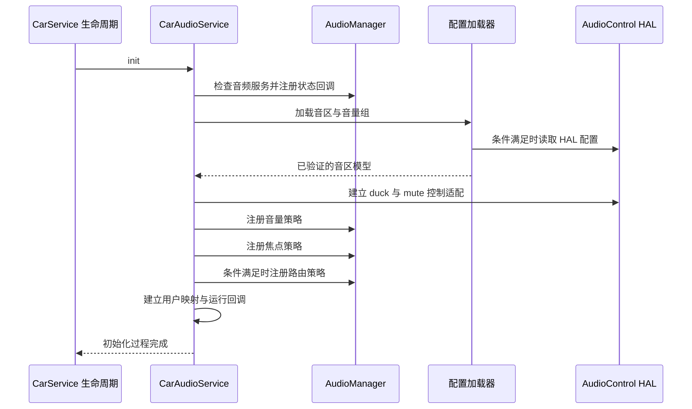

修改 `car_audio_configuration.xml` 后，音区没有变化；打开某个资源开关后，功能仍然不可用；开机时第一次获取车载音频服务偶尔失败。这些现象看似无关，却都涉及同一个问题：配置如何变成已经注册、可以执行的运行状态。

CarAudioService 启动并非简单读取 XML。它要确认音频服务状态，选择配置来源，建立逻辑模型，注册控制与路由策略，再连接用户、硬件和设备变化。阅读这条链路，可以判断一个问题发生在配置输入、模型验证、策略注册还是生命周期阶段，而不是只根据最终异常修改配置。

## 构造阶段只形成初始条件

构造函数接收配置文件路径和服务依赖，并读取 `audioUseDynamicRouting`、`audioUseCoreVolume`、`audioUseCoreRouting` 等资源。资源值会经过产品 overlay，源码基础值不等于设备最终值。这里还创建用户映射、设置存储和回调等对象，为后续初始化准备条件，见 [CarAudioService 构造过程](https://android.googlesource.com/platform/packages/services/Car/+/9f04df65daa8b9a65ee05fd4039fe95446874d76/service/src/com/android/car/audio/CarAudioService.java#454)。

这一步尚未完成设备路由注册。即使日志表明服务对象已经创建，也不能据此认为音区可查询、音量组可操作。对系统界面而言，连接到 CarService 与音频子服务完成初始化是不同事件；若忽略这个区别，首次进入音量页面时容易把“暂未就绪”当成“产品没有音区”。

运行模式尤其需要按实际条件理解。当前 `runInLegacyMode()` 返回的是“动态路由和核心路由都没有启用”，而不是只检查一个动态路由开关。因此，关闭动态路由并不自动等于 legacy：核心路由打开时仍走非 legacy 初始化。这一条件直接写在 [runInLegacyMode](https://android.googlesource.com/platform/packages/services/Car/+/9f04df65daa8b9a65ee05fd4039fe95446874d76/service/src/com/android/car/audio/CarAudioService.java#4363) 中。

legacy 为早期适配等场景保留较简化的音量处理。非 legacy 路径则建立完整音区和策略对象。设计产品 overlay 时，应把运行模式与各功能的前置条件一起检查，避免一边让服务进入 legacy，一边要求只在非 legacy 下工作的车载静音、焦点执行或空间平衡持久化。

## 同步与异步初始化

`init()` 根据 `asyncAudioServiceInit` 选择直接执行或投递到 handler。异步分支会在 finally 中标记初始化过程已经结束，并唤醒等待者；`waitForInitComplete()` 最终同时考虑完成标记与成功标记。这里“结束”与“成功”刻意分开：异常结束不应伪装成正常服务，见 [init 与等待逻辑](https://android.googlesource.com/platform/packages/services/Car/+/9f04df65daa8b9a65ee05fd4039fe95446874d76/service/src/com/android/car/audio/CarAudioService.java#543)。

调用方不应通过固定延时猜测服务准备状态。慢启动设备、日志负载和 HAL 服务恢复都会改变完成时间，睡眠一段时间只能把竞态变得不容易复现。系统应使用对应的服务就绪机制，并在界面上保留未就绪状态，而不是把初始化失败转成一个看似正常的空音区列表。

初始化入口还先检查 audioserver 是否运行，并注册 AudioServerStateCallback。如果音频服务尚不可用，会记录状态并等待回调触发后续处理，而不是继续使用无效设备快照。这体现了车载服务与原生音频进程之间的依赖关系。对开机偶发问题，应把两者的启动时间线放在一起看，见 [initCarAudioService](https://android.googlesource.com/platform/packages/services/Car/+/9f04df65daa8b9a65ee05fd4039fe95446874d76/service/src/com/android/car/audio/CarAudioService.java#599)。

下面的时序省略了次要回调，但保留模型构建与策略注册的依赖顺序。它描述的是 audioserver 已运行、非 legacy 的正常分支；其他分支不能硬套同一条时间线。

<div style="overflow-x:auto;margin:1.5rem 0;">



</div>

## HAL 配置与 XML 配置的选择

当前加载入口先调用 `loadAudioZonesUsingAudioControlLocked()`。只有 `audioControlHalConfiguration` 打开，且 AudioControlWrapper 声明支持音频配置能力，才会真正进入该路径。接口版本检查要求 AudioControl AIDL 高于版本四，也就是具备相应版本五接口能力；这不代表只要 HAL 版本足够，产品就一定选择 HAL 配置。

HAL 返回空配置、能力不满足或加载失败时，入口可能回退到配置文件。调用链随后对音区执行统一验证并初始化设备增益。这里应关注的是实际成功采用了哪个来源，而不是某个配置文件是否恰好存在。选择过程见 [loadAndInitCarAudioZonesLocked](https://android.googlesource.com/platform/packages/services/Car/+/9f04df65daa8b9a65ee05fd4039fe95446874d76/service/src/com/android/car/audio/CarAudioService.java#2152)，能力判断见 [AudioControlWrapper](https://android.googlesource.com/platform/packages/services/Car/+/9f04df65daa8b9a65ee05fd4039fe95446874d76/service/src/com/android/car/audio/AudioControlWrapper.java#173)。

XML 路径搜索先考虑 vendor，再考虑 system。两个位置存在同名文件时，并不是把它们合并；查找会选择首先命中的路径。排查“改了文件却没生效”时，应核对服务 dump 中的配置路径和设备上的实际文件，而不能仅确认构建树里某个文件已修改。路径定义见 [AUDIO_CONFIGURATION_PATHS](https://android.googlesource.com/platform/packages/services/Car/+/9f04df65daa8b9a65ee05fd4039fe95446874d76/service/src/com/android/car/audio/CarAudioService.java#193)。

HAL 配置与 XML 配置共同服务于同一套 Car 模型，但来源不同会影响维护方式。前者将部分配置契约放在硬件接口边界，后者更直观地以产品文件表达。无论使用哪一条，底层 Audio HAL 报告的设备、地址和能力仍需与模型一致。仅替换配置来源不能修复一个不存在的输出端口。

## 解析顺序与配置版本

解析器验证根节点和版本，再处理设备配置、自定义 context、镜像设备、激活音量配置和音区。当前支持的 XML 版本为一至四。版本号属于配置格式，不是 Android 版本号；同一 Android 基线可以兼容多个旧格式，但新字段未必能在旧格式中使用，见 [parseCarAudioZones](https://android.googlesource.com/platform/packages/services/Car/+/9f04df65daa8b9a65ee05fd4039fe95446874d76/service/src/com/android/car/audio/CarAudioZonesHelperImpl.java#293)。

顺序也有语义。解析器遇到 zones 后加载 context 并进入音区解析，因此需要先定义的全局配置应放在 zones 前。将某段配置从文件顶部移动到末尾，可能并非纯粹格式调整。配置评审应结合解析流程和已有测试样例，而不是只依据 XML 语法是否能够被通用编辑器打开。

可以用下面的示意结构理解依赖，但它不是可直接刷入产品的完整配置：具体设备、context、组名和字段应来自目标产品及对应 schema。

```xml
<!-- 结构示意，省略了必需的产品内容 -->
<carAudioConfiguration version="4">
    <deviceConfigurations>
        <!-- 需要先确定的设备级策略选项 -->
    </deviceConfigurations>
    <zones>
        <!-- 音区、配置、音量组和设备映射 -->
    </zones>
</carAudioConfiguration>
```

全局设置与局部映射应分开审查。前者决定使用哪套路由、音量和硬件通知机制；后者决定一个具体用途属于哪个组、最终关联哪些设备。若同时修改二者，出现故障时很难区分是模式切换问题还是映射问题。实践中可以先保持运行模式稳定，确认完整设备表，再逐步引入新增能力。

## 资源开关不一定是最终值

部分设置存在明确覆盖关系。XML helper 获取的 core routing、core volume、volume group muting 等值可以覆盖构造时从资源传入的默认值；未在文件中声明时才保留原值。服务加载成功后通过 `updateConfigValueFromZoneHelperLocked()` 更新运行字段。资源、配置文件和最终 dump 之间因此可能出现不同数值，这不必然是代码缺陷。

解析器对布尔值也没有简单把任意非 true 字符串都当成 false。它检查 true/false 的合法性，错误字符串会记录日志并保留缺省分支。这个细节有助于识别拼写错误：功能没有按预期启用时，应查看解析日志，而不是假设每个未知值都必然导致启动异常。相关行为见 [设备配置解析与默认值](https://android.googlesource.com/platform/packages/services/Car/+/9f04df65daa8b9a65ee05fd4039fe95446874d76/service/src/com/android/car/audio/CarAudioZonesHelperImpl.java#479)。

另一些功能还叠加 aconfig flag。以 fade 配置为例，需要平台 flag、car flag 和资源开关共同满足。由此不能建立一个“只看 overlay 就能知道全部功能”的检查方法。对于产品验收，更可靠的记录是：源码能力、发布配置中的 flag、资源或文件值、HAL 支持和最终运行状态分别是什么。

## 为什么先建立模型再注册策略

路由策略需要枚举已验证的音区、组和设备；焦点策略需要知道 context 以及音区边界；音量策略需要可操作的组。因此服务先加载模型，再依次建立 volume、focus、routing 策略，最后连接 occupant 信息和 core volume 回调，见 [策略建立顺序](https://android.googlesource.com/platform/packages/services/Car/+/9f04df65daa8b9a65ee05fd4039fe95446874d76/service/src/com/android/car/audio/CarAudioService.java#2232)。

这不是说某个策略一定比另一个策略“更重要”，而是对象之间存在依赖。若在模型未完成时允许用户切换或音量键修改，调用就可能引用尚不存在的组。注册异常也必须被当成初始化失败处理，不能只保留内存中的模型并继续让上层认为路由有效。

配置验证是这种保护的前半段。它可以发现重复、缺失或关系不合法的问题；策略注册是后半段，它让通用音频系统接受这些规则。二者都通过，才说明配置有机会实际执行。即便如此，还应通过播放验证设备选择和音量控制，因为硬件连接和厂商实现的行为不在 XML 解析器能够完整验证的范围内。

## 把启动失败分成可复现的类别

| 阶段 | 常见表现 | 优先核对 |
| --- | --- | --- |
| 服务依赖 | 首次连接失败，音频服务随后才起来 | audioserver 状态和初始化时间线 |
| 来源选择 | 修改 XML 没影响 | HAL 配置是否生效、实际文件路径 |
| 语法与版本 | 初始化明确抛出解析异常 | 根节点、版本、字段及定义顺序 |
| 模型约束 | 某音区或设备校验失败 | 地址、组、context、默认配置关系 |
| 策略注册 | 模型存在但策略注册失败 | Android AudioPolicy 注册结果 |
| 运行验证 | 无异常但声音走错位置 | 用户 affinity、当前配置和实际输出 |

集成报告应保留第一处失败的完整异常链与前后配置日志。只截取最后的“服务不可用”会掩盖真正原因。例如，源头可能是一个无法匹配的策略名称，随后引发服务初始化未成功，最终才表现为音量界面查询失败。修复最外层界面的空指针处理可以改善体验，却不会让底层配置自动变正确。

## 配置变更需要可追踪的版本边界

一份配置并非脱离代码独立运行。解析器支持哪些版本、哪些功能受 flag 控制、哪些字段会覆盖资源，都随产品基线变化。发布配置时，应同时记录 Car 服务版本、通用音频版本、HAL 接口能力和配置格式版本。这样回溯问题时才能知道某字段是未被支持、未被启用，还是已生效但结果不符。

实际维护可以为每次配置变更附上一张差异表：新增或删除了哪些设备，哪些用途换了组，哪些组改了音量范围，哪些音区改变默认配置。它比仅提交整份格式化 XML 更容易审查。如果变更同时包含无关缩进调整，关键映射差异容易被掩盖，也不利于后续针对单项功能回退。

跨分区配置还应考虑更新组合。vendor 文件与系统框架可能不在同一次开发迭代中更新；某项新能力若依赖新解析器或新 HAL 接口，旧组合必须有明确行为。这里不应只追求“新镜像启动成功”，还要定义不匹配组合是被拒绝、回退到旧机制，还是由发布流程禁止产生。

启动日志应记录决定性的输入，而不是只打印成功结果。实际来源是 HAL 还是 XML、采用哪个路径、最终路由与音量模式是什么，都能解释后续状态。对于复杂 overlay，最好把最终解析值与原始配置一起纳入问题单，避免另一个团队根据源码默认值推导出与实机不同的分支。

也要区分加载失败与设备晚到。某个固定 bus 在底层配置中缺失，通常应修正产品描述；一个动态设备开机时未连接，则可能是合法状态，应由默认配置和设备回调处理。把两者都处理成“等一会再试”，会延迟发现静态配置错误；把两者都视为致命错误，又会破坏动态设备场景。

测试环境应能复现初始化顺序变化。可以在受控环境中分别观察音频服务先就绪与车载服务先启动时的行为，也可以在乘员关系已建立后重新初始化音频。目标是检查服务能否读取现有状态，而不是只响应未来通知。许多恢复缺陷来自假定某个通知一定在订阅之后到达。

对失败处理，最有价值的验收结果是系统进入清楚、可诊断的状态。例如初始化失败后，上层显示音频服务未就绪，并保留原始原因；策略注册失败后，不继续宣称设备已配置。与隐藏错误并使用偶然默认路线相比，明确失败能更早暴露集成不一致，也避免错误状态进入后续用户操作。

配置上线前还应保存一组稳定基线输出，包括已验证的音区模型、核心策略列表和代表播放的设备选择。后续版本出现变化时，可以先比较模型，再比较运行行为。这样问题定位不依赖某位工程师记忆中的“以前好像是这条 bus”，而有可重复的状态证据。

## 建立一个最小配置验证闭环

首次适配可以先使用一个主音区、少量明确存在的输出设备和基础媒体用途，验证启动、查询、播放和音量控制。此时应记录实际运行模式、音区数量、当前配置和可用设备地址。建立稳定基线后，再添加后排音区、动态设备或自定义 context，每次变化都对应一个清楚的验收场景。

验证时最好同时保留逻辑与物理证据。逻辑侧确认 Car dump 中模型与预期一致，AudioPolicy 中出现相应规则；播放侧确认轨道选择了目标输出；物理侧确认目标扬声器出声、其他区域不串音。若只有“能听见声音”，很可能是默认路由掩盖了错误映射，直到增加第二音区才暴露问题。

还需要有意测试错误配置，而不是只测试正确配置。把一个设备地址改为不存在的值，确认系统在预期阶段报告清晰错误；使用不支持的版本，确认不会静默接受；撤销一个必需定义，确认失败位置容易追踪。CarService 单元测试中的配置正反例可以作为设计依据，而不是在整车上随机尝试格式。

最后，启动验证必须包含恢复路径。音频服务重启、用户切换和动态设备重新连接后，服务需要重新获得有效状态。开机正常只覆盖生命周期中的一个时刻。[电源与恢复]()会进一步说明如何检查策略、用户映射和硬件状态在这些事件后重新一致；这也是让配置从一次性成功变成可长期运行系统的必要步骤。

<!-- series-navigation -->
## 系列导航

[系列目录]()

[上一篇：总体架构与设计目标]()

[下一篇：应用如何接入车载音频]()
