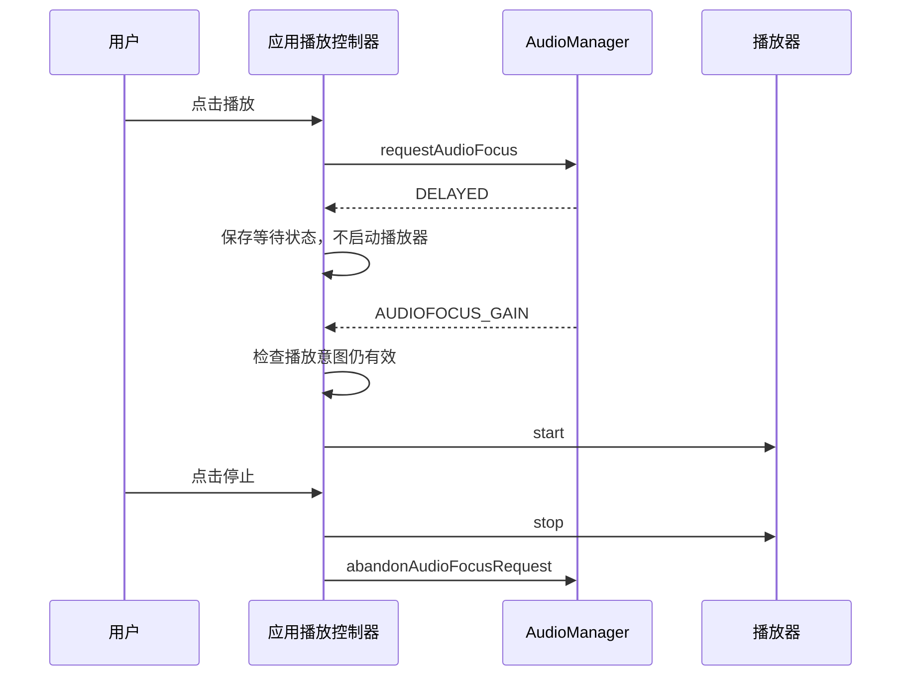

音乐应用在手机上表现正常，移到车机后却出现导航不压低音乐、切换媒体源后仍有声音、通话结束后错误自动播放等问题。原因常常不是车载音频栈缺少某个特殊播放接口，而是应用没有把用途、焦点请求和播放器状态作为同一份播放意图管理。

普通应用参与 AAOS 音频的主要契约仍是 Android 的 AudioAttributes 与 AudioFocusRequest。CarAudioService 根据这些输入实施车载策略。应用应正确描述自己正在做什么，并按请求结果和回调更新播放；座舱系统组件则另外负责音区、音量组和设备配置。两类职责混在一起，会让应用在某一款车上勉强工作，却难以适配不同座舱布局。

## 播放属性与焦点属性必须一致

一次音乐播放至少涉及两处属性：焦点请求携带的属性，以及实际播放器或 AudioTrack 使用的属性。若焦点按导航申请，轨道却按媒体播放，系统在仲裁时看到的是导航，在路由和播放监控时看到的却是媒体。后续的 duck、音量组选取和执行约束就可能面对互相矛盾的输入。

AudioFocusRequest 的接口说明明确要求使用与播放一致的属性，见 [setAudioAttributes](https://android.googlesource.com/platform/frameworks/base/+/94b4c163b7dfe5ce3607f7bb8456f9573f7de57d/media/java/android/media/AudioFocusRequest.java#482)。最稳妥的实现是在创建播放会话时形成一份不可变属性，并将同一份语义用于焦点和播放器。这里强调的是语义一致，不要求所有组件必须共享同一个 Java 对象引用。

usage 回答声音用途，content type 回答内容性质。播客通常仍属于媒体用途，但内容是 speech；导航播报应使用导航用途，而不是因为内容是语音就把 usage 改成通信。把二者分开，可使路由、仲裁和内容相关处理分别获得正确输入。也不要为抢占其他声音而滥用高优先级用途，这会破坏整车策略中对音量、区域和关键提示的假设。

下面是普通音乐播放的 API 结构示意。播放器由应用持有，`focusListener` 和 `handler` 需要在同一套播放控制状态中实现；示例仅展示请求配置，不替代完整生命周期代码。

```java
AudioAttributes attributes = new AudioAttributes.Builder()
        .setUsage(AudioAttributes.USAGE_MEDIA)
        .setContentType(AudioAttributes.CONTENT_TYPE_MUSIC)
        .build();
AudioFocusRequest focusRequest = new AudioFocusRequest.Builder(
        AudioManager.AUDIOFOCUS_GAIN)
        .setAudioAttributes(attributes)
        .setAcceptsDelayedFocusGain(true)
        .setOnAudioFocusChangeListener(focusListener, handler)
        .build();
player.setAudioAttributes(attributes);
int result = audioManager.requestAudioFocus(focusRequest);
```

## 请求结果决定是否可以开始播放

`requestAudioFocus` 有 GRANTED、DELAYED 和 FAILED 三种结果。GRANTED 允许应用继续当前播放意图；DELAYED 表示系统接受等待，但此时尚未获得播放资格；FAILED 表示这次请求没有成功。没有声明接受延迟焦点时，接口不会返回 DELAYED，见 [AudioManager 请求契约](https://android.googlesource.com/platform/frameworks/base/+/94b4c163b7dfe5ce3607f7bb8456f9573f7de57d/media/java/android/media/AudioManager.java#4900)。

把所有非 FAILED 结果都当作成功，是车载应用中很隐蔽的错误。电话或其他受保护请求存在时，音乐可能被延迟；如果应用立即启动播放器，就在焦点真正获批前输出了音频。即便产品没有立刻静音这份播放，行为仍然违反契约，切换到启用焦点执行约束的设备后就可能暴露问题。

等待期间还要保存用户意图。用户按下播放，系统返回 DELAYED，随后用户又按暂停，这时原先的等待意图已被取消。即便稍后收到 GAIN，也不能直接开始播放。可靠的状态判断是“获得焦点，并且当前用户仍希望播放”，而不是“收到任何 GAIN 就调用 start”。

下面的时序强调这个检查点。焦点回调和用户操作可能来自不同事件源，应用应将它们串行到同一控制线程或以等效方式保护状态。

<div style="overflow-x:auto;margin:1.5rem 0;">



</div>

## 丢失焦点是状态转换而非单一暂停命令

永久 LOSS、临时 LOSS 和 CAN_DUCK 应对应不同的恢复策略。永久丢失意味着应用不能依赖一次自动恢复回调继续播放；临时丢失可保留“此前正在播放”的信息，在重新获得焦点后根据用户意图恢复；允许 duck 的临时丢失则可能由应用暂停，也可能配合系统降低音量。应用必须理解自己所声明的行为。

不要只维护一个 `isPlaying` 布尔值。它无法区分用户主动暂停、因临时失焦暂停、因缓冲未播放和等待焦点几种情况。至少应在控制逻辑中保存当前播放意图、是否持有焦点、是否等待焦点、是否允许失焦后恢复。具体实现可以是状态机，也可以是受统一线程管理的一组字段，重点是每种恢复都有可解释的前置条件。

| 事件 | 播放动作 | 后续恢复条件 |
| --- | --- | --- |
| 请求获批 | 按当前播放意图启动 | 不需要额外等待 |
| 请求延迟 | 保持不播放 | 获得焦点且意图仍有效 |
| 请求失败 | 保持不播放并更新界面 | 新的有效请求成功 |
| 临时失焦 | 暂停或执行规定动作 | GAIN 且用户未取消 |
| 永久失焦 | 停止本次自动恢复链 | 用户重新触发播放 |
| 用户主动暂停 | 停止自动恢复意图 | 用户再次主动播放 |

状态还应绑定一次播放会话，而不是整个进程。应用中旧播放器被释放、新播放器已创建时，旧会话的异步回调不应重新启动新会话。可以在控制层使用会话代次或等效标识，丢弃已经失效的回调。这个设计与车载特性无关，但多源切换频繁的座舱更容易放大此类竞态。

## 车载 ducking 不能只靠回调次数判断

AAOS 的外部焦点策略可以允许两个请求并发，并通过硬件控制降低某些输出设备的音量。在这样的分支中，原焦点持有者不一定收到 CAN_DUCK 回调。应用因此不能把“没有失焦通知”解释为“系统没有降低声音”，也不应在每次导航出现时自行猜测并降低媒体音量。

如果内容不适合被压低，例如需要完整听清的有声书，可以通过 `setWillPauseWhenDucked(true)` 声明希望暂停。Car 的交互评估会考虑现有持有者的这一要求，即使默认矩阵允许并发，也可能把持有者加入失焦集合，见 [FocusInteraction 的并发分支](https://android.googlesource.com/platform/packages/services/Car/+/9f04df65daa8b9a65ee05fd4039fe95446874d76/service/src/com/android/car/audio/FocusInteraction.java#422)。声明应与应用实际行为一致，不能设置后仍继续全音量播放。

系统 fade、硬件 duck 和应用自身渐变也要分别管理。一次焦点抢占并不保证新应用自动淡入；若播放器库已经做了渐变，应用再叠加一套相同动画可能拉长过渡或造成错误恢复。需要听感优化时，应先识别产品已启用的机制，再设计应用侧行为，具体见[降低音量与渐变]()。

## 正确释放焦点与监听器

当本次播放意图结束，应用应使用对应的 AudioFocusRequest 调用 abandon，而不是只停止写音频数据。焦点管理器并不通过“听不到声音”自动推断业务结束；没有释放的请求可能继续影响其他应用的仲裁。反过来，短暂缓冲通常不等于播放会话结束，频繁 abandon 和重新 request 会制造无意义抢占。

接口要求 abandon 使用先前的请求对象，见 [abandonAudioFocusRequest](https://android.googlesource.com/platform/frameworks/base/+/94b4c163b7dfe5ce3607f7bb8456f9573f7de57d/media/java/android/media/AudioManager.java#4929)。持有请求和监听器的生命周期应与播放控制器一致。匿名创建大量不同 listener，会让应用难以知道哪个请求仍然有效，也给重复请求和错误释放制造条件。

发生资源错误时同样需要收尾。解码失败、媒体不可访问或用户退出后，如果应用已经决定不再继续本次播放，应取消等待、停止播放器并释放焦点。清理动作宜具备重复调用的安全性，避免用户停止和播放器错误同时到达时留下部分状态。恢复也必须重新经过有效的播放意图，而不是由错误处理路径隐式开启。

## 前后台条件与权限边界

焦点申请可能在到达车载交互矩阵之前就被拒绝。当前 AudioManager 契约对面向较新 API 的应用说明了前台或前台服务要求。排查 FAILED 时，除了用途竞争，还需要检查应用当前运行资格和平台拒绝原因，不能直接归咎于 CarAudioFocus。相关条件与适用 target SDK 写在 [requestAudioFocus 说明](https://android.googlesource.com/platform/frameworks/base/+/94b4c163b7dfe5ce3607f7bb8456f9573f7de57d/media/java/android/media/AudioManager.java#4905)。

实际请求入口还经过 HardeningEnforcer。当前实现结合 AppOps、target SDK、特权身份、功能 flag 和 override 判断是否阻止请求，因此接口文档中的常规资格说明不能代替具体构建的拒绝链分析。该入口属于请求准入，与 CarAudioFocusEnforcement 对已发生播放实施 silence 的职责不同，见 [blockFocusMethod](https://android.googlesource.com/platform/frameworks/base/+/94b4c163b7dfe5ce3607f7bb8456f9573f7de57d/services/core/java/com/android/server/audio/HardeningEnforcer.java#405)。

车载系统控制接口则有另一套权限。设置音量组需要 `CAR_CONTROL_AUDIO_VOLUME`，查询或修改 UID 的音区关联需要相应 audio settings 权限；这些不是普通播放必需能力。接口注解分别见 [setGroupVolume](https://android.googlesource.com/platform/packages/services/Car/+/9f04df65daa8b9a65ee05fd4039fe95446874d76/car-lib/src/android/car/media/CarAudioManager.java#542)与 [setZoneIdForUid](https://android.googlesource.com/platform/packages/services/Car/+/9f04df65daa8b9a65ee05fd4039fe95446874d76/car-lib/src/android/car/media/CarAudioManager.java#1284)。

对于座舱设置应用，应先查询功能是否启用，再决定展示哪些操作。镜像、组静音或激活音量等功能可能因产品配置不同而不可用。界面不应仅因为编译时存在 API 就展示必然成功的按钮。功能查询入口为 [isAudioFeatureEnabled](https://android.googlesource.com/platform/packages/services/Car/+/9f04df65daa8b9a65ee05fd4039fe95446874d76/car-lib/src/android/car/media/CarAudioManager.java#510)，服务连接失效也应导致界面刷新能力状态。

## 应用团队与平台团队如何对齐

接入评审可以围绕一份声音清单进行。每个声音明确使用场景、usage、content type、焦点类型、失焦动作、恢复条件以及播放所属用户。平台团队据此检查 context、音区、音量组和交互规则，应用团队据此实现状态控制。与只交换“音频优先级高低”相比，这份清单更接近系统实际接受的输入。

例如，导航团队若要求“播报期间音乐继续，但要降低音量”，应明确请求是否为短暂可 duck，以及音乐内容是否允许 duck；如果音乐声明要暂停，就不能仍把“音乐暂停”判为平台 bug。再例如，后排视频应主要通过正确用户和音区归属实现空间隔离，而不是伪造另一种 usage 来绕开主区媒体规则。

同一应用也可能包含多个声音角色。媒体播放、语音对话和界面提示不能因为属于一个包就全部沿用媒体属性。应按真正的声音用途选择属性，并明确多个播放器之间的关系。与此同时，不要为每个短提示创建无节制的焦点会话；是否需要独立申请，应结合该声音的用途、平台策略和业务持续时间制定一致规则。

## 控制线程与迟到事件如何处理

音频焦点回调、播放器状态和用户操作通常不是同一个来源。最容易出现的竞态是用户停止与 GAIN 几乎同时到达：如果两个回调各自直接控制播放器，最终状态取决于线程调度。把事件集中到一个播放控制器，让它按当前意图决定动作，比在每个回调里单独增加条件更容易验证。

可以为每次用户发起的播放意图生成一份内部会话标识。异步准备完成、焦点获批和错误通知都关联这份标识；控制器只接受当前会话的事件。用户切换媒体或取消播放时更新会话，旧事件即使随后到达，也只能用于清理旧资源，不能重新激活已经过期的播放。它是应用侧的状态设计，不需要平台增加特殊焦点类型。

音量恢复也应考虑来源。若应用因为 CAN_DUCK 自行降低了播放器音量，恢复时只能撤销自己施加的变化，不能把用户刚刚调低的音量覆盖成固定最大值。一个简单做法是分别管理用户目标音量和临时策略系数，再由统一位置合成播放器音量；具体是否采用这种设计，要与播放器库已有行为协调。

准备和播放同样应该分开。等待焦点时可以根据业务进行媒体准备，但真正开始输出应受焦点与播放意图约束。这样既避免把准备阶段错误当成焦点错误，也防止异步 prepare 完成后无条件启动。测试需要覆盖“准备先完成”和“焦点先获批”两种时序，确保最终动作取决于条件齐备，而非某个回调固定先到。

应用日志不应只写一条“暂停”。应区分用户暂停、临时失焦暂停、永久失焦停止、资源错误和设备策略触发。系统集成时，平台可以看到焦点结果，却未必知道应用内部为什么没有恢复；明确动作原因能够把排查范围缩到状态转换，而不必靠反复复现猜测业务意图。

还要处理界面与后台播放服务之间的一致性。页面销毁不一定表示用户希望结束音乐，后台服务停止也不能只更新页面图标而留下请求。焦点请求应由真正拥有播放生命周期的组件管理，界面通过该组件发送意图并订阅状态。这样用户离开页面、重新进入或切换显示后，仍能看到实际会话状态。

播放器库若已经管理焦点，应用不能同时在另一层独立申请同一份播放的焦点。两套管理者可能各自 abandon、各自恢复音量，产生看似平台随机的抢占。接入前应明确焦点所有者：要么由库负责并遵循其接口，要么由应用统一负责并按库要求关闭重复管理，不能只在出现冲突后临时屏蔽某个回调。

最后，任何自动恢复都应能解释为一个仍然有效的用户意图。车载环境中，屏幕切换、用户退出和媒体源替换比单屏设备更频繁，旧意图失效的机会也更多。把这一原则放在控制器中心，可以同时减少失焦恢复、延迟获批和异步准备造成的意外播放。

## 可重复的接入验证

应用验证至少覆盖两类音乐应用互抢、导航插播、临时打断、请求延迟后取消、用户主动暂停后收到恢复，以及播放器错误后的焦点释放。每个场景都记录请求结果、焦点回调、用户意图和播放器实际状态。这四类日志采用同一时间基准，才能区分策略决定与应用响应延迟。

测试不能只看最终是否出声。先检查应用是否在 GRANTED 前启动，是否在永久 LOSS 后仍自动恢复，是否在用户取消后响应迟到 GAIN。然后再观察声音过渡和路由。这样能够把应用契约缺陷与系统音频处理缺陷分开，避免为错误的应用状态机调整整车策略。

还应在不同产品能力组合上测试：启用与未启用系统 fade，采用 HAL duck 与要求应用暂停，以及有无后排用户。测试目标不是要求听感完全一致，而是确认应用在这些合法策略结果下始终遵守声明。一个可靠的播放控制器能够适应策略差异，不会把某款设备偶然采用的回调顺序当成跨产品保证。

<!-- series-navigation -->
## 系列导航

[系列目录]()

[上一篇：启动流程与配置体系]()

[下一篇：声音的语义模型]()
