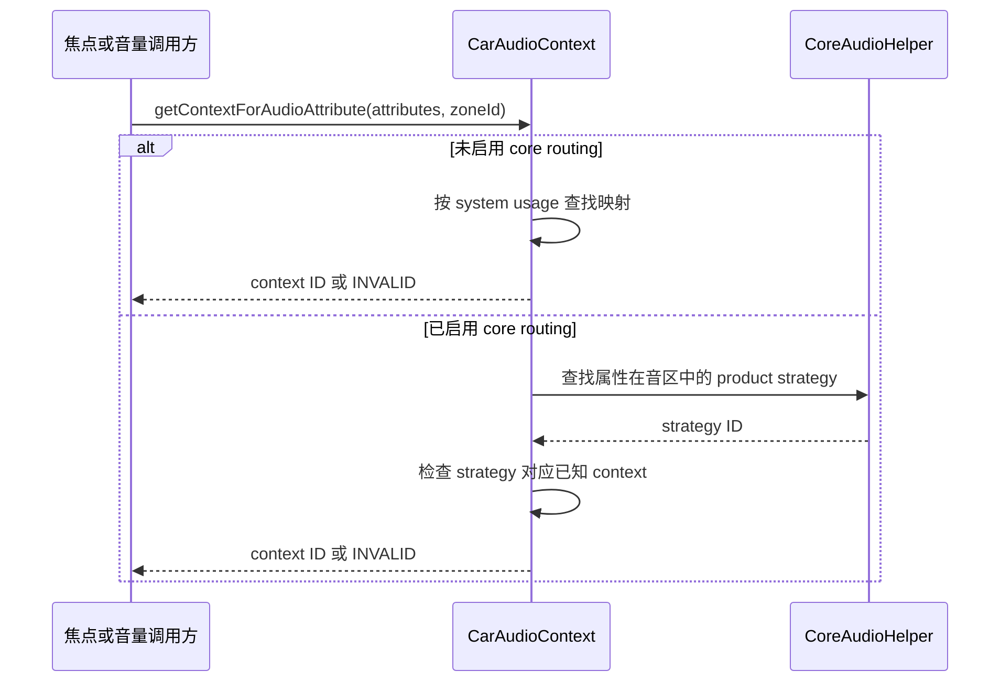

一个“请向右转”的提示同时具有几种特征：它用于导航，内容是语音，可能只需要短暂播放，通常要在驾驶员所在区域可听见。系统不会仅凭音频采样内容推断这些特征。应用提供属性，车载层把属性转换成上下文，再由配置和策略决定焦点、音量与输出。

AudioAttributes 与 CarAudioContext 是这条转换链的两层语义。前者是 Android 音频请求的描述，后者是车载管理模型中的归类。context 既不是播放器，也不是扬声器；修改 context 映射会影响策略理解，但不会凭空创建物理音频通路。把这些边界讲清楚，才能设计可维护的声音分类。

## usage 和 content type 分别表达什么

usage 描述声音为何被播放，例如媒体、导航、通信或提示。content type 描述内容性质，例如音乐、语音或提示音。两者相互补充，而不是彼此替代。同为 speech 的有声书和导航播报，应根据用途选择不同 usage；同为媒体用途的音乐和播客，则可以具有不同 content type。

这种区别影响多个机制。用途通常进入路由和车载上下文选择；内容类型还可能进入渐变等处理条件。系统能否对某类播放器实施 fade，不只取决于它是否叫“音乐应用”。如果应用用错误属性描述内容，平台策略再精细也只能对错误输入作决定。因此，声音分类应由应用与平台共同确认，不能全部留给播放器库默认值。

AudioAttributes 还包含 flags、tags 等信息，但不能假定所有消费方都比较全部字段。某些路径只看 usage，另一些路径依赖更丰富的策略匹配。调试时，应问“当前这一层如何比较属性”，而不是看到属性对象中存在一个 tag，就认为它必然改变 Car 动态路由或默认焦点交互。

## 默认 CarAudioContext 是用途集合

默认 MUSIC context 包括 UNKNOWN、GAME 和 MEDIA。NAVIGATION 包括导航引导用途，VOICE_COMMAND 包括 assistant 与 accessibility 等用途。这说明 context 是一组属性的管理分类，不是 usage 的另一种拼写；多个不同 usage 可以落到同一 context。默认定义从 [MUSIC 与 NAVIGATION](https://android.googlesource.com/platform/packages/services/Car/+/9f04df65daa8b9a65ee05fd4039fe95446874d76/service/src/com/android/car/audio/CarAudioContext.java#199)开始。

CALL_RING 与 CALL 被分开，通知、闹钟和系统提示也分别归类。车载还定义 EMERGENCY、SAFETY、VEHICLE_STATUS、ANNOUNCEMENT 等 context，以表达整车需要区分的声音。完整默认映射见 [CarAudioContext 的属性集合](https://android.googlesource.com/platform/packages/services/Car/+/9f04df65daa8b9a65ee05fd4039fe95446874d76/service/src/com/android/car/audio/CarAudioContext.java#212)。这些名称描述逻辑用途，不直接等同于法规定义、功能安全等级或具体硬件通道。

| 声音场景 | 属性用途示例 | 默认车载归类示例 |
| --- | --- | --- |
| 音乐与视频声音 | MEDIA | MUSIC |
| 游戏声音 | GAME | MUSIC |
| 导航引导 | ASSISTANCE_NAVIGATION_GUIDANCE | NAVIGATION |
| 语音助手 | ASSISTANT | VOICE_COMMAND |
| 通话铃声 | NOTIFICATION_RINGTONE | CALL_RING |
| 通信声音 | VOICE_COMMUNICATION | CALL |
| 车辆状态提示 | VEHICLE_STATUS | VEHICLE_STATUS |

这张表适用于默认分类视角。产品使用自定义 context 或核心路由时，需要按照实际模型重新核对。应用仍应声明正确用途，而不是绑定某个产品恰好分配的整数 context ID。数值 ID 主要用于服务内部关联，跨配置持久保存时必须明确版本与含义。

## 非核心路由如何匹配属性

非 core routing 分支使用 AudioAttributesWrapper 作为映射键。其默认比较只检查 `getSystemUsage()`，hashCode 也使用相同语义，见 [AudioAttributesWrapper](https://android.googlesource.com/platform/packages/services/Car/+/9f04df65daa8b9a65ee05fd4039fe95446874d76/service/src/com/android/car/audio/CarAudioContext.java#898)。因此，同样使用 MEDIA 的两个属性对象，即使 content type 或 tag 不同，在这一套 context 查找中仍可能被视为相同用途。

这条实现事实有很实际的后果。若产品想把媒体应用中的两种内容分到不同设备，单纯给其中一份 MEDIA 属性加一个自定义 tag，不足以证明传统 Car 动态路由能够区分它们。必须进一步查看具体路由规则是否消费该字段；当前 CarAudioDynamicRouting 构建的普通规则使用 usage 匹配，相关实现见 [动态规则构建](https://android.googlesource.com/platform/packages/services/Car/+/9f04df65daa8b9a65ee05fd4039fe95446874d76/service/src/com/android/car/audio/CarAudioDynamicRouting.java#127)。

反过来，不同对象匹配到相同 context，并不意味着它们的一切行为都一样。后续 fade 配置或其他执行模块仍可能读取 content type 或完整属性。系统采用分层判断，不能把某一层的相等关系推广到全部音频栈。故障日志中最好保留完整属性，同时明确本次分析使用了哪个字段。

下面描述一次属性查询。第一条分支采用本地用途映射；第二条分支通过核心策略解析，再确认结果属于已知车载 context。图中“查询策略”是对 helper 调用的概括。

## 核心路由改变了上下文来源

启用 core routing 时，CarAudioContext 调用 `CoreAudioHelper.getStrategyForAudioAttributes(attributes, zoneId)`。只有返回有效 strategy，而且该 ID 在 context 名称表中存在，才返回对应 context；否则为 INVALID，见 [getContextForAudioAttribute](https://android.googlesource.com/platform/packages/services/Car/+/9f04df65daa8b9a65ee05fd4039fe95446874d76/service/src/com/android/car/audio/CarAudioContext.java#587)。这使 Android 核心策略与车载上下文之间形成显式关联。

自定义 context 的解析也与此配套：core routing 模式会按 context 名称查找 product strategy，把 strategy ID 作为 context ID，并验证非默认 strategy 支持所声明的属性；默认 strategy 有兜底例外，不受这项支持性检查约束。若找不到策略，解析直接报错；并不是给一个任意自定义名称就能建立可运行的车载用途，见 [自定义 context 解析](https://android.googlesource.com/platform/packages/services/Car/+/9f04df65daa8b9a65ee05fd4039fe95446874d76/service/src/com/android/car/audio/CarAudioZonesHelperImpl.java#394)。

这类关联有利于统一核心路由、音量与车载模型，但也增加了跨配置一致性要求。产品策略中的名称、属性规则与 Car 配置中的 context 需要共同维护。只改一侧会导致启动失败或不符合预期的匹配，不能把它当作普通 UI 文案重命名。具体集成方式在[核心音频路由与音量]()讨论。

## 自定义 context 不自动改写全部策略

XML helper 在格式较旧或没有自定义 context 时加载默认定义；使用自定义定义时，则建立相应名称到 ID 的映射，见 [loadCarAudioContexts](https://android.googlesource.com/platform/packages/services/Car/+/9f04df65daa8b9a65ee05fd4039fe95446874d76/service/src/com/android/car/audio/CarAudioZonesHelperImpl.java#366)。这个入口解决“配置中有哪些 context”，却不等于系统所有策略表都自动变成任意可扩展规则。

一个容易忽略的例子是默认焦点交互。FocusInteraction 根据 requested usage 和 holder usage 调用 `getLegacyContextForUsage()`，再查交互矩阵。也就是说，默认焦点矩阵依然有自己的 legacy 分类逻辑，见 [getFocusInteractionLocked](https://android.googlesource.com/platform/packages/services/Car/+/9f04df65daa8b9a65ee05fd4039fe95446874d76/service/src/com/android/car/audio/FocusInteraction.java#445)。为路由创建新 context 后，不能未经验证就宣称它获得了独立的默认焦点优先级。

如果产品需要更细的并发策略，应评估 OEM 焦点扩展等正式入口，并保证路由分类与焦点分类能够解释同一场景。两个分类不必完全相同，但差异应有设计理由。例如，两个用途可共享音量组，却在焦点上互斥；两种媒体输出可分属不同音区，却沿用相同 MUSIC 语义。

## system usage 的边界

部分车载用途属于 system usage。CarAudioContext 的辅助函数会判断用途类型，分别调用 `setSystemUsage` 或普通 `setUsage`，见 [getAudioAttributeFromUsage](https://android.googlesource.com/platform/packages/services/Car/+/9f04df65daa8b9a65ee05fd4039fe95446874d76/service/src/com/android/car/audio/CarAudioContext.java#604)。普通应用不能把这段服务内部构建逻辑直接照搬成“任意使用系统告警用途”的方案；API 可见性与调用权限也属于契约的一部分。

系统组件在定义车辆提示时，应先确定声音真正所属语义，再决定由哪个具备能力的组件发出。不能为了确保响亮就把普通通知声明成紧急用途。这样做不仅影响抢占关系，还可能改变静音、焦点执行和设备选择，使其他模块无法依赖属性含义进行保护。

关键提示在整车中的实现还可能包含 Android 之外的音源。此时 AudioControl HAL 的焦点与元数据接口可以参与协调，但这些声音的物理产生路径可能不同。上下文模型用于描述与协作，不能据此推导所有车辆声音都由 Android 播放器生成。外部源的处理在[外部音源]()进一步展开。

## context 与音量组和设备的关系

配置把 context 关联到音区配置内的设备，再由音量组管理相关设备。多个 context 可以共享一个音量组，也可以分到不同组；同一种 context 在不同音区中可以对应不同设备。设计时应先定义体验需求，再选择这些组合，而不是默认每个 context 都需要一根独立 bus。

如果音乐和导航共享设备，硬件可能无法仅按设备分别实施某些控制；如果它们共享音量组，用户调整其中一个时也可能影响另一个。反过来，将每种声音拆成独立设备和组会增加配置与硬件处理复杂度。因此评审应同时考虑独立路由、独立音量、并发混音和 duck 粒度，不能只看一张用途到地址的映射表。

一个后排耳机场景能够说明这些关系。视频仍然是媒体用途，不必创建“后排媒体 usage”；空间分离由用户和音区决定。耳机接入可能改变当前 zone config，但不需要改变应用内容类型。这样，应用保持稳定语义，设备变化由平台管理，避免应用代码随着车内每一项硬件变化不断增加分支。

## 如何验证一份声音分类

可以从实际应用日志或播放配置中取得属性，再依次核对 context、音区、音量组和设备。每一步都记录输入和输出，不要仅查看最后一个 bus 名称。若 context 已错误，继续修改硬件增益只会掩盖问题；若 context 正确而音区错误，应转向用户归属；若前两者正确而输出错误，再检查路由规则。

验证矩阵应包含同 usage 不同 content type、不同 usage 同 context、同 context 不同音区，以及未知或不支持属性几类情况。前两类用于观察分类粒度，第三类用于确认空间隔离，最后一类用于检查失败处理。目标是让系统对边界输入有可解释行为，而不是只验证预先准备好的音乐样例。

对于自定义 context，增加一个名称一致性用例也很有价值：修改核心策略名称但不改 Car 配置，应在预期阶段暴露不匹配，而不是悄悄选择默认路由。再检查默认策略回退是否符合设计，防止错误属性因为仍然“有声音”而长期潜伏。能出声不是分类正确的充分条件。

跨团队交付时，应把分类表写成版本化接口资料。每个条目说明用途、内容性质、适用调用者、默认焦点行为和预期音区，而不是只交付一组整数值。这样应用团队可以声明正确属性，平台团队可以检查映射，测试团队可以构造边界场景，后续增加声音类型时也能明确评估影响范围。

## 分类变更如何评估影响范围

新增一种声音时，首先要判断它是否真的需要新语义。如果只是同一媒体用途在另一个座位播放，应使用音区维度；如果只是内容从音乐变成语音，应先考虑 content type；如果要求不同并发关系或独立音量，再检查已有 context 是否能表达。过早增加自定义分类，会使应用、策略和测试共同承担额外维护成本。

同样，合并两个 context 也不只是减少配置行数。合并后可能共享音量控制，默认并发判断也可能继续按原 usage 分类，产生“路由看起来合并，焦点行为仍不同”的结果。评审时应分别列出路由、音量、焦点和执行约束的变化，不能把 context 改名当作所有模块统一迁移。

可以为每种声音建立一条可检查的语义记录：实际使用场景、属性构建位置、焦点请求属性、播放器属性、预期 context 及异常时的回退。记录属性构建位置尤其有用，因为有些应用在焦点层设置了正确用途，却让第三方播放器内部继续使用默认媒体属性。只有检查两处输入，才能确认端到端一致。

声音分类还需要处理业务变化。导航应用播放用户选择的音乐时，不应继续沿用导航用途；语音助手中的持续媒体播放，也不能永久借用短暂语音交互的语义。分类应跟随这次声音的实际目的，而不是跟随应用品牌、进程名称或主界面的功能名称。

对于带 tag 的产品约定，应明确消费方和匹配规则。标签可以作为某个策略的补充输入，但不能成为没有定义的通用扩展口。文档应说明谁创建标签、谁读取标签、缺失时如何处理，以及是否影响默认匹配。否则不同模块可能对同一个字符串赋予不同含义，产生难以定位的隐式依赖。

测试人员可以从语义记录自动生成用例组合：保持用途不变更换内容类型，保持内容类型不变更换用途，保持两者不变更换用户，再在允许的系统组件中验证特殊用途。每一步都只改变一个语义维度，容易发现哪个模块比较字段过少或使用了错误默认值。

当一个属性无法映射到合法 context 时，应追踪失败出现在哪个消费方。某条播放可能仍被核心默认策略接受，而 Car 的特定管理查询返回无效；这并不表示两者都正确，也不表示所有功能都会同步失败。系统需要定义这类输入的产品支持范围，并在接入阶段尽早修正未被完整管理的声音。

稳定的分类模型最终会成为跨版本接口。应用升级可以更换解码器，硬件升级可以更换输出设备，只要用途与内容声明保持准确，平台就能继续根据相同语义实施规则。相反，若把设备名字或临时产品需求塞进 usage 选择，任何一次硬件调整都可能要求应用同步改动，失去分层设计的价值。

## 一个导航分类错误的完整分析

假设导航播报使用 MEDIA，音乐同时使用 MEDIA，产品默认 MUSIC 对 MUSIC 互斥。用户听到的现象是“导航一来音乐彻底停止”，开发者可能首先怀疑 duck 实现。但在焦点入口，两份请求已经被归到同一种媒体交互，系统根本没有按导航对音乐的关系作决策。

修复应从导航播放和焦点请求的属性一致性开始，而不是直接修改交互矩阵让所有媒体并发。后一种修改会连带改变两款音乐应用的抢占行为，扩大问题范围。属性纠正后，再验证导航请求类型、音乐的暂停声明和产品 duck 配置，才能逐层得到预期体验。

这个案例也说明，context 模型的意义并非增加一层名称，而是把应用用途转换成可复用的座舱策略语言。准确的语义让多个模块可以独立演进；错误或含混的语义则迫使焦点、音量和硬件适配不断加入特殊判断，最终使系统难以维护。

<!-- series-navigation -->
## 系列导航

[系列目录]()

[上一篇：应用如何接入车载音频]()

[下一篇：多音区与多用户]()
