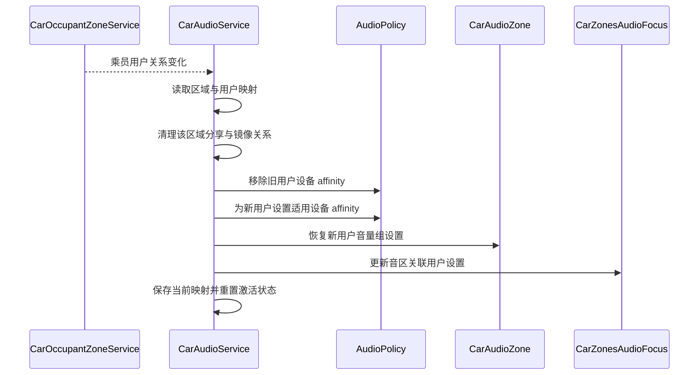

驾驶员听音乐，后排乘客看视频，两份声音都使用媒体用途，却应该互不抢占并到达不同设备。仅配置两组扬声器还不够：系统必须知道每个播放请求属于哪个用户，该用户关联哪个乘员区域，以及该区域使用哪一个音区。

AAOS 的多音区能力由多层映射共同构成。audio zone 表达音频管理边界，occupant zone 表达乘员位置及其关联资源，Android user 表达运行身份，UID 标识该身份下的应用。它们可能在界面上都对应“后排左侧”，但在代码和配置中不能互换。理解这些身份之间的关系，才能避免跨区播放和用户切换后的串音。

## 四种标识分别管理什么

音区拥有自己的配置、音量组和焦点管理对象。它回答“这份声音在哪一个音频管理范围内参与规则”。乘员区域由 CarOccupantZoneService 管理，用来关联位置、显示等资源以及用户。Android 用户决定应用进程和设置的归属；同一包在不同用户下运行，实际 UID 不同，不能只根据包名判断其声音属于谁。

显示屏也不等于音区。一个屏幕上的应用是否在预期用户下运行，需要由用户与显示的系统配置保证；音频不会因为窗口被放到后排显示屏，就自动从后排喇叭输出。调试多屏车机时，应同时记录显示 ID、user ID、应用 UID 和 audio zone ID，把“界面位置正确”与“音频身份正确”分开验证。

| 标识 | 主要含义 | 常见误用 |
| --- | --- | --- |
| audio zone ID | 音频规则、组和输出的范围 | 当成座椅编号或用户编号 |
| occupant zone ID | 乘员位置与关联资源 | 当成音区的固定同义词 |
| user ID | Android 运行身份与设置归属 | 只看当前驾驶员而忽略乘客 |
| UID | 某用户下的应用身份 | 只使用包名判断跨用户播放 |
| zone config ID | 某音区的一套设备配置 | 当成一个新的乘员区域 |

这些数字可以在某个样例中恰好相同，但不存在普遍的等值约束。配置和日志应明确字段名称。一次缺少字段名的“zone=1”记录，可能无法判断究竟是乘员区、音区还是显示相关区域，从而使跨模块定位失去依据。

## 音区模型先于用户绑定

Car 配置解析创建 CarAudioZone，并解析可选的 occupantZoneId 映射。主音区的 ID 使用 PRIMARY_AUDIO_ZONE；其他音区不能占用该主区编号，解析器还验证音区 ID 的唯一性。相关约束见 [parseAudioZone 与 getZoneId](https://android.googlesource.com/platform/packages/services/Car/+/9f04df65daa8b9a65ee05fd4039fe95446874d76/service/src/com/android/car/audio/CarAudioZonesHelperImpl.java#560)。

乘员映射不是每个音区都必须显式声明。解析器在字段存在时记录 audio zone 到 occupant zone 的关系，并验证乘员区编号不重复，该逻辑位于同一解析器的 `parseOccupantZoneId()`。没有映射时，服务仍有相应处理分支，不能因为一个产品没使用 occupant 映射就断言它没有音区模型。

每个音区还包含一套或多套 zone config。它们共享音区身份，却可使用不同输出设备，例如内置扬声器和耳机。模型要求有且只有一套默认配置，并验证每套配置归属的音区和音量组关系，见 [validateZoneConfigs](https://android.googlesource.com/platform/packages/services/Car/+/9f04df65daa8b9a65ee05fd4039fe95446874d76/service/src/com/android/car/audio/CarAudioZone.java#178)。切换配置改变的是设备方案，不等于切换乘员或 Android 用户。

## 请求如何找到音区

CarAudioService 查询 UID 的音区时，先查看显式 UID 映射；若没有，再按 UID 所属用户查询乘员区域，并获取其 audio zone；仍没有有效结果时回退主音区。这个优先次序写在 [getZoneIdForUidLocked](https://android.googlesource.com/platform/packages/services/Car/+/9f04df65daa8b9a65ee05fd4039fe95446874d76/service/src/com/android/car/audio/CarAudioService.java#3043)。因此，未知映射可能表现为声音进入主区，而不一定表现为创建播放失败。

回退行为便于基本播放继续工作，却会掩盖集成缺陷。例如，后排应用误运行在驾驶员用户下时，媒体轨道可能正常出声，只是来自前排。此时修改后排 bus 增益不会解决问题；应首先检查应用 UID 的用户部分以及 occupant 关联是否符合设计。

焦点分发也要选择音区。CarZonesAudioFocus 根据音频请求获取相应音区；内部属性 bundle 若携带有效的指定音区信息，可影响焦点分发，见 [getAudioZoneIdForAudioFocusInfo](https://android.googlesource.com/platform/packages/services/Car/+/9f04df65daa8b9a65ee05fd4039fe95446874d76/service/src/com/android/car/audio/CarZonesAudioFocus.java#276)。这属于系统路径中的显式信息，不能把它误解为普通应用只设置一个 zone 数字就自动获得对应物理路由。

焦点区域和数据路由需要保持一致。把焦点请求送到后排，而实际播放器仍按主区路由，可能造成“后排规则允许并发，前排却同时听见两份媒体”。因此系统扩展任何指定音区机制时，都必须同时说明播放设备如何确定，不能只修改焦点层。

## 用户变化如何更新音频状态

当乘员用户关系变化，服务从 CarOccupantZoneService 读取驾驶员和各乘员区域的用户。对已配置映射的音区逐一更新，未映射的音区另按默认逻辑处理；没有 occupant 映射时则走整体调整分支。入口见 [handleOccupantZoneUserChanged](https://android.googlesource.com/platform/packages/services/Car/+/9f04df65daa8b9a65ee05fd4039fe95446874d76/service/src/com/android/car/audio/CarAudioService.java#3938)。

更新并非只改一张 `zoneId → userId` 表。服务会处理主区媒体分享和镜像关系，删除旧用户 device affinity，为新用户建立适用的设备关联，恢复该用户的音量组设置，更新焦点相关用户设置，并重置激活状态。主区还可能恢复用户的前后与左右声场平衡，见 [updateUserForOccupantZoneLocked](https://android.googlesource.com/platform/packages/services/Car/+/9f04df65daa8b9a65ee05fd4039fe95446874d76/service/src/com/android/car/audio/CarAudioService.java#4009)。

下面以乘客从一个区域退出、另一个用户接入为概念时序。实际实现会根据用户是否为空、是否驾驶员及是否存在共享关系选择分支，图中“恢复用户设置”概括了音量与相关状态更新。

顺序关系有实际意义。若先恢复新用户音量、却仍保留旧用户路由，新状态可能作用在错误播放上；若忘记撤销镜像，旧用户的分享关系可能继续影响设备。用户切换应作为跨焦点、路由和音量的状态迁移来验证，而不只检查界面上的用户名变了。

## 用户 affinity 如何进入路由

在动态路由路径中，服务调用 AudioPolicy 的 `setUserIdDeviceAffinity`，把用户关联到允许使用的设备集合。这个集合与 usage 规则共同决定用户的播放可进入哪些输出。设置入口会检查音频服务状态与 routing policy 是否可用，见 [setUserIdDeviceAffinityLocked](https://android.googlesource.com/platform/packages/services/Car/+/9f04df65daa8b9a65ee05fd4039fe95446874d76/service/src/com/android/car/audio/CarAudioService.java#3201)。

affinity 不等于“无论用途都强制播放到单一设备”。一个音区可能包含音乐、导航、通话等多个设备，用户关联的是集合，具体请求仍需经过相应属性与策略选择。若只记录一个“用户默认扬声器”，就容易遗漏同一用户不同用途分路的事实。

在共享主区媒体或镜像场景，设备集合可能临时扩展。因此，排查跨区声音时不能只看静态配置，还需检查当前是否存在有效的分享或镜像请求。正常的动态关系变化与错误残留可能产生相似听感，区分它们要看请求生命周期与预期状态，详见[媒体分享与镜像]()。

## 显式 UID 路由与乘员映射不能随意叠加

`setZoneIdForUid` 是另一种控制入口，要求车载 audio settings 权限及非 legacy 模式。当前实现明确要求 occupant 映射未启用，不能把两套映射任意叠加，见 [setZoneIdForUid](https://android.googlesource.com/platform/packages/services/Car/+/9f04df65daa8b9a65ee05fd4039fe95446874d76/service/src/com/android/car/audio/CarAudioService.java#3077)。产品应先决定采用哪种归属模型，再选择控制方式。

UID 切区也不是单纯写 Map。当 UID 已有显式音区映射时，服务先取出该 UID 在原区的焦点持有者与等待者，按特定顺序临时移出旧区，再修改设备关联，随后在新音区恢复相关请求。先处理等待者可避免移除持有者时等待者被意外恢复，见 [UID 切区中的焦点迁移](https://android.googlesource.com/platform/packages/services/Car/+/9f04df65daa8b9a65ee05fd4039fe95446874d76/service/src/com/android/car/audio/CarAudioService.java#3090)。

首次建立显式 UID 映射时，没有旧的显式映射条目，当前实现不会先按用户归属推导旧音区再执行上述焦点搬移。已有映射的迁移过程则提示了一个重要边界：焦点状态随空间归属变化而迁移，目标区仍可能存在其他声音，恢复请求必须经过目标区规则。不能把“移动应用到另一音区”理解为无条件保留原区的一切播放权利。系统控制界面应等待操作结果，并通过当前状态确认最终归属。

## 多音区与多焦点的关系

两个音区中的媒体可以各自持有焦点，因为它们由不同音区的焦点对象管理。这里的隔离来自请求归属，而不是把媒体用途扩展成“前排音乐”“后排音乐”等大量新 usage。保持用途稳定、以空间维度隔离，是多用户架构能够扩展的重要原因。

音区边界也不能被视为物理声学隔离的保证。若两区最终连接到相同的物理扬声器，或者硬件路由配置错误，逻辑上各自持有焦点仍然可能听到混音。逻辑模型负责决策边界，硬件设计负责输出边界，验收时二者都要检查。

此外，播放音区并不自动解决录音隔离。输入设备归属、录音权限和并发录音策略有独立机制，不能因为媒体已分区，就认为后排麦克风只能被后排应用使用。相关问题在[录音与隐私]()讨论，系统方案中应单独列出输入侧需求。

## 设计一套可复现的双音区实验

设驾驶员用户与后排用户分别启动同一个测试媒体应用，两份轨道都声明 MEDIA。先独立播放，确认各自设备；再同时播放，检查两区焦点列表均存在对应请求。随后只调整后排音量，观察驾驶员组不受影响；最后停止一侧，确认另一侧播放保持。

这些步骤分别验证用户归属、路由隔离、焦点隔离和音量隔离。只有同时播放成功，不能证明音量隔离；只有音量条独立，也不能证明物理输出隔离。测试记录应把每个维度单独列出，避免一句“多区正常”掩盖覆盖不足。

接着执行用户退出与替换。新用户进入后检查其音量是否按设计恢复，旧用户的分享和镜像是否清理，旧 UID 的轨道是否仍有有效路由。再插拔后排动态设备，验证变化的是当前输出配置，而不是错误修改 occupant 映射。每次操作都保存操作前后四种身份，能够很快识别残留关系。

## 以一次乘客迁移检查状态一致性

设某位乘客原先使用后排左侧区域，随后退出并在另一乘员区域登录。业务上看，这是用户换了座位；音频层则需要区分两个事件：原区域失去用户，新区域获得用户。原区域的设备不应继续被旧关系占用，新区域也不应继承不属于该用户的临时分享请求。

可以在操作前保存一份状态快照，列出两个区域当前用户、各自设备集合、当前配置、活跃焦点和分享状态。操作后对照检查哪些字段应变化、哪些应保持。物理设备归属通常仍由音区配置决定，用户身份改变的是关联与设置；若所有字段都被笼统重置，可能掩盖错误，也可能丢失产品希望保留的区域状态。

音量恢复尤其需要区分个人偏好和设备能力。用户曾在某组选择的 index，需要在当前组范围和限制下使用；不同设备方案不一定有相同增益能力。不能只把上一区域的数字原样显示，就认为已经完成用户体验迁移。应确认服务当前模型的范围、限制和最终执行结果相互一致。

用户退出时，旧应用进程结束与音频关联清理并不一定在同一个时刻完成。测试应观察是否存在短暂的陈旧请求或播放器，以及它们何时从系统状态消失。若问题只发生在快速登录、退出、再登录中，重点应放在事件顺序和清理边界，而不是静态音区编号。

还应明确未分配区域的产品行为。没有乘客时，区域可能仍有默认用户关联或保留默认配置，但这不意味着可以任意播放上一位乘客的内容。默认映射负责系统有确定归属，应用内容是否继续由其生命周期和产品规则决定。把“有默认用户”当作“应自动恢复媒体”会越过这一职责边界。

系统控制页面也应区分区域选择与用户选择。音量面板选中后排组，表示后续操作针对该组；它不应隐式修改媒体应用所属用户。反之，切换媒体账户也未必改变 Android user。清晰的界面状态与底层身份能够减少测试人员把应用账户、乘员和系统用户混为一谈。

对于错误回退，应有专门用例。让一个测试 UID 没有预期的乘员映射，观察它如何回到主区，并检查日志能否说明回退原因。这样能防止上线后把主区出声误判成“后排设备坏了”。默认路线提供兼容性，但验收应确认每个受支持乘员场景都走显式预期关系。

多区验证还应检查共享资源。两个区域若共用某个外部源或硬件处理能力，逻辑上隔离并不保证资源使用完全独立。需要由平台与硬件团队说明共享边界，并让应用在资源不可用时得到可解释结果。音区设计提供管理维度，不能替代对硬件资源数量与并发能力的评估。

最终的问题记录应能从一次播放反向重建身份链：哪个用户下的哪个 UID，在何时以什么属性请求焦点，归到哪个音区，当时采用哪个配置与设备集合。这样的记录既支持正常路径验收，也能支持用户迁移、恢复和异常回退分析，比只保存一张后排界面截图更接近故障本身。

## 用身份链分析串音故障

若后排视频从前排出声，第一步记录实际播放 UID，而不是只记录包名。第二步由 UID 找到用户，再检查该用户的 occupant zone 与 audio zone。第三步检查当前 zone config、设备 affinity 和轨道实际输出。只有这条链前半段正确，才进入底层设备和 HAL 方向排查。

若用户切换后音量继承了上一位乘客，重点转向音量设置恢复与用户映射更新；若只有分享结束后仍串音，则检查请求清理和 affinity 回收。相同的物理表现可能来自不同状态迁移，按事件触发点缩小范围，比反复修改静态 XML 更有效。

最后，应把用户变化与 audioserver 恢复组合测试。音频服务重建时，乘员服务可能早已完成用户分配，CarAudioService 需要主动处理现有映射，而不只是等待未来变化事件。相关补偿逻辑见 [初始化时已有用户的处理](https://android.googlesource.com/platform/packages/services/Car/+/9f04df65daa8b9a65ee05fd4039fe95446874d76/service/src/com/android/car/audio/CarAudioService.java#2500)。这类时序是“冷启动正常，音频重启后串区”的重要检查方向。

<!-- series-navigation -->
## 系列导航

[系列目录]()

[上一篇：声音的语义模型]()

[下一篇：动态音频路由]()
