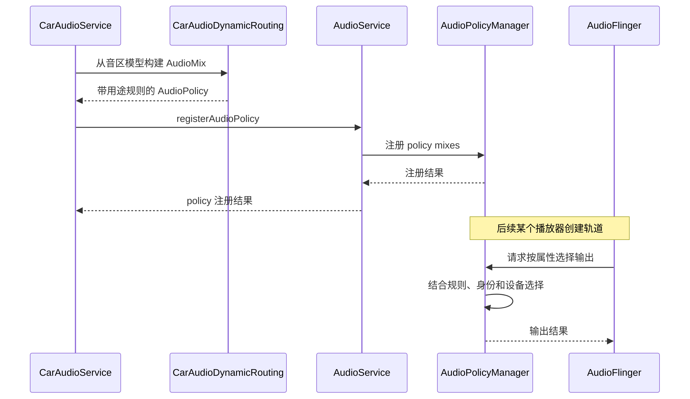

产品配置把媒体放到一条 bus、导航放到另一条 bus，并不意味着播放器会直接打开这些名字。配置需要先转换成 Android 音频系统能执行的路由规则，播放轨道创建时再根据属性与身份匹配规则。AAOS 的动态路由正是完成这一步转换的机制。

这里的“动态”指运行时注册 AudioPolicy 和 AudioMix，不等于只服务 USB 或蓝牙等可插拔设备。固定车载 bus 也可以通过动态策略路由；动态设备本身则还涉及连接状态和 zone config 切换。把两个概念区分开，有助于理解为什么开机时固定扬声器也需要策略注册。

<!-- aaos-architecture -->
## 路由策略如何跨越服务边界

CarAudioContext 提供语义，CarAudioDynamicRouting 构造规则，CarAudioService 注册策略。图中的 Binder 线是策略注册与控制关系，不传输媒体样本；最终输出选择发生在 native 音频策略侧。

<figure style="width:min(1560px, calc(100vw - 48px));position:relative;left:50%;transform:translateX(-50%);margin:1.5rem 0;">
  <iframe src="../../../diagrams/aaos17-audio-routing.html" title="AAOS Audio Routing" width="100%" height="960" loading="lazy" style="display:block;border:1px solid #cbd5e1;border-radius:8px;background:#fff;"></iframe>
  <figcaption style="font-size:0.9rem;margin-top:0.6rem;">可在图内滚动查看完整架构，或<a href="../../../diagrams/aaos17-audio-routing.html" target="_blank" rel="noopener">单独打开架构图</a>。</figcaption>
</figure>

## 路由模型如何变成 AudioMix

CarAudioDynamicRouting 从所有音区开始，遍历音区配置、音量组和组内设备地址。它为适合使用动态 policy mix 的设备收集 context，再将 context 展开为 AudioAttributes，建立用途匹配规则。最终，一个 mix 关联规则、格式和目标设备，见 [setupAudioDynamicRoutingForGroup](https://android.googlesource.com/platform/packages/services/Car/+/9f04df65daa8b9a65ee05fd4039fe95446874d76/service/src/com/android/car/audio/CarAudioDynamicRouting.java#113)。

这个转换过程说明，XML 中的 context 名称不会原样成为 AudioPolicyManager 的万能匹配条件。传统 Car 路径实际添加的是 `RULE_MATCH_ATTRIBUTE_USAGE`。因此，评审路由能力应以生成的规则为准：如果业务想在相同 usage 内按标签区分输出，不能只在 Car 配置中增加一个 context 名字就认为已经实现。

设备也是实际对象，而不仅是字符串。服务依据 CarAudioDeviceInfo 找到 AudioManager 暴露的 AudioDeviceInfo，再用该对象创建 mix。地址用于跨层对应，设备类型与能力决定它能否构成有效输出。若底层根本没有报告目标设备，上层文件中的地址不会自行变成可用硬件。

## render mix 与音频数据通路

创建 mix 时，代码设置采样格式、目标设备，并使用 `AudioMix.ROUTE_FLAG_RENDER`。这种规则用于把匹配播放渲染到设备，不能与用于回环捕获的 loopback mix 混为一谈。实现入口见 [addMix](https://android.googlesource.com/platform/packages/services/Car/+/9f04df65daa8b9a65ee05fd4039fe95446874d76/service/src/com/android/car/audio/CarAudioDynamicRouting.java#184)。

CarAudioDynamicRouting 不读取应用的 PCM 缓冲区，也不执行重采样或混音算法。它把路由选择规则交给通用音频栈；随后由对应 AudioFlinger 输出路径和 Audio HAL 处理数据。若声音失真、丢帧或写入阻塞，确认规则后还需要进入数据路径分析，单纯修改 Car 的 usage 映射通常无法解决这些问题。

mix 格式取自设备描述，包括采样率、编码和声道相关参数，由同一类中的 `createMixFormatFromDevice()` 构建。它描述注册规则使用的格式条件，并不意味着应用必须把所有媒体预先转成同一格式。实际转换能力和最终输出路径由核心音频栈与 HAL 能力共同决定。

## 默认配置为何最后添加

每个音区可能有默认配置和已选择的非默认配置。构建过程先处理已选择且当前可用的非默认配置，再把默认配置放在最后，作为动态设备断开后的备用路径。若没有任何选中的配置可用，会抛出异常；默认配置仍需始终具备可用基础，见 [setupAudioDynamicRouting](https://android.googlesource.com/platform/packages/services/Car/+/9f04df65daa8b9a65ee05fd4039fe95446874d76/service/src/com/android/car/audio/CarAudioDynamicRouting.java#55)。

这一顺序体现了产品必须拥有可解释回退的要求。后排耳机断开后，系统需要知道恢复到哪套设备，而不是留下指向消失设备的规则。默认配置不能仅作为 XML 的必填装饰；它应有真实可用的设备映射和符合体验要求的声音去向。

回退也不必然意味着所有声音都应转到整车公共扬声器。是否允许某个区域在耳机断开后继续外放，是产品体验与隐私需求的一部分，应通过配置和上层播放策略共同设计。动态路由提供选择机制，不能代替业务定义断开后继续、暂停或提示用户的行为。

## 注册链路与播放选择是两个阶段

CarAudioService 先创建 AudioPolicy.Builder，添加镜像相关策略，再添加一般音区路由，构建 policy 后调用 AudioManagerWrapper 注册。注册失败会抛出初始化错误，见 [setupRoutingAudioPolicyLocked](https://android.googlesource.com/platform/packages/services/Car/+/9f04df65daa8b9a65ee05fd4039fe95446874d76/service/src/com/android/car/audio/CarAudioService.java#2270)。内存中有 mix 对象不代表原生系统已经接受它。

AudioService 接收注册请求并管理策略生命周期，之后通过 AudioSystem 把 mixes 注册到原生音频策略层。Java 注册入口与 mix 下发分别见 [registerAudioPolicy](https://android.googlesource.com/platform/frameworks/base/+/94b4c163b7dfe5ce3607f7bb8456f9573f7de57d/services/core/java/com/android/server/audio/AudioService.java#15182)和 [registerPolicyMixes 调用](https://android.googlesource.com/platform/frameworks/base/+/94b4c163b7dfe5ce3607f7bb8456f9573f7de57d/services/core/java/com/android/server/audio/AudioService.java#16440)。这条链也会受到权限、回调对象和服务状态影响。

播放发生时才进入另一阶段：AudioFlinger 创建轨道过程中请求输出选择，AudioPolicyManager 根据属性、身份、设备和已注册的 policy mixes 进行处理。对应原生入口为 [getOutputForAttrInt](https://android.googlesource.com/platform/frameworks/av/+/475269ec44acec82792be6b01fb8e16357d4d2c8/services/audiopolicy/managerdefault/AudioPolicyManager.cpp#1392)。因此排查时应区分“规则没有注册”与“规则已注册但本次请求没有按预期匹配”。

图中的原生调用经过中间 Binder/JNI 层，图为聚焦路由职责的概念时序。关键是注册在前、匹配在后；不能从某次应用播放日志反推启动阶段的策略一定已经正确建立。

## 用途规则为何还需要用户 affinity

两个音区都可能有 MEDIA 规则，仅凭用途不能区分驾驶员和乘客的媒体。用户 device affinity 进一步限制身份可以使用的设备集合，与用途规则共同表达“谁的什么声音去哪里”。这部分由 CarAudioService 在用户映射变化时维护，详见[音区与多用户映射]()。

AudioPolicy 提供 UID 和 user ID 两类 affinity 接口。它们要求 policy 已注册，并把设备类型和地址传给服务，见 [setUserIdDeviceAffinity](https://android.googlesource.com/platform/frameworks/base/+/94b4c163b7dfe5ce3607f7bb8456f9573f7de57d/media/java/android/media/audiopolicy/AudioPolicy.java#590)。它们不是给普通播放器公开的任意选区开关，而是系统策略管理的一部分。

一个常见误区是认为“usage 已匹配后排 bus，所以用户不重要”。如果规则空间内有多组同用途设备，没有正确身份约束，实际输出可能不符合乘员归属。另一个误区是只设置用户 affinity，却遗漏某用途的 mix；身份限制只能约束已有路由选择，不能代替用途映射本身。

## 配置验证保护哪些不变量

传统动态路由要求同一音区配置内的 usage 不应指向多个不同地址，否则同一个请求缺乏明确的用途路由。验证器检查重复地址、usage 对应设备以及 core routing 分支，见 [validateCanUseDynamicMixRouting](https://android.googlesource.com/platform/packages/services/Car/+/9f04df65daa8b9a65ee05fd4039fe95446874d76/service/src/com/android/car/audio/CarAudioZoneConfig.java#193)。发生歧义时应修正模型或采用适合的核心策略机制，而不是依赖注册顺序偶然选择一个输出。

地址共享也有范围限制。在非 core routing 条件下，验证器不允许设备地址跨音区共享，也不允许同一配置的不同组重复使用同一地址；同一音区的不同配置之间则允许复用。相关校验见 [CarAudioZonesValidator](https://android.googlesource.com/platform/packages/services/Car/+/9f04df65daa8b9a65ee05fd4039fe95446874d76/service/src/com/android/car/audio/CarAudioZonesValidator.java#97)。动态设备的身份处理有额外分支，不能把空地址简单等同于固定 bus 地址重复。

这些限制服务于可判定性。若一个物理地址同时属于两个独立音量组，组 A 调音量时应采用哪一份增益？若它又属于两个音区，用户隔离如何成立？系统在配置阶段拒绝某些关系，是为了避免运行时出现无法清楚定义的控制结果。

## 与 core routing 的共存边界

`audioUseDynamicRouting` 控制是否建立这条 Car 动态路由 policy；`audioUseCoreRouting` 则表示采用核心策略理解和设备选择能力。二者不能简单按名称理解成永远互斥，实际模型会判断某设备是否仍适合动态 policy mix。core routing 下，CarAudioZoneConfig 会避免一般用途 mix 覆盖更丰富的核心策略。

当核心策略依据完整属性作区分时，再注册仅按 usage 的粗粒度规则可能丢掉这种区分。代码为此更新设备的动态 mix 可路由标志，CarAudioDynamicRouting 遍历时跳过不适用设备。这是选择规则粒度的兼容处理，而不是设备本身突然不可播放。相关设计在[核心音频路由与音量]()继续分析。

产品迁移到 core routing 时，应重新检查用途、策略、组名和输出的关联，不能只翻转资源开关后保留所有旧假设。特别是过去通过 Car mix 覆盖的路线，现在可能由核心引擎负责，排障入口也应随之变化。

## 把路由错误与音量错误分开

假设音乐正常、导航无声，先确认导航轨道的实际 usage，再看该 usage 是否属于预期 context，以及该 context 是否分配给设备。如果规则和设备都存在，再检查注册结果与轨道选择。只有轨道确实落到导航输出后，才集中检查该组的静音、gain 限制和硬件链路。

如果所有用途都能出声却全部走同一扬声器，可能是 Car 策略未注册、运行模式不符、用户关联错误，或底层设备映射把多个逻辑地址接到同一输出。应先确认不同轨道在 AudioPolicy 中选择的设备是否不同，再决定问题属于策略层还是 HAL/硬件层。

如果仅在拔掉设备后出现错误，检查当前配置与默认配置的有效性，以及策略是否随状态更新。此类故障不应只通过重新启动应用掩盖，因为新建轨道可能暂时绕开陈旧状态，却不能解释系统为何没有完成设备变化处理。

## 用地址表检查跨层配置契约

设备地址是路由分析中的关键连接点，但它不是一段可以随意改写的展示文字。Car 配置引用地址，底层设备描述报告地址，策略注册把地址带入原生层，硬件适配再解释对应连接。修改地址时应核对整条链，避免只有一侧更新，导致匹配失效却仍被默认输出掩盖。

可以为产品建立一份地址契约表，记录设备类型、地址、支持格式、所属音区、关联用途和实际物理去向。表中的最后一列需要硬件团队确认，因为两个不同逻辑地址可能在某些设计中经过同一处理单元；它们是否具有独立音量或独立 duck 能力，不能仅从字符串不同推断。

以音乐与导航分路为例，软件层可以为它们生成不同 mix，并选择不同设备。但如果 HAL 最终把两条流汇入同一不可独立控制的通道，按设备 duck 可能无法只压低音乐。这不是 mix 匹配失败，而是控制粒度与硬件能力不一致。设计阶段应先确认需要独立控制的声音是否保持了足够长的独立路径。

反过来，也不应为了每个音量滑块都创建一个物理设备。音量组、策略与设备之间的关系应由实际控制需求决定；某些产品可以在核心策略或更下层实现所需区分。过度拆分逻辑设备会增加地址、配置和测试组合，却未必带来可观察的体验收益。

## 注册正确仍可能选择错误输出

规则注册成功说明系统接受了规则，不说明每次请求都满足规则。播放属性可能与预期不同，用户 affinity 可能陈旧，设备连接状态可能变化，或者产品采用了另一套路由模式。定位时应保存同一次播放的输入快照，避免把启动时规则与很久以后另一条轨道的输出放在一起比较。

对于复现概率低的问题，建议给测试播放使用容易识别的内容和稳定会话标识，并在开始、停止、切换用户和设备变化时记录事件。这里的标识用于关联日志，不承担路由语义。不要为了方便检索而改变 usage，因为这会改变待验证的行为本身，让复现环境与真实问题不同。

如果轨道创建时设备选择正确，随后听到的位置变化，应检查是否发生了配置切换或设备重连，而不是只重复分析最初的 createTrack。路由是运行状态，能够随系统事件改变；静态配置表描述的是允许关系，当前有效关系则需要在事件时间线上观察。

用户 affinity 的更新也要关注结果。服务请求设置设备集合后，调用可能失败；业务层如果忽略结果，仍把界面标成切区成功，就会造成软件认知与实际路由不同。测试应分别记录请求目标、API 结果和最终轨道输出，不能用其中一项替代其他两项。

多用途并发时，还应检查规则之间是否存在意外覆盖。音乐单独播放正常，导航单独播放也正常，并不能证明同时出现时仍使用预期输出或增益。并发测试需要保留两条轨道的身份和属性，确认它们没有因为默认匹配、共享设备或控制状态切换而产生联动。

当问题只能通过重启修复时，应把重启理解为清空和重建状态的干预，而不是结论。比较重启前后的 policy mixes、affinity 和当前配置，可以找出哪项状态发生了修正。若只记录“重启后好了”，就无法区分注册遗漏、清理失败和设备重新枚举等不同原因，也难以证明代码修复有效。

最终的路由验收应同时具有正向和反向证据：预期设备收到声音，非预期区域没有收到同一份声音。尤其在多音区和公共扬声器共存时，仅在目标位置听到内容可能不足以发现泄漏。通过逐区监听或设备侧观测确认输出范围，才能把逻辑路由正确转化为完整体验正确。

## 设计有效的动态路由实验

可以建立媒体和导航两个明确用途，各对应一个已知输出，先单独播放，再并发播放，并记录轨道属性与输出设备。然后保持用途不变，换到另一个用户，确认身份约束改变输出范围。最后改变设备连接状态，观察默认配置是否按设计承担回退。每个阶段只改变一个维度，便于确定哪一条关系生效。

测试还应包含失败输入。错误地址应在配置或设备查找阶段可见；同用途映射到两个互相冲突的固定设备，应触发验证；注册失败不能被上层当成成功。负向用例验证的是系统能否保护不变量，它们能在上线前发现“偶尔走对设备”的脆弱方案。

对音频团队，最有用的交付物是一张可追踪表：应用用途、所属用户、Car context、zone config、音量组、设备地址、注册规则和实际输出。它把需求和实现连接起来，也为之后的核心路由迁移、设备扩展和故障回归提供基线。路由设计的完成标准，是每一种输入在每一种受支持状态下都有明确去向和可验证行为。

<!-- series-navigation -->
## 系列导航

[系列目录]()

[上一篇：多音区与多用户]()

[下一篇：Core Audio 路由与音量方案]()
