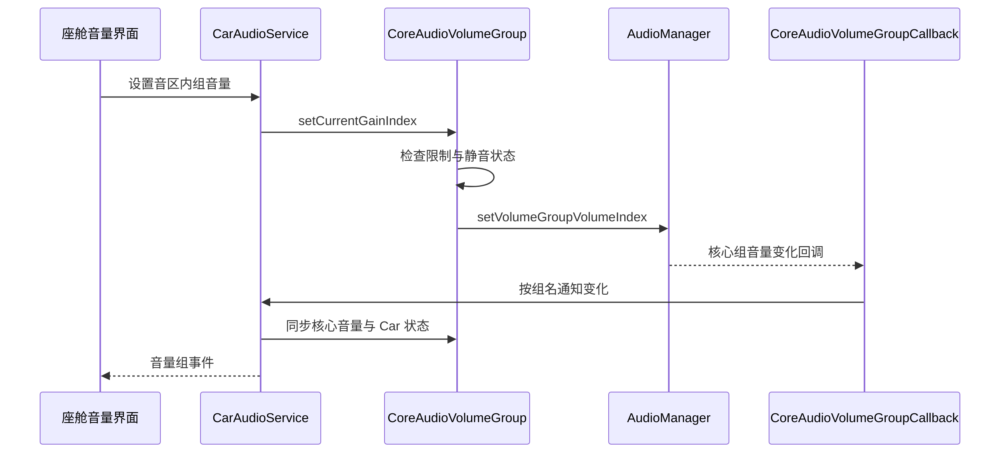

传统 Car 动态路由主要按 usage 把声音送到设备，Car 音量组再管理相关设备增益。当产品希望利用 Android 核心策略中的属性匹配、产品策略和音量组时，就需要另一种分工：车载层保留座舱模型，核心音频层承担更多路由与音量执行。

`audioUseCoreRouting` 与 `audioUseCoreVolume` 是这类协作的两个入口，但它们不是一个“打开后所有问题都由核心解决”的总开关。路由选择、组标识映射、用户状态和事件同步仍需一致。理解两条路径各自转交了什么职责，比简单比较哪种架构更新更有工程价值。

## 先区分三个相近概念

core routing 指车载层依赖核心音频的 product strategy 等模型来理解属性及路由关系。core volume 指 Car 音量组将实际音量操作交给核心音量组 API。CAP，即可配置音频策略，则是原生音频策略引擎的一种实现方式，通过配置表达策略规则。三者相关，但不能仅凭 Car 的一个资源开关就推断原生引擎已采用某种配置实现。

基础资源将动态路由、core volume 和 core routing 分别列出，见 [Car 音频开关](https://android.googlesource.com/platform/packages/services/Car/+/9f04df65daa8b9a65ee05fd4039fe95446874d76/service/res/values/config.xml#24)。配置文件中的设备级选项还可能覆盖初始资源值，因此产品分析应查看最终运行字段。迁移时应记录每项开关的作用和配置来源，而不是把“CAP 产品”当成足够精确的运行模式描述。

原生 `engineconfigurable` 的 Engine 存在从 HAL 配置加载、回退 XML 以及编译条件分支。这个事实说明引擎配置本身也有独立选择链，见 [可配置引擎加载入口](https://android.googlesource.com/platform/frameworks/av/+/475269ec44acec82792be6b01fb8e16357d4d2c8/services/audiopolicy/engineconfigurable/src/Engine.cpp#73)。CarAudioService 与原生引擎需要共同适配，但不是同一个配置解析器。

## Product strategy 是属性与策略之间的桥梁

AudioProductStrategy 表示核心层的一组音频策略语义，包含支持的属性等信息。CoreAudioHelper 可以按属性查找 strategy，也可以按名称查找。启用核心路由后，CarAudioContext 不再仅用本地 usage 表获取 context，而是从核心策略结果获得对应 ID，详见[属性与上下文模型]()。

名称匹配因此成为配置契约。Car 自定义 context 解析时，会在 core routing 分支以 context 名称查找 strategy，再检查非默认 strategy 是否支持所声明的属性；默认 strategy 有兜底例外。找不到名称，或非默认 strategy 不支持所声明属性，会在初始化阶段报错。相关检查见 [parseCarAudioContext](https://android.googlesource.com/platform/packages/services/Car/+/9f04df65daa8b9a65ee05fd4039fe95446874d76/service/src/com/android/car/audio/CarAudioZonesHelperImpl.java#394)。

这与“为属性任意分配一个整数 ID”不同。strategy ID 是核心模型导出的关联键，Car 需要承认同一份语义。产品配置评审时，应把 strategy 名称、属性规则、Car context 名称和音量组名称放在同一张表中，任何一项修改都要评估其他列是否仍然成立。

## 多音区查询还受到核心能力分支影响

CoreAudioHelper 的带 zoneId 查询在 `multiZoneAudio` flag 启用时，调用支持音区参数的 AudioProductStrategy API；否则回到不带音区的策略查找。入口见 [getStrategyForAudioAttributes](https://android.googlesource.com/platform/packages/services/Car/+/9f04df65daa8b9a65ee05fd4039fe95446874d76/service/src/com/android/car/audio/CoreAudioHelper.java#116)。因此，方法签名带有 zoneId，并不自动证明所有构建都执行了多音区核心匹配。

helper 还区分严格查找与允许 default fallback 的查找。严格查询找不到支持的 strategy 时返回无效值；另一组方法允许回退默认属性对应的策略。使用哪一组方法应从调用链确认，不能把“默认策略存在”理解为每个不匹配输入都必然被静默接受。

这种区别影响排障。若某属性意外落到默认组，需要确认是配置本身把它归入默认策略，还是调用方选择了允许回退的查询。二者都可能有声音，但修改方向不同：前者检查策略定义，后者检查调用语义及缺失映射。只观察最终音量组名称无法判断原因。

## 为什么 core routing 会避开粗粒度 mix

Car 传统动态规则使用 usage 匹配，而核心策略可以依据更丰富的属性关系。如果已经把同一 usage 内的不同属性分成多个 strategy，再用一个粗粒度 Car mix 强行覆盖它们，核心区分就可能失效。因此，CarAudioZoneConfig 的验证会对动态 mix 可用性作额外处理。

在 core routing 条件下，相关设备会被标记为不走普通 Car 动态 mix；没有 core routing 时，同 usage 指向不同设备则会被视为不合法路由关系。源码见 [validateCanUseDynamicMixRouting](https://android.googlesource.com/platform/packages/services/Car/+/9f04df65daa8b9a65ee05fd4039fe95446874d76/service/src/com/android/car/audio/CarAudioZoneConfig.java#193)。这不是设备不可用，而是将适当粒度的决定交给适当的策略层。

迁移过程中应验证旧的 Car mix 是否仍存在，以及它们是否属于仍需要的特殊路径。不能看到动态路由 policy 对象存在，就断言所有设备仍由传统 usage mix 决定；也不能看到某设备没有 mix，就断言该用途没有路由。解释实际输出需要结合运行模式和原生策略状态。

## 两种音量组实现的分工

CarVolumeGroupFactory 根据 `useCoreAudioVolume` 创建 CoreAudioVolumeGroup 或 CarAudioVolumeGroup，两者共享车载音量组抽象，见 [getCarVolumeGroup](https://android.googlesource.com/platform/packages/services/Car/+/9f04df65daa8b9a65ee05fd4039fe95446874d76/service/src/com/android/car/audio/CarVolumeGroupFactory.java#64)。这让上层仍可围绕音区和组操作，而实际增益路径采用不同实现。

传统 CarAudioVolumeGroup 把音量 index 转成 millibel gain，并遍历组内设备设置增益。CoreAudioVolumeGroup 则确定对应核心组 ID，读取核心组的最小、最大和当前音量状态，再调用 AudioManagerWrapper 的核心组接口。两种 index 都是逻辑刻度，但不能假定其范围、默认值或与分贝关系完全相同。

| 维度 | CarAudioVolumeGroup | CoreAudioVolumeGroup |
| --- | --- | --- |
| 执行对象 | 组内 Car 音频设备 gain | Android 核心 AudioVolumeGroup |
| 主要映射 | index 到设备增益 | Car 组到核心组 ID |
| 状态来源 | Car 模型与设备限制 | Car 状态及核心音量状态同步 |
| 集成重点 | 设备步长和增益能力一致 | 名称、属性、组 ID 与回调一致 |

传统实现的设备遍历见 [CarAudioVolumeGroup 设置增益](https://android.googlesource.com/platform/packages/services/Car/+/9f04df65daa8b9a65ee05fd4039fe95446874d76/service/src/com/android/car/audio/CarAudioVolumeGroup.java#82)。这个比较并不意味着 core volume 不再需要硬件增益或限制；只是实际音量执行经由核心层，车载层仍保留相应约束与状态协调。

## Car 组名如何关联核心组

CoreAudioVolumeGroup 构造时，根据组名选取代表属性，再按属性和音区获取核心 volume group ID；然后从 AudioManager 查询该组范围和状态，见 [CoreAudioVolumeGroup 构造](https://android.googlesource.com/platform/packages/services/Car/+/9f04df65daa8b9a65ee05fd4039fe95446874d76/service/src/com/android/car/audio/CoreAudioVolumeGroup.java#67)。因此，Car 组 ID 与核心组 ID 是两个字段，日志中应分别标明。

CoreAudioHelper 按名称枚举 AudioVolumeGroup，并挑选适合定位该组的代表属性。名称不是可以随意本地化的界面标题，而是配置之间的连接点。一个“只是把音乐组改成更好看的中文名”的修改，如果发生在配置契约字段上，可能破坏组关联；界面显示名称应与底层标识分开管理。

设置音量时，CoreAudioVolumeGroup 还考虑 blocked、用户 mute 和最后可听音量等状态，再调用 `setVolumeGroupVolumeIndex`，见 [核心组音量设置](https://android.googlesource.com/platform/packages/services/Car/+/9f04df65daa8b9a65ee05fd4039fe95446874d76/service/src/com/android/car/audio/CoreAudioVolumeGroup.java#128)。所以“核心 API 调用了一次”并不能完整说明最终听感，当前限制和静音状态仍然重要。

下面时序描述通过车载接口调整核心音量组的正常概念流程，并保留异步回调回到车载状态的环节。具体增益应用时机由核心音频层与播放状态决定。

## 双向同步为何必要

核心音量可能由 CarAudioManager 之外的客户端改变。若 Car 只记录自己发出的 setGroupVolume，界面与实际核心组就会逐渐不一致。CoreAudioVolumeGroupCallback 因此注册到 AudioManager，收到核心 group ID 后查出组名，再通知车载层更新。

一个特别重要的边界是回调含义。源码注释说明，该回调对应客户端引起的核心组 index 变化，不表示 AudioPolicyManager 在某一时刻真正设置了端口 gain，例如某组开始活跃时的增益应用并不等同于一次该回调。说明见 [CoreAudioVolumeGroupCallback](https://android.googlesource.com/platform/packages/services/Car/+/9f04df65daa8b9a65ee05fd4039fe95446874d76/service/src/com/android/car/audio/CoreAudioVolumeGroupCallback.java#58)。把回调当作物理硬件确认，会导致测量和状态判断错误。

同步代码会比较当前音量、静音与最后可听 index，并处理 HAL block 等限制。若硬件限制仍然存在，核心侧某次 unmute 不应轻易绕过限制。系统中存在多方状态输入，正确实现应根据来源和约束合并状态，而不是“最后一次收到的数字无条件覆盖所有状态”。

## 如何规划迁移与验证

从传统 Car 路径迁移时，先建立属性到 product strategy 的对应，再建立 Car context 与策略名称关联，随后确认 Car 组到核心组的映射。完成这些静态一致性后，再启用实际路由和音量路径。一次同时修改所有开关、组名和设备地址，会让每个失败都具有多个可能原因。

第一阶段验证“选对组与设备”。对每类用途记录完整属性、音区、strategy、Car group、core group 和输出设备。第二阶段验证“状态同步”：通过 Car 接口和核心接口分别修改音量，确认两侧显示一致；再测试 mute、unmute、限制和恢复，观察最后可听音量是否符合产品预期。

第三阶段验证并发。同一设备可能在不同时间承载不同策略与音量组，核心层需要在活跃关系变化时应用适当增益。不能只在无播放时比较两个 index，就认为音量模型正确；必须让实际轨道开始、停止和交替，并检查物理输出变化是否与选中的组一致。

第四阶段验证多用户与设备变化。用户切换后的组状态、后排音区核心匹配、动态设备断开后的策略选择都可能走不同分支。尤其要记录 `multiZoneAudio` 等 flag 的实际值，避免在一个启用了相关能力的构建上验证后，把结论直接推广到另一发布配置。

## 用状态实验区分 index 与实际增益

核心音量接入后，界面展示的 index、最后可听 index、mute 状态和实际硬件增益是不同观察量。用户把音量设到某个刻度后静音，系统可能需要保存该刻度以便取消静音时恢复；硬件又可能因为限制暂时不能采用目标增益。若测试只读取一个整数，就无法判断这些状态是否正确协作。

可以设计一个有明确步骤的实验：先在播放中设置目标音量，再静音，修改目标音量，最后取消静音。每一步记录 Car 组状态、核心组状态和实际听感。实验关注的不是所有产品都必须采用同一种界面表现，而是代码选择的状态合并规则与产品定义一致，且两侧没有互相覆盖形成循环变化。

再加入硬件限制。受限期间尝试通过 Car 接口和核心接口分别调整音量，观察限制是否仍被保留，以及解除限制后恢复的是哪份目标状态。如果限制解除后突然跳到一个很早以前的 index，应追踪限制期间目标值与当前执行值是否被混用，而不是只检查解除回调有没有收到。

这类测试需要区分客户端请求与服务通知。界面收到组变化回调后，通常应刷新状态，而不应无条件再次发送同一个设置请求。否则容易形成反馈循环：核心通知 Car，Car 通知界面，界面又把显示值写回核心。在多方同时控制音量时，这种循环还可能覆盖另一个合法操作。

回调关联应使用稳定的组身份，而不是仅使用界面列表位置。用户切换或 zone config 变化后，列表可能重新生成；缓存一个旧位置对应的组会让新的音量操作发给错误对象。对于核心路径，还需同时保存 Car 组身份与核心关联，并在模型重建后重新查询，避免持有过期映射。

## 配置迁移应保留可比较的基线

迁移前先保存一组代表场景的完整状态，例如媒体、导航和通话分别使用哪些属性、落到哪个输出、由哪个组控制。迁移后用相同输入复测，差异才有明确含义。如果同时更换应用、媒体内容和设备配置，很难判断听感变化来自核心音量、数据格式还是应用行为。

对音量曲线的比较也应明确坐标。传统 Car index 与核心 index 的范围可能不同，直接比较相同数字没有意义。可以先比较最小、最大、静音行为与几个明确目标点，再结合实际曲线和测量方法评估体验。代码提供逻辑接口，并不保证两个实现的同名刻度在物理响度上相等。

核心策略中的默认项应单独验收。故意使用不在特定规则中的属性，观察它是否进入设计允许的默认 strategy；再检查 Car 对该结果是否有有效 context 和组。这样能够发现“核心能够播放，但车载管理模型不完整”的缝隙，避免音量面板或焦点执行在异常用途下出现不一致。

多音区迁移还需要逐区核对组名与策略名称。两个区域在界面上都叫“媒体音量”，不意味着底层必须共享同一个核心组；反之，底层刻意共享某些状态时，也必须让产品设计清楚这种联动。应使用配置契约名称与展示名称的对应表，避免凭相同文案误判执行对象。

兼容性验证要以实际构建为单位。带 zone 参数的 helper、相关 aconfig flag、核心引擎配置来源和 HAL 能力共同决定可用行为。源码中有相应方法只是第一步，发布镜像上的有效组合才是验收对象。保存这些条件能够使回归测试在升级后及时发现分支变化，而不把它们误认为随机波动。

当迁移完成后，系统团队应能回答三类问题：属性如何找到策略，Car 组如何找到核心组，状态变化如何从执行端回到车载界面。每类问题都有一条可跟踪的调用链和一组实验。只要其中任何一类仍依赖猜测，启用开关就不能算作完整集成。

## 常见故障如何缩小范围

如果初始化报找不到 strategy，首先核对 context 名称和核心策略定义，不要先检查音频数据线程。若 route 正确但调整音量无效，检查 Car 组对应的核心 ID、mute 和 block 状态；若核心音量已改变而车载 UI 未刷新，检查 callback 注册和组名解析。

如果两个看似独立的组互相影响，查看它们是否实际落到同一个核心组，或者在同一设备上由策略关系产生联动。相反，UI 显示两个不同 ID 不能证明执行端独立，因为其中一个 ID 可能属于 Car 命名空间，另一个才属于核心命名空间。日志必须同时写出所属层次。

最终交付不应只包含“已启用 core audio”一句结论，而应包含可核对的映射表、功能分支和并发实验。核心路由与音量带来的价值，在于让车载需求与核心策略能力一致表达；这种一致性必须通过配置、调用链和实际播放共同验证，而不是由开关名称保证。

<!-- series-navigation -->
## 系列导航

[系列目录]()

[上一篇：动态音频路由]()

[下一篇：音频焦点仲裁]()
