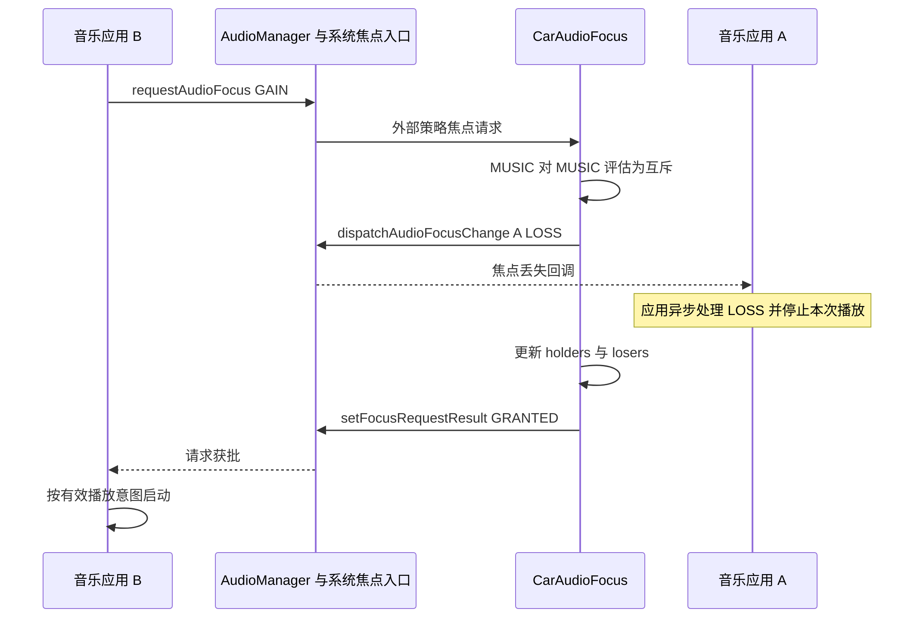

音乐正在播放时，另一款音乐应用请求播放，原应用通常失去焦点；导航插播时，音乐却可能继续保持焦点并降低声音。两种现象说明，车载 audio focus 不是一个永远只允许单一持有者的锁。它管理的是带有用途、请求类型和音区信息的播放关系。

AAOS 通常通过 CarAudioService 注册的外部音频策略处理焦点。Android 通用入口仍负责接收请求，但车载层在音区内决定互斥、并发或拒绝，再把结果送回应用。焦点结果与真正的出声、duck、fade、强制静音分别由相关机制执行，不能把它们统称为一次“抢焦点”。

## 外部策略接管发生在哪里

CarAudioService 创建 CarZonesAudioFocus，将其设为 AudioPolicyFocusListener，并声明该 policy 是 audio focus policy。对应注册在 [setupFocusControlAudioPolicyLocked](https://android.googlesource.com/platform/packages/services/Car/+/9f04df65daa8b9a65ee05fd4039fe95446874d76/service/src/com/android/car/audio/CarAudioService.java#2347)。这使 Car 能够实施多音区和并发交互，而不只是观察普通焦点栈的变化。

MediaFocusControl 发现外部策略后，将请求通知给策略并返回等待外部处理的内部状态，停止继续执行普通焦点栈流程，见 [外部策略分支](https://android.googlesource.com/platform/frameworks/base/+/94b4c163b7dfe5ce3607f7bb8456f9573f7de57d/services/core/java/com/android/server/audio/MediaFocusControl.java#1546)。因此，分析 AAOS 不能只阅读手机默认 focus stack，就断言所有 loss、恢复和渐变规则都相同。

CarZonesAudioFocus 根据请求选择音区，再调用该区 CarAudioFocus，最后通知相关焦点观察者，见 [onAudioFocusRequest](https://android.googlesource.com/platform/packages/services/Car/+/9f04df65daa8b9a65ee05fd4039fe95446874d76/service/src/com/android/car/audio/CarZonesAudioFocus.java#237)。两个不同音区的媒体可以分别持有焦点；如果本应独立的播放互相打断，应先核对音区归属，而不是立即修改交互矩阵。

## 一个请求包含哪些有效信息

用途决定请求被归为音乐、导航、通话等哪种关系。gain request 描述持续性质：GAIN 通常用于持续媒体，TRANSIENT 用于短暂占用，TRANSIENT_MAY_DUCK 表示其他播放可以按策略降低音量继续。Car 代码把 GAIN 识别为永久请求，把 MAY_DUCK 识别为允许 duck，但注释也说明“媒体永久、其他临时”是预期惯例而非所有情况下强制执行的约束。

请求还包含 client ID、UID、属性、flags 等信息。client ID 关联监听器和请求生命周期，UID 用于身份归属，delay 标记表达能否等待，pause-on-duck 标记表达现有应用是否愿意被压低。最终结果不能只根据一个 usage 值判断，必须保留这些输入，见 [evaluateFocusRequestLocked 的前置处理](https://android.googlesource.com/platform/packages/services/Car/+/9f04df65daa8b9a65ee05fd4039fe95446874d76/service/src/com/android/car/audio/CarAudioFocus.java#254)。

系统还可能处于焦点受限状态，或已存在 transient exclusive 请求。它们会在一般矩阵评估前影响接受条件。调试拒绝时，应从入口逐层排除资格、限制、重复请求和交互结果，不能看到 FAILED 就简单解释为“有一个更高优先级声音”。

## 默认矩阵不是一列优先级数字

FocusInteraction 为当前持有者和新请求组合定义三种关系：REJECT、EXCLUSIVE、CONCURRENT。矩阵行表示当前持有者，列表示新进入的请求。它表达场景之间的关系，而不是给每个用途分配一个数字后永远比较大小。

MUSIC 对新 MUSIC 为 EXCLUSIVE，对新 NAVIGATION 为 CONCURRENT，见 [默认 MUSIC 行](https://android.googlesource.com/platform/packages/services/Car/+/9f04df65daa8b9a65ee05fd4039fe95446874d76/service/src/com/android/car/audio/FocusInteraction.java#110)。但 CONCURRENT 并不单独保证两者都保持焦点：代码还要求新请求允许 duck，并考虑旧持有者希望暂停或要求接收 duck 事件等条件，见 [evaluateRequest](https://android.googlesource.com/platform/packages/services/Car/+/9f04df65daa8b9a65ee05fd4039fe95446874d76/service/src/com/android/car/audio/FocusInteraction.java#401)。

| 矩阵结果 | 新请求的基本结果 | 对已有请求的基本影响 |
| --- | --- | --- |
| REJECT | 失败，或在允许条件下延迟 | 保持原关系 |
| EXCLUSIVE | 可授予 | 加入将失焦集合 |
| CONCURRENT | 可授予 | 满足并发条件时保持，否则加入失焦集合 |

例如，导航使用 MAY_DUCK，音乐也接受被压低时，双方可保持焦点；音乐声明 pause-on-duck 后，它应收到相应失焦处理。若导航使用普通 TRANSIENT，同一矩阵单元也不能被解读成永远并发。产品需求应明确 gain 类型和持有者行为，单独贴一张矩阵不足以定义完整体验。

矩阵还可能随用户设置变化。通话期间是否拒绝导航可修改 CALL 对 NAVIGATION 的交互，见 [setRejectNavigationOnCallLocked](https://android.googlesource.com/platform/packages/services/Car/+/9f04df65daa8b9a65ee05fd4039fe95446874d76/service/src/com/android/car/audio/FocusInteraction.java#364)。因此复现这类问题时，应记录用户和设置状态，而不是把源码静态初始化值当成设备当前结果。

## holders 和 losers 如何表达阻塞关系

CarAudioFocus 维护 focus holders 与 focus losers。后者不是所有历史失焦请求的永久存档，而主要保存仍可能恢复的请求，并记录阻止其恢复的 blocker。一个请求可以同时被多个后来的请求阻塞，因此恢复不能仅根据“最后一个声音结束”决定。

临时抢占会把原持有者转入 losers，并添加新请求为 blocker；永久抢占则将原请求按永久失焦处理并清理。区分这两类关系，可以解释为什么导航结束后音乐可能恢复，而另一款音乐接管后原应用通常需要新的播放意图，而不是等待自动回到最前面。

当某个 blocker 退出，服务从等待者的 blocker 列表移除它；只有列表为空的请求才返回 holders 并收到 GAIN。恢复逻辑见 [removeBlockerAndRestoreUnblockedFocusLosersLocked](https://android.googlesource.com/platform/packages/services/Car/+/9f04df65daa8b9a65ee05fd4039fe95446874d76/service/src/com/android/car/audio/CarAudioFocus.java#897)。这个模型适合多份临时声音交错的车载场景，比把 losers 理解成简单的栈更准确。

## 两款音乐应用切换的真实时序

假设 A 正在播放，B 在同一音区用 GAIN 请求媒体焦点，且没有其他拒绝条件。默认 MUSIC 对 MUSIC 互斥，A 将获得永久 LOSS，B 的请求获批。Car 先执行对失焦集合的处理，再把 B 放进 holders，并通过 `setFocusRequestResult` 返回请求结果。

下面先展示未启用 fade 延迟回调的基本路径。回调抵达应用线程的精确时刻与实际停止播放仍取决于应用调度；图中只画出 LOSS 通知，A 的播放器响应不构成 B 获批之前的同步屏障。

若产品启用 Car fade，永久 LOSS 的分发可以走 `dispatchAudioFocusChangeWithFade`，A 的 loss 回调可能延后到 fade-out 完成。Car 不因此等待 A 的整个 fade 才给 B 返回获批，所以 B 开始播放与 A 淡出可以重叠。也没有“所有新 B 都自动从零淡入”的保证。这部分执行链见[降低音量与渐变]()，不应从焦点矩阵本身推导听感。

## 延迟请求不是无限排队

CarAudioFocus 的 `canReceiveDelayedFocus` 要求请求是永久 GAIN，同时带有允许延迟的标记；临时请求不能仅凭应用设置 accepts-delayed 就假定一定进入延迟流程。实现见 [canReceiveDelayedFocus](https://android.googlesource.com/platform/packages/services/Car/+/9f04df65daa8b9a65ee05fd4039fe95446874d76/service/src/com/android/car/audio/CarAudioFocus.java#780)。应用必须处理实际返回值，而不能按自己期望的结果启动。

当前实现维护一个 `mDelayedRequest`。新的不同 client 替换已有延迟请求时，会向旧请求发送 LOSS，再保存新的请求，见同文件的 `swapDelayedAudioFocusRequestLocked`。因此它不是通用的无限 FIFO 队列，测试时需要覆盖“已有一份延迟媒体，又来另一份媒体”的情况。

等待请求也可以被主动 abandon。服务识别到 client ID 对应 delayed request 后清空它。应用若在等待期间取消播放，应释放请求并清除恢复意图，否则稍后有机会获批时可能出现用户未期待的播放。焦点管理与应用状态必须共同完成取消，不能只在界面上把按钮换成暂停状态。

## 重复 client 与请求替换

Car 不允许同一个监听器身份同时承载无法区分的不同请求。当前持有者再次请求同一 context 时，可替换旧请求；不同 context 通常被拒绝，通话与铃声交换存在特定处理。相关分支见 [重复 client 检查](https://android.googlesource.com/platform/packages/services/Car/+/9f04df65daa8b9a65ee05fd4039fe95446874d76/service/src/com/android/car/audio/CarAudioFocus.java#303)。

这是应用设计应尊重的边界。一个同时具备媒体与语音功能的应用，不应把同一个 listener 当作任意用途共用的请求槽，却期待回调自动告诉它究竟哪份播放受影响。应明确定义会话和监听器关系，并在切换用途时正确释放或替换请求。

相反，无节制创建新 listener 也不合理：它可能让旧请求继续存在，形成应用自身的阻塞关系。可靠的实现既不混用不同请求身份，也不遗留不用的身份。系统日志中的 client ID 是排查这类问题的重要依据，包名相同并不代表只有一个焦点请求。

## OEM 策略与执行约束的边界

CarAudioFocus 可以走内部评估，也可以在 OEM 服务启用且就绪等条件满足时请求外部评估。默认矩阵因此不是所有量产产品的最终规则。分析某款车的行为，应先确认 OEM 焦点服务是否实际参与，再使用相应结果解释 holders、losers 和延迟状态。

OEM 扩展改变的是决策来源，焦点执行仍需通过服务更新状态和分发结果。另一方面，[焦点强制执行]()处理不遵守焦点的播放，是另一个机制。被授予焦点与播放器真正出声、丢失焦点与数据立即停止，都不能在没有执行证据时画等号。

对于系统开发者，最重要的设计纪律是保持决策与执行可观察。记录焦点结果后，再记录应用响应、duck/fade 或 silence 状态，才能判断体验问题来自规则不合理、回调处理错误还是执行链路未达到目标。

## 推演三个请求交错时的状态

考虑一个明确的策略假设：媒体 A 正在播放，临时请求 B 到来使 A 暂时失焦；B 仍存在时，临时请求 C 又到来，并且根据产品规则，C 也阻止 A 恢复。这个例子只用于解释 blocker 模型，不假定 B 和 C 必须属于某两种固定用途。实际用途组合应按产品矩阵选择。

此时 A 的等待关系需要同时记住 B 和 C。若 B 先结束，A 仍被 C 阻塞，不能收到恢复通知；如果只维护“最近打断我的请求是 B”这样的单一字段，就会错误恢复。等 C 也结束，A 才具备重新进入 holders 的条件。应用是否真正开始播放，还要检查用户在等待期间是否取消。

如果 C 是永久请求，状态含义又不同。A 可能不再作为可恢复等待者保留，原有 blocker 关系也需要清理。不能把所有新请求都压入一个队列，再在最后统一恢复旧声音。永久与临时的差别决定了请求生命周期，而不是只决定一条回调常量的名字。

这个推演可以转成状态断言：B 到来后 A 位于 losers；C 到来后 A 的 blocker 集合反映仍有效的阻塞；只移除 B 后 A 不恢复；所有有效 blocker 消失后才发送 GAIN。断言关注关系是否正确，比只在扬声器端判断音乐有没有短暂响起更接近仲裁实现。

请求被应用主动 abandon 与进程退出也应走同样的清理原则。对等待者而言，关键是对应 blocker 已经失效，而不是它为什么失效。测试应覆盖主动结束和异常退出两种路径，确认不会遗留一个永远阻止恢复的条目。若只在异常退出后无法恢复，可重点检查身份和生命周期通知。

## 请求结果与回调处理不是同一时刻

外部策略把 GRANTED 返回新请求者，表示系统决定接受该请求；旧应用真正停止播放则发生在它收到并处理 LOSS 之后。它们之间涉及异步传递和应用线程调度。即便没有系统 fade，也不能从服务函数调用的先后关系推导出扬声器上的严格无重叠切换。

因此，记录时至少区分请求发起、策略结果、应用收到回调和播放器状态变化四个事件。如果策略结果及时但播放器很晚停止，应检查应用控制线程或播放器行为；如果请求长时间没有结果，应继续查策略处理和系统交互。将它们全部记成一个“focus 时间”会丢失定位能力。

fade 开启后，这种区别更明显：系统可以有意延后旧应用的 LOSS 通知，让已开始的音量包络先完成。此时听感上的一段过渡可能符合设计。反过来，如果应用自己先停止，系统包络也不能制造原本已经不存在的数据。过渡效果来自决策、音量处理与播放器行为的共同作用。

同样，收到 GAIN 不表示所有状态都已经恢复到适合出声。应用可能仍在缓冲，路由可能刚刚切换，或者用户已取消播放。平台排障应先确认焦点关系，再确认实际播放器和设备状态；应用排障则应从有效意图和会话状态出发。两方使用同一时间线，才能确定责任边界。

## 拒绝结果需要保留完整上下文

对于一次 FAILED 请求，问题单应包含请求用途、gain 类型、flags、UID、client ID、音区和当时 holders/losers。只有包名和返回值通常不足以复现，因为同一应用可以在不同用户、不同音区、不同会话中提出完全不同的请求。

还应记录是否使用 OEM 评估、是否启用相关用户设置，以及是否处于焦点受限状态。若一个产品在通话中允许导航，另一个产品拒绝导航，可能来自明确配置差异，并非任何一方必然违反默认实现。分析应先确认决策来源，再讨论规则是否符合产品需求。

修改焦点策略后，回归范围应覆盖被改变单元的两个方向和相关并发组合。当前持有者是音乐、新请求是导航，与当前持有者是导航、新请求是音乐，是两个不同输入。只验证其中一个方向，很容易遗漏非对称关系；只验证两个请求，也可能遗漏多个持有者共同参与评估时的结果。

焦点测试最终应同时证明“该播放时可以播放”和“不该恢复时没有恢复”。后一类尤其重要：用户主动暂停、永久失焦、延迟请求被替换以及仍存在 blocker，都会使自动恢复不成立。系统与应用共同守住这些条件，才能避免座舱中突如其来的旧媒体播放。

## 如何构造焦点验证矩阵

测试应从同音区两款媒体开始，验证新请求获批和旧请求永久 LOSS；然后加入导航 MAY_DUCK，分别让音乐允许 duck 与要求暂停，确认结果不同。再测试普通 TRANSIENT、通话期间导航设置，以及请求延迟和延迟替换。每个用例都记录完整属性、gain 类型、flags、client ID 和音区。

多 blocker 场景也不可省略。让一份媒体被两个临时请求依次阻塞，只结束其中一个，确认媒体不会过早恢复；再结束剩余 blocker，确认恢复符合应用仍有效的播放意图。这个实验能直接验证等待者关系是否被正确维护。

遇到“焦点恢复了但没声音”，先检查应用是否启动，再检查 route、mute 和 fade/duck 状态；遇到“失焦后仍有声音”，先确认回调是否抵达及应用是否响应，再看是否属于可并发或受约束的特殊路径。按这条顺序分析，才能让每一项修复落在真正负责该行为的模块上。

<!-- series-navigation -->
## 系列导航

[系列目录]()

[上一篇：Core Audio 路由与音量方案]()

[下一篇：压低音量与淡入淡出]()
