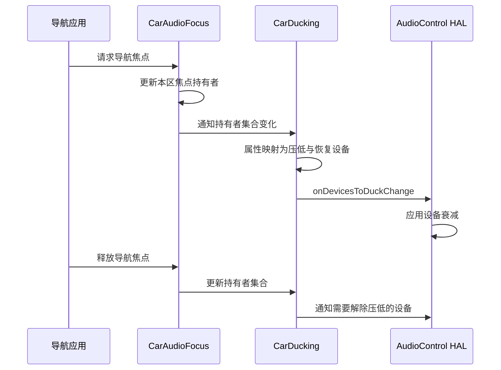
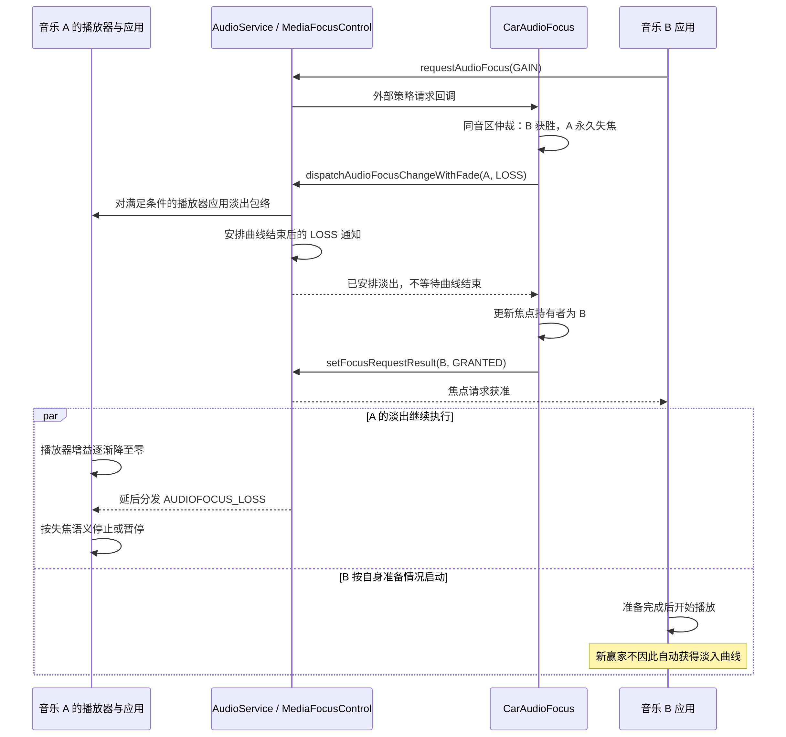

音乐正在播放，导航开始报路，音乐变轻；音乐应用甲播放时，应用乙开始播放，甲的声音逐渐消失。这两种听感都包含音量变化，却对应不同的控制目标。前者允许声音并存，后者通常伴随焦点持有者退出。要把过渡做得稳定，必须同时回答谁决定变化、变化落在哪个对象上，以及对象何时恢复。本篇以[系列基线]()为准，分别讨论设备 ducking 与播放器 fading，并解释为什么获得焦点不保证新音乐自动淡入。

## 三种容易混淆的声音变化

Ducking 是把某路声音临时压低，让更重要的声音保持清晰。音乐仍可继续推进播放进度，导航结束后再恢复。Fade-out 是随时间把增益降到零，常用来缓和永久失焦时的突变。Fade-in 则随时间恢复增益，但必须追问恢复的是哪个对象：被系统淡出的旧播放器、应用自己新建的播放器，还是功放中的某条输入通道。

车机还存在名为 fader 的前后声场调节。AudioControl HAL 的 `setFadeTowardFront()` 改变前排与后排扬声器之间的声音分布，参数不是毫秒，也不代表播放切换的淡出曲线。将这三个概念都记成“fade”，会在配置评审中产生直接的责任错配：界面工程师改前后声场，用户期待的却是歌曲切换的平滑度。[AudioControl前后分布接口]()

焦点负责决定哪些声音可以持有播放资格，ducking 与 fading 负责把结果落实为声音行为。资格与执行不是一个状态：焦点回调已经到达，并不证明外部功放已经应用衰减；播放器仍为 started，也不证明当前能够听见。排障时要保留这些差别，而不是寻找一个包办全部事实的“正在播放”标志。

## 车载 ducking 从焦点集合生成设备集合

AAOS 的 `CarDucking` 接收每个 zone 的焦点持有者变化。它把焦点信息转换成音频属性，生成包含当前 zone、音量组信息和活动属性的请求，再选择内部规则或可用的 OEM ducking 服务。随后，计算结果被转换成设备地址，交给 `AudioControlWrapper.onDevicesToDuckChange()`。这里计算的是当前应压低哪些设备，以及哪些设备应解除压低。[CarDucking 的更新入口与策略选择](https://android.googlesource.com/platform/packages/services/Car/+/9f04df65daa8b9a65ee05fd4039fe95446874d76/service/src/com/android/car/audio/CarDucking.java#71)

注意请求对象字段叫 active playback attributes，而此处实际输入来自焦点持有者。不能看到字段名称就认定每个条目都有正在向扬声器输送的数据。应用可能先获取焦点，再准备解码器；在这段时间，策略已经看到该声音的存在。这个设计使声音开始之前就能安排其他通道的让路行为，也意味着应用不应长时间无意义地占有焦点。

以下时序描述导航与音乐允许并存、并且 HAL ducking 通道已启用的代表性场景。箭头表示控制请求，最终衰减的幅度和过渡形状由实际执行端实现。

压低集合不是简单地将低优先级属性全部映射为地址。`CarDuckingUtils` 先得到需要 duck 的 context 对应地址，再求出仍持有焦点、但不应 duck 的 context 对应地址；两者相交时，后者从待压低地址中移除。原因是设备级衰减会影响该设备承载的所有声音，不能为了压低音乐，把共享同一 bus 的导航也压低。[共享设备保护与恢复集合差分](https://android.googlesource.com/platform/packages/services/Car/+/9f04df65daa8b9a65ee05fd4039fe95446874d76/service/src/com/android/car/audio/CarDuckingUtils.java#56)

这条规则把路由设计和用户听感连接起来。若音乐与导航都被映射到同一不可分离的设备通道，策略层可能知道应该压低音乐，执行层却没有独立控制音乐的对象。此时继续调整 ducking 优先级并不能获得预期效果，需要重新检查 context 到 bus 的映射，或确认下层是否还有可独立处理的音轨。设备地址既是路由标识，也是控制粒度的边界。

解除压低采用新旧集合差分：之前需要 duck、现在不再需要的地址进入 unduck 列表。这个设计避免在每次焦点变动时盲目重置所有设备。对 HAL 来说，正确处理恢复与正确处理压低同样重要；若只记录 duck 请求、不清除旧状态，导航结束后音乐就会长期偏小。

## 两条执行路径不能叠加推断

本树资源 `audioUseHalDuckingSignals` 默认是 true，但设备 overlay、HAL 能力与服务初始化共同决定最终是否使用。它表示允许向 HAL 提供设备 ducking 信号，不能据此推断固定衰减分贝或固定渐变时间。[HAL ducking 资源说明](https://android.googlesource.com/platform/packages/services/Car/+/9f04df65daa8b9a65ee05fd4039fe95446874d76/service/res/values/config.xml#45)

车载外部焦点策略与标准 framework 的自动 ducking 还需要协调。CarAudioService 中明确说明车载策略处理并发焦点关系，并绕过 framework 的 ducking 逻辑。分析 AAOS 行为时，应先确认当前注册的外部策略，再沿其实际分支跟踪。把手机路径中的自动 duck 曲线原样套到每一台车机会把不同执行端混在一起。[车载焦点与 ducking 的协调](https://android.googlesource.com/platform/packages/services/Car/+/9f04df65daa8b9a65ee05fd4039fe95446874d76/service/src/com/android/car/audio/CarAudioService.java#2347)

如果产品另外要求应用收到可 duck 失焦后自行降低音量，必须明确它与 HAL 衰减的组合关系。两个独立乘法增益同时下降，会让声音比任一团队设计的目标更轻；恢复时间不同又会形成二次起伏。集成设计应指定每类声音由谁负责 duck，并把其他层的增益变化纳入测量，而不是只比较某一层的整数音量值。

## Fade-out 是播放器上的音量曲线

Framework 的 `FadeOutManager` 通过 `PlayerProxy.applyVolumeShaper()` 向播放器应用曲线。默认 fade-out 时长为两秒，曲线控制点为时间比例零、四分之一、一，分别对应增益一、零点六五、零。这里的增益是一条乘法包络，不等于音量组 index，也不是 HAL 设备地址的 gain。[默认曲线与适用属性](https://android.googlesource.com/platform/frameworks/base/+/94b4c163b7dfe5ce3607f7bb8456f9573f7de57d/services/core/java/com/android/server/audio/FadeConfigurations.java#45)

默认规则仅允许 media、game usage，排除 speech 内容以及 AAudio、SoundPool 播放器类型。请求者是 speech，或输家声明遇到可 duck 丢失时应暂停，也会让 `canCauseFadeOut()` 拒绝触发。这些条件说明系统淡出不是所有声音都统一执行的全局后处理；必须结合焦点申请属性和实际播放器属性判断。[触发双方的限制](https://android.googlesource.com/platform/frameworks/base/+/94b4c163b7dfe5ce3607f7bb8456f9573f7de57d/services/core/java/com/android/server/audio/FadeOutManager.java#141)

在外部策略使用带 fade 的分发接口时，`FocusRequester` 对永久 `AUDIOFOCUS_LOSS` 尝试淡出，并在成功后延迟发送失焦通知。临时失焦和可 duck 失焦不应仅因名字里有 loss 就被解释成同一条两秒淡出路径。永久失焦的延迟使应用有机会在曲线结束之后停止播放器，从而避免应用立刻暂停破坏过渡。[带淡出的失焦分发](https://android.googlesource.com/platform/frameworks/base/+/94b4c163b7dfe5ce3607f7bb8456f9573f7de57d/services/core/java/com/android/server/audio/FocusRequester.java#569)

这个时序也解释一种常见日志现象：声音已经在降低，但应用尚未打印失焦回调。只看回调时间会误判为系统“提前操作了声音”。实际上淡出本身就是服务端安排的前置动作。测量时应同时记录请求进入、曲线启动、焦点通知和播放器暂停四个时间点。

## 两个音乐应用切换的完整时序

先限定场景：A、B 位于同一音区，均以媒体属性申请永久焦点，策略决定 B 独占；产品已启用车载 fade 配置，A 的播放器也满足淡出条件。CarAudioFocus 在处理 A 的永久失焦时调用带 fade 的分发接口，随后更新持有者并通过 `setFocusRequestResult()` 回报 B。它没有等待 A 的曲线结束。底层返回的 `AUDIOFOCUS_REQUEST_DELAYED` 在这里表示 A 的失焦通知被延后，并不自动把 B 的请求变成“等待焦点”。[失焦处理与请求结果回报](https://android.googlesource.com/platform/packages/services/Car/+/9f04df65daa8b9a65ee05fd4039fe95446874d76/service/src/com/android/car/audio/CarAudioFocus.java#450)

这是逻辑控制时序，省略了 Binder 代理和播放器内部线程；请求分发不会用 Binder 承载 PCM。图中的并行意味着 A 的尾音与 B 的起音可以重叠，也可能因 B 尚未准备好而出现空白，并不承诺固定交叉淡化时长。若 A 不符合淡出条件或产品没有启用这条路径，失焦通知会沿普通分支发送，A 是否平滑退出取决于应用和实际执行端。若两者属于独立音区，则先按各区策略分别仲裁，不能直接套用这张同区独占图。

## 新获得焦点的应用为何不一定淡入

设音乐甲已经播放，音乐乙请求并获得焦点。系统可能对甲的现有播放器淡出，但不会仅因为乙是赢家就把乙的输出从零拉到一。`unfadeOutUid()` 首先查找 UID 是否存在于被淡出的应用集合，没有记录便直接返回；进一步的 `fadeInPlayer()` 只处理已经存在于淡出播放器集合中的 player。[恢复操作的对象检查](https://android.googlesource.com/platform/frameworks/base/+/94b4c163b7dfe5ce3607f7bb8456f9573f7de57d/services/core/java/com/android/server/audio/FadeOutManager.java#214)

因此，源码中存在 fade-in，并不能证明“每个新赢家都有淡入”。它主要恢复之前受系统淡出影响的播放器。新配置默认恢复曲线为一秒，旧配置路径则反向播放原淡出曲线。这个默认值只适用于被该机制恢复的对象；它不是对所有媒体 App 的入场动画承诺。[淡入默认时长](https://android.googlesource.com/platform/frameworks/base/+/94b4c163b7dfe5ce3607f7bb8456f9573f7de57d/media/java/android/media/FadeManagerConfiguration.java#144)

恢复也不只有重新获焦这一种入口。MediaFocusControl 在延后派发 LOSS 后，还会安排 offender 延迟，之后通过 `forgetUid()` 撤销该 UID 的 fade 状态；PlaybackActivityMonitor 最终同样调用 `unfadeOutUid()`。默认 offender 延迟为两秒，它与淡出时长、淡入时长是三个不同计时。这个清理动作只撤销 fade 层，并不重新授予焦点：遵守协议的应用仍应停止播放，车载焦点强制执行也可能继续保持自己的静默限制。[延后失焦与清理调度](https://android.googlesource.com/platform/frameworks/base/+/94b4c163b7dfe5ce3607f7bb8456f9573f7de57d/services/core/java/com/android/server/audio/MediaFocusControl.java#1958)；[forgetUid 的恢复动作](https://android.googlesource.com/platform/frameworks/base/+/94b4c163b7dfe5ce3607f7bb8456f9573f7de57d/services/core/java/com/android/server/audio/PlaybackActivityMonitor.java#1022)

如果产品要稳定的音乐交叉淡化，需要由能够同时控制两路播放器生命周期的组件协调。它要知道旧音轨剩余数据、新音轨准备状态、音量包络，以及焦点是否允许重叠。两个相互独立的第三方 App 并不会自然共享这些信息。系统的失焦保护可以缓和旧声音退出，却不能保证新应用准备时间，更不能保证两首歌曲的音乐节拍对齐。

同一 UID 还可能创建多个播放器，恢复时不能只盯住 App 包名。原播放器释放后创建的新 player，其接口标识不同，系统记录也不同。抓取声音过渡问题时，UID、player interface id、属性、生命周期必须一起保留；否则容易把旧轨恢复和新轨启动错认为一次连续操作。

## 车载淡出配置如何进入 framework

AAOS 使用淡出管理配置还需要额外条件。本树 `audioUseFadeManagerConfiguration` 资源默认 false，服务同时检查 framework 与 car 侧 feature flag。资源启用后，车载配置可以按 zone 配置引用命名的 fade 定义，在分发焦点变化时携带相应配置。不能因为 framework 内有默认两秒曲线，就推断车载外部策略已经调用该路径。[车载开关与配置要求](https://android.googlesource.com/platform/packages/services/Car/+/9f04df65daa8b9a65ee05fd4039fe95446874d76/service/res/values/config.xml#90)

配置选择也有作用域。主区默认配置会设置到核心框架；非主区在需要时将该区默认配置作为本次临时配置传入。OEM 服务还可以针对音频属性提供临时配置，相关选择应连同请求属性一起检查。产品开发应为正常音乐切换、紧急提示、语音内容分别确认目标，不宜只修改一个全局时间后期待所有场景一致。

应用侧的原则比较简单：申请焦点和创建播放器使用一致的 AudioAttributes；只在允许播放后启动；失去焦点后按回调语义处理；不要依赖未约定的服务端淡入补偿应用自身的起音突变。系统侧则应把 fade 作为明确开启、有适用集合的执行机制，写入配置验收范围。

## 用可观察状态验证声音过渡

可以构造下表中的最小场景，每次只改变一个条件。测试音频宜使用稳定电平的素材，以便把内容本身的强弱变化与系统增益区分开。记录声卡或外部采样设备上的包络时，还应同步记录播放器和设备状态，避免把硬件静音切换当成曲线。

| 场景 | 重点观察 | 能回答的问题 |
|---|---|---|
| 音乐与导航分离到不同 bus | duck 地址和 unduck 地址 | 是否存在可独立衰减的设备 |
| 两类声音共享 bus | 是否触发共享设备保护 | 为什么策略希望 duck 却没有设备动作 |
| 两个普通媒体 App 交替获焦点 | 旧 player 曲线与新 player 启动 | 是否只有旧声音淡出 |
| 旧应用重新获得焦点 | 被淡出记录与恢复曲线 | 听到的淡入是否来自恢复 |
| speech 内容或排除类型 | fade 资格判断 | 为什么相同焦点变化没有相同曲线 |

遇到“音乐切换有时顺滑、有时突兀”，先比较是否走了同一焦点分发接口，再比较播放器类型、属性与现存淡出记录。遇到“导航结束后音量没恢复”，则先比较 duck 地址的新旧集合与 HAL 接收状态，随后检查应用是否还保留自己的降音量因子。把焦点、播放器包络、设备衰减、用户音量四层分开，才能把听感差异定位到可修复的控制动作。

## 从听感需求写出可验收的约定

“导航来了音乐轻一点”不是完整需求。至少应说明导航首次持有焦点时是否立即压低、导航两句话之间的静音是否保持压低、导航释放焦点后多久恢复，以及多段导航连续到来时是否重新启动下降曲线。这些条件决定听感是否稳定。若应用每句话都释放再申请，设备层可能反复下降和恢复；若整段导航持续持有焦点，音乐可能在较长空白期仍保持低电平。两种行为都可能符合某段代码，却对应不同的产品体验。

对后排同时播放的电影，还要确认前排导航是否应该影响后排。设备地址列表携带 zone 信息，意味着可以表达各区的变化，但物理功放的通道共享仍可能破坏隔离。验收时必须同时监听两个座位区域，不能只确认主区请求生成了正确列表。若两区共享了执行端增益，应把该事实明确写进路由约束，而不是让应用通过反复调高音量补偿。

另一个场景是提示音刚开始，媒体应用同时响应可 duck 回调，系统又发出 HAL duck 信号。音量曲线可能先下降一次，再下降一次，听起来像“导航吞掉音乐”。最有效的分离方法是固定媒体自身增益、观察设备衰减，再固定设备衰减、观察应用增益。这里的固定应在可控测试版本中完成，并保持素材、组音量和输出通道相同，才能比较两个控制动作的贡献。

恢复也需要定义优先级。假设导航期间用户按下静音，导航结束时解除 duck 应只撤销临时衰减，不应解除用户静音。假设用户把音乐音量调低，解除 duck 也不应恢复成导航之前的绝对电平。实现应把用户目标与临时系数分别保存，恢复时重新组合当前有效状态。这个原则同样适用于播放器曲线：恢复系统包络，不代表重写应用刚刚选择的内容音量。

最后，交叉淡化的验收要包含播放器准备失败。若新应用因网络缓冲迟迟没有数据，旧应用可能已经失焦并淡出，出现短暂安静并不证明 fade 算法错误。要消除这种空白，需要媒体业务协调准备和切换时机，而不仅是把淡出时间拉长。通过把“旧声音如何退出”和“新声音何时可用”拆成两项指标，可以避免用一条曲线掩盖播放链路中的等待问题。

<!-- series-navigation -->
## 系列导航

[系列目录]()

[上一篇：音频焦点仲裁]()

[下一篇：音频焦点强制执行]()
