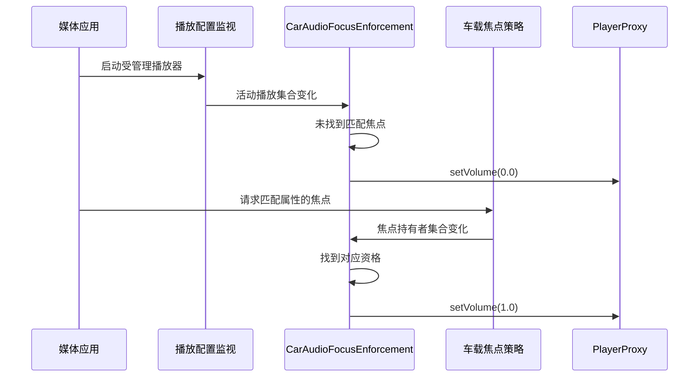

焦点仲裁已经通知音乐应用停止，扬声器却仍有音乐；另一个应用完全没有申请焦点，照样创建播放器输出声音。仅靠应用合作，无法把“谁可以播放”的规则可靠落实。本篇讨论本系列源码中的 `CarAudioFocusEnforcement`：它观察实际活动播放器，对指定范围内没有匹配焦点的播放施加静默。它与[焦点仲裁]()、[淡出]()各有不同职责，理解这些边界才能解释“播放状态正常但没有声音”。

焦点“申请被拒绝”还有另一个入口：AudioService 在交给 MediaFocusControl 前，通过 `HardeningEnforcer.blockFocusMethod()` 检查申请资格。本篇讨论的 CarAudioFocusEnforcement 则在焦点或播放快照变化之后，对不匹配的播放器执行静默。前者决定请求能否进入仲裁，后者约束已经出现的播放，不能把二者视为同一条规则。[申请入口的准入检查](https://android.googlesource.com/platform/frameworks/base/+/94b4c163b7dfe5ce3607f7bb8456f9573f7de57d/services/core/java/com/android/server/audio/AudioService.java#12795)

## 仲裁结果为何还需要执行机制

音频焦点本身是一套协商协议。申请者表达需求，策略决定授予、拒绝或延迟，已有持有者收到状态变化。创建和启动播放器则沿另一套接口执行。一个编写不完整的应用可以遗漏焦点申请，也可能收到失焦后没有停止。这时焦点列表与实际播放列表发生偏离，单纯调整焦点优先级无法修复偏离。

强制执行把两份状态放在一起比较：活动播放器回答“谁确实在播放”，焦点持有者回答“谁已经获得相应资格”。若某个受管理播放器没有匹配资格，服务通过播放器代理将其静默；重新匹配后再恢复。该机制没有替应用创建焦点请求，也不将被拒绝的请求自动改成成功。它执行既有资格，而不是另建一套仲裁规则。

这一区分影响应用排障。播放器写入成功、播放进度推进，说明数据和生命周期路径仍在工作；强制静默可能只改变服务端施加的音量因子。如果开发者将“没有声音”一律视为解码失败，就会在错误的层面重建播放器，甚至反复触发静默判断。

## 启用条件和主区范围

CarAudioService 初始化时将 feature flag、非 legacy 模式和 `audioEnableAudioFocusEnforcement` 资源组合起来决定是否启用。本树资源默认 true，默认受管理 usage 为 media、game 和 announcement；这些默认配置并不能代替对产品最终资源与 flag 的检查。[初始化条件](https://android.googlesource.com/platform/packages/services/Car/+/9f04df65daa8b9a65ee05fd4039fe95446874d76/service/src/com/android/car/audio/CarAudioService.java#502)；[资源及默认集合](https://android.googlesource.com/platform/packages/services/Car/+/9f04df65daa8b9a65ee05fd4039fe95446874d76/service/res/values/config.xml#136)

当前实现只处理主音区。`onFocusChange()` 和 `onAudioPlaybackChange()` 都遍历各区输入，但遇到非 `PRIMARY_AUDIO_ZONE` 就跳过。不能因回调输入是按 zone 组织的集合，就宣称后排音区也受到相同强制静默。多区域产品需要分别验证，不应把主区案例外推到全车。[主区过滤](https://android.googlesource.com/platform/packages/services/Car/+/9f04df65daa8b9a65ee05fd4039fe95446874d76/service/src/com/android/car/audio/CarAudioFocusEnforcement.java#389)

受管理集合不是“所有声音”。设置集合时，源码拒绝把 emergency、safety、call assistant、voice communication 和 voice communication signalling 纳入其中。这个约束避免用同一普通媒体执行策略去静默关键通信或安全用途。配置开发者应尊重语义分组，而不是为了压住某个有问题的应用，直接扩大到所有 usage。[关键用途校验](https://android.googlesource.com/platform/packages/services/Car/+/9f04df65daa8b9a65ee05fd4039fe95446874d76/service/src/com/android/car/audio/CarAudioFocusEnforcement.java#91)

产品若需要豁免更细粒度的属性，还可以配置 do-not-silence 列表。默认该列表为空。它和受管理 usage 集合一起形成“先决定是否属于管理范围，再判断是否被精确豁免”的规则。豁免是对具体属性的契约，应追踪来源、用途与实际播放器属性，避免变成无法解释的永久例外。

## 两种事件共同驱动检查

只监听焦点变化不足以执行规则。应用可能在焦点不变时新建播放器，也可能先获得焦点很久之后才开始播放。因此，服务同时连接焦点持有者回调和播放配置回调：前者更新资格，后者更新实际播放器。任一侧发生变化，都以另一侧的当前快照重新求值。[CarAudioService 连接两种回调](https://android.googlesource.com/platform/packages/services/Car/+/9f04df65daa8b9a65ee05fd4039fe95446874d76/service/src/com/android/car/audio/CarAudioService.java#2351)

下图描述一个没有申请焦点的受管理媒体播放器，随后补充正确焦点请求的概念时序。评估器是播放器层的执行者，焦点的授予仍由原有策略负责。

评估不是每次都无条件发送音量操作。实现保存当前已静默的 player interface id 集合，只有目标状态与已记录状态不同才调用代理。这样可以避免重复回调导致重复设置，也使日志更适合反映状态转换。这个标识属于一次播放器实例，不能拿包名替代；同一个应用的多个播放器可以具有不同的属性和匹配结果。

由于焦点通知和播放通知来自不同事件源，调试时应按时间排序保留两边的更新。不要仅凭其中一个快照断言应用违规，也不要为了消除一次短暂时序窗口就给所有播放器加豁免。先确认应用是否严格遵守“焦点结果允许之后再启动”的协议，再分析服务端的事件处理。

## 播放器与焦点如何匹配

管理范围匹配使用 `CarAudioContext.getAudioAttributesMatchScore()`，达到 usage 匹配级别就可以纳入检查。随后，精确匹配 do-not-silence 属性的播放器直接豁免。对其余对象，`shouldSilence()` 寻找相同 UID 的焦点条目，并比较 system usage 与 tags。两者均匹配时，认为该播放拥有资格；没有匹配项则应静默。[资格匹配逻辑](https://android.googlesource.com/platform/packages/services/Car/+/9f04df65daa8b9a65ee05fd4039fe95446874d76/service/src/com/android/car/audio/CarAudioFocusEnforcement.java#317)

UID 匹配避免应用借用另一个应用的焦点。usage 匹配避免同一进程申请了媒体焦点，却据此无限扩展成其他用途。tags 又提供更细的契约边界：请求焦点时和创建播放器时若用了不同标签，即使 UID、usage 看起来相同，也可能不匹配。标签比较会移除空或纯空白项，但不会把任意不同标签自动视为同一种声音。

因此，最可靠的应用写法是用同一份不可变 AudioAttributes 同时构建焦点请求与播放器配置。不能让业务层生成一份带标签的焦点属性，底层播放封装再偷偷换成只有 media usage 的默认属性。两套属性在某些系统上都能发声，并不意味着它们满足当前强制执行契约。

匹配并不是按焦点 client id 逐个绑定播放器。一个 UID 下的多个播放器，如果使用相同 system usage 和标签，可能被同一个匹配焦点覆盖。系统集成时应据此设计声音分类；若希望同一应用内部有独立受控的播放身份，需要保证请求与播放两边都使用一致的区分信息，而不是只给播放器起不同名称。

## 静默执行与失败处理

执行端通过 `PlayerProxy` 调用零或一的音量操作。它不在此处创建淡入淡出曲线，也不直接停止解码器，更不调用 AudioControl HAL 去压低整个设备。将这种静默理解为设备级 ducking，会错误地扩大影响范围；将恢复理解为重新播放，也会误判媒体进度。[代理执行与异常回滚](https://android.googlesource.com/platform/packages/services/Car/+/9f04df65daa8b9a65ee05fd4039fe95446874d76/service/src/com/android/car/audio/CarAudioFocusEnforcement.java#247)

调用前，服务更新已静默集合；代理调用抛异常时，再把集合回滚，以免内部认为已经执行成功。缺失代理时同样记录错误而不报告成功状态。这个顺序体现了一个通用要求：策略状态与执行结果不能永久脱离。抓取日志时，既要看“应该静默”的判断，也要看代理调用是否失败。

恢复使用一的服务侧音量因子，含义是撤销这层执行的衰减。产品中用户组音量、设备 gain、其他静音或应用自己的音量控制仍需分别考虑。不能看到恢复操作就认定声音必然达到用户预期电平；它只证明当前这一层不再要求静默。

对持续输出的违规播放器，静默不会自动节省解码、网络或 CPU 工作。应用仍应正确处理焦点变化并暂停业务。强制执行是系统对不合作行为的限制，不应成为应用忽略回调的借口；否则虽然没有扰民声音，后台资源消耗和状态不一致仍然存在。

## 停车放宽有条件也有覆盖项

本树还提供停车时放宽强制执行的策略。资源允许放宽、车辆被判定为 parked、且没有强制覆盖时，服务会启用 relaxed park mode。评估器在放宽模式下仍检查是否存在关键音频焦点；只有没有关键请求时，才恢复此前由它静默的活动播放器并返回。[放宽与关键焦点判断](https://android.googlesource.com/platform/packages/services/Car/+/9f04df65daa8b9a65ee05fd4039fe95446874d76/service/src/com/android/car/audio/CarAudioFocusEnforcement.java#171)

这个分支使车载娱乐用途与驾驶场景可以有不同约束，同时避免“停车模式”简单覆盖所有关键提示。测试停车放宽时，应同时包含有、无关键焦点两类场景。只把挡位变为驻车再听一段音乐，无法覆盖完整条件。

`setEnforceableAudioFocusEnabled()` 的名称也容易导致误读。当前服务实现保存 `mForceEnableAudioFocusEnforcement`，并在停车监视器存在时重新计算停车放宽状态。它不能被脱离初始化开关解释成一个任意开启或关闭整套功能的普通布尔开关；传 false 主要撤销强制覆盖，并不等价于关闭已经启用的执行机制。[强制覆盖接口](https://android.googlesource.com/platform/packages/services/Car/+/9f04df65daa8b9a65ee05fd4039fe95446874d76/service/src/com/android/car/audio/CarAudioService.java#3534)

这些接口受车载音频设置控制权限保护。普通媒体应用无需也不应依靠切换系统策略来获得声音；应用只要满足焦点契约。系统设置或诊断工具则必须说明操作影响的是停车放宽、管理范围还是主功能开关，避免界面只有一个模糊的“音频焦点开关”。

## 用例设计应覆盖匹配与恢复

下面的矩阵是集成验证的起点，实际结果还需结合产品最终资源。每轮测试记录 UID、player id、system usage、tags、zone、焦点持有者以及停车状态，并保留播放持续时间轴。

| 输入条件 | 预期检查方向 |
|---|---|
| 主区 media 播放且未请求焦点 | 在启用且未放宽时进入静默 |
| 焦点与播放 UID、usage、tags 一致 | 获得对应资格并解除本机制静默 |
| 同 UID 但标签不同 | 不能仅凭 UID 判定匹配 |
| 非主区播放 | 当前实现的主区执行器跳过 |
| 精确命中豁免属性 | 不因缺少焦点被此机制静默 |
| 停车放宽且无关键焦点 | 恢复此前被本机制静默的活动播放器 |
| 停车放宽期间出现关键焦点 | 重新进入正常执行判断 |

一个有价值的故障复现是让应用先正确申请 media 焦点，再将播放器属性改成带新标签的 media。它能隔离“根本未申请”与“申请和播放不一致”两类问题。第二个复现是在静默期间释放旧 player，再创建新 player，检查新实例能否按当前资格重新求值，避免测试只覆盖一次创建。

另一个必须覆盖的恢复过程是应用失焦后继续播放，随后用户重新选择该媒体源。应用重新请求焦点后，检查声音恢复来自资格重新匹配，而不是重新设置用户音量偶然绕过症状。若只有重启应用才恢复，应比较新旧 player id、代理异常、焦点列表和放宽状态，逐一确认哪层状态没有更新。

## 与其他静音机制一起排查

车机无声并不一定来自焦点执行。用户可能静音了音量组，HAL 可能报告阻断或限制，电源策略可能禁止音频，播放器也可能处于淡出后的恢复过程。把所有静音都压缩成一个布尔值，会让界面与日志无法解释解除哪一层后仍然没有声音。

合理的排障顺序从事实出发：先确认活动 player 及其 zone，再确认对应焦点资格，随后查看强制执行记录和代理错误，最后对照组静音、设备 gain 与路由。如果播放器根本没有启动，就不应首先修改 enforcement 配置；如果目标属于后排音区，也不应拿当前仅主区的执行器作为唯一解释。

对系统开发者而言，最重要的设计成果不是“违规应用终于安静了”，而是每次静默都能解释为明确条件，每次资格恢复都能撤销对应限制。应用、系统 UI 和测试工具围绕同一组身份信息观察，才能使焦点从礼貌协商变成可验证的车载播放秩序。

## 应用封装与系统界面如何协同

媒体框架通常把焦点管理放在业务控制器，把播放器创建放在独立播放引擎中。两者分层本身没有问题，但需要一个共同的声音身份对象，至少保存本次播放的属性和焦点请求生命周期。业务控制器不应在获得焦点后丢弃请求状态，播放引擎也不应在切歌、切换音频输出或者重建解码器时退回另一组默认属性。否则首曲正常，第二曲开始无声，会被误认为曲目编码不兼容。

系统界面应把“受焦点执行静默”作为可解释状态，而不是自动改动音量滑块。如果应用仍在播放但失去资格，界面可以继续显示媒体进度，同时让诊断页展示对应限制原因。若界面擅自把组音量改成零，用户重新选中媒体源后即使执行器恢复，声音仍会被组音量压住；这把临时资格问题写进了持久化偏好，扩大了故障影响。

测试还应包含快速操作。用户连续选择两个媒体应用、立即切回第一个，会产生焦点与播放快照交错。需要验证最终稳定状态与最后一次被接受的请求一致，不能只要求每个中间回调都立即产生可听变化。抓取记录时可给每次用户动作加单调递增的测试序号，再按系统时间关联焦点、播放器和代理动作，这比依赖多个应用各自的文本日志顺序可靠。

上线后的问题分类也应保持这份边界。若应用使用了错误属性，修复应用契约；若产品期望某类声音被管理却没有进入 usage 集合，修复配置；若停车状态与车辆事实不一致，检查车辆属性和监视器；若资格判断正确但代理执行失败，再处理播放器生命周期与通信问题。只有原因归类正确，豁免列表才不会成为掩盖所有集成缺陷的入口。

<!-- series-navigation -->
## 系列导航

[系列目录]()

[上一篇：压低音量与淡入淡出]()

[下一篇：音量组与音量键]()
