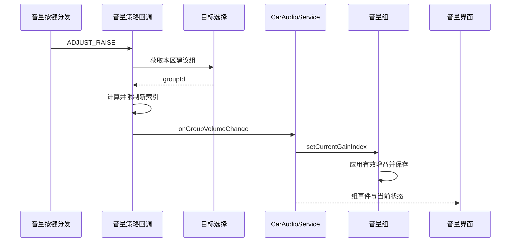

驾驶员按下方向盘音量加键，系统应该调音乐、导航还是通话？这个问题先于“音量加一”。AAOS 把目标选择与数值执行分开：根据音区、活动声音和产品规则选择音量组，再把组索引转换成相应执行路径的音量。理解这条链路，才能解释导航播报结束后按键仍调导航、不同座位同一索引听感不同，以及界面数字变化但声音没有变化。本篇聚焦非 legacy 车载音量模型，核心音量路径的差别见[核心音频路由与音量]()。

<!-- aaos-architecture -->
## 两种音量组的执行边界

CarAudioVolumeGroup 沿设备增益接口控制端口，CoreAudioVolumeGroup 沿 AudioManager 控制核心音量组。图中分别标注这两条控制路径，避免把设备增益都画成经过 AudioService；它们都不承载音频样本。

<figure style="width:min(1560px, calc(100vw - 48px));position:relative;left:50%;transform:translateX(-50%);margin:1.5rem 0;">
  <iframe src="../../../diagrams/aaos17-audio-volume.html" title="AAOS Audio Volume" width="100%" height="960" loading="lazy" style="display:block;border:1px solid #cbd5e1;border-radius:8px;background:#fff;"></iframe>
  <figcaption style="font-size:0.9rem;margin-top:0.6rem;">可在图内滚动查看完整架构，或<a href="../../../diagrams/aaos17-audio-volume.html" target="_blank" rel="noopener">单独打开架构图</a>。</figcaption>
</figure>

## 音量组是用户控制单位

音量组把一组应共同调节的声音和输出设备组织起来。它属于某个 zone 的当前配置，拥有组标识、包含的 context、设备地址以及增益范围。它不是单个应用，也不必等同于一个物理扬声器。多个用途可以共享一个组，一个组也可以控制多个输出地址，因此组的划分直接决定界面能提供怎样的独立调节能力。

如果导航和媒体放在同一组，用户调导航时就可能同时改变媒体组增益；若它们分组但最终共用不可独立控制的设备，逻辑上的独立滑块又未必对应独立声学控制。配置评审应从用户希望独立调节的声音出发，再检查 context、group、bus 和设备控制能力能否一致表达。不能只根据界面希望展示几个滑块就创建几个编号。

组标识必须连同 zone 使用。多音区可以各自有编号相同的组，配置切换还可能改变组与设备的关系。系统界面不应将一个裸 group id 缓存为永久全车身份，更不应把“组零一定是音乐”写成公共假设。正确做法是查询当前配置和组信息，再建立界面映射。

## 索引与设备增益不是同一单位

在 `CarAudioVolumeGroup` 路径中，组索引按最小增益和步长转换成毫贝：`gain = minGain + index × stepSize`。设置组索引后，该组遍历关联设备并应用转换后的 gain。这里的整数索引适合表达用户调节档位，设备增益则适合描述底层控制能力。[索引转换与逐设备应用](https://android.googlesource.com/platform/packages/services/Car/+/9f04df65daa8b9a65ee05fd4039fe95446874d76/service/src/com/android/car/audio/CarAudioVolumeGroup.java#79)

例如，为说明计算关系，假设某组最小增益为负六千毫贝，步长为一百毫贝，索引二十对应负四千毫贝。这个例子只解释公式，不规定任何产品的实际范围。两个音区即使都显示二十，也可能因为最小值、步长、扬声器、功放和声学校准不同而具有不同声压。跨设备迁移配置时，不能只复制滑块最大值。

同一组的设备需要兼容的步长。源码在重新计算设备 gain stage 时检查步长一致性，并在范围变化后尽量用原来的毫贝值映射到新索引；超出新范围时退回设备提供的默认值。这说明索引只是当前范围内的表示，设备变化后保持原索引未必保持原电平。[设备范围变化后的索引重算](https://android.googlesource.com/platform/packages/services/Car/+/9f04df65daa8b9a65ee05fd4039fe95446874d76/service/src/com/android/car/audio/CarAudioVolumeGroup.java#125)

CAP 使用核心音量组时，具体执行对象与上述设备 gain 路径不同。上层仍可保持车载组语义，但分析落点时必须识别组的具体实现类。本文中的毫贝公式不能不加条件地推广到每条核心音量曲线，产品排障应同时记录当前是否采用核心路由和核心音量。

## 按键先确定本次要调谁

默认音量选择由 `CarVolume` 负责。它综合活动播放属性、通话状态、HAL 活动属性，并按配置的 context 优先级选择目标。通话状态会补充来电铃声或通话属性，HAL 属性使不完全依靠普通应用播放器的外部声音也能参与选择。音量选择不等同于简单读取焦点栈顶，也不等同于只看前台应用。[活动声音集合的组成](https://android.googlesource.com/platform/packages/services/Car/+/9f04df65daa8b9a65ee05fd4039fe95446874d76/service/src/com/android/car/audio/CarVolume.java#298)

本树提供两版优先级。第一版包含导航、通话、媒体等完整集合；第二版只保留通话、媒体、公告和语音交互等限定用途。资源默认选择第一版。第二版不是“更新所以一定更好”，而是改变哪些声音可以通过通用按键自动成为目标。[优先级列表](https://android.googlesource.com/platform/packages/services/Car/+/9f04df65daa8b9a65ee05fd4039fe95446874d76/service/src/com/android/car/audio/CarVolume.java#73)；[版本资源](https://android.googlesource.com/platform/packages/services/Car/+/9f04df65daa8b9a65ee05fd4039fe95446874d76/service/res/values/config.xml#51)

这里的优先级是“用户按键应该调谁”，不是安全重要性或焦点优先级。紧急声音在某个音量列表中位置靠后，不能据此推断它会被普通音乐抢走焦点；导航被优先选中，也不表示它能够永久占有整个输出。把三个不同问题复用同一张优先级表，会让产品行为难以解释。

下面时序省略输入设备到系统按键分发的细节，展示音量策略收到一次主区增大请求之后的代表路径。若 OEM 音量服务接管选择，目标求值部分由外部服务完成，但执行仍回到车载音量接口。

## 连续按键的目标为何保持不变

用户连续旋转旋钮时，通常希望这一串动作始终调同一种声音。若导航在两个按键之间结束，目标立即切到音乐，会让用户无法预测下一格影响谁。`CarVolume` 因而保留最近选择的 context，在配置的超时内继续使用；超时后才重新根据活动集合选取。[目标保留与超时检查](https://android.googlesource.com/platform/packages/services/Car/+/9f04df65daa8b9a65ee05fd4039fe95446874d76/service/src/com/android/car/audio/CarVolume.java#195)

`audioVolumeKeyEventTimeoutMs` 默认三千毫秒。资源说明它既用于声音停止之后仍可参与选择的时间，也用于连续自动音量调整之间切换目标所需的停顿。这个时间不是播放器的 fade 时长，更不是音量弹窗显示时间。三者可能在界面上同时发生，却由不同机制控制。[按键目标超时资源](https://android.googlesource.com/platform/packages/services/Car/+/9f04df65daa8b9a65ee05fd4039fe95446874d76/service/res/values/config.xml#68)

验证这条规则时，要区别“最后一次播放结束”与“最后一次音量调整”的时间。导航结束后立刻连续按两次，再等待足够间隔按第三次，才能观察保留与重新选择。仅隔几百毫秒重复单步测试，可能一直延长目标保留窗口，得到“系统永远调错组”的假象。

动态设备又增加一个过滤条件。本树 `audioEnableVolumeKeyEventsToDynamicDevices` 默认 false，默认不让动态设备组成为音量键候选。若所有可用组都被过滤，回调可能得到无效 group id 并直接返回。这是显式可用性边界，不能把没有数值变化一律当成按键丢失。[无可用组时的处理](https://android.googlesource.com/platform/packages/services/Car/+/9f04df65daa8b9a65ee05fd4039fe95446874d76/service/src/com/android/car/audio/CarAudioPolicyVolumeCallback.java#146)

## 加减和静音按键怎样落到组操作

内部策略读取当前组索引、最小值、最大值和静音状态。正常增减按一步调整并截断到范围内；静音状态下的增减有专门分支，将本次目标值设为最小索引，再由后续组操作处理解除用户静音。静音、取消静音和切换静音则走独立回调。不能仅按“加键必定在旧值上加一”实现界面预览。[内部按键计算](https://android.googlesource.com/platform/packages/services/Car/+/9f04df65daa8b9a65ee05fd4039fe95446874d76/service/src/com/android/car/audio/CarAudioPolicyVolumeCallback.java#164)

设置组音量进入 `CarAudioService.setGroupVolume()`，需要车载音量控制权限。legacy 模式转为 stream volume；非 legacy 模式查询对应组并调用 `setCurrentGainIndex()`，随后发出组音量和可能的静音变化事件。处于限制、衰减或阻断时，组内部还会修正或拒绝请求，因此界面必须读取实际状态，而不是只显示自己刚发出的数值。[服务端设置入口](https://android.googlesource.com/platform/packages/services/Car/+/9f04df65daa8b9a65ee05fd4039fe95446874d76/service/src/com/android/car/audio/CarAudioService.java#1203)

这也解释系统 UI 与普通媒体 App 的分工。普通应用负责自己的内容播放及焦点，车载设置界面负责用户可见的组控制，后者需要系统集成授权。示例工具若直接调用组接口，应明确自己是受授权的系统组件，不能让开发者以为所有商店应用都能控制其他座位的组音量。

## 组事件比单个回调数字更有用

传统回调可以通知某个组发生变化，但复杂状态还包括静音、受阻、范围、衰减以及触发原因。新的组事件应视为一次状态变化的描述，界面再读取或使用对应组信息完成显示。只订阅增益变化会遗漏“索引没有变，但现在不能调”的状态。

用户操作回写界面时，还要避免反馈环。界面发起设置，服务发送事件，界面更新控件；控件的程序更新不应再次当成用户拖动发送相同请求。否则一次按键会产生多次设置、重复提示音或大量回调，掩盖真正的状态变化。为控件区分用户输入和状态同步，是音量 UI 的基本实现条件。

范围变化同样需要事件驱动。耳机连接、zone 配置切换或设备能力更新后，最小、最大索引可能变化。若界面只更新当前值而不更新范围，滑块可能展示非法位置，用户下一次操作又发送过期数值。组信息应作为一个整体更新，而不是分别缓存几个永不失效的字段。

## 一次导航音量误调应怎样分析

假设用户报告“导航结束后调音乐，却改了导航音量”。先确认按键所属 zone，再看当时的活动播放、通话及 HAL 属性；随后查看最近选择的 context 和超时，最后检查该 context 对应的组。若导航刚结束且仍处于目标保留窗口，这可能正是配置行为，产品应决定是否缩短窗口或采用不同目标选择规则。

如果导航与媒体同组，问题就不是选错目标，而是组本身没有提供独立控制。如果界面把同一组显示成两个独立滑块，用户将永远无法建立正确预期。应在配置或界面模型上修正，而不是在按键回调中加应用包名特判。

如果导航根本不应参与通用音量键选择，可以评估现有列表版本或 OEM 音量策略，而不是提高媒体焦点优先级。后者会改变并发播放秩序，却未必改变按键目标。这个例子体现了分层设计的价值：产品体验变化应落在负责该体验的机制上。

## 最小验收矩阵与状态记录

| 用例 | 需要记录的事实 |
|---|---|
| 单独播放媒体并连续增减 | zone、group、每步索引与边界 |
| 导航和媒体并存 | 列表版本、活动属性与选中 context |
| 导航结束后连续按键 | 最近目标时间与重新选择时刻 |
| 静音状态下按加减键 | 用户静音、HAL 静音和最终有效索引 |
| 无声音时按键 | 默认 context 与对应组是否可用 |
| 动态设备接入后按键 | 候选过滤开关与设备连接状态 |
| 切换用户或 zone 配置 | 当前组映射、范围与恢复值 |

实验应同时记录界面事件、服务状态和设备增益。若组数值变化正确而听感不变，继续追踪设备执行与音频内容；若请求组就不正确，先解决选择规则，不必立即检查功放。将问题按“选谁、设多少、是否允许、执行到哪、界面显示什么”拆分，比反复改变音量曲线更快定位根因。

## 持久化与多用户体验

音量是用户偏好，保存时必须带上用户、zone、配置和组等作用域。`CarVolumeGroup` 的基础设置路径会保存当前用户的 gain index。用户切换时应恢复新用户的状态，而不是把前一个驾驶员最后一次调节继续当成全局真值。配置切换时也应使用对应配置的组语义，否则同一编号可能恢复到完全不同的声音类别。

在集成设计中，可以把音量组看成带有当前能力范围的用户设置对象。设备提供范围，车载配置组织用途，策略决定按键目标，服务应用限制并保存，界面展示结果。各层都不需要知道全部细节，但必须传递稳定的身份和完整状态。

对跨座位控制，还应明确操作者的意图。例如中控设置页允许调后排电影音量，而方向盘按键默认作用于驾驶相关 zone，这两种操作不能共享一个隐式的“当前组”全局变量。界面选择后排组不应悄悄改变方向盘按键的目标。使用显式 zone 参数并在事件中保留作用域，可以减少多用户并行操作造成的误调。

## 把旋钮行为写成明确的产品约定

一个完整的旋钮需求应说明默认目标、候选声音、目标保留时间、静音时的第一步行为以及达到边界后的反馈。只写“每次增加一格”会把最重要的选择条件留给实现者猜测。例如来电铃声与媒体并存时调谁、接通以后是否立即切到通话组、通话结束的一小段时间是否继续保留通话目标，都应在同一场景脚本里验证。

界面可以在每次自动选组时清晰展示所调声音名称，让用户观察规则，而不是仅显示一个通用扬声器图标。目标保持窗口中继续显示导航，能够解释为什么连续旋钮仍影响导航；如果界面提前切成音乐，底层仍调导航，就形成了真实的交互缺陷，即使服务选择完全符合配置。

验证连续按键时还应包含长按和快速旋转。输入层可能合并或重复事件，音量层应按接收到的调整语义处理；不要用最终差了几格直接推断服务丢事件。分别统计输入事件、策略回调次数、实际组设置次数和最终索引，可以判断差异来自事件生成、范围截断还是限制状态。达到最大值之后继续按加键，最终数值不变属于正常边界处理，不能与未进入回调混为一谈。

当产品调整优先级或保留时间后，应回归已有用户习惯。较短窗口让目标更快跟随当前声音，也更容易在连续操作中切换；较长窗口提高连续操作的一致性，却可能让用户在声音结束后仍调旧目标。不存在脱离产品情境的唯一正确数值，关键是使选择规则、界面提示和测试预期保持一致。

<!-- series-navigation -->
## 系列导航

[系列目录]()

[上一篇：音频焦点强制执行]()

[下一篇：静音、增益限制与激活音量]()
