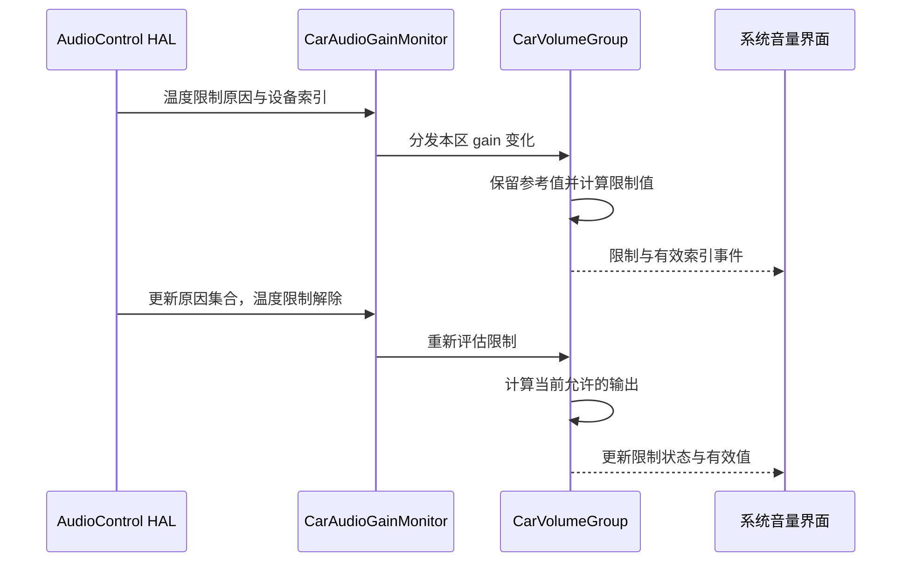

用户把音乐调到较高音量，功放因温度限制输出，几分钟后限制解除；另一辆车从休眠恢复后，首次播放被控制在合适范围内。这两种情况都可能让界面音量与用户上次选择不同，却不应该简单归为“系统偷偷改音量”。AAOS 需要分别保存用户目标、当前限制与实际执行值。本篇沿音量组状态解释静音、阻断、限制、衰减和激活音量，重点讨论它们如何恢复，以及为什么取消一个限制不一定立刻有声。

## 先区分用户目标和有效输出

`CarVolumeGroup` 保存当前 gain index，同时还保存 blocked、limited、attenuated 等状态。`getCurrentGainIndex()` 会考虑这些限制，并在组静音时返回最小索引。内部缓存的用户目标与对外可见的有效值可能不同，这并不是数据损坏，而是为了在临时限制结束后恢复合理电平。[有效索引计算](https://android.googlesource.com/platform/packages/services/Car/+/9f04df65daa8b9a65ee05fd4039fe95446874d76/service/src/com/android/car/audio/CarVolumeGroup.java#485)

另一类查询 `getCarVolumeGroupInfo()` 会返回受限制后的 gain index，并通过独立的 `muted` 字段报告静音；它没有先把组静音折算成最小索引。读取组信息的界面必须一起解释索引和静音状态，不能只凭索引判断是否可听。[组信息的构建](https://android.googlesource.com/platform/packages/services/Car/+/9f04df65daa8b9a65ee05fd4039fe95446874d76/service/src/com/android/car/audio/CarVolumeGroup.java#965)

当前限制优先级为：阻断值优先；没有阻断时，如果当前目标超过上限，则使用限制值；随后考虑临时衰减；否则使用原索引。这里的顺序是代码中的决策顺序，不能把所有限制简单取最小值后认为完全等价。不同状态还会改变用户设置请求是否被接受以及应发送什么事件。

从产品角度看，至少需要区分“用户想要多大”和“系统现在允许多大”。如果热限制临时把音量压低，而界面把这个值当成新的长期偏好保存，冷却后就无法恢复原来选择。如果用户在限制期间主动调节，又需要决定新的请求如何成为参考值。源码中的不同分支正是为了处理这些语义。

## 用户静音与 HAL 静音分别保存

组静音最终为用户静音或 HAL 静音的组合。用户点击取消静音时，如果 HAL 静音仍有效，`setMuteLocked(false)` 会拒绝该请求。这样可以避免紧急通信或远端控制要求的静音，被普通界面一次点击解除。[两种静音状态与解除限制](https://android.googlesource.com/platform/packages/services/Car/+/9f04df65daa8b9a65ee05fd4039fe95446874d76/service/src/com/android/car/audio/CarVolumeGroup.java#778)

用户静音可以根据设置持久化，HAL 静音则来自系统外部反馈，不应混入用户偏好。假设用户先静音，随后远端也静音，远端解除后仍应保持用户静音；反过来，用户取消自己的静音也不应清除远端要求。用两个原因分别保存，再组合为最终状态，比单一布尔值更容易正确处理这种交错。

组静音需要产品开启相应能力。`CarVolumeGroupMuting` 构造时检查 AudioControl HAL 是否支持组静音，配置要求启用但 HAL 不支持时会报错。它在组状态变化后生成每个 zone 的设备静音、解除静音列表，并调用 HAL。这里控制的对象是设备地址集合，不是某个 App 的焦点请求。[组静音能力与下发](https://android.googlesource.com/platform/packages/services/Car/+/9f04df65daa8b9a65ee05fd4039fe95446874d76/service/src/com/android/car/audio/CarVolumeGroupMuting.java#65)

电源策略也可以施加 muting restriction。在生成设备列表时，普通组可能因限制被静音，包含关键 context 的组有不同处理。用户静音与电源限制应继续分别解释：唤醒后撤销电源限制，并不意味着撤销用户此前的静音偏好。相关生命周期见[电源与恢复]()。

## HAL 反馈带来的是原因和状态

AudioControl 的 gain 回调包含原因列表以及设备 gain 信息，CarAudioGainMonitor 先按 zone 分组，再让对应 zone 和 volume group 处理。不存在的 zone 会被记录并跳过；组内也检查地址和索引是否合法。反馈必须能对应到当前配置，过期地址或配置切换前的索引不能直接成为新状态。[gain 回调的分区处理](https://android.googlesource.com/platform/packages/services/Car/+/9f04df65daa8b9a65ee05fd4039fe95446874d76/service/src/com/android/car/audio/CarAudioGainMonitor.java#75)

原因不是仅用于日志美化。当前实现把 forced master mute、TCU mute、remote mute 归入阻断；把 thermal limitation 和 suspend exit volume limitation 归入上限限制；把 ADAS ducking 和 navigation ducking 归入衰减；TCU mute、remote mute 还可形成 HAL 组静音。外部功放音量反馈则可以更新当前索引。[原因分类](https://android.googlesource.com/platform/packages/services/Car/+/9f04df65daa8b9a65ee05fd4039fe95446874d76/service/src/com/android/car/audio/CarAudioGainMonitor.java#113)

同一个回调可以携带多个原因，组会分别计算各类状态。不能约定“收到任意非空原因就静音”，否则导航 duck 可能变成完全无声；也不能把所有反馈都当作用户调音量，否则临时热限制会覆盖用户参考值。HAL 与 framework 的集成应对每个原因规定进入、更新和退出时的有效信息。

以下时序描述热限制进入并解除的代表场景。硬件已经施加限制后回报原因，CarAudio 更新状态并同步同组设备与界面；它并不是由界面先决定功放温度是否安全。

## 阻断限制衰减对按键的影响不同

阻断意味着普通音量请求不能继续改变组。`setCurrentGainIndex()` 在 blocked 状态直接返回；有限制时，将超过上限的请求截断；处于 attenuation 时，用户主动设置会重置该衰减状态，再把处理后的索引作为新的参考。用户请求还可能解除用户静音，但不会凭空解除有效的 HAL 静音。[用户设置与限制交互](https://android.googlesource.com/platform/packages/services/Car/+/9f04df65daa8b9a65ee05fd4039fe95446874d76/service/src/com/android/car/audio/CarVolumeGroup.java#521)

因此“按加键没变化”有多种解释。到达最大值属于数值边界，blocked 属于请求被限制，limited 属于请求被截断，HAL mute 则可能让有效增益仍不可听。界面需要展示适当原因，测试也要看状态分支，而不是只比较最终索引是否增加。

当 HAL 反馈暂时衰减或阻断时，`onAudioGainChanged()` 注释明确要求保留当前增益缓存，以便事件清除后恢复；只有外部功放音量反馈等特定原因才更新参考索引。处理结束后还会把受限增益同步到同组端口，并重新同步静音应用。[HAL 状态更新与参考值保留](https://android.googlesource.com/platform/packages/services/Car/+/9f04df65daa8b9a65ee05fd4039fe95446874d76/service/src/com/android/car/audio/CarVolumeGroup.java#898)

恢复不总是回到最初记录的那个数值。如果限制期间用户提出了可接受的新音量请求，新的参考值已经改变；如果另一个限制尚未解除，输出仍受其约束。正确测试必须包含多个原因重叠和用户主动操作，否则只能证明最简单的进入退出流程。

## 激活音量解决下一次开始播放的边界

激活音量用于把某次播放开始时的组音量限制在配置区间。它可以设置最小值，避免关键可调声音过轻，也可以设置最大值，避免上次大音量在新的启动场景突然出现。它不等同于持续热限制，也不是每次音量键都必须遵守的固定上下界。

本树 `audioUseMinMaxActivationVolume` 默认 false。开启后，配置还需指定组的激活范围与触发类型。类型包括启动或用户、zone 配置切换后的首次激活，来源 UID 改变，以及每次新活动播放。三个触发条件代表不同产品意图，不能把所有播放器 started 事件都无条件解释成一次“开机音量重置”。[资源开关](https://android.googlesource.com/platform/packages/services/Car/+/9f04df65daa8b9a65ee05fd4039fe95446874d76/service/res/values/config.xml#104)；[触发类型定义](https://android.googlesource.com/platform/packages/services/Car/+/9f04df65daa8b9a65ee05fd4039fe95446874d76/service/src/com/android/car/audio/CarActivationVolumeConfig.java#30)

`handleActivationVolume()` 先检查本次触发类型是否在组允许的位集合内，再比较当前参考索引与激活上下界。在范围内直接不变，超出范围才调整到相应边界。静音、阻断、限制或衰减同时存在时，它还会判断是否应发送可见增益变化事件，因此内部参考更新和用户可见变化不能机械地视为同一步。[激活音量的执行分支](https://android.googlesource.com/platform/packages/services/Car/+/9f04df65daa8b9a65ee05fd4039fe95446874d76/service/src/com/android/car/audio/CarVolumeGroup.java#553)

配置中的百分比是组索引范围上的参数，不是人耳响度百分比，也不直接等于功放输出电压比例。音量曲线和声学系统决定最终听感。一个“最大激活百分之四十”的值，必须在对应产品的设备范围和声学校准下验收，不能跨车型复制后称为同样响亮。

## 正确设计首次播放与切换音源

如果产品希望每次上车恢复媒体时不超过舒适音量，应选择与首次激活语义相符的触发条件。若选择每次播放变化，用户暂停再继续也可能遇到重新约束，改变正在使用中的预期。若选择来源变化，同一应用内部切歌通常不等于来源 UID 改变，不能将它当成“每首歌音量归一化”。

激活范围也应与用户静音协调。用户已经静音时，系统可能更新参考索引，但不应让“最小激活音量”被误解成必须解除用户静音才能达到下限。用户选择不听和系统防止意外过轻是不同需求，后者不能偷偷覆盖前者。

对于导航，若每段提示都建立一个新播放实例，按播放变化触发可能比按音源变化更频繁。对于媒体源切换，一个应用可能承载多个内容来源，UID 又不一定变化。因此产品必须先理解触发器观察到的技术身份，再决定它是否等价于界面中的“切换音源”。如果两者不同，应在设计中明确而不是靠偶然生命周期实现。

## 用状态组合而不是单一路径验收

| 场景 | 要验证的关系 |
|---|---|
| 用户静音后 HAL 静音，再解除 HAL 静音 | 用户偏好仍保留 |
| HAL 静音时请求取消静音 | 请求不能越过 HAL 限制 |
| 热限制期间按加键 | 有效值不超过限制，界面解释原因 |
| 阻断期间调节 | 请求没有改变可执行目标 |
| 衰减期间用户主动设置 | 按实际分支更新参考与衰减状态 |
| 激活时参考值超出范围 | 只有允许的触发类型执行约束 |
| 激活范围内重新播放 | 不发生无意义重设 |
| 设备范围变化且限制仍在 | 索引重新映射，限制信息保持一致 |

这些用例需要同时保存用户请求值、内部参考值、有效值、静音原因、HAL 原因列表和最终设备 gain。只抓一张滑块截图不能分辨临时衰减与永久偏好更新。对硬件限制还应记录硬件实际生效时间，避免把服务接收反馈的时间当成限制开始时间。

## 界面需要展示原因而不是反复补偿

遇到音量被限制，界面不应通过循环设置更高数值“补偿”，这会与硬件保护或系统策略形成争用。更好的行为是显示实际有效值和可理解的限制状态，并让用户知道当前操作是否被接受。设备解除限制后，界面根据新状态更新，而不是自行恢复一份早已过期的缓存。

开发工具可以保留更完整的诊断视图：原始目标、受限值、用户静音、HAL 静音、限制原因与最后更新时间分别展示。面向普通驾驶员的界面可以更简洁，但内部数据模型不应为追求简单而把原因丢掉。只有保留原因，才能正确处理取消一个状态而另一个仍有效的情况。

跨用户恢复时尤其要防止状态串用。用户偏好属于相应用户和配置，硬件热限制却可能跨用户持续有效；切换用户不能清除功放限制，限制解除也不能恢复成前一用户的音量。把偏好与约束分层保存，才能同时满足个性化和当前设备状态。

最终验收应从听到的声音回到控制原因：如果解除静音仍无声，检查阻断、有效索引、播放器资格和路由；如果限制解除后突然过响，检查参考值是否被正确保留或被新请求替换；如果每次暂停恢复都改音量，检查激活触发类型。每个问题都对应不同状态转换，不能用统一的“重置所有音量状态”作为长期修复。

## 用一条时间轴复核恢复行为

可以设计一个明确的组合实验：先把媒体调到中高档，记录参考值；再注入可控的热限制，让有效值下降；随后在限制期间主动调低一次；最后撤销热限制。这个实验的重点不是听到几次音量变化，而是确认恢复依据已经更新后的参考值。若最终回到最初高档，说明某一层仍使用旧快照；若永久停在临时限制值，说明某一层可能把约束误存成了偏好。

另一条时间轴检验静音原因叠加：用户静音、远端静音、用户请求取消、远端解除。每一步都要记录请求是否被接受以及两种原因的当前值。产品界面若只展示最后一次按钮动作，第三步就可能显示已经取消静音，而实际系统仍受远端限制。正确显示应跟随服务给出的有效状态，同时保留能够解释原因的信息。

设备动态更新也会改变恢复条件。某个输出设备的最小值、最大值或步长变化后，旧限制索引未必仍然有效。组实现会尝试按原毫贝值重新映射，无法映射的限制可能重置；源码要求仍有效的限制由 AudioControl 重新回报，并由 Audio HAL 保证过渡中的输出一致性。因此设备更新验收不能止于“新范围显示出来了”，还要确认原本有效的限制没有在重配置窗口中丢失。

为了让回调可靠恢复，HAL 侧应与 framework 约定原因集合表达的是当前有效状态。进入限制时上报，条件改变时更新，最后一个原因解除时也必须有对应通知。只发送进入事件而没有退出信息，会让服务永久保留限制；只发送新索引却携带旧原因，则可能继续阻断用户请求。检查回调语义往往比调整上层超时更能解决恢复问题。

激活音量也可以用相同方法验收：用户设置超出激活范围的值，停止播放，再分别执行同源恢复、换源、换用户和配置切换。按配置声明的触发类型比对哪些步骤发生修正，哪些保持不变。这样既能验证防止意外大音量的目标，也能发现触发范围过宽导致的日常体验问题。

<!-- series-navigation -->
## 系列导航

[系列目录]()

[上一篇：音量组与音量键]()

[下一篇：OEM 音频策略扩展]()
