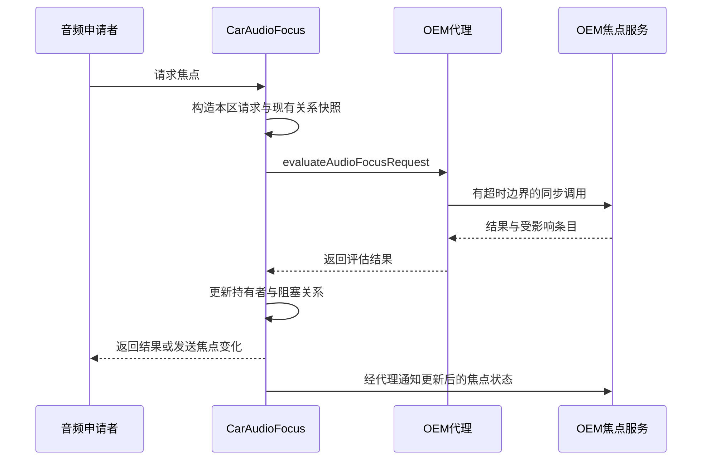

同样是导航与音乐并存，不同车型可能要求不同的压低规则；同样按音量加键，有的产品优先调导航，有的始终保留媒体调节。直接改动 CarAudioService 可以实现差异，却容易把产品规则与系统状态管理缠在一起。OEM 音频服务提供了专门的决策扩展点：厂商根据请求快照返回结果，CarAudio 继续维护焦点集合并执行音量或 ducking。扩展点的价值在于明确输入输出和失败边界，而不是允许任意逻辑进入音频关键路径。

## 扩展策略与接管系统的区别

OEM 音频扩展主要覆盖焦点、音量选择和 ducking 三类决策。焦点回答新请求是否可接受、哪些现有条目受影响；音量回答本次调整应改变哪个组及其目标状态；ducking 回答哪些音频属性应被压低。它们分别对应不同产品规则，不应因为部署在同一服务中就混成一个“最高优先级”函数。

这些接口不传输 PCM，不代替 AudioFlinger，不直接成为功放驱动。OEM 返回需要 duck 的属性后，CarAudio 仍需把属性映射为设备地址并处理共享设备保护；OEM 返回组索引后，组实现仍需应用范围与限制。把执行层工作放进策略服务，会造成重复操作，也让返回结果与系统实际状态不一致。

服务配置由 `config_oemCarService` 指定，本树默认空字符串。接入要求实现相应车载 OEM 服务契约，而不是任意注册一个普通 Android service 就能被调用。连接、ready 状态、具体子服务是否提供，都影响扩展是否可用。[服务配置与超时资源](https://android.googlesource.com/platform/packages/services/Car/+/9f04df65daa8b9a65ee05fd4039fe95446874d76/service/res/values/config.xml#682)

## 焦点评估收到的是完整关系快照

CarAudioFocus 构造外部评估请求时，包含新焦点请求、当前 holders、暂时失焦的 losers、已静音音量组与 zone id；可用时还附带音频特性信息。已有条目被同一请求替换时，构造输入会排除对应被替换项，避免新请求与自身错误比较。[外部焦点请求构造](https://android.googlesource.com/platform/packages/services/Car/+/9f04df65daa8b9a65ee05fd4039fe95446874d76/service/src/com/android/car/audio/CarAudioFocus.java#573)

losers 不是无用的历史。它们可能因暂时失焦仍有恢复资格，新请求又可能成为新的 blocker。若 OEM 只看当前 holders，就会漏掉这些关系：当原来抢占者退出时，被暂时阻塞的媒体可能错误恢复，与新请求同时冲突。策略必须处理“当前能播的”和“仍在等待恢复的”两类条目。

焦点评估返回 granted、delayed 或 failed，并通过 newly lost、newly blocked 等集合说明状态变化。永久 loss 表示条目退出恢复关系，临时 loss 则保留之后重新评估的可能。返回一个成功整数，却不正确描述受影响集合，并不能构成完整的焦点决策。[焦点服务结果契约](https://android.googlesource.com/platform/packages/services/Car/+/9f04df65daa8b9a65ee05fd4039fe95446874d76/car-lib/src/android/car/oem/OemCarAudioFocusService.java#42)

下图描述 OEM 焦点服务已启用且 ready 时的正常评估。CarAudio 是状态的维护者，OEM 是本次决策的提供者；状态变化通知用于同步观察，不能与同步评估互相替代。

## 可用性降级与调用失败要分别分析

CarAudioFocus 的外部策略选择会检查 OEM 是否启用、是否 ready，以及焦点子服务是否存在。没有满足条件时使用内部评估。这是“本次没有可用扩展”的路径，不等于调用已进入 OEM 之后发生异常时也总会重新执行默认策略。[外部焦点服务选择](https://android.googlesource.com/platform/packages/services/Car/+/9f04df65daa8b9a65ee05fd4039fe95446874d76/service/src/com/android/car/audio/CarAudioFocus.java#641)

后者取决于代理采用的调用机制。焦点评估使用 `doBinderCallWithTimeoutCrash()`；超时会进入服务故障处理，而其捕获的其他调用异常返回预定义的 `FAILED` 结果对象，其中条目集合为空。它不是 `null`，也不会自动重跑默认焦点算法。ducking 与音量代理使用带默认值的定时调用：ducking 的默认值为空集合，音量的默认值为空变化。不能把这些行为统一写成“OEM 超时后自动使用 AOSP 算法”。[焦点代理](https://android.googlesource.com/platform/packages/services/Car/+/9f04df65daa8b9a65ee05fd4039fe95446874d76/service/src/com/android/car/oem/CarOemAudioFocusProxyService.java#89)；[ducking 默认值](https://android.googlesource.com/platform/packages/services/Car/+/9f04df65daa8b9a65ee05fd4039fe95446874d76/service/src/com/android/car/oem/CarOemAudioDuckingProxyService.java#52)

空 ducking 结果表示本次没有返回需压低属性，空音量变化表示本次不执行调整；它们不包含内部规则的计算结果。这种区别直接影响体验：用户可能按键后没有变化，或某次并发声音没有按产品规则压低。诊断时必须区分 OEM 真的选择空结果，还是代理因错误返回相同默认值。

因此，部署 OEM 策略之后，服务时延、可用性和日志就成为音频功能的一部分。不能把它当作低频配置服务，在同步回调里查询网络、加载大量文件或等待另一个尚未完成的系统初始化。正常决策应主要消费本次输入和已经准备好的本地规则。

## 音量扩展决定对象与目标状态

音量请求包含 zone 的音量组信息、活动属性、通话状态和调整方向。OEM 返回 `OemCarVolumeChangeInfo`，其中描述是否有变化以及目标组状态。CarAudioPolicyVolumeCallback 再根据加减、静音等调整类型调用内部组设置接口。[外部音量结果的执行](https://android.googlesource.com/platform/packages/services/Car/+/9f04df65daa8b9a65ee05fd4039fe95446874d76/service/src/com/android/car/audio/CarAudioPolicyVolumeCallback.java#83)

这使产品可以实现不同于默认 context 列表的选择，但结果必须属于有效 zone、有效组与合法索引范围。策略不要根据一个全局“当前音乐组编号”处理所有区域，也不要在缓存中长期保留配置切换前的组对象。输入快照提供了当前组状态，优先使用它能减少额外查询和过期状态。

一个合理的产品规则示例是：通话期间调通话组；没有通话时，若用户刚在设置页明确选中某组，则在明确时限内保持该组；否则按当前活动声音选择。实现时，显式选择状态要带 zone、配置身份和有效期。这里的示例是产品规则设计，不是本树内置行为，不能把示例优先级写成所有 AAOS 的默认规范。

音量代理的定时调用默认返回无变化，因此测试必须覆盖“决策不需要变化”和“调用失败”两类相同表面结果。策略日志应记录输入摘要、规则编号、结果和耗时，使一次按键未生效能够被准确归类。[音量代理超时默认值](https://android.googlesource.com/platform/packages/services/Car/+/9f04df65daa8b9a65ee05fd4039fe95446874d76/service/src/com/android/car/oem/CarOemAudioVolumeProxyService.java#60)

## Ducking扩展只返回语义候选

CarDucking 构造请求后，服务可用则调用外部 ducking，不能使用则执行内部规则。外部结果仍是 AudioAttributes 列表，而不是直接写某块功放寄存器。CarDuckingUtils 随后根据 zone 路由转换为地址，并移除被不应压低的活动 context 共享的地址。[ducking 服务选择与后续转换](https://android.googlesource.com/platform/packages/services/Car/+/9f04df65daa8b9a65ee05fd4039fe95446874d76/service/src/com/android/car/audio/CarDucking.java#120)

因此 OEM 策略应与路由配置共同评审。若它要求压低媒体，但媒体和导航共享一个不能拆分的 bus，最终设备集合可能没有这个地址。不能通过让 OEM 返回更多相近属性来强迫地址进入集合，那会破坏共享保护的语义。需要解决的是设备控制粒度，而不是策略返回列表长度。

焦点策略和 ducking 策略也必须相容。如果焦点结果不允许两路并存，ducking 不应被当作让它们继续播放的授权。反过来，允许并发并不保证必须 duck，某些产品希望不同区域或不同用途独立播放。两份规则共同表达产品声音场景，但分别负责资格与电平让路。

## 同步回调必须避免环路

OEM 服务在评估中调用 CarService，CarService 又为该调用进入 OEM，可能形成循环等待或递归调用。辅助类专门记录这类调用，超过阈值会进入故障处理。最稳妥的设计是把评估函数做成输入快照到结果的有界计算，避免在同步评估栈中再次触发焦点或音量决策。[循环调用监控与超时行为](https://android.googlesource.com/platform/packages/services/Car/+/9f04df65daa8b9a65ee05fd4039fe95446874d76/service/src/com/android/car/oem/CarOemProxyServiceHelper.java#350)

如果产品需要车辆状态，应由独立订阅维护本地快照，并在评估开始时一次性读取。不要在持有策略锁时同步请求一个可能回调音频服务的外部组件。规则版本、车辆状态版本与输入请求一起写入诊断记录，可以解释为什么相似请求在两个时刻得到不同结果。

超时配置只是最后的故障边界，不是正常性能预算。本树资源中的秒级等待不能被理解为一次旋钮或焦点操作允许用户等待几秒。产品应根据交互目标规定更严格的正常延迟，并测量高分位耗时、并发负载和冷启动时延。把超时简单调大只会延长卡住的时间，并不能修复死锁或阻塞依赖。

## 将策略写成可复核的规则

规则输入至少应包含 zone、请求属性、gain 类型、holders、losers，以及相关组状态。输出应能说明使用哪条规则、哪些对象发生何种变化。对固定快照，相同规则版本应产生相同结果；若依赖额外产品状态，就把该状态也纳入记录，避免只有一段无法重放的自由逻辑。

可以先用数据表定义常见组合，再实现求值。表格不要只有“允许/拒绝”，还应包含永久或临时 loss、delay 是否允许、哪些条目新增 blocker，以及是否需要特殊 fade 配置。多条规则相交时规定明确顺序，例如关键通信与用户娱乐模式谁优先，避免依赖集合迭代顺序产生偶然结果。

| 验证维度 | 代表用例 |
|---|---|
| 正常焦点关系 | 媒体、导航、通话的授予与恢复 |
| 等待关系 | 已有 loser 时再进入新请求 |
| 区域隔离 | 两个 zone 相同用途同时申请 |
| 音量对象 | 配置切换前后相同组编号 |
| 无变化结果 | 合理空结果与代理异常默认值 |
| 生命周期 | 未 ready、服务退出、重新连接 |
| 时间边界 | 慢回调、并发回调、环路调用 |

## 发布前验证状态一致性

策略单元测试可以对同一输入快照断言结果集合，但还需集成测试验证 CarAudio 应用结果之后的状态。尤其是临时失焦恢复，不能只断言“新请求成功”；还要断言旧请求的 blocker 关系和后续释放时的恢复次序。否则错误可能延迟到几次操作后才显现。

对配置更新，先验证规则能覆盖当前实际 context、group 与 usage。一个规则包可能在实验车上工作，但量产 overlay 新增了 context 或调整组划分，旧策略就会漏处理。规则版本应与可支持的配置条件关联，遇到不认识的用途采取明确结果，并留下可诊断记录。

对服务重启，不能只检查 Binder 重新连接。还要确认 ready 生命周期正确、子服务重新可用、焦点状态通知可被处理，以及缓存的用户或 zone 信息没有沿用失效对象。OEM 服务应把系统当前快照视为状态恢复依据，而不是假设自己重启前的内存就是最新事实。

采用 OEM 扩展后，系统和产品团队的接口交付应包括规则表、请求结果样例、时延目标、故障语义和恢复测试。代码接口只解决“能调用”，这些约定解决“调用后仍能维持正确声音秩序”。当默认策略已经满足产品需求时，保留默认路径也能减少跨进程决策和独立生命周期带来的复杂度。

## 一个并发场景如何拆成三份决策

考虑主区播放音乐时开始导航，随后手机来电。焦点策略首先决定导航能否与媒体并存，再决定来电对二者造成永久还是临时影响；ducking 策略根据允许继续持有焦点的声音，选择需要压低的属性；音量策略则在用户此时按旋钮时选择铃声、通话或其他组。三份结果使用同一产品场景，却没有理由完全复用同一优先级顺序。

当电话接通，导航可能仍具有恢复关系，媒体也可能在等待。通话结束时，系统会重新评估相关条目。若 OEM 只在最初来电时返回了丢失集合，没有正确描述临时阻塞关系，结束后的声音恢复就可能缺项。测试应完整执行从音乐到导航到来电再到通话结束的序列，而不是只测试任意两种声音的静态组合。

如果用户在来电期间旋转音量，应将此次调整和通话状态快照关联。状态从 ringing 变成 offhook 的边界上，旋钮目标是否保持、是否立即切换，需要产品明确。不能让焦点服务按一种电话状态解释请求，音量服务又凭异步缓存按另一种状态选择组，却在日志里都只写“电话中”。可以为本次评估记录状态采样时间，使竞态具备复核依据。

## 用故障注入检查真实退路

开发版本可让 OEM 服务针对测试请求返回空结果、抛出受控异常或延迟到指定时间。这样的实验用于确认代理实际走哪条故障路径，不能在生产驾驶场景随意触发。每种注入都应同时检查应用得到的结果、焦点集合是否改变、已有声音是否继续，以及系统服务是否按预期恢复。

对 ducking，空集合可能撤销之前需要压低的设备，因此故障默认值的影响不仅是“这次不压低”。对音量，无变化意味着一次操作可能被忽略，界面不能先乐观增加数字后长期不纠正。对焦点，超时路径涉及服务故障处理，必须将它与普通拒绝请求分开统计，不能只计算请求成功率。

规则计算耗时也应拆分。代理排队时间、跨进程等待时间和 OEM 实际求值时间分别测量，才能判断增加线程是否有用。若所有线程都在等同一把锁，扩大线程池只会积累更多等待；若耗时来自规则首次加载，应在 ready 之前完成准备；若来自每次读取存储，则应采用明确更新的缓存。

最终交付可以保存一组脱敏的输入输出样本作为回归集。升级系统、改变资源或调整规则之后重放它们，比较不仅是授予结果，还包括受影响条目、目标组与 duck 属性集合。与少量完整用户流程结合，这种回归方式能把产品规则变化与平台实现变化区分开。

<!-- series-navigation -->
## 系列导航

[系列目录]()

[上一篇：静音、增益限制与激活音量]()

[下一篇：AudioControl HAL 的设计与应用]()
