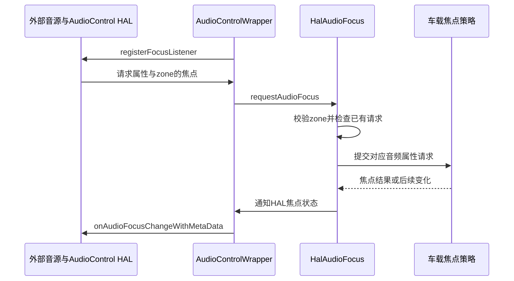

车机播放音乐时，外部控制器需要播报车辆提示；功放因温度限制输出，Android 音量界面需要显示当前限制。这些场景都需要系统与车载音频硬件交换控制信息，却不要求把音频样本通过 CarService 搬运。AudioControl HAL 正是这条控制契约。本篇解释它可以表达什么、版本与能力怎样检查，以及重连后哪些状态必须恢复。真正的音频流接口将在[播放管线与Audio HAL]()展开。

<!-- aaos-architecture -->
## Audio HAL 与 AudioControl HAL 的接口边界

左侧控制接口面向车载焦点、设备 duck/mute、gain 回报及配置；右侧接口面向音频端口和流。两个 HAL 服务框表示不同契约，不规定供应商必须采用哪种进程部署，也不表示样本要经过 AudioControl HAL。

<figure style="width:min(1560px, calc(100vw - 48px));position:relative;left:50%;transform:translateX(-50%);margin:1.5rem 0;">
  <iframe src="../../../diagrams/aaos17-audio-hal-contracts.html" title="AAOS HAL Contracts" width="100%" height="960" loading="lazy" style="display:block;border:1px solid #cbd5e1;border-radius:8px;background:#fff;"></iframe>
  <figcaption style="font-size:0.9rem;margin-top:0.6rem;">可在图内滚动查看完整架构，或<a href="../../../diagrams/aaos17-audio-hal-contracts.html" target="_blank" rel="noopener">单独打开架构图</a>。</figcaption>
</figure>

## 两种HAL解决不同问题

Core Audio HAL 提供模块、端口、patch、输入输出流等接口，负责让音频服务打开设备并交换音频数据。AudioControl HAL 面向车载控制：外部音源的焦点请求、设备 duck 和 mute、gain 反馈、前后左右分布、模块变化以及可选车载配置。两者可能在同一厂商实现中协作，但 AIDL 接口职责不同。

判断接口归属时，不要只看名称里都有 Audio。`openOutputStream()` 属于音频流的建立，`onDevicesToDuckChange()` 属于对已有输出对象施加控制意图。CarAudioService 不通过 AudioControl 发送每一帧 PCM，AudioControl 服务也不因此成为所有 Android 播放器的数据中转站。[AudioControl 接口范围](https://android.googlesource.com/platform/hardware/interfaces/+/0162af698935100a590b7359581ac8b1b80693e5/automotive/audiocontrol/aidl/android/hardware/automotive/audiocontrol/IAudioControl.aidl#61)

这一区分有实际排障价值。若 PCM 根本没有进入目标输出，检查流、路由与设备能力；若流正常但外部提示无法使媒体让路，检查控制契约、zone 和地址；若控制回调正常但功放没有动作，再查看厂商执行链路。单独重启一个名字带 audio 的服务，无法替代层次定位。

## Wrapper隔离版本差异

当前 `AudioControlWrapper` 包装 AIDL `IAudioControl`，通过声明的 default 服务取得 Binder。服务没有在 manifest 中声明或不可用，会影响初始化；这不是一个可以由普通应用任意提供的同名接口。[服务发现与包装层](https://android.googlesource.com/platform/packages/services/Car/+/9f04df65daa8b9a65ee05fd4039fe95446874d76/service/src/com/android/car/audio/AudioControlWrapper.java#94)

Wrapper 提供 `supportsFeature()`，让 CarAudioService 按能力使用接口。基本焦点、ducking、组静音属于基础能力；带 metadata 的焦点和 gain callback 要求更高接口版本；module callback 又有版本要求；HAL 提供车载配置还需要对应 feature flag 和第五版及以上能力判断。文章和产品文档应写具体能力，不能只说“使用 AIDL 所以全部支持”。[能力与版本检查](https://android.googlesource.com/platform/packages/services/Car/+/9f04df65daa8b9a65ee05fd4039fe95446874d76/service/src/com/android/car/audio/AudioControlWrapper.java#152)

接口版本只是声明层的一部分。产品还要核实资源是否启用相应功能、HAL 是否正确实现契约，以及配置是否满足校验。一个服务成功返回版本号，不等于它的 duck 设备地址映射正确；一个接口可调用，也不等于设备有独立通道可以执行目标动作。

版本兼容设计应由 Wrapper 这样的边界层集中承担。上层业务不必到处比较版本号，而是询问功能能否使用；不支持时走明确的旧机制或失败路径。这样升级 HAL 时，产品规则和版本适配不会散落在每个焦点与音量分支里。

## 外部音源如何参与焦点管理

HAL 通过注册的 `IFocusListener` 请求或放弃焦点，CarAudio 的 `HalAudioFocus` 将 metadata 转成 AudioAttributes，校验 zone，并为该区和属性维护请求。已经存在相同属性请求时，它回报现有状态；没有时才创建新请求。这个去重使外部源不必每次状态重报都在系统中制造另一份焦点身份。[HAL焦点请求入口](https://android.googlesource.com/platform/packages/services/Car/+/9f04df65daa8b9a65ee05fd4039fe95446874d76/service/src/com/android/car/audio/HalAudioFocus.java#114)

下面是外部音源发起请求的代表时序。图中省略音频样本本身，因为外部声音可以走平台自己的数据路径；这里展示的是向 Android 描述其存在和焦点状态。

这里不能直接照搬普通 App 必须等待 gain 才开始播放的假设。AudioControl 接口的焦点说明明确指出，HAL 不被要求在 gain 回调前等待，也不被要求收到 loss 就停止外部声音。这反映车载外部源的特殊性：某些声音可能由独立控制系统决定。Android 仍需要知道它的状态，以便协调自己的声音，但接口本身不是外部硬件的强制播放闸门。[HAL焦点契约说明](https://android.googlesource.com/platform/hardware/interfaces/+/0162af698935100a590b7359581ac8b1b80693e5/automotive/audiocontrol/aidl/android/hardware/automotive/audiocontrol/IAudioControl.aidl#67)

因此，系统集成必须另行明确外部源如何响应结果、哪些声音不可被 Android 阻止、结束时如何放弃请求。若外部源结束却忘记 abandon，Android 可能长期认为它仍在影响焦点或按键目标。若真实声音已经开始却没有请求，Android 又无法及时安排其他声音让路。两种错误都来自控制状态与实际源状态不一致。

## Duck和Mute传递设备级意图

`onDevicesToDuckChange()` 按 zone 传递需要压低、解除压低的地址及当前相关 metadata；`onDevicesToMuteChange()` 则传递设备静音和解除静音列表。前者用于并发声音的电平让路，后者用于组静音等状态，两者不能合并成同一个“低音量”布尔值。[设备duck与mute接口](https://android.googlesource.com/platform/hardware/interfaces/+/0162af698935100a590b7359581ac8b1b80693e5/automotive/audiocontrol/aidl/android/hardware/automotive/audiocontrol/IAudioControl.aidl#87)

设备地址必须与音频配置中的地址一致。逻辑组编号不能代替 bus address，UI 中的“前排音乐”名称也不能直接作为 HAL 键值。建议在集成映射表中同时列出 zone、组、context、地址、实际硬件通道和可控制增益，这样一次请求才能追踪到物理执行对象。

接口传递意图，不规定统一衰减分贝与曲线。产品可以在执行端实现适合的过渡，但必须保证重复通知、解除通知和状态重建的行为一致。如果上层发送相同 duck 状态，执行端不应每次都把当前增益再乘一次；否则重复回调会让音乐越变越轻。状态应按目标应用，而不是按事件次数累积。

Mute 同样应能处理原因叠加。用户组静音、外部通信静音、硬件保护可能同时存在。AudioControl 与下层音频系统要明确哪些原因由谁拥有，解除某一路请求时只撤销对应原因。否则一个导航结束事件可能意外解除用户静音，形成比缺少回调更严重的语义错误。

## Gain反馈让系统看到硬件约束

HAL 通过 gain callback 报告意外或外部引起的增益变化及原因。原因可能包含热限制、通信静音或外部功放反馈，framework 再转成音量组的 blocked、limited、attenuated 等状态。回调不是纯遥测：它影响用户请求是否可执行，以及界面应显示何种限制。[gain请求与callback注册](https://android.googlesource.com/platform/hardware/interfaces/+/0162af698935100a590b7359581ac8b1b80693e5/automotive/audiocontrol/aidl/android/hardware/automotive/audiocontrol/IAudioControl.aidl#161)

方向也要分清。接口既存在 framework 通知 HAL 的 gain 变化方法，也存在 HAL 回报变化的 callback，不能因为名字相近就把所有消息都解释成“Android 发起调音量”。调试记录应明确发起方、原因、设备地址和索引范围，才能判断是一条正常反馈链，还是两端互相回写导致循环。

对硬件限制，进入与退出都需要状态同步。功放冷却后若没有正确清除限制原因，界面可能继续拒绝调大；若只清原因但未报告相应有效状态，又可能造成显示与输出短暂不一致。具体同步顺序由实现确定，但测试必须观察声学输出、HAL 状态和组事件，而不能只检查一次 Binder 调用返回。

## Fader和Balance属于空间分布

`setBalanceTowardRight()` 的负一到正一表示从完全偏左到完全偏右；`setFadeTowardFront()` 则表示完全偏后到完全偏前。零表示居中，超范围输入由实现限制到合法范围。这里的 fade 是前后声场分布，不是音乐切换的淡入淡出。[左右与前后接口](https://android.googlesource.com/platform/hardware/interfaces/+/0162af698935100a590b7359581ac8b1b80693e5/automotive/audiocontrol/aidl/android/hardware/automotive/audiocontrol/IAudioControl.aidl#122)

CarAudioEffects 保存和恢复这些用户设置，并通过 Wrapper 发送到底层。它的名字并不表示它管理所有 EQ、混响或 DSP 算法。若产品有环绕、均衡器或座位声场算法，需要寻找相应效果链或厂商接口，不应把所有音效配置塞进前后左右两个浮点参数。[音效与空间分布的区别]()

空间分布还要与多音区区别。把声音偏向后排，不等同于把某个应用路由到后排 zone；前者调整分布，后者改变逻辑归属与输出。一个产品可以同时支持两者，但不能用 fader 模拟独立乘客音区，否则焦点、音量和用户隔离仍然没有建立。

## 可选配置接口改变配置来源

较新的 AudioControl 能够报告音频设备配置、zone 列表和镜像设备。`getAudioDeviceConfiguration()` 返回默认路由标记时，CarAudio 继续使用既有配置机制；否则相关 zone 接口必须提供有效数据。Wrapper 在能力不支持或特定调用异常时返回默认配置或空集合，后续仍需按对应初始化路径校验。[配置获取与fallback](https://android.googlesource.com/platform/packages/services/Car/+/9f04df65daa8b9a65ee05fd4039fe95446874d76/service/src/com/android/car/audio/AudioControlWrapper.java#493)

这不意味着 XML 被普遍废弃。产品最终由 feature flag、接口版本、返回配置和初始化分支决定来源。配置来源改变时，context、group、设备地址之间的约束仍在，不能因为数据来自 HAL 就省略一致性校验。相同逻辑配置应能被 dump 成可观察模型，以便与原有文件配置进行比较。

动态模块 callback 也不是完整路由切换命令。它报告硬件模块相关配置变化，上层还需更新设备能力、组范围和当前连接状态。收到通知不等于所有活动 track 已经迁移到新设备。动态变化的完整过程见[动态设备与区域配置]()。

## Binder重连必须恢复契约

Wrapper 监听服务死亡。发生死亡后，它清除 listener、gain callback、module callback 的注册标志，重新取得服务句柄，再通知 CarAudio 的 death recipient。新 Binder 连接不是旧 callback 自动复活，必须让上层执行相应恢复流程。[服务死亡后的重新连接](https://android.googlesource.com/platform/packages/services/Car/+/9f04df65daa8b9a65ee05fd4039fe95446874d76/service/src/com/android/car/audio/AudioControlWrapper.java#550)

HAL 焦点管理在 reset 时会放弃此前登记的请求，以免保留已经死亡的外部源身份。新的 HAL 实例需要根据真实活动源重新建立状态。测试不能只看服务列表里名字重新出现，还应检查监听注册、外部焦点、当前静音、duck、gain 限制与空间分布设置是否符合恢复策略。

接口还规定注册新 focus listener 时应替换旧 listener，观察者死亡时应清理。这个生命周期规则防止服务恢复后回调继续发往失效 Binder，或同一事件被发送给多个过期观察者。厂商实现应覆盖重复注册和进程死亡，而不仅是一次启动成功。

## 集成验收围绕控制对象展开

| 场景 | 核验对象 |
|---|---|
| 外部源开始与结束 | zone、属性、焦点请求及abandon |
| 导航压低媒体 | duck地址、恢复地址及执行增益 |
| 用户组静音 | 本区设备集合与其他区隔离 |
| 硬件热限制 | 原因进入退出与组状态同步 |
| 调整前后左右 | 参数范围、用户恢复和实际空间分布 |
| HAL服务重启 | callback重新注册与当前状态重建 |
| 配置能力不支持 | 明确fallback路径和最终有效配置 |

定位问题时从一次具体控制动作开始，记录请求的身份、下发参数、HAL 接收以及实际硬件变化。若对象身份错了，修正映射；若消息丢了，检查服务和 callback 生命周期；若消息正确而硬件未变化，检查执行端；若硬件变了而 UI 不知道，检查反馈。把控制链完整闭合，AudioControl 才能真正连接 Android 的策略与车辆音频系统的行为。

## 一份设备地址表应回答哪些问题

项目初期就应把逻辑地址与实际执行能力对齐。对每个地址，明确属于哪个音区、承载哪些用途、是否与其他用途共享混音、可以独立设置何种增益、静音作用在哪个位置，以及恢复后由谁重新设置状态。这份表不是单纯的硬件接线图，它连接了上层策略中的对象与执行端真正能够控制的对象。

例如一个逻辑地址在底层同时承载音乐与车辆提示，设备级静音就会同时影响两者。上层即使把车辆提示声明为关键用途，也不能改变这条物理事实。可以通过重新划分路由、使用独立硬件通道或调整控制方案解决，但不能只在焦点矩阵中提高优先级就宣称关键提示已经受到保护。

还要明确地址的稳定性。如果同一地址在不同车型配置或运行模式下指向不同通道，必须保证切换期间的控制请求不会落到旧映射。服务重新加载配置后，应能从当前模型重新生成设备集合，而不是继续发送进程启动时缓存的地址列表。关联日志保留配置身份，有助于识别这种跨配置错误。

## 异步接口返回不等于声音已经改变

许多通知方法采用单向调用。发送方完成调用，只能说明请求进入了通信路径，不能把该时刻当作扬声器增益已完成变化的证据。执行端可能还要排队、与其他控制器同步或应用渐变。对有明确响应时间要求的声音，应在产品验证中测量从策略事件到实际声音变化的端到端时间。

这种测量需要共同时间轴。Android 侧记录焦点变化和参数下发，HAL 侧记录接收与执行，外部采样记录实际包络。若多个处理器时钟不一致，先建立可用的时间关联，再比较延迟。否则“HAL晚了几十毫秒”可能只是两份日志时钟偏差，无法支持实现结论。

对于恢复类动作，最好同时验证最终状态和过渡过程。最终声音正确但中间突然全音量，可能是先解除设备静音再恢复限制顺序不合适；最终声音偏小但请求已经完成，可能是外部设备保留旧duck原因。两者需要不同修复，不能用同一个固定等待时间掩盖。

## 让接口测试与车辆试验各司其职

接口测试适合检查参数范围、能力声明、重复注册、死亡清理和错误返回。受控集成测试适合检查设备地址、音区隔离与限制恢复。真实车辆声学试验才适合确认衰减幅度、过渡舒适度和不同座位的听感。前一层通过不能自动替代后一层，也没有必要把每个参数校验都放到路试中完成。

验收报告应把三类结果关联到同一软件和配置版本。这样用户报告某次导航结束后音乐偏小时，团队能够判断是接口行为改变、设备映射改变，还是声学参数改变。控制契约清晰之后，系统与供应商的责任划分也会具体到可观察的输入输出，而不是停留在“声音问题归音频团队”的模糊范围。

<!-- series-navigation -->
## 系列导航

[系列目录]()

[上一篇：OEM 音频策略扩展]()

[下一篇：从 AudioTrack 到扬声器]()
