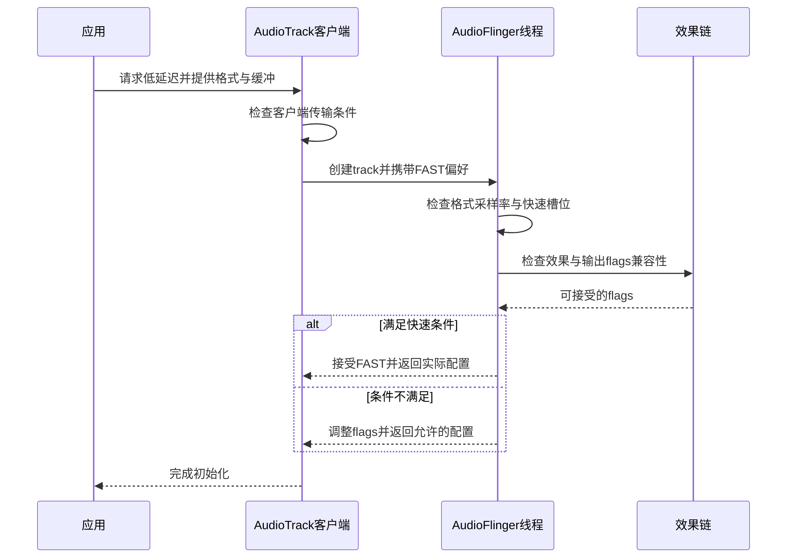

导航提示需要及时起音，媒体长时间播放关注功耗，交互声音又不能频繁爆音。同一条音频路径很难同时把延迟、功耗、处理自由度和稳定性全部推到最好。Android 提供普通混音、快速轨道、直接输出、压缩卸载、MMAP 等机制，但应用请求不等于实际采用，音效也可能改变可用路径。本篇以[播放管线]()为基础，解释选择条件与测量边界，避免把某个 flag 当成性能保证。

## 先定义要优化的时间与代价

“音频延迟”至少可以指用户点击到声音开始、应用提交样本到设备播放、录音到回放，或视频画面与声音之间的偏差。它们经过的环节不同。点击到起音可能包含业务调度、焦点、文件读取、解码准备和设备唤醒；持续输出延迟则更多受缓冲和处理周期影响。测量前必须明确起止事件。

功耗也要指定范围。减少应用处理器唤醒不一定减少外部功放功耗，减少软件混音不一定减少整个座舱音频系统负载。车载平台可能有独立 DSP、多个输出域以及外部声学处理，平台代码只能说明可选机制，最终收益需要在目标硬件与真实配置上测量。

稳定性是第三个维度。小缓冲缩短等待，却更容易被调度抖动打断；大缓冲提高容错，却增加交互时延。产品应为不同用途设定目标，允许媒体与交互声音采用不同路径，而不是要求全系统无差别使用最小缓冲。

## Low latency是一项有条件的请求

AudioTrack 的低延迟模式文档明确要求设备支持，并指出效果可能无法继续工作、采样率需要匹配输出端。应用还需谨慎管理缓冲，以较小块及时供数。设置 `PERFORMANCE_MODE_LOW_LATENCY` 只表达意图，不会替应用消除线程阻塞或替硬件提供不存在的低延迟端口。[低延迟与省电模式契约](https://android.googlesource.com/platform/frameworks/base/+/94b4c163b7dfe5ce3607f7bb8456f9573f7de57d/media/java/android/media/AudioTrack.java#464)

native 客户端在创建轨道时还会检查传输模式等条件；AudioFlinger 的服务端检查更严格。快速轨道要求线性 PCM、合适声道关系、与输出一致的采样率、关联的 fast mixer 以及空闲快速槽位，还需要通过效果兼容检查。任一条件不满足都可能移除 FAST flag。[客户端偏好检查](https://android.googlesource.com/platform/frameworks/av/+/475269ec44acec82792be6b01fb8e16357d4d2c8/media/libaudioclient/AudioTrack.cpp#1826)；[服务端FAST条件](https://android.googlesource.com/platform/frameworks/av/+/475269ec44acec82792be6b01fb8e16357d4d2c8/services/audioflinger/Threads.cpp#2638)

这解释同一应用在不同设备、不同并发负载下走不同路径的情况。实验室只有一个播放器时快速槽位充足，量产场景多个声音并发时可能不同；应用采样率与当前输出匹配，切换到另一设备后也可能不再匹配。性能验证不能只覆盖首次创建的一种静态状态。

以下时序展示快速路径选择的核心判断。拒绝快速模式不一定意味着播放失败，可能在允许的普通路径上继续；测试应检查返回的实际状态与服务端轨道，而不是只验证构造没有抛异常。

## 缓冲调优必须观察Underrun

AudioTrack 提供 underrun 计数，用于观察应用写入缓冲是否因供数不及时而耗尽。它的作用域是应用层写入缓冲，不是全链路所有硬件欠载的总计数。因此计数为零不能证明功放输出绝无间断，计数增加也需要结合写入节奏判断原因。[underrun计数定义](https://android.googlesource.com/platform/frameworks/base/+/94b4c163b7dfe5ce3607f7bb8456f9573f7de57d/media/java/android/media/AudioTrack.java#2603)

一个实用的调优过程是先建立稳定播放，再逐步减小有效缓冲，同时记录欠载与调度延迟；找到边界后留出适合目标负载的余量。源码文档建议在静音素材下进行这类边界调试，避免故意制造的断裂影响听感。不能用最低一次成功的缓冲值作为所有设备和温度状态的量产参数。

应用的音频供数线程应避免文件读写、网络等待、复杂对象分配以及不可控锁等待。需要解码或生成数据时，可以在上游准备好，再让输出线程完成有界工作。提高线程优先级无法修复无限等待的锁，也无法让网络总是按时提供下一块数据。

缓冲还要与启动阈值和预填充一起考虑。创建了较大容量，并不代表起音必须等全部填满；实际等待受播放器与输出策略共同影响。比较两次实验时，应同时记录容量、有效大小、每次写入块大小和开始播放前已提交帧数，否则无法解释为什么缓冲看似相同而起音时间不同。

## 省电路径与低延迟目标不同

省电模式倾向使用更深缓冲和更大写入块，减少频繁唤醒，并提高对短时供数抖动的容忍。其代价通常是更高延迟。长时间媒体播放适合评估这类路径，而需要快速响应的交互声音不应只为了降低一点 CPU 活动就默认采用同样配置。

音频处理器或 HAL 中的缓冲仍会增加端到端等待。应用把自身缓冲减小后，若主要延迟来自下游固定周期，收益可能有限。优化前先测量各段占比，可以避免用高欠载风险换取几乎不可见的延迟下降。

对于车机，设备从休眠或 standby 恢复的时间还可能主导首次起音。持续播放测得的低延迟不能直接代表冷启动提示音。测试应分别测量设备已活跃、输出刚关闭、系统恢复等状态，并记录是否复用了既有输出。

## Direct和Offload不能与FAST混为一谈

AudioFlinger 根据输出 flags 选择不同线程。Direct 表示不同于普通混音的直接输出处理，compressed offload 则把压缩音频交给支持的下层解码播放链路。它们和快速 PCM 轨道的目标、格式和处理约束不同，不能把名称中“direct”理解成所有环节更快。[输出线程分支](https://android.googlesource.com/platform/frameworks/av/+/475269ec44acec82792be6b01fb8e16357d4d2c8/services/audioflinger/AudioFlinger.cpp#3049)

AudioTrack 的 offload 构建要求检查设备是否支持对应格式与属性，且接口约束为 media usage。请求某种编码卸载成功与否，取决于设备能力和当前配置。应用必须有明确的能力检测和失败处理，不能假设 Android 版本相同就有相同编解码硬件。[offload请求约束](https://android.googlesource.com/platform/frameworks/base/+/94b4c163b7dfe5ce3607f7bb8456f9573f7de57d/media/java/android/media/AudioTrack.java#1350)

卸载的主要价值常在长期媒体播放的处理与功耗分工，而不是任意短音效的最小起音时间。短声音的准备、开流和设备唤醒成本可能改变收益。对不同内容长度、连续播放与切歌场景分别测量，才能判断产品应该在哪些情况下使用卸载。

MMAP 也需要平台能力、权限与音频路径支持，不能因为存在 AAudio 或相关 flag 就认定实际走了内存映射硬件路径。服务端线程与 HAL 状态是判断依据。本文不把厂商私有零拷贝、DSP 隧道等实现细节当作 AOSP 所有设备的共同事实。

## 音效以Session和处理位置关联

应用插入音效通常需要指定对应播放器的 audio session id。相同 session 可以关联相关播放器及效果链，生命周期重建时必须维护正确关系。AudioEffect 文档还明确指出，通过 session 零把均衡器等插入效果挂到全局输出混音的用法已弃用，不能把它作为现代车载音效控制的通用示例。[AudioEffect会话契约](https://android.googlesource.com/platform/frameworks/base/+/94b4c163b7dfe5ce3607f7bb8456f9573f7de57d/media/java/android/media/audiofx/AudioEffect.java#60)

AudioFlinger 管理 effect chain，并通过效果 HAL 创建相应效果实现。session 效果、输出级处理、设备级处理的影响范围不同；产品 EQ 可能位于厂商 DSP，也可能通过标准效果框架实现。调试时先确认实际效果实例、会话与处理位置，再判断为什么某个 App 或某个座位没有听到效果。

一个播放器重建后若得到新的 session，旧效果仍绑定原 session，就可能出现“切歌后音效消失”。反过来，错误复用 session 也可能让不相关声音受到同一效果。播放器与效果应共享明确的资源生命周期，释放时同时清理，恢复时重新绑定，而不是只保存一个全局整数。

## 效果可能改变性能路径

FAST 创建过程检查设备、输出级、全局混音和当前 session 的效果链兼容性。一个新增软件效果可能移除快速标志，使音频进入不同处理路径。此时“打开均衡器后延迟增加”可能来自路径变化，而不仅是均衡器算法本身增加几帧处理。[效果兼容检查](https://android.googlesource.com/platform/frameworks/av/+/475269ec44acec82792be6b01fb8e16357d4d2c8/services/audioflinger/Threads.cpp#2669)

Offload 对效果也有约束。源码允许创建不支持卸载的效果，但启用时会触发相关轨道失效处理，策略还会避免在不兼容效果存在时打开相应 direct 输出。不能仅看效果对象创建成功就认定仍保留卸载路径；启用前后都要检查实际 track 和 thread。[offload与效果的兼容分支](https://android.googlesource.com/platform/frameworks/av/+/475269ec44acec82792be6b01fb8e16357d4d2c8/services/audioflinger/Threads.cpp#1614)

Bit-perfect 目标要求避免改变样本数据，因此与会修改音频的效果存在根本冲突。产品若同时要求逐位保真与均衡、空间处理，必须明确哪种模式优先，以及切换时如何显示和执行。用两个独立开关都显示已开启，会让用户看到互相矛盾的承诺。

## 车载空间控制不是通用音效引擎

CarAudioEffects 的主要职责是前后 fader 与左右 balance 的设置和用户持久化。它通过 AudioControl 控制空间分布，并不是管理全部均衡器、低音增强、回声消除和环绕算法的框架。名称相似不表示执行层相同。[CarAudioEffects的范围](https://android.googlesource.com/platform/packages/services/Car/+/9f04df65daa8b9a65ee05fd4039fe95446874d76/service/src/com/android/car/audio/CarAudioEffects.java#35)

录音侧的 AEC、NS、AGC 又有输入用途和设备条件，不能把播放侧效果测试结果直接推广过去。车辆语音交互还受到麦克风阵列、回声参考、外部功放延迟和声学空间影响，标准接口存在只说明有契约入口，不说明实际算法质量或硬件配置已经满足需求。

当系统同时使用应用效果、平台效果和外部 DSP 校准时，需要列出各层处理顺序。重复均衡、重复响度增强可能引入过载或不自然听感；某层静音也可能使后续算法看不到有效参考。音效集成应与路由、增益和性能共同评审，避免各团队独立优化后叠加出意外结果。

## 用分层证据评估性能

| 维度 | 需要观察的证据 |
|---|---|
| 请求与实际路径 | 请求flags、返回flags、线程类型 |
| 应用供数 | 写入周期、块大小、部分写入与欠载 |
| 服务端处理 | mixer周期、效果链、调度延迟 |
| HAL与硬件 | 实际格式、缓冲、输出时序 |
| 用户体验 | 起音延迟、持续延迟、爆音和切换间断 |
| 资源成本 | CPU唤醒、负载、设备功耗与温度条件 |

每次比较只改变一个主要变量，并保持素材、路由、组音量、效果和设备状态一致。若切换音效时同时改变采样率和输出设备，最终延迟差不能归因于单一算法。记录完整配置比只保留平均毫秒数更有助于复现。

对交互声音，报告分布和最差场景比只报均值更有意义；对长时媒体，记录持续欠载与功耗稳定段；对恢复场景，记录第一次声音与后续声音差异。性能目标最终应写成具体用途的可测约定，而不是“全部开启低延迟模式”。

## 一个效果开关的完整验证实验

以媒体均衡器为例，先在效果关闭时记录轨道实际路径、会话、输出格式、应用欠载与端到端延迟，再启用效果并重复采集。首先比较是否发生轨道重建或输出线程变化；只有路径保持相同时，才适合进一步比较算法本身的处理开销。若路径改变，结果应描述为整个播放方案的差异，而不是把所有时间都记到效果运算上。

随后关闭效果，检查路径能否按预期恢复。某些状态变化需要重建轨道才能重新评估，不能假设取消效果的一刻就立刻回到原来输出。测试还要包含切歌、应用重新打开、设备切换和用户切换，确认效果设置的持久化范围与实际绑定关系一致。

最后增加受控负载，观察原本稳定的缓冲是否仍然有余量。负载应包含产品真实会同时运行的业务，而不是只用一个极端压力工具得出不可解释的结论。将音频供数延迟与系统调度事件对应，可以判断是否需要优化应用线程、服务处理，还是下层输出周期。

## 避免把能力声明当成测量结果

设备声明支持某条路径，表示请求有可能被接受；请求实际被接受，表示本次走到该路径；声学测量达到目标，才说明用户体验满足要求。这三个层次都需要证据。即使服务端确认是快速轨道，也不能跳过外部功放和扬声器链路，直接宣称整车达到某个毫秒数。

同样，卸载路径运行并不自动等于整机明显省电。可能因为外部处理器本来就保持活跃，或者其他业务占据主要功耗，系统级收益很小。比较时应同时说明测量设备、工作状态、内容持续时间和所包含的功耗范围，让读者知道结论能用于哪一类决策。

对卡顿问题，优先检查时间轴上的供数空洞，而不是先把所有缓冲加大。扩大缓冲可能暂时掩盖上游停顿，但也会推迟提示和控制响应。若停顿来自同步读取资源，应把读取移出实时供数路径；若来自设备切换，则需要改进重配置；若来自效果不兼容引起的重建，应调整效果和路径选择。

性能优化最终是一组用途相关的取舍。音乐可以接受较大缓冲来换取稳定与功耗收益，短交互音需要更快响应，语音链路又关注往返延迟与参考同步。明确每种声音的目标、实际路径和失败恢复方式，比在全局配置中堆叠更多性能标志更可控。

<!-- series-navigation -->
## 系列导航

[系列目录]()

[上一篇：从 AudioTrack 到扬声器]()

[下一篇：录音链路与麦克风隐私]()
