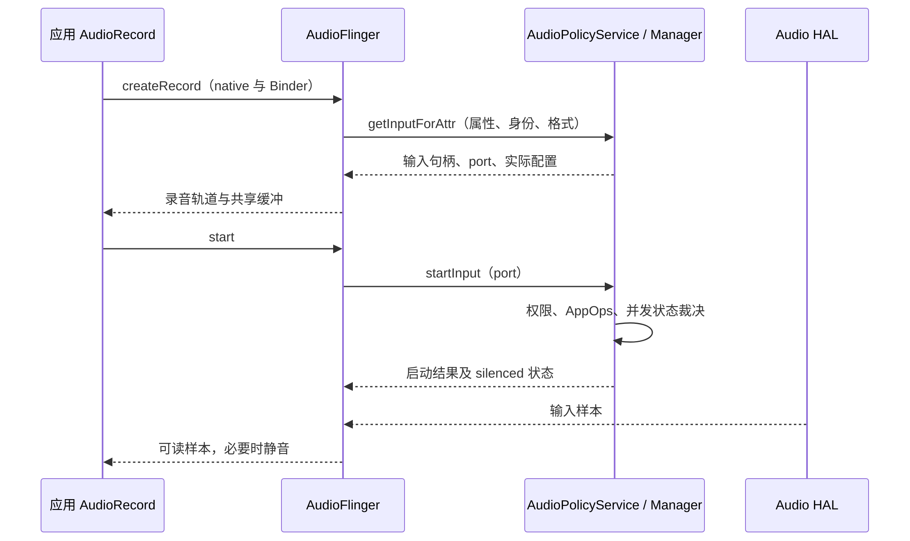

后排乘客开始录制语音，驾驶员同时唤醒助手。两个应用都持有麦克风权限，两个 `AudioRecord` 也可能都处于录音状态，却只有一方收到有效声音。这不是播放焦点失效：录音具有自己的权限、输入路由、并发规则和隐私机制。判断问题时必须分别回答“是否创建成功”“是否启动成功”“实际连接哪只麦克风”和“样本是否被系统置为静音”。

本文沿用[系列源码基线]()。首先建立录音路径，再解释策略为何保留一个活动录音对象却不给它真实麦克风数据，最后给出能够区分设备问题和策略问题的检查方法。播放音区仍然重要，但不能直接推导录音授权或输入设备归属。

<!-- aaos-architecture -->
## 录音数据路径与静音控制

绿色路径从输入流经过 RecordThread 和共享缓冲到达 AudioRecord；蓝色路径表示策略侧传递客户端静音状态。输入仍活动与客户端获得真实样本是两个问题，图中刻意把数据方向和控制方向分开。

<figure style="width:min(1560px, calc(100vw - 48px));position:relative;left:50%;transform:translateX(-50%);margin:1.5rem 0;">
  <iframe src="../../../diagrams/aaos17-audio-capture.html" title="AAOS Audio Capture" width="100%" height="960" loading="lazy" style="display:block;border:1px solid #cbd5e1;border-radius:8px;background:#fff;"></iframe>
  <figcaption style="font-size:0.9rem;margin-top:0.6rem;">可在图内滚动查看完整架构，或<a href="../../../diagrams/aaos17-audio-capture.html" target="_blank" rel="noopener">单独打开架构图</a>。</figcaption>
</figure>

## 一、输入链路有独立的资源与身份

应用通过 `AudioRecord.Builder` 描述音源、采样格式、通道和缓冲大小。这里的 audio source 是 `MIC`、`VOICE_RECOGNITION`、`VOICE_COMMUNICATION` 等录音用途，不是播放侧的 `USAGE_MEDIA`。同样采集麦克风，语音识别和通信可能需要不同预处理、并发待遇与设备选择。把所有录音统一写成默认音源，会丢失系统用于选择策略的重要语义。

Java 对象经 JNI 进入 native AudioRecord，服务端创建录音轨道。当前基线中，`AudioFlinger::createRecord` 调用 `AudioSystem::getInputForAttr` 向 AudioPolicyService 请求输入；后者交给 AudioPolicyManager 选择输入设备及输入资源，并创建关联归属身份、session、port ID 的录音客户端。应当按这一真实调用关系阅读代码，不能直接把播放侧旧版建轨图反向画成录音图。[建录音轨道][af-record]和[输入请求][aps-input]给出了两个入口。

AudioPolicy 决定符合条件的输入，AudioFlinger 的 RecordThread 组织采集与客户端缓冲，Audio HAL 提供设备数据。真实麦克风、DSP 波束形成和回声参考的接线位于产品实现范围。CarService 负责车载场景控制，但普通应用的每一块录音 PCM 不会通过 CarService，也不会经 AudioControl HAL 转发。

session ID 用于关联录音与预处理效果；port ID 标识这次策略客户端；UID 和 attribution source 说明谁在使用麦克风。它们不可互相替代。重建录音对象后 session 或 port 可能变化，因此记录日志时既要有应用自己的业务会话号，也要保存系统分配的关联标识，避免将旧回调误判为新会话状态。

下面表示普通录音创建和启动的概念时序，省略转换结构、线程投递和缓冲建立细节。图中控制调用通过框架接口及 Binder 完成，PCM 通过录音共享缓冲传输，不是以逐包 Binder 调用回送给应用。

<div style="overflow-x:auto;margin:1.5rem 0;">



</div>

## 二、权限检查不是一次性开关

`RECORD_AUDIO` 是普通麦克风录音的基础权限，但“用户曾经允许过”不能覆盖后续所有运行状态。AudioPolicyService 的 `startInput` 调用 `startRecording` 检查访问；硬拒绝直接返回权限错误，允许或软拒绝则进入相应状态设置，再更新活动客户端的并发裁决，最后尝试启动底层输入。[启动入口][aps-start]明确区分了这些步骤。

这一顺序体现了两类失败的区别。硬拒绝表示这次调用没有资格开始访问；软拒绝或后续策略变化可以令客户端保持活动但被 silenced。后者允许系统在条件恢复时切回有效数据，不必要求应用每次竞争失败都销毁并创建录音器。不过，应用必须理解自己仍处于 recording 状态并不证明取得真实声音。

AppOps 还需要对访问生命周期进行统计。当客户端从可录音变为静音，策略会停止相应访问记录；恢复时重新检查并开始记录，然后通过 `setRecordSilenced` 通知 AudioFlinger。不能为了“修复无声”只改应用里的一处布尔值，否则会造成用户可见隐私状态和实际数据访问不一致。[状态更新实现][aps-silence]把这种联动放在同一条路径中。

前后台状态也参与裁决。本地基线在创建录音客户端时依据 UID 的最高 target SDK 计算旧应用的后台静音兼容豁免；这不是一个可以泛化为“后台始终可以录音”的保证。应用仍需满足组件生命周期、前台服务及权限要求，车载系统应用也不能仅凭预装身份忽略这些约束。排查时应同时记录包版本、target SDK、当前用户和前后台状态。

## 三、并发录音与播放焦点是两套模型

播放焦点主要表达声音之间应独占、压低还是允许并发。录音仲裁首先保护麦克风数据，不会因为应用获得 `AUDIOFOCUS_GAIN` 就自动授权它录音。反过来，一个合法录音者未必需要播放声音，也就不必为采集动作申请媒体焦点。[音频焦点章节]()中的 holder 和 loser，不能当成录音客户端列表。

AudioPolicyService 的 `updateUidStates_l` 收集活动录音者，综合前台状态、开始时间、隐私敏感标记、助手身份、辅助功能身份、通话或通信模式以及特权条件计算能否录音。源码保留了多种分支，因此“最后开始的一定获胜”只能描述部分普通应用竞争，不能作为完整规则。[并发裁决][aps-concurrency]尤其值得结合实际 source 和身份阅读。

隐私敏感录音用于表达当前采集不应被普通竞争者共享。`AudioRecord.Builder.setPrivacySensitive(true)` 可显式设置这个要求，但它不是申请系统权限，也不是确保任何情况下独占硬件。系统仍须处理电话、助手、特权及设备能力等条件；某些音源还有默认敏感属性。产品不能通过关闭敏感标志来绕过通话或用户隐私限制。[Builder 契约][record-private]说明了接口语义。

本地基线还包含并发限制绕过权限相关 feature flag，并兼容既有 `CAPTURE_AUDIO_OUTPUT` 特权处理。看到该分支不等于普通第三方应用可申请这些能力，更不能在文章示例中把 privileged permission 当运行时权限弹窗使用。若 OEM 确有同时采集需求，应首先证明音源和用途合理，再核对系统权限授予、并发政策和 HAL 资源能力三个层面。

多音区不会自动把这套录音规则分割成“每排座位各自有独占麦克风”。CarAudio zone 主要组织播放路由、音量与焦点；输入设备是否分配给某位乘客，取决于输入政策与产品拓扑。即使后排扬声器完全独立，车内麦克风也可能共享一个 DSP 输入。设计全舱语音方案时，先确定物理采集通道和用户边界，再决定应用会话组织。

## 四、系统静音和声学静音必须分开

在本地 `updateUidStates_l` 中，传感器隐私开启后直接进入所有录音静音的处理。它比普通客户端之间的优先级比较更早发生。[隐私入口][aps-concurrency]说明了为什么切换麦克风隐私时，可以观察到仍存活的录音器持续读到静音，而不一定收到构造失败异常。

应用应注册录音配置回调，并查看 `AudioRecordingConfiguration.isClientSilenced()`。当系统因策略令客户端静音，界面应显示相应状态并避免把一段全零样本误当作用户长时间未讲话。配置回调同时可能报告实际格式、采样率或预处理变化，不能把所有回调都解释为权限变化。[回调契约][record-callback]和[静音字段][record-config]提供了直接观察接口。

`isClientSilenced()==false` 也不是麦克风电路正常的证明。静音开关可能位于外部 DSP 或模拟电路，输入路由可能选错，波束形成也可能抑制了目标方向。系统字段解释的是客户端政策状态；样本能量、输入设备和物理链路共同解释最终信号。调查时应把“系统允许采集”与“采集到预期的人声”写成两条独立结论。

## 五、普通应用的可观察录音示例

下面是已有 `RECORD_AUDIO` 授权、应用处于合规运行状态时的 Java 教学片段。它展示可观察接口，不包含权限页面、线程退出与完整错误 UI。采样率必须结合设备支持验证；读循环放在工作线程，并在业务退出时停止、注销回调和释放对象。

```java
AudioFormat format = new AudioFormat.Builder()
        .setSampleRate(16000)
        .setEncoding(AudioFormat.ENCODING_PCM_16BIT)
        .setChannelMask(AudioFormat.CHANNEL_IN_MONO)
        .build();
int minBytes = AudioRecord.getMinBufferSize(16000,
        AudioFormat.CHANNEL_IN_MONO, AudioFormat.ENCODING_PCM_16BIT);
if (minBytes <= 0) throw new IllegalStateException("Unsupported format");
AudioRecord recorder = new AudioRecord.Builder()
        .setAudioSource(MediaRecorder.AudioSource.VOICE_RECOGNITION)
        .setAudioFormat(format)
        .setBufferSizeInBytes(minBytes * 2)
        .build();
AudioManager.AudioRecordingCallback observer =
        new AudioManager.AudioRecordingCallback() {
    @Override
    public void onRecordingConfigChanged(
            List<AudioRecordingConfiguration> configs) {
        AudioRecordingConfiguration c =
                recorder.getActiveRecordingConfiguration();
        if (c != null) {
            Log.i("CaptureDemo", "silenced=" + c.isClientSilenced()
                    + ", device=" + c.getAudioDevice());
        }
    }
};
recorder.registerAudioRecordingCallback(context.getMainExecutor(), observer);
recorder.startRecording();
// 工作线程读取；检查正长度、错误码和业务取消状态。
```

不要对“全部零值”单独设置自动重建循环。在隐私开启或并发抑制时，重建不会改变政策，只会使日志和隐私访问记录更加混乱。应先读取 active recording configuration，再区分需要用户操作、等待竞争者结束、设备重新连接或真正的对象失效。对 `ERROR_DEAD_OBJECT` 等错误则按播放器/录音器生命周期重建，并重新注册观察者。

## 六、选择麦克风是请求，不是最终结果

`setPreferredDevice` 验证传入设备是否为输入设备，然后向 native 层提出偏好；`getPreferredDevice` 的文档明确指出，它不保证就是实际用于录音的设备。业务要核实真正输入，应在启动后读取 routed device，并监听路由变化。[设备接口][record-device]是避免“设置成功就一定生效”误判的关键。

多麦克风产品还可以查询 `getActiveMicrophones()` 与通道映射。不过本地实现会在 HAL 未给出具体麦克风资料时，回退到 routed device 合成信息。因此列表中存在一个对象，不足以证明系统知道每颗物理麦克风的位置、波束或原始通道。若产品要求区分驾驶席与副驾，HAL 信息完整性应成为集成验收项。

实际输入格式也未必等于客户端格式。框架可能在支持范围内进行格式适配；若识别 SDK 假设样本始终属于指定物理通道，设备切换后即使读循环没有报错，语义也可能已经变化。应把路由变化事件传到业务层，决定继续当前语音会话还是重新初始化前处理与识别状态。

## 七、按现象构建验证矩阵

测试应保存操作时间、用户、UID、source、session、port、实际输入设备、silenced 状态和读返回值。这样可以把 Java 观察、策略客户端和 RecordThread 对齐，而不是只收集一条“录音正常”的日志。

| 场景 | 应观察什么 | 不能据此推断什么 |
| --- | --- | --- |
| 单一前台应用录音 | 启动结果、实际设备、有效样本 | 其他并发组合也一定可用 |
| 两个普通录音应用竞争 | 前后台变化与 silenced 切换 | 播放焦点决定输入赢家 |
| 开启麦克风隐私 | 回调、系统状态、样本变化 | 一定销毁 AudioRecord |
| 蓝牙通话期间开始识别 | 通话模式、并发政策、输入路由 | 麦克风权限足以覆盖电话 |
| 插拔外部麦克风 | 设备通知、实际路由、格式变化 | preferred device 始终有效 |

在设备上可读取 `adb shell dumpsys audio`、`adb shell dumpsys media.audio_policy` 和 `adb shell dumpsys media.audio_flinger`，再按 UID、session、port 关联。第一份帮助观察框架状态，第二份观察输入策略和客户端，第三份观察录音线程与轨道。具体字段随构建配置而异，应保存完整原始输出后再过滤，不把不同时间的片段拼成一个瞬时状态。

排查顺序从访问资格开始，再看并发静音，之后是实际路由、输入线程、HAL 与物理信号。这能避免在系统明确禁止真实采集时反复调整 DSP，也能避免在系统已允许采集时仅凭权限弹窗排除硬件问题。后续[语音与热词章节]()将在这一基础上解释低功耗检测、识别录音和语音播报之间的协作。

## 八、用一次前后排竞争复盘设计边界

假设后排应用甲正在录制语音消息，驾驶员启动助手乙。先不要预设必须同时成功：验收用例应先写清楚乘员是否获得独立输入、助手是否允许打断、已有语音消息应该继续还是提示暂停。播放音区隔离与这些选择没有一一对应关系，只有确定产品期望，才能判断系统结果是缺陷还是正确仲裁。

接下来记录甲启动时的输入设备和有效样本，然后标记乙进入前台、创建输入和开始采集的时间。如果甲仍有正常读取长度，但配置回调显示被静音，就说明应用线程和缓冲仍工作，问题落在政策选择。若乙结束后甲重新获得有效样本，还需要检查业务是否已经因静音提前提交了空白消息；框架恢复并不能自动修复应用对录音结束的误判。

另一种情况是甲乙都未被系统静音，但两边实际收到同一物理输入。此时需要回到产品输入拓扑：独立的应用对象、会话编号和设备偏好并不会自动生成独立声学通道。若预期后排只录后排，必须证明输入路由与前端处理确实输出对应信号，再检查业务用户关联。用不同位置的受控声音做通道验证，比观察两条启动成功日志更有意义。

第三种情况是乙启动失败而甲不受影响。这可能发生在权限硬拒绝、格式不支持或底层输入资源无法满足请求时。应保留最初的错误码以及对应策略状态，避免自动重试覆盖首个失败现场。错误处理界面也应区分“当前被占用”和“没有访问权限”，因为用户可采取的操作不同。

最后验证异常退出。甲被关闭、乙进程退出或用户切换时，活动录音客户端、隐私访问记录和输入设备状态应收敛；业务不应依靠下一次重新启动来清理旧状态。多用户设备尤其应把用户编号写入观测记录，同一个包在不同用户下具有不同身份，不能仅用包名合并两条录音链路。

这些步骤把验收从“录得到声音”推进为“正确的人、在正确的状态、通过正确的设备获得声音”。后续即使更换麦克风数量或语音供应商，仍可沿用同一组证据判断边界是否保持一致。

[af-record]: https://android.googlesource.com/platform/frameworks/av/+/475269ec44acec82792be6b01fb8e16357d4d2c8/services/audioflinger/AudioFlinger.cpp#2432
[aps-input]: https://android.googlesource.com/platform/frameworks/av/+/475269ec44acec82792be6b01fb8e16357d4d2c8/services/audiopolicy/service/AudioPolicyInterfaceImpl.cpp#838
[aps-start]: https://android.googlesource.com/platform/frameworks/av/+/475269ec44acec82792be6b01fb8e16357d4d2c8/services/audiopolicy/service/AudioPolicyInterfaceImpl.cpp#960
[aps-silence]: https://android.googlesource.com/platform/frameworks/av/+/475269ec44acec82792be6b01fb8e16357d4d2c8/services/audiopolicy/service/AudioPolicyService.cpp#1258
[aps-concurrency]: https://android.googlesource.com/platform/frameworks/av/+/475269ec44acec82792be6b01fb8e16357d4d2c8/services/audiopolicy/service/AudioPolicyService.cpp#951
[record-private]: https://android.googlesource.com/platform/frameworks/base/+/94b4c163b7dfe5ce3607f7bb8456f9573f7de57d/media/java/android/media/AudioRecord.java#739
[record-callback]: https://android.googlesource.com/platform/frameworks/base/+/94b4c163b7dfe5ce3607f7bb8456f9573f7de57d/media/java/android/media/AudioRecord.java#2277
[record-config]: https://android.googlesource.com/platform/frameworks/base/+/94b4c163b7dfe5ce3607f7bb8456f9573f7de57d/media/java/android/media/AudioRecordingConfiguration.java#292
[record-device]: https://android.googlesource.com/platform/frameworks/base/+/94b4c163b7dfe5ce3607f7bb8456f9573f7de57d/media/java/android/media/AudioRecord.java#2193

<!-- series-navigation -->
## 系列导航

[系列目录]()

[上一篇：混音、低延迟、Offload 与音效]()

[下一篇：语音交互与唤醒音频]()
