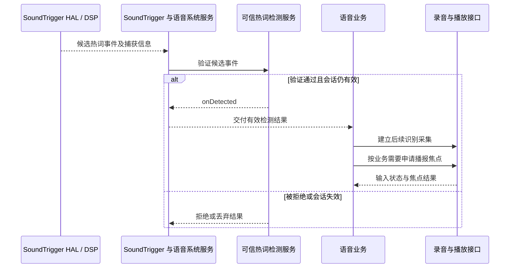

音乐播放中，驾驶员说出唤醒词，车机发出提示音，压低音乐并开始识别，随后朗读结果，最后恢复音乐。用户感知的是一次连续交互，系统实际涉及热词检测、麦克风采集、识别业务、播放焦点和音频输出等多个独立生命周期。任何一段失败，都可能被统一报成“语音没有反应”。

设计这条链路的第一步是区分检测和识别：检测关注是否出现某个声学事件，识别关注用户说了什么；播报又属于播放链路。Android 提供连接这些能力的服务和接口，但不自动提供每个产品所需的唤醒模型、离线识别能力或全舱声学算法。本文结合[本系列基线]()，说明如何给这些职责建立清楚的边界。

## 一、把一次对话拆成三个会话

热词会话可能长期处于监听状态，希望用较低功耗等待触发。识别会话通常在用户明确开始交互后持续一段时间，消耗真实麦克风数据并交给识别服务。语音回复会话输出 TTS 或预录提示音，需要与音乐、导航、电话共同参加播放策略。三者可以衔接，也可能重叠，但不能共用一个简单的“语音 active”布尔值。

例如，热词模型已经加载，并不意味着当前允许采集后续语音；语音识别返回成功，也不意味着回复播放器拿到焦点；提示音已响，更不说明麦克风采集已启动。系统日志应为热词触发、识别起止、提示音和播报分别记录状态，然后用业务会话 ID 串联。这种建模能直接缩小“唤醒后无声”的定位范围。

普通应用可以在用户操作后使用录音或 SpeechRecognizer，但系统默认语音助手还涉及 VoiceInteractionService 与系统授予的角色、服务声明和权限。不能将助手服务的系统能力直接复制到普通音乐应用中。`SpeechRecognizer` 本身明确说明，连续不断识别会造成显著资源消耗，其接口不用于把一次次识别请求拼成永久后台热词监听。[识别接口说明][speech]给出了这条使用边界。

## 二、SoundTrigger 管理检测设备与模型

SoundTrigger Middleware 对上暴露检测能力，对下适配不同 SoundTrigger HAL。其职责包括权限检查、客户端协议验证、HAL 行为校验、串行访问、日志和恢复。它不是语音文本识别引擎，也不负责媒体音量。[中间层说明][middleware]将这些职责拆成适配、业务和系统服务三层。

`SoundTriggerModule` 通过独立 session 管理客户端加载的模型，启动识别时把模型、设备与输入相关会话交给 HAL。这说明一个模型句柄不是全局永久有效的编号：它依附于连接和服务状态，HAL 重连后不能盲目复用旧句柄。[模块实现][st-module]是理解模型加载、开始和停止边界的入口。

`AlwaysOnHotwordDetector` 使用 availability 状态区分硬件不可用、尚未注册、已注册以及错误。历史常量 `STATE_KEYPHRASE_UNSUPPORTED` 仍保留在接口中，但已弃用且不再是有效状态；当前实现不能提前判定指定短语和语言组合是否受支持。应用不能只在开机调用一次 startRecognition 后永久认为检测已运行，应等待并处理可用性变化。模型注册和资源就绪是两个不同条件；“平台编译了 SoundTrigger”也不能证明产品实际支持指定语言或短语。[检测器状态][detector-state]明确表达了这些差别。

触发事件可能携带捕获可用性、capture session、触发前后音频信息。`RECOGNITION_FLAG_CAPTURE_TRIGGER_AUDIO` 表达希望取得触发音频，事件中的 `captureAvailable` 才说明能否继续使用捕获会话。不能把“收到关键短语事件”理解为“完整用户指令已经包含在回调里”，否则经常丢失唤醒词之后的首个字。[事件载荷][detector-event]应与产品的预卷音频能力一起核对。

## 三、可信检测服务承担二次验证与隔离

Android 的 HotwordDetectionService 支持由系统协调的检测流程。DSP 检测可先报告候选事件，再通过可信检测服务验证；软件检测则有从麦克风开始监听的路径。源码中 `DspTrustedHotwordDetectorSession` 与 `SoftwareTrustedHotwordDetectorSession` 分开管理，不能据一个类的回调行为推断另一个类完全相同。[DSP 会话][dsp-session]和[软件会话][software-session]是两条具体路径。

DSP 候选不必然成为最终唤醒。验证可以报告 detected 或 rejected，且系统检查返回时会话是否仍有效、服务是否经历重启，以及结果交付的权限条件。一个常见竞争是用户已取消旧交互，旧验证随后返回；如果产品只认“最后收到的 detected”，就可能重新打开已关闭的语音界面。业务会话代数和显式取消状态有助于过滤陈旧结果。

HotwordDetectionService 的 `onDetect` 形态覆盖 DSP 事件、软件检测和外部音频等场景。服务声明使用专门的绑定权限，由系统协调绑定；这些接口不是让普通应用直接任意连接后读麦克风的快捷通道。SDK 接口存在、服务成功绑定与具体产品允许运行检测，仍然是不同层次。[服务契约][hotword-service]说明了回调和绑定要求。

下面是“DSP 候选经过验证后进入业务识别”的概念时序。是否使用捕获会话、怎样取得后续 PCM，以及是否并发播放提示音，必须由产品的已启用能力决定，图中没有假设所有实现共用同一条音频流。

<div style="overflow-x:auto;margin:1.5rem 0;">



</div>

## 四、AEC、NS、AGC 分别解决什么

AEC，即声学回声消除，用播放参考帮助抑制扬声器声音重新进入麦克风形成的回声。NS 是噪声抑制，关注背景噪声；AGC 是自动增益控制，调整输入的电平范围。它们不会自动解决所有车舱问题：风噪、双讲、强混响、扬声器非线性和多个乘员同时说话，各有不同约束。

Java 音频效果接口通过 AudioRecord 的 session ID 关联输入预处理。`AcousticEchoCanceler.isAvailable()` 只反映系统是否提供该效果类型；`create(sessionId)` 还可能因实现或资源问题返回 null。即使创建成功，也应查看当前启用状态和修改操作结果。系统可能根据音源默认配置预处理，因此不能看到代码没有显式创建 AEC 就认定设备没有回声处理。[AEC 实现与说明][aec]体现了这些条件。

以下片段适用于已有合法 AudioRecord 会话的能力检查。它是应用侧观察示例，不是完整车载声学校准方案。对于产品已经在 DSP 侧完成的处理，是否再启用 Android 效果必须由音频团队明确设计，避免两个独立 AGC 互相追逐增益，或串联降噪产生明显音质损伤。

```java
AcousticEchoCanceler aec = null;
if (AcousticEchoCanceler.isAvailable()) {
    aec = AcousticEchoCanceler.create(recorder.getAudioSessionId());
    if (aec != null) {
        int result = aec.setEnabled(true);
        Log.i("VoiceCapture", "aecResult=" + result
                + ", enabled=" + aec.getEnabled());
    }
}
// 会话结束时释放 aec；录音器重建后重新关联新 session。
```

AEC 的关键不只是一个开关。参考信号必须与实际发声内容匹配，并满足算法对时延、采样时钟和增益变化的要求。若媒体从 DSP 直通路径输出，而 AEC 只看得到 Android 某条混音流，回声参考可能缺少真正响起的信号。这类问题应通过产品音频拓扑和声学测量验证，不能仅凭接口返回成功解决。

多麦克风还涉及波束形成、声源方向、乘员定位和通道选择。CarAudio 音区信息可以表达播放去向，却不能自动赋予一个语音应用“只听后排”的能力。输入设备、DSP 输出通道、麦克风位置元数据和业务乘员绑定必须对齐；前后排各有播放器，并不意味着有两套独立且可同时使用的录音前端。

## 五、语音与音乐协作要同时管理输入和输出

唤醒提示音、助手回复、导航播报不应全部冒充音乐 usage。真实语义决定它们如何进入 CarAudioContext，以及与媒体的焦点关系。是否需要短暂独占、允许音乐 duck，或在电话期间拒绝交互，应由业务语义和车载策略共同确定，详见[声音语义模型]()与[焦点仲裁]()。

“先拿焦点再录音”并不是录音授权规则，但某些产品会采用这个业务顺序以避免用户对着一段无法完成的交互说话。例如需要提示音确认开始的流程，可以等待必要资源就绪后再提示。另一些产品希望支持打断式语音，可能允许采集与音乐并发，并依赖 AEC。二者都是产品选择，必须与输入政策和硬件能力一致。

在识别阶段应处理 `silenced`、路由变化和隐私状态，不把录音全零无限送入识别引擎；在回复阶段则处理焦点被电话抢占、播放取消和 TTS 完成。若用户取消会话，输入停止、播放停止、焦点释放和检测状态恢复都要有对应动作。只停识别网络请求而保留麦克风，会造成资源和隐私状态残留。

音乐恢复也必须有明确条件。应用在 transient loss 后是否继续，是播放器的合法状态与焦点回调共同决定的；如果用户在语音期间主动暂停了音乐，就不应因语音结束而强制开始播放。把“用户暂停”和“被系统暂时打断”分别保存，可以避免最常见的错误自动恢复。

## 六、重启与取消是正常生命周期

本地 HotwordDetectionConnection 监听 AudioFlinger Binder 死亡。`audioServerDied()` 重新取得服务，并重启热词检测服务进程；源码注释说明这样做是为了避免服务正在读音频时直接替换 Binder 带来的竞争。[音频服务死亡处理][hotword-recovery]证明恢复范围不止重新申请一次音频焦点。

因此，语音业务应允许检测可用性短暂下降，清理旧采集句柄，并等待系统恢复后重新建立必要状态。不要在任何错误回调中立即同步无限重试。重试需要知道故障归属：未注册短语需要配置或用户操作，HAL 暂不可用需要等资源，旧会话已取消则不应重启，而识别网络失败与 SoundTrigger 资源无关。

取消还涉及跨线程回调。SoundTrigger 中间层对 stopRecognition、unloadModel 的同步和锁顺序有专门约束；上层业务也应避免持有会话锁调用可能阻塞的系统服务，再在回调里尝试获取同一把锁。可以把状态变更、外部调用和结果收敛拆开，并用会话版本判断回调是否过期。

## 七、建立覆盖完整交互的测试记录

建议以一条时间线记录“模型可用—开始监听—候选事件—验证结果—输入有效—识别结果—焦点结果—开始播报—结束恢复”。延迟分析应分段计算；从用户说话到界面弹出的总耗时无法判断瓶颈在 DSP 检测、验证服务、线程调度还是业务网络。

| 测试场景 | 应同时观察的证据 |
| --- | --- |
| 安静车舱唤醒 | availability、触发事件、有效输入起点 |
| 大音量音乐中唤醒 | AEC 参考覆盖、回声残留、误唤醒与漏唤醒 |
| 导航或电话插入 | 输入 silenced、音频模式、播放焦点回调 |
| 唤醒后立即取消 | 旧回调是否丢弃、录音及焦点是否释放 |
| audioserver 恢复 | 检测服务重启、旧句柄失效、重新监听状态 |
| 前后排分别讲话 | 实际麦克风通道、乘员绑定、业务会话归属 |

系统侧可结合 `adb shell dumpsys voiceinteraction`、`adb shell dumpsys soundtrigger`、`adb shell dumpsys media.audio_policy` 和 `adb shell dumpsys media.audio_flinger` 阅读状态；服务是否存在以产品构建为准。采集原始语音需要遵循产品已有的隐私与测试数据管理方式，排查访问状态时通常先用会话元数据即可。

语音体验最终来自多个生命周期的准确衔接。热词可用、录音有效、识别成功和播报可闻各有独立证据，只有把它们关联到同一业务会话，才可以判断一次交互在哪一步停止，以及应该由应用、系统策略还是声学实现修复。

## 八、把声学验证和软件验证分开闭环

软件联调阶段可以先确认每个状态转换都会发生：模型加载是否完成、候选事件是否进入系统、验证结果是否交付、录音是否有效、播放是否启动。这个阶段不应把调低检测门限当作修复消息链路的方法。门限变化可能让事件更频繁，却无法解决会话丢失、权限拒绝或错误恢复，反而会掩盖真正的控制问题。

声学验证则需要受控条件。应记录说话者位置、音乐内容、媒体音量、车内噪声、麦克风通道和参考信号来源，再测量误触发、漏触发及识别表现。只比较两个软件版本的总体成功率，若期间还调整了增益或扬声器路径，就无法确定改善来自哪项变化。对回声问题尤其如此：参考和实际发声之间的变化，会改变算法看到的系统。

可以采用逐层加干扰的方法：先安静环境单人讲话，再加入稳定背景噪声，然后加入媒体播放，最后测试提示音、导航与用户讲话同时发生。若安静环境正常、音乐场景恶化，优先查看参考覆盖与回声路径；若所有场景都在唤醒后丢失第一个音节，优先检查触发音频和后续采集的衔接。不同失效模式对应不同的排查入口。

测试打断式语音时，还要确定播报声音是否会再次触发唤醒。业务可以根据会话状态抑制某些检测结果，但简单地在播报期间关闭所有监听，会失去用户打断能力。是否允许打断是产品契约，声学处理、检测策略与状态机需要共同满足它，不能由某个低层组件私自决定。

恢复测试应注入到不同阶段：等待热词时、验证候选时、识别采集中和回复播放中。每个阶段都可能保存不同资源，所以不能用一次空闲状态下重启成功代替全部场景。正确结果不仅是稍后还能唤醒，还包括旧请求不再弹出界面、没有重复提示音、没有残留录音，以及用户主动暂停的媒体不会被误恢复。

对于多轮对话，同一热词触发可能产生多个识别与播报轮次。业务应让每轮拥有明确开始和结束条件，并限制等待用户回答的时间；新电话、用户取消或用户切换应能结束整个对话。这样系统资源变化才有稳定的落点，应用也能向用户说明当前是在等待、识别还是播报。

[speech]: https://android.googlesource.com/platform/frameworks/base/+/94b4c163b7dfe5ce3607f7bb8456f9573f7de57d/core/java/android/speech/SpeechRecognizer.java#42
[middleware]: https://android.googlesource.com/platform/frameworks/base/+/94b4c163b7dfe5ce3607f7bb8456f9573f7de57d/services/voiceinteraction/java/com/android/server/soundtrigger_middleware/README.md#3
[st-module]: https://android.googlesource.com/platform/frameworks/base/+/94b4c163b7dfe5ce3607f7bb8456f9573f7de57d/services/voiceinteraction/java/com/android/server/soundtrigger_middleware/SoundTriggerModule.java#321
[detector-state]: https://android.googlesource.com/platform/frameworks/base/+/94b4c163b7dfe5ce3607f7bb8456f9573f7de57d/core/java/android/service/voice/AlwaysOnHotwordDetector.java#101
[detector-event]: https://android.googlesource.com/platform/frameworks/base/+/94b4c163b7dfe5ce3607f7bb8456f9573f7de57d/core/java/android/service/voice/AlwaysOnHotwordDetector.java#415
[dsp-session]: https://android.googlesource.com/platform/frameworks/base/+/94b4c163b7dfe5ce3607f7bb8456f9573f7de57d/services/voiceinteraction/java/com/android/server/voiceinteraction/DspTrustedHotwordDetectorSession.java#107
[software-session]: https://android.googlesource.com/platform/frameworks/base/+/94b4c163b7dfe5ce3607f7bb8456f9573f7de57d/services/voiceinteraction/java/com/android/server/voiceinteraction/SoftwareTrustedHotwordDetectorSession.java#84
[hotword-service]: https://android.googlesource.com/platform/frameworks/base/+/94b4c163b7dfe5ce3607f7bb8456f9573f7de57d/core/java/android/service/voice/HotwordDetectionService.java#142
[aec]: https://android.googlesource.com/platform/frameworks/base/+/94b4c163b7dfe5ce3607f7bb8456f9573f7de57d/media/java/android/media/audiofx/AcousticEchoCanceler.java#35
[hotword-recovery]: https://android.googlesource.com/platform/frameworks/base/+/94b4c163b7dfe5ce3607f7bb8456f9573f7de57d/services/voiceinteraction/java/com/android/server/voiceinteraction/HotwordDetectionConnection.java#351

<!-- series-navigation -->
## 系列导航

[系列目录]()

[上一篇：录音链路与麦克风隐私]()

[下一篇：蓝牙音乐与通话]()
