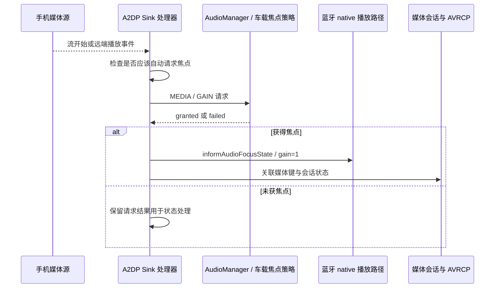

手机通过蓝牙在车机播放音乐，来电后音乐消失，通话结束却没有恢复。这个现象横跨手机播放器、蓝牙传输、车机媒体会话、通话服务、车载焦点和音频硬件。只看车机音量，或者只看手机显示“正在播放”，都不足以判断失败在哪一层。

车载角色首先要认清：接收手机音乐的一方通常是 A2DP Sink，手机是 Source；承接手机电话的一方是 HFP Client，也就是免提角色，手机承担网关角色。这与“Android 手机向耳机播放”的常见方向不同。本文依据[系列固定基线]()，分析这两类角色在本地 Android 17 实现中的控制流程。

## 一、连接、传输、焦点和可闻是四个状态

蓝牙设备已连接，只说明某些 profile 的连接建立。A2DP 媒体流开始，说明远端产生了流事件；本地拿到焦点，说明策略准许它按当前规则参与播放；扬声器真正可闻，还要求本地轨道、输出路由、增益与硬件工作。四者之间存在关联，却不能用一个 connected 状态替代。

HFP 同样区分电话控制连接与音频连接。车机可以获知来电和号码，但语音链路尚未建立；用户也可以把通话音频切回手机，而电话仍然继续。界面上的通话状态、蓝牙音频状态和 AudioPolicy 的路由状态必须分别记录，否则容易把用户主动切换音频出口误判为掉话。

profile 是否启动取决于产品配置。本地 `A2dpSinkService.isEnabled()` 和 `HeadsetClientService.isEnabled()` 分别查询 BluetoothProperties，缺省回退为 false。源码包含实现并不等于所有 AAOS 产品都启用了这两个角色，更不代表同一设备支持任意角色组合。[Sink 开关][sink-enabled]和[Client 开关][hfp-enabled]是集成时应先确认的入口。

车载媒体应用通常承担浏览、播放控制和会话展示；真正收到蓝牙流的组件可能在蓝牙进程。若只按当前前台界面包名搜索播放轨道，可能找不到实际客户端。调查时应关联媒体会话、蓝牙服务 UID 与 native 轨道，不能默认界面应用就是音频数据生产者。

## 二、A2DP Sink 怎样申请媒体焦点

`A2dpSinkStreamHandler` 处理本地播放命令、远端播放事件和流开始事件。流到达不一定无条件申请焦点：某些分支检查设备类别或 `a2dp_sink_automatically_request_audio_focus` 资源。基础资源中这个自动申请开关为 false；产品 overlay 可以改变结果。[事件分支][sink-events]与[资源默认值][bt-res]解释了“手机开始播放但车机未立刻发声”的一种正常原因。

实际焦点请求使用 `USAGE_MEDIA`、`CONTENT_TYPE_UNKNOWN` 和长期 `AUDIOFOCUS_GAIN`。源码注释说明，蓝牙流可能承载音乐、有声书、导航或其他声音，所以没有武断地把内容都标为音乐。[焦点请求][sink-focus]显示出传输协议无法完全替代业务语义的限制：车机看到的通常是一个媒体入口，不一定知道手机每个应用的内部用途。

申请获得授权后，处理器把焦点变化消息放到队列前部，再由统一分支启动本地 streaming。这样初次申请成功与之后恢复焦点共享处理路径。未获授权时不会把返回值当作普通成功，而是记录请求失败。AAOS 启用车载外部焦点策略后，该请求仍会进入车载仲裁，而非绕开音区规则。

<div style="overflow-x:auto;margin:1.5rem 0;">



</div>

## 三、蓝牙 duck 和暂停不是同一种动作

在焦点回调中，GAIN 会启动 streaming 并把 native 轨道增益恢复为 1；`LOSS_TRANSIENT_CAN_DUCK` 按资源百分比降低增益，越界配置则回退到默认值；`LOSS_TRANSIENT` 把增益设置为零；永久 LOSS 则放弃焦点并停止本地 streaming 状态。[回调处理][sink-events]说明这些动作并非统一发送“暂停手机”的命令。

因此，暂时失焦时远端进度仍可能前进，本地只是听不到声音。用户听到的“音乐暂停”并不总等于手机播放器暂停。是否同步发送 AVRCP 控制命令、手机怎样响应，以及媒体会话如何展示，是另一条控制链。处理器还把焦点变化交给 AVRCP Controller，以协调媒体状态，不能只查看本地增益就断言远端状态。

本地实现还用一小段静音 MediaPlayer 让 MediaSessionService 知道蓝牙正在播放，从而支持媒体键归属。这个播放器不是手机音乐 PCM 的来源，不能在 AudioFlinger dump 中看到它就认定找到了真实蓝牙音乐轨道。[媒体键关联][sink-keys]解释了这个容易干扰调试的细节。

与[压低音量和淡入淡出]()结合分析时，应避免重复衰减。车载 HAL 可能对设备 duck，蓝牙本地处理器也有增益变化路径，实际哪些路径会同时生效取决于焦点回调和产品配置。若导航期间音乐过小，应分别记录框架播放器增益、蓝牙 gain 和 HAL duck 状态，不能只修改一个固定百分比。

## 四、HFP 音频连接如何进入车内扬声器

`HeadsetClientStateMachine` 接收音频连接状态，检查是否允许路由。如果当前不允许，会发送断开音频的消息而不继续建立车机输出。语音路由的允许状态与电话是否存在是两个条件；产品需要保留“电话继续、声音在手机”的合法场景。[音频连接处理][hfp-connect]是这一分支的依据。

在允许路由且资源可用的路径中，代码依据协商出的连接类型选择采样率：普通路径、宽带和超宽带分别有不同设置。这里描述的是本地分支行为，不是保证任意手机都会协商到最高质量。随后启用 HFP 路由，申请音频焦点，设置通话音量，并进入 AudioOn 状态。音量在切换后设置，是因为某些 HAL 在模式切换时重置增益。

焦点请求使用 `USAGE_VOICE_COMMUNICATION`、`CONTENT_TYPE_SPEECH` 和 `AUDIOFOCUS_GAIN_TRANSIENT`。它与 A2DP 的长期媒体请求不同，通常表示电话期间的临时占用。本地代码还提示，Telecom 等控制电话的实体可能另外持有焦点，所以不能假设 HFP 状态机的一次 abandon 就清除了所有与通话有关的占用。[焦点与路由入口][hfp-focus]给出了具体实现。

要注意真实顺序：本地连接处理先设置 HFP 采样率并启用路由，再保存 requestAudioFocus 的请求对象，之后设置音量。不能为了画出理想流程而把它改写成“只有焦点成功才建立硬件路由”。研究某次失败时，应依据实际请求返回、实际连接和状态机日志判断，而不是把一层成功当作全链路事务成功。

## 五、Telecom 管电话，蓝牙与音频层落实通路

`HfpClientConnectionService` 是 Telecom ConnectionService，通过 PhoneAccount 和连接对象把远端电话纳入车机通话管理。拨号界面、来电界面和通话控制因此可以使用统一的 Telecom 模型，但这个抽象并不取代蓝牙的语音连接与底层音频路由。[电话账户创建][hfp-telecom]说明了两层的接合位置。

通话结束与音频链路断开也不完全等价。AudioOn 状态收到音频断开时会关闭 HFP 路由，释放状态机自己保存的焦点请求，并返回 Connected。源码明确说明，控制通话的实体仍可能持有焦点；音频连接偶然断开不能自动当作用户同意挂断电话。[断开处理][hfp-disconnect]是定位“声音没了但电话还在”的直接依据。

因此，恢复音乐要检查三件事：通话侧是否仍存在有效占用、媒体侧是否仍有继续播放的意图、蓝牙媒体流是否还能提供数据。若用户在电话中主动暂停音乐，通话结束不应强制启动；若电话音频切回手机但电话仍在进行，产品可能仍要求媒体保持抑制。业务策略必须与界面含义一致。

多音区产品还要明确电话属于哪个音区、麦克风属于谁，以及媒体流归属哪个用户。蓝牙连接通常不是每个乘客各自拥有一套完全独立硬件，不能仅通过改变播放 zone 就认定电话上行也随之迁移。此处应与[多音区用户模型]()和[录音链路]()共同核对。

## 六、用只读状态观察替代盲目切换路由

下面是一组设备侧只读取证命令。应在连接稳定、媒体播放、来电、通话、挂断后分别保存一份，文件名由测试工具附加时间与场景。输出字段随产品实现变化，重点是同一时间的状态能否互相解释。

```sh
adb shell dumpsys bluetooth_manager
adb shell dumpsys telecom
adb shell dumpsys media_session
adb shell dumpsys audio
adb shell dumpsys media.audio_policy
adb shell dumpsys media.audio_flinger
```

蓝牙状态帮助确认 profile、活动设备及音频连接；Telecom 说明电话是否仍存在；媒体会话说明播放器和媒体键控制归属；音频服务与策略说明焦点、路由、输出和音量。若没有统一时间基准，手机、蓝牙进程与音频服务的日志可能被错误排序，形成“先恢复再失焦”的假象。

不要在调查第一步同时重连蓝牙、重启播放器和修改音量。这样即使声音恢复，也无法知道是哪一个动作使状态收敛。先固定一个失败现场，再按控制链、数据链、增益链逐层检查。尤其不要把专供系统蓝牙组件的 HFP 方法包装为普通应用修复接口，它们并非第三方媒体应用应控制的全局开关。

## 七、通话打断音乐的完整复盘

设定测试开始时手机歌曲持续播放、车机媒体焦点有效、输出可闻。来电阶段先记录音乐是否已失焦，再区分铃声播放与通话音频连接。铃声可能在语音链路建立前发生，所以“听到铃声”不能证明通话上下行已正常。接听后同时观察远端听感和车内听感，分别对应上行与下行路径。

若接听后只有对方听不到驾驶员，应查看 HFP 上行、麦克风路由和静音状态，而非重复申请媒体焦点。若只有车内听不到对方，应查看语音输出、通话增益和路由允许状态。若双向都异常，还需确认音频连接类型、协商和 HAL 状态。通过方向拆分，能避免把所有问题归结为“蓝牙连接不稳定”。

挂断时记录电话对象结束、音频连接断开、HFP 路由关闭和各焦点释放的先后。若媒体已收到 GAIN，但远端流没有恢复，应调查手机或 AVRCP；若远端流持续而 native gain 仍为零，应检查焦点消息处理和本地恢复；若本地轨道活动但目标设备被静音，应调查车载音量与 HAL。每种证据都对应不同责任边界。

还应测试车机接听与手机接听、主动挂断与远端挂断、通话中切换到手机、蓝牙短暂断连、连续两次来电，以及音乐来自本地应用而非手机的情况。后者能区分通话释放问题与蓝牙媒体恢复问题：若本地音乐能恢复而手机音乐不能，公共车载焦点路径通常已有部分证据，需要继续沿蓝牙媒体链排查。

| 现象 | 首先关联的状态 |
| --- | --- |
| 已连接但媒体不响 | Sink 是否启用、自动焦点配置、流事件和请求结果 |
| 导航时音乐极低 | 蓝牙 gain、播放器衰减、HAL duck 是否叠加 |
| 电话仍在但车内无语音 | HFP 音频连接、路由允许、是否切回手机 |
| 挂断后歌曲继续走但无声 | 媒体焦点恢复、本地 gain、输出静音 |
| 方向盘键控制错误播放器 | MediaSession 活动状态与 AVRCP 会话归属 |

## 八、多个手机与异步事件如何扩大问题

当车辆记住多部手机时，连接设备、活动媒体设备和承载当前电话的设备可能不同。测试记录不能只保留一个“蓝牙已连接”的标志，而应给每条事件附上设备身份和用途。否则手机甲的媒体恢复事件可能与手机乙的电话结束混在一起，看起来像同一设备发生了错误顺序。

活动设备切换还涉及已有数据与控制状态的清理。旧设备可能继续产生远端播放状态更新，而车机已经把媒体键交给新设备。此时应检查事件是否归属当前有效会话，不能收到任何播放状态就更新统一界面。车载媒体中心在切换来源时，也应保存用户选择的来源，避免迟到事件把界面和按键重新拉回旧手机。

连接重试期间要区分“资源暂时不可用”与“用户拒绝自动播放”。若用户已经选择本地媒体，蓝牙重连后不应仅因远端有流就无条件抢占；自动申请焦点资源的设计正是需要结合产品行为理解的地方。验收时应覆盖先连接再播放、先在手机播放再连接，以及通话中重新建立媒体连接三种顺序。

声音是否恢复还应和手机端状态一起看。如果车机已经恢复输出能力，而手机播放器因永久失焦停止，就需要一次明确的播放控制；若手机仍在流送，额外发送播放命令可能重复改变状态。自动恢复策略应依据事件和会话意图，而不是在挂断回调中固定发送一次播放键。

## 九、把产品行为写成可验收契约

集成文档应明确自动接管手机音乐的时机、来电与通话的媒体处理、通话出口切换的行为，以及用户暂停后的恢复规则。这些不是底层协议名称能够替产品决定的。基础资源提供默认值，系统状态机提供机制，产品需要把两者组合成稳定体验，并在不同手机和连接顺序下验证。

日志也应保留状态来源。例如“媒体暂停”要说明是用户命令、焦点抑制、远端流停止还是本地增益归零；“电话结束”要说明是通话对象结束还是仅音频连接断开。命名越具体，跨团队讨论越容易复现问题。只有当控制状态、数据状态和实际声学结果互相吻合，才能认为蓝牙音乐与电话切换完成集成。

[sink-enabled]: https://android.googlesource.com/platform/packages/modules/Bluetooth/+/c77db469de80f86660bc053bec4dee0c5d4b947c/android/app/src/com/android/bluetooth/a2dpsink/A2dpSinkService.java#74
[hfp-enabled]: https://android.googlesource.com/platform/packages/modules/Bluetooth/+/c77db469de80f86660bc053bec4dee0c5d4b947c/android/app/src/com/android/bluetooth/hfpclient/HeadsetClientService.java#129
[sink-events]: https://android.googlesource.com/platform/packages/modules/Bluetooth/+/c77db469de80f86660bc053bec4dee0c5d4b947c/android/app/src/com/android/bluetooth/a2dpsink/A2dpSinkStreamHandler.java#151
[bt-res]: https://android.googlesource.com/platform/packages/modules/Bluetooth/+/c77db469de80f86660bc053bec4dee0c5d4b947c/android/app/res/values/config.xml#88
[sink-focus]: https://android.googlesource.com/platform/packages/modules/Bluetooth/+/c77db469de80f86660bc053bec4dee0c5d4b947c/android/app/src/com/android/bluetooth/a2dpsink/A2dpSinkStreamHandler.java#239
[sink-keys]: https://android.googlesource.com/platform/packages/modules/Bluetooth/+/c77db469de80f86660bc053bec4dee0c5d4b947c/android/app/src/com/android/bluetooth/a2dpsink/A2dpSinkStreamHandler.java#269
[hfp-connect]: https://android.googlesource.com/platform/packages/modules/Bluetooth/+/c77db469de80f86660bc053bec4dee0c5d4b947c/android/app/src/com/android/bluetooth/hfpclient/HeadsetClientStateMachine.java#1683
[hfp-focus]: https://android.googlesource.com/platform/packages/modules/Bluetooth/+/c77db469de80f86660bc053bec4dee0c5d4b947c/android/app/src/com/android/bluetooth/hfpclient/HeadsetClientStateMachine.java#933
[hfp-telecom]: https://android.googlesource.com/platform/packages/modules/Bluetooth/+/c77db469de80f86660bc053bec4dee0c5d4b947c/android/app/src/com/android/bluetooth/hfpclient/HfpClientConnectionService.java#354
[hfp-disconnect]: https://android.googlesource.com/platform/packages/modules/Bluetooth/+/c77db469de80f86660bc053bec4dee0c5d4b947c/android/app/src/com/android/bluetooth/hfpclient/HeadsetClientStateMachine.java#1914

<!-- series-navigation -->
## 系列导航

[系列目录]()

[上一篇：语音交互与唤醒音频]()

[下一篇：外部音源与 AudioPatch]()
