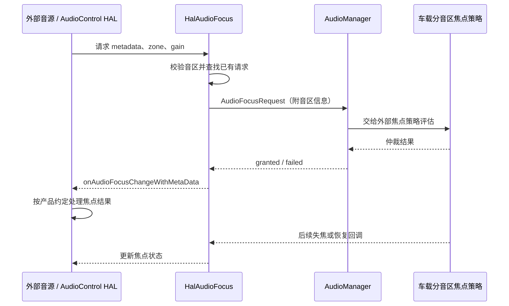

车机收音机正在发声，AudioFlinger 中却找不到持续写入 PCM 的普通应用轨道。这未必异常：调谐器或外部 DSP 可以通过硬件音频路径直接送到输出设备。Android 仍需要知道它正在播放、声音属于哪种用途、应与哪些声音竞争，以及用户音量应该控制哪个设备。

外部音源集成的核心，是将控制状态与实际硬件播放对应起来。音频焦点决定是否允许参与声音竞争，路由连接决定信号去向，增益决定电平，调谐器自身还管理频率和节目。这些操作不能用一次“收音机开始”概括。本文依据[系列源码基线]()，解释现代系统接口、旧车载兼容接口及 HAL 焦点的边界。

## 一、外部音源不必绕进应用 PCM 缓冲

普通媒体播放器把解码后的样本送入 AudioTrack；硬件音源可能已经在调谐器或 DSP 中产生信号，重新采集到应用再播放会增加传输、时延和资源开销。AudioPatch 表达源端口与目标端口之间的连接关系，实际连接可由政策和 HAL 落实。是否经过软件混音、是否在硬件内部直通，取决于设备拓扑与支持能力。

因此，不能把“没有普通 AudioTrack”直接写成“Android 完全不知道这路声音”。系统可以通过硬件音源播放器、patch、HAL 焦点请求和增益状态表达它。反过来，焦点列表里有收音机也不能证明硬件信号真正接通；控制注册和数据链路必须分别验证。

Audio HAL 负责端口、流与连接等音频执行能力，AudioControl HAL 负责车载音频控制协作。后者能替外部参与者请求焦点、接收 duck 或 mute 信息，却不是传输收音机 PCM 的通道。把两个 HAL 合并成一个“音频 HAL”模块，会掩盖某些故障只发生在控制面或数据面的事实。

外部音源也不等于最高优先级音源。收音机通常属于媒体语义，外部告警则应使用相应语义；是否允许被导航压低、被电话打断，仍由车载策略决定。厂商在 DSP 内部直接发声，不能成为跳过已定义音区与音量行为的理由，否则 Android 显示的状态将无法解释用户听到的声音。

## 二、Android 17 基线保留了旧接口，但已经标记弃用

本地 `CarAudioManager.getExternalSources()` 已标记 `@Deprecated`，文档建议通过 `AudioManager.getDevices(GET_DEVICES_INPUTS)` 枚举输入；`createAudioPatch` 与 `releaseAudioPatch` 同样已弃用，建议使用 `HwAudioSource`。这些都是带系统 API 条件的能力，不能当作普通第三方应用可以直接调用的公开 SDK。[旧接口契约][car-api]提供了迁移方向。

旧接口仍有工程价值，因为已有产品可能继续使用它，调查存量问题时需要读懂实现。CarAudioService 要求 `CAR_CONTROL_AUDIO_SETTINGS` 权限，同时检查 `ro.android.car.audio.enableaudiopatch` 属性；默认值为 false。仅加入权限声明不会打开这条路径，设备具有某个源端口也不意味着接口已启用。[接口门控][patch-entry]与[属性默认值][patch-property]应一起核对。

旧枚举逻辑收集指定类型的非麦克风输入端口，忽略空地址。地址是定位源设备的重要标识，不能用列表顺序、显示名或上次开机的数值 ID 替代。产品配置发生变化或设备重连时，应重新确认地址对应的可用设备，而不是缓存一个永远有效的对象。

另一个重要限制是旧 `createAudioPatchLocked` 固定使用 `PRIMARY_AUDIO_ZONE`，根据传入 usage 选择主音区输出，再同步该输出音量组当前音量。它不是一个可指定任意 zone 的接口；在多音区项目中添加一个后排源地址，也不会使旧调用自动路由到后排。[旧 patch 创建][patch-create]给出了清楚的边界。

## 三、HwAudioSource 把硬件源纳入播放器模型

`HwAudioSource` 继承 PlayerBase，构造时检查设备必须是 source，并以 `PLAYER_TYPE_HW_SOURCE` 注册播放器。启动调用 `AudioSystem.startAudioSource`，成功后记录播放状态；停止则调用 `stopAudioSource` 并清理句柄。这让硬件源可以拥有更统一的播放器生命周期，而不是仅保存一个裸 patch 句柄。[播放器注册][hw-register]与[启动停止实现][hw-start]展示了设计动机。

它的 `start()` 不返回错误码，调用者应检查 `isPlaying()`；内部 native handle 大于零表示成功，零表示未初始化或停止，负值承载启动失败。重复对已经播放的对象 start 会触发状态检查。因此业务需要按对象状态组织调用，而不是在每个界面刷新时重复开始硬件源。

但统一模型不等于功能完全等同于 AudioTrack。本地 `playerSetVolume`、`playerApplyVolumeShaper` 等方法仍保留 TODO 或占位实现。由此不能声称“改用 HwAudioSource 后，系统必然能对任何外部 DSP 音源执行相同淡入淡出”。实际硬件衰减仍要核对产品路径与 HAL 支持。[效果相关实现][hw-effects]是这条限制的重要证据。

下面是平台系统组件的 Java 教学片段。前提是具备相关系统 API 使用条件，`sourceDevice` 来自当前有效输入设备，硬件与策略支持这类源。普通媒体应用不应复制系统 API 到反射调用路径。

```java
AudioAttributes attributes = new AudioAttributes.Builder()
        .setUsage(AudioAttributes.USAGE_MEDIA)
        .setContentType(AudioAttributes.CONTENT_TYPE_MUSIC)
        .build();
HwAudioSource source = new HwAudioSource.Builder()
        .setAudioDeviceInfo(sourceDevice)
        .setAudioAttributes(attributes)
        .build();
// 业务先完成必要的焦点与设备状态判断。
source.start();
if (!source.isPlaying()) {
    // 启动失败：记录源设备、属性和当前策略状态，结束业务请求。
}
// 用户停止或永久失焦时，按业务生命周期调用 source.stop()。
```

示例中的注释并不表示 HwAudioSource 自动申请焦点。对象管理播放执行，业务仍需把焦点契约接好，或者采用产品定义的 HAL 发起焦点模式。两种方式不能无意中重复代表同一硬件源，否则会出现双份 holder、一次停止只释放其中一份的问题。

## 四、HAL 可以为 Android 外部声音申请焦点

AudioControl 的 `IFocusListener` 允许 HAL 上报请求和放弃，新的带 metadata 方法携带播放属性与音区。CarService 的 `HalAudioFocus` 按 zone 和属性包装维护请求，将 metadata 转成 AudioAttributes，并在 Bundle 中附加目标音区，再通过 AudioManager 进入车载焦点仲裁。[HAL 协议][focus-aidl]与[桥接逻辑][hal-focus]说明它是控制桥梁，而不是第二套独立仲裁器。

当同一音区、同一属性包装已有请求时，HalAudioFocus 会把当前状态回传，而非不断创建新请求。这个键不等于每个物理信号源都拥有独立身份。产品若存在两个相同用途的外部源，需要理解桥接层的聚合方式，避免把它误当作任意数量硬件客户端的独立播放会话管理器。

请求成功时记录状态并通知 HAL；失败时回传 LOSS。本地实现明确不支持 HAL 音频焦点的 delayed 结果，遇到 delayed 会记录警告并按 LOSS 处理。不能把普通应用的延迟焦点设计原样套到外部音源上。还要区分协议与产品约定：`IAudioControl` 明确允许 HAL 不等待 GAIN 就播放，也不要求收到 LOSS 就停止；这些通知为系统协调提供状态，具体等待与停止行为由产品约定决定。[接口中的外部焦点契约](https://android.googlesource.com/platform/hardware/interfaces/+/0162af698935100a590b7359581ac8b1b80693e5/automotive/audiocontrol/aidl/android/hardware/automotive/audiocontrol/IAudioControl.aidl#66) 与[第 14 篇]()对此作了区分。

<div style="overflow-x:auto;margin:1.5rem 0;">



</div>

## 五、旧 patch 的增益参数不能当用户音量

旧辅助实现从源设备取得 gain controller，使用 joint gain 配置源端口，然后建立源到目标的 patch。没有源端口增益控制器会失败；底层创建失败也会抛出错误，而不是返回一个必定有效的连接。[辅助创建逻辑][patch-helper]说明了输入能力检查为何重要。

`gainInMillibels` 用于源端平衡，用户音量通常仍由目标音量组管理。这两个值处于不同控制位置。若某个外部音源比其他媒体明显偏响，可能需要调整源平衡；如果音量键没有改变所有预期声音，则应检查目标音量组与设备绑定。盲目把源增益当作用户音量，会造成不同来源切换时电平不一致。

接口文档与底层 helper 对增益参数的表述也值得谨慎对照。集成时应根据源端口实际暴露的范围、步进和 HAL 对配置的解释验证，不能假设传零就对所有实现产生相同的“保持当前增益”效果。用于示例的数值应落在实际设备支持范围内，不从另一款车的配置直接复制。

硬件直通音源还可能与 Android 混音流在 DSP 才汇合。若用户要求同时混音或 duck，必须确认处理位置能分别控制两路信号。只有一个已混合后的公共增益，通常无法单独压低收音机而保持导航音量；软件策略再准确也不能创造不存在的硬件控制自由度。

## 六、用状态所有者约束生命周期

每个外部音源应明确由哪个组件负责调谐、请求焦点、建立路由、设置源平衡和停止播放。可以由系统应用协调，也可以由 HAL 报告硬件主导的事件，但同一动作应有清晰所有者。否则很容易出现应用认为 HAL 会释放，而 HAL 等待应用停止的循环。

正常停止时，硬件播放和路由应收敛，焦点也应释放；永久失焦时必须执行产品定义的停止或抑制行为。异常情况下还包括设备消失、应用进程退出、AudioControl HAL 重启和 audioserver 重启。保留原来的 patch handle 或播放器 native handle 并不保证资源依然存在，恢复需要重新查询实际设备和服务状态。

HalAudioFocus 的 `reset()` 会遍历各音区已有请求并放弃，设计用于 HAL 死亡时清理旧占用。这个动作防止已不存在的外部请求长期阻塞其他声音，但不代表外部 DSP 的模拟输出一定同时停止。硬件默认静音、连接重建和状态重报需要在产品恢复设计中明确，与[电源与恢复]()一起验证。

对回调也要处理过期问题。源切换可能发生在焦点结果返回之前，旧源的成功回调不能启动新源或恢复已停止节目。应用可以使用业务请求编号，把当前源、当前状态与回调绑定；HAL 主导模式也应保证报告的是当前有效硬件状态，而非重放失效事件。

## 七、外部音源无声的分层调查

第一层检查源是否真实产生信号。调谐器完成调谐、接收到节目和节目音频有效是不同事实；外部输入插入也不说明对端正在输出。第二层检查 Android 是否选择了正确源端口和目标端口，patch 或硬件源是否成功开始。第三层检查焦点、用户静音、HAL mute、duck 与源增益。最后检查功放、DSP 和物理输出。

设备侧可以保存 `adb shell dumpsys car_service --services CarAudioService`、`adb shell dumpsys audio`、`adb shell dumpsys media.audio_policy` 和 `adb shell dumpsys media.audio_flinger`。旧接口还可只读检查 `adb shell getprop ro.android.car.audio.enableaudiopatch`。不要为了让调用通过，临时把只读产品属性当普通运行时开关修改；应先确认产品为何选择当前方案。

| 现象 | 更有区分力的证据 |
| --- | --- |
| 焦点已获准但无声 | 源信号、实际 patch、设备地址和输出增益 |
| Android 媒体已停但收音机继续 | 硬件是否收到失焦、谁负责实际停止 |
| 音量键只影响部分声音 | 源是否绕过目标组、DSP 汇合位置 |
| 切源后旧声音残留 | 旧 patch 生命周期和外部源停止次序 |
| HAL 重启后媒体被长期阻塞 | 旧 HAL 焦点记录是否清理、新请求是否重建 |

## 八、把端口地址和业务来源分层命名

外部源设计中最好分别保存业务来源、物理设备地址和当前系统句柄。业务来源可以是“收音机”，地址标识产品音频配置中的输入，句柄则代表某次服务连接中的资源。三者生命周期不同：用户收藏的节目可以跨重启保存，系统句柄不能因此被当作持久化配置。

设备热插拔或服务恢复后，应从业务来源重新解析当前可用设备，再创建新的播放资源。若地址已不存在，应向业务报告来源不可用，而不是把相同列表下标的新设备当作旧输入。这样的约束尤其适合同时存在调谐器、外部数字输入和可插拔设备的产品，能避免音频从意外来源被送往扬声器。

源端与目标端的格式能力也需要明确。端口能枚举出来，并不证明任意采样率、通道数或直接连接方式都成立；有些组合需要转换，有些硬件根本不支持。接口失败时应同时保存两端能力和请求参数，而不是只记录“创建失败”。产品固定拓扑可以在集成阶段校验这些组合，减少运行时探索。

对于外部告警，业务优先级、播放位置和失效后的行为需要单独定义。媒体源的自动恢复策略不能直接套到告警，也不能因为两者都由 DSP 输出就共用一个状态对象。明确语义后，焦点桥接、设备增益和恢复逻辑才可以分别验证，硬件团队也能理解哪一条信号需要独立控制。

## 九、建立可复用的集成验收案例

从“收音机单独播放”开始，记录来源、usage、zone、输出设备和音量组。随后让本地音乐申请焦点，观察收音机应如何失焦及停止；再切回收音机，确认旧路由没有残留。这个过程应检查实际听感与系统状态，而不是仅检查接口返回成功。

下一步插入导航和电话。导航期间若应压低收音机，就同时核实 HAL 收到的控制与硬件电平变化；电话期间若应停止，则验证电话结束后是否允许自动恢复，以及用户主动停止是否覆盖自动恢复。不要把所有临时打断都实现为重新调谐，因为那可能带来启动延迟和节目状态丢失。

多音区验收要特别标记接口限制。使用旧主音区 patch 接口的产品，不应通过一个看似通用的业务参数伪装支持后排；真正需要后排外部源时，应从支持多音区的政策和硬件源方案设计，并核实各输出能力。产品文档应写清当前实现覆盖范围，避免界面承诺超过底层契约。

最后进行服务重启和源设备变化测试。成功恢复的标准是旧状态被清理、新设备重新枚举、焦点与路由重新一致、声音从预期位置以预期音量出现。只有这样，外部音源才能在 Android 看得到的控制世界与 DSP 实际发声世界之间保持一致。

[car-api]: https://android.googlesource.com/platform/packages/services/Car/+/9f04df65daa8b9a65ee05fd4039fe95446874d76/car-lib/src/android/car/media/CarAudioManager.java#765
[patch-entry]: https://android.googlesource.com/platform/packages/services/Car/+/9f04df65daa8b9a65ee05fd4039fe95446874d76/service/src/com/android/car/audio/CarAudioService.java#2690
[patch-property]: https://android.googlesource.com/platform/packages/services/Car/+/9f04df65daa8b9a65ee05fd4039fe95446874d76/service/src/com/android/car/audio/SystemPropertiesWrapper.java#29
[patch-create]: https://android.googlesource.com/platform/packages/services/Car/+/9f04df65daa8b9a65ee05fd4039fe95446874d76/service/src/com/android/car/audio/CarAudioService.java#2720
[hw-register]: https://android.googlesource.com/platform/frameworks/base/+/94b4c163b7dfe5ce3607f7bb8456f9573f7de57d/media/java/android/media/HwAudioSource.java#52
[hw-start]: https://android.googlesource.com/platform/frameworks/base/+/94b4c163b7dfe5ce3607f7bb8456f9573f7de57d/media/java/android/media/HwAudioSource.java#139
[hw-effects]: https://android.googlesource.com/platform/frameworks/base/+/94b4c163b7dfe5ce3607f7bb8456f9573f7de57d/media/java/android/media/HwAudioSource.java#65
[focus-aidl]: https://android.googlesource.com/platform/hardware/interfaces/+/0162af698935100a590b7359581ac8b1b80693e5/automotive/audiocontrol/aidl/android/hardware/automotive/audiocontrol/IFocusListener.aidl#67
[hal-focus]: https://android.googlesource.com/platform/packages/services/Car/+/9f04df65daa8b9a65ee05fd4039fe95446874d76/service/src/com/android/car/audio/HalAudioFocus.java#112
[patch-helper]: https://android.googlesource.com/platform/packages/services/Car/+/9f04df65daa8b9a65ee05fd4039fe95446874d76/car-builtin-lib/src/android/car/builtin/media/AudioManagerHelper.java#170

<!-- series-navigation -->
## 系列导航

[系列目录]()

[上一篇：蓝牙音乐与通话]()

[下一篇：媒体共享与音区镜像]()
