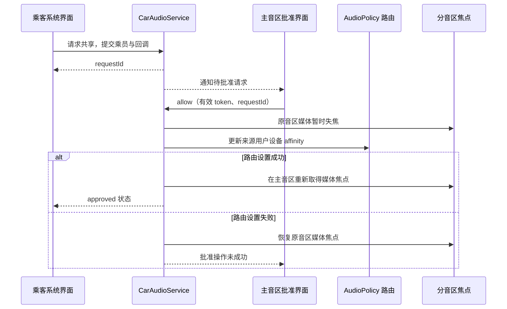

后排乘客想把歌曲放到驾驶舱扬声器，另一种需求是让两个后排音区一起播放同一内容。用户都可能称它们为“共享音乐”，AAOS 却提供不同机制：共享到主音区带有请求和批准流程；音区镜像组织多个非主音区，并依赖专门的镜像输出资源与 HAL 配合。

这两种能力不是对扬声器简单复制一份 PCM。声音的用户身份、路由约束、焦点归属和请求生命周期都要改变。本文按[固定源码基线]()解释控制流程，特别说明请求编号、成功回调与真正发声之间的区别，以及共享、镜像和配置切换为什么不能随意重叠。

## 一、先确定分享的对象和目标

共享到主音区的请求以 OccupantZoneInfo 表示发起乘员。CarAudioService 根据乘员找到 audio zone，再核对是否已经属于主音区、是否映射到活动用户、是否正参与镜像。主音区自身不能再次申请把自己的媒体共享给自己。[共享请求入口][share-request]体现了乘员、用户和音区之间的关系。

请求主要围绕用户的媒体行为展开，不是挑选某个 AudioTrack 做任意信号复制。要准确理解效果，应把用户设备 affinity 与媒体用途路由规则一起看。改变设备可达集合会影响后续匹配，不能把“给 affinity 添加设备”直接解释为所有声音都会同时复制到每个设备。

镜像则至少涉及两个不同的非主音区，列表不能重复且不能包含主音区。每个音区必须有活动用户，不能已经共享到主音区，也不能被另一个镜像请求占用。列表顺序有语义：服务实现保留首个音区作为来源和当前焦点管理依据。[镜像入口][mirror-request]与[校验分支][mirror-check]定义了它的实际适用范围。

两者都需要系统 API 使用条件和 `CAR_CONTROL_AUDIO_SETTINGS` 权限，还要求相应路由模式可用。普通播放器应该使用正常媒体接口，由有权限的系统界面协调共享操作。不要把这一组接口作为第三方应用擅自把后排内容送到驾驶舱的机制。

## 二、共享请求需要明确的批准者

`MediaRequestHandler` 为请求分配唯一编号，保存回调和乘员，并异步通知批准方。调用返回一个有效编号，只表示请求已经被系统受理，不能立即在界面上显示“主音区正在播放”。同一回调对象不能被重复用于正在登记的多个请求；调用者需要按照 API 的生命周期组织回调。[请求登记][request-handler]提供了具体状态管理。

批准方要先登记主音区媒体请求回调。CarAudioService 处理 allow 时验证批准 token 是否属于已注册回调，并检查请求是否还存在。如果用户已取消、乘员已改变或批准者已退出，旧批准操作可能不再有效。这是异步授权型流程，不能用一个同步布尔按钮直接代表所有后续状态。

拒绝、取消和停止拥有不同状态。拒绝表示请求没有获准；取消可以发生在等待批准时；停止通常表示已建立的共享被结束。界面应据状态解释原因，而不是把所有回调都显示为“播放失败”。这样用户能够区分对方拒绝、自己取消以及系统因资源变化结束共享。

产品应明确谁可以批准，以及批准期间如何展示来源与乘员。系统接口提供技术绑定，不会替业务生成完整交互规则。最少应让批准者知道哪个乘员正在请求共享，并能停止已允许的共享；用户切换后，不应让新驾驶员继承一个没有说明来源的隐形请求。

## 三、批准后同步调整路由与媒体焦点

共享建立时，服务先让来源用户在原音区的媒体暂时失焦，保存相关焦点栈。随后给用户设备 affinity 加入主音区媒体设备。路由设置失败时，原音区焦点被恢复；成功路径继续登记批准 token 的死亡监听，并把媒体焦点放到主音区重新取得。[共享执行][share-execute]显示了焦点与路由必须协调变更的原因。

这不是把所有应用状态冻结后原样搬迁。重新获得焦点会与主音区已有声音发生仲裁：主音区音乐、导航或电话仍有自己的状态。原后排媒体进入主音区后，可能遇到不同竞争结果。应用应正常响应焦点回调，不能因为系统界面显示“共享批准”就忽略之后的失焦。

停止共享时，服务从主音区暂时移出该用户媒体焦点，恢复原音区设备集合，再把媒体焦点交回原音区，最后发送停止状态。路由恢复失败时会保留相应处理分支，而非无条件报告结束。[共享退出][share-stop]说明为什么停止也必须作为一个受观察的操作。

<div style="overflow-x:auto;margin:1.5rem 0;">



</div>

这里图示的是主要成功与路由失败路径，不把 Binder 死亡等所有失败都抽象成完全原子的回滚。源码中多个步骤通过异步回调和服务调用衔接，工程验证要分别检查路由、焦点和请求记录最终是否一致。

## 四、镜像需要专门的输出资源

镜像不是一个无限容量的软件广播按钮。`canEnableAudioMirror()` 区分可启用、镜像输出资源耗尽和内部错误；建立镜像时会为请求分配镜像设备，再将实际处理投递到服务线程。预检查与执行之间资源可能变化，因此不能以预检查成功代替最终状态回调。[镜像 API 契约][mirror-api]清楚描述了这一点。

模拟器的多显示配置中包含镜像设备条目，音频策略也提供相应 bus 端口。这些文件说明如何把镜像源纳入配置，但不能仅复制一段 XML 就认定任意量产 HAL 会执行镜像。产品必须同时具备正确设备、路由和 HAL 行为，且要验证目标设备增益与输出能力。

服务处理镜像时先让相关音区暂时失焦，更新用户到镜像设备的路由约束，再恢复媒体焦点。当前源码有明确 TODO：尚未实现完整多音区焦点管理，目前选择来源音区作为焦点管理音区。不能将它描述为每个接收音区都完整独立仲裁同一镜像内容。[镜像执行][mirror-execute]是评估电话或导航插入行为的重要依据。

随后服务用 `AudioManager.setParameters` 发送 `mirroring_src` 与 `mirroring_dst` 信息，目标由各音区的媒体输出地址组成。这条实现路径传递的是镜像控制参数，不是逐帧 PCM。它也不等同于 AudioControl HAL 的某个专用音频数据接口。[HAL 参数路径][mirror-hal]应与实际 Audio HAL 实现共同核对。

## 五、镜像资源与业务请求不是永久状态

镜像 request ID 用于扩展、查询和关闭当前镜像关系，不应持久化为跨重启恢复依据。新增接收音区应使用扩展接口，而不是创建第二个与原音区重叠的请求。两个独立镜像请求不能通过一个重复成员列表隐式合并，否则资源和焦点归属将无法明确。

关闭某个音区或整个请求时，需要恢复参与用户路由和焦点，并释放不再使用的镜像资源。业务应等待状态通知再更新最终界面；关闭按钮被点击和声音已经恢复独立播放之间存在处理窗口。若这个窗口内用户又修改成员，系统界面应串行化操作或明确标记待完成状态。

镜像当前聚焦于媒体共享体验，不应假设电话、导航、告警等全部会按相同方式复制。用途路由和当前焦点实现决定哪些声音参与以及如何竞争；产品需求若要求“所有声音全舱同步”，需要重新核对能力边界，而不是直接扩大描述。尤其要验证接收音区本地声音与镜像内容之间的策略。

资源不足也应该成为正常业务分支。镜像设备池已被占用时，系统可能拒绝新请求；界面应保留原有独立播放状态并说明当前不可共享。通过反复创建请求“抢一个空位”会扩大竞争窗口，日志中也难以分辨用户意图与自动重试。

## 六、为什么共享、镜像和配置切换互斥

共享到主音区与镜像都会改变同一用户的路由约束；音区配置切换又可能更换该音区设备集合和音量组。如果三者独立修改同一状态，最后写入的一方可能覆盖另一方的期望。CarAudioService 因此在入口及异步执行时重复检查共享和镜像冲突，配置切换也要求先退出这两种模式。

重复检查不是多余的防御代码。入口检查通过后，请求可能等待线程处理；在等待期间用户分配或另一个共享状态已经改变。执行时再次确认可以阻止使用过期前提。应用也应理解，列表里刚刚显示“可用”的目标，点击后仍可能因为并发变化被拒绝。

批准者 Binder 死亡会触发共享撤销处理；注销批准回调也会处理它拥有的请求。这样共享拥有明确生命周期，不依赖界面永远存活。然而业务仍应在退出页面或用户切换时主动整理请求，并在重连后查询实际状态，不能仅相信本地缓存的 request ID。

对于换座位场景，OccupantZone、user 和 audio zone 的映射可能改变。系统界面应重新读取当前乘员映射再发起共享，不把旧乘员信息当作稳定身份。否则可能把原先后排甲的请求错误显示成新乘员乙的请求，即使底层路由本身没有出错，用户体验仍存在明显问题。

## 七、系统界面的最小实现流程

下面是教学伪代码，省略完整 Java 类型与错误 UI。重点是先注册回调，再创建请求，最后根据 request ID 对齐异步结果。系统应用需要具备权限和功能条件，普通音乐应用仍只负责自己的播放生命周期。

```text
页面进入：
  查询当前乘员、用户、音区及功能状态
  注册共享或镜像状态回调
  读取已存在请求，显示真实状态

用户发起操作：
  检查目标与当前模式是否兼容
  创建请求，保存返回 requestId
  显示“等待批准”或“正在设置”

收到状态：
  只更新匹配 requestId 的当前操作
  成功后显示参与者与停止入口
  拒绝、取消、停止时清理本地记录

用户退出或用户变化：
  按产品契约结束自身拥有的请求
  注销回调，丢弃旧用户的缓存
```

不要通过调用 `AudioTrack.setPreferredDevice` 来伪装这套共享流程。那只是单个播放器的设备偏好，不能代替乘员审批、跨用户 affinity、镜像设备分配和焦点转移。也不要为了共享而把乘客应用改为驾驶员用户运行，用户身份承担权限、数据和生命周期含义，不能作为路由捷径。

## 八、验证成功和退出同样重要

共享用例应覆盖批准、拒绝、批准前取消、批准后停止、批准者退出和乘员用户切换。每一步都同时查看 request ID、用户设备 affinity、媒体焦点所属音区和实际输出。只验证“批准后能听见”会遗漏大量状态残留，尤其是停止后后排媒体仍响在驾驶舱的问题。

镜像用例应覆盖两个音区起步、增加接收者、移除接收者、资源耗尽、成员重复、主音区被错误加入以及另一个请求占用成员。第一项证明基本功能，后几项证明系统能够拒绝不成立的组合并保留原有状态。源码已有 MediaRequestHandler 和 CarAudioMirrorRequestHandler 单元测试，可作为理解回调和资源管理约定的辅助入口。[请求处理测试][request-test]覆盖状态边界。

声学结果也需要独立观察。镜像控制成功并不证明各扬声器时延和响度一致；目标设备可能具有不同处理链和增益。若用户要求同步影音，应在实际产品输出上测量同步与延迟，不能从一个框架 request ID 推导声学同步精度。量产验收应把控制成功和听感质量分别定义。

最后验证切回独立播放。每个音区应重新遵循自己的用户、设备、音量组和焦点策略；用户在共享期间主动暂停的应用不应被强制启动。共享功能真正完成，不只是建立一条新的发声关系，还包括在取消、异常和退出后把所有参与者送回明确且一致的状态。

## 九、用一次撤销操作检验状态是否一致

假设后排媒体已经共享到主音区，此时批准界面退出。应先看请求状态是否转为停止，再看来源用户的设备集合是否恢复，最后看媒体焦点是否回到原音区。若请求已停止但仍能从主音区听见，说明不能只排查回调 UI，而应继续核对实际路由或播放器是否存在其他独立输出请求。

另一种情况是路由恢复后没有声音。这不必然是撤销失败：媒体可能在共享期间被用户主动暂停，也可能在原音区重新申请焦点时遇到新的竞争者。应先确认播放意图和焦点结果，再判断输出链路。把任何无声都修成自动调用播放，会破坏用户对暂停的控制。

镜像退出也应用同样方法逐项验证。请求从管理器移除、镜像设备释放、HAL 收到关闭控制、参与用户恢复独立路由，各自都有观察证据。若某一步失败，应记录故障位置和最终可恢复状态，而不是让界面永远显示处理中。明确每一步的观测点，使控制层和硬件团队能共同定位残留声音。

对系统界面而言，最可靠的状态模型是以系统当前结果为准，用本地请求序号关联尚未完成的操作。页面重建后重新查询，而不是从旧按钮颜色推断共享仍然存在。这能同时解决进程重建、用户切换和迟到回调带来的混乱。

[share-request]: https://android.googlesource.com/platform/packages/services/Car/+/9f04df65daa8b9a65ee05fd4039fe95446874d76/service/src/com/android/car/audio/CarAudioService.java#1418
[request-handler]: https://android.googlesource.com/platform/packages/services/Car/+/9f04df65daa8b9a65ee05fd4039fe95446874d76/service/src/com/android/car/audio/MediaRequestHandler.java#125
[share-execute]: https://android.googlesource.com/platform/packages/services/Car/+/9f04df65daa8b9a65ee05fd4039fe95446874d76/service/src/com/android/car/audio/CarAudioService.java#3133
[share-stop]: https://android.googlesource.com/platform/packages/services/Car/+/9f04df65daa8b9a65ee05fd4039fe95446874d76/service/src/com/android/car/audio/CarAudioService.java#3219
[mirror-request]: https://android.googlesource.com/platform/packages/services/Car/+/9f04df65daa8b9a65ee05fd4039fe95446874d76/service/src/com/android/car/audio/CarAudioService.java#1598
[mirror-check]: https://android.googlesource.com/platform/packages/services/Car/+/9f04df65daa8b9a65ee05fd4039fe95446874d76/service/src/com/android/car/audio/CarAudioService.java#1731
[mirror-api]: https://android.googlesource.com/platform/packages/services/Car/+/9f04df65daa8b9a65ee05fd4039fe95446874d76/car-lib/src/android/car/media/CarAudioManager.java#1630
[mirror-execute]: https://android.googlesource.com/platform/packages/services/Car/+/9f04df65daa8b9a65ee05fd4039fe95446874d76/service/src/com/android/car/audio/CarAudioService.java#1838
[mirror-hal]: https://android.googlesource.com/platform/packages/services/Car/+/9f04df65daa8b9a65ee05fd4039fe95446874d76/service/src/com/android/car/audio/CarAudioService.java#1873
[request-test]: https://android.googlesource.com/platform/packages/services/Car/+/9f04df65daa8b9a65ee05fd4039fe95446874d76/tests/CarServiceUnitTest/src/com/android/car/audio/MediaRequestHandlerTest.java#1

<!-- series-navigation -->
## 系列导航

[系列目录]()

[上一篇：外部音源与 AudioPatch]()

[下一篇：动态设备与音区配置切换]()
