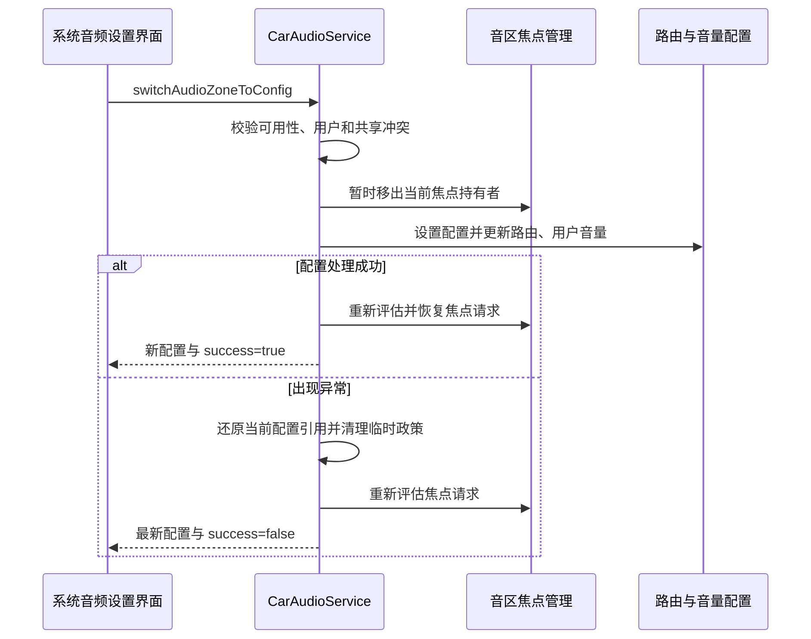

后排乘客插入耳机，希望声音从座椅扬声器转到耳机；拔出后又希望恢复到原来的播放位置。这个动作看似只是更换输出设备，车载系统还要维护音区、用户、音量组、焦点和配置可用性。如果只更新播放器偏好，音量界面与车载路由可能仍保留旧状态。

AAOS 用音区配置表示同一音区的不同设备与音量组织方式，并用动态设备事件更新哪些配置当前可用。本文依据[固定源码基线]()解释这套机制。这里的动态设备是可变化的设备状态，不应与“动态 AudioMix 路由”混为同一个概念；采用 Core Audio routing 时同样需要正确处理配置状态。

## 一、一个音区可以拥有多个配置

audio zone 表示声音服务的空间与用户边界，zone configuration 表示该音区某一种具体输出组织。例如同一后排音区可以有默认扬声器配置和耳机配置，每种配置包含各自音量组与设备。选择配置会改变当前服务使用的设备集合，不是创建一个新的乘员或用户。

`CarAudioZone` 校验至少有配置、当前配置存在、配置所属 zone 一致，以及恰好一个默认配置。默认配置是启动和回退设计的重要基础，不能把多个配置都标为默认，以为系统会随机选一个可用的。[音区校验][zone-validation]明确表达这些不变量。

配置对象有三个应分开的状态：default 表示默认候选，active 表示当前具备所需可用条件，selected 表示当前被选中。一个耳机配置可以存在但未 active；一个扬声器配置可以 active 却未 selected。界面若只保留“启用/禁用”两个状态，就无法清楚表达“可选择”和“正在使用”。

本地 `CarAudioZoneConfig.isActive()` 遍历音量组，要求所有组都 active。不能因为配置中的一个设备出现，就认为整个配置可用；配置包含的其他组仍可能缺失所需设备。[配置状态实现][config-active]是理解按钮何时应可点击的依据。

## 二、设备通知怎样变成配置可用性

CarAudioService 注册 AudioDeviceCallback，`CarAudioDeviceCallback` 直接把设备加入和移除转交给服务。服务先检查 audioserver 是否处于 down 状态，再过滤设备；本地过滤函数排除输入设备和 BUS 设备，主要处理这条动态输出路径。[回调转发][device-callback]与[过滤实现][device-filter]说明它并不是所有 HAL 端口变化的统一入口。

设备加入后，服务遍历相关音区更新配置，重新检查动态 mix 使用条件，并通过配置变化回调通知客户端。这个过程使一个已经在配置中声明的动态输出能力变得可用，不等于任意新设备插入都自动创建新的音区。业务列表应从系统重新查询当前配置，而不是自己根据设备类型拼出一个配置对象。

设备移除更复杂。如果受影响配置不是当前选中配置，通常只是更新可用性；如果当前选中配置已变为不可用，则服务尝试切回默认配置，并发送带 `CONFIG_STATUS_AUTO_SWITCHED` 的通知。[移除处理][devices-removed]解释了为什么拔掉耳机会引起配置和音量组同时变化。

“尝试自动回退”也不应写成无条件成功保证。切换仍可能遇到用户、共享或路由状态变化，调查时应读取回调携带的最新配置和实际 selected 状态。设备通知、切换执行与页面更新不是一个跨进程原子操作，界面必须接受中间状态并最终向系统状态收敛。

## 三、配置切换是异步的协调操作

系统应用通过 `CarAudioManager.getAudioZoneConfigInfos()` 枚举配置，再调用 `switchAudioZoneToConfig`。调用需要 `CAR_CONTROL_AUDIO_SETTINGS` 权限、非 legacy 路由模式以及有效配置。服务检查配置存在、active、音区有活动用户，并且没有共享到主音区或参与镜像。[切换入口与校验][switch-entry]定义了操作前提。

入口检查通过后，真正操作被投递到服务线程，最终通过 callback 返回更新后的配置和成功标志。因此方法返回不能直接作为切换完成依据。等待期间设备可能被拔出、用户可能退出、共享状态可能变化，执行路径还会重新检查关键条件。

如果目标就是当前配置，处理可以直接成功返回；它不会仅为重复选择重建一切。这种行为有利于界面重新绑定后收敛状态，但业务仍应避免无意义地连续发送相同请求。持续的重复请求会让真实失败更难识别，也会造成回调与界面选择之间的竞争。

下面是切换的主要概念时序。图中路由更新代表动态路由或 Core Audio 对应机制，不能理解为所有产品都注册新的 AudioPolicy。

<div style="overflow-x:auto;margin:1.5rem 0;">



</div>

## 四、路由、音量和焦点为什么要一起变化

`handleSwitchZoneConfig` 先取得当前音区，保存旧配置，并让该音区焦点持有者暂时失焦。接着切换当前配置、改变路由政策、加载该用户的音量组设置、更新相关 fade 配置并重置激活音量类型。最后重新评估焦点，发出音量组变化事件。[切换执行][switch-execute]体现了配置不是一个单独的设备字段。

动态 AudioMix 方案会建立新路由 AudioPolicy，为所有用户设置 affinity，再替换旧政策；Core Audio routing 分支不使用这条政策注册方式，方法直接返回相应结果，由配置变化对应机制处理路由。[路由分支][switch-routing]解释了为什么调试时不能在 CAP 产品上强求出现同样的 AudioMix 变化。

切换异常时，服务会还原当前配置引用，按条件清理临时政策，并重新评估焦点请求。这里不能泛化成所有层次都具备完整事务回滚。HAL、音量和客户端回调涉及不同组件，故障调查仍应分别检查实际输出与记录是否一致。一个失败回调最有价值的附加信息，是系统最后实际选中了什么。

重新获得焦点也不是简单恢复此前布尔状态。等待切换期间可能有新的高优先级请求，设备关系也发生变化，因此服务重新评估请求。应用应该按正常焦点契约决定继续播放，不把短暂失焦当作用户主动停止，也不因为曾经获得焦点而忽略重新仲裁的结果。

音量组还可能在不同配置中拥有不同范围或不同设备。界面不能只替换设备名称而沿用旧滑块上下限，更不能把旧 group ID 当全局稳定语义。应在切换结果及音量组事件后重新读取当前组信息，更新范围、当前值、静音与可操作状态。

## 五、动态设备焦点隔离是可选政策

基础资源 `audioUseIsolatedAudioFocusForDynamicDevices` 默认为 false。启用时，相关焦点请求除了同音区，还要根据目标播放设备关系判断是否交互；未启用时仍以同音区交互为基础。[资源说明][dynamic-options]说明同一后排的扬声器与耳机是否彼此打断，并不是插入设备后天然固定的行为。

CarAudioService 将该开关转换为 `AUDIO_FEATURE_ISOLATED_DEVICE_FOCUS`，交给车载焦点管理。此能力需要结合实际路由才能解释：若两个请求最终仍指向同一设备，就不能因它们来自不同应用而认为应完全隔离。[特性传递][focus-feature]连接了资源与焦点策略。

隔离焦点也不会自动隔离每条硬件处理链。设备逻辑上不同，底层仍可能共享 DSP 资源或功放；焦点允许并发只说明政策不要求它们互相打断。产品需要验证并发输出资源和增益控制是否真正独立，特别是某些动态设备会与固定音区共享处理能力。

对应用来说，应同时记录自己的实际 routed device 和焦点事件。只根据当前选中配置猜测设备，遇到播放器偏好、政策变化或切换中的短暂状态时容易误判。配置提供系统期望，实际路由提供当前执行结果，二者吻合才是完整证据。

## 六、音量键是否影响动态设备也有独立开关

`audioEnableVolumeKeyEventsToDynamicDevices` 默认同样是 false。启用后，音量键选择可考虑包含动态设备的音量组，并继续服从配置的音量优先级；禁用时相关动态设备用途会被排除在这条候选路径之外。[按键选择实现][key-selection]把这项条件应用到音量上下文选择。

因此，“耳机正在响但方向盘音量键仍调扬声器”不一定是按键丢失，可能是产品有意限制驾驶员按键影响乘客设备。是否合理取决于座舱控制设计，调查之前应先核对资源值与目标用户。不能为了让某个用例通过而把全部动态设备无条件加入主音量控制。

动态设备自身还可能有本地音量控制。Android 音量组值、协议音量和设备物理旋钮之间是否同步，需要产品明确。观察到界面滑块变化，只能证明框架控制值发生变化；若听感未变，还要看实际控制目标与设备是否支持对应增益路径。

## 七、一个系统设置页的实现要点

以下教学伪代码强调状态管理。接口查询、配置回调和切换回调应在同一业务状态模型中收敛，页面应区分“可用”“当前选中”和“正在切换”。不要从名称猜测默认配置，也不要手工构造系统未返回的 config ID。

```text
进入页面：
  查询目标音区当前用户与配置列表
  注册配置变化、音量组事件回调
  用 isActive 控制可选状态，用 isSelected 显示当前选择

选择配置：
  保存目标 zoneId、configId 与业务请求序号
  调用 switchAudioZoneToConfig，显示处理中

切换回调：
  核对请求序号，读取返回的最新配置
  重新获取音量组及范围
  失败时显示真实 selected 配置，不保留乐观勾选

设备或用户变化：
  丢弃过期选择，重新读取配置列表
  收到自动回退时刷新播放位置与音量界面
```

注册全局配置变化回调有助于捕获设备移除触发的自动切换；仅监听自己发起的那次 switch callback，会漏掉外部状态变化。反过来，收到全局变化也不代表当前用户请求已成功，必须结合 zone、config 与 selected 状态判断。页面退出时清理回调，用户变化时重新建立对应上下文。

## 八、用插拔、冲突和失败构建验收矩阵

从默认配置稳定播放开始，插入目标设备，确认备用配置由不可用变为可用，但不要预设插入一定自动选中。随后手动切换，记录焦点回调、当前配置、音量组和实际输出设备。成功后拔出，观察回退目标与声音恢复位置，以及用户界面是否跟随。

重复测试时不要只看最终有声。每一轮都要检查旧设备是否还有残留输出、音量是否误继承、播放进度是否异常跳变、焦点是否重复获得或永久丢失。切换到耳机前的扬声器大音量尤其需要明确映射策略，不能把相同整数索引当成相同声学响度。

加入共享与镜像后，应验证配置切换被正确拒绝，且原模式继续保持一致。解除共享或镜像后再切换，不能因先前失败留下半更新的按钮状态。相关机制见[媒体共享与镜像]()。

| 场景 | 主要观察点 |
| --- | --- |
| 插入动态设备 | 配置 active 变化、未必自动 selected |
| 切换到可用配置 | 路由更新、焦点重新评估、音量组刷新 |
| 拔出当前设备 | 默认回退尝试、最新 selected 与实际输出 |
| 切换期间用户退出 | 请求失败或重新校验、旧用户状态不残留 |
| 共享或镜像期间切换 | 冲突处理与原有状态保持 |
| audioserver 恢复期间插拔 | 服务恢复后的设备重新识别与配置收敛 |

## 九、区分设备增删与 HAL 增益能力变化

AudioControl HAL 的端口变化回调还可以报告设备增益信息改变。CarAudioZoneConfig 的 `onAudioPortsChanged` 按地址更新设备资料，重新计算音量组增益阶段并生成音量事件。它与本文的 AudioDeviceCallback 动态输出增删不是同一条通知路径：一个更偏向已有设备能力，另一个涉及当前设备存在性。

调试时应先判断收到的是哪类变化。若设备地址始终存在、只是音量范围改变，应关注增益重新计算与 UI 范围刷新；若耳机消失导致配置 inactive，应关注配置回退。把二者都记录为“设备变了”，会让团队在错误方向寻找路由问题。

设计良好的配置切换，应能解释每个状态的所有者：设备服务报告存在性，车载音区模型判断配置，路由政策执行去向，焦点服务重新仲裁，音量组表达控制范围，界面展示最终事实。这样即使设备变化发生在播放、通话或用户切换期间，系统仍有清楚的恢复路径。

## 十、配置设计应从回退体验反向校验

为耳机配置设计默认回退时，先考虑拔出瞬间用户希望在哪里继续听。若回到座椅扬声器，必须确认当前用户仍占用该音区、目标音量采用什么设置，以及私人内容是否需要先暂停。框架提供默认配置回退机制，产品仍需决定业务播放器是否继续；不能用“系统自动切回”代替完整的隐私与体验设计。

配置名称也应体现用户可理解的输出位置，而系统标识保持独立。名称可以本地化和调整，配置编号与设备类型承担程序关联。界面把名称当键值后，语言切换或配置改名就可能误认同一对象，因此回调匹配应使用系统标识，展示时再读取最新名称。

另一个验收重点是短时间反复插拔。设备加入、移除和切换请求可能交错到达，应用不应按收到一条事件就假定完整状态已经稳定。应重新读取配置快照，以最新 selected 和 active 为准，并丢弃过期请求的乐观界面。问题复现记录需要保留事件顺序和请求编号，避免只比较两次截图。

如果产品需要支持多只同类型动态设备，还应仔细核对当前设备匹配能力。源码在动态设备加入处理处保留了有关同类型多设备扩展的说明，不能据“类型可配置”推导任意数量设备均可独立分配。实际设计应验证匹配标识、冲突处理和音区排他占用，再开放相应设置入口。

[zone-validation]: https://android.googlesource.com/platform/packages/services/Car/+/9f04df65daa8b9a65ee05fd4039fe95446874d76/service/src/com/android/car/audio/CarAudioZone.java#168
[config-active]: https://android.googlesource.com/platform/packages/services/Car/+/9f04df65daa8b9a65ee05fd4039fe95446874d76/service/src/com/android/car/audio/CarAudioZoneConfig.java#496
[device-callback]: https://android.googlesource.com/platform/packages/services/Car/+/9f04df65daa8b9a65ee05fd4039fe95446874d76/service/src/com/android/car/audio/CarAudioDeviceCallback.java#37
[device-filter]: https://android.googlesource.com/platform/packages/services/Car/+/9f04df65daa8b9a65ee05fd4039fe95446874d76/service/src/com/android/car/audio/CarAudioService.java#4495
[devices-removed]: https://android.googlesource.com/platform/packages/services/Car/+/9f04df65daa8b9a65ee05fd4039fe95446874d76/service/src/com/android/car/audio/CarAudioService.java#4433
[switch-entry]: https://android.googlesource.com/platform/packages/services/Car/+/9f04df65daa8b9a65ee05fd4039fe95446874d76/service/src/com/android/car/audio/CarAudioService.java#3495
[switch-execute]: https://android.googlesource.com/platform/packages/services/Car/+/9f04df65daa8b9a65ee05fd4039fe95446874d76/service/src/com/android/car/audio/CarAudioService.java#3622
[switch-routing]: https://android.googlesource.com/platform/packages/services/Car/+/9f04df65daa8b9a65ee05fd4039fe95446874d76/service/src/com/android/car/audio/CarAudioService.java#3709
[dynamic-options]: https://android.googlesource.com/platform/packages/services/Car/+/9f04df65daa8b9a65ee05fd4039fe95446874d76/service/res/values/config.xml#111
[focus-feature]: https://android.googlesource.com/platform/packages/services/Car/+/9f04df65daa8b9a65ee05fd4039fe95446874d76/service/src/com/android/car/audio/CarAudioService.java#2380
[key-selection]: https://android.googlesource.com/platform/packages/services/Car/+/9f04df65daa8b9a65ee05fd4039fe95446874d76/service/src/com/android/car/audio/CarAudioService.java#3899

<!-- series-navigation -->
## 系列导航

[系列目录]()

[上一篇：媒体共享与音区镜像]()

[下一篇：电源策略与服务恢复]()
