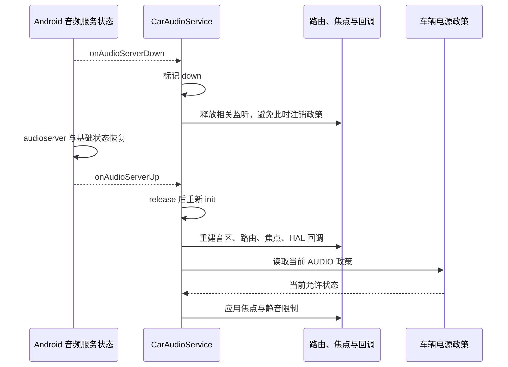

车辆唤醒后，播放器进度继续走，扬声器却没有声音。另一辆车在 audioserver 重启后恢复了主驾媒体，后排仍然无声。两种现象都叫“恢复失败”，但前者可能是电源政策或硬件时序，后者可能涉及用户路由重新注册。若直接把所有状态重置，声音也许暂时回来，却无法知道真正原因。

恢复设计要先识别谁失去了状态：电源政策变化、Android 音频服务重建、车载 AudioControl HAL 重连和应用播放器失效，各有不同边界。本文结合[系列源码基线]()，解释系统已有恢复机制和需要产品验证的环节，避免把“进程存在”当作“音频已恢复”。

## 一、AUDIO 电源政策改变的是允许状态

`CarAudioPowerListener` 订阅 PowerComponent.AUDIO，接收变化时使用 accumulated policy 判断 AUDIO 是否开启，而不是只看本次增量政策。这样一条只修改显示或其他组件的政策，不会意外覆盖先前音频状态。初始化时还会读取当前政策，使服务重建后的行为与当前车辆状态对齐。[电源监听实现][power-listener]是理解这一点的入口。

AUDIO disabled 不能简单翻译为“立即关闭所有扬声器”。本地 `setAudioEnabled` 对焦点设置 restriction；启用音量组静音能力时，还设置 muting restriction。没有音量组静音时，源码仍保留 master mute 对应处理的 TODO。因此不能从一个接口名推导所有配置都具有相同硬件静音效果。[电源应用入口][audio-enabled]应与产品开关一起阅读。

焦点受限后，CarAudioFocus 清理非关键的 delayed request、loser 和 holder，发送永久 LOSS；新来的非关键请求会失败。关键声音由当前 critical 属性判定，本地实现包括 EMERGENCY 与 SAFETY。[焦点限制][focus-restrict]和[关键属性][critical]说明政策的目标是保留定义好的必要声音，而非把所有用途同等处理。

恢复 AUDIO enabled 只是解除限制，不会自动把每一个此前永久失焦的应用重新播放。媒体是否恢复，需要应用或车载媒体业务依据用户意图重新组织。若用户本来已暂停，恢复电源后也不应无条件发出播放命令。把“允许音频”和“要求应用播放”分开，是避免唤醒后意外发声的基础。

## 二、电源静音与用户静音应独立解释

CarVolumeGroupMuting 根据音量组生成要 mute 和 unmute 的设备地址。组本身被用户静音时需要静音；电源限制开启时，不包含关键上下文的组也进入静音集合。关键组并不因此覆盖用户静音，因为代码仍先考虑组自身 muted 条件。[静音集合生成][group-muting]给出了实际组合规则。

这意味着一个组在电源恢复后仍可能保持静音，原因是用户设置仍有效。调查时应记录用户 mute、限制 mute、HAL 原因和当前增益，而不是只找一个全局“mute=false”。若在恢复代码里粗暴清除所有静音，可能修复某次测试却破坏用户状态和热保护限制。

同样，焦点恢复与硬件解除静音不是完全同步的事件。应用可能已经开始写数据，而功放、DSP 或输出设备还处于恢复阶段。Android 控制链需要把允许状态传播出去，产品硬件还需要满足自己的初始化与时钟条件。应为这些阶段分别记录时间点，而不是用一个“resume complete”日志覆盖全部动作。

休眠唤醒也不必然导致 audioserver 重启。如果进程和 Binder 仍然存活，主要问题可能是电源政策、设备或 HAL 状态，而不是服务对象重建。反过来，唤醒过程中若确实发生服务死亡，则必须同时分析重建路径。是否发生重启应通过进程、死亡回调和日志证明，不能从“没有声音”反推。

## 三、audioserver 恢复包含基础框架重配置

AudioService 的 `onAudioServerDied()` 在服务未就绪或 AudioFlinger 不可用时延后重试；检测到重新运行后，通知 HAL 进入 restarting 阶段，恢复设备连接、蓝牙状态、通话模式、流与音量组设置，以及可恢复参数等。还会重新连接已登记政策的 mixes 和设备 affinity，失败政策会被处理。[AudioService 恢复][framework-recovery]显示恢复远超“重新启动 AudioFlinger”。

这些步骤解释了为什么服务注册完成后仍存在重配置窗口。在窗口内查询到进程或 Binder 不等于所有设备和政策已经恢复。客户端如果此时立即发起共享、切换音区或设置路由，可能遇到暂时失败；应根据实际服务状态与操作结果处理，而不是永久缓存第一次错误。

AudioService 恢复的是自己管理的基础状态，CarAudioService 仍有车载音区、用户映射、焦点策略、HAL 回调和音量控制需要建立。两层各自拥有状态，因此不能因为基础框架做了 restore，就省略车载服务恢复验证，也不能反过来只检查 CarAudioService dump 而忽略 native 输出资源。

应用音频对象也有自己的生命周期。进程还在不代表 native 轨道或录音句柄有效。应用应处理错误、重建必要对象并重新关联回调；业务播放位置和用户意图可以保存，旧 native handle 不可当成持久资源。语音检测服务还可能因音频服务死亡重启，详见[语音与热词]()。

## 四、CarAudioService 的 down 与 up 处理有意不对称

`CarAudioServerStateCallback.onAudioServerDown` 调用 `releaseAudioCallbacks(true)`。这个路径标记服务 down，释放播放、焦点 HAL、音量、设备和电源等监听，但刻意避免在音频服务未恢复时注销音频政策，以减少锁竞争；也暂不释放可能与 audioserver 同进程的 AudioControl wrapper。[状态回调][server-callback]与[down 清理][release-callbacks]体现了失效期间少做阻塞交互的设计。

up 回调调用 CarAudioService 的 `release()` 然后 `init()`。重新初始化会先检查音频服务器状态，加载并初始化音区，建立播放监控、控制与路由政策、HAL 焦点及增益回调、乘员配置、电源政策监听和设备监听等。[初始化顺序][car-init]解释了后排用户路由为何也必须重新建立。

恢复时不会简单无条件打开音频。回调注释明确说明，初始化会读取当前电源政策，再决定是否允许音频。这避免音频服务在车辆本应限制发声的阶段重启后，错误绕过电源约束。测试时既要覆盖 AUDIO enabled 下重启，也要覆盖 disabled 下重启。

<div style="overflow-x:auto;margin:1.5rem 0;">



</div>

## 五、AudioControl HAL 独立死亡走另一条路径

AudioControlWrapper 监听 Binder 死亡，死亡后清理已注册状态标记，重新取得 HAL 服务句柄，重新绑定死亡监听，然后通知 CarAudioService。它恢复的是车载控制接口连接，不是重建全部 PCM 播放线程。[wrapper 重连][hal-wrapper]是这层恢复的具体入口。

CarAudioService 的 `audioControlDied()` 先检查 audioserver 是否运行，再检查内部 down 标记。如果音频服务也处于 down，就不再竞争性地恢复控制 HAL，而等待音频服务 up 后整体初始化。若只是 AudioControl HAL 独立死亡，则重置 HAL 音频焦点、增益监控并重新设置模块变化回调。[控制 HAL 恢复][hal-recovery]体现了两个恢复路径的优先关系。

HAL 焦点 reset 会放弃旧请求，防止已死亡硬件客户端继续占用。增益 reset 清理旧监控状态，随后重新登记监听。产品 HAL 需要重新提供当前真实状态，不能假设 CarService 永久记得先前进程中的所有控制信息。对于外部音源尤其要核实硬件是否仍在发声，以及新的焦点报告是否与实际声音一致。

独立恢复不等于所有硬件状态自动重放。源码中这一入口明确重建的内容，应与产品自己管理的 DSP 参数、设备增益、镜像和功放状态逐项对照。不能因为 Binder 已重连就推断 EQ、声场或外部源全部恢复；每项状态要有责任组件和可观察结果。

## 六、恢复时应保存语义，而非盲目保存句柄

可持久化的是用户设置和业务意图，例如用户音量、静音偏好、媒体播放位置；需要重新计算的是当前用户与音区关系、可用设备、配置选择和策略；需要重建的是 Binder、播放器、录音器、政策注册与回调。把三类状态分开，可以避免旧设备 ID、旧 patch handle 和旧请求编号穿越服务重启。

用户映射必须取恢复后的真实乘员状态。车辆可能在恢复期间完成用户切换，若直接重放旧 UID affinity，就会把新用户声音送到旧位置。AOSP 的车载服务测试专门检查 audioserver up 后各音区用户分配，说明这是恢复契约的重要组成部分。[用户恢复测试][recovery-test]可以作为产品扩展测试的起点。

音量恢复也需要当前配置。相同 group ID 在配置变化后未必表示相同设备，恢复时应使用当前组定义、范围和用户设置。若设备增益能力在 HAL 重启后改变，还要处理范围更新与限制状态。只把休眠前整数写回，可能得到错误响度或越界请求。

业务上应给恢复过程一个明确状态，例如“等待音频就绪”。在这个状态中保留用户操作意图，但不要无限高速重复播放或重注册全部监听。可以在服务恢复通知或设备配置更新后再发起所需动作，并把旧会话回调视为过期。这样恢复日志仍然能够解释每一步由谁触发。

## 七、定位唤醒后无声的证据顺序

首先判断进程是否重启、AUDIO 当前是否允许、焦点是否 restricted。随后读取当前用户音区映射、选中配置和可用设备，再核对播放轨道、输出和增益。这个顺序能尽早区分“策略禁止发声”与“已允许但数据或硬件未恢复”，避免在受限状态下反复调整底层路由。

以下是设备侧只读取证示例，先保存完整输出再做关键字过滤。CarService 支持 `--services` 选择服务；应附上操作时间与唤醒阶段，使多份快照可以关联。

```sh
adb shell dumpsys car_service --services CarAudioService CarPowerManagementService
adb shell dumpsys audio
adb shell dumpsys media.audio_policy
adb shell dumpsys media.audio_flinger
adb shell dumpsys media_session
```

CarAudioService dump 包含 Audio enabled、当前配置、用户映射、功能开关和焦点信息。若电源已允许但没有 holder，检查应用是否因永久失焦没有重新请求；若 holder 有效而无活跃轨道，检查播放器恢复；若轨道活跃但输出错音区，检查 affinity 与设备；若所有软件状态合理，再对齐 HAL、DSP、时钟和功放状态。

不能只看“最后一条成功日志”。恢复往往发生部分成功：主音区可用而后排路由未建立，媒体可用而热词会话未恢复，Android 输出正常而外部功放尚未开启。按用户、用途和设备形成矩阵，比用一句“音频恢复成功”更能描述真实覆盖范围。

## 八、故障注入要覆盖不同状态组合

在受控测试设备上，分别验证 AUDIO enabled 与 disabled 期间的音频服务重启、AudioControl HAL 独立重启、正常休眠唤醒和重复唤醒。故障注入可能打断现有声音，应由项目测试流程执行；本文的命令示例仅收集状态，不通过重启命令替代故障分析。

还要让故障发生在媒体播放、导航播报、电话音频、后排独立播放、外部音源和动态设备切换等阶段。空闲时重启成功不能证明带活动路由和焦点的恢复正确。每个用例应检查请求、回调和设备是否重复注册，旧焦点是否残留，用户暂停是否被尊重，以及恢复后音量是否突然改变。

| 场景 | 恢复判据 |
| --- | --- |
| AUDIO disabled 时重启 | 服务可恢复，但非关键声音仍受限制 |
| audioserver 重启 | 基础政策、车载用户映射与设备路由重新一致 |
| AudioControl 独立死亡 | 新 Binder、监听和外部焦点状态收敛 |
| 唤醒期间用户变化 | 使用当前用户设置与当前音区归属 |
| 耳机在恢复期间拔出 | 当前配置与真实设备匹配，必要时回退 |
| 媒体被用户暂停 | 恢复服务不强制恢复播放意图 |

## 九、把恢复问题转化为可验证的因果链

一个有效问题单应写成：“音频服务器在某时刻死亡；基础服务恢复；车载重新初始化完成；后排用户设备 affinity 设置失败；播放器继续写入但没有目标输出。”每个分句都有日志或状态支持，才能把修复落在正确组件。仅写“唤醒有概率无声，重启后正常”只能描述症状，不能指导修改。

恢复机制的目标是重新建立一致状态，而不是掩盖故障。政策、用户、路由、焦点、增益和硬件的最终值必须相互解释；如果某个状态无法恢复，应明确暴露失败并保留证据。通过这种方式，休眠唤醒与服务重启才能成为可设计、可测试的日常生命周期，而非依赖反复重试的偶然成功。

## 十、恢复完成应有分层判据

项目可以把恢复完成拆成服务可达、策略可用、业务可继续和声音可闻四个判据。服务可达只证明连接建立；策略可用要求当前用户、设备和限制已经收敛；业务可继续要求播放器或录音器拥有有效资源；声音可闻还需要实际硬件输出。不同团队分别提供对应证据，避免同一个“完成”事件被赋予四种含义。

对于量产监控，可以记录恢复开始、关键步骤结果、失败原因和最终配置摘要，而不是持续输出全部音频样本。重复失败应保留第一次错误和重试次数，防止后续成功覆盖长期不稳定。若某一步反复失败，业务需要稳定的降级状态与用户反馈，而不是不断闪烁播放图标。

恢复过程中收到新的用户操作，应以新的意图为准。例如用户在等待期间选择了其他音源，旧播放器恢复后不能再自动抢回；乘员已经离开，旧音区请求不应重新建立。会话版本与当前用户检查可以阻止这些迟到恢复动作，使技术恢复始终服务于当前业务状态。

[power-listener]: https://android.googlesource.com/platform/packages/services/Car/+/9f04df65daa8b9a65ee05fd4039fe95446874d76/service/src/com/android/car/audio/CarAudioPowerListener.java#42
[audio-enabled]: https://android.googlesource.com/platform/packages/services/Car/+/9f04df65daa8b9a65ee05fd4039fe95446874d76/service/src/com/android/car/audio/CarAudioService.java#3826
[focus-restrict]: https://android.googlesource.com/platform/packages/services/Car/+/9f04df65daa8b9a65ee05fd4039fe95446874d76/service/src/com/android/car/audio/CarAudioFocus.java#141
[critical]: https://android.googlesource.com/platform/packages/services/Car/+/9f04df65daa8b9a65ee05fd4039fe95446874d76/service/src/com/android/car/audio/CarAudioContext.java#708
[group-muting]: https://android.googlesource.com/platform/packages/services/Car/+/9f04df65daa8b9a65ee05fd4039fe95446874d76/service/src/com/android/car/audio/CarVolumeGroupMuting.java#196
[framework-recovery]: https://android.googlesource.com/platform/frameworks/base/+/94b4c163b7dfe5ce3607f7bb8456f9573f7de57d/services/core/java/com/android/server/audio/AudioService.java#2267
[server-callback]: https://android.googlesource.com/platform/packages/services/Car/+/9f04df65daa8b9a65ee05fd4039fe95446874d76/service/src/com/android/car/audio/CarAudioServerStateCallback.java#36
[release-callbacks]: https://android.googlesource.com/platform/packages/services/Car/+/9f04df65daa8b9a65ee05fd4039fe95446874d76/service/src/com/android/car/audio/CarAudioService.java#771
[car-init]: https://android.googlesource.com/platform/packages/services/Car/+/9f04df65daa8b9a65ee05fd4039fe95446874d76/service/src/com/android/car/audio/CarAudioService.java#598
[hal-wrapper]: https://android.googlesource.com/platform/packages/services/Car/+/9f04df65daa8b9a65ee05fd4039fe95446874d76/service/src/com/android/car/audio/AudioControlWrapper.java#570
[hal-recovery]: https://android.googlesource.com/platform/packages/services/Car/+/9f04df65daa8b9a65ee05fd4039fe95446874d76/service/src/com/android/car/audio/CarAudioService.java#4226
[recovery-test]: https://android.googlesource.com/platform/packages/services/Car/+/9f04df65daa8b9a65ee05fd4039fe95446874d76/tests/CarServiceUnitTest/src/com/android/car/audio/CarAudioServiceUnitTest.java#3063

<!-- series-navigation -->
## 系列导航

[系列目录]()

[上一篇：动态设备与音区配置切换]()

[下一篇：系统集成与故障定位实战]()
