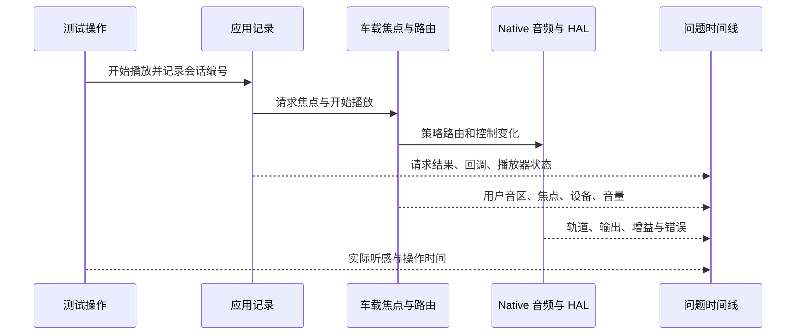

“应用有进度但没有声音”“导航时音乐太小”“后排声音跑到主驾”“唤醒后第一次播放失败”，是不同团队最常见的音频问题描述。它们都不足以直接定位代码：同一个现象可能来自播放状态、权限与焦点、用户路由、静音限制、服务恢复或硬件信号。

本篇把前面章节组合成一套可执行的集成与排查方法。基本原则是先记录真实状态，再找最早不符合预期的边界；每次只改变一个有依据的变量。依据仍是[系列固定源码提交]()，设备操作示例用于说明验证方法，实际输出应来自被测产品。

## 一、用六条证据链描述一次播放

第一条是配置：系统采用 XML 还是 AudioControl HAL 提供的配置，启用了哪些路由和音量能力。第二条是身份：哪个用户、哪个 UID、哪个乘员、哪个音区在请求。第三条是焦点：请求属性、gain 类型、结果和后续失焦。第四条是路由：属性匹配到哪个策略、设备或 AudioMix。第五条是增益：应用音量、音量组、静音、限制与 HAL 控制。第六条是数据：播放器是否真的启动、轨道是否有样本、输出与硬件是否消费。

这些证据不是一条单向同步调用链。焦点可以先取得而播放器尚未建轨，轨道可以存在但被策略静音，外部源可以没有普通 AudioTrack 却仍在发声。排查要把它们关联到同一业务会话，而不是看到任意一条成功就宣布全链路正常。

最小身份集合建议包括用户、UID、包名、用途、音区、session、播放器标识、实际设备地址和时间。包名只说明安装包，不能区分多用户实例；session 关联效果与轨道，却不等于焦点 client ID；设备数值 ID 也不能代替配置地址。明确每个标识的生命周期，才能可靠地跨层关联。

## 二、集成前先证明配置真正生效

CarAudioService 的初始化优先尝试满足 flag 与 HAL 能力条件的 AudioControl 配置来源，无法取得有效配置时再考虑 XML。XML 路径按预定顺序选择，解析后还更新路由、音量和 HAL duck 等实际设置。只修改一个仓库中的 XML 文件，不代表设备运行时就读取了它。[配置加载][config-load]与[HAL 配置分支][config-hal]是判断生效来源的依据。

因此，集成检查应保存设备上最终文件、资源 overlay 结果、功能 flag 与 CarAudioService dump。配置文件说明设计输入，dump 说明服务实际采用的模型。若两者不一致，先查来源与初始化错误，不要立即修改路由代码。多仓库源码还应固定各自 revision，不能把一个主仓库提交当作整个 Android 系统版本。

设备地址应贯穿 Audio HAL 端口、音频策略路由和 car audio 配置。一个地址拼写正确但角色不符，仍不能建立预期连接；一个 car context 已配置但找不到实际输出设备，也不会因 XML 语法通过就变得可用。校验应包含用途覆盖、音区默认配置、音量组约束与用户映射。

如果采用 Core Audio routing 或 Core volume，应检查相应策略和音量组配置一致性，不能用动态 AudioMix 路由模式的全部预期强行验证。CAP 是可配置方案，排查入口首先应确定实际走哪条实现路径，参见[Core Audio 方案]()。

## 三、先取完整快照，再做定向过滤

下面是一组只读采集命令。应在问题发生前、操作发生时和稳定失败后分别采集，并记录用户操作时间。不要先只筛选包含“error”的行，因为策略正常拒绝、当前静音和设备选错未必以错误级别输出。

```sh
adb shell dumpsys car_service --services CarAudioService
adb shell dumpsys car_service --services CarPowerManagementService
adb shell dumpsys audio
adb shell dumpsys media.audio_policy
adb shell dumpsys media.audio_flinger
adb shell dumpsys media_session
adb logcat -b all -d -v threadtime
```

`car_service --services` 是当前 CarService dump 支持的入口，而不是猜测的命令。[dump 参数实现][dump-entry]可用于确认设备工具是否与源码一致。CarAudioService 输出功能开关、当前音频允许状态、用户音区映射、音量组、HAL 焦点、duck 和共享状态等。[车载 dump][car-dump]能帮助建立第一层系统模型。

AudioService 输出基础框架状态，AudioPolicyService 说明输入输出与策略客户端，AudioFlinger 说明混音、录音和轨道执行。MediaSession 用于检查媒体来源与控制状态。它们互相补充：媒体会话的 playing 是业务状态，不能取代 native 轨道证据；有轨道也不能证明正确扬声器已经发声。

快照并非绝对同时。连续执行多个 dumpsys 的时间足以跨越一次短暂焦点变化，因此必须保存采集顺序与日志时间。如果问题只持续几十毫秒，应增加应用与关键服务事件记录，而不是从较晚的稳定快照倒推出全部瞬间状态。图中示例表示取证关联，箭头是记录关系而非声音数据传输。

<div style="overflow-x:auto;margin:1.5rem 0;">



</div>

## 四、案例一：两个音乐应用切换没有交叉淡化

先写清预期：应用甲正在播放，乙申请长期媒体焦点，希望甲逐渐淡出，乙从零逐渐变大。这里包含两个独立要求。车载焦点在开启相应能力且需要 fade 时调用 `dispatchAudioFocusChangeWithFade`；否则直接派发失焦。[车载失焦分支][focus-fade]说明没有开启配置时，不能要求系统必然产生淡出。

即使旧播放器被淡出，新播放器首次获得焦点也不等于自动淡入。FadeOutManager 的 `unfadeOutUid` 找不到该 UID 的既有淡出记录会直接返回；它恢复的是曾被系统衰减的状态。[恢复实现][fade-restore]支持这一关键区分。产品若要求每次换源都执行特定交叉淡化，需要另行明确新播放器行为，而不是只填写恢复淡入时长。

排查记录应包括双方属性、UID、焦点请求与回调时间、实际 fade 配置、播放器启动时间和增益变化。若乙在甲淡出期间开始正常音量播放，短时间重叠不一定是错误；是否符合产品听感要求，需要对照目标时序。若甲收到失焦后立即停播，听到的曲线还受应用自身行为影响。

验证时同时覆盖首次启动乙、甲被淡出后重新获得焦点、语音内容、被排除的播放器类型和功能关闭状态。这样能够区分没有进入系统淡出、已进入但应用先停播、以及新播放器本来就没有淡入记录三类原因，详见[压低与淡入淡出]()。

## 五、案例二：后排媒体跑到驾驶舱

先确定播放进程的真实用户与 UID，再检查 OccupantZone 到 audio zone 的映射，以及当前用户设备 affinity。界面显示在后排屏幕，不保证应用一定以对应后排用户运行；共享到主音区或镜像也可能有意改变媒体去向。没有检查这些条件，就不能直接把问题归因于 AudioPolicy。

焦点归属与输出设备应分别核对。CarZonesAudioFocus 依据请求、用户和服务状态计算音区；路由则由政策和设备约束执行。[焦点音区选择][focus-zone]是读取仲裁归属的入口。焦点在后排而数据走主音区，说明控制与路由存在不一致；两者都在主音区，则应先追查身份或共享状态。

播放建轨的本地实现也应按当前版本分析：AudioFlinger 的 createTrack 内调用 getOutputForAttr 取得输出策略结果，再继续建轨。[native 建轨][create-track]可用于跟踪具体 session 与输出句柄。不要使用过时的固定调用图，把所有问题强行解释成应用先直接向 AudioPolicy 建轨。

恢复正确用户映射后，还要验证导航、通知与媒体是否符合各自用途。只让媒体回到后排并不足以证明所有路由正确；某些用途可能有不同规则。测试应在用户切换、重启恢复和配置切换后重复，因为这些动作会重新建立用户设备关系。

## 六、案例三：音量键变化但声音不变

首先确认按键实际控制哪个 zone 和 group。车载音量键根据活动用途和优先级选择目标，未必始终控制媒体；通话、导航或最近活动上下文可能改变选择。动态设备是否参与选择也由开关决定。因此滑块变化不等于当前听到的那路声音被调整。

接着读取音量组的 min、max、current、mute、blocked、limited、attenuated 与 HAL reason。CarVolumeGroup dump 将这些状态分别输出。[音量组诊断字段][volume-dump]说明“用户设置值”与“实际受约束值”可能不同：限制可以封顶，衰减可以暂时压低，阻塞和静音又有不同语义。

若组状态符合预期，再检查设备地址、HAL 增益与功放路径。两个组若实际汇入同一个不可分控增益点，框架无法创造独立响度；外部音源绕过当前设备，也可能不受该音量组影响。此时修复应落在配置或硬件控制边界，而非增加一次应用音量调用。

验证应记录按键前后实际目标组与声音来源，并区分用户拖动、系统激活音量、HAL 限制和用户切换恢复。若没有变化来源信息，正常的系统限幅可能被误报成“音量被随机改回”。相关原理见[静音、限制与激活音量]()。

## 七、案例四：录音启动成功但识别为空

先检查读取返回值、实际输入设备和 `isClientSilenced`。录音并发政策与播放焦点分离，拿到助手播放焦点不证明允许真实采集；隐私开关或其他录音者可能让活动客户端收到静音。如果系统明确标记静音，重建 AudioRecord 通常不会改变政策。

系统未静音时，再检查采样格式、通道、DSP 前处理和物理麦克风。多麦克风设备返回的路由元数据不一定完整表示每颗麦克风的声学位置，语音识别端还可能错误假设通道或格式。应先验证输入样本与目标声音，再调查识别模型，不把所有空结果归因于网络。

最后看生命周期：热词触发是否交付有效会话，采集是否在提示音后正确开始，旧会话回调是否覆盖新会话。这个案例需要[录音与隐私]()和[语音与热词]()两套证据配合，不能仅靠播放器日志定位。

## 八、案例五：唤醒后只有第一次播放无声

先确认是否发生音频服务死亡，再检查 AUDIO 政策、车载初始化与设备状态。若政策仍限制非关键焦点，第一次播放可能被正常拒绝；若服务正在重建，路由资源可能尚未可用。两种情况需要不同恢复策略，不能统一通过延迟固定几秒掩盖。

若后续播放正常，应比较两次请求之间究竟变化了什么：焦点结果、用户 affinity、设备注册、音量限制还是播放器对象。只有找出使状态从失败变成功的条件，才能设计可靠等待或重建逻辑。固定延迟在某台设备有效，不代表慢启动、用户切换或硬件恢复更慢时仍成立。

CarAudioServerStateCallback 在 up 后重新 release/init，初始化重新查询电源政策，而非无条件启用声音。[车载恢复入口][server-recovery]说明为什么这类问题要同时观察电源和服务恢复。设备、外部 DSP 与功放还需要各自证据，详见[电源与恢复]()。

## 九、把源码测试与设备验收分开使用

本地构建文件定义 `CarServiceAudioUnitTest`，包含车载音频相关单元测试。[测试模块][test-module]可以作为焦点矩阵、配置解析、音量限制、请求生命周期和恢复逻辑的测试入口。测试中的 mock 能证明某个输入触发预期调用，不能证明量产 HAL 真实输出了预期声音。

在已配置 Android 构建环境并连接合适测试设备的条件下，可以使用项目现有测试流程执行这个模块。不要在没有构建和设备条件时把源码测试用例存在写成“已验证”。设备验收则应覆盖不同用户、音区、用途、并发声音和状态转换，另行记录声学结果与硬件版本。

建议采用分层验收：先确认配置模型与接口权限，再验证单一播放，随后验证焦点竞争和音量控制，最后加入多用户、设备变化、共享镜像与故障恢复。每一层建立稳定基线后再增加变量，能显著减少同时调整 XML、应用和 HAL 带来的不确定性。

## 十、一个可交付的问题单应该包含什么

问题单首先写可复现操作与实际结果，再写期望行为和适用条件。附件至少包含相关源码与设备版本、最终配置、用户音区关系、应用属性、时间线和原始 dump。结论应区分已证明事实、由事实支持的推断以及待验证假设，不把“怀疑 HAL”写成根因。

修复验证要证明原始场景恢复，并覆盖最接近的反例。例如修复音量键目标后验证电话和动态设备；修复焦点恢复后验证用户主动暂停；修复后排路由后验证用户切换与共享退出。每个测试都应解释它防止哪类回归，而不是简单堆积大量无关播放次数。

AAOS 音频集成的难点在于多方状态协同。配置声明意图，策略做选择，框架执行资源管理，HAL 与硬件落实信号，应用维护业务生命周期。把这些职责转成可关联的证据，就能从“哪里没有声音”推进到“哪个条件首次不成立”，让修复具备明确依据和可重复的验收标准。

还应把“恢复后正常”作为一个对照实验，而不是根因结论。如果重新申请焦点即可恢复，说明问题可能在请求生命周期；如果重新创建轨道才恢复，进一步检查资源失效；如果只重设设备增益有效，则保留前后增益与 HAL 状态对照。每次恢复动作只验证一个假设，记录它改变了什么，才能把临时绕过转化为可解释的修复。

对于偶发问题，优先扩大观测覆盖，再扩大操作次数。自动化脚本应记录每轮用户、音区、配置、请求结果与失败时间，并在首次失败时冻结相关现场。仅报告连续循环次数和总失败率，很难区分一个根因还是多个独立故障；能关联到具体状态转移的失败样本通常更有工程价值。

[config-load]: https://android.googlesource.com/platform/packages/services/Car/+/9f04df65daa8b9a65ee05fd4039fe95446874d76/service/src/com/android/car/audio/CarAudioService.java#2152
[config-hal]: https://android.googlesource.com/platform/packages/services/Car/+/9f04df65daa8b9a65ee05fd4039fe95446874d76/service/src/com/android/car/audio/CarAudioService.java#2180
[dump-entry]: https://android.googlesource.com/platform/packages/services/Car/+/9f04df65daa8b9a65ee05fd4039fe95446874d76/service/src/com/android/car/ICarImpl.java#811
[car-dump]: https://android.googlesource.com/platform/packages/services/Car/+/9f04df65daa8b9a65ee05fd4039fe95446874d76/service/src/com/android/car/audio/CarAudioService.java#936
[focus-fade]: https://android.googlesource.com/platform/packages/services/Car/+/9f04df65daa8b9a65ee05fd4039fe95446874d76/service/src/com/android/car/audio/CarAudioFocus.java#194
[fade-restore]: https://android.googlesource.com/platform/frameworks/base/+/94b4c163b7dfe5ce3607f7bb8456f9573f7de57d/services/core/java/com/android/server/audio/FadeOutManager.java#214
[focus-zone]: https://android.googlesource.com/platform/packages/services/Car/+/9f04df65daa8b9a65ee05fd4039fe95446874d76/service/src/com/android/car/audio/CarZonesAudioFocus.java#276
[create-track]: https://android.googlesource.com/platform/frameworks/av/+/475269ec44acec82792be6b01fb8e16357d4d2c8/services/audioflinger/AudioFlinger.cpp#1048
[volume-dump]: https://android.googlesource.com/platform/packages/services/Car/+/9f04df65daa8b9a65ee05fd4039fe95446874d76/service/src/com/android/car/audio/CarVolumeGroup.java#622
[server-recovery]: https://android.googlesource.com/platform/packages/services/Car/+/9f04df65daa8b9a65ee05fd4039fe95446874d76/service/src/com/android/car/audio/CarAudioServerStateCallback.java#42
[test-module]: https://android.googlesource.com/platform/packages/services/Car/+/9f04df65daa8b9a65ee05fd4039fe95446874d76/tests/CarServiceUnitTest/Android.bp#484

<!-- series-navigation -->
## 系列导航

[系列目录]()

[上一篇：电源策略与服务恢复]()
