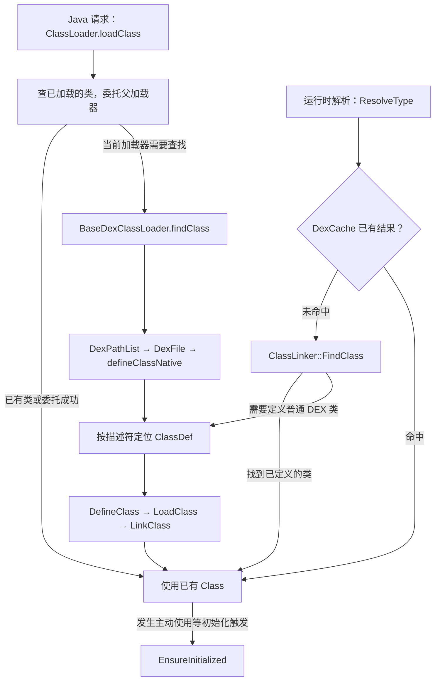

Android 应用的类通常以 `classes.dex` 中的 `class_def_item` 表示。ART 找到这条记录后，先构造运行时类对象 `mirror::Class`，再建立继承关系、字段布局和方法分派表。随后，字节码中的符号引用可以按需解析。到了首次主动使用等需要初始化的时点，ART 才保证完成该类的静态初始化。

本文沿 Android 16 系列的实现讲解普通 DEX 类。磁盘格式以 JVM Specification 第 4 章和 Android DEX 格式为准。生命周期语义对照 JVMS 第 5 章，ART 函数与状态按 Android 16 系列源码说明。源码链接指向公开 AOSP 版本，各分支的行号和优化路径可能不同。[JVMS §4 类文件格式](https://docs.oracle.com/javase/specs/jvms/se21/html/jvms-4.html) · [JVMS §5 加载、链接和初始化](https://docs.oracle.com/javase/specs/jvms/se21/html/jvms-5.html) · [Android DEX 格式](https://source.android.com/docs/core/runtime/dex-format)

## 1. 同一个类在 ClassFile 和 DEX 中的表示

Java 编译器通常为每个类生成一个 `.class`。Android 构建工具再把多个 `.class` 转成一个或多个 DEX。在普通 APK 中，它们通常是 `classes.dex`、`classes2.dex` 等。ART 类链接器从 DEX 的类定义取信息，因此定位 Android 上实际运行的类时，应以设备所用 DEX 为准。[D8 工具文档](https://developer.android.com/tools/d8)

| 要表达的信息 | JVM ClassFile | Android DEX |
| --- | --- | --- |
| 文件组织 | `ClassFile` 以 `0xCAFEBABE` 开始，多字节量按大端编码。常量池与成员记录属于该类 | 常见 DEX 以 `dex\n` 和版本字段开头，通常使用小端。一个 DEX 内的类共享索引表 |
| 类名和继承 | `this_class`、`super_class`、`interfaces[]` 经常量池引用类名 | `class_def_item` 的 `class_idx`、`superclass_idx`、`interfaces_off` 指向类型索引或类型列表 |
| 字段和方法的符号 | 常量池以 `CONSTANT_Fieldref`、`CONSTANT_Methodref` 等记录拥有者、名称和类型信息 | `field_ids` 记录所属类型、字段类型和名称。 `method_ids` 记录所属类型、名称和 `proto_idx`，后者关联参数和返回类型 |
| 本类成员 | `field_info[]`、`method_info[]` 存放访问标志、名称、描述符和属性 | `class_data_off` 指向 `class_data_item`，分静态字段、实例字段、直接方法、虚方法四组 |
| 有实现的方法 | `method_info` 的 `Code` 属性包含 JVM 字节码、局部变量槽与操作数栈容量，以及异常处理表等 | `encoded_method.code_off` 指向 `code_item`。记录寄存器大小、入参字数、出参区域大小、指令和异常处理等 |
| 静态初值 | 可记录在字段的 `ConstantValue` 属性中，也可由 `<clinit>` 执行赋值 | `static_values_off` 指向 `encoded_array_item`，按 DEX 静态字段顺序提供前缀初值。余下字段保持默认值，之后可由 `<clinit>` 赋值 |

符号表条目和类定义要分开看。以 `Lwiki/Counter;` 为例，`type_ids[type_idx] → string_ids[descriptor_idx] → string_data_item` 能得到描述符。有 `type_id` 只表明当前 DEX 引用了这个类型。ART 还需要在可见的 DEX 中找到对应的 `class_def_item`，或从类表、映像等取得已经定义的类。[JVMS §4.1 和 §4.4](https://docs.oracle.com/javase/specs/jvms/se21/html/jvms-4.html#jvms-4.1) · [DEX 表项与数据区](https://source.android.com/docs/core/runtime/dex-format) · [AOSP `dex_file_structs.h`](https://android.googlesource.com/platform/art/+/refs/heads/android16-release/libdexfile/dex/dex_file_structs.h)

### 示例：在同一份代码里看定义、初值和指令

```java
package wiki;

class Base {}

public class Counter extends Base {
    static final int LIMIT = 3;
    static int seed = start();
    int value;

    private static int start() {
        return LIMIT + 4;
    }

    public int add(int delta) {
        return value += delta;
    }
}
```

用 JDK 17 和 Android SDK Build Tools 36.0.0 验证以下命令。将示例保存为 `Counter.java`，在其所在目录执行。

```bash
sdk_build="$ANDROID_HOME/build-tools/36.0.0"
mkdir -p out/class out/dex

javac --release 8 -g -d out/class Counter.java
javap -v -p -classpath out/class wiki.Counter

"$sdk_build/d8" --min-api 28 --output out/dex \
  out/class/wiki/Base.class out/class/wiki/Counter.class
"$sdk_build/dexdump" -d out/dex/classes.dex
```

- `javap` 显示 `LIMIT` 的 `ConstantValue: int 3`。`static {}` 对应 `<clinit>`，其中的 `invokestatic` 和 `putstatic` 把计算结果写入 `seed`。
- `dexdump` 显示 `Lwiki/Counter;` 的父类为 `Lwiki/Base;`，`LIMIT` 有编码初值 `3`，`seed` 由 `<clinit>` 中的 `invoke-static → move-result → sput` 赋值。此例中 `<clinit>` 完成后 `seed == 7`。
- `add(int)` 的 DEX 指令依次使用 `iget`、`add-int/2addr`、`iput` 和 `return`。示例的 `code_item` 有 3 个寄存器，其中 2 个是入参寄存器，分别传入 `this` 和 `delta`。指令中的 `field@0002` 是示例 DEX 的 `field_ids` 索引，实例字段的实际内存偏移由 ART 在链接时计算。

这也说明了调试时需要区分的三个编号。DEX 的表索引用于符号查找，`*_off` 用于定位文件结构，ART 链接出的字段偏移用于访问运行时对象。三者的基准各不相同。[Dalvik 字节码与指令格式](https://source.android.com/docs/core/runtime/dalvik-bytecode)

## 2. 查找类：从类加载器找到 ClassDef

Java 层的普通应用路径如下。ART 也可从解释器、编译代码或 JNI 的类型解析入口进入 C++ 实现。



1. **Java 层决定搜索顺序。** 默认 `ClassLoader.loadClass()` 先查已加载记录，再委托父加载器，最后调用自己的 `findClass()`。`BaseDexClassLoader.findClass()` 可在查自己的 `DexPathList` 前后搜索配置的共享库。自定义加载器和 `DelegateLastClassLoader` 可以采用不同策略。[AOSP `ClassLoader.java`](https://android.googlesource.com/platform/libcore/+/refs/heads/android16-release/ojluni/src/main/java/java/lang/ClassLoader.java) · [AOSP `BaseDexClassLoader.java`](https://android.googlesource.com/platform/libcore/+/refs/heads/android16-release/dalvik/src/main/java/dalvik/system/BaseDexClassLoader.java)
2. **ART 查找 DEX 内的类定义。** `DexPathList.findClass()` 遍历路径元素，由 `DexFile.loadClassBinaryName()` 进入 JNI。原生入口把 `wiki.Counter` 转成 `Lwiki/Counter;`，在关联的 DEX 中查 `ClassDef`，找到后交给 `ClassLinker::DefineClass()`。运行时 `ResolveType()` 则先查 referrer 所用的 `DexCache`。未命中时，`ClassLinker::FindClass()` 查类表，并按启动类路径或适用的加载器策略继续搜索，必要时回调 Java 加载器。[AOSP `DexPathList.java`](https://android.googlesource.com/platform/libcore/+/refs/heads/android16-release/dalvik/src/main/java/dalvik/system/DexPathList.java) · [AOSP `dalvik_system_DexFile.cc`](https://android.googlesource.com/platform/art/+/refs/heads/android16-release/runtime/native/dalvik_system_DexFile.cc) · [AOSP `class_linker.cc`](https://android.googlesource.com/platform/art/+/refs/heads/android16-release/runtime/class_linker.cc)

**类身份由二进制名和定义加载器共同确定。** 请求加载的一方是发起加载器，经委托实际定义类的一方是定义加载器。若两个独立加载器各自定义了 `wiki.Counter`，即使字节内容一样，两份 `Class` 也各有类型身份，对应实例可能无法互相强制转换。数组类由运行时创建，引用类型数组的定义加载器随其元素类型，基本类型数组由启动加载器定义。[JVMS §5.3](https://docs.oracle.com/javase/specs/jvms/se21/html/jvms-5.html#jvms-5.3)

## 3. 定义与结构链接：把索引变成运行时布局

| ART 入口 | 读取或计算什么 | 运行时结果 |
| --- | --- | --- |
| `DefineClass()`、`SetupClass()` | 读取 `ClassDef`、访问标志和类型索引，登记对应 `DexFile` | 建立 `mirror::Class` 和 `DexCache` 关联，发布类表条目。并发查找通过类表和 `EnsureResolved()` 等待最终结果 |
| `LoadClass()`、`ClassAccessor` | 解码 `class_data_item` 的四组成员。计数、成员索引差值、访问标志和方法代码偏移等使用 ULEB128，索引每组重新累计 | 在定义加载器对应的 `LinearAlloc` 中建立 `ArtField`、`ArtMethod` 记录，挂到类上。非 abstract、非 native 的常规方法由 `code_off` 关联代码 |
| `LoadSuperAndInterfaces()` | 解析父类和直接接口的类型索引 | `Class` 持有父类和接口信息，状态推进到 `kLoaded` |
| `LinkClass()`、`LinkMethods()`、`LinkFields()` | 检查继承约束，完成虚方法、接口方法分派及字段布局 | 得到字段偏移、普通类实例大小、GC 所需的引用字段信息，以及适用于该类型的 vtable、iftable 等分派结构 |

`mirror::Class` 是 Java 层 `java.lang.Class` 对象在 ART 中的表示。对于普通实例，类对象描述布局，实例按该布局存放各自的字段值。类对象本身也有大小，其中可以包含静态字段存储和嵌入式分派表。**因此，`Class` 自身的大小和 `new Counter()` 的实例大小是两个不同的量。** [AOSP `ClassAccessor`](https://android.googlesource.com/platform/art/+/refs/heads/android16-release/libdexfile/dex/class_accessor-inl.h) · [AOSP `ClassLinker`](https://android.googlesource.com/platform/art/+/refs/heads/android16-release/runtime/class_linker.cc) · [AOSP `mirror::Class`](https://android.googlesource.com/platform/art/+/refs/heads/android16-release/runtime/mirror/class.h)

需要嵌入分派表的类可能先用一个临时 `Class` 占位。等 `LinkClass()` 算出最终大小后，ART 可以分配并复制到正确大小的新类对象，修正有关的 `ArtField`、`ArtMethod` 的 declaring class，再替换类表条目。旧对象进入 `kRetired`，新对象从 `kResolving` 推进到 `kResolved`。这也是 GC 需要区分类链接状态的原因。临时类对象和完成布局后的类对象包含的有效引用槽可能不同。[AOSP `LinkClass()` 实现](https://android.googlesource.com/platform/art/+/refs/heads/android16-release/runtime/class_linker.cc) · [AOSP `ClassStatus`](https://android.googlesource.com/platform/art/+/refs/heads/android16-release/runtime/class_status.h)

## 4. 验证和解析：区分三个相近的概念

| 概念 | ART 中的检查或结果 |
| --- | --- |
| **DEX 结构校验** | 开启文件验证时，`DexFileVerifier` 检查 header、map、区段及跨区段索引或偏移的合法性。关注的是文件能否按 DEX 格式读取 |
| **类和方法验证** | `ClassLinker::VerifyClass()` 和 `ClassVerifier` 处理类及方法，`MethodVerifier` 检查指令与控制流、寄存器类型等约束。适用时可以复用预编译产物中的验证结果 |
| **符号解析** | `ResolveType()`、`ResolveField()`、`ResolveMethod()` 等根据类型索引和引用上下文查找运行时目标。结果可缓存于 `DexCache`。例如 `iget` 的 `field_idx` 最终用于定位 `ArtField`，再按其字段偏移读取对象 |

JVMS 将验证、准备、解析归于 linking，允许解析按需进行。读 ART 日志时，`kResolved` 表示**当前类的结构链接已完成**，如继承、方法表和字段布局已建立。某个方法体里引用的其他字段或方法，仍然可能在验证、准备执行或真正执行时才解析。 `kResolved` 也先于普通路径上的 `kInitialized`。[JVMS §5.4](https://docs.oracle.com/javase/specs/jvms/se21/html/jvms-5.html#jvms-5.4) · [AOSP `DexFileVerifier`](https://android.googlesource.com/platform/art/+/refs/heads/android16-release/libdexfile/dex/dex_file_verifier.cc) · [AOSP `ClassVerifier`](https://android.googlesource.com/platform/art/+/refs/heads/android16-release/runtime/verifier/class_verifier.cc) · [AOSP `ResolveType()` 等解析实现](https://android.googlesource.com/platform/art/+/refs/heads/android16-release/runtime/class_linker-inl.h)

## 5. 初始化：什么时候执行静态代码

`Class.forName("wiki.Counter", false, loader)` 可以取得类对象而不执行类初始化。将参数改为 `true`，或者执行 `new Counter()`、调用它声明的静态方法、访问它声明且实际通过静态字段指令读取的字段，才会触发所需的初始化检查。编译期常量常被调用者内联。例如 `Counter.LIMIT` 可能已经编译成整数常量 `3`，此时没有访问 `Counter` 静态字段的指令。[JVMS §5.5](https://docs.oracle.com/javase/specs/jvms/se21/html/jvms-5.html#jvms-5.5) · [AOSP `Class.forName` 原生入口](https://android.googlesource.com/platform/art/+/refs/heads/android16-release/runtime/native/java_lang_Class.cc)

链接准备阶段建立静态字段的存储，字段起初具有类型对应的默认值，例如 `int` 为 `0`，引用为 `null`。

普通 DEX 类通过 `ClassLinker::EnsureInitialized()` 进入 `InitializeClass()` 后，按以下步骤推进。

1. 按需验证类，检查已有状态，并将本线程登记为初始化线程。其他线程遇到 `kInitializing` 时等待，同一线程递归进入时按初始化协议处理。
2. 对 class 按规则初始化父类及需要初始化、声明默认方法的相关超接口。
3. 按 DEX 静态字段顺序写入 `static_values_off` 所指的编码初值，再调用当前类的 `<clinit>`。示例中编码值对应 `LIMIT`，执行代码对应 `seed`。
4. 成功后发布已初始化状态并通知等待线程。ART 还有 `kVisiblyInitialized` 状态，用于减少其后访问静态成员时的同步开销。若初始化失败，此类进入错误状态。常见现象是首次出现 `ExceptionInInitializerError` 或原始 `Error`，后续主动使用出现 `NoClassDefFoundError`。

以上顺序描述的是 ART 的 DEX 路径。JVMS §5.5 对 `.class` 的 `ConstantValue` 使用独立规则，其步骤 6 先处理常量字段，步骤 7 才递归初始化父类及相关接口。阅读两份实现时，应分别跟踪 `ConstantValue` 和 DEX 编码初值的入口。[AOSP `InitializeClass()` 实现](https://android.googlesource.com/platform/art/+/refs/heads/android16-release/runtime/class_linker.cc) · [AOSP 类状态](https://android.googlesource.com/platform/art/+/refs/heads/android16-release/runtime/class_status.h) · [JVMS §5.5 初始化顺序](https://docs.oracle.com/javase/specs/jvms/se21/html/jvms-5.html#jvms-5.5)

## 6. Boot image 与预编译会改变哪些路径

启动映像和应用映像可保存部分已经构建的类对象、字符串和相关引用。ART 装载兼容的映像时，可将其类集合导入类表，因此查找这类类时可能直接命中已有对象。Zygote 预加载也会使一部分 Java 类在应用进程被 fork 之前就已加载或初始化。[AOSP `ClassLinker` 的映像装载实现](https://android.googlesource.com/platform/art/+/refs/heads/android16-release/runtime/class_linker.cc) · [AOSP `ZygoteInit.java`](https://android.googlesource.com/platform/frameworks/base/+/refs/heads/android16-release/core/java/com/android/internal/os/ZygoteInit.java)

OAT 或 `.odex` 可提供已编译的方法入口，VDEX 可提供验证相关数据并可能包含 DEX，`.art` 是运行时映像。ART 会检查预编译产物与 DEX、类加载上下文等是否匹配，必要时回到原始 DEX。AOT、JIT 和解释器决定方法如何执行，类在运行时仍遵守加载器身份和初始化约束。[Android ART 配置文档](https://source.android.com/docs/core/runtime/configure) · [AOSP `OatFileManager`](https://android.googlesource.com/platform/art/+/refs/heads/android16-release/runtime/oat/oat_file_manager.cc) · [AOSP `VdexFile`](https://android.googlesource.com/platform/art/+/refs/heads/android16-release/runtime/vdex_file.h)

## 7. 从异常反查类加载阶段

| 常见现场 | 优先核对 |
| --- | --- |
| `ClassNotFoundException` | 请求的二进制名、发起加载器、委托顺序、DEX 路径，以及对应 DEX 是否真的有该 `class_def_item` |
| `VerifyError` | 对应 DEX 的方法签名、`code_item`、寄存器类型及依赖类版本 |
| `NoSuchMethodError`、`NoSuchFieldError` | 调用者 DEX 里的符号签名，与加载器实际选中的目标类版本是否一致 |
| `ExceptionInInitializerError`，随后报 `NoClassDefFoundError` | 首次失败的 `<clinit>` 或上游初始化异常。仅凭后续错误码无法区分类缺失与初始化曾失败 |
| 同名类型出现 `ClassCastException` | 分别记录两个对象的 `Class` 及其定义加载器 |
| 栈停在 `EnsureResolved()` 或等待初始化的路径 | 同时抓其他线程，沿类锁找到正在链接或初始化该类的线程 |

排查时，先把 **类描述符、实际 DEX、定义加载器、`ClassStatus`** 对齐，再判断当前失败点在查找、结构链接、字节码验证、符号解析还是初始化。这样能把日志中的方法名和索引还原到具体的文件记录与运行时状态。
