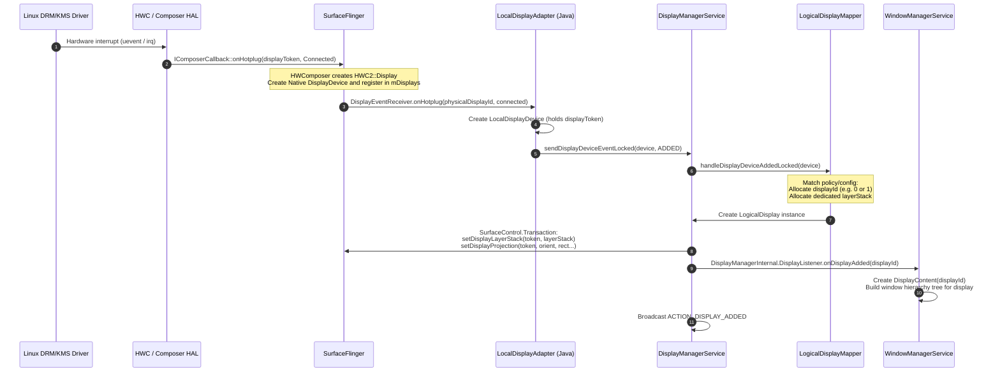
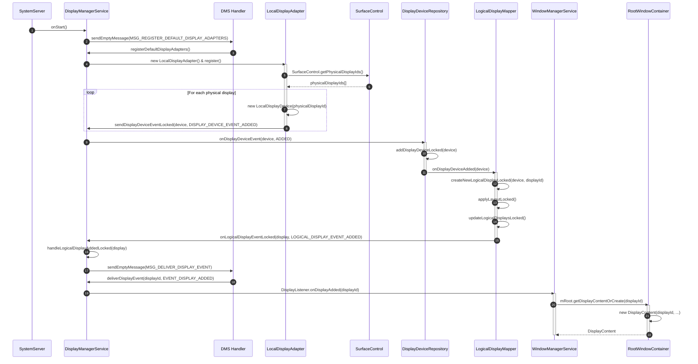
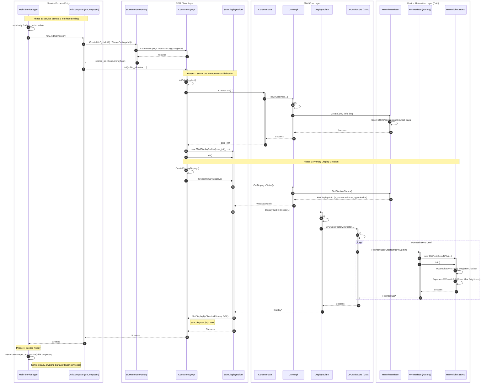

+++
title = "Android 显示系统架构：DisplayManagerService 与 SurfaceFlinger 双层显示管理机制"
date = 2026-10-12
draft = false
+++

# Android 显示系统架构：DisplayManagerService 与 SurfaceFlinger 双层显示管理机制

> **文档版本**: 2.0.0 (Comprehensive Edition)  
> **状态**: 正式发布 (Approved)  
> **涵盖模块**: DisplayManagerService (DMS), WindowManagerService (WMS), SurfaceFlinger (SF), CompositionEngine, HWComposer (HWC), Qualcomm SDM (Snapdragon Display Manager), Linux DRM/KMS  
> **适用平台**: Android 10 ~ Android 14+ (包含 AOSP Phone/Tablet、Foldable 折叠屏、Android Automotive OS 车载多屏以及高通芯片座舱平台)

---

## 目录
1. [引言与架构全景](#1-引言与架构全景)
2. [显示管理的核心双层语义](#2-显示管理的核心双层语义)
3. [第一层语义：物理显示设备的生命周期管理](#3-第一层语义物理显示设备的生命周期管理)
   - 3.1 [硬件端口感知与 PhysicalDisplayId 编码](#31-硬件端口感知与-physicaldisplayid-编码)
   - 3.2 [Hotplug 热插拔与设备注册全链路](#32-hotplug-热插拔与设备注册全链路)
   - 3.3 [Java 框架内部设备流转与 LogicalDisplay 创建流水线](#33-java-框架内部设备流转与-logicaldisplay-创建流水线)
   - 3.4 [SurfaceFlinger Native 层的 Display 实体体系](#34-surfaceflinger-native-层的-display-实体体系)
4. [第二层语义：逻辑映射与合成管线（LayerStack、Output 与 Display）](#4-第二层语义逻辑映射与合成管线layerstackoutput-与-display)
   - 4.1 [核心实体定义与概念矩阵](#41-核心实体定义与概念矩阵)
   - 4.2 [DisplayDevice 与 Output 的关系](#42-displaydevice-与-output-的关系)
   - 4.3 [LayerStack 的设计哲学与分配机制（与 DisplayID 的解耦）](#43-layerstack-的设计哲学与分配机制与-displayid-的解耦)
   - 4.4 [LayerStack 与 Output 的空间路由机制](#44-layerstack-与-output-的空间路由机制)
   - 4.5 [OutputLayer：图层在输出端的具象化](#45-outputlayer图层在输出端的具象化)
5. [经典拓扑映射模式实战](#5-经典拓扑映射模式实战)
   - 5.1 [模式 A：车载独立多屏与座舱显示组隔离（DisplayGroup）](#51-模式-a车载独立多屏与座舱显示组隔离displaygroup)
   - 5.2 [模式 B：显示镜像模式（Display Mirroring）](#52-模式-b显示镜像模式display-mirroring)
   - 5.3 [模式 C：折叠屏内外屏动态切换与设备状态机（Layout）](#53-模式-c折叠屏内外屏动态切换与设备状态机layout)
6. [运行期核心策略调度](#6-运行期核心策略调度)
   - 6.1 [动态刷新率与分辨率仲裁（DisplayModeDirector）](#61-动态刷新率与分辨率仲裁displaymodedirector)
   - 6.2 [显示电源与平滑亮度调光（DisplayPowerController & DisplayPowerState）](#62-显示电源与平滑亮度调光displaypowercontroller--displaypowerstate)
   - 6.3 [输入视口映射与触控分发（InputManagerService 协同）](#63-输入视口映射与触控分发inputmanagerservice-协同)
7. [高通平台 (Qualcomm SDM) 硬件合成器实现深度剖析](#7-高通平台-qualcomm-sdm-硬件合成器实现深度剖析)
   - 7.1 [高通 HWC 架构全景与服务入口](#71-高通-hwc-架构全景与服务入口)
   - 7.2 [高通 HWC 启动与 Display 创建全流程时序](#72-高通-hwc-启动与-display-创建全流程时序)
   - 7.3 [核心实现组件深度解析](#73-核心实现组件深度解析)
   - 7.4 [车载虚拟化环境下的典型避坑经验](#74-车载虚拟化环境下的典型避坑经验)
8. [关键源码对照与跟踪索引](#8-关键源码对照与跟踪索引)

---

## 1. 引言与架构全景

在 Android 显示子系统中，**显示管理（Display Management）** 是连接上层应用界面布局与底层芯片硬件扫描输出的承上启下中枢。上层 `WindowManagerService` (WMS) 负责管理“窗口放在哪块屏上”，下层 `Hardware Composer` (HWC) 负责调度“哪个硬件扫描通道（Pipeline）输出信号”，全部由 **DisplayManagerService (DMS)** 与 **SurfaceFlinger (SF)** 协同完成仲裁、抽象与路由。

下图展示了从 Android 顶层应用到芯片显示控制器（DPU）的端到端分层架构图：

```
+========================================================================================================+
|                              [Application & Window Management Layer (Java)]                            |
|                                                                                                        |
|    Application / ViewRootImpl                                                                          |
|         │                                                                                              |
|         ▼ (Request to add window)                                                                      |
|    WindowManagerService (WMS)                                                                          |
|         │                                                                                              |
|         ├──> RootWindowContainer                                                                       |
|         │         └──> DisplayContent (Window hierarchy tree per logical display)                     |
|         │                                                                                              |
|         └──> SurfaceControl.setLayerStack(windowLayerStack)                                            |
|                    │                                                                                   |
+====================╪===================================================================================+
                     │                                                                                   
+====================▼===================================================================================+
|                                 [Display Policy Authority: DisplayManagerService]                      |
|                                                                                                        |
|  DisplayManagerService (DMS)                                                                           |
|       │                                                                                                |
|       ├──> LogicalDisplayMapper (Core Mapping Engine)                                                  |
|       │         │                                                                                      |
|       │         ├──> DisplayGroup 0 (Default Group: Driver / System)                                   |
|       │         │         ├──> LogicalDisplay 0 (Default Display, displayId=0, layerStack=0)           |
|       │         │         └──> LogicalDisplay 2 (Cluster Display, displayId=2, layerStack=2)           |
|       │         │                                                                                      |
|       │         └──> DisplayGroup 1 (Passenger Group: Passenger User)                                  |
|       │                   └──> LogicalDisplay 1 (Passenger Display, displayId=1, layerStack=1)         |
|       │                                                                                                |
|       ├──> DisplayDeviceRepository & DisplayAdapter Family                                             |
|       │         ├──> LocalDisplayAdapter   ───> LocalDisplayDevice (Built-in panels, HDMI/DP external) |
|       │         ├──> VirtualDisplayAdapter ───> VirtualDisplayDevice (Record, Cast, CarPlay/Auto)      |
|       │         └──> WifiDisplayAdapter    ───> WifiDisplayDevice (Miracast wireless displays)         |
|       │                                                                                                |
|       ├──> DisplayModeDirector    (Refresh rate 60/120Hz, resolution arbitration)                      |
|       └──> DisplayPowerController (DisplayPowerState, PhotonicModulator thread, ColorFade)             |
+===================================================╪====================================================+
                                                    │ SurfaceControl.Transaction:
                                                    │   - setDisplayLayerStack(displayToken, layerStack)
                                                    │   - setDisplayProjection(displayToken, orient, rect...)
                                                    │   - setDisplayPowerMode(displayToken, mode)
+===================================================▼====================================================+
|                              [Composition Core: SurfaceFlinger & CompositionEngine]                    |
|                                                                                                        |
|  SurfaceFlinger (Main Service State Machine)                                                           |
|       │                                                                                                |
|       ├──> mDisplays map: std::map<IBinder /*token*/, sp<DisplayDevice>>                               |
|       │                                                                                                |
|       └──> CompositionEngine (libcompositionengine)                                                    |
|                 │                                                                                      |
|                 ▼                                                                                      |
|        +──────────────────────────────────────────────────────────────+                                |
|        │  DisplayDevice (Native Display Endpoint)                     │                                |
|        │    - Holds: displayToken, DisplayId, PowerMode, ActiveMode   │                                |
|        │    - Owns: std::shared_ptr<compositionengine::Display>       │                                |
|        +──────────────────────────────┬───────────────────────────────+                                |
|                                       │ (C++ inheritance: is-a)                                        |
|                                       ▼                                                                |
|        +──────────────────────────────────────────────────────────────+                                |
|        │  compositionengine::Output (Abstract Composition Target)     │                                |
|        │    - Output::State.layerStack (Filtered LayerStack ID)       │                                |
|        │    - Viewport / Frame / Projection spatial transform matrices│                                |
|        │    - RenderSurface / Framebuffer target render buffer        │                                |
|        +──────────────────────────────┬───────────────────────────────+                                |
|                                       │                                                                |
|      ┌────────────────────────────────┴──────────────────────────────┐                                 |
|      ▼ (Filtered by LayerStack)                                      ▼                                 |
| Layer (Window Buffer Layer)                                      OutputLayer                           |
| - Layer.layerStack == Output.layerStack ─────────────────> (Layer projection instance on Output)       |
+===================================================╪====================================================+
                                                    │ Submit composition plan & mode specs               
+===================================================▼====================================================+
|                         [Hardware Composer & Qualcomm SDM HAL Layer]                                   |
|                                                                                                        |
|  HWComposer (Hardware Composer Manager in SF)                                                          |
|       │                                                                                                |
|       ▼ (AIDL / HIDL IComposerClient)                                                                  |
|  AidlComposer (BnComposer) ───> ConcurrencyMgr (SDM Interface Singleton)                               |
|                                     │                                                                  |
|                                     ├──> SDMDisplayBuilder ───> DisplayBuiltIn                         |
|                                     │                                │                                 |
|                                     └──> CoreImpl                    ▼                                 |
|                                            │                  DPUMultiCore (Mux)                       |
|                                            ▼                         │                                 |
|                                     HWInfoInterface                  ▼                                 |
|                                            │                  HWPeripheralDRM                          |
|                                            ▼                         │                                 |
|                                     DRM Capabilities                 ▼                                 |
|                                     (/dev/dri/card0)          HWDeviceDRM::Init()                      |
+===================================================╪====================================================+
                                                    │ Linux Kernel DRM/KMS IOCTL                         
+===================================================▼====================================================+
|                                    [Kernel Drivers & Display Hardware]                                 |
|                                                                                                        |
|  Linux Kernel DRM/KMS Driver (msm_drm / DPU Driver)                                                    |
|  Display Processing Unit (DPU) & Hardware Scanout Engines                                              |
|  Physical Panels (DSI-0 / Cluster, DP-0 / Center Console, DP-1 / Passenger Screen)                     |
+========================================================================================================+
```

---

## 2. 显示管理的核心双层语义

Display 的管理天然具备两层不可混淆的维度：

| 语义层级 | 核心关注点 | 核心实体 | 责任边界 |
| :--- | :--- | :--- | :--- |
| **第一层：物理设备管理**<br>*(Physical Management)* | **硬件存在与物理生命周期** | `HWComposer::Display`<br>`PhysicalDisplayId`<br>`DisplayDevice`(Native)<br>`DisplayAdapter` | 感知屏幕硬件插拔、获取 EDID 与端口号、与 Composer HAL 建立通信、控制物理通断电、调度 VSync 节拍。 |
| **第二层：逻辑映射与合成路由**<br>*(Logical & Composition)* | **窗口内容到输出通道的精准路由** | `LogicalDisplay`<br>`DisplayGroup`<br>`LayerStack`<br>`compositionengine::Output`<br>`OutputLayer` | 抽象系统 `displayId`；划定 `DisplayGroup` 边界；分配 `layerStack`；在合成阶段过滤图层；完成视口投影（Projection）与多屏/镜像/折叠切换。 |

---

## 3. 第一层语义：物理显示设备的生命周期管理

### 3.1 硬件端口感知与 PhysicalDisplayId 编码

在底层驱动中，物理屏幕往往连接在 SoC 的不同硬件接口（如 DSI-0、DP-0、HDMI 等）。现代 Android（Android 10+）通过 64 位的 `PhysicalDisplayId` 唯一标识一个物理硬件屏。

`PhysicalDisplayId` 的位结构中明确包含了：
1. **Port ID (端口号)**：8 位整数，由底层驱动（DRM Connector ID）指定，对应硬件物理插槽。在车载环境中，Port ID 决定了硬件连线是接往仪表板、中控屏还是副驾屏。
2. **EDID Model / Serial Hash**：屏幕的固件特征哈希，用于识别显示器的厂商与制造批次。

### 3.2 Hotplug 热插拔与设备注册全链路

当屏幕接入或系统初始化扫描硬件端口时，热插拔事件在跨进程系统各层依次触发：



### 3.3 Java 框架内部设备流转与 LogicalDisplay 创建流水线

在 `DisplayManagerService` 内部，从接收设备通知到上层窗口管理容器创建，经历了精密的 Handler 消息解耦和状态更新流水线：



#### 关键实现步骤解析：
1. **初始化阶段**:
   - `SystemServer` 启动 DMS 调用 `onStart()`；
   - 发送 `MSG_REGISTER_DEFAULT_DISPLAY_ADAPTERS` 消息到 Handler，执行 `registerDefaultDisplayAdapters()` 创建 `LocalDisplayAdapter`。
2. **设备探测与适配器上报**:
   - `LocalDisplayAdapter` 调用 `SurfaceControl.getPhysicalDisplayIds()` 扫描硬件；
   - 为每个硬件屏幕创建 `LocalDisplayDevice` 并封装 SurfaceFlinger 返回的 `displayToken`；
   - 调用 `sendDisplayDeviceEventLocked` 发送 `DISPLAY_DEVICE_EVENT_ADDED`。
3. **设备仓储（DisplayDeviceRepository）中转**:
   - `DisplayDeviceRepository` 统一缓存所有激活的物理设备；
   - 触发监听器通知 `LogicalDisplayMapper`。
4. **逻辑显示绑定（LogicalDisplayMapper）**:
   - `LogicalDisplayMapper` 接收到设备后，执行 `createNewLogicalDisplayLocked` 创建 `LogicalDisplay` 实例；
   - 调用 `applyLayoutLocked` 依据当前设备状态（DeviceState）配置布局；
   - 调用 `updateLogicalDisplaysLocked` 刷新全局状态，回调 `onLogicalDisplayEventLocked(LOGICAL_DISPLAY_EVENT_ADDED)`。
5. **通知 WMS 构建窗口树**:
   - DMS 发送 `MSG_DELIVER_DISPLAY_EVENT` 内部异步消息；
   - 最终通过 `DisplayListener` 回调 `WindowManagerService.onDisplayAdded(displayId)`；
   - WMS 调用 `mRoot.getDisplayContentOrCreate(displayId)` 构建该屏幕独立的窗口层级根节点 `DisplayContent`。

### 3.4 SurfaceFlinger Native 层的 Display 实体体系

在 Native 层，SurfaceFlinger 并不是直接操作物理屏驱动，而是通过三层实体实现管理解耦：
1. **`HWComposer`**：持有 `mDisplayData: std::map<hal::HWDisplayId, HWC2::Display>`，直接面向 HAL 发起硬件图层准备（`validateDisplay`）与提交（`presentDisplay`）。
2. **`DisplayDevice` (Native)**：
   - 代表一个完整的显示端点，持有一个匿名的 Binder 句柄 `displayToken`；
   - 管理当前设备的物理特性：电源状态（`PowerMode`）、显示模式（`DisplayMode`，如 3840x2160@60Hz）、支持的色彩空间；
   - 内部聚合了合成引擎中的核心实现——`compositionengine::Display`。
3. **`SurfaceFlinger::mDisplays`**：
   - 全局字典 `std::map<IBinder, sp<DisplayDevice>>`；
   - DMS 下发的所有 `SurfaceControl` 事务（配置 LayerStack、投影矩形、电源状态），都以 `displayToken` 为 Key 检索并修改对应的 `DisplayDevice`。

---

## 4. 第二层语义：逻辑映射与合成管线（LayerStack、Output 与 Display）

这是现代 Android 显示引擎最精妙的解耦设计，涉及图层空间隔离、几何投影与最终像素合成。

### 4.1 核心实体定义与概念矩阵

```
                ┌──────────────────────────────────┐
                │          LogicalDisplay          │ (Window reference frame, holds displayId)
                └─────────────────┬────────────────┘
                                  │ 1:1 Allocation
                                  ▼
                ┌──────────────────────────────────┐
                │            LayerStack            │ (Logical routing bus ID)
                └────────┬─────────────────┬───────┘
                         │ Route tag       │ Monitored & bound
                         ▼                 ▼
             ┌────────────────┐       ┌──────────────────────────────┐
             │  Layer (Window)│       │ compositionengine::Output    │ (Composition output target)
             └───────┬────────┘       └──────────────┬───────────────┘
                     │                               │
                     └───────────────┬───────────────┘
                                     │ Spatial match instantiation
                                     ▼
                      ┌─────────────────────────────┐
                      │         OutputLayer         │ (Projection instance of Layer on Output)
                      └──────────────┬──────────────┘
                                     │
                                     ▼
                      ┌─────────────────────────────┐
                      │    HWComposer / HWC Layer   │ (Submitted to hardware composition pipeline)
                      └─────────────────────────────┘
```

### 4.2 DisplayDevice 与 Output 的关系

自 Android 10 重构引入 `libcompositionengine` 后，Google 将显示设备（设备端）与合成管线（输出端）彻底解耦：
- **`compositionengine::Output` (输出基类)**：
  - 一个纯粹的图像合成目标抽象；
  - 内部维护视口状态：`displayBounds`（像素边界）、`layerStackSpaceRect`（逻辑坐标空间）、`transform`（旋转与缩放矩阵）、`layerStack`（当前监听的图层栈 ID）；
  - 它不需要知道自己连接的是真实硬件屏还是虚拟 Buffer。
- **`compositionengine::Display` (设备特化实现)**：
  - **继承自 `compositionengine::Output`** (`class Display : public Output`)；
  - 扩展了物理屏特征：持有 `HWComposer` 引用、硬件 `DisplayId`、色彩变换矩阵等。
- **`DisplayDevice` (Native 外观类)**：
  - 拥有 `std::shared_ptr<compositionengine::Display>`；
  - **关系结论**：**`DisplayDevice` 封装并代表显示设备，其内核中的 `compositionengine::Output` 承载实际的合成管线与渲染输出。**

### 4.3 LayerStack 的设计哲学与分配机制（与 DisplayID 的解耦）

在初学 Android 显示系统时，极易产生一个直觉认知：“既然每个屏幕都有一个 DisplayID，那 LayerStack 是不是就等于 DisplayID？为什么不直接在 SurfaceFlinger 中使用 DisplayID？”

答案是：**在常规的独立屏幕中，AOSP 源码中默认确实将 `layerStack` 赋值为 `displayId`；但在系统架构设计上，两者的概念、语义与生命周期是彻底解耦的，并且在特定场景下它们绝不相等。**

#### 1. 默认分配逻辑：源码级实现
在 `LogicalDisplayMapper.java` 创建逻辑显示时：
```java
// frameworks/base/services/core/java/com/android/server/display/LogicalDisplayMapper.java

private LogicalDisplay createNewLogicalDisplayLocked(DisplayDevice device, int displayId) {
    final int layerStack = assignLayerStackLocked(displayId);
    final LogicalDisplay display = new LogicalDisplay(displayId, layerStack, device);
    ...
    return display;
}

private int assignLayerStackLocked(int displayId) {
    // AOSP 源码经典注释：
    // "Layer stacks are just unique integers. We assign them to match
    //  the logical display id since that's easy and convenient."
    return displayId;
}
```
对于系统默认创建的普通主屏（`displayId=0`）、独立外接屏（`displayId=1`）或副驾屏（`displayId=2`），DMS 确实“为了简便”，直接分配了与其 `displayId` 相同数值的 `layerStack`。

#### 2. 核心设计理念：为什么必须将两者彻底解耦？
如果让底层的 SurfaceFlinger 直接理解并依赖 `displayId`，会破坏分层架构的独立性：

| 维度 | `displayId` (逻辑显示 ID) | `layerStack` (图层栈 ID) |
| :--- | :--- | :--- |
| **所属体系** | **Java Framework / WMS / 应用运行环境** | **Native C++ / SurfaceFlinger / 合成引擎** |
| **形象比喻** | **“房间号”**（应用和窗口在哪里安家） | **“电视频道号”**（显示端输出哪路节目的信号） |
| **关注核心** | 窗口层级树、输入焦点、屏幕尺寸/DPI、多用户（UserId）隔离 | 图层缓冲（Buffer）、可见性裁剪、硬件管线叠加（HWC Overlay） |
| **生命周期** | 与 WMS 的 `DisplayContent` 强绑定，创建和销毁开销极高 | 仅是一个 32 位整型标记（Token），可在不同输出端之间极低成本地动态换绑 |

通过解耦：
- **上层保持稳定**：Activity 和 WMS 只需要认准自己的“房间”（`displayId`），窗口树无需因为底层输出端的插拔或切换而频繁重建。
- **底层极其灵活**：SurfaceFlinger 是一套纯粹的 C++ 高性能渲染引擎，它无需理会上层复杂的 Java 窗口状态与多用户权限，只需基于简单的整数相等比对（`layer->getLayerStack() == output->getLayerStack()`）即可完成极速过滤。

#### 3. 核心实战：两者不相等的典型场景
在以下关键场景中，`displayId` 与 `layerStack` 表现出明确的分离：

##### 场景 A：屏幕镜像与系统录屏（Auto-Mirroring & VirtualDisplay）
- 当通过 `DisplayManager.createVirtualDisplay()` 创建录屏或投屏时，系统为虚拟屏分配了一个全新的逻辑 ID（例如 `displayId = 3`）。
- 若指定了 `VIRTUAL_DISPLAY_FLAG_AUTO_MIRROR`，该虚拟屏的使命是采集主屏（`displayId = 0`）的画面。
- **底层行为**：DMS 将该虚拟屏幕对应的 `Output` 绑定的不是 `layerStack 3`，而是 **`layerStack = 0`**！
- **结果**：**`displayId (3) != layerStack (0)`**。两个不同的 Output（物理主屏和虚拟录屏缓冲）同时监听 `layerStack 0`，主屏上的所有窗口被同时合成并投递到录屏 Surface 中。

##### 场景 B：黑屏待机保护（`BLANKED_LAYER_STACK`）
在 `LogicalDisplay.configureDisplayLocked()` 中：
```java
// 当物理设备处于休眠/灭屏或未准备好的中间状态时
device.setLayerStackLocked(t, isBlanked ? BLANKED_LAYER_STACK : mLayerStack);
```
- `BLANKED_LAYER_STACK` 的值为 `0xFFFFFFFF` (`-1`)。
- 当屏幕处于关闭或瞬态切换时，DMS 将该输出端临时切换到无效栈。此时该屏幕的逻辑 `displayId` 依然是 0，但底层合成端监听的 `layerStack = -1`，确保 SurfaceFlinger 不会在此期间将任何图层误合成输出，避免灭屏闪烁。

##### 场景 C：折叠屏动态重定向（Foldable Switching）
- 折叠屏手机在内大屏和外小屏切换时，主屏幕逻辑上的 `displayId` 与 `layerStack` 始终保持为 0（保证前台 App 绝不销毁）；
- DMS 将 `layerStack 0` 从外屏的底层 Token 解绑，重新重定向绑定到内屏的底层 Token。
- 这印证了：**`layerStack` 是一条流动的数据路由总线，它与特定的硬件设备并不绑定，可以在多个硬件输出端之间灵活调度。**

### 4.4 LayerStack 与 Output 的空间路由机制

为什么应用窗口只会显示在指定的屏幕上，而不会跑偏到其他屏幕？
1. **WMS 图层标记**：
   - 当 WMS 将某个 Activity 或 Dialog 放置在特定的逻辑屏上时，它读取该逻辑屏的 `layerStack`。
   - 调用 `SurfaceControl.setLayerStack(windowLayerStack)`，将该整型 ID 赋予该窗口的图层。
2. **DMS 输出端绑定**：
   - DMS 初始化或更新屏幕时，调用 `SurfaceControl.setDisplayLayerStack(displayToken, layerStack)`。
   - SurfaceFlinger 依据 `displayToken` 找到 `DisplayDevice`，将其关联的 `Output::State.layerStack` 设为相同的值。

### 4.5 OutputLayer：图层在输出端的具象化

在 SurfaceFlinger 每一帧合成遍历时（`calculateOutputLayerState`）：
- 系统遍历所有具有绘制内容的 `Layer`；
- 遍历所有注册的合成目标 `Output`；
- **空间比对规则**：
  $$\text{if } (\text{Layer.layerStack} == \text{Output.layerStack})$$
- 只要匹配成功，合成引擎便会创建（或复用）一个 **`OutputLayer`** 实体。
- **`OutputLayer` 的核心职责**：
  - 存储该 `Layer` 针对该 `Output` 的专属变换状态（例如在当前屏幕上的绝对显示区域、可见裁切区域、局部不透明度、Z-Order 堆叠次序）；
  - 决定采用 **Device Composition (HWC 硬件叠加)** 还是 **Client Composition (RenderEngine GPU 回写合成)**。

---

## 5. 经典拓扑映射模式实战

### 5.1 模式 A：车载独立多屏与座舱显示组隔离（DisplayGroup）

在车载智能座舱系统中，液晶仪表（Cluster）、中控主屏（Center Console）与副驾娱乐屏（Passenger Screen）通常由一颗车规级芯片统一驱动。传统的单屏架构无法满足车载系统的**安全隔离**与**多用户并发**诉求。为此，Android 引入了 **`DisplayGroup`（显示组）** 机制。

#### 1. 为什么需要 DisplayGroup？
1. **业务与弹窗逻辑隔离（Cross-screen Isolation）**：
   - 避免副驾屏的音视频 App 弹窗（Activity）意外跳到中控屏上遮挡关键 ADAS 导航。
   - `WindowManagerService` 依据 `DisplayGroup` 限制 Activity 启动边界，跨 Group 默认禁止路由。
2. **座舱多用户并发（Concurrent Multi-User）**：
   - 车载系统要求主驾与副驾同时以不同账号独立登录（如主驾 User 0，副驾 User 10）。
   - Android 将 `DisplayGroup` 与系统的 `UserId` 绑定，每个 DisplayGroup 运行一套独立的 SystemUI、Launcher 和应用进程空间。

#### 2. DisplayGroup 层级拓扑图

```
DisplayManagerService (Global System Authority)
    │
    ├── DisplayGroup 0 (Primary Group -> User 0: Driver / Vehicle Services)
    │     ├── LogicalDisplay 0 (Center Console / Default Display, layerStack=0)
    │     └── LogicalDisplay 2 (Instrument Cluster / Navigation, layerStack=2)
    │
    └── DisplayGroup 1 (Secondary Group -> User 10: Front Passenger)
          └── LogicalDisplay 1 (Passenger Entertainment Screen, layerStack=1)
```

```
[Physical Port]     Port 0 (DSI-0)              Port 1 (DP-0)              Port 2 (DP-1)
                          │                           │                          │
[SF Device]         DisplayDevice 0             DisplayDevice 1            DisplayDevice 2
                          │                           │                          │
[Composition]       Output 0                    Output 1                   Output 2
                          ▲                           ▲                          ▲
[Layer Routing]      LayerStack 0                LayerStack 1               LayerStack 2
                          ▲                           ▲                          ▲
[Logical Mapping]   LogicalDisplay 0            LogicalDisplay 1           LogicalDisplay 2
                    (displayId = 0)             (displayId = 1)            (displayId = 2)
                          ▲                           ▲                          ▲
[Display Group]     └─────┬─────────────────────┘   └─────────────┬────────────┘
                    DisplayGroup 0 (User 0)               DisplayGroup 1 (User 10)
                          │                                       │
[WMS Window Tree]   DisplayContent (0) / (2)              DisplayContent (1)
                    [Cluster / Center Console]            [Passenger Entertainment]
```

#### 3. CarService 配置与自动划分实践
通过在 `packages/services/Car/service/res/values/config.xml` 中配置物理端口与座舱乘员区的映射：

```xml
<string-array name="config_occupant_display_mapping">
    <item>displayPort=129:type=DRIVER:seat=0</item>
    <item>displayPort=130:type=PASSENGER:seat=1</item>
    <item>displayPort=131:type=PASSENGER:seat=2</item>
</string-array>
```

**运行链路**：
1. `CarOccupantZoneService` 启动时解析该配置；
2. 为副驾（Seat 1）拉起独立的用户（如 User 10）；
3. 调用 `WindowManager` 接口将对应 Port 的屏幕绑定给 User 10；
4. WMS 自动创建并分配独立的 `DisplayGroup`，将副驾屏纳入其中，实现完全隔离的座舱交互空间。

---

### 5.2 模式 B：显示镜像模式（Display Mirroring）
常见于投屏、会议室演示或副驾同步中控导航画面。

```
[Logical Mapping]                   LogicalDisplay 0 (displayId = 0)
                                                 │
[Layer Routing]                             LayerStack 0
                                                 │
                          ┌──────────────────────┴──────────────────────┐
                          ▼                                             ▼
[Composition]        Output 0 (Primary Output)                     Output 1 (Mirror Output)
                          │                                             │
[SF Device]          DisplayDevice 0 (Built-in Display)            DisplayDevice 1 (External Display)
                          │                                             │
[Physical Port]      Port 0 (Internal Panel)                       Port 1 (HDMI / Type-C DP)
```
- **核心特征**：
  - **一个 `LayerStack` 绑定给了两个不同的 `Output`**；
  - SurfaceFlinger 在遍历属于 `LayerStack 0` 的窗口时，会同时向 `Output 0` 和 `Output 1` 分别生成 `OutputLayer`；
  - 两个屏幕虽然显示相同的内容，但各自的 `Output` 可以配置独立的 `Viewport` 缩放比和 `Projection` 裁切以适应不同物理分辨率。

---

### 5.3 模式 C：折叠屏内外屏动态切换与设备状态机（Layout）

折叠屏设备具有多块物理屏幕（外小屏、内大屏），但用户在使用中希望窗口状态平滑过渡，不需要创建两套独立的系统桌面。

```
[Unfolded State]:
LogicalDisplay 0  ──>  LayerStack 0  ──>  Output 0  ──>  DisplayDevice 0 (Inner Main Screen, Active)
                                                          DisplayDevice 1 (Outer Sub Screen, Off/Doze)

              ======================= User folds device =======================

[Folded State]:
LogicalDisplay 0  ──>  LayerStack 0  ──>  Output 1  ──>  DisplayDevice 1 (Outer Sub Screen, Active)
                                                          DisplayDevice 0 (Inner Main Screen, Off/Doze)
```

#### 核心机制：状态驱动的 `Layout` 映射表
在 `LogicalDisplayMapper` 内部，设备形态与屏幕的绑定由 `Layout` 类统一抽象：
- **`Layout` 内部数据结构**：
  每个设备状态（展开、折叠、半折叠等）对应一份 `Layout` 配置。`Layout` 包含一组 `Layout.Display` 对象：
  - **物理地址 (`mAddress`)**：对应物理显示设备 `DisplayDevice` 的唯一地址（`DisplayAddress`）；
  - **逻辑显示 ID (`mLogicalDisplayId`)**：该设备当前应映射到的逻辑 ID（主屏始终固定映射为 `DEFAULT_DISPLAY = 0`）；
  - **使能状态 (`mIsEnabled`)**：指示在该形态下该物理屏应当处于开启（ON）还是休眠（OFF）状态。
- **动态无感切换原理**：
  1. 铰链传感器上报设备形态变更至 `DeviceStateManager`；
  2. `LogicalDisplayMapper` 查表获取目标形态的 `Layout` 蓝图；
  3. 执行 `applyLayoutLocked`：将 `LogicalDisplay 0`（`LayerStack 0`）与旧物理设备解除绑定，动态重定向绑定到目标物理设备；
  4. 应用层由于始终运行在固定的 `displayId=0` 上，仅收到屏幕尺寸与配置变更事件（`onConfigurationChanged`），**无需销毁重建 Activity**，实现流畅的折叠过渡体验。

---

## 6. 运行期核心策略调度

### 6.1 动态刷新率与分辨率仲裁（DisplayModeDirector）
现代屏幕支持高刷动态切换（如 60Hz、90Hz、120Hz、VRR/LTPO 自适应）：
- **多维度投票仲裁机制（Votes）**：
  `DisplayModeDirector` 维护了投票器体系，汇总各方诉求：
  1. **应用层投票（App Request）**：通过 `Window.getAttributes().preferredDisplayModeId` 或 `preferredRefreshRate`（游戏申请 120Hz，视频播放器申请 24/60Hz）；
  2. **系统设置投票（User Settings）**：用户开启平滑显示或限制省电模式；
  3. **温控保护投票（Thermal Throttling）**：设备高温时锁定最高 60Hz 降温；
  4. **低亮度防频闪投票（Low Brightness）**：低亮度下锁定高刷新率以规避 OLED PWM 闪烁。
- **生效机制**：
  DMS 仲裁出兼顾流畅与功耗的最优 Mode，通过 `SurfaceControl.setDesiredDisplayModeSpecs()` 传给 SurfaceFlinger，SF 在垂直同步（VSync）边界内安全驱动硬件完成切换。

### 6.2 显示电源与平滑亮度调光（DisplayPowerController & DisplayPowerState）

屏幕电源管理的核心痛点是：**底层硬件通断电操作耗时极长（百毫秒级），若在系统主线程同步执行必然引发系统冻结（ANR）。**

#### 1. DisplayPowerState 的异步状态机与线程模型
`DisplayPowerState` 充当了策略控制器与硬件执行之间的异步解耦层：
- **状态缓存器 (State Holder)**：
  在 Java 内存中维护期望的目标状态：`mScreenState`（电源状态）、`mScreenBrightness`（背光亮度）、`mColorFadeLevel`（渐变透明度）。
- **异步更新线程 (`PhotonicModulator`)**：
  - 当状态改变时触发 `scheduleScreenUpdate()`；
  - 任务投递给独立的后台线程 `PhotonicModulator`；
  - 该线程循环接收状态，在后台调用 `mBlanker.requestDisplayState()`，通过 JNI 穿透到底层 SurfaceFlinger/HAL 执行硬件通断电与背光写入，**彻底解放 DMS 主线程**。
- **`ColorFade` 开关屏动画协调**：
  开关屏时协调绘制淡入淡出遮罩，通过 `Choreographer` 保证动画与屏幕 VSync 严格同步。
- **状态收敛栅障 (`waitUntilClean`)**：
  提供 `waitUntilClean(Runnable listener)` 回调。只有当 `PhotonicModulator` 确认硬件写入完成（`mScreenReady = true`）且遮罩动画结束时，才回调通知上层控制器完成状态收敛。

### 6.3 输入视口映射与触控分发（InputManagerService 协同）
在多屏系统（尤其是车载多触控屏）中，物理触控事件必须准确路由到发生触摸的屏幕：
- DMS 通过 `DisplayViewport` 结构体，向 `InputManagerService` (IMS) 同步每个屏幕的绝对物理坐标、方向和缩放矩阵；
- IMS 结合 Linux `evdev` 驱动的硬件端口名或 USB 总线路径，将物理触摸屏与对应的 `LogicalDisplay` 进行硬件级绑定，防止中控屏触摸错位影响副驾屏。

---

## 7. 高通平台 (Qualcomm SDM) 硬件合成器实现深度剖析

在搭载高通 SoC（如 SA8155、SA8295、SA8775 以及骁龙手机芯片）的平台上，Android 标准层定义的 `IComposerClient` HAL 接口具体落地为高通专属的 **SDM (Snapdragon Display Manager)** 显示框架。

### 7.1 高通 HWC 架构全景与服务入口
高通 HWC 架构分为四个核心层次：
1. **Service Process Entry**：进程入口 `service.cpp`，遵循 Android VINTF 规范暴露 `AidlComposer` (`BnComposer`) AIDL 服务。
2. **SDM Client Layer**：包含隐藏的单例管理中枢 **`ConcurrencyMgr`** 与负责组装屏幕的 `SDMDisplayBuilder`。
3. **SDM Core Layer**：包含核心业务实现 `CoreImpl`、内建屏幕实体 `DisplayBuiltIn`、以及负责多 DPU 核心管线复用的 `DPUMultiCore (Mux)`。
4. **Device Abstraction Layer (DAL)**：包含硬件探测接口 `HWInfoInterface` 与驱动对接实体 **`HWPeripheralDRM`**。

### 7.2 高通 HWC 启动与 Display 创建全流程时序

以下 Mermaid 时序图展现了从 `service.cpp` 启动到底层物理屏幕对象完整构建的详细步骤：



### 7.3 核心实现组件深度解析

#### 1. 进程门面：`service.cpp` 与 `AidlComposer`
HWC 进程启动时不直接触碰硬件，而是优先构造 `AidlComposer`。该类是整个 Composer HAL 面向 Binder 客户端（SurfaceFlinger）的服务实现门面。

#### 2. 上帝对象：`ConcurrencyMgr`
`AidlComposer` 初始化时通过工厂类获取 `LifeCycle`、`Settings` 等关键接口。在源码底层，这些接口全部由同一个单例实现——**`ConcurrencyMgr`**。它是 SDM Client 层的总控制台，负责全局并发会话仲裁与屏幕生命周期流转。

#### 3. 硬件扫描：`HWInfoInterface`
在构建屏幕实例前，SDM 必须先摸清硬件底细。`CoreImpl` 初始化时调用 `HWInfoInterface` 打开 Linux DRM 主节点（`/dev/dri/card0`），扫描 Connector 列表并解析 EDID，判定内建屏与外接屏的连接状态。

#### 4. 对象工厂链条：`Builder` $\rightarrow$ `DisplayBuiltIn` $\rightarrow$ `HWPeripheralDRM`
- **`SDMDisplayBuilder`**：识别出主屏连接后，创建 `DisplayBuiltIn` 逻辑对象。
- **`DPUMultiCore (Mux)`**：针对高分辨率超宽屏或双目屏，控制多个 DPU Core 分工合并。
- **`HWPeripheralDRM`**：作为底层驱动抽象（DAL），真正建立与 Linux DRM/KMS 的 Session 并在 `PopulateHWPanelInfo` 中读取面板属性。

### 7.4 车载虚拟化环境下的典型避坑经验

在基于 Hypervisor（如 QNX、Gunyah）的车载虚拟化架构中，Android 通常作为 Guest VM 运行：
- **背光路径与 BadConfig 隐患**：
  `HWPeripheralDRM` 初始化时会调用 `PopulateHWPanelInfo()` 尝试读取 `/sys/class/backlight/...` 节点获取屏幕最大亮度与调光曲线。
- **典型失效模式**：
  若在虚拟机配置中没有给 Android 正确透传或虚拟化背光节点，HWC 在初始化时由于路径不存在可能将 `max_brightness` 置为 0。随后当 SurfaceFlinger 或 DMS 首次下发亮度更新或显示模式时，SDM 会抛出 `BadConfig` 或无声忽略，导致车载屏幕在休眠唤醒后出现**“背光全黑但系统正常运行”**的棘手故障。

---

## 8. 关键源码对照与跟踪索引

| 业务领域 | 核心类 / 接口 | 源码路径 (AOSP / Qualcomm SDM) | 核心职责 |
| :--- | :--- | :--- | :--- |
| **Java 逻辑显示服务** | `DisplayManagerService` | `frameworks/base/services/core/java/com/android/server/display/DisplayManagerService.java` | 系统总入口，处理生命周期与策略流转 |
| **设备仓储中枢** | `DisplayDeviceRepository` | `frameworks/base/services/core/java/com/android/server/display/DisplayDeviceRepository.java` | 集中缓存所有激活的硬件/虚拟设备实体 |
| **逻辑映射中枢** | `LogicalDisplayMapper` | `frameworks/base/services/core/java/com/android/server/display/LogicalDisplayMapper.java` | 物理设备与逻辑设备绑定、多屏与折叠屏策略 |
| **状态机与布局配置** | `Layout` | `frameworks/base/services/core/java/com/android/server/display/layout/Layout.java` | 物理地址与逻辑 ID 的映射蓝图定义 |
| **电源异步更新中枢** | `DisplayPowerState` | `frameworks/base/services/core/java/com/android/server/display/DisplayPowerState.java` | 管理 `PhotonicModulator` 异步线程与调光动画 |
| **Native 合成服务** | `SurfaceFlinger` | `frameworks/native/services/surfaceflinger/SurfaceFlinger.cpp` | 合成总管，维护 `mDisplays` 字典与帧调度 |
| **Native 显示设备** | `DisplayDevice` | `frameworks/native/services/surfaceflinger/DisplayDevice.cpp` | Native 显示端点抽象，封装 `compositionengine::Display` |
| **合成输出端基类** | `compositionengine::Output` | `frameworks/native/services/surfaceflinger/CompositionEngine/src/Output.cpp` | 视口、投影几何变换、LayerStack 过滤与合成 |
| **图层具象输出实例** | `compositionengine::OutputLayer`| `frameworks/native/services/surfaceflinger/CompositionEngine/src/OutputLayer.cpp` | Layer 在特定 Output 上的状态与硬件准备 |
| **高通 AIDL Composer 门面** | `AidlComposer` | `hardware/qcom/display/sdm/libs/hwc2/service.cpp` | 高通 HWC 进程入口与 Binder 服务实现 |
| **高通 SDM 单例控制中枢** | `ConcurrencyMgr` | `hardware/qcom/display/sdm/libs/hwc2/concurrency_mgr.cpp` | SDM Client 总控制台，驱动屏幕构建流转 |
| **高通内建屏幕逻辑实现** | `DisplayBuiltIn` | `hardware/qcom/display/sdm/libs/core/display_builtin.cpp` | 内建显示屏业务逻辑，对接 DPU 多核多通道 |
| **高通 DRM 硬件交互适配** | `HWPeripheralDRM` | `hardware/qcom/display/sdm/libs/core/drm/hw_peripheral_drm.cpp` | 对接 Linux DRM/KMS IOCTL，读取背光与配置 |

---
*End of Documentation.*
