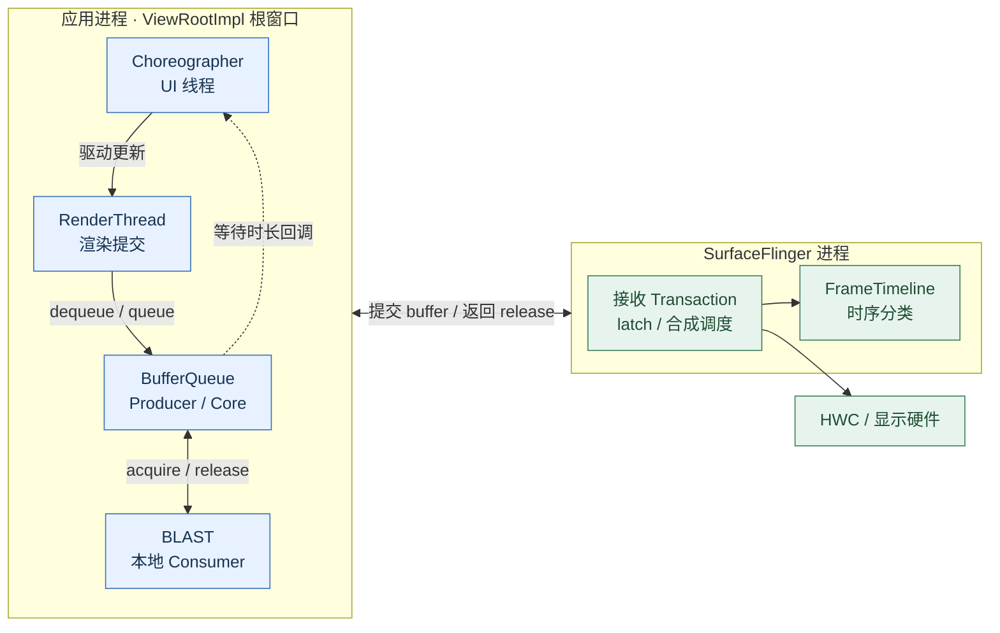
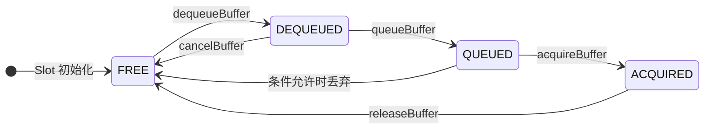
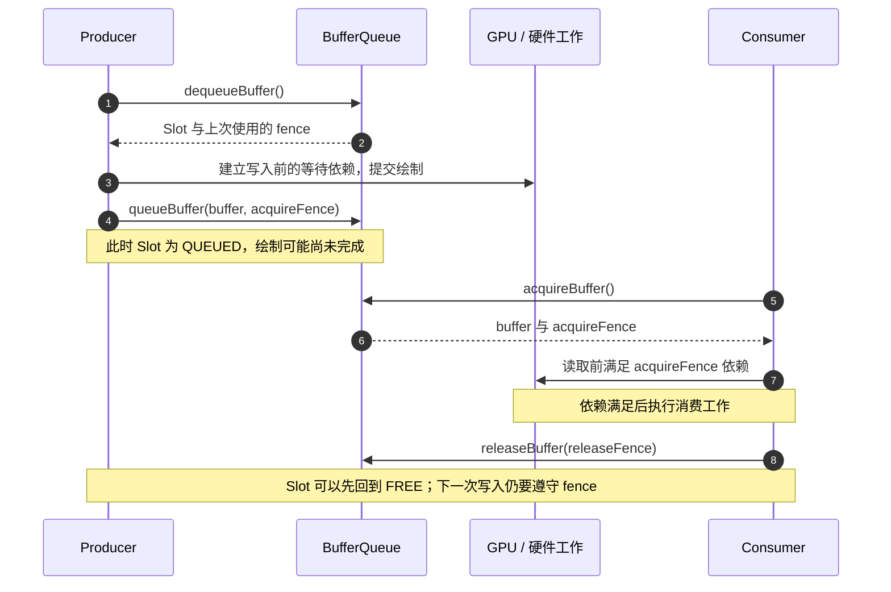
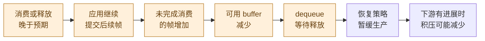
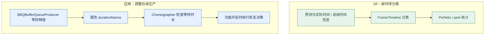
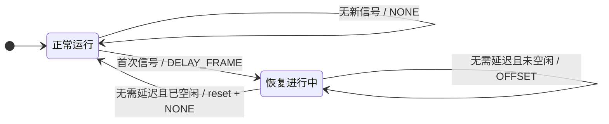

Android 图形管线需要持续回答两个问题：**下一帧可以写入哪块缓冲区，以及这块缓冲区何时可以被安全地读写。** BufferQueue 用 Slot 状态管理使用权，Fence 描述异步工作的完成依赖。生产和消费的节奏失配时，有限的缓冲区会形成背压，应用可能在申请下一块 buffer 时等待。

Buffer Stuffing 讨论的是这条管线中的积压及其时序后果：旧帧占据了后续帧原本期望的呈现机会，画面可能仍然连续更新，但呈现延迟升高。理解它需要把 BufferQueue 状态、SurfaceFlinger 的时间线分类和应用侧的恢复策略联系起来。

本文面向 Android 图形系统开发与性能分析人员。先解释通用 BufferQueue，再讨论 **ViewRootImpl 根窗口使用 BLAST 的路径**。摄像头、视频解码器、游戏自建 Surface 的生产节奏和恢复策略需要分别分析。

> **阅读与验证范围**：图表在窄屏上可横向滚动。状态图默认采用非 shared-buffer 模式；三缓冲和固定刷新周期仅用于教学。恢复实现按 2026-10-12 核对的项目源码说明，精确提交见[源码基线与索引](#source-baseline)。文中的数值时序是教学模型，Perfetto 章节提供采集与判读方法，不代表已经取得台架实测结果。

<style>
.bq-wiki-diagram {
  overflow-x: auto;
  margin: 1.5rem 0 0.75rem;
  padding: 1rem;
  border: 1px solid #d8e0ea;
  border-radius: 8px;
  background: #fff;
}
.bq-wiki-diagram .mermaid { min-width: 920px; text-align: center; }
</style>

## 1. 先确定 BufferQueue 在哪里

### 1.1 通用模型与 BLAST 路径

BufferQueue 连接 Producer 与 Consumer。Producer 通过 `dequeueBuffer()` 申请 buffer，提交绘制工作后用 `queueBuffer()` 入队；Consumer 通过 `acquireBuffer()` 取走，使用结束后用 `releaseBuffer()` 归还。BufferQueue 传递的是 buffer 引用、句柄和同步信息，本身不复制整幅像素数据。[BufferQueue 官方说明](https://source.android.com/docs/core/graphics/arch-bq-gralloc)

Producer 和 Consumer 的进程位置由具体用途决定。对于本文的 ViewRootImpl / BLAST 路径，BufferQueue 与 native BLAST 都在应用进程内：**本地 Consumer 是 BLAST 使用的 BufferItemConsumer，SurfaceFlinger 接收的是提交到 SurfaceControl 的 buffer transaction。**

<div class="bq-wiki-diagram" id="bq-process">



</div>

*图 1：ViewRootImpl / BLAST 的进程边界。实线表示生产、消费及跨进程提交 / 释放，虚线表示等待时长反馈；跨进程双向箭头中的 buffer 提交与 release 返回均携带相应 fence。图中未展开 GPU、Binder 线程和 release channel 的线程细节。*

对应实现分为三步：

1. `ViewRootImpl.updateBlastSurfaceIfNeeded()` 创建 BLAST，并把等待回调连接到 `Choreographer.onWaitForBufferRelease()`。
2. `BLASTBufferQueue.acquireNextBufferLocked()` 从本地 BufferQueue 获取 buffer，调用 Transaction 的 `setBuffer()` 提交给 SF。
3. SF 返回的 release 信息进入 BLAST 的释放处理，最终推进本地 Slot 的回收。

因此，分析现代窗口时不能直接套用“SF 在自己的进程里调用该 BufferQueue 的 `acquireBuffer()`”这一旧式简图。也不能用 Java / native 的语言边界代替应用 / SF 的进程边界。

### 1.2 四个不能混用的对象

| 对象 | 含义 | 分析时的注意点 |
|---|---|---|
| GraphicBuffer | 保存图像数据的缓冲区对象及其底层分配 | 引用仍存在，不等于任意一方都能修改内容 |
| Buffer Slot | BufferQueue 管理的槽位，记录状态、关联 buffer 和 fence 等 | Slot 可以处于 FREE，但尚未分配 GraphicBuffer |
| Frame | 一次生产并提交的图像及其时序身份 | 同一块 GraphicBuffer 可以先后承载多帧 |
| SurfaceControl / Layer | SF 管理的图层及其属性 | 图层标记不等于 BufferQueue 状态或硬件刷新率 |

## 2. Slot 状态：当前由谁使用

### 2.1 普通模式下的四种状态

`BufferState` 使用 `(mDequeueCount, mQueueCount, mAcquireCount)` 和 `mShared` 记录状态。下面列出非 shared-buffer 模式的常见组合。

| 状态 | 计数 `(D, Q, A)` | 所处阶段 | 是否能直接读写像素 |
|---|---|---|---|
| `FREE` | `(0, 0, 0)` | 可供队列再次分配 | 仍需成功 dequeue，并满足返回 fence 的依赖 |
| `DEQUEUED` | `(1, 0, 0)` | Producer 已申请，尚未 queue / cancel | Producer 等待上次使用完成后才能写 |
| `QUEUED` | `(0, 1, 0)` | Producer 已提交，等待 Consumer 获取 | GPU 绘制可能仍在执行；入队不证明像素完成 |
| `ACQUIRED` | `(0, 0, 1)` | Consumer 已获取，尚未 release | Consumer 必须满足 acquire fence 的依赖后才能读 |

“持有”描述的是队列协议中的使用权，不表示 CPU、GPU 或显示硬件的工作已经结束。状态和 Fence 必须一起看。

<div class="bq-wiki-diagram" id="bq-slot-states">



</div>

*图 2：普通模式的核心 Slot 状态机。这里只画常用流转；丢帧、数量限制和 shared-buffer 分支有各自的前置条件。*

### 2.2 attach、detach 与 shared-buffer

`detachBuffer()` 将关联 buffer 从队列管理中移出，普通模式下相应 Slot 回到 FREE；它不等于销毁 Slot，也不保证底层 GraphicBuffer 立即销毁。Producer 的 `attachBuffer()` 把外部 buffer 放入选定 Slot，并使其进入 DEQUEUED；Consumer 的对应操作使其进入 ACQUIRED。操作仍受数量与状态检查约束。

shared-buffer 模式下，`mShared=true`，dequeue、queue、acquire 计数可以同时存在，也可以大于 1。此时不能把图 2 当成严格互斥的四状态模型。共享也不意味着可以无视同步依赖而并发读写同一份像素。

## 3. Fence：什么时候可以安全访问

Fence 是异步工作之间的完成依赖。通常把 Producer 提交给 Consumer 的完成 fence 称为 **acquire fence**，把 Consumer 返回给后续 Producer 的完成 fence 称为 **release fence**。名称体现的是使用方向，不是两种互不相关的同步技术。

<div class="bq-wiki-diagram" id="bq-fences">



</div>

*图 3：逻辑状态可以先移交，实际内存访问由 Fence 约束。该图描述通用 Producer / Consumer 协议，不把 Consumer 固定为 SF。*

实际等待可以由 GPU 命令队列完成，也可能发生在 CPU 或驱动路径。分析卡顿时，需要区分 **等待可用 Slot** 与 **等待拿到的 buffer 可安全使用**：两者都可能出现在渲染路径上，但等待对象和处理方法不同。[Android 同步框架](https://source.android.com/docs/core/graphics/sync)

如果没有新帧，系统可以继续呈现旧内容，但不能据此推导“每个 VSync 都先释放旧 buffer，再继续读它”。继续显示输入 buffer、保留已合成输出，以及以 fence 延迟复用，是不同的生命周期安排。

## 4. 三缓冲、背压与 Buffer Stuffing

### 4.1 三个 buffer 不等于三个固定角色

三缓冲允许生产、等待和消费在一定程度上重叠。某一时刻出现 `ACQUIRED × 1 + QUEUED × 1 + DEQUEUED × 1` 可以是合理状态，但它不能单独证明吞吐量最高，也不能单独证明发生 Stuffing。

在 BLAST 路径中，本地 buffer 一旦被 BLAST acquire 并提交给 SF，仍可能处于 ACQUIRED，而 SF 尚未呈现它。因此：

> **本地 `mQueue.size()` 不等于整条显示管线中尚未呈现的帧数，ACQUIRED 也不等于正在被屏幕扫描。**

实际可用 buffer 数由最大 dequeued / acquired 数、额外缓冲策略、连接状态等共同决定。“屏幕固定持有一个、队列固定一个、应用固定一个”只是某种快照，不是系统契约。

### 4.2 dequeue 为什么等待

在 `BufferQueueProducer.waitForFreeSlotThenRelock()` 中，以下两类情况分别参与等待判断：

```cpp
// 等价伪代码；省略 shared-buffer、分配及错误返回分支。
const bool tooManyBuffers = mCore->mQueue.size() > maxBufferCount;
const bool needWait = (found == INVALID_BUFFER_SLOT) || tooManyBuffers;
```

`tooManyBuffers` 的含义是 **QUEUED 队列长度超过当前允许的最大 buffer 数**；源码注释特别提到快速断开、重连后的状态。它是局部布尔条件，不是“所有 buffer 都被占用”的统称，也不是返回给应用的错误码。

| 情况 | 可能结果 |
|---|---|
| 有可用 buffer / Slot，且其他限制允许 | dequeue 成功；必要时分配 GraphicBuffer |
| 没有可用 Slot，或上述 `tooManyBuffers` 成立 | 进入等待判断，等待释放或队列条件变化 |
| 命中非阻塞 / async 返回分支 | 返回 `WOULD_BLOCK` |
| 超过允许的最大 dequeued 数等协议限制 | 返回 `INVALID_OPERATION` 等错误 |
| 等待超过配置的超时时间 | 返回 `TIMED_OUT` |

所以，“看到 FREE=0 就必然报 `tooManyBuffers`”是错误推断。排障应先确认进入了哪个分支，再分析为什么没有 buffer 可用。

### 4.3 积压如何形成

当下游一次消费或释放晚于预期，而应用仍按原来的节奏生产，尚未完成消费的帧就可能增加。有限的 buffer 最终把压力传回 Producer，表现为 dequeue 等待。这种由下游进度约束上游生产的行为称为**背压**。

下面只演示“帧呈现落后一拍”的时序关系。假设刷新周期 `T=16.67 ms`，每个显示机会最多呈现一帧；A 原计划在 V1 呈现，但实际在 V2 呈现；后续 B、C 暂时没有丢弃或重排。表中的 expected 是本例固定的参考计划，不代表调度器永远不会更新预测。

<div class="bq-wiki-diagram" id="bq-backlog">



</div>

*图 4：积压与背压的形成。箭头表达因果关系，不表示这些步骤必然各占一个 VSync。*

| 呈现机会 | 参考计划 | 本例实际呈现 | 相对参考计划的延迟 |
|---|---|---|---|
| V1：16.67 ms | A | 旧内容 | A 未按计划呈现 |
| V2：33.34 ms | B | A | A 晚 `1T` |
| V3：50.01 ms | C | B | B 晚 `1T` |
| V4：66.68 ms | D | C | C 晚 `1T` |

此时相邻新帧仍可能每隔 `T` 呈现一次，但相对原计划均晚了 `T`。这是**帧率与延迟不同**的例子：画面连续不意味着输入到呈现的延迟足够低；图中也没有“每帧再多晚一个周期”的累积关系。

可用一个守恒关系理解暂缓生产的目的：

```text
下一周期的积压 = 当前积压 + 新增提交 − 下游完成或丢弃的帧
```

这里的“积压”是教学模型中选定管线范围内的未完成帧数，不是某个 BufferQueue 字段。如果生产与消费长期等速，既有积压可能保持；若某周期少生产一帧，而下游仍有进展，积压才有机会减少。丢帧、空闲、节奏调整也会改变结果。一次慢帧不必然导致永久的一帧延迟，积压也可能超过一帧。

### 4.4 三种容易混淆的现象

| 现象 | 主要含义 | 不能据此直接认定 |
|---|---|---|
| `BufferStuffing` | 应用帧的期望呈现机会被前一帧占据，后续帧被推迟 | 应用 GPU 一定很慢，或者队列一定恰好有三个 buffer |
| `SurfaceFlingerStuffing` | SF 前一显示帧运行过长，将后一显示帧推迟 | 与应用侧每次 dequeue 等待一一对应 |
| 长时间 dequeue 等待 | Producer 缺少可用资源或受队列条件约束 | 一定发生死锁，或一定符合 FrameTimeline 的 Stuffing 分类 |

## 5. 检测与恢复是两条路径

FrameTimeline 回答“这帧为什么没有按期呈现”，Choreographer 的恢复回答“应用接下来如何安排生产”。二者使用不同的信息和触发点，不能串成“SF 先分类，再把分类结果发送给应用恢复”的调用链。

<div class="bq-wiki-diagram" id="bq-detection-recovery">



</div>

*图 5：事后分类和生产节奏反馈相互关联，但不存在图中两条路径之间的直接分类结果调用。*

### 5.1 FrameTimeline 如何分类

当前基线的 `SurfaceFrame::classifyJankLocked()` 在实际呈现偏晚的分支中，使用前一帧的 latch / expected-present 信息识别 Buffer Stuffing。理解这段代码前，先区分三个时间：

| 字段 | 含义 |
|---|---|
| `mPredictions.endTime` | 当前帧预测的结束时间，即期望完成期限 |
| `mActuals.endTime` | 当前帧实际完成相关工作后记录的结束时间 |
| `mLastFrameTimestamps.latchTime` | 保存的前一帧 latch 时间 |

关键逻辑如下，省略了周边分类分支：

```cpp
const bool readyBeforePreviousLatch =
        mLastFrameTimestamps.latchTime != 0 &&
        mPredictions.endTime <= mLastFrameTimestamps.latchTime;

const bool dueLastFrame =
        !FlagManager::getInstance().buffer_stuffing_fix() ||
        (mLastFrameTimestamps.expectedPresentTime != 0 &&
         mPredictions.presentTime - presentThreshold <
                 mLastFrameTimestamps.expectedPresentTime);

if (readyBeforePreviousLatch && dueLastFrame) {
    mJankType |= JankType::BufferStuffing;
}
```

尽管变量名是 `readyBeforePreviousLatch`，第一项比较的仍是**预测期限**，不能解释成“GPU 已经在前帧 latch 之前完成”。第二项还受到 `buffer_stuffing_fix` 和时间容差 `presentThreshold` 的影响，也不能简写成不带条件的两帧 expected-present 大小比较。

随后实现使用 `前一帧 latchTime + displayFrameRenderRate.period` 作为调整后的 deadline，与 `mActuals.endTime` 比较，重新判断应用是否完成过晚。源码明确考虑了积压超过一个 buffer 的情况；同一帧也可能具有多个 jank 标记。因此，Buffer Stuffing 分类既不等同于 GPU 慢，也不排除应用同时存在 deadline miss。

### 5.2 BLAST 用什么信号触发恢复

当前基线在 `BBQBufferQueueProducer` 中覆写 `waitForBufferRelease()`：等待 `BufferReleaseReader.readBlocking()` 返回 release 信息，处理释放，然后计算这次处理路径的耗时，调用注册的等待回调。

这不是“先执行普通 BufferQueue 的条件变量等待，再额外执行一次 BLAST 等待”，而是**派生类替换了该等待实现**。超时、中断、错误等提前返回分支也不等于一次成功上报的恢复信号。

ViewRootImpl 将回调连接到 `Choreographer.onWaitForBufferRelease()`，其阈值判断是：

```java
if (durationNanos > mLastFrameIntervalNanos / 2) {
    mBufferStuffingState.isStuffed.set(true);
}
```

例如最近记录的帧间隔为 16.67 ms 时，阈值约为 8.33 ms。这里使用的是 Choreographer 最近记录的间隔，并非固定的“60 Hz 常量”。该判断是生产端背压的启发式信号，不等价于 FrameTimeline 的分类公式。

## 6. Choreographer 如何恢复

### 6.1 DELAY_FRAME、OFFSET 与 NONE

当 `buffer_stuffing_recovery` 开启时，`doFrame()` 先调用 `updateBufferStuffingState()`，然后执行以下动作。

| 动作 | `doFrame()` 中的行为 | 目的 |
|---|---|---|
| `DELAY_FRAME` | 记录一次额外等待，安排下一次 VSync，然后提前返回 | 本次不进入后续帧回调流程，给下游推进的时间 |
| `OFFSET` | 将本次用于帧时间处理的时间减去一个 `frameInterval` | 调整恢复期间的动画时间线 |
| `NONE` | 不施加上述恢复动作 | 正常处理，或结束一次恢复 |

`DELAY_FRAME` 不直接调用 `releaseBuffer()`，也不会撤销已经提交的 GPU 工作。它减少本轮新增生产；只有下游继续消费、丢弃或释放，实际占用才会下降。

<div class="bq-wiki-diagram" id="bq-recovery-states">



</div>

*图 6：恢复状态与动作。只有 multi-recovery 开启时，持续恢复期间的新信号才可再次触发 DELAY_FRAME；没有新的延迟动作时，先检查空闲退出条件，再决定是否 OFFSET。*

### 6.2 为什么要偏移时间

假设连续动画上次使用的帧时间为 `t`，下一次回调因恢复被推迟一个显示周期。若随后直接使用 `t + 2T` 计算动画，动画位置可能出现一次较大的时间步进。应用一个周期的负偏移后，这次用于动画的时间可变为 `t + T`，使恢复期间的时间进度更连续。

这是动画时间的调整，不会把已经错过的画面补回过去，也不是降低显示器刷新率。实际 `doFrame()` 还会处理调度抖动、时间倒退和 `mFPSDivisor`；不能把这段教学算式当成所有帧最终时间戳的完整算法。

### 6.3 恢复何时结束

当前实现维护 `mLastNoOffsetFrameTimeNanos`，避免用已经偏移的动画时间判断空闲，并比较：

```text
vsyncsSinceLastCallback =
    (当前 frameTime − 上次记录的未偏移 frameTime) / 最近帧间隔

totalFrameDelays = numberWaitsForNextVsync + 1

若 vsyncsSinceLastCallback > totalFrameDelays：reset，返回 NONE
否则：返回 OFFSET
```

上述除法按实现进行整数计算；帧间隔无效时还有保护分支。`numberWaitsForNextVsync` 不仅记录最初的 DELAY_FRAME，还会累计恢复期间时间倒退、FPSDivisor 等原因导致的额外等待。实现用它排除“主动等待”造成的间隔，避免立即误判为空闲。

`buffer_stuffing_multi_recovery` 关闭时，一段持续恢复过程通常只在开始时执行一次 DELAY_FRAME；开启后，新的等待信号可以再次触发 DELAY_FRAME。**恢复状态退出依赖空闲判断，并不是每执行一次 OFFSET 就立即结束。**

## 7. layer flag 与功能开关分别控制什么

`RECOVERABLE_FROM_BUFFER_STUFFING` 是 SurfaceControl / Layer 的属性标记，值为 `0x2000`。ViewRootImpl 会通过 Transaction 设置它，表明该层对应可参与此类恢复的窗口路径。

在本文核对的基线中，ViewRootImpl 的**设置 layer flag**和**注册等待回调**是两段不同的代码；Choreographer 的上述恢复判断没有直接读取该 layer flag。不能仅凭发现这个标记，就认定运行时已开启恢复或恢复一定成功。其在其他分支中的读取者和用途，应继续沿该版本的 SF 消费端代码核对。

| 名称 | 所属位置 | 当前基线中的作用 |
|---|---|---|
| `RECOVERABLE_FROM_BUFFER_STUFFING` | SurfaceControl / Layer | 表达层的相关属性，不是恢复总开关 |
| `buffer_stuffing_recovery` | framework View flags | 控制 Choreographer 是否执行恢复决策 |
| `buffer_stuffing_multi_recovery` | framework View flags | 控制持续恢复期间能否处理新的 Stuffing 信号并再次延迟一帧 |
| `buffer_stuffing_fix` | SF FlagManager | 控制 FrameTimeline 分类中的附加时间条件 |

在当前源码里，`buffer_stuffing_recovery` 被声明为 fixed read-only flag。`.aconfig` 中存在定义，不等于设备当前取值为 true，也不意味着可以通过任意 `settings` 或 `device_config` 命令动态切换。验证时应记录对应产品的构建配置与运行时可观测证据。

这一机制也不是通用 GPU 降载开关。它可以暂缓部分生产，但不会自动减少单帧绘制复杂度、降低硬件刷新率，或修复持续的 GPU / HWC 性能瓶颈。

## 8. 用 Perfetto 建立证据链

### 8.1 采集时保留哪些信息

先选定一个可重复的界面操作，例如相同页面的一次转场或固定时长滚动，并记录镜像版本、应用版本、显示模式和相关 flag 配置。多设备环境应指定 Android 设备的序列号；H47A 上需要选择 Android GVM，而不是 Linux PVM。

下面是一个 15 秒采集起点。将序列号和 `atrace_apps` 中的包名替换成目标值，在采集期间执行测试操作。

```bash
serial='替换为 Android GVM 的序列号'

adb -s "$serial" shell perfetto --txt -c - \
  -o /data/misc/perfetto-traces/buffer-stuffing.perfetto-trace <<'EOF'
buffers {
  size_kb: 16384
  fill_policy: RING_BUFFER
}
duration_ms: 15000
data_sources {
  config {
    name: "linux.ftrace"
    ftrace_config {
      ftrace_events: "sched/sched_switch"
      ftrace_events: "sched/sched_waking"
      atrace_categories: "gfx"
      atrace_categories: "view"
      atrace_categories: "wm"
      atrace_apps: "com.example.app"
    }
  }
}
data_sources {
  config {
    name: "linux.process_stats"
    process_stats_config { scan_all_processes_on_start: true }
  }
}
data_sources {
  config { name: "android.surfaceflinger.frametimeline" }
}
EOF

adb -s "$serial" pull \
  /data/misc/perfetto-traces/buffer-stuffing.perfetto-trace .
```

设备必须提供相应数据源并允许采集。该配置覆盖基本调度、View / gfx 和 FrameTimeline 信息；GPU fence、厂商 HWC 与内核显示事件是否可见取决于平台，缺失时需要补采。本文没有在目标台架上执行这份采集命令。

### 8.2 按三个问题阅读 Trace

**第一，帧是否呈现偏晚，以及被如何分类？** 在应用的 Expected / Actual FrameTimeline 中定位目标帧，核对 `Present Type`、`Jank Type`、Layer 和 frame token，并沿关联关系找到 SF DisplayFrame。不要用一条普通切片的右边界代替所有意义上的“实际呈现时间”。[Perfetto FrameTimeline 文档](https://perfetto.dev/docs/data-sources/frametimeline)

可以在 Perfetto SQL 中筛选 Stuffing 帧：

```sql
SELECT
  a.ts / 1e6 AS start_ms,
  a.dur / 1e6 AS duration_ms,
  p.name AS process_name,
  a.layer_name,
  a.surface_frame_token,
  a.display_frame_token,
  a.present_type,
  a.on_time_finish,
  a.jank_type
FROM actual_frame_timeline_slice AS a
LEFT JOIN process AS p USING (upid)
WHERE a.jank_type LIKE '%Buffer Stuffing%'
ORDER BY a.ts;
```

这里的 `duration_ms` 是该表切片的持续时间，不是直接计算出的输入延迟。列含义和可用性应以使用的 Trace Processor 版本为准。

**第二，生产端是否受到了背压？** 对齐应用 RenderThread 的 dequeue / `waitForBufferRelease`、buffer release 相关事件与 CPU 调度状态。若只有长等待，应继续判断是没有可用 Slot、等待 release 信息、GPU fence 未完成，还是线程没有及时获得 CPU；不能直接给所有等待贴上同一个根因。

**第三，恢复是否执行并有效？** 检查源码对应的 `Buffer stuffing recovery` 轨道及 `Negative offset of … ns added to animation` 事件。`buffer stuffed` 瞬时事件在当前基线位于 multi-recovery 分支，缺少它不能单独证明恢复未执行。随后比较 dequeue 等待、呈现偏差和连续更新情况，不能只比较平均 FPS。

| 观察到的证据 | 可以支持的结论 | 仍需补充的证据 |
|---|---|---|
| FrameTimeline 标记 Buffer Stuffing | 该帧符合此版本的时间线分类 | 应用是否收到等待回调、恢复是否开启 |
| dequeue 等待时间明显增加 | 生产端出现背压或相关等待 | 具体等待分支、release / fence / 调度原因 |
| 出现恢复轨道和 OFFSET 事件 | Choreographer 进入了恢复路径 | 后续延迟或等待是否改善 |
| 恢复后相同场景等待和呈现偏差下降 | 该案例中恢复与改善相符 | 重复测试及其他性能因素控制 |

SF 的 `JankType::BufferStuffing` 值为 `0x40`，映射到 Perfetto proto 的 `JANK_BUFFER_STUFFING` 为 `128`。两者属于不同枚举，分析导出数据时不要按数值直接互换。

### 8.3 如何记录一个可复核案例

一条完整记录至少包含：镜像及源码版本、窗口 / Layer、操作步骤、显示周期、flag 状态、Trace 文件与时间范围、关联的帧 token、等待分支、恢复事件，以及恢复前后的相同指标。若要进行开关对照，需要确认该 flag 在产品上的可控方式，并保持负载与测试操作一致。

文中的图 4 解释“如何形成积压”，本节解释“需要什么证据确认”。只有补齐实际 Trace，才能对具体台架给出“发生了哪类 Stuffing、恢复是否生效”的结论。

## 9. 常见误判速查

| 说法 | 更准确的理解 |
|---|---|
| QUEUED 说明 GPU 已画完 | 说明 Producer 已提交；像素完成依赖 acquire fence |
| ACQUIRED 就是在屏幕上显示 | 说明本地 Consumer 已获取；BLAST 可能已提交给 SF 但尚未呈现 |
| FREE=0 就报 tooManyBuffers | 无可用 Slot 与队列长度超限是分别判断的条件 |
| 三个 buffer 全占用就证明 Stuffing | 单次状态快照不足以证明，需要结合期望与实际时序 |
| native BLAST 在 SF 进程 | 本文的 ViewRootImpl 路径中，它位于应用进程 |
| SF 分类后通知 Choreographer 跳帧 | 本文基线中，分类与应用等待回调是不同路径 |
| 跳过 doFrame 就释放一个 buffer | 它暂缓生产，实际回收仍依赖下游推进 |
| 设置 layer flag 就开启恢复 | 还需核对回调连接、功能开关与运行时事件 |
| 恢复会把延迟永久变成零 | 它调整生产节奏，效果取决于负载和消费进度 |

## 10. 源码基线与索引 {#source-baseline}

### 10.1 本文核对的版本

以下是项目 QSSI 代码树的两个独立 Git 仓库提交，路径均相对 QSSI 根目录。它们用于复现本文中的具体分支判断，不代表所有 Android 版本都具有相同实现。

| 仓库 | 核对提交 |
|---|---|
| `frameworks/native` | `2e1246c43c3bb1c54ded8262cb6e7f753e435046` |
| `frameworks/base` | `7e02e30ae717b63eee8f959868524f1af8ab45ec` |

例如，可在拥有该项目历史的代码树中精确读取本次引用版本：

```bash
git -C frameworks/native show \
  2e1246c43c3bb1c54ded8262cb6e7f753e435046:libs/gui/BufferQueueProducer.cpp

git -C frameworks/base show \
  7e02e30ae717b63eee8f959868524f1af8ab45ec:core/java/android/view/Choreographer.java
```

### 10.2 按问题定位源码

| 问题 | 仓库内路径 | 搜索入口 |
|---|---|---|
| Slot 状态及 shared 模式 | native：`libs/gui/include/gui/BufferSlot.h` | `BufferState` |
| dequeue 限制与等待条件 | native：`libs/gui/BufferQueueProducer.cpp` | `waitForFreeSlotThenRelock` |
| BLAST 创建本地队列 | native：`libs/gui/BLASTBufferQueue.cpp` | `createBufferQueue` |
| BLAST acquire 与提交 | 同上 | `acquireNextBufferLocked`、`setBuffer` |
| 等待 release 与回调耗时 | 同上 | `BBQBufferQueueProducer::waitForBufferRelease` |
| 根窗口连接恢复回调 | base：`core/java/android/view/ViewRootImpl.java` | `updateBlastSurfaceIfNeeded` |
| 恢复状态与动作 | base：`core/java/android/view/Choreographer.java` | `onWaitForBufferRelease`、`updateBufferStuffingState`、`doFrame` |
| SF 分类及 deadline 调整 | native：`services/surfaceflinger/Scheduler/FrameTimeline.cpp` | `classifyJankLocked` |
| jank 类型定义 | native：`libs/gui/include/gui/JankInfo.h` | `BufferStuffing`、`SurfaceFlingerStuffing` |
| layer flag 定义 | base：`core/java/android/view/SurfaceControl.java`；native：`libs/gui/include/gui/LayerState.h` | `RECOVERABLE_FROM_BUFFER_STUFFING`、`eRecoverableFromBufferStuffing` |
| framework 功能开关 | base：`core/java/android/view/flags/view_flags.aconfig` | `buffer_stuffing_recovery`、`buffer_stuffing_multi_recovery` |
| SF 分类修正开关 | native：`services/surfaceflinger/surfaceflinger_flags_new.aconfig`、`services/surfaceflinger/common/FlagManager.cpp` | `buffer_stuffing_fix` |

索引使用符号名而非易变的行号。升级代码基线时，应重新核对等待实现、阈值、功能开关、空闲判断与 Trace 事件；原有示意图不能替代对新实现的验证。

### 10.3 官方资料

- [AOSP：BufferQueue and Gralloc](https://source.android.com/docs/core/graphics/arch-bq-gralloc)：通用生产 / 消费与缓冲分配模型。
- [AOSP：Synchronization framework](https://source.android.com/docs/core/graphics/sync)：显式同步与 Fence 依赖。
- [AOSP：Buffer Stuffing and Recovery](https://android.googlesource.com/platform/frameworks/native/+/refs/heads/main/libs/gui/BufferStuffing.md)：恢复策略的设计背景。此链接跟随上游分支，细节与本文项目基线可能不同。
- [Perfetto：Android Jank detection with FrameTimeline](https://perfetto.dev/docs/data-sources/frametimeline)：时间线、帧关联、jank 属性与 SQL 表。

本文由 BufferQueue 状态机与 Buffer Stuffing 恢复两篇笔记整合而成，统一了对象、进程边界和时序术语；两个旧页面地址保留为本文的跳转入口。
