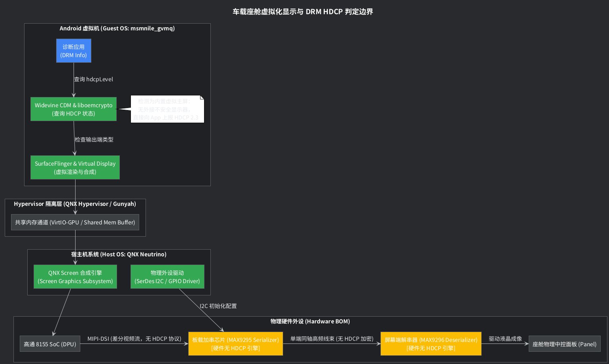

+++
title = "Android 显示架构深度剖析：HDCP 级别获取机制与 DSI / DP 显示接口核心差异"
date = 2026-10-12
draft = false
+++

# Android 显示架构深度剖析：HDCP 级别获取机制与 DSI / DP 显示接口核心差异

> **文档版本**: 1.0.0 (Comprehensive Edition)  
> **适用平台**: Android 10 ~ Android 15 (AOSP 手机/平板、Android Automotive OS 车载中控及多屏系统、高通 SA8155/SA8295 智能座舱虚拟机 GVM 架构)  
> **核心模块**: `android.media.MediaDrm`、Widevine CDM (`libwvdrmengine.so`)、OEMCrypto (`liboemcrypto.so`)、Display HAL / HWC、MIPI DSI、DisplayPort (DP / eDP)、SerDes (GMSL / FPD-Link)

---

## 目录
1. [问题背景与核心反常现象](#1-问题背景与核心反常现象)
2. [HDCP 保护机制与 DRM 业务决策模型](#2-hdcp-保护机制与-drm-业务决策模型)
   - 2.1 [HDCP 协议演进与等级矩阵](#21-hdcp-协议演进与等级矩阵)
   - 2.2 [Max HDCP 与 Current HDCP 的“木桶协商”](#22-max-hdcp-与-current-hdcp-的木桶协商)
   - 2.3 [DRM 输出保护策略（Output Protection Policy）对分辨率的裁决](#23-drm-输出保护策略output-protection-policy对分辨率的裁决)
3. [Android HDCP 级别获取全链路源码剖析](#3-android-hdcp-级别获取全链路源码剖析)
   - 3.1 [全景调用时序图](#31-全景调用时序图)
   - 3.2 [Framework 层：MediaDrm 与 @HdcpLevel 枚举](#32-framework-层mediadrm-与-hdcplevel-枚举)
   - 3.3 [HIDL / AIDL HAL 层：WVDrmPlugin 状态映射](#33-hidl--aidl-hal-层wvdrmplugin-状态映射)
   - 3.4 [CDM 核心引擎：CdmEngine 与 MapHdcpVersion](#34-cdm-核心引擎cdmengine-与-maphdcpversion)
   - 3.5 [TEE 安全层：OEMCryptoCENC 规范与 HDCP_NO_DIGITAL_OUTPUT](#35-tee-安全层oemcryptocenc-规范与-hdcp_no_digital_output)
4. [物理显示接口对决：MIPI DSI vs DisplayPort (DP / eDP)](#4-物理显示接口对决mipi-dsi-vs-displayport-dp--edp)
   - 4.1 [核心技术指标对比矩阵](#41-核心技术指标对比矩阵)
   - 4.2 [MIPI DSI 架构：协议、物理层与车载走线局限](#42-mipi-dsi-架构协议物理层与车载走线局限)
   - 4.3 [DisplayPort 架构：微包传输、AUX 握手与 MST 菊花链](#43-displayport-架构微包传输aux-握手与-mst-菊花链)
   - 4.4 [DP 的外置形态与 HDMI 互转机制（DP++ 与 Type-C DP Alt Mode）](#44-dp-的外置形态与-hdmi-互转机制dp-与-type-c-dp-alt-mode)
5. [DRM 安全模型：内屏免 HDCP 与外屏强校验的本质哲学](#5-drm-安全模型内屏免-hdcp-与外屏强校验的本质哲学)
   - 5.1 [SVP（Secure Video Path）全流程数据通路](#51-svpsecure-video-path全流程数据通路)
   - 5.2 [为什么 DSI 内部屏免 HDCP？](#52-为什么-dsi-内部屏免-hdcp)
   - 5.3 [为什么外接 DP / HDMI 必须强制 HDCP？](#53-为什么外接-dp--hdmi-必须强制-hdcp)
   - 5.4 [内置 eDP 的特殊定位与权衡](#54-内置-edp-的特殊定位与权衡)
6. [车载座舱（高通 8155 GVM）工程实战解密](#6-车载座舱高通-8155-gvm工程实战解密)
   - 6.1 [为什么硬件 SerDes 无 HDCP 却上报 HDCP 2.3？](#61-为什么硬件-serdes-无-hdcp-却上报-hdcp-23)
   - 6.2 [虚拟化显示链路与 QNX Host 隔离模型](#62-虚拟化显示链路与-qnx-host-隔离模型)
   - 6.3 [工程设计与安全合规建议](#63-工程设计与安全合规建议)
7. [总结与核心速查清单](#7-总结与核心速查清单)

---

## 1. 问题背景与核心反常现象

在 Android 智能终端和智能座舱研发过程中，工程师常使用 **DRM Info** 等工具检测系统的数字版权管理（Widevine CDM）能力。在典型的高通车载方案（如 SA8155 / SA8295，Android 运行在 QNX Hypervisor 虚拟机 `msmnile_gvmq`）上，经常观察到如下状态：

```text
Widevine CDM
Vendor: Google
Version: 17.0.1@034
Max HDCP Level Supported: HDCP 2.3
Current HDCP Level: HDCP 2.3
Security Level: L1
```

然而，硬件原理图及 BOM 清单显示：**SoC 与中控屏/副驾屏之间通过加解串器（SerDes，如 Maxim GMSL2、TI FPD-Link 等）长线传输，且该 SerDes 芯片采用的是未烧录 HDCP 密钥的非加密物料（No-HDCP）**。

这就引出了一系列在底层显示驱动与多媒体系统中的核心疑问：
1. **DRM Info 显示的 `Current HDCP Level` 到底代表什么？它是通过何种软件接口层层穿透获取的？**
2. **物理链路上 SerDes 芯片明明不支持 HDCP，为什么系统依然判定并上报了最高安全级别的 `HDCP 2.3`？**
3. **在底层物理接口中，DisplayPort (DP) 与 MIPI DSI 有何本质差别？DP 口是否支持类似 HDMI 的外置可插拔显示？**
4. **DRM 规范对内部 DSI 显示和外接 DP 屏幕的安全防护逻辑有何根本差异？**

本文将自顶向下深入 Android 源码，结合硬件接口原理与座舱虚拟化架构，对上述问题进行全景剖析。

---

## 2. HDCP 保护机制与 DRM 业务决策模型

### 2.1 HDCP 协议演进与等级矩阵

**HDCP (High-bandwidth Digital Content Protection，高带宽数字内容保护)** 是由 Intel 主导制定的加密协议，用于防止未经授权的设备通过数字接口截获或录制高价值视听内容。

| HDCP 协议版本 | 典型接口规范 | 加密算法体系 | 典型应用时代 | 安全评级与破解状态 |
| :--- | :--- | :--- | :--- | :--- |
| **HDCP 1.0 ~ 1.3** | DVI, HDMI 1.0~1.2, DP 1.1 | 40-bit 专有线性反馈移位寄存器 (LFSR) | 2000 ~ 2005 (早期数字高清) | **完全攻破**（主密钥已泄漏） |
| **HDCP 1.4** | HDMI 1.3~1.4, DP 1.2 | LFSR + 流密码加强 | 2009 至今 (通用 1080P) | **已攻破**（仅提供基础防录屏） |
| **HDCP 2.0 ~ 2.1** | 早期无线投屏 (Miracast) | 128-bit AES + RSA 公钥鉴权 | 2011 ~ 2013 | 过渡版本，已被 2.2 替代 |
| **HDCP 2.2** | HDMI 2.0, DP 1.3/1.4, Type-C | 128-bit AES + 3072-bit RSA / SHA-256 | 2014 至今 (4K UHD 门槛) | **高安全性**（4K 准入标准） |
| **HDCP 2.3** | HDMI 2.1, DP 2.0/2.1 | 增强型 AES-128-CTR + Type 1 流严格控制 | 2018 至今 (8K / 顶级 4K HDR) | **当前最高安全级别** |

### 2.2 Max HDCP 与 Current HDCP 的“木桶协商”

* **Max HDCP Level Supported（最大支持等级）**：
  * 指当前终端硬件发送端（Transmitter / SoC 视音频控制器）硬件上所能支持的最高加密协议上限。
* **Current HDCP Level（当前生效等级）**：
  * 指当前终端与所连接的下游接收端（Sink / 显示器 / 投影仪 / 电视 / 中继器 Repeater）**在实际物理链路中完成握手协商后生效的安全级别**。

```
[发射端 SoC Transmitter] ──(HDMI / DP 物理链路)──> [显示端 Sink / Monitor]
     支持: HDCP 2.3                                      支持: HDCP 1.4
           └────────────────── 协商结果 ───────────────────┘
                       Current HDCP Level = HDCP 1.4
                           (向下兼容，木桶原则)
```

HDCP 严格遵循**向下兼容与木桶原理**：
1. 若发射端支持 HDCP 2.3，但外接显示器或中间的转接坞仅支持 HDCP 1.4，则 `Current HDCP Level` 降级为 `HDCP 1.4`；
2. 若链路中存在任何不支持 HDCP 的中继节点或显示器，`Current HDCP Level` 跌落为 `HDCP_NONE`（无保护）或 `HDCP_LEVEL_UNKNOWN`；
3. 只有当发射端、线缆、中继器和接收端全链路支持并成功握手时，`Current HDCP Level` 才会稳定在 `HDCP 2.3`。

### 2.3 DRM 输出保护策略（Output Protection Policy）对分辨率的裁决

流媒体内容提供商（Netflix、Disney+、Amazon Prime Video、国内爱奇艺/腾讯视频 4K HDR 专区）在分发 Widevine DRM 加密视频流时，许可证（License）内嵌了严格的 **OPL（Output Protection Level，输出保护等级）** 规则：

```
                      ┌───────────────────────────────────────┐
                      │ 客户端请求播放 4K UHD DRM 视频        │
                      └──────────────────┬────────────────────┘
                                         ▼
                      ┌───────────────────────────────────────┐
                      │ 查询系统 Current HDCP Level          │
                      └──────────────────┬────────────────────┘
                                         │
        ┌────────────────────────────────┼────────────────────────────────┐
        ▼                                ▼                                ▼
[Current >= HDCP 2.2]          [Current == HDCP 1.4]             [Current == HDCP NONE]
        │                                │                                │
        ▼                                ▼                                ▼
放行 4K UHD / HDR 原画播放     降级至 1080P 或 720P 标清播放       直接黑屏报错 (拒绝解密输出)
(满足数字好莱坞 MovieLabs 规范)  (防 4K 原始数字信号遭采集卡截获)     (防止模拟/明文数字直录)
```

---

## 3. Android HDCP 级别获取全链路源码剖析

DRM Info 显示的属性绝非悬空推测，而是通过 Android Framework 标准多媒体 API 自上而下层层穿透，直至硬件 TEE（TrustZone）安全世界执行后返回。

### 3.1 全景调用时序图

下图展示了从 App 层调用 `MediaDrm` 开始，跨越 JNI、Native 框架、HIDL/AIDL HAL、Widevine CDM，最终抵达 TrustZone OEMCrypto 的完整调用链路：

```plantuml
@startuml
!theme plain
skinparam backgroundColor #282A2D
skinparam defaultFontName "Noto Sans CJK SC"
skinparam defaultFontSize 14
skinparam defaultFontColor #E8EAED
skinparam defaultTextAlignment center
skinparam titleFontColor #FFFFFF
skinparam titleFontSize 18
skinparam shadowing false
skinparam roundcorner 0
skinparam ArrowColor #BDC1C6
skinparam ArrowFontColor #E8EAED
skinparam ArrowThickness 1
skinparam note {
    BackgroundColor #3C4043
    BorderColor #5F6368
    FontColor #E8EAED
}
skinparam sequence {
    ParticipantBackgroundColor #34A853
    ParticipantBorderColor #5F6368
    ParticipantFontColor #FFFFFF
    LifeLineBorderColor #5F6368
    LifeLineBackgroundColor #3C4043
    BoxBackgroundColor #202124
    BoxBorderColor #5F6368
    BoxFontColor #E8EAED
    GroupBackgroundColor #3C4043
    GroupBodyBackgroundColor #202124
    GroupBorderColor #5F6368
    GroupFontColor #FFFFFF
    GroupHeaderFontColor #FFFFFF
    DividerBackgroundColor #3C4043
    DividerBorderColor #5F6368
    DividerFontColor #E8EAED
    ReferenceBackgroundColor #202124
    ReferenceBorderColor #5F6368
    ReferenceFontColor #E8EAED
    ArrowColor #BDC1C6
    ArrowFontColor #E8EAED
}
skinparam participant<<ext>> {
    BackgroundColor #3C4043
    FontColor #E8EAED
}
hide stereotype
hide footbox

title Android Widevine HDCP 级别获取全链路时序图

participant "诊断 App\n(DRM Info)" as App <<ext>>

box "Android 框架层 (Java & Native)"
participant "MediaDrm\n(Java API)" as MediaDrmJava
participant "android_media_MediaDrm\n(JNI Bridge)" as MediaDrmJNI
participant "libmediadrm.so\n(Native C++)" as MediaDrmNative
end box

box "HAL 接口与 Widevine CDM"
participant "WVDrmPlugin\n(DRM HAL Service)" as WVDrmPlugin
participant "CdmEngine\n(libwvdrmengine.so)" as CdmEngine
participant "CryptoSession\n(CDM Core Session)" as CryptoSession
end box

box "安全硬件与 TEE"
participant "liboemcrypto.so\n(OEMCrypto Adapter)" as OEMCrypto
participant "TrustZone / QSEE\n(widevine.mbn)" as TrustZone <<ext>>
end box

autonumber "<b>[00]"
App -> MediaDrmJava : getPropertyString("hdcpLevel") / getConnectedHdcpLevel()
activate MediaDrmJava

MediaDrmJava -> MediaDrmJNI : native_getConnectedHdcpLevel()
activate MediaDrmJNI

MediaDrmJNI -> MediaDrmNative : getConnectedHdcpLevel(&connectedLevel)
activate MediaDrmNative

MediaDrmNative -> WVDrmPlugin : getHdcpLevels_1_2() [HIDL / AIDL IPC]
activate WVDrmPlugin

WVDrmPlugin -> CdmEngine : QueryStatus(QUERY_KEY_CURRENT_HDCP_LEVEL)
activate CdmEngine

CdmEngine -> CryptoSession : GetHdcpCapabilities(&current, &max)
activate CryptoSession

CryptoSession -> OEMCrypto : OEMCrypto_GetHDCPCapability(&current, &max)
activate OEMCrypto

OEMCrypto -> TrustZone : SMC 调用陷入安全世界 (QSEECom IPC)
activate TrustZone
TrustZone --> OEMCrypto : 返回当前物理显示拓扑等级
deactivate TrustZone

OEMCrypto --> CryptoSession : OEMCrypto_SUCCESS (返回枚举 current = HDCP_V2_3)
deactivate OEMCrypto

CryptoSession --> CdmEngine : CdmResponseType::NO_ERROR
deactivate CryptoSession

CdmEngine -> CdmEngine : MapHdcpVersion(current) -> "HDCP-2.3"
CdmEngine --> WVDrmPlugin : 返回字符串 "HDCP-2.3"
deactivate CdmEngine

WVDrmPlugin -> WVDrmPlugin : mapHdcpLevel_1_2("HDCP-2.3")
WVDrmPlugin --> MediaDrmNative : 返回 Status::OK, HdcpLevel_V1_2::HDCP_V2_3
deactivate WVDrmPlugin

MediaDrmNative --> MediaDrmJNI : 状态码映射
deactivate MediaDrmNative

MediaDrmJNI --> MediaDrmJava : 返回整数常量 HDCP_V2_3 (6) / 字符串 "HDCP-2.3"
deactivate MediaDrmJNI

MediaDrmJava --> App : 界面呈现 Current HDCP Level: HDCP 2.3
deactivate MediaDrmJava
@enduml
```



### 3.2 Framework 层：MediaDrm 与 @HdcpLevel 枚举

在 AOSP 源码 `frameworks/base/media/java/android/media/MediaDrm.java` 中，定义了标准的获取接口与等级常数：

```java
// frameworks/base/media/java/android/media/MediaDrm.java
public static final String PROPERTY_HDCP_LEVEL = "hdcpLevel";
public static final String PROPERTY_MAX_HDCP_LEVEL = "maxHdcpLevel";

@IntDef({HDCP_LEVEL_UNKNOWN, HDCP_NONE, HDCP_V1, HDCP_V2,
         HDCP_V2_1, HDCP_V2_2, HDCP_V2_3, HDCP_NO_DIGITAL_OUTPUT})
public @interface HdcpLevel {}

public static final int HDCP_LEVEL_UNKNOWN = 0;       // 未知或访问出错
public static final int HDCP_NONE = 1;                // 设备不支持 HDCP，内容无保护
public static final int HDCP_V1 = 2;                  // HDCP 1.0
public static final int HDCP_V2 = 3;                  // HDCP 2.0 Type 1
public static final int HDCP_V2_1 = 4;                // HDCP 2.1 Type 1
public static final int HDCP_V2_2 = 5;                // HDCP 2.2 Type 1
public static final int HDCP_V2_3 = 6;                // HDCP 2.3 Type 1
public static final int HDCP_NO_DIGITAL_OUTPUT = Integer.MAX_VALUE; // 无外接数字输出，隐式绝对安全

@HdcpLevel
public native int getConnectedHdcpLevel();

@HdcpLevel
public native int getMaxHdcpLevel();
```

* **历史兼容性**：在早期的 Android API 中，诊断工具主要通过 `drm.getPropertyString("hdcpLevel")` 查询字符串；
* **原生类型接口**：从 Android 9 (API 28) 起，Google 正式提供了强类型方法 `getConnectedHdcpLevel()`，底层映射到 `HDCP_V2_3` 等整型常量。

### 3.3 HIDL / AIDL HAL 层：WVDrmPlugin 状态映射

Widevine HAL 实现层代码（位于 `vendor/widevine/libwvdrmengine/mediadrm/src_hidl/WVDrmPlugin.cpp`）负责承接 IPC 请求：

```cpp
// vendor/widevine/libwvdrmengine/mediadrm/src_hidl/WVDrmPlugin.cpp
Return<void> WVDrmPlugin::getHdcpLevels_1_2(getHdcpLevels_1_2_cb _hidl_cb) {
  HdcpLevel_V1_2 connectedLevel = HdcpLevel_V1_2::HDCP_NONE;
  HdcpLevel_V1_2 maxLevel = HdcpLevel_V1_2::HDCP_NO_OUTPUT;

  std::string level;
  Status status = queryProperty(wvcdm::QUERY_KEY_CURRENT_HDCP_LEVEL, level);
  if (status == Status::OK) {
    connectedLevel = mapHdcpLevel_1_2(level);
  } else {
    ALOGE("Failed to query current hdcp level.");
    _hidl_cb(Status_V1_2::ERROR_DRM_INVALID_STATE, connectedLevel, maxLevel);
    return Void();
  }

  status = queryProperty(wvcdm::QUERY_KEY_MAX_HDCP_LEVEL, level);
  if (status == Status::OK) {
    maxLevel = mapHdcpLevel_1_2(level);
  }
  
  _hidl_cb(Status_V1_2::OK, connectedLevel, maxLevel);
  return Void();
}
```

### 3.4 CDM 核心引擎：CdmEngine 与 MapHdcpVersion

Widevine CDM 核心模块（`cdm/core/src/cdm_engine.cpp`）完成属性名到底层加密会话的转发，并完成枚举向 UI 文本的转化：

```cpp
// cdm/core/src/cdm_engine.cpp
std::string MapHdcpVersion(CryptoSession::HdcpCapability version) {
  switch (version) {
    case HDCP_NONE:                 return "Unprotected";
    case HDCP_V1:                   return "HDCP-1.x";
    case HDCP_V2:                   return "HDCP-2.0";
    case HDCP_V2_1:                 return "HDCP-2.1";
    case HDCP_V2_2:                 return "HDCP-2.2";
    case HDCP_V2_3:                 return "HDCP-2.3";
    case HDCP_NO_DIGITAL_OUTPUT:    return "Disconnected"; // 或表示无数字输出
    default:                        return "Unknown";
  }
}

CdmResponseType CdmEngine::QueryProperty(...) {
  if (query_token == QUERY_KEY_CURRENT_HDCP_LEVEL ||
      query_token == QUERY_KEY_MAX_HDCP_LEVEL) {
    CryptoSession::HdcpCapability current_hdcp, max_hdcp;
    crypto_session->GetHdcpCapabilities(security_level, &current_hdcp, &max_hdcp);
    *query_response = MapHdcpVersion(
        query_token == QUERY_KEY_CURRENT_HDCP_LEVEL ? current_hdcp : max_hdcp);
    return NO_ERROR;
  }
}
```

### 3.5 TEE 安全层：OEMCryptoCENC 规范与 HDCP_NO_DIGITAL_OUTPUT

穿透到硬件级 TEE 的接口规范由 Google 定义在 `OEMCryptoCENC.h` 中。这一头文件不仅规定了函数原型，还对硬件行为做了极其权威的定义：

```c
// vendor/widevine/libwvdrmengine/oemcrypto/include/OEMCryptoCENC.h
typedef enum OEMCrypto_HDCP_Capability {
  HDCP_NONE = 0,              // 不支持 HDCP，无安全数据通道
  HDCP_V1 = 1,                // HDCP 1.x
  HDCP_V2 = 2,                // HDCP 2.0 Type 1
  HDCP_V2_1 = 3,              // HDCP 2.1 Type 1
  HDCP_V2_2 = 4,              // HDCP 2.2 Type 1
  HDCP_V2_3 = 5,              // HDCP 2.3 Type 1
  HDCP_NO_DIGITAL_OUTPUT = 0xff // 无外接数字输出，本地安全数据通路
} OEMCrypto_HDCP_Capability;

OEMCryptoResult OEMCrypto_GetHDCPCapability(
    OEMCrypto_HDCP_Capability* current,
    OEMCrypto_HDCP_Capability* maximum);
```

> **[!IMPORTANT] 规范关键声明（摘自 OEMCryptoCENC.h 官方注释）**：  
> *"The value 0xFF (`HDCP_NO_DIGITAL_OUTPUT`) means the device is using a local, secure, data path instead of HDMI output. Notice that HDCP must use flag Type 1: all downstream devices will also use the same version or higher."*  
> **含义**：如果设备使用的是本地内部安全通路（Local Secure Data Path）而非外接 HDMI 输出，则该链路被认为具备天然最高防护能力，在许可证校验中被视为满足任何高规格 HDCP 等级。

---

## 4. 物理显示接口对决：MIPI DSI vs DisplayPort (DP / eDP)

在理解 DRM 安全判定之前，必须从物理层与协议层彻底厘清两大主流显示总线的本质差异。

### 4.1 核心技术指标对比矩阵

| 架构维度 | MIPI DSI (Display Serial Interface) | DisplayPort (DP / eDP) |
| :--- | :--- | :--- |
| **主导联盟** | **MIPI Alliance** (移动行业处理器接口联盟) | **VESA** (视频电子标准协会) |
| **设计定位** | **移动/嵌入式内部封闭总线**（手机、智能手表、车载主屏） | **计算机/外设通用高速总线**（PC 显示器、外接大屏、笔记本内屏） |
| **典型物理形态** | PCB 覆铜走线、微型 FPC 软排线（裸芯片互联） | 外置插座（标准 DP、Mini DP、Type-C DP）、微型同轴线 (eDP) |
| **原生物理距离** | **极短**（常规 ≤ 15~30 cm，长距离必须依赖 SerDes 串行器） | **较长**（无源铜缆 2 ~ 3 米，Type-C 线缆 1 ~ 2 米，光纤线缆可达数十米） |
| **物理层机制** | D-PHY (源同步时钟 Lane + 数据 Lanes) / C-PHY (3相编码) | Main-Link 高速差分通道 (8b/10b 或 128b/132b 编码，内置嵌入式时钟 CDR) |
| **控制与自适应通道** | 走 Lane 0 的低功耗逃逸命令（LP Mode / DCS 命令集） | 独立半双工 **AUX 通道** (1~2 Mbps)，专用于 EDID 读取与 DPCD 链路训练 |
| **热插拔与自动协商** | **无原生热插拔**（不支持运行时插拔，分辨率写死在 DTB 设备树） | **原生硬件 HPD 中断引脚**（支持即插即用，运行时自适应协商分辨率与摆幅） |
| **音频混合传输** | 原生**不支持音频**（纯视频传输，音频必须走独立 I2S/TDM 总线） | 原生支持多声道、高采样率音频微包混编传输 |
| **HDCP 原生支持** | **无原生 HDCP 加密引擎** | **原生支持硬件级 HDCP 1.3 / 2.2 / 2.3 加密认证** |
| **多屏级联扩展** | 仅支持点对点拓扑 | 原生支持 **MST (Multi-Stream Transport) 菊花链单口驱动多屏** |

### 4.2 MIPI DSI 架构：协议、物理层与车载走线局限

MIPI DSI 的核心理念是**“极致精简与极致低功耗”**：
1. **工作模式**：
   * **Video Mode（视频模式）**：类似于传统 RGB 接口，SoC 显示控制器（DPU）必须按照像素时钟（PCLK）不间断地向屏幕推送场同步（VSYNC）、行同步（HSYNC）和有效像素数据。屏幕端无显存（Gramless），功耗低、成本低。
   * **Command Mode（命令模式）**：面板内部自带显存（FrameBuffer）。SoC 仅在画面发生局部或全屏变化时才通过高速突发（Burst）写入显存，静态画面下显示控制器与 PHY 处于超低功耗休眠（LP Mode）。
2. **车载走线的物理瓶颈**：
   * DSI 采用极低电平摆幅（高速 HS 模式下差分摆幅仅约 200 mV），抗共模干扰与高频衰减能力极其有限。
   * 在车身电子环境中，从中控域控车机到仪表屏、副驾屏的线束往往长达 **1.5 米 ~ 3 米**，且需穿过复杂的整车高压线束。DSI 信号直接通过铜线引出必将出现严重误码、信号畸变或电磁辐射（EMI）超标。
   * **解决方案**：车载必须在板端紧贴 SoC DSI 引脚放置 **加串器（Serializer，如 GMSL2 MAX9295）**，将并行/DSI 信号调制为高达 3~6 Gbps 的同轴单端高频信号，拉线到屏幕端再经由 **解串器（Deserializer，如 MAX9296）** 还原为 DSI 或 OpenLDI 喂给面板。

```
[座舱 SoC (如 8155)]
      │ (MIPI-DSI, PCB 走线 < 5cm)
      ▼
[板载串行器 Serializer (MAX9295)]
      │
      │ ◄─── 整车同轴长屏蔽线缆 (1.5 ~ 3米, 传输车身高速单端信号)
      ▼
[屏幕端解串器 Deserializer (MAX9296)]
      │ (MIPI-DSI / OpenLDI)
      ▼
[车载液晶显示模组 Panel]
```

### 4.3 DisplayPort 架构：微包传输、AUX 握手与 MST 菊花链

与 DSI 简单的点对点像素管道不同，DisplayPort 从诞生之日起更像是一种**高速局域网架构**：
1. **微包化传输（Micro-Packet Architecture）**：
   * 视频像素、消隐数据、多声道音频以及时间戳全部被切割成类似于 PCIe / 以太网的微数据包（Micro-packets）。
   * 得益于微包结构，DP 引入了革命性的 **MST（Multi-Stream Transport）** 技术：单根物理 DP 线缆内部可以并行复用多路独立的视频流，通过显示器自带的 DP Out 接口级联下一台显示器（菊花链 Daisy Chain），实现多屏独立异显。
2. **AUX 通道与自适应链路训练（Link Training）**：
   * DP 具备独立的半双工辅助通道（AUX Channel，差分信号，速率 1 Mbps 曼彻斯特编码）。
   * 插入显示器触发 **HPD（Hot Plug Detect）高电平中断**后，SoC 与显示器通过 AUX 通道自动读取 **EDID** 获取显示屏分辨率、颜色格式，随后自动进行 **链路训练**：动态调整发送端的电压摆幅（Voltage Swing）与预加重（Pre-emphasis），以匹配当前线缆质量，确保误码率低于极限值。

### 4.4 DP 的外置形态与 HDMI 互转机制（DP++ 与 Type-C DP Alt Mode）

针对用户关于“**DP 口是否可以通过类似 HDMI 的外置接口连接？**”的疑问，结论是：**不仅完全可以，而且 DP 是目前外置高速视频互联的核心底座**。

#### ① 常见物理接口形态
* **标准 DisplayPort（Full-size DP）**：PC 显卡与电竞显示器标配，带防脱落机械卡扣，插拔手感与 HDMI 一致；
* **Mini DisplayPort**：体积与 USB 相当，常用于工控机、车载工装调试盒及早期轻薄本；
* **USB Type-C (DP Alt Mode)**：目前**消费电子与车载扩展的主流形态**。Type-C 接口内部拥有 4 对高速差分对（TX1/RX1, TX2/RX2），在进行 DP 交替模式握手后，可直接分配 2 条或 4 条高速通道直通运行原生的 DisplayPort 协议。

#### ② DP 与 HDMI 的互通机制
* **DP++（Dual-Mode DisplayPort 双模技术）**：
  若设备 DP 接口支持 DP++，当插入被动转接线（Passive Dongle）时，发送端 PHY 能够感知并将输出电平与协议直接切换为 HDMI 所需的 **TMDS 差分信号**。用户只需几元钱的被动转接线，即可将 DP 口直接插入电视或 HDMI 投影仪。
* **主动式转接器（Active Adapter）**：
  对于不支持 DP++ 的纯 DP 输出口，采用内置协议转换芯片（如 Parade PS176 等）的主动转接线，硬件内部实时解包 DP 信号并重构编码输出标准的 HDMI 2.0/2.1 信号，实现无缝互转。

---

## 5. DRM 安全模型：内屏免 HDCP 与外屏强校验的本质哲学

理解了 DSI 与 DP 的底层机制后，我们便能看透 DRM 安全规范的顶层决策模型：**“内部物理封闭靠硬件隔离保护；外部暴露通道靠动态密码学防御”**。

### 5.1 SVP（Secure Video Path）全流程数据通路

在现代移动与车载 SoC 中，DRM 视频的解密、解码与渲染是在硬件隔离的 **SVP（安全视频通路）** 中完成的：

```
[网络下载的 DRM 加密流]
        │
        ▼
[SoC 安全世界 TrustZone (TEE)] ──(AES 密钥解密)──> [安全受保护物理内存 (TrustZone Protected RAM)]
                                                        │
                                                        ▼
                                              [硬件视频解码器 (Secure VPU)]
                                                        │ (解码出明文 YUV 帧)
                                                        ▼
                                              [安全内存物理缓冲 (Secure Gralloc Buffer)]
                                                        │
                                                        ▼
                                              [显示硬件合成器 (Secure DPU / MDP)]
                                                        │
                         ┌──────────────────────────────┴──────────────────────────────┐
                         ▼                                                             ▼
           【本地内置接口 (MIPI DSI)】                                     【外置可插拔接口 (DP / HDMI)】
                         │                                                             │
                         ▼                                                             ▼
            ┌────────────────────────┐                                    ┌────────────────────────┐
            │   物理机壳与内部封闭走线   │                                    │  硬件 HDCP 2.3 加密引擎 │
            │   (无需/不支持 HDCP)    │                                    │  (强制要求端到端加密握手)│
            └────────────────────────┘                                    └────────────────────────┘
                         │                                                             │
                         ▼                                                             ▼
                  [车内中控面板]                                                 [外部显示器 / 电视]
```

### 5.2 为什么 DSI 内部屏免 HDCP？

1. **攻击面评估与物理封闭性**：
   * DRM 规范（如 Widevine Specification 与 MovieLabs Specification for Enhanced Content Protection）的核心假设是：防止用户通过简易设备（如淘宝售卖的几百元 HDMI 视频采集卡）进行高保真数字翻录。
   * 手机机身是胶水封死的，车载座舱的仪表盘和中控台深埋在仪表板内部。黑客想要截取 DSI 信号，必须将车机域控拆开并在极细密的高速微带线上焊接数十皮法电容的高频探针（RF Probe），这属于极端侵入式攻击，不属于常规版权保护的防范模型。
2. **SVP 保证了在芯片内部的绝对安全**：
   * 在视频输出到 DSI 引脚之前，所有的像素数据全部驻留在安全内存（Secure Gralloc）中，Android Linux 内核、Root 权限的应用程序、调试器等均无法 Dump 出任何内存数据。
3. **协议先天限制**：
   * 如前所述，MIPI DSI 从协议层就未定义 HDCP 密钥交换协议，强求 DSI 跑 HDCP 在工业界不具备工程可行性。

### 5.3 为什么外接 DP / HDMI 必须强制 HDCP？

1. **接口极易被物理旁路**：
   * 任何外接 DP、Type-C 或 HDMI 接口，用户都可以随意拔下显示器，串接一个专业的“硬件视频采集录像机”。
   * 如果该接口不施加加密保护，则 SoC DPU 吐出的每秒数千兆字节的明文数字像素流将毫无保留地暴露在外，瞬间被完整录制成无损视频文件。
2. **密码学强制防御**：
   * 必须通过 HDCP 2.2 / 2.3 的公钥体系与物理握手，确保接收端也是经过合法授权认证、绝不私自落盘缓存像素的合规显示器。一旦握手失败，SoC 的 DPU 会在硬件层面切断输出，或直接输出全黑帧。

### 5.4 内置 eDP 的特殊定位与权衡

很多中高端笔记本电脑（如 MacBook、ThinkPad）或部分高端车载连屏，其 SoC 输出使用的是 **eDP（Embedded DisplayPort）**。
* **虽然跑的是 DP 信号，但由于其属于不可插拔的内部屏（Internal Panel）**：
  * 在绝大部分商业实现中，驱动直接将其识别为 `kInternal` 或 `Primary Display`，在 OEMCrypto 中归类为 **本地安全通路（Local Secure Path）**，**免除 HDCP 校验即可放行 4K 播放**。
  * 只有在少数极其严苛的最高等级影视安全认证中，厂商才会采购内置了 HDCP 解密 Receiver 的 eDP 面板并使能板端加密。

---

## 6. 车载座舱（高通 8155 GVM）工程实战解密

回到前文的核心疑问：**“为什么 HBEZ 项目的硬件 SerDes 不支持 HDCP，DRM Info 却赫然显示 `HDCP 2.3`？”**

结合高通 8155 平台虚拟机架构，其底层机理在于三重解耦：

### 6.1 为什么硬件 SerDes 无 HDCP 却上报 HDCP 2.3？

#### 解密一：SoC 与串行器是 MIPI DSI 直连，SoC 根本无法感知外部 SerDes 是否支持 HDCP
* 在 8155 域控板卡上，SoC 的 DPU（显示处理核心）通过 MIPI DSI 接口直接走 PCB 铜箔连接到板载加串芯片（MAX9295）。
* SoC DPU 的硬件状态机在驱动 DSI 接口时，**没有发起 HDCP 握手的任何物理指令，也不存在握手失败的状态反馈**。
* 对 SoC 的底层安全子系统（TrustZone）而言，它只知道 DSI 正在按照设备树设定的时序平稳推送数据，整条链路被默认标记为健康运行的内置安全通道。

#### 解密二：虚拟化（GVM）环境下的层级隔离与透传阻断
* 本架构中 Android 并非运行在裸机（Bare-metal）上，而是作为 **Guest OS（客户虚拟机，`msmnile_gvmq`）** 运行于 **QNX Hypervisor** 之上。
* **物理 SerDes 的控制权完全归属于 Host OS (QNX)**：QNX 的 I2C 驱动与 Screen 子系统全权负责加解串器的上电、锁定（Lock Detection）与配置。
* Android 内部的 `SurfaceFlinger` 和 `Display HAL` 只能看到 Hypervisor 分配给它的虚拟显示设备（Virtual Display）。运行在 Android 虚拟机内的 Widevine CDM 与 `liboemcrypto.so`，**在软件栈拓扑上根本穿透不到物理硬件，完全无法获知底层 SerDes 的实际型号与加密能力**。

#### 解密三：BSP 与 OEMCrypto 为通过 Widevine 认证的默认行为（Mock / Policy Defaults）
* 在高通交付的 `msmnile_gvmq` BSP 中，`liboemcrypto.so` 的底层实现遵循如下安全策略分支：
  1. 检查是否存在外接热插拔显示接口（如外接 HDMI、Type-C DP Out）；
  2. 若检测到**当前仅有系统内部主屏（Primary Display / Virtual Display）在工作，无任何不安全外接接口接入**；
  3. `OEMCrypto_GetHDCPCapability` 将直接返回：
     * `current = HDCP_V2_3`（等同于硬件芯片最大能力，视同绝对安全）；
     * 或者返回 `current = HDCP_NO_DIGITAL_OUTPUT (0xFF)`。
  4. Widevine CDM 收到此返回值后，统一映射转换为面向应用程序的字符串 `"HDCP-2.3"`。

> **工程逻辑闭环**：如果高通在虚拟机驱动中上报 `HDCP_NONE`，将会直接导致 Google 官方的 **GTS（Google Test Suite）HDCP 单元测试用例大面积挂死**，且国内外的商业长视频 App 会集体触发降级逻辑导致 4K 内容无法播放。因此，对于内置/虚拟屏幕，上报最高支持能力是行业通行的标准实现。

### 6.2 虚拟化显示链路与 QNX Host 隔离模型



### 6.3 工程设计与安全合规建议

虽然车机系统在当前“无 HDCP 硬件”下能够正常上报并在 DRM Info 中呈现 `HDCP 2.3` 且能正常播放视频，但在整车项目量产与安全评估中需关注以下建议：

1. **避免外接扩展接口裸奔**：
   * 如果车机扶手箱或后排设计了面向用户的 **Type-C 投屏输出（DP Alt Mode）或 HDMI 输出接口**，该路输出**必须严格走硬件 HDCP 2.2/2.3 握手流程**。切不可将外接显示器也 Mock 为内置屏，否则会导致用户随意插入采集卡抓取 4K 影片，违反与内容版权方签署的法律协议。
2. **座舱内部线束窃听的攻防边界**：
   * 目前对于车内 SerDes 链路，由于整车线束处于全封闭金属车身内部，业界绝大多数 OEM 认可将内部屏归为“物理安全通路”。
   * 若车企未来计划引入高等级的海外流媒体（如符合好莱坞 MovieLabs 超高清蓝光标准的原盘级点播），版权方若提出针对车内线束的物理窥探审查，届时需升级选用支持 **HDCP 2.3 加密规格的 SerDes 芯片料号**。

---

## 7. 总结与核心速查清单

| 核心问题 | 关键结论与技术本质 |
| :--- | :--- |
| **`Current HDCP Level` 是什么？** | 当前显示链路**实际协商生效**的数字保护级别。受限于“木桶原则”，由发射端、线缆、中继器和接收端中**最低的一环**决定。 |
| **获取接口链条？** | `MediaDrm.getPropertyString("hdcpLevel")` $\rightarrow$ `WVDrmPlugin::getHdcpLevels_1_2()` $\rightarrow$ `CdmEngine::MapHdcpVersion()` $\rightarrow$ `OEMCrypto_GetHDCPCapability()` $\rightarrow$ TrustZone TEE。 |
| **DSI 与 DP 的本质差异？** | **DSI** 是低功耗、短距离、面向板级内置屏幕的专用点对点管道；**DP** 是微包化、带独立 AUX 协商、原生支持音频、MST 菊花链与硬件 HDCP 的通用高速外部互联标准。 |
| **DP 可以外置连接吗？** | **完全可以**。形态包括标准 DP、Mini DP、USB Type-C (DP Alt Mode)；且通过 DP++ 或主动转接芯片可无缝转接为 HDMI。 |
| **为什么 DSI 免 HDCP，外接 DP 必须有？** | **内屏靠封闭保安全**：DSI 属于机身/车体内部，黑客无法轻易旁路，SVP 确保内存安全；**外屏靠加密保安全**：外接线缆极易串联硬件采集卡，必须通过 HDCP 2.2/2.3 强制端到端密码学加密。 |
| **不支持 HDCP 的 SerDes 为何显示 HDCP 2.3？** | 1. SoC 输出 DSI 信号，根本无 HDCP 握手信道；<br>2. 运行在 QNX Hypervisor 虚拟机（GVM）下，Android 无法感知物理 SerDes；<br>3. 底层驱动判定为本地安全通道（`HDCP_NO_DIGITAL_OUTPUT`），默认上报芯片最高能力（HDCP 2.3）以通过 CTS/GTS 测试并放行 4K 播放。 |
