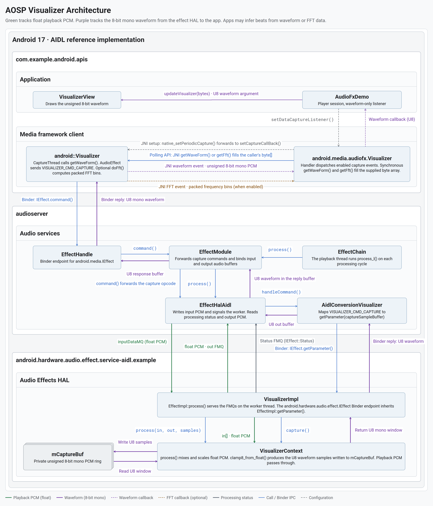

+++
title = 'Android Visualizer：从播放 PCM 到波形和频谱'
date = '2026-11-28T00:00:00+08:00'
draft = false
description = '沿 AOSP 源码追踪播放 PCM 如何变成 8 位波形、FFT 在哪里计算，以及应用怎样用这些数据做音乐律动。'
ShowToc = true
+++

`android.media.audiofx.Visualizer` 让应用从正在播放的音频中取一小段数据，用来画波形或频谱。以播放器的音乐律动为例，Android 提供波形采集和快速傅里叶变换（FFT），应用决定哪一刻算一次鼓点，以及如何用它驱动动画。下面沿 AOSP `android17-release` 的 AIDL 软件效果实现追踪一次采集。[Android API 文档](https://developer.android.com/reference/android/media/audiofx/Visualizer)

## 播放 PCM 在哪里变成波形？

转换发生在效果 HAL 的 **`VisualizerContext::process()`**。AudioFlinger 处理播放音频时，通过快速消息队列（FMQ）把一块浮点 PCM 交给效果。以立体声为例，`process()` 读取同一时刻的左右声道样本，求和、缩放，再量化成一个无符号 8 位样本，写入效果自己的环形缓冲区。原来的浮点 PCM 同时被复制到输出，继续参与播放。[波形转换与播放输出源码](https://android.googlesource.com/platform/frameworks/av/+/475269ec44acec82792be6b01fb8e16357d4d2c8/media/libeffects/visualizer/aidl/VisualizerContext.cpp#253)

```cpp
float smp = 0.f;
for (uint32_t i = 0; i < mChannelCount; ++i) {
    smp += in[inIdx++];
}
mCaptureBuf[captIdx] = clamp8_from_float(smp * fscale);
```

图中**绿色**跟踪播放链上的浮点 PCM，**紫色**跟踪从这次写入开始的 8 位单声道 waveform。waveform 本身也是 PCM，只是声道数、精度和用途发生了变化。默认的 `SCALING_MODE_NORMALIZED` 按当前音频块的峰值缩放，较轻的声音也能画出明显起伏。`SCALING_MODE_AS_PLAYED` 则按声道数取平均，保留输入电平的相对变化。做音量阈值判断时，这个差别会直接影响结果。[缩放模式实现](https://android.googlesource.com/platform/frameworks/av/+/475269ec44acec82792be6b01fb8e16357d4d2c8/media/libeffects/visualizer/aidl/VisualizerContext.cpp#253)

[](../../static/images/aosp-visualizer-architecture.png)

点击图片可查看 PNG 原图，也可[打开 HTML 架构图](../../static/diagrams/aosp-visualizer-architecture.html)。

## 一次采集的时序

1. **建立会话。** 应用用播放器的 `audioSessionId` 创建 `Visualizer`，设置窗口大小和所需数据类型，再启用效果。此后每处理一个播放块，效果都会更新环形缓冲区。
2. **请求波形。** 应用可主动调用 `getWaveForm()`，也可注册监听器，让应用进程里的原生 `CaptureThread` 定时发起采集。两种方式最终都由原生客户端通过 Binder 向 AudioFlinger 发送 `VISUALIZER_CMD_CAPTURE`。
3. **返回一个窗口。** AudioFlinger 的 AIDL 适配层将命令转换为效果 HAL 的 `getParameter(captureSampleBuffer)`。HAL 的 `capture()` 从已有波形中复制一个窗口，经 Binder 应答返回。图上的 `process()`、`capture()` 表示函数调用，FMQ 箭头标出播放数据，Binder 的请求与应答分别标出命令和返回的数据。[命令转换](https://android.googlesource.com/platform/frameworks/av/+/475269ec44acec82792be6b01fb8e16357d4d2c8/media/libaudiohal/impl/effectsAidlConversion/AidlConversionVisualizer.cpp#142) · [读取波形窗口](https://android.googlesource.com/platform/frameworks/av/+/475269ec44acec82792be6b01fb8e16357d4d2c8/media/libeffects/visualizer/aidl/VisualizerContext.cpp#177)
4. **按需计算 FFT 并交付。** 请求频谱时，**应用进程内的 AOSP 原生客户端**对返回的波形调用 `doFft()`。同时订阅波形和频谱时，一轮定时采集只取一次波形，两种结果来自同一个窗口。JNI 把结果交给 Java 层，再由 `Handler` 分发给监听器。首次注册监听器时优先使用注册线程的 Looper，缺省时使用主线程的 Looper。[原生采集与 FFT](https://android.googlesource.com/platform/frameworks/base/+/94b4c163b7dfe5ce3607f7bb8456f9573f7de57d/media/jni/audioeffect/Visualizer.cpp#306) · [Java 回调注册](https://android.googlesource.com/platform/frameworks/base/+/94b4c163b7dfe5ce3607f7bb8456f9573f7de57d/media/java/android/media/audiofx/Visualizer.java#646)

## 应用怎样读取数据？

普通应用先声明并取得 `RECORD_AUDIO` 运行时权限。观察自己的播放器时，给构造函数传入 `MediaPlayer.getAudioSessionId()` 或 `AudioTrack.getAudioSessionId()`。传 `0` 表示观察输出混音，还需要声明 `MODIFY_AUDIO_SETTINGS`。[会话与权限](https://android.googlesource.com/platform/frameworks/base/+/94b4c163b7dfe5ce3607f7bb8456f9573f7de57d/media/java/android/media/audiofx/Visualizer.java#34)

| 应用拿到的数据 | Java 中的读法 |
| --- | --- |
| 波形 `byte[N]` | 每字节是一个无符号采样点，范围 0～255，静音为 128。画图时用 `(waveform[i] & 0xff) - 128` 得到以 0 为中心的振幅。 |
| FFT `byte[N]` | 各分量是有符号数。`fft[0]` 存直流分量，`fft[1]` 存奈奎斯特频率分量。其余频点 `1 ≤ k < N/2` 的幅值用 `Math.hypot(fft[2*k], fft[2*k+1])` 计算。 |
| 回调参数 `samplingRate` | 表示音频采样率，单位是 mHz。第 `k` 个频点对应 `k * (samplingRate / 1000.0) / N` Hz。`setDataCaptureListener()` 的 `rate` 同样用 mHz，控制的是每秒采集几次。 |

在效果停用时设置 `setCaptureSize(N)`，按 `getCaptureSizeRange()` 选择范围内的 2 的幂。注册监听后调用 `setEnabled(true)`，检查各步返回值是否为 `Visualizer.SUCCESS`。仅画波形时，注册参数可用 `waveform=true, fft=false`，这样客户端会跳过 FFT。回调数组只在本次回调期间有效，若留到下一帧绘制或交给其他线程，应先复制。结束时调用 `setEnabled(false)` 和 `release()`。[FFT 数组布局](https://android.googlesource.com/platform/frameworks/base/+/94b4c163b7dfe5ce3607f7bb8456f9573f7de57d/media/java/android/media/audiofx/Visualizer.java#492) · [回调数组的生命周期](https://android.googlesource.com/platform/frameworks/base/+/94b4c163b7dfe5ce3607f7bb8456f9573f7de57d/media/java/android/media/audiofx/Visualizer.java#605)

## 用于音乐律动时，能观察到多少音频？

这个分支支持 128、256、512、1024 点窗口，定时采集上限为 20,000 mHz，即每秒 20 次。假设音频采样率为 48 kHz，1024 点窗口只覆盖约 **21.3 ms**。即使按上限采集，两次请求的名义间隔也有 **50 ms**。短促的鼓点可能落在两个窗口之间。调低回调频率可以减少应用唤醒、窗口读取和按需 FFT 的次数。效果启用期间，播放侧仍按音频块更新波形。[窗口大小常量](https://android.googlesource.com/platform/system/media/+/440eb272fd3da0ca7bdae932e61e7fd9be1fd324/audio/include/system/audio_effects/effect_visualizer.h#32) · [定时采集频率上限](https://android.googlesource.com/platform/frameworks/base/+/94b4c163b7dfe5ce3607f7bb8456f9573f7de57d/media/jni/audioeffect/Visualizer.h#154)

画频谱柱时，应用可以直接把频点幅值映射成柱高。做节拍灯效时，应用还要比较多个窗口的变化，例如检测低频能量的突然上升，并设置最小触发间隔，避免一个鼓点反复触发。若算法依赖连续 PCM 或逐帧定位瞬态，可参考站内的 [AudioPlaybackCapture 实现](../audioflinger-playback-capture/)。
