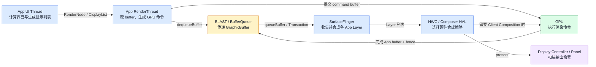
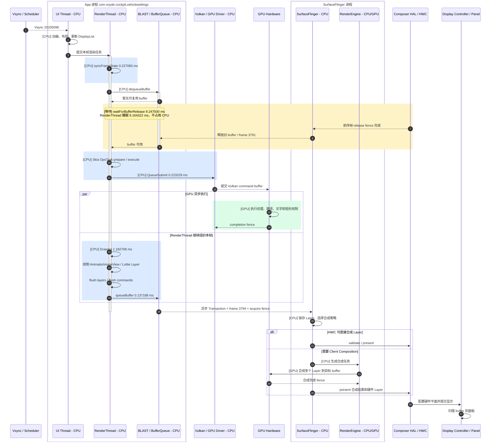
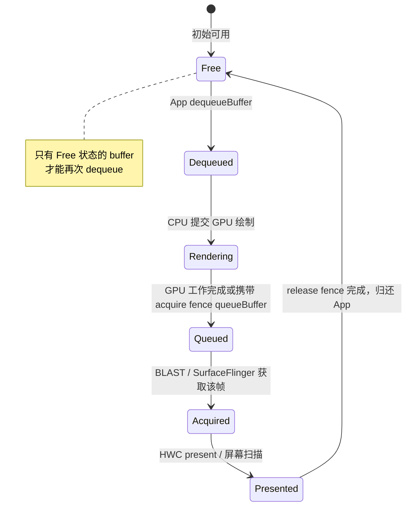
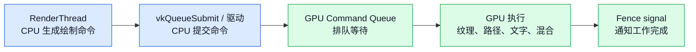
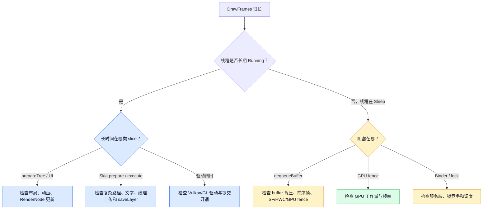

+++
date = '2026-07-17T16:00:00+08:00'
draft = false
title = '从 DrawFrames 到屏幕显示：用一条 Perfetto Trace 看懂 Android CPU、GPU 与 BufferQueue'
+++

本文用一条真实的 Perfetto Trace，解释 Android 应用的一帧是怎样从 `DrawFrames` 变成屏幕上的像素的。文章面向刚接触 Android 图形系统的读者，重点回答以下问题：

- `DrawFrames` 里的方法分别在做什么？
- 哪些代码运行在 CPU 上，哪些工作交给 GPU？
- App、SurfaceFlinger、HWC 和显示硬件之间是什么关系？
- 为什么一个 11.115 ms 的 `DrawFrames`，真正占用 CPU 的时间只有约 1.842 ms？
- 为什么 `dequeueBuffer` 很慢，却不一定代表 App 绘制很慢？

## 1. 本文分析的真实帧

数据来自 `20260717_094759_trace_1.perfetto` 中的：

```text
DrawFrames 20205096
```

目标帧的基本信息如下：

| 项目 | 值 |
|---|---|
| App 进程 | `com.voyah.cockpit.vehiclesettings`，PID 4270 |
| 执行线程 | `RenderThread`，TID 11120 |
| Vsync ID | `20205096` |
| Frame Number | `3794` |
| 绘制区域 | `3190 × 1626` |
| `DrawFrames` 墙钟耗时 | **11.115313 ms** |
| CPU 实际运行时间 | **1.842084 ms** |
| 睡眠等待时间 | **9.164322 ms** |
| Runnable 等待调度时间 | **0.108907 ms** |

先给出结论：

> 这一帧的主要耗时不是 CPU 绘制，也不能直接归因于 GPU；RenderThread 有 9 ms 以上在等待 BufferQueue 释放一个可用 buffer。真正的 CPU 运行时间只有约 1.842 ms。

## 2. 先建立正确的心智模型

初学者很容易把 Android 绘制理解成“App 调用 GPU，然后 GPU 把内容画到屏幕”。实际过程多了一条非常重要的缓冲区流水线：



这里要记住三件事：

1. **App 通常不直接画到屏幕**。App 画入一个 `GraphicBuffer`，再把 buffer 交给 SurfaceFlinger。
2. **CPU 提交 GPU 命令和 GPU 执行命令不是一回事**。`QueueSubmit` 是 CPU 侧提交；命令提交后，GPU 可以异步执行。
3. **屏幕显示不只涉及 GPU**。SurfaceFlinger 和 HWC 可能让显示控制器直接扫描某些 Layer；只有需要 Client Composition 时，SurfaceFlinger 才使用 GPU 合成这些 Layer。

## 3. 有哪些参与者

### 3.1 进程、线程和硬件

| 参与者 | 所在位置 | 本帧中的职责 | 主要运行位置 |
|---|---|---|---|
| UI Thread | App 进程 | 响应 Vsync、执行动画和布局、更新 RenderNode/DisplayList | CPU |
| RenderThread | App 进程 | 同步渲染状态、取得 buffer、让 Skia 生成 GPU 命令、提交最终 buffer | CPU |
| BLASTBufferQueue / BufferQueue 客户端 | App 图形栈及相关库 | 管理 App Surface 的 buffer 状态和 frame transaction | CPU + 内核同步机制 |
| `surfaceflinger` | SurfaceFlinger 系统进程 | 收集所有 Layer、锁存 buffer、决定本轮合成和显示内容 | CPU；必要时调用 GPU |
| Composer HAL / HWC | 实现依设备而异 | 判断 Layer 走硬件平面还是 Client Composition，执行 present | CPU 控制硬件 |
| GPU 驱动 | 内核及用户态驱动 | 接收 Vulkan/GL 命令、管理显存、同步和 fence | CPU 驱动代码 + GPU |
| GPU | 硬件 | 执行 Skia/Vulkan 生成的顶点、片元、纹理等命令 | GPU |
| Display Controller | 显示硬件 | 按 HWC 配置读取 buffer，并按时序扫描到屏幕 | 专用显示硬件，不是 GPU |
| Panel | 屏幕硬件 | 将扫描出的像素信号真正显示出来 | 显示硬件 |

`system_server` 中的 WindowManagerService、DisplayManagerService 负责窗口、Surface 和显示设备的生命周期管理，但正常情况下不会在每一帧的 App `DrawFrames` 热路径上执行全部工作。

### 3.2 HWC 是否一定是独立进程

不一定。HWC 是 Hardware Composer HAL 的概念和接口。根据 Android 版本及厂商实现，它可能通过 Binder 与独立的 Composer HAL 服务交互，也可能表现为 SurfaceFlinger 调用相关库。分析 Perfetto 时应以设备实际出现的进程和线程为准，不要把“HWC”机械地等同于某一个固定进程名。

### 3.3 BufferQueue 的生产者和消费者

对 App 的 Surface 来说，可以先用下面的简化模型理解：

- **生产者 Producer**：App RenderThread，通过 `dequeueBuffer` 取得 buffer，绘制后通过 `queueBuffer` 交还。
- **消费者 Consumer**：现代 Android 通常通过 BLASTBufferQueue 把新 buffer 组织成 SurfaceControl Transaction，最终由 SurfaceFlinger 锁存和显示。

在现代 BLAST 架构下，回调和 buffer 获取可能发生在 App 侧 BLAST 代码中，因此看到 `BLAST Consumer` 不等于“这段代码一定运行在 SurfaceFlinger 进程”。判断执行位置必须同时查看 Perfetto 的进程和线程轨道。

## 4. 一帧从哪里开始

严格来说，`DrawFrames` 不是一帧的最早起点。它前面还有 Vsync 和 UI Thread 阶段：

1. 屏幕刷新节奏产生 Vsync。
2. App 收到对应的 frame callback。
3. UI Thread 执行动画、输入处理、布局和绘制遍历。
4. UI Thread 更新 RenderNode 和 DisplayList，并把渲染任务交给 RenderThread。
5. RenderThread 进入本文看到的 `DrawFrames 20205096`。

本文 trace 中目标 slice 位于 RenderThread，所以 11.115313 ms **不等于整帧从 Vsync 到上屏的总延迟**，也不包含 SurfaceFlinger 后续合成和面板扫描的全部时间。

## 5. 目标帧的完整时序

下面的时序图同时展示了目标 `DrawFrames` 内部的真实耗时，以及 buffer 离开 App 以后通常还会发生的流程。



图中 `HWC → SurfaceFlinger → BLAST` 的 release 路径是帮助初学者理解所有权归还的逻辑简图。实际设备上，release fence、Transaction 回调和 BufferQueue 状态更新可能通过 Binder、共享内存、内核 sync fence 及 App 侧 BLAST 回调共同完成。

## 6. `DrawFrames 20205096` 逐步拆解

### 6.1 一级步骤

下表按真实执行顺序排列。总耗时是 Perfetto slice 的墙钟时间；自身耗时是扣除直接子 slice 后的时间。

| 步骤 | 调用次数 | 总耗时 | 自身耗时 | 占 `DrawFrames` | 在哪里做 |
|---|---:|---:|---:|---:|---|
| `query` | 3 | 0.005053 ms | 0.003803 ms | 0.05% | CPU |
| `syncFrameState` | 1 | 0.227083 ms | 0.005103 ms | 2.04% | CPU |
| `dequeueBuffer - ...BLAST Consumer` | 1 | 0.000521 ms | 0.000521 ms | <0.01% | CPU 打点 |
| `dequeueBuffer` | 1 | **9.255677 ms** | 0.005885 ms | **83.27%** | CPU 发起，随后睡眠等待 |
| `Trace HWC release fence` | 1 | 0.006979 ms | 0.006979 ms | 0.06% | CPU 记录 fence |
| `OpsTask::onPrepare` | 3 | 0.001979 ms | 0.001979 ms | 0.02% | CPU |
| `OpsTask::onExecute` | 3 | 0.076146 ms | 0.076146 ms | 0.69% | CPU 生成/编码 GPU 命令 |
| `QueueSubmit` | 1 | 0.223229 ms | 0.223229 ms | 2.01% | CPU 调用 Vulkan 驱动 |
| `Drawing 0,0–3190,1626` | 1 | **1.182708 ms** | 0.306509 ms | **10.64%** | CPU 组织绘制并提交 GPU 工作 |
| 未被子 slice 覆盖的间隙 | — | 0.135938 ms | — | 1.22% | CPU 代码、调度边界或未打点逻辑 |

这些一级子项合计 10.979375 ms，再加上 0.135938 ms 未打点间隙，等于 `DrawFrames` 的 11.115313 ms。

### 6.2 `query`：查询 Surface 状态

三个一级 `query` 分别耗时：

```text
0.002448 ms
0.001615 ms
0.000990 ms
```

它们代表渲染管线向 Surface/NativeWindow 查询状态。因为 trace 名称没有记录 query opcode，不能仅凭 `query` 判断是在查询宽高、格式、变换还是其他属性。它们总共只有 0.005053 ms，不是性能问题。

### 6.3 `syncFrameState`：把 UI 状态同步给 RenderThread

`syncFrameState` 总耗时 **0.227083 ms**，其中：

| 子方法 | 耗时 | 作用 |
|---|---:|---|
| `prepareTree` | 0.221980 ms | 遍历 RenderNode 树、同步属性、处理动画和 Layer 更新 |
| `syncFrameState` 自身 | 0.005103 ms | 同步流程的其他控制逻辑 |

Android HWUI 采用 UI Thread 与 RenderThread 分工：UI Thread 描述“画什么”，RenderThread 决定怎样把这些描述转换为实际 GPU 工作。`prepareTree` 就是两者状态交接的重要阶段。

### 6.4 `dequeueBuffer`：为什么等待了 9.25 ms

RenderThread 在画一帧之前，必须先取得一个可以写入的 GraphicBuffer。调用关系如下：

| 调用层级 | 总耗时 | 自身耗时 | 说明 |
|---|---:|---:|---|
| `dequeueBuffer` | **9.255677 ms** | 0.005885 ms | 请求一个可写 buffer |
| └ `waitForBufferRelease` | **9.247500 ms** | **9.216458 ms** | 没有空闲 buffer，等待旧 buffer 被释放 |
| 　 └ `releaseBufferCallback frame=3791` | 0.031042 ms | 0.001407 ms | 收到旧 buffer 的释放回调 |
| 　　 └ `releaseBufferCallbackLocked` | 0.029635 ms | 0.004374 ms | 持锁更新 BufferQueue 状态 |
| 　　　 └ `releaseBuffer frame=3791` | 0.025261 ms | 0.008386 ms | 释放 frame 3791 使用的 buffer |
| 　　　　 ├ `wait` ×2 | 0.003646 ms | 0.003646 ms | 检查或等待同步 fence |
| 　　　　 └ `releaseBuffer` | 0.013229 ms | 0.012708 ms | 将 buffer 放回可用集合 |
| └ `addAndGetFrameTimestamps` | 0.001771 ms | 0.001771 ms | 更新并查询帧时间戳 |

这段时间不是在循环消耗 CPU。线程调度状态证明：RenderThread 在目标 `DrawFrames` 中有 **9.164322 ms 处于可中断睡眠状态 `S`**。

#### Buffer 为什么会不够用

可以把 BufferQueue 想象成餐厅里的有限餐盘：



如果已有 buffer 分别处在 GPU 渲染、SurfaceFlinger 持有、HWC 显示或等待 release fence 的状态，App 就没有空闲 buffer 可取，只能睡眠。常见原因包括：

- 前序帧 GPU 执行时间过长；
- SurfaceFlinger 没有及时锁存或合成；
- HWC/显示控制器尚未释放正在扫描的 buffer；
- App 生产帧的速度短时间内超过显示消费速度；
- BufferQueue 可用 buffer 数量或最大 acquired 数量受限；
- release fence 较晚才 signal；
- SurfaceFlinger、Composer HAL 或相关线程发生调度延迟。

本帧能够确定的是“等待 frame 3791 释放后才取得 buffer”。只分析 App 的 `DrawFrames` 子树，还不能唯一确定 frame 3791 为什么释放得晚；需要继续关联 SurfaceFlinger、HWC、GPU 和 fence 轨道。

### 6.5 Skia `onPrepare` 与 `onExecute`

HWUI 使用 Skia Ganesh GPU 后端。可以把它理解成两个阶段：

- `OpsTask::onPrepare`：CPU 准备纹理、顶点数据、pipeline 和资源引用。
- `OpsTask::onExecute`：CPU 把 Skia 的绘制操作编码成 Vulkan command buffer。

这里的 `onExecute` 仍主要是 **CPU 在生成 GPU 指令**，不是 GPU 已经花同样长的时间完成了绘制。

三个一级 `onExecute` 分别耗时 0.044531、0.018646 和 0.012969 ms，合计 0.076146 ms；三个一级 `onPrepare` 合计只有 0.001979 ms。

### 6.6 `QueueSubmit`：CPU 把工作交给 GPU

一级 `QueueSubmit` 耗时 **0.223229 ms**。它表示 CPU 进入 Vulkan/用户态驱动并提交 command buffer 的时间。



因此不能把 0.223229 ms 当作 GPU 执行时间。GPU 可能在 `QueueSubmit` 返回后继续运行，并通过 fence 与 CPU、BufferQueue 和 SurfaceFlinger 同步。

### 6.7 `Drawing`：真正组织本帧内容

`Drawing 0.00 0.00 3190.00 1626.00` 总耗时 **1.182708 ms**，内部如下：

| 子步骤 | 总耗时 | 自身耗时 | 作用 |
|---|---:|---:|---|
| 第一个 `drawLayer [AnimatorImageView]` | 0.187136 ms | 0.064219 ms | 绘制第一个 51×51 动画图层 |
| ├ `VectorDrawable repaint` | 0.082604 ms | 0.082604 ms | 重新栅格化矢量图 |
| └ `Texture upload` | 0.040313 ms | 0.040313 ms | 上传为 GPU 纹理 |
| 第二个 `drawLayer [AnimatorImageView]` | 0.070416 ms | 0.021562 ms | 绘制第二个 51×51 动画图层 |
| ├ `VectorDrawable repaint` | 0.040625 ms | 0.040625 ms | 重新生成矢量图内容 |
| └ `Texture upload` | 0.008229 ms | 0.008229 ms | 上传纹理 |
| `drawLayer [LottieAnimationView]` | 0.042240 ms | 0.042240 ms | 绘制 42×42 Lottie 图层 |
| `flush layers` | 0.231146 ms | 0.085468 ms | 刷新离屏 Layer 的 GPU 操作 |
| `alpha caused saveLayer` | 0.000729 ms | 0.000729 ms | 因整体透明度创建临时离屏 Layer |
| `flush commands` | 0.192865 ms | 0.001354 ms | 完成最终一批 Vulkan 命令 |
| `frameTimelineInfo` | 0.004480 ms | 0.001251 ms | 给 frame 3794 设置 Vsync ID 20205096 |
| `setSurfaceDamage` | 0.001197 ms | 0.001197 ms | 告诉消费者本帧哪些区域发生变化 |
| `queueBuffer` | 0.137188 ms | 0.021095 ms | 把完成的 buffer 交给 BLAST/BufferQueue |
| `reportMetricsWithPresentTime` | 0.003802 ms | 0.002917 ms | 更新帧展示时间与渲染指标 |
| `dumpingMemoryStatistics` | 0.005000 ms | 0.005000 ms | 执行渲染内存统计相关逻辑 |

`Drawing` 自身未由更深子 slice 覆盖的部分为 0.306509 ms，包括遍历、状态切换和其他未单独打点的渲染逻辑。

### 6.8 常见 Skia GPU 操作名

本帧中可以看到以下 Skia Ganesh 操作：

| 操作名 | 次数 | slice 合计时间 | 作用 |
|---|---:|---:|---|
| `FillRectOp` | 10 | 0.046875 ms | 填充普通矩形 |
| `TextureOp` | 10 | 0.041717 ms | 绘制或采样纹理 |
| `CircularRRectOp` | 6 | 0.032916 ms | 绘制圆形或圆角矩形 |
| `AtlasTextOp` | 8 | 0.027500 ms | 从字形 atlas 绘制文字 |
| `PathStencilCoverOp` | 2 | 0.017604 ms | 使用 stencil-and-cover 绘制路径 |
| `FillRRectOp` | 4 | 0.013282 ms | 填充圆角矩形 |
| `DrawAtlasPathOp` | 2 | 0.008542 ms | 使用 atlas 中缓存的数据绘制路径 |

这些 slice 表示 CPU 侧准备或编码对应 GPU 操作的范围，不应直接解释成 GPU 硬件执行耗时。

### 6.9 `flush layers` 与 `flush commands`

`flush layers` 总耗时 0.231146 ms，主要包含：

| 内部操作 | 次数 | 合计耗时 |
|---|---:|---:|
| `OpsTask::onPrepare` | 4 | 0.025990 ms |
| `OpsTask::onExecute` | 4 | 0.106667 ms |
| `QueueSubmit` | 1 | 0.013021 ms |

`flush commands` 总耗时 0.192865 ms，其中 `Vulkan finish frame` 为 0.191511 ms：

| 内部操作 | 耗时 |
|---|---:|
| `OpsTask::onPrepare` | 0.037448 ms |
| `OpsTask::onExecute` | 0.098698 ms |
| `QueueSubmit` | 0.011146 ms |
| 其他控制和未单独打点逻辑 | 0.044219 ms |

这说明最终命令刷新本身很轻，不是 11 ms 的主要来源。

### 6.10 最终 `queueBuffer`

绘制完成后，App 必须把 buffer 交出去：

| 调用 | 耗时 | 作用 |
|---|---:|---|
| 外层 `queueBuffer` | 0.137188 ms | App/NativeWindow 提交 buffer |
| `applyGrallocMetadataLocked` | 0.009896 ms | 写入 gralloc metadata，如色彩空间等 |
| 内层 `queueBuffer` | 0.100416 ms | 更新 BufferQueue/BLAST 状态 |
| ├ `addAndGetFrameTimestamps` | 0.018854 ms | 更新并读取 frame timestamp |
| └ `onFrameAvailable` | 0.072187 ms | 通知 BLAST 有新帧到达 |
| 　 ├ `acquireBuffer` | 0.003489 ms | 获取新到达的 buffer |
| 　 └ `acquireNextBufferLocked frame=3794` | 0.064739 ms | 选取 frame 3794 |
| `Trace GPU completion fence` | 0.005781 ms | 记录 GPU completion fence |

`frameTimelineInfo` 把 `frameNumber=3794` 和 `vsyncId=20205096` 关联起来。这个 Vsync ID 是跨 App、SurfaceFlinger 和 FrameTimeline 分析同一帧的重要钥匙。

## 7. buffer 离开 App 后发生什么

App 的 `DrawFrames` 在 `queueBuffer` 后接近结束，但一帧还没有真正显示：

1. BLASTBufferQueue 将新 buffer 和 SurfaceControl 状态组织成 Transaction。
2. Transaction 异步发送给 SurfaceFlinger。
3. SurfaceFlinger 在合适的 Vsync 周期锁存新 buffer。
4. SurfaceFlinger 收集屏幕上所有可见 Layer。
5. HWC `validate` 判断每个 Layer 的合成方式：
   - Device Composition：显示硬件平面直接处理；
   - Client Composition：SurfaceFlinger 通过 RenderEngine/GPU 合成；
   - 设备还可能支持 Cursor、Solid Color 等其他类型。
6. SurfaceFlinger/HWC 调用 `present`。
7. Display Controller 按扫描时序读取最终 buffer。
8. 面板显示像素。
9. 旧 buffer 不再被显示硬件使用后，release fence signal，buffer 才能重新回到 App。

这也解释了本例为什么会出现循环依赖感：当前帧 3794 想开始绘制，却必须先等前面的 frame 3791 释放其 buffer。

## 8. 哪些是 CPU，哪些是 GPU

### 8.1 明确运行在 CPU 上的工作

- UI Thread 的动画、布局和 DisplayList 构建；
- RenderThread 的 `syncFrameState`、`prepareTree`；
- `dequeueBuffer` 和 `queueBuffer` 的控制逻辑；
- Skia `onPrepare`、`onExecute` 的大部分命令构建工作；
- Vulkan API 和用户态驱动的命令提交部分；
- SurfaceFlinger 的 Layer 遍历、锁存和合成策略选择；
- HWC HAL 的策略和硬件配置代码；
- Binder、BufferQueue 状态管理以及 fence 管理代码。

### 8.2 明确运行在 GPU 上的工作

- 执行 Vulkan/GL command buffer；
- 纹理采样与缩放；
- 路径、矩形、圆角和文字的实际栅格化；
- alpha blending；
- SurfaceFlinger 选择 Client Composition 时的多 Layer 合成。

### 8.3 不属于 CPU 或 GPU 通用计算的部分

- Display Controller 扫描 buffer；
- 硬件 overlay/plane 合成；
- 屏幕面板刷新；
- 某些 DMA、内存控制器及显示处理单元的工作。

### 8.4 “等待 GPU”时 CPU 在做什么

CPU 线程等待 fence 时通常会睡眠，不会持续占用一个 CPU 核。Perfetto 中如果一个长 slice 对应线程状态 `S`，说明它大部分时间在阻塞等待；如果对应 `Running`，才表示确实在 CPU 上执行。

本例正是如此：`dequeueBuffer` 的 9.255677 ms 中，绝大部分是睡眠等待 buffer，而不是 CPU 忙了 9 ms。

## 9. 如何正确阅读 Perfetto 中的耗时

### 9.1 墙钟时间不等于 CPU 时间

一个 slice 从开始到结束的时间包括：

```text
墙钟时间 = CPU Running + Runnable 排队 + Sleep/Blocked 等待
```

本帧恰好满足：

```text
11.115313 ms
= 1.842084 ms Running
+ 0.108907 ms Runnable
+ 9.164322 ms Sleeping
```

### 9.2 父子 slice 不能相加

`dequeueBuffer` 的 9.255677 ms 已经包含 `waitForBufferRelease` 的 9.247500 ms。如果把二者相加，会重复计算。

同理，`Drawing` 已经包含 `drawLayer`、`flush commands` 和 `queueBuffer`。分析时应区分：

- **Inclusive/总耗时**：包括子方法；
- **Self/自身耗时**：扣除直接子方法。

### 9.3 CPU 提交时间不等于 GPU 执行时间

`QueueSubmit` 只说明 CPU 花多长时间把工作交给驱动。要判断 GPU 是否慢，需要查看：

- GPU queue/slice 轨道；
- GPU completion fence；
- Vulkan/GL driver events；
- FrameTimeline 中 App 和 SurfaceFlinger 的 deadline；
- 是否存在 HWC release fence 延迟。

## 10. 这一帧应该怎样继续定位

目前已经确定直接瓶颈为 `waitForBufferRelease`，下一步应该沿着“谁迟迟没有归还 buffer”继续排查，而不是优先优化 51×51 的 VectorDrawable。

建议按以下顺序关联 Perfetto：

1. 用 `vsyncId=20205096` 找到 App FrameTimeline 和 SurfaceFlinger FrameTimeline。
2. 查看 frame 3791、3792、3793 的 GPU completion 与 present/release fence。
3. 查看 SurfaceFlinger 主线程、RenderEngine 和相关 Binder 线程是否发生调度延迟。
4. 查看 Composer HAL/HWC 轨道是否有较长的 `validate`、`present` 或 fence 等待。
5. 查看 GPU 是否在前序帧上长时间繁忙。
6. 检查 BufferQueue 中 dequeued、queued、acquired buffer 数量是否触顶。
7. 对照屏幕刷新周期判断 buffer 释放是否只是正常跨 Vsync，还是已经错过 deadline。

可以用下面的判断树快速分类：



## 11. 本例最终结论

1. `DrawFrames 20205096` 墙钟耗时为 **11.115313 ms**。
2. RenderThread 实际在 CPU 上运行约 **1.842084 ms**，CPU 工作量并不重。
3. 最大耗时是 `dequeueBuffer` 的 **9.255677 ms**，其中 `waitForBufferRelease` 为 **9.247500 ms**。
4. RenderThread 有 **9.164322 ms** 处于睡眠，说明它在等 buffer，而不是忙于计算。
5. 真正的 `Drawing` 只有 **1.182708 ms**；Skia 准备、纹理上传、图层绘制和提交都比较轻。
6. `QueueSubmit` 是 CPU 提交 GPU 命令的时间，不能当成 GPU 执行时间。
7. App `queueBuffer` 后，SurfaceFlinger、HWC、Display Controller 仍需完成锁存、合成、present 和扫描，像素才真正出现在屏幕上。
8. 后续应重点追踪 frame 3791 的 release 路径，以及 SurfaceFlinger、HWC 和 GPU fence，而不是先优化 App 的绘制指令。

理解这一帧最关键的一句话是：

> Android 图形性能问题不只是“CPU 画得慢”或“GPU 跑得慢”；很多卡顿发生在 App、BufferQueue、SurfaceFlinger、HWC 和显示硬件组成的生产者—消费者流水线中。
