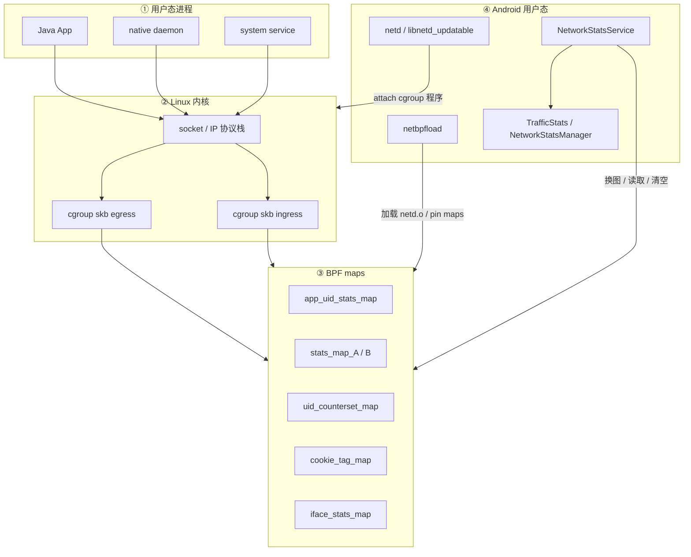
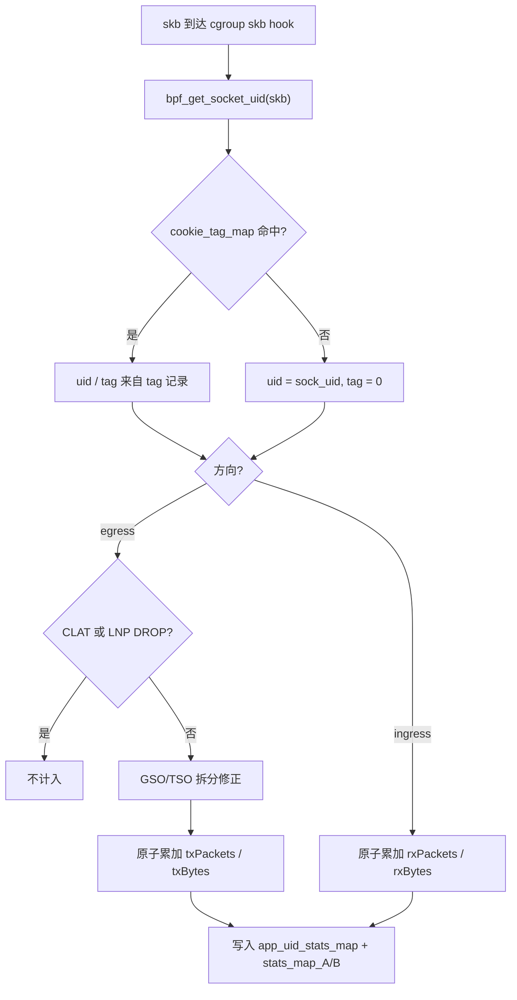
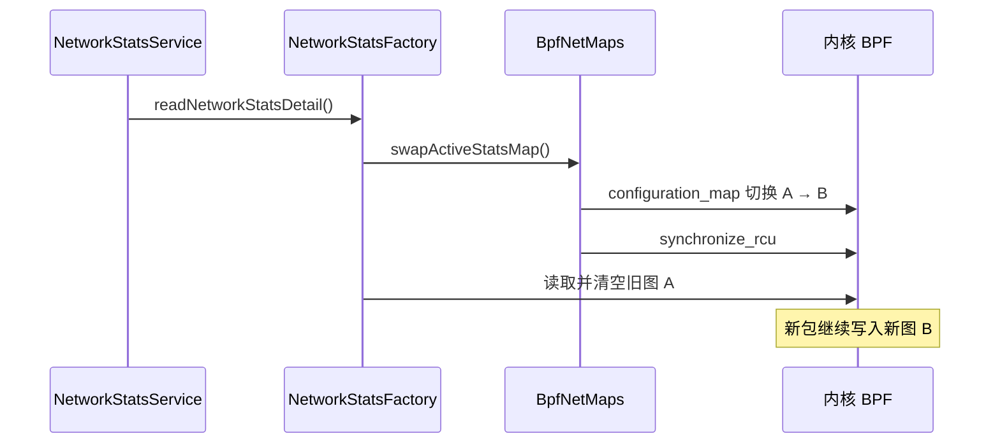
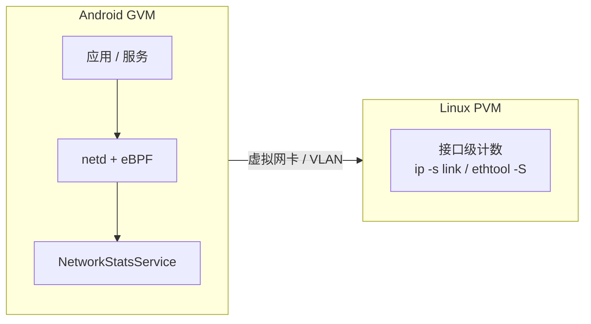

+++
date = '2026-11-11T17:40:00+08:00'
draft = false
title = 'Android 16 网络流量计量：eBPF 计费机制与平台落地'
weight = 10
+++

Android 16 的流量计量已经完全不依赖 iptables 或 `/proc/net/xt_qtaguid`，而是由 **cgroup v2 + eBPF** 在内核 socket/IP 层完成逐包归属，再由 `netd` 与 `NetworkStatsService` 换图读取、按时间桶持久化，最终通过 `TrafficStats`、`NetworkStatsManager` 和 `dumpsys netstats` 对外提供数据。

本文以 Android 16（25Q4，API 36）源码基线为主，说明这套机制的挂载点、统计维度、数据通路、权限模型和常见坑，并在最后一节给出平台侧的落地与验证方法。

---

## 0. 摘要（TL;DR）

- Android 16 的流量计量不是 iptables 规则计数，也不是旧的 `/proc/net/xt_qtaguid`，而是 **cgroup v2 + eBPF**。
- 内核在 cgroup 的 IP 出入口挂两个 `BPF_PROG_TYPE_CGROUP_SKB` 程序；每个 skb 经过时，按 **socket 的 UID** 把 `{rx/tx bytes, packets}` 累加到 BPF hash map。
- 统计维度是 **UID + 接口 + tag + counterSet（前台/后台）+ 方向**；**没有 PID**，所以能到「应用/UID」，不能直接到「进程」。
- 用户态由 **netbpfload/netd + NetworkStatsService** 完成加载、挂载、换图、读取、2 小时桶持久化；对外暴露 `TrafficStats`、`NetworkStatsManager`、`dumpsys netstats`。
- 关键设计是 **A/B 双缓冲 + `synchronize_rcu`**：读旧图、写新图，避免清图时丢包。

---

## 1. 背景与演进

### 1.1 为什么需要内核级计量

应用层无法可靠统计流量：进程可能崩溃、绕过 Java 层、使用 native socket、共享 socket、或通过代理转发。Android 需要在**内核 socket/IP 层**对每个包做归属判定，才能覆盖 Java 应用、native daemon、系统服务，并支撑流量套餐、后台限制、流量看板等能力。

### 1.2 从 qtaguid 到 eBPF

| 代际 | 机制 | 位置 | 主要问题 |
|---|---|---|---|
| Android 8 及以前 | `xt_qtaguid` 内核模块 | `/proc/net/xt_qtaguid/stats` | 需要按 UID 打标签；规则遍历开销；维护困难 |
| Android 9 | `xt_qtaguid` + eBPF 过渡 | 内核模块 | 两套并存 |
| Android 10+ | **eBPF cgroup skb** | `BPF_CGROUP_INET_INGRESS/EGRESS` | 需要内核 BPF/cgroup 支持；但 O(1)、可扩展、支持 tag |
| Android 16 | eBPF + **mainline Connectivity APEX** | `com.android.tethering` APEX 内的 `netd.o` / `service-connectivity.jar` | 模块可独立更新；`netbpfload` 负责加载 |

Android 16 中：

- eBPF 程序对象 `netd.o` 打包在 `com.android.tethering` APEX 的 `etc/bpf/mainline/`；
- `netbpfload`（APEX 内）负责加载并 pin maps；
- `netd` 通过 `libnetd_updatable` 把 cgroup 程序挂到 `/sys/fs/cgroup`；
- `NetworkStatsService` 代码在 APEX 的 `service-connectivity.jar` 中，由 `SystemServer` 启动。

---

## 2. 总体架构



四层职责：

| 层 | 组件 | 职责 |
|---|---|---|
| ① 用户态进程 | Java App / native daemon / system service | 创建 socket、收发数据；不感知计费 |
| ② Linux 内核 | socket 层、IP 协议栈、cgroup skb hooks | 每包触发 `bpf_traffic_account()`，按 socket UID 归属 |
| ③ BPF maps | `app_uid_stats_map`、`stats_map_A/B`、`uid_counterset_map`、`cookie_tag_map`、`iface_stats_map` | 在内核与用户态之间传递统计结果 |
| ④ Android 用户态 | bpfloader/netbpfload、netd、NetworkStatsService、API | 加载/挂载、换图读取、持久化、对外提供 API |

---

## 3. 内核侧实现

### 3.1 挂载点：cgroup v2 + cgroup skb 程序

netd 启动时把两个 `BPF_PROG_TYPE_CGROUP_SKB` 程序挂到 cgroup v2 根目录 `/sys/fs/cgroup`：

- `BPF_CGROUP_INET_EGRESS`：本机发出的包；
- `BPF_CGROUP_INET_INGRESS`：进入本机的包。

关键代码：

| 动作 | 位置 |
|---|---|
| netd 启动时初始化 BPF | `system/netd/server/main.cpp:143-147` |
| 加载 `libnetd_updatable`，失败直接 `ALOGE` 后退出 | `Connectivity/bpf/netd/NetdUpdatable.cpp:25-32`；`main.cpp:143-147` |
| 把程序 attach 到 cgroup | `Connectivity/bpf/netd/BpfHandler.cpp:116-117` |
| 程序定义（25Q2+ / 5.10+ ingress） | `Connectivity/bpf/progs/netd.c:611-614` |
| 程序定义（25Q2+ / 5.10+ egress） | `Connectivity/bpf/progs/netd.c:652-655` |

> 因为挂在**根 cgroup**上，所有进程（Java、native、system）的 socket 都被覆盖，不需要逐应用挂载。netd 在 BPF 初始化失败时会直接退出，所以「设备能正常启动」本身就说明 cgroup BPF 计费已经挂上。

### 3.2 如何拿到 UID：socket 的 `sk_uid`

每个 `struct sock` 在创建时记录创建者的 UID（`sk_uid`）。BPF 程序用 helper 读取：

```c
// netd.c:524
uint32_t sock_uid = bpf_get_socket_uid(skb);
```

如果 socket 被业务打过 tag，则优先使用 tag 中的 UID：

```c
// netd.c:534-541
uint64_t cookie = bpf_get_socket_cookie(skb);   // 0 iff !skb->sk
UidTagValue* utag = bpf_cookie_tag_map_lookup_elem(&cookie);
uint32_t uid, tag;
if (utag) {
    uid = utag->uid;
    tag = utag->tag;
} else {
    uid = sock_uid;
    tag = 0;
}
```

两个特殊处理：

| 场景 | 代码 | 行为 |
|---|---|---|
| `skb->sk == NULL`（典型是入向未连接 UDP 的早期阶段） | `netd.c:524-531` | helper 返回 overflow UID 65534 → 代码归到 `0`（root） |
| DNS 解析流量 | `netd.c:554-559` | `tag == TAG_SYSTEM_DNS && uid == AID_DNS` 时把 `uid` 换成 `sock_uid`，归到请求方 |
| CLAT（464xlat）egress | `netd.c:549` | 直接 `return PASS`，不重复计费；只计堆叠接口的 IPv4 |

**关键结论**：UID 是「这个包所属 socket 的归属 UID」，不是「当前调用 `send()` 的进程 UID」。进程自己创建 socket → 归进程 UID；别人把 socket fd 传给你用 → 仍归 socket 创建者/标签 UID。

### 3.3 统计 key / value 与 map



统计 key/value 定义（`Connectivity/bpf/progs/netd.h:43-57`）：

```c
typedef struct {
    uint32_t uid;
    uint32_t tag;
    uint32_t counterSet;   // 0 = default, 1 = foreground
    uint32_t ifaceIndex;   // skb->ifindex
} StatsKey;

typedef struct {
    uint64_t rxPackets;
    uint64_t rxBytes;
    uint64_t txPackets;
    uint64_t txBytes;
} StatsValue;
```

相关 map（`netd.c:70-76`，`netd.h:98`）：

| Map | 类型 | Key → Value | 容量 | 作用 |
|---|---|---|---|---|
| `app_uid_stats_map` | HASH | `uid` → `StatsValue` | 10000 | **UID 累计**，自开机只增不清，供 `TrafficStats` 实时读 |
| `stats_map_A` / `stats_map_B` | HASH | `StatsKey` → `StatsValue` | 各 5000 | **明细**，双缓冲；读旧图后清空，供 `NetworkStatsService` 生成历史 |
| `uid_counterset_map` | HASH | `uid` → `uint8` | 4000 | 前台/后台标记（`counterSet`） |
| `cookie_tag_map` | HASH | socket cookie → `{uid, tag}` | 10000 | 业务 socket tag 覆盖 |
| `iface_stats_map` | HASH | `ifindex` → `StatsValue` | 1000 | 接口累计 |

`StatsKey` 的组装（`netd.c:571-576`）：

```c
StatsKey key = {.uid = uid, .tag = tag, .counterSet = 0, .ifaceIndex = skb->ifindex};
uint8_t* counterSet = bpf_uid_counterset_map_lookup_elem(&uid);
if (counterSet) key.counterSet = (uint32_t)*counterSet;
```

### 3.4 每包累加与 GSO 修正

`netd.c:582-583` 依次调用 `update_stats_with_config()` 和 `update_app_uid_stats_map()`；前者根据当前 active map 写 A 或 B。累加函数由 `DEFINE_UPDATE_STATS` 宏生成（`netd.c:174-218`），核心是两条原子加：

- egress → `txPackets/txBytes`；
- ingress → `rxPackets/rxBytes`。

字节不是简单 `skb->len`。对于 GSO/TSO 大包（5.4+ 的 `gso_segs > 1`，或老内核 `bytes > 1500`），代码按 MTU 1500 做近似拆分（`netd.c:189-214`）：

```text
overhead = IP 头 + (TCP 头 + 12 字节时间戳选项) 或 UDP 头
mss      = 1500 - overhead
payload  = skb->len - overhead
packets  = gso_segs（5.4+）或 ceil(payload / mss)
bytes    = overhead * packets + payload
```

这是**近似值**：目的是让一个 GSO 大包按「多个 MSS 段 + 每段协议头」记账，而不是只算 1 个包。

方向与丢弃语义：

| 场景 | 行为 | 依据 |
|---|---|---|
| ingress | 先累加，再返回 `match`；即使随后被 DROP，也已计入 | `netd.c:568-583` |
| egress 且 `match == DROP` | **不计入**，直接 return | `netd.c:568-569` |
| CLAT egress | 不计入 | `netd.c:549` |
| DNS | 归到请求方 UID | `netd.c:557-559` |

### 3.5 A/B 双缓冲与 RCU：为什么不会丢数



`stats_map_A/B` 不能边写边清，否则会丢包。Android 采用「写新图、读旧图」：

1. `NetworkStatsFactory.readNetworkStatsDetail()` 先请求换图（`NetworkStatsFactory.java:229-235`）；
2. `BpfNetMaps.swapActiveStatsMap()` 修改 `configuration_map`，把 active map 从 A 切到 B（`BpfNetMaps.java:838-865`）；
3. 调 `synchronize_rcu`，等所有 CPU 看到新配置；
4. 读并清空旧的 inactive map（`NetworkStatsFactory.java:248-260`、`BpfNetworkStats.cpp:254-285`）；
5. 下一次 poll 反向切换，读并清空另一个图。

这样内核始终写新图，用户态安全地读/清旧图。

### 3.6 counterSet、tag、iface

- **counterSet**：framework 通过 `NetworkStatsService.noteUidForeground()` 写 `uid_counterset_map`（`NetworkStatsService.java:1976-2009`）；`0=default`、`1=foreground`（`NetworkStats.java:96-98`）。用于区分前台/后台流量。
- **tag**：业务可通过 `TrafficStats`（Java）或 netd 的 socket tag 接口把流量归到指定 UID/tag。`BpfHandler::tagSocket()` 用 `SO_COOKIE` 取 socket cookie，写入 `cookie_tag_map`（`BpfHandler.cpp:347-448`，写入在 `:442-443`）。限制：
  - 单 UID tagged 条目上限 500；
  - 总 tagged 条目上限为 stats map 的 90%；
  - 超限会拒绝 tag 请求（`EMFILE`），防止 map 被填满导致计费绕过（`BpfHandler.cpp:48-55`）。
- **iface**：key 里的 `ifaceIndex` 来自 `skb->ifindex`；`stats_map_A/B` 可按接口拆，`app_uid_stats_map` 不按接口拆、只按 UID 聚合。

---

## 4. 用户态实现

### 4.1 加载与挂载

| 组件 | 位置 | 职责 |
|---|---|---|
| `netbpfload` / `bpfloader` | APEX `com.android.tethering/bin/netbpfload` | 加载 `netd.o`，pin maps 到 `/sys/fs/bpf/netd_shared/` |
| `netd` | `system/bin/netd` | 通过 `libnetd_updatable` 把 cgroup 程序 attach 到 `/sys/fs/cgroup`；失败则退出 |
| `libnetd_updatable` | APEX `lib64/libnetd_updatable.so` | `BpfHandler::init()`、`tagSocket()`、`untagSocket()` |

map 路径（`NetworkStatsService.java:271-282`）：

```text
/sys/fs/bpf/netd_shared/map_netd_app_uid_stats_map
/sys/fs/bpf/netd_shared/map_netd_stats_map_A
/sys/fs/bpf/netd_shared/map_netd_stats_map_B
/sys/fs/bpf/netd_shared/map_netd_iface_stats_map
/sys/fs/bpf/netd_shared/map_netd_uid_counterset_map
```

### 4.2 NetworkStatsService

`NetworkStatsService` 代码在 `com.android.tethering` APEX 的 `service-connectivity.jar`，由 `SystemServer` 启动（`SystemServer.java:2196-2200`；`NetworkStatsServiceInitializer.java:48-53`）。

| 能力 | 实现 | 依据 |
|---|---|---|
| 定时轮询 | `AlarmManager` 每 **30 min** 触发 `ACTION_NETWORK_STATS_POLL` | `NetworkStatsService.java:1094-1101`、`:3570-3576` |
| 按需 poll | 打开统计 session 时默认 `FLAG_POLL_ON_OPEN`；非 system UID 15 s 限速，system UID 不限速 | `:1602-1613`、`:1581-1587`、`:473` |
| 读明细 | 换图 → `synchronize_rcu` → 读/清旧图 | `NetworkStatsFactory.java:229-260` |
| 实时 UID | `getUidStats(uid)` 直接读 `app_uid_stats_map`，不换图/不清零 | `NetworkStatsService.java:2136-2142` |
| 历史桶 | xt 1 h；UID 2 h、Tag 2 h；UID 持久 15 天/删除 90 天；Tag 5 天/15 天 | `:3594-3604` |
| 全 UID 聚合 | `getNetworkStatsUidDetail(UID_ALL, ...)` | `:3292-3294` |

> 注意：`NetworkStatsManager` 的历史查询是 **2 小时桶**，文档明确「bucket 在小时级，不能做细粒度计量」。如果需要分钟级历史，必须自己在 system UID 侧采样 `app_uid_stats_map` 并落库。

### 4.3 API 层

| API | 粒度 | 典型用途 | 权限/限制 |
|---|---|---|---|
| `TrafficStats.getUidRxBytes/TxBytes` | UID 实时累计（since boot） | 自己 UID；system UID 可读全部 | 非 system 调其他 UID 返回 `UNSUPPORTED`（服务端只放行 system/self，`NetworkStatsService.java:2136-2142`） |
| `TrafficStats.getTotalRxBytes` | 接口总量 | 设备总流量 | 读 `iface_stats_map` |
| `NetworkStatsManager.queryDetailsForUid` | UID + 时间桶 | 历史用量 | `PACKAGE_USAGE_STATS` 或 `READ_NETWORK_USAGE_HISTORY`；同用户/全部用户取决于 access level |
| `NetworkStatsManager.querySummary` | 设备/UID 汇总 | 概览 | 同上 |
| `dumpsys netstats` | 原始 map + 历史 | 诊断 | `DUMP` 权限 |

`NetworkStatsManager` 的公开 `networkType` 重载只支持 `TYPE_MOBILE/TYPE_WIFI`；**Ethernet 会抛 `IllegalArgumentException`**（`NetworkStatsManager.java:1043-1068`）。Ethernet 场景必须用 `NetworkTemplate.buildTemplateEthernet()`（`NetworkTemplate.java:299`）走隐藏/`@SystemApi` 重载，或在平台内编译的 app 中调用。

---

## 5. 统计口径与维度

### 5.1 维度

| 维度 | 是否支持 | 说明 |
|---|---|---|
| UID | ✅ | 内核 key 的直接字段 |
| 接口 | ✅ | `ifaceIndex`；`stats_map_A/B` 可按接口拆 |
| tag | ✅ | 业务 socket tag；`cookie_tag_map` |
| counterSet | ✅ | 前台/后台 |
| 方向 | ✅ | ingress=rx，egress=tx |
| bytes / packets | ✅ | IP 层字节；包数按 GSO 段修正 |
| 时间桶 | ✅ | 2 h 桶；15/90 天保留 |
| 包名 | ❌（需派生） | UID→`PackageManager` 映射；共享 UID/多用户需处理 |
| PID/进程 | ❌ | key 无 PID；共享 UID 无法拆 |
| 协议/端口 | ❌ | 除非业务打 tag；内核 key 不含端口 |

### 5.2 计入 / 不计入

| 场景 | 是否计入 UID | 说明 |
|---|---|---|
| 公网/私网/同网段/VLAN | ✅ | 计费不按目的地址过滤 |
| IPv6 链路本地 | ✅ | 正常 IP 包 |
| 回环 IP（127.0.0.1/::1） | ⚠️ 通常计入 | UID 累计图通常包含；接口维度/历史是否包含 `lo` 需实机核对 |
| TCP/UDP 单播 | ✅ | 正常 |
| 组播 egress（mDNS/SSDP） | ✅ | 发送侧 socket UID 明确 |
| 组播 ingress | ⚠️ 可能归 root | `skb->sk` 可能为空 → overflow → 0 |
| ARP/LLDP/PAUSE/VLAN tag | ❌ | 不是 IP；接口计数器会算 |
| UNIX socket / binder / VSOCK | ❌ | 不是 IP |
| 转发/NAT/tethering | ❌（不计到源进程） | 没有本机 socket；tethering 由 NetworkStatsService 单独合并 |
| 硬件 offload / 交换机端口间转发 | ❌ | 不经过本机 IP 栈 |
| 被防火墙/LNP DROP 的 egress | ❌ | `netd.c:568-569` |
| 入向被 DROP 的包 | ✅（先计后丢） | `netd.c:568-583` |
| 共享 UID（root/system） | ⚠️ 只能汇总 | 需要独立 UID 或 per-PID eBPF |

### 5.3 字节口径

- 统计在 **IP 层**：包含 IP 头 + TCP/UDP 头 + payload；不包含以太网帧头/FCS（与 `ethtool -S` 的接口字节不能直接对账）。
- GSO 包按 MTU 1500 做**近似拆分**，补充每段协议头；因此与物理线缆字节存在小偏差。
- 重传会被重复计入（每个发出的包都算）。
- NAT/464xlat 由 `NetworkStatsService` 做调整；tethering 由 provider 合并。

### 5.4 Android 16 本地网络保护（LNP）

Android 16 的 netd BPF 程序已包含本地网络访问控制：

- `should_block_local_network_packets()`：`netd.c:262-305`；
- 计费路径调用：`netd.c:565`；
- system UID 豁免：`netd.c:265`（`uid % AID_USER_OFFSET < AID_APP_START`，即 UID < 10000）；
- 一旦置 `match = DROP`，egress 在累加前 return，**被拦的局域网发送流量不计入**（`netd.c:568-569`）；ingress 先累加再返回，仍会计入。

默认是否生效：

- `RESTRICT_LOCAL_NETWORK` 兼容性开关在源码中是 `@Disabled`（`ConnectivityCompatChanges.java:151-152`）；
- `PermissionMonitor.shouldEnforceLocalNetRestrictions()` 需要 `BpfNetMaps.isAtLeast25Q2() && CompatChanges.isChangeEnabled(RESTRICT_LOCAL_NETWORK, uid)`（`PermissionMonitor.java:250-253`）。

> 结论：默认配置下 LAN 流量正常计入；如果该 compat change 被显式开启，未授权 UID 的 LAN egress 会被 DROP 且不计入，ingress 仍计入。具体是否开启需在目标设备上核对（见 10.4）。

---

## 6. 权限模型

`NetworkStatsAccess` 的访问级别（`NetworkStatsAccess.java:56-118`）：

| Level | 授予对象 | 可访问范围 |
|---|---|---|
| `DEFAULT` | 所有应用 | 仅自己 UID |
| `USER` | Profile owner | 同用户全部 UID |
| `DEVICESUMMARY` | `PACKAGE_USAGE_STATS`（AppOps）或 `READ_NETWORK_USAGE_HISTORY` | 同用户全部 UID + 设备汇总 |
| `DEVICE` | system UID、device owner、carrier-privileged、NetworkStack | 全部 UID（含跨用户） |

相关权限：

| 权限 | protectionLevel | 说明 |
|---|---|---|
| `PACKAGE_USAGE_STATS` | `signature\|privileged\|development\|appop\|retailDemo` | AppOps `GET_USAGE_STATS`；priv-app 在 `privapp-permissions` 声明后，`MODE_DEFAULT` 回落到权限检查 |
| `READ_NETWORK_USAGE_HISTORY` | `signature\|privileged` | 直接拿到 `DEVICESUMMARY` 级别 |
| `DUMP` | `signature\|privileged\|development` | `dumpsys netstats` |

> 普通第三方应用不能读其他应用流量；需要用户授予「使用情况访问」，或者做成 platform 签名的 priv-app / system UID 组件。

---

## 7. 典型用法

### 7.1 Java：TrafficStats（实时、轻量）

```java
long rx = TrafficStats.getUidRxBytes(Process.myUid());
long tx = TrafficStats.getUidTxBytes(Process.myUid());
long rxp = TrafficStats.getUidRxPackets(Process.myUid());
long txp = TrafficStats.getUidTxPackets(Process.myUid());
```

- 读 `app_uid_stats_map`，不换图、不清零，开销小；
- 默认 1 s 客户端缓存（Android V+，`ENABLE_TRAFFICSTATS_RATE_LIMIT_CACHE`），采样间隔建议 ≥1 s；
- 非 system UID 读别人返回 `UNSUPPORTED`；system UID 可读全部。

### 7.2 Java：NetworkStatsManager（历史）

```java
NetworkStatsManager mgr = context.getSystemService(NetworkStatsManager.class);
NetworkTemplate tpl = NetworkTemplate.buildTemplateEthernet(); // 以太网
NetworkStats stats = mgr.queryDetailsForUid(tpl, startTime, endTime, uid);
while (stats.hasNextBucket()) {
    NetworkStats.Bucket b = new NetworkStats.Bucket();
    stats.getNextBucket(b);
    // b.getRxBytes() / b.getTxBytes() / b.getStartTimeStamp() ...
}
stats.close();
```

- 历史桶 2 h；短窗口查询可能为空（只包含完整落入窗口的桶）；
- Ethernet 不能用公开的 `networkType` 重载；
- 需要 `PACKAGE_USAGE_STATS` 或 `READ_NETWORK_USAGE_HISTORY`。

### 7.3 adb / dumpsys（诊断）

```bash
# 全部 UID 累计（uid rxBytes rxPackets txBytes txPackets）
adb shell dumpsys netstats | sed -n '/mAppUidStatsMap/,/mStatsMapA/p'

# UID + 接口明细（ifaceIndex ifaceName tag_hex uid_int cnt_set rxBytes rxPackets txBytes txPackets）
adb shell dumpsys netstats | sed -n '/mStatsMapA/,/mIfaceStatsMap/p'

# 强制一次 poll（会换图并清空明细图）
adb shell dumpsys netstats --poll

# 只看 cookie/tag map
adb shell dumpsys netstats --bpfRawMap --cookieTagMap
```

### 7.4 特权采集（system UID，推荐用于平台内看板）

以平台内的 PolarisAgent 为例：它是 `android.uid.system` + platform 签名 + priv-app，已声明 `DUMP` / `PACKAGE_USAGE_STATS`。采集设计：

1. 枚举 UID：`PackageManager.getInstalledPackages()` + `getPackagesForUid()`，缓存并监听包变化；
2. 每 2–5 s 对每个 UID 调 `TrafficStats.getUidRxBytes/TxBytes/RxPackets/TxPackets`；
3. 两次快照差值算速率；
4. 需要接口/tag/前台后台明细或历史时，用 `NetworkStatsManager` + `NetworkTemplate.buildTemplateEthernet()`；
5. 不新增权限、不改 framework/netd。

### 7.5 直接读 BPF map（不推荐）

- map 是 `0660 root:net_bw_acct`，需要 `net_bw_acct` 组或 root；
- 需要 SELinux 允许访问 `/sys/fs/bpf/netd_shared`；
- 读 `stats_map_A/B` 还要处理换图/清空语义，容易破坏 NetworkStatsService 的数据；
- 只读 `app_uid_stats_map` 相对安全，但仍有 SELinux 和版本兼容成本。

---

## 8. 性能与容量

| 项 | 数值/行为 | 建议 |
|---|---|---|
| 每包开销 | 一次 cgroup skb 程序 + 2 次 hash map 更新（A/B + app map） | 内核 JIT，常态开销低；不需要额外开关 |
| `app_uid_stats_map` | 10000 条 | 常规 UID 数远小于上限 |
| `stats_map_A/B` | 各 5000 条 | tagged 条目过多会占用容量 |
| 单 UID tagged 上限 | 500 条 | 不要给业务大量打 tag |
| 总 tagged 上限 | stats map 的 90% | 超限拒绝 tag（`EMFILE`） |
| `cookie_tag_map` | 10000 条 | socket 销毁时清理（5.10+ 由 `BPF_CGROUP_INET_SOCK_RELEASE` 处理） |
| poll 开销 | 换图 + `synchronize_rcu` + 读/清旧图 | 不要秒级 poll；实时用 `TrafficStats` |
| 客户端缓存 | 默认 1 s / 400 条 LRU | 采样 ≥1 s |
| 历史保留 | xt 1 h；UID 2 h 桶，15 天持久/90 天删除；Tag 5 天/15 天 | 长期看板需自己落库 |

---

## 9. 常见问题（FAQ）

**Q1：为什么某个应用在 `dumpsys netstats` 里看不到流量？**
A：先确认 UID 是否共享（如 system 1000）；再看是否走了转发/tethering、offload、UNIX/binder/VSOCK，或 egress 被防火墙/LNP DROP。入向未连接 UDP 可能被归到 root(0)。

**Q2：`TrafficStats.getUidRxBytes(otherUid)` 为什么返回 -1？**
A：服务端只允许 `SYSTEM_UID` 或本 UID 读取（`NetworkStatsService.java:2136-2142`）。普通应用只能读自己；要读全部用 `NetworkStatsManager` + 权限，或做 system UID 组件。

**Q3：`NetworkStatsManager.queryDetailsForUid` 为什么返回空？**
A：历史桶是 2 h，短窗口没有完整桶；另外 Ethernet 不能用公开的 `networkType` 重载，需要用 `NetworkTemplate` 隐藏/SystemApi。

**Q4：为什么和 `ethtool -S` / `/proc/net/dev` 对不上？**
A：netstats 是 IP 层口径，接口计数器是 L2 口径；GSO 修正、重传、NAT/464xlat、tethering 都会造成差异。

**Q5：能统计到单个进程吗？**
A：不能直接到 PID。内核 key 只有 UID；共享 UID 会合并。要精确到进程，需要给进程独立 UID，或自建 per-PID eBPF（`bpf_get_current_pid_tgid`）/ sock_diag 诊断。

**Q6：局域网通信会计入吗？**
A：默认会计入；L2-only、转发/tethering、offload/交换机转发、UNIX/binder/VSOCK 不计；LNP 默认关闭，开启后未授权 UID 的 LAN egress 不计。

**Q7：重启后为什么流量归零？**
A：`app_uid_stats_map` 是自开机累计；历史桶可跨重启保留，但实时累计清零。

**Q8：为什么前台/后台能分开？**
A：`uid_counterset_map` 由 framework 的 `noteUidForeground()` 写入；key 中的 `counterSet` 区分 default/foreground。

---

## 10. 平台落地说明（8397）

### 10.1 平台与镜像证据



| 项 | 现状 | 证据 |
|---|---|---|
| Android 版本 | Android 16（25Q4，SDK 36.1，安全补丁 2025-12-05） | `out/dist/build.prop` |
| 内核 | 需为 5.10+（cgroup v2 + BPF）；本平台以镜像构建配置为准 | 构建产物 / defconfig |
| netd / bpfloader | 镜像内 `system/bin/netd`、`system/bin/bpfloader`、APEX `bin/netbpfload` | `qssi/out/target/product/qssi_au_64/` |
| BPF 程序 | `com.android.tethering` APEX 的 `etc/bpf/mainline/netd.o` | 同上 |
| NetworkStatsService | APEX `service-connectivity.jar`，SystemServer 启动 | `SystemServer.java:2196-2200` |
| 启动顺序 | `init.rc:1095` 启动 bpfloader、`:1101` 启动 netd；netd 失败即退出 | `system/core/rootdir/init.rc`、`main.cpp:143-147` |
| GVM 接口 | eth0 / VETH0_* / eth1.x（VLAN），以实际网络配置为准 | 网络配置 overlay |
| PVM 侧 | 只有接口级计数（`ip -s link`、`ethtool -S`）；无 UID 计费 | 平台源码检索 |

### 10.2 平台上的 UID 分布（台架实测）

- system(1000) 下约 80 个用户态进程；root(0) 下约 30 个用户态进程；内核线程 465 个。
- 独立 UID 的示例：media(1013)、cameraserver(1047)、audioserver(1041)、bluetooth(1002)、wifi(1010)、vehicle_network(1054)。
- 结论：独立 UID 的进程可按 UID 单独看；netd、polarisd、多数 vendor HAL 等共享 UID 的只能看汇总。

### 10.3 产品落地建议

| 目标 | 建议路径 |
|---|---|
| PolarisGUI 按需看 Top APP 流量 | 加 `NetStatsProbe`，`dumpsys netstats` 解析 `mAppUidStatsMap` + `stats_map_A/B` |
| 持续 2–5 s 采样、按 UID 看板 | PolarisAgent（system UID）采样 `TrafficStats`，或 `NetworkStatsManager` 历史 |
| 分钟级、跨重启历史 | 新增采集服务落本地 DB（或接 VHR），不依赖 2 h 桶 |
| PVM Linux 进程级 | 单独立项：eBPF `bpf_get_current_pid_tgid` 或 nftables owner 计数 |

### 10.4 实机验证清单

```bash
# 0) 版本与 map
adb shell getprop ro.build.version.sdk            # 期望 36
adb shell ls -l /sys/fs/bpf/netd_shared/          # 期望 map_netd_app_uid_stats_map 等
adb shell logcat -d -s netd | grep -i libnetd_updatable_init

# 1) 全 UID 累计
adb shell dumpsys netstats | sed -n '/mAppUidStatsMap/,/mStatsMapA/p'

# 2) 目标进程 UID
adb shell ps -A -o UID,PID,NAME | grep <进程名>

# 3) 制造流量后对比 UID 增量
adb shell dumpsys netstats | sed -n '/mAppUidStatsMap/,/mStatsMapA/p' | grep " <uid> "

# 4) 接口维度
adb shell dumpsys netstats | sed -n '/mStatsMapA/,/mIfaceStatsMap/p' | grep " <uid> "

# 5) 本地网络保护是否开启（看 compat/权限配置）
adb shell dumpsys connectivity | grep -i local
```

---

## 11. 代码索引

| 主题 | 文件:行 |
|---|---|
| BPF 统计 key/value | `packages/modules/Connectivity/bpf/progs/netd.h:43-57` |
| map 定义与容量 | `bpf/progs/netd.c:70-76`；`netd.h:98` |
| UID 获取 | `bpf/progs/netd.c:524-531`、`:534-541` |
| CLAT / DNS 特例 | `bpf/progs/netd.c:549`、`:554-559` |
| LNP 判定 | `bpf/progs/netd.c:262-305`、`:565`、`:568-569` |
| key 组装 / counterSet | `bpf/progs/netd.c:571-576` |
| 写入 app map / 换图写入 | `bpf/progs/netd.c:582-583` |
| GSO 修正 / 原子加 | `bpf/progs/netd.c:174-218` |
| cgroup 程序定义 | `bpf/progs/netd.c:611-614`、`:652-655` |
| attach | `bpf/netd/BpfHandler.cpp:116-117` |
| tagSocket / 限额 | `bpf/netd/BpfHandler.cpp:347-448`、`:48-55` |
| netd 启动 | `system/netd/server/main.cpp:143-147` |
| bpfloader / netd 启动顺序 | `system/core/rootdir/init.rc:1095`、`:1101` |
| A/B 换图 | `service/src/com/android/server/BpfNetMaps.java:838-865` |
| 读/清明细图 | `service-t/src/com/android/server/net/NetworkStatsFactory.java:229-260` |
| 读 UID 累计 | `service-t/native/libs/libnetworkstats/BpfNetworkStats.cpp:116-118` |
| 读明细 | `BpfNetworkStats.cpp:254-285` |
| 服务常量/轮询/保留 | `NetworkStatsService.java:271-282`、`:1094-1101`、`:3570-3576`、`:3594-3604` |
| UID 统计权限 | `NetworkStatsService.java:2136-2142` |
| dumpsys 格式 | `NetworkStatsService.java:3217-3248` |
| 全 UID 聚合 | `NetworkStatsService.java:3292-3294` |
| 访问级别 | `framework-t/src/android/net/NetworkStatsAccess.java:56-118` |
| TrafficStats | `framework-t/src/android/net/TrafficStats.java:1067/1089/1111/1133/1138` |
| NetworkStatsManager | `framework-t/src/android/app/usage/NetworkStatsManager.java:538/682/1043-1068` |
| counterSet | `NetworkStatsService.java:1976-2009`；`NetworkStats.java:96-98` |
| LNP 开关 | `ConnectivityCompatChanges.java:151-152`；`PermissionMonitor.java:250-253` |
| SystemServer 启动 | `frameworks/base/services/java/com/android/server/SystemServer.java:2196-2200` |
| APEX 初始化 | `service-t/src/com/android/server/NetworkStatsServiceInitializer.java:48-53` |

---

## 12. 参考与证据强度

- 本文代码引用基于 Android 16（25Q4）源码树：`packages/modules/Connectivity`、`system/netd`、`system/bpf`、`frameworks/base`。
- 平台能力结论：源码 + 构建产物级（强）。
- 实车结论：构建产物 + 台架 `ps` 数据（中高）；具体数值需按 10.4 节核对。
- per-PID 统计、PVM Linux 进程级统计：平台**不提供现成能力**，需要新增 eBPF/nftables 方案。
- 文中的图使用 Mermaid 绘制，可直接在支持 Mermaid 的 Markdown 渲染器中查看与修改。