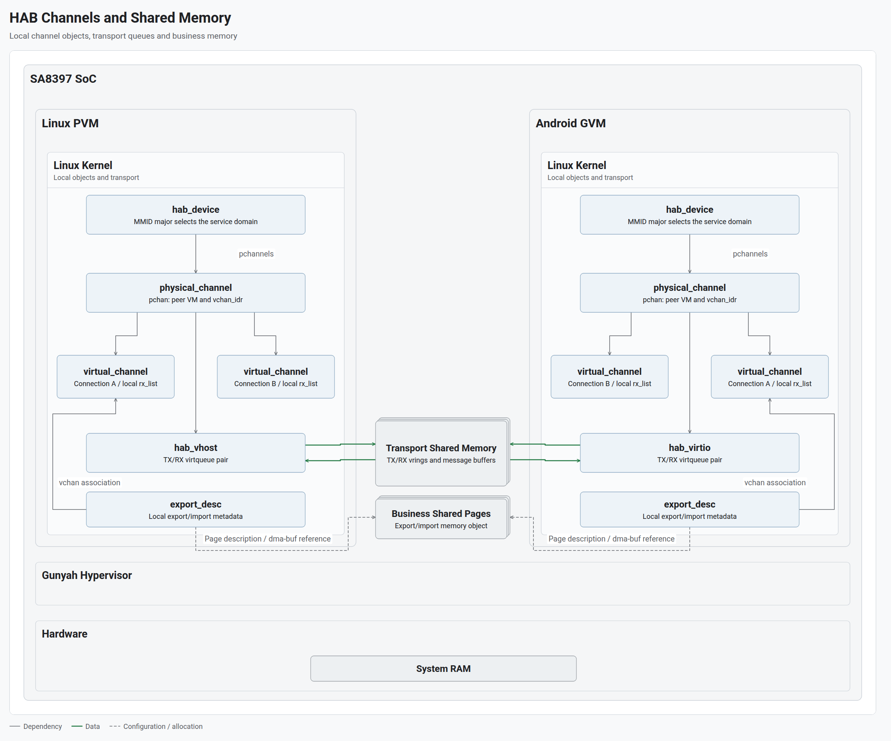
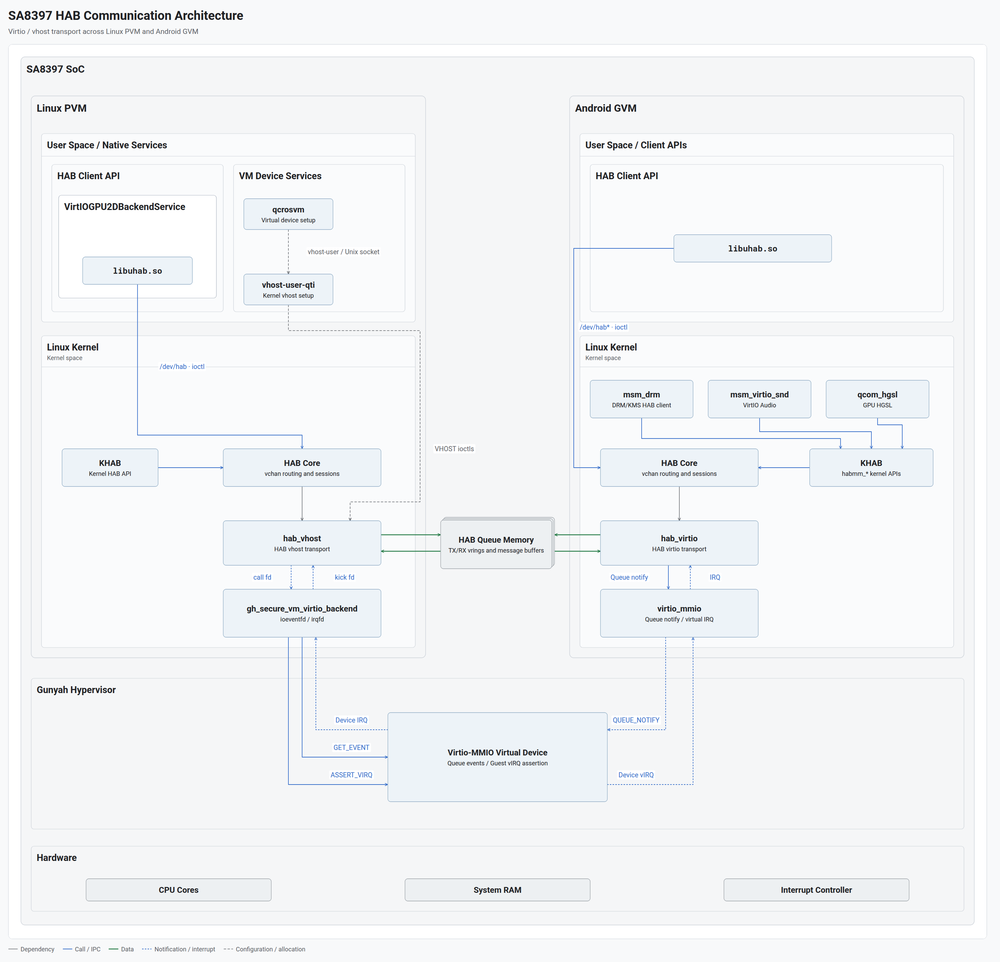
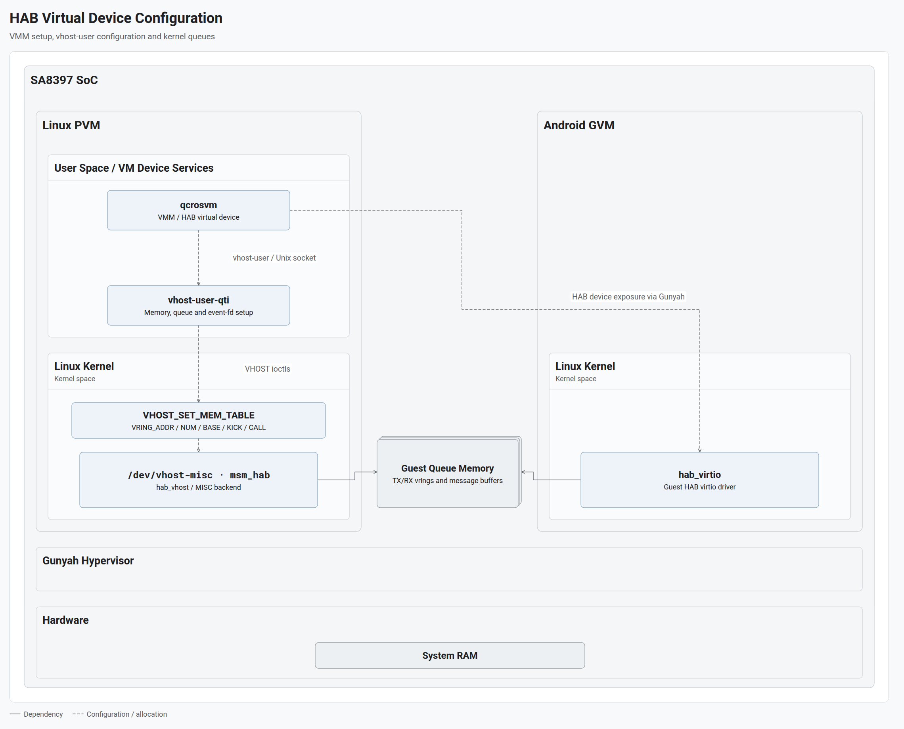
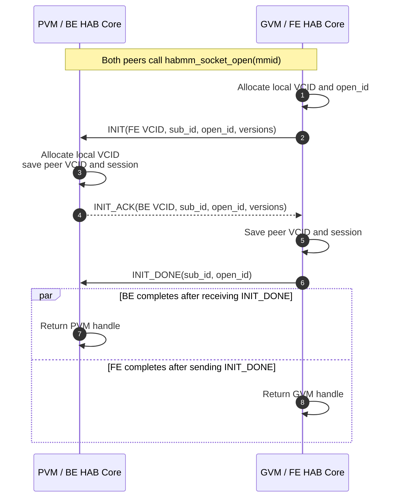
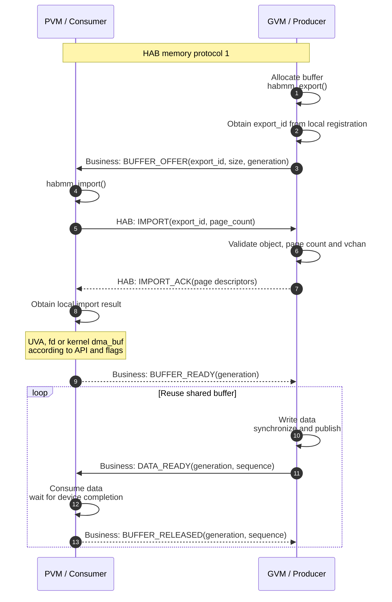
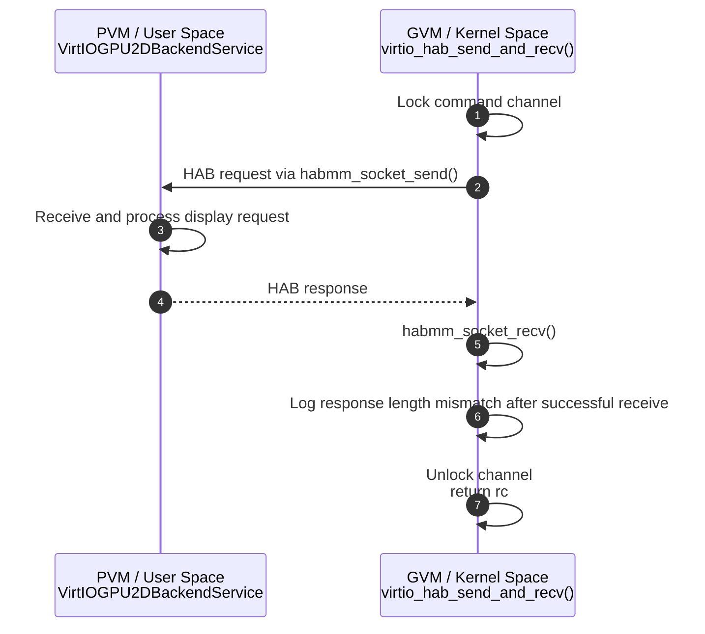
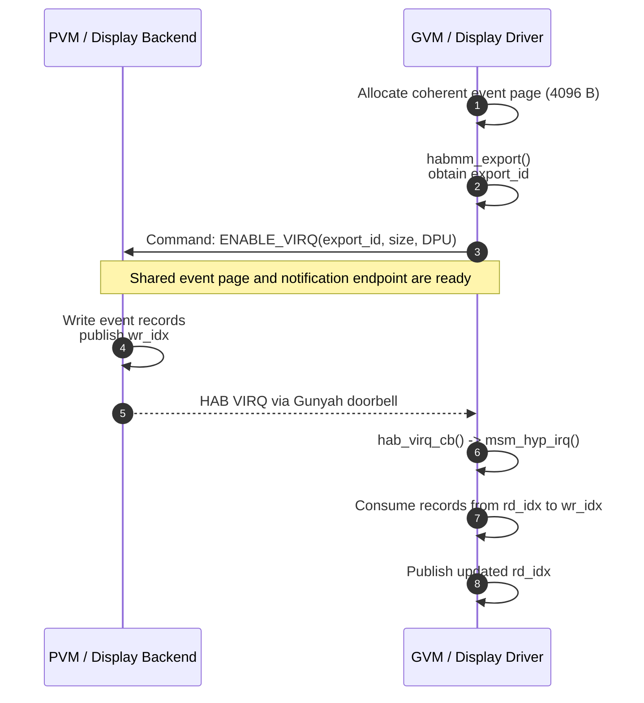

+++
date = '2026-10-21'
draft = false
showToc = true
title = 'SA8397 HAB 通信机制与服务开发'
description = 'HAB 通道模型、VirtIO/vhost 传输、内存管理与通信时序，以及显示后端实例和 PVM/GVM 用户态服务开发'
tags = ["Android", "Linux", "Virtualization", "Gunyah", "Qualcomm", "HAB", "IPC"]
+++

## 1. 通信模型与架构

### 1.1 消息、共享内存与通知

HAB（Hypervisor Abstraction）为跨 VM 的用户态进程和内核模块提供三类接口：

| 能力 | 接口内容 | 业务用途 |
|---|---|---|
| 消息通道 | 有边界的字节消息 | 请求、响应、资源描述、状态 |
| 内存共享 | 内存对象的导出描述与导入映射 | 图形、音频等大 buffer 的共同访问 |
| VIRQ 通知 | 对端事件提示 | 唤醒处理者，检查共享状态或事件队列 |

消息通道将一次 `send` 的内容作为一条消息交付给 `recv`。业务协议定义消息中的命令、参数和处理结果。共享内存用于保存较大的业务数据，消息传递资源标识和控制信息，通知触发接收侧检查待处理工作。

### 1.2 HAB 的核心抽象

HAB 以业务域选择传输资源，以逻辑连接复用底层链路，并通过客户端上下文管理本地连接与共享对象。

#### 1.2.1 MMID：业务寻址与建链匹配

MMID 编码为 `major | (minor << 16)`，major 占低 16 位，minor 占随后 8 位。major 选择 `hab_device`，minor 在 open 握手中作为 `sub_id` 匹配业务连接。同一 major 下的不同 minor 可以复用同一 pchan。

两端使用约定的 major 和 minor 调用 `habmm_socket_open()`，FE/BE 角色由平台 pchan 配置决定。这里的 major/minor 是 HAB 的协议字段，与 Linux 字符设备的主次设备号分别管理。

#### 1.2.2 hab_device：业务域的通道集合

`struct hab_device` 表示一个 MMID major 对应的 HAB 业务域。`id` 保存 major，`pchannels` 管理该域面向各对端 VM 的 pchan，`openq_list` 保存待匹配的建链消息。

这是 HAB Core 的通道管理对象，与 Linux 的 `struct device`、字符设备节点及 VirtIO 设备分别建模。例如，显示命令的 major 301 和事件的 major 303 对应不同 `hab_device`，但由同一个 VirtIO HAB 显示设备承载。

#### 1.2.3 pchan：面向对端 VM 的传输链路

`struct physical_channel` 属于一个 `hab_device`，表示该业务域到对端 VM 的底层链路。它记录两端 VM 信息，以 `vchan_idr` 索引连接，以 `expid_idr` 索引导出对象，并通过 `hyp_data` 关联传输实现。

pchan 随平台通道初始化建立，供业务连接复用。SA8397 的 VirtIO/vhost 实现为每个 pchan 配置一对 TX/RX virtqueue；队列容量、消息 buffer 和传输处理时间由其所属 vchan 共享。

#### 1.2.4 vchan：一次 open 建立的逻辑连接

每次成功的 `habmm_socket_open()` 建立一对连接端点，两端分别创建本地 `struct virtual_channel`。一个客户端可以建立多个 vchan，每个 vchan 关联一个 pchan。

vchan 的 `id` 为本地 VCID，`otherend_id` 保存对端 VCID，`session_id` 区分连接实例。`rx_list` 保存已接收、待业务读取的消息，`rx_queue` 用于等待消息到达，关闭状态控制连接退出。

本地 API 使用本端 VCID 操作连接。跨 VM 消息的 header 携带对端 VCID 的局部 ID（低 12 位）和 session；接收端在当前 pchan 的索引中查找 vchan，再校验 session。两端 VCID 独立分配，局部编号复用时由 session 区分新旧连接。

#### 1.2.5 uhab_context：本地资源归属

`struct uhab_context` 管理调用者打开的 vchan、导出仓库 `exp_whse`、导入仓库 `imp_whse` 及待完成的建链请求。vchan 同时关联 context 和 pchan：前者确定本地资源归属，后者确定跨 VM 传输链路。

UHAB 在打开 HAB 设备文件时创建 context，并保存在 `file->private_data`；一个进程可以持有多个 context。当前 Linux KHAB 的调用者共用驱动全局 `hab_driver.kctx`。

#### 1.2.6 export_id 与 VIRQ：共享对象和通知端点

`export_id` 标识已登记的业务共享内存对象，使用时受通道与对象生命周期约束。导入请求还要核验页数及所属 vchan；导入成功后取得本地映射、fd 或内核 dma-buf。业务数据保存在共享页中，连接消息传递其描述和控制信息。

VIRQ 标识独立的通知端点，使用专门的注册上下文和 Gunyah doorbell 资源。事件内容与数量由业务状态或共享记录表达，通知触发接收者检查这些记录。

#### 1.2.7 通道与共享内存关系



[打开 HTML 图稿](../../images/hab/sa8397-hab-channel-memory.html)

- **本地对象与通道关联**：左右两侧分别维护自己的 `hab_device`、pchan 和 vchan。灰色实线表示对象引用或关联；同一 pchan 下的连接 A、B 共享传输资源，各自保留本地接收队列。
- **消息传输内存**：绿色实线表示 `hab_vhost`、`hab_virtio` 对同一组 TX/RX vring 和消息 buffer 的读写。两端的通道管理对象各自独立，传输时共同访问中间的共享内存。
- **业务共享页**：下方 `export_desc` 保存本地导出/导入元数据，灰色虚线表示页描述或 dma-buf 引用。业务数据保存在独立共享页中，其使用关系由 export/import 管理。

### 1.3 SA8397 软件分层



[打开 HTML 架构图](../../images/hab/sa8397-hab-architecture.html)

图中蓝色实线表示调用，蓝色点线表示通知，绿色实线表示共享队列读写，灰色虚线表示资源配置。两侧 UHAB、KHAB 汇入各自的 HAB Core；普通消息经 `hab_virtio` 与 `hab_vhost` 交换，队列通知由 Gunyah Virtio-MMIO 资源及两侧驱动衔接。

| 层次 | PVM：Yocto Linux | GVM：Android |
|---|---|---|
| 用户态入口 | 服务链接 `libuhab.so`，通过 `/dev/hab` ioctl 调用 | 客户端链接 `libuhab.so`，通过 `/dev/hab*` ioctl 调用 |
| 内核态入口 | KHAB 导出的 `habmm_*` 接口 | KHAB，供 `msm_drm`、`msm_virtio_snd`、`qcom_hgsl` 等调用 |
| HAB Core | 建链、消息分发、共享对象管理 | 建链、消息分发、共享对象管理 |
| 消息传输 | `hab_vhost` | `hab_virtio` |
| 队列通知接入 | `gh_secure_vm_virtio_backend` | `virtio_mmio` |

HAB 的插件边界覆盖通信资源分配、数据读写、通知，以及内存导出和导入。SA8397 的普通消息由 `hab_virtio.c` 与 `hab_vhost.c` 对接；Gunyah 提供 VM 承载与 Virtio-MMIO 通知支持。

PVM 用户态的 `qcrosvm` 是 VMM，`vhost-user-qti` 配置内核 vhost。业务服务调用 libuhab 和虚拟设备配置是两条并列路径，前者在已配置的通道上发送消息。

### 1.4 与 TCP/IP、VSOCK 的边界

| 维度 | HAB | TCP/IP | VSOCK |
|---|---|---|---|
| 寻址 | MMID 与连接匹配 | IP 地址和端口 | CID 和端口 |
| 数据接口 | 保留消息边界 | TCP 提供有序可靠字节流 | 常用 `SOCK_STREAM` 提供字节流，类型支持取决于传输 |
| 部署范围 | 平台配置的 VM 与业务域 | 可通过 IP 网络互达的端点 | VM 与宿主等，取决于 Hypervisor 和传输 |
| 业务共享内存 | 配套 export/import 接口 | 通过独立机制协作 | 通过独立机制协作 |
| 接入条件 | HAB 驱动、库、域和传输配置 | IP 网络配置与 socket 协议 | VSOCK 地址族及相应传输支持 |

TCP 的字节流需要业务层定义消息长度或分隔规则；VSOCK 提供独立于 VM IP 网络配置的通信地址族。参见 [RFC 9293](https://www.rfc-editor.org/rfc/rfc9293.html) 和 [Linux VSOCK 接口](https://man7.org/linux/man-pages/man7/vsock.7.html)。HAB 的选择通常与平台驱动、共享内存和设备服务接口相联系，性能差异需要在相同负载下测量。

## 2. 底层传输机制

### 2.1 VirtIO 与 vhost

VirtIO 使用前端驱动和虚拟设备后端共同管理 I/O 队列。GVM 前端提供 buffer，PVM 后端处理 buffer，并发布完成状态。HAB 在此基础上封装自己的消息头和通道协议。

vhost 将后端队列处理放入 PVM 内核。接收时，`hab_vhost` 从共享队列读取消息并交给 HAB Core；发送时，Core 调用 vhost 排队，worker 再将消息填入共享 buffer。用户态 VMM 负责设备创建和配置，普通消息的数据处理进入两侧内核传输驱动。

### 2.2 Virtqueue、vring 与消息 buffer

virtqueue 是提交和回收 buffer 的队列接口。当前链路使用 split vring，其共享内存布局包含三部分：

| 结构 | 内容 | 状态发布者 |
|---|---|---|
| Descriptor table | buffer 地址、长度、读写方向及描述符链 | GVM driver |
| Available ring | 可供后端处理的描述符链索引 | GVM driver |
| Used ring | 已处理的描述符及使用长度 | PVM device backend |

HAB header 和 payload 位于 descriptor 指向的消息 buffer。队列按“前端提交 → 后端处理 → 前端回收”的顺序运行；available/used 索引表示处理进度。buffer 复用以传输层归还为条件。结构与发布规则见 [VirtIO 1.2，Split Virtqueues](https://docs.oasis-open.org/virtio/virtio/v1.2/virtio-v1.2.html#x1-300007)。

每个 pchan 对应两条 virtqueue，TX/RX 始终按 GVM 视角命名：

| 队列 | 消息方向 | GVM 提交的 buffer | PVM 的操作 |
|---|---|---|---|
| TX | GVM → PVM | 已填入 header 和 payload 的 buffer | 读取消息，归还描述符 |
| RX | PVM → GVM | 预先准备的可写 buffer | 填入消息，发布使用长度 |

两端分别持有本地队列管理对象，共同访问这一对 vring 及关联 buffer。队列槽位有限；buffer 或 descriptor 耗尽时，发送路径可能等待或返回资源错误。

### 2.3 虚拟设备配置

`qcrosvm` 创建 HAB 虚拟设备，经 vhost-user Unix socket 向 `vhost-user-qti` 传递内存区域、队列信息和 fd。`vhost-user-qti` 将这些资源配置给内核 vhost：



[打开 HTML 图稿](../../images/hab/sa8397-hab-device-configuration.html)

图中以 MISC 通道为例。`vhost-user-qti` 经 `/dev/vhost-misc` 的 VHOST ioctl 配置 `msm_hab` 中的 `hab_vhost`。`VHOST_SET_MEM_TABLE` 块汇总内存表、vring 地址与参数、kick/call fd 等配置接口。右侧虚线表示 `qcrosvm` 经 Gunyah 向 GVM 暴露 HAB 虚拟设备；两侧内核驱动与 Guest Queue Memory 之间的灰色实线表示队列资源关联。

内存表建立后端访问 Guest 内存的范围，vring 配置指定队列位置，kick/call fd 连接本地通知端点。该 socket 传递配置和 fd；HAB 消息通过共享队列读写。

例如 MISC 配置使用 `device-id=90, queue-num=2`，对应一个 pchan 的队列对；DISPLAY 配置使用 `device-id=93, queue-num=10`，承载多个 pchan。配置入口分别位于 `crosvm-gunyah/qcrosvm_sa8797.service` 和 `vhost-user/vhost-user-*.service`。

### 2.4 双向队列通知

队列状态保存在共享内存，通知使对端开始检查队列。Gunyah 将 Virtio-MMIO 虚拟设备资源交给 PVM 后端，资源包含 capability、IRQ 和寄存器区信息。

**GVM → PVM：**GVM 的 `vm_notify()` 写 `VIRTIO_MMIO_QUEUE_NOTIFY`；Gunyah 产生设备事件并触发 PVM 资源 IRQ。`gh_secure_vm_virtio_backend` 的 `vdev_interrupt()` 调用 `GET_EVENT`，根据 `EVENT_NEW_BUFFER` 的队列位图执行 `eventfd_signal()`，唤醒对应 vhost worker。

**PVM → GVM：**vhost 更新 used ring 后发出 call 通知，irqfd 回调调用 Gunyah `ASSERT_VIRQ`。GVM 收到设备虚拟中断，`vm_interrupt()` 进入 `vring_interrupt()`，随后执行 HAB 队列回调。

eventfd 是 PVM 内部的通知对象。跨 VM 的部分由 Virtio-MMIO 虚拟设备事件与 Guest vIRQ 断言完成；`GET_EVENT`、`ASSERT_VIRQ` 的 ABI 定义位于 Gunyah 驱动的 `hcall_virtio.h`。

### 2.5 HAB VIRQ

业务 VIRQ 使用独立的 Gunyah doorbell 资源。`hab_virq_hgy.c` 通过 `gh_dbl_send()` 发出事件。内核调用者通过注册回调处理通知；当前 Linux UHAB 通过 eventfd 接收通知，由用户线程检查共享状态。它与 virtqueue 的 queue notify、used-ring interrupt 分别管理。

doorbell 状态可以合并连续通知。业务需要统计事件数量或保留事件内容时，应将记录和读写索引保存在共享页中，通知处理者读取队列直至当前待处理记录耗尽。发布记录与触发通知之间还需要相应的内存顺序和缓存同步。

## 3. 内存组织与管理

### 3.1 本地对象与传输共享内存

pchan、vchan 和 `rx_list` 属于各 VM 的本地内核内存。两端各自创建对象、维护锁和等待队列；建链交换标识，后续消息通过协议头定位本地连接。

传输共享内存保存 vring 和消息 buffer。在 GVM 接收路径中，HAB Core 将消息复制到本地 vchan 接收队列后，传输 buffer 即可回补给 RX virtqueue。业务 `recv()` 的处理速度和传输 buffer 的回收因此分属不同阶段。

传输共享内存承载连接消息，业务共享页承载由 export/import 管理的数据对象。两类内存分别分配和管理，具有不同的回收条件。

### 3.2 地址空间与映射

进程使用虚拟地址 VA，Guest OS 将其转换到 GPA/IPA，Hypervisor 的第二阶段转换确定系统物理页。两端可以用不同的本地地址访问同一批共享页。

| 标识 | 有效范围 |
|---|---|
| VA / 指针 | 当前进程或内核地址空间 |
| GPA / IPA | 当前 VM 所见的物理地址空间 |
| HPA / PA | 系统物理内存 |
| DMA 地址 / IOVA | 设备 DMA 映射使用的地址空间 |
| dma-buf fd | 当前进程文件描述符表中的共享 buffer 引用 |
| export_id | HAB 导出对象标识，结合通道及对象生命周期使用 |

跨 VM 共享通过页描述和接收侧映射建立访问关系。业务消息传递 export ID、大小和资源用途；接收侧 import 后取得自己的映射或 dma-buf。设备访问还需满足相应 DMA 映射要求，参见 [Linux DMA 地址说明](https://docs.kernel.org/core-api/dma-api-howto.html#cpu-and-dma-addresses)。

### 3.3 业务内存 export/import

导出方调用 `habmm_export()`，HAB 收集页或 dma-buf 信息、创建导出描述并分配 export ID。两端 context 保存导出和导入对象，pchan 参与 export ID 索引。

export 的 sizebytes 必须非零且为 `PAGE_SIZE` 的整数倍；import 的大小必须与导出对象一致。可共享范围还受内存来源、映射及平台访问条件约束。

当前两端支持的内存协议 1 将描述交换放在 import 阶段：export 先在本地登记；业务将 export ID 和大小发送给对端；对端 `habmm_import()` 发出 IMPORT 请求，导出侧核验对象、页数及所属 vchan，返回携带页描述的 ACK，导入侧据此建立本地对象。协议 0 则在 export 阶段发送描述并等待 ACK，内存协议版本在建链时协商。

业务共享页可持续承载多次数据更新。每次更新通过协议约定的序号、所有权和完成通知协调，避免重复传输整块内容。普通消息在传输 buffer 与本地消息对象之间仍有数据复制；UHAB 调用还包含用户态与内核态之间的复制。

当前 Linux 内存插件的 grant 路径主要收集页和引用，revoke 路径直接返回成功。共享范围依赖平台已有的内存接入和映射机制；export/unexport 的对象管理与 Hypervisor 页权限变更需要分别分析。

### 3.4 同步、所有权与回收

共享数据的正确访问同时依赖三个条件：

| 条件 | 负责内容 |
|---|---|
| 所有权协议 | 确定当前可写者、读者及 buffer 复用时刻 |
| 内存与缓存同步 | 保证数据和索引按约定顺序对 CPU、设备和对端可见 |
| 完成协议 | 表示设备或对端已结束访问，允许解绑和释放 |

vring 的发布顺序由 VirtIO 队列操作维护。业务共享 buffer 的同步由其分配器、映射属性、驱动和协议共同完成；dma-buf 还可能涉及 CPU access 同步和 DMA fence。参见 [Linux dma-buf 同步机制](https://docs.kernel.org/driver-api/dma-buf.html)。

正常释放顺序为：停止提交新任务，等待双方 CPU/设备访问结束，释放业务额外取得的映射和引用，再按接口约定执行 unimport。HAB 管理的返回映射和基础引用由其释放路径回收；当前 UHAB 先执行 unimport ioctl，成功后再 munmap/close。导出端确认对象可释放后 unexport，再释放原始 buffer。

UNIMPORT 的对端处理是异步的，导出侧仍标记 remote-imported 时，unexport 会返回 `-EBUSY`。VIRQ 注销和回调退出需要与共享状态页释放协调。解除映射失败时，应按当前实现的对象状态处理，保留仍在使用的资源。

## 4. 通信时序与完成语义

### 4.1 初始化与建链

虚拟设备初始化建立共享内存访问、队列和通知资源，HAB 将传输对象关联到 pchan。业务 open 在这些资源上创建 vchan，握手交换两端 VCID、API/内存协议版本和 session 信息。



FE 发出 INIT_DONE 后可以返回；BE 在收到 DONE 后返回。open 的 timeout 控制具体等待阶段，内部握手另有等待参数。服务的业务请求期限应由业务协议单独管理。

### 4.2 GVM → PVM 消息

1. GVM 调用 send，Core 封装目标 vchan 的局部 ID、session、类型和长度。
2. `virtio_physical_channel_send()` 将 header/payload 放入 TX buffer，调用 `virtqueue_add_outbuf()` 并 kick。
3. PVM 经 Gunyah 设备事件获得通知，`hab_vhost` 的 `tx_worker()` 取得描述符并读取消息。
4. `hab_msg_recv()` 查找目标 vchan，将 payload 复制到本地消息对象，入队并唤醒接收者。
5. PVM 发布 used 状态，GVM 回收 TX buffer；PVM 业务调用 recv 取得消息。

第 5 步中的 GVM TX buffer 回收与 PVM 业务 recv 可以独立调度；归还 descriptor 以第 4 步读取和复制完成为前提。

### 4.3 PVM → GVM 消息

1. PVM 调用 send，`physical_channel_send()` 将消息复制到本地 `send_list`，调度发送工作并返回。
2. `rx_worker()` 取出待发消息，获得 GVM 预提交的 RX buffer，经 `fill_rx_buf()` 填写内容。
3. PVM 更新 used ring，通过 call fd、irqfd 和 Gunyah ASSERT_VIRQ 通知 GVM。
4. GVM 回调通过 `virtqueue_get_buf()` 取得消息，交给 HAB Core 分发至 vchan。
5. GVM 将 buffer 重新提交到 RX virtqueue，供 PVM 后续发送使用。

RX buffer 暂不可用时，PVM 保留待发节点并等待后续处理。业务应限制在途请求和待发数据量，避免本地队列持续增长。

### 4.4 共享内存协作



该时序采用内存协议 1。`BUFFER_OFFER`、`DATA_READY` 等是业务消息，IMPORT/ACK 由 HAB 处理。generation 区分重新建立的共享对象，sequence 区分其中的数据更新。释放阶段需要双方确认停止访问，再撤销导入和导出对象。

### 4.5 完成、错误与连接恢复

| 可观察阶段 | 含义 |
|---|---|
| send 返回成功 | 本端接受消息；具体完成点由两侧传输实现决定 |
| used buffer 被回收 | 传输层已结束对该 buffer 的使用 |
| 对端 recv 返回成功 | 对端调用者取得消息 |
| 业务完成响应 | 业务协议规定的处理结果已产生 |

普通 MSG 路径未提供逐条业务 ACK 和自动重传。接收侧内存分配失败仍可能导致消息丢弃。需要确认执行结果的请求，应带 request ID 并等待响应；超时后的执行结果可能未知，重发依赖幂等性或服务端去重。

| 接口条件 | 当前行为与处理要求 |
|---|---|
| 消息长度 | Core payload 上限为 500 KiB；PVM→GVM 的当前 vhost 路径另限制为 5100 B |
| 接收 buffer 太小 | 返回 `-EOVERFLOW`，输出所需长度，消息保留在队首；按协议上限扩容或结束连接 |
| 接收超时 | 必须设置 `HABMM_SOCKET_RECV_FLAGS_TIMEOUT`，timeout 单位为 ms |
| 非阻塞接收无数据 | 返回 `-EAGAIN` |
| 对端关闭 | 已排队消息读完后，recv 可返回 `-ENODEV` |
| 多连接接口 | 当前 UHAB 的 `sendto/recvfrom` 为返回成功的空实现；服务使用独立点对点 vchan |

连接异常后，服务应停止当前 session 的收发，显式 close 旧句柄，并按退避策略重新 open。PVM 的 vhost reset-owner 会等待业务关闭旧 vchan，遗留连接会影响设备恢复。VM 重启后，共享对象、在途请求和业务状态均需重新协调。

## 5. VirtIOGPU2DBackendService 通信实例

### 5.1 部署依赖

`VirtIOGPU2DBackendService` 是 PVM 用户态显示后端，为 GVM 显示客户端提供合成与显示服务。GVM 的 DRM/KMS 驱动通过 KHAB 发送显示协议；PVM 后端通过 `libuhab.so` 接入 HAB，通过 `libopenwfd.so` 调用 OpenWFD 接口。

`display-be.service` 以 `display` 用户启动该进程，参数为 `/usr/bin/config.xml`，依赖 `vhost-user-disp.service`，并在 OpenWFD 服务之后启动。`vhost-user-disp` 配置 HAB 传输设备；显示后端处理显示业务，两者属于独立进程。

Android 显示栈位于 GVM 用户态，经本地 DRM/KMS 接口进入 `msm_drm` 中的虚拟显示实现。跨 VM 连接的端点分别是 GVM 内核驱动与 PVM 用户进程，应用层无需直接管理 HAB 连接。

PVM 后端以预编译程序提供，内部命令转换和硬件完成时序由后端实现及显示协议规定。

### 5.2 通道配置

GVM 的 `display-drivers/msm/hyp/virtio/virtio_kms.c` 在 probe 中设置 MMID，随后由 `virtio_gpu_hab_open()` 分别打开命令与事件连接。

| 连接 | GVM 标识 | MMID | PVM 配置 |
|---|---|---|---|
| 命令 | `CHANNEL_CMD` | `MM_DISP_1 = 301` | `Packet/ID = 301` |
| 事件 | `CHANNEL_EVENTS` | `MM_DISP_3 = 303` | `Event/ID = 303` |

PVM 的 `display-be/usr/bin/config.xml` 同时配置 `Buffer/ID = 301`。该条目指定资源协议使用的通道编号。像素 buffer 的共享还涉及具体资源创建、导入和显示提交协议。

两条连接由同一个显示 HAB 虚拟设备承载。`qcrosvm_sa8797.service` 为显示设备配置 `device-id=93`、`queue-num=10`，对应显示域五个 pchan 各自的 TX/RX 队列对；命令与事件连接使用其中不同的 pchan。命令与事件分离后，等待事件的阻塞接收不占用命令连接。

### 5.3 命令响应

`display-drivers/msm/hyp/virtio/virtgpu_vq.c` 的 `virtio_hab_send_and_recv()` 在同一次通道加锁区间内发送请求并接收响应。请求包含显示命令及其参数；响应结构由显示协议定义。互斥路径串行处理同一命令连接上的请求与响应，避免并发调用相互取走响应。

请求经过 GVM 的 KHAB、HAB Core 和 `hab_virtio`，由共享队列到达 PVM 的 `hab_vhost`、Core 和 UHAB。业务交互顺序为：



普通互斥路径和自旋锁路径使用不同的发送等待方式。helper 接收成功后会检查响应长度；长度不匹配时记录日志，返回值仍可能为 0。遇到超过接收区的消息时，移除该消息后重新接收；连接断开和接收超时按相应返回码处理。

命令响应表达该命令的协议结果。DPU 中断、vsync 和 commit 完成分别通过显示事件协议报告，其完成条件由对应显示操作定义。

### 5.4 WAIT_EVENTS

`virtio_gpu_event_kthread()` 在独立事件连接上循环调用 `virtio_gpu_cmd_get_event()`，发送 `VIRTIO_GPU_CMD_WAIT_EVENTS` 请求并等待事件响应。响应按 scanout 提供 `vsync_count`、`commit_count`、`hpd_count`；线程将计数交给 `virtio_kms_event_handler()`，分别分发 vsync、commit complete 和热插拔事件。

该路径使用 `virtio_hab_send_and_recv_timeout()`：接收窗口为 2500 ms，接收失败后重新发送请求，重试次数耗尽后转入阻塞接收。等待事件通过请求/响应协议实现，不要求 PVM 向命令连接插入异步消息。事件计数属于响应内容；一次响应可报告多个已发生事件，通知次数与显示事件次数没有一一对应的要求。事件线程在连接返回 `-ENODEV` 时退出，并关闭事件连接。

### 5.5 共享事件页与 VIRQ

显示驱动还使用共享事件页和独立 HAB VIRQ 传递中断状态。`virtio_kms.c` 的 `virtio_hab_register_virq()` 为两个 DPU 注册接收端 VIRQ，标识为 3001、3002，远端 PVM 的 HAB VMID 为 0。

`virtio_enable_virq_all()` 为各 DPU 执行以下操作：

1. `create_virq_shmem()` 分配并清零 4096 B coherent memory，通过 `habmm_export()` 获得 export ID。
2. 初始化共享页中的队列容量，由 `virtio_gpu_cmd_enable_virq()` 通过命令连接发送 `ENABLE_VIRQ`，参数包含 export ID、共享页大小和 DPU 标识。
3. 接收端在 VIRQ 到达后，经 `hab_virq_cb()` 调用 `msm_hyp_irq()`，消费共享页中的中断记录。

`display-drivers/msm/hyp/msm_hyp_irq.c` 的 `msm_hyp_dispatch_irqs()` 读取 `rd_idx`、`wr_idx`，遍历已发布记录，按中断类型及状态位调用显示中断处理函数，并更新读索引。共享页保存事件数据，doorbell 负责通知接收端检查队列。



每条共享记录包含 DPU、控制器、中断类型及状态。接收端按控制器使能掩码筛选记录，将状态位映射到本地中断处理入口。一次回调可以消费多条记录，进度由读写索引表达。export ID 标识共享页，VIRQ 标识注册通知端点。

probe 启动 WAIT_EVENTS 线程；VIRQ 注册成功后，为各 DPU 创建并尝试启用共享事件页。两条事件路径同时保留，其事件分工由后端协议定义。

## 6. PVM 服务与 GVM 客户端开发

### 6.1 协议与通道规划

PVM 服务和 GVM 客户端均可使用 UHAB。两端链接各自系统的 `libuhab`，以相同 MMID 调用 open，再通过返回的本地句柄收发消息。业务 server/client 与 HAB 的 BE/FE 角色分别定义；后者由平台配置决定。

通道接入有两种情况：

| 情况 | 配置工作 |
|---|---|
| 复用已部署 major，例如 `MM_MISC=601` | 为业务分配未占用 minor，确认访问权限和两端匹配 |
| 新增 major 或平台通道 | 联动 HAB 设备表、VM/pchan、设备树和 VirtIO/vhost 资源配置 |

同一 major 内的业务 minor 通常复用已有 pchan，业务服务共享已启动的虚拟设备与后端配置进程。

示例采用固定 20 B 的请求/响应协议：

| 偏移 | 字段 | 编码 |
|---|---|---|
| 0 | magic | `0x48414231` |
| 4 | version | `1` |
| 8 | opcode | 请求 `1`，响应 `2` |
| 12 | request_id | 客户端分配，响应原样返回 |
| 16 | value | 请求值；响应值为输入加一，按 uint32_t 运算 |

所有字段显式编码为 32 位大端整数。客户端发送 41，服务返回 42，并携带相同 request ID。长度、版本、类型和编号均在解析时校验。

### 6.2 最小请求与响应

[完整 C 示例](../../examples/hab-rpc-demo/hab_rpc_demo.c) 使用同一源文件生成两端程序，通过 `server/client` 参数选择业务角色。服务端循环处理一条连接，客户端仅保留一个在途请求。连接异常时关闭旧句柄，再重新建链。

核心 API 调用如下，编码、报文校验、信号退出和退避逻辑包含在完整源文件中：

```c
int32_t handle = 0;
uint8_t packet[20];
uint32_t size = sizeof(packet);
uint32_t mmid = HAB_MMID_CREATE(MM_MISC, assigned_minor);

int rc = habmm_socket_open(&handle, mmid, 500,
                          HABMM_SOCKET_OPEN_FLAGS_SINGLE_BE_SINGLE_FE);
if (rc != 0)
    return rc;

/* Client: encode and send a request, then receive its response. */
put32(packet, MAGIC);
put32(packet + 4, 1);
put32(packet + 8, 1);
put32(packet + 12, request_id);
put32(packet + 16, 41);
rc = habmm_socket_send(handle, packet, sizeof(packet),
                        HABMM_SOCKET_SEND_FLAGS_NON_BLOCKING);
if (rc == 0) {
    rc = habmm_socket_recv(handle, packet, &size, 200,
                            HABMM_SOCKET_RECV_FLAGS_TIMEOUT);
}
/* Validate response fields; the full example waits up to its request deadline. */
int close_rc = habmm_socket_close(handle);
return rc != 0 ? rc : close_rc;
```

服务端按“recv → 校验请求 → 计算结果 → send”处理。每次 recv 前重新将 size 设为 buffer 容量；返回后 size 表示实际长度或溢出所需长度。UHAB 返回 0 或负 errno，连接 handle 仅交给 HAB API 使用。

### 6.3 超时、并发与重连

完整示例对 send 的 `-EAGAIN` 设置约 2 s 的用户态重试预算，单次 recv 使用 200 ms 窗口，客户端按单调时钟限制一次响应等待约 2 s。非阻塞发送标志控制特定资源等待，单次调用仍可能涉及内核分配和锁等待。服务的空闲接收超时继续等待；协议错误、`-ENODEV` 或其他会话错误结束当前连接。

固定 20 B 协议将 `-EOVERFLOW` 视为异常报文并关闭连接。可变长协议应先规定最大长度，再按返回长度分配足够空间重收。一个连接并发承载多个请求时，由接收调度器按 request ID 分发响应，并限制在途数量。

响应超时的请求结果按“未知”处理。示例重连后创建新请求；有副作用的设备操作还需要跨重连请求身份、幂等处理、去重或结果查询。服务退出和 VM 重启恢复时，关闭旧句柄，撤销旧资源关系，再重建业务状态。

示例默认运行 30 s，支持 SIGINT/SIGTERM。open 的内部握手等待可能长于传入 timeout，进程使用定时信号打断可中断等待。HAB 调用本身仍受内核调度和具体驱动行为约束。

### 6.4 大数据扩展

大数据服务可在初始化阶段建立共享 buffer 池，通过 export/import 创建两端使用关系。运行期消息传递业务资源编号、有效数据范围、generation 和 sequence，完成响应归还 buffer 使用权。

缓冲池容量与在途任务数量需要有界。消费者完成 CPU 或设备访问后才能归还资源；生产者取得归还确认后才能覆写。使用 VIRQ 时，共享队列索引记录任务进度。停机按第 3 章的访问停止、业务额外引用释放、unimport、unexport 顺序回收。

### 6.5 编译、部署与验证

PVM 使用对应 Yocto/Linux SDK；GVM 使用 Android/Bionic 工具链及本镜像配套的 UHAB 开发文件。两端分别编译、链接目标 ABI 的 `libuhab.so`：

```sh
"$TARGET_CC" --sysroot="$TARGET_SYSROOT" -std=c11 -Wall -Wextra -Werror \
  -fPIE -pie -I"$UHAB_INCLUDE" -I"$HAB_UAPI_INCLUDE" \
  hab_rpc_demo.c -L"$UHAB_LIBDIR" -luhab -o hab_rpc_demo
```

`UHAB_INCLUDE` 指向用户态 `habmm.h` 所在目录，`HAB_UAPI_INCLUDE` 提供 `linux/habmmid.h`，库目录提供目标系统的 libuhab。参数说明见[示例说明](../../examples/hab-rpc-demo/README.md)。

两端设置已分配的相同 `ASSIGNED_MINOR`，分别运行对应的可执行文件：

```sh
# PVM
./hab_rpc_demo server "${ASSIGNED_MINOR:?set an assigned minor}" 30

# GVM
./hab_rpc_demo client "${ASSIGNED_MINOR:?set the same assigned minor}" 30
```

PVM 服务可交由 systemd 管理，按所用通道安排 vhost-user 服务依赖和运行用户。GVM 客户端按 Android init、文件权限及 SELinux 策略部署；所选 pchan 应允许用户态访问。两端均需加载对应驱动，并使动态链接器能够找到 libuhab。

| 验证项 | 观察结果 |
|---|---|
| 正常请求响应 | 客户端输出 `request=… result=42`，编号对应 |
| 对端未运行 | 建链等待或超时；运行期限到达后请求退出并中断可中断等待 |
| 客户端退出与服务重启 | 旧句柄关闭，重新建立连接 |
| 长度或版本错误 | 结束异常会话，不继续解析报文 |
| VM 重启或设备 reset | 关闭旧 vchan，重建连接与共享资源 |

进程运行期限到达后的正常退出只表示程序结束；请求/响应记录用于确认业务往返。并发、共享 buffer 和压力验证应分别观测队列积压、在途数量、资源释放及重连结果。

