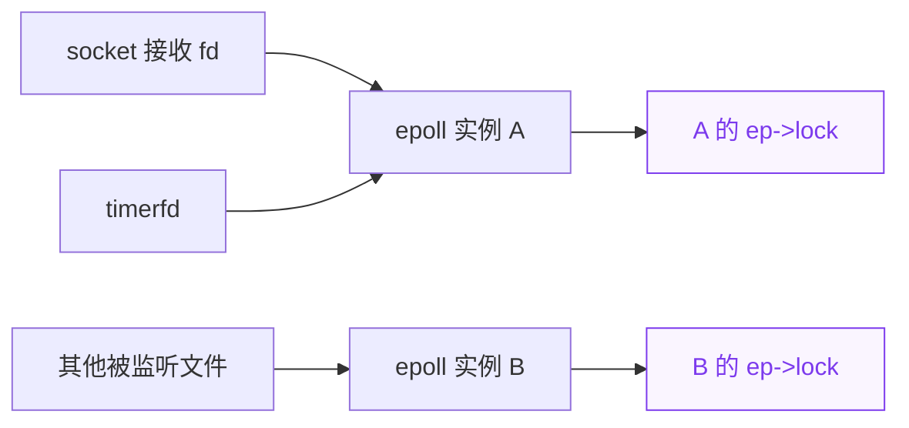

+++
title = 'Linux socket 与 epoll 回调和 PREEMPT_RT 锁的实现原理'
date = '2026-10-14T12:00:00+08:00'
draft = false
description = '解释 Unix socket 和 timerfd 的 epoll 通知路径、RT 读写锁与 CPU 配额依赖，并分析正式修复将 rwlock 改为 spinlock 后如何恢复优先级继承。'
ShowToc = true
TocOpen = true
+++

一次用户态 `write()` 可以在发送线程的内核上下文中，执行接收方所使用的 epoll 回调，并获取接收方 epoll 实例的内核锁。同一个 epoll 实例还可能监听 timerfd，因此发送日志的用户线程和执行定时器的内核线程，会进入同一个 `ep_poll_callback()` 并访问同一个 `ep->lock`。

理解这条路径，需要区分三件事：**数据属于谁、回调由谁执行、锁保护哪个对象**。它们不一定对应同一个进程。

本文先解释本案 `6.6.110-rt61-debug` 平台中尚未修复的 rwlock 实现，第八节再说明正式修复后的 spinlock 模型。上游提交 `0c43094f8cc9` 已将 `ep->lock` 改为 `spinlock_t`，对应的 6.6.y 修复进入 Linux 6.6.114，因此不能把下面的旧读写锁模型泛化到所有当前 Linux 内核。具体字段和 `ktimers/%u` 线程实现仍以目标平台版本为准。对应的现场案例见 [PVM STR 唤醒后 epoll 与 CFS 配额循环等待分析]()。

## 一、socket fd 和 epoll fd 分别代表什么

fd 是进程文件描述符表中的索引。相同的 fd 数字在不同进程中可以指向完全不同的对象，不能只比较数字就认定两端相连。

对于本例使用的 AF_UNIX stream socket，关键关系如下：

```text
发送进程的 fd
  → struct file
    → struct socket
      → struct sock / struct unix_sock
        → peer 指向对端 Unix socket

接收进程的 fd
  → struct file
    → 对端 struct socket
      → 对端 struct sock
```

`struct socket` 是 socket 文件接口与协议实现之间的对象；`struct sock` 及其协议专用结构保存接收队列、协议状态、回调和对端关系。AF_UNIX 通信发生在本机内核，不需要经过网卡。

epoll fd 对应另一类文件对象：

```text
epoll fd
  → struct file，f_op = eventpoll_fops
    → file->private_data
      → struct eventpoll
```

一个 `struct eventpoll` 表示一个 epoll 实例。它保存被监听的文件集合、就绪队列和等待 `epoll_wait()` 的线程队列。socket fd 用来收发数据，epoll fd 用来管理和等待一组文件的就绪通知。

`epoll_create1()` 创建新实例；`dup()`、继承或传递已有 epoll 文件描述符可以共享原实例。因此，锁归属应按 `struct eventpoll` 对象身份判断，不能按进程数量或 fd 数量判断。

## 二、每个 epoll 实例都有自己的锁

本版本 `struct eventpoll` 中的关键字段可以简化为：

```c
/* 结构示意，省略无关成员。 */
struct eventpoll {
    struct mutex mtx;
    wait_queue_head_t wq;
    wait_queue_head_t poll_wait;
    struct list_head rdllist;
    rwlock_t lock;
    struct rb_root_cached rbr;
    struct epitem *ovflist;
};
```

这里不是“全内核只有一把 epoll 锁”，而是“每个实例嵌入自己的一把 `lock`”。



同一实例中，所有回调共同访问它的就绪队列，所以需要遵守同一个实例锁的协议。不同实例的 `ep->lock` 是不同对象，即使它们都使用 `rwlock_t` 类型。

| 字段 | 保护或服务的对象 | 不能混淆的地方 |
|---|---|---|
| `ep->mtx` | 实例的控制、文件移除与事件收集等操作之间的互斥 | 与 `ep->lock` 是两把不同的锁 |
| `ep->lock` | `rdllist`、`ovflist` 等就绪队列状态 | 本版本中是读写锁，回调取读侧，扫描切换取写侧 |
| `ep->wq` | 在该实例上等待 `epoll_wait()` 的线程 | 这是等待队列，不是 `ep->lock` |
| `ep->wq.lock` | 上述等待队列自身的操作 | 与外层 eventpoll 读写锁是不同实例 |
| `ep->poll_wait` | 其他 poll/epoll 对这个 epoll 文件的监听 | 可能带来更深的事件通知链 |

实际现场分析必须比较锁地址、对象地址和调用位置。“两个线程都在 `ep_poll_callback()`”本身不证明它们访问同一实例。

## 三、epoll_ctl 如何把文件事件接到 epoll 上

应用执行 `epoll_ctl(epfd, EPOLL_CTL_ADD, fd, ...)` 后，内核为这项监听建立 `struct epitem`。其核心关系是：

```c
/* 来自 ep_insert() 的关键关系。 */
epi->ep = ep;                   /* 属于哪个 epoll 实例 */
ep_set_ffd(&epi->ffd, tfile, fd); /* 监听哪个文件 */
```

内核随后调用被监听文件的 `poll` 实现，传入一个用于安装等待队列回调的 `poll_table`。当文件的 `poll` 实现调用 `poll_wait()` 时，epoll 的 `ep_ptable_queue_proc()` 会建立 `eppoll_entry`：

```c
/* 关键语句，省略分配和错误处理。 */
init_waitqueue_func_entry(&pwq->wait, ep_poll_callback);
pwq->base = epi;
add_wait_queue(whead, &pwq->wait);
```

如果使用 `EPOLLEXCLUSIVE`，会进入相应的 exclusive 注册分支。无论哪种分支，重要关系都是：

```text
被监听文件的等待队列
  → eppoll_entry.wait
    → 回调函数 ep_poll_callback
    → eppoll_entry.base
      → epitem
        → epi->ep
          → 所属 struct eventpoll
```

`poll_wait()` 在这里承担“把通知关系登记到等待队列”的工作，不表示执行 `epoll_ctl()` 的线程必须睡眠等到事件发生。

## 四、Unix socket 写入为什么执行接收方的 epoll 回调

在本版本 AF_UNIX stream 的普通发送路径中，`unix_stream_sendmsg()` 将数据放入对端接收队列后，调用对端的 `sk_data_ready`：

```c
/* 顺序示意，省略错误处理与其他发送逻辑。 */
unix_state_lock(other);
skb_queue_tail(&other->sk_receive_queue, skb);
unix_state_unlock(other);
other->sk_data_ready(other);
```

本案中的回调是 `sock_def_readable()`，它访问对端 `socket_wq`，唤醒对端等待队列中的监听项。此前由 epoll 安装的 `ep_poll_callback()` 因而得到执行。

```text
发送线程 write()
  → sock_write_iter()
    → unix_stream_sendmsg()
      → 对端接收队列加入数据
      → other->sk_data_ready(other)
        → sock_def_readable()
          → wake_up_interruptible_sync_poll()
            → ep_poll_callback()
```

**这一整条函数调用链仍可处于发送线程的内核上下文。** 调用对端 socket 的回调，并不自动切换到接收进程执行。

在本次案例中：

- 发送者是 `gpumon-qprof`，写入自己的 `fd2`，也就是 stderr；
- 对端是 journald 的接收 socket `fd106`；
- 该 socket 被 journald 的 epoll `fd7` 监听；
- 因而 qprof 的内核调用栈会取得 journald 所使用的那个 epoll 实例的锁。

“journald 的 epoll”描述的是文件描述符和对象归属，不限制谁可以在内核中执行这个对象的事件回调。

## 五、timerfd 为什么会进入同一个 epoll 回调

timerfd 把定时器到期表示为文件可读事件。应用可以像监听 socket 一样，把 timerfd 加入 epoll。

`timerfd_poll()` 使用 `poll_wait(file, &ctx->wqh, wait)` 注册监听。到期时，`timerfd_tmrproc()` 调用 `timerfd_triggered()`，更新到期状态并唤醒 `ctx->wqh`：

```text
timerfd 到期
  → timerfd_tmrproc()
    → timerfd_triggered()
      → 更新 expired 和 ticks
      → wake_up_locked_poll(&ctx->wqh, EPOLLIN)
        → ep_poll_callback()
```

在本文平台的 RT 实现中，本案 timerfd 回调由 `ktimers/12` 执行。因此这个 `ep_poll_callback()` 运行在 ktimers/12 的上下文。

回调选择哪把 epoll 锁，由登记时保存的 `epi->ep` 决定：

```c
struct epitem *epi = ep_item_from_wait(wait);
struct eventpoll *ep = epi->ep;

read_lock_irqsave(&ep->lock, flags);
```

socket 和 timerfd 只有在监听关系最终指向同一 `struct eventpoll` 时，才会竞争同一把 `ep->lock`。本次 dump 已通过锁地址和 epoll 对象确认这一点；这不意味着所有 timerfd 都经过 journald，也不意味着所有 epoll 共用锁。

## 六、回调修改就绪队列为什么却获取读锁

这里的 reader 指的是**共享读锁持有者**，不是“正在调用 `read()` 的进程”。发送数据的线程也可以成为 reader。

`ep_poll_callback()` 要报告某个文件就绪，并更新 epoll 的就绪状态。本版本允许多个事件回调并行进入，因此采用如下配合：

1. 回调获取 `ep->lock` 的读侧，可以与其他读侧回调并发；
2. 读侧内部通过原子操作及专用并发队列操作，处理多个回调之间的竞争；
3. `ep_start_scan()`、`ep_done_scan()` 获取写侧，排他地切换、摘取或合并就绪列表。

因此，“持读锁”不意味着其中每一条语句都只读取内存。这里的读写锁用于区分“可以并发的事件生产阶段”和“必须排他的列表结构切换阶段”。回调间的写入安全还依赖它们使用的原子与队列算法，不能仅凭读锁保证。

也不能把 `epoll_wait()` 理解为整个系统调用期间一直持有写锁。本版本在扫描前后的特定区段取得写侧，中间通过 `ovflist` 等机制容纳新事件。

## 七、PREEMPT_RT 如何实现这把读写锁

本文版本的关键层次是：

```text
ep->lock                         rwlock_t
  └── rwbase                     struct rwbase_rt
        ├── readers              读者计数及其偏置状态
        └── rtmutex              struct rt_mutex_base
              ├── owner          内部互斥锁持有者
              ├── waiters        等待者
              └── wait_lock      保护内部状态的 raw spinlock
```

`ep->lock.rwbase.rtmutex` 是读写锁内部的组成部分，不是另一把独立的业务锁。它的 owner 和“谁持有读锁”不是同一个概念。

### 7.1 读锁获取与释放

读快路径在允许新读者进入时，通过原子方式增加读者计数。读慢路径可能短暂获取内部 `rtmutex`，但成功进入读临界区后会释放该内部互斥锁。

因此，一个正在读临界区中的 reader，通常不会出现在内部 `rtmutex.owner` 字段里。识别 reader，需要结合读者计数、线程栈、保存的对象指针以及加解锁代码位置。

读锁释放会减少计数；如果最后一个读者退出且 writer 正在等待，则唤醒 writer。它不需要先等待 writer 把内部 `rtmutex` 交还给自己，才能释放已经持有的读权。

### 7.2 写锁获取分为两个阶段

writer 的简化过程是：

```text
取得 rwbase.rtmutex
    ↓
调整读者计数偏置，使新 reader 进入慢路径
    ↓
检查是否还有已有 reader
    ├── 没有：取得完整写权
    └── 有：保留内部 rtmutex，睡眠等待读者退出
```

这解释了一种看似矛盾、实际合法的状态：

```text
journald 是内部 rtmutex 的 owner
journald 却睡在 rt_write_lock()
```

它已经完成第一阶段，但尚未获得排他的写权。新来的 reader 会被内部 `rtmutex` 挡住，旧 reader 则应继续执行到读锁释放。

### 7.3 reader 和 writer 的优先级继承存在区别

等待内部 `rtmutex` 的高优先级任务，可以提升其 owner，也就是 writer 的优先级。但已有 reader 并不是该内部互斥锁的 owner；本版本也没有通过这条共享读锁关系，把 writer 的优先级继续传递给所有已有 reader。

因此，提高 writer 的优先级并不能替它减少读者计数。reader 必须真正获得执行机会，完成自己的解锁。Linux 官方的 [RT 锁语义说明](https://www.kernel.org/doc/html/latest/locking/locktypes.html#rwlock-t-and-preempt-rt) 也说明了这类读者优先级继承限制；具体字段与路径以本文所用平台源码为准。

## 八、正式修复如何用 spinlock 消除读者继承缺口

Nam Cao 的正式修复 [eventpoll: Replace rwlock with spinlock](https://git.zx2c4.com/wireguard-linux/commit/fs/eventpoll.c?id=0c43094f8cc9d3d99d835c0ac9c4fe1ccc62babd) 将 `ep->lock` 从读写锁改为互斥的 `spinlock_t`，并同步调整调用和链表操作。对应 6.6.y 回移是 `eb0d280c2751`，发布记录见 [Linux 6.6.114 ChangeLog](https://cdn.kernel.org/pub/linux/kernel/v6.x/ChangeLog-6.6.114)。

### 8.1 从共享 reader 改为明确的 owner

| 行为 | 本案旧 rwlock 模型 | 修复后的 spinlock 模型 |
|---|---|---|
| 事件生产者进入临界区 | 多个回调可同时持读侧 | 回调互斥进入临界区 |
| 事件消费者整理就绪队列 | 取写侧，等待已有 reader | 获取同一把互斥锁 |
| 实际持锁任务的身份 | reader 通常不是内部 rtmutex owner | 在 RT 实现中有明确的锁 owner |
| 高优先级任务等待时 | 可以提升 writer，但无法沿共享读锁关系提升已有 reader | 可以沿 owner 关系传递优先级 |

以本次 qprof 为例，旧实现下 journald 已占内部 rtmutex，却仍等待 qprof 退出读侧。修复后，假如 qprof 已取得 `ep->lock`，journald 在 qprof 解锁前就无法取得这把锁，不会再形成“journald 已占内部 mutex，但真正阻碍推进的是另一个 reader”的状态。

### 8.2 spinlock 在 RT 下仍可抢占

这里的 `spinlock_t` 与 `raw_spinlock_t` 必须区分。在 PREEMPT_RT 下，普通 `spinlock_t` 由支持优先级继承的 RT 锁机制实现，持锁区仍可被抢占。正式修复依靠明确 owner 的继承关系恢复推进能力，不是通过全面禁止调度来避免竞争。[Linux 官方锁语义](https://www.kernel.org/doc/html/latest/locking/locktypes.html#spinlock-t-and-preempt-rt)

结合本案参与者，修复后的预期关系是：

```text
qprof 持有 ep->lock，成为 RT 锁的明确 owner
    ↓
journald 或 ktimers 等待该锁
    ↓
高优先级等待者可通过 PI 提升 qprof
    ↓
qprof 继续完成临界区并解锁
    ↓
等待者推进，ktimers 继续处理补额等软定时器
```

上述是结合修复模型与本地调度实现对本案的解释。当前源码的 `rt_mutex_setprio()` 和 `__setscheduler_prio()` 显示，继承到 RT 有效优先级的普通任务可以临时进入 RT 调度类；本次配置启用了 CFS bandwidth，未启用 RT group scheduling。这为持锁任务提供了不再仅依赖原 CFS 补额的推进路径，并不表示永久修改应用的用户态调度策略。正式回移后仍需验证实际优先级变化和解锁行为。

### 8.3 配套改动和回归范围

锁模型变更后，事件生产者之间也相互排斥，因此原先支持并发入队的 `list_add_tail_lockless()`、`chain_epi_lockless()` 辅助路径不再按旧模型保留。完整回移需要同步处理初始化、加解锁和队列操作；只修改 `rwlock_t` 字段不足以实现正式修复。

回归应同时覆盖正确性和实时性能：保留 CPU 配额与原始事件负载，验证持锁任务可推进、补额能恢复，再检查并发 epoll 吞吐和尾延迟。对应的 BSP 验证计划及已知性能报告见 [案例行动项]()。

## 九、持锁期间被抢占为什么通常不会死锁

在此 PREEMPT_RT 实现中，`read_lock_irqsave()` 映射到 RT 读锁获取，不能按非 RT 内核的同名接口，推断整个持锁区都禁止抢占或一直关闭硬中断。持锁任务可以被调度出去，读权仍然保留。

普通抢占的过程是：

```text
reader 持锁 → 被抢占 → 其他线程执行
                         ↓
                reader 再次获得 CPU
                         ↓
                从被打断处继续 → 解锁
```

writer 等待 reader 时会睡眠，新 reader 等待内部 `rtmutex` 时也会睡眠。它们不会仅仅因为优先级高，就永远占着 CPU 不让旧 reader 运行。只要旧 reader 仍有运行资格，且没有其他阻塞或长期饥饿条件，这条等待链就有解除的机会。

`wake_up_sync()` 中的 `sync` 也不表示发送线程必须等待接收进程处理完成。此版本通过 `WF_SYNC` 携带调度提示；函数调用、等待队列回调和对端业务处理完成，是三个不同层次的概念。

本次死锁多出的条件是 CFS 配额限流：reader 恢复运行依赖补额定时器，而执行补额定时器的 ktimers 又被同一实例的锁等待链卡住。详见 [案例中的 CPU 配额分析]()。

## 十、softirq_ctrl.lock 为什么会扩大影响范围

除了对象级的 `ep->lock`，本平台还有 CPU 局部的 BH 控制锁：

```text
per_cpu(softirq_ctrl, 12).lock
```

源码调用形式是 `local_lock(&softirq_ctrl.lock)`，`local_lock` 宏通过当前 CPU 选择实际实例。在该 RT 配置下，`local_lock_t` 映射到 `spinlock_t`，再由 RT 的互斥锁机制实现。

ktimers 的外层执行路径是：

```text
run_timersd()
  → ksoftirqd_run_begin()
    → __local_bh_disable_ip()
      → 首次进入时取得当前 CPU 的 softirq_ctrl.lock
  → __do_softirq()
    → 定时器回调
  → ksoftirqd_run_end()
    → __local_bh_enable()
      → 对应退出时释放 softirq_ctrl.lock
```

如果中间的 timerfd 回调在 `ep->lock` 上睡眠，外层 BH 控制锁不会因此自动释放。进入同一 CPU 的相关 `local_bh_disable()` 路径的其他线程，就可能等待这把锁。

本案 SCMI 和 WDT bark 的 forced IRQ 线程在 `irq_forced_thread_fn()` 入口进入上述 BH 保护，尚未推进到各自的 handler。这里的影响范围由 CPU 和具体调用路径决定，并非所有 CPU、所有中断都会一同停止。

| 名称 | 作用域 | 本案角色 |
|---|---|---|
| `ep->lock` | 单个 eventpoll 对象 | qprof 持读权，journald 申请写权 |
| `ep->lock.rwbase.rtmutex` | 上述读写锁的内部组件 | journald 持有，ktimers 等待 |
| `per_cpu(softirq_ctrl, 12).lock` | CPU12 的相关 BH 执行区段 | ktimers 持有，多个 IRQ 线程等待 |
| `ctx->wqh.lock` | 某个 timerfd 的等待队列 | timerfd 唤醒路径中的另一把锁 |
| socket 的 `wq->wait.lock` | 某个 socket 的等待队列 | socket 就绪通知的等待队列锁 |

这些锁可能在一条栈中嵌套出现。看到 `rt_spin_lock`、`rt_read_lock` 或 `rtmutex` 函数名，必须继续解析具体对象地址，才能判断它属于哪一层。

## 十一、从 dump 证明同一锁需要哪些证据

定位时可以按以下顺序核对：

1. 从进程 fd 表取得 socket 与 epoll 文件对象，确认 `eventpoll_fops` 和 `file->private_data`。
2. 对 AF_UNIX 两端比较 `unix_sock.peer`，并验证对端文件确实出现在接收进程的 fd 表。
3. 从回调栈、保存寄存器或 `eppoll_entry` 恢复 `epitem`，检查 `epi->ep` 与 `epi->ffd`。
4. 从等待线程的 `pi_blocked_on` 找到 `rt_mutex_waiter.lock`，与 `ep->lock.rwbase.rtmutex` 地址比对。
5. 解析内部 `rtmutex.owner` 时，按当前实现去掉低位标志，再核对对应任务。
6. 结合 `readers`、代码偏移和加解锁位置确定已有 reader；不能从内部 mutex owner 反推 reader。
7. 如果涉及调度停顿，继续检查任务状态、CFS 组、配额和补额定时器的执行 CPU。

还需区分本解析器中的状态显示：本案 `0x1000` 对应 `TASK_RTLOCK_WAIT`，不能因输出旁边出现 `[R]` 就认为线程可运行；`0x402` 对应 `TASK_IDLE`，也不能直接当作异常 D 状态。

## 十二、源码定位与进一步阅读

本地参考源码根目录：

```text
/home/voyah/workspace/8397/linux/apps/apps_proc/build-auto-voyah/tmp-glibc/work-shared/gen5/kernel-source
```

下表行号对应本次核对的本地树；移植到其他版本时应优先按函数名查找。

| 文件与位置 | 内容 |
|---|---|
| `net/unix/af_unix.c:2318` 附近 | 对端接收队列入队以及 `other->sk_data_ready()` |
| `net/core/sock.c:3353` | `sock_def_readable()` 唤醒 socket 等待队列 |
| `fs/eventpoll.c:178` | `struct eventpoll` 的独立锁与队列 |
| `fs/eventpoll.c:1203` | `ep_poll_callback()` 从监听项恢复 ep 并取读锁 |
| `fs/eventpoll.c:1311` | `ep_ptable_queue_proc()` 安装回调 |
| `fs/eventpoll.c:1543`、`:1592` | 监听项绑定 ep 与初始化 poll table |
| `fs/eventpoll.c:617`、`:635` 附近 | `ep_start_scan()`、`ep_done_scan()` 的写侧区段 |
| `fs/timerfd.c:63`、`:74`、`:249` | timerfd 到期、唤醒与 poll 注册 |
| `kernel/locking/rwbase_rt.c:53`、`:144`、`:231` | RT 读锁快路径、读解锁和写锁等待 |
| `include/linux/rwlock_rt.h:51`、`kernel/locking/spinlock_rt.c:228` | RT 读锁映射及抢占、迁移语义 |
| `kernel/sched/wait.c:191` | sync wakeup 与 `WF_SYNC` |
| `kernel/sched/core.c` 中 `rt_mutex_setprio()`、`__setscheduler_prio()` | PI 有效优先级更新和调度类切换 |
| `kernel/softirq.c:155`、`:1041` | BH 控制锁与 `run_timersd()` |
| `include/linux/local_lock_internal.h:107` | 当前 RT 配置的 local lock 实现 |

- [Linux 锁类型与 PREEMPT_RT 规则](https://www.kernel.org/doc/html/latest/locking/locktypes.html)：用于理解锁类别与优先级继承边界。
- [实时内核与普通内核的差异](https://docs.kernel.org/core-api/real-time/differences.html#timers)：介绍 RT 下 soft hrtimer 的执行方式；平台的具体线程名称和分工仍需核对源码。
- [正式修复提交](https://git.zx2c4.com/wireguard-linux/commit/fs/eventpoll.c?id=0c43094f8cc9d3d99d835c0ac9c4fe1ccc62babd) 与 [6.6.114 发布记录](https://cdn.kernel.org/pub/linux/kernel/v6.x/ChangeLog-6.6.114)：区分本文旧读写锁模型与修复后的锁模型。
- [本次 PVM STR 死锁案例与证据]()：把上述对象关系落实到进程、锁地址、配额和 watchdog 记录。
