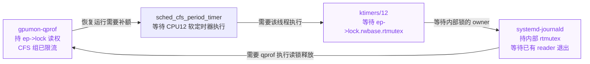
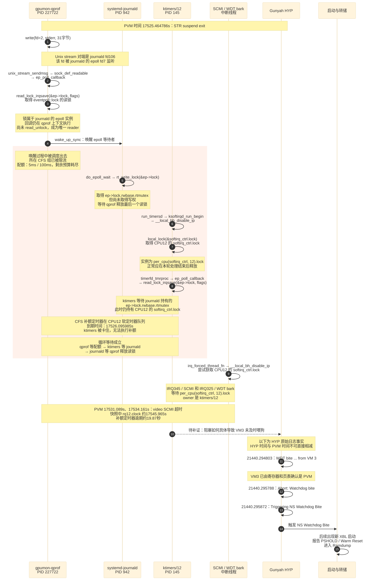

+++
title = 'PVM STR 唤醒后 epoll 与 CFS 配额循环等待的根因分析'
date = '2026-10-14T12:10:00+08:00'
draft = false
description = '基于 1009daily341 FULLDUMP，分析 epoll 与 CFS 配额循环等待，对照 Linux 上游已知问题和 6.6.114 修复，并给出 BSP 回移及 STR 验证计划。'
ShowToc = true
TocOpen = true
+++

本次 `1009daily341_fulldump` 已确认的核心故障机制，是 **PVM 中受 CFS CPU 配额限制的 epoll 读锁持有者，与 PREEMPT_RT 写锁等待、CPU12 软定时器执行线程形成循环等待**。

这一机制与 Linux 社区已经报告的 eventpoll、rwlock 和 CFS bandwidth 停滞问题一致。上游已通过 **`eventpoll: Replace rwlock with spinlock`** 修复，并回移到 Linux 6.6.114。本次运行态仍使用旧的 rwlock 路径，下一步应优先评估该修复在当前 BSP 中的完整回移与验证。提交和版本依据见第九节。

`gpumon-qprof` 向 journald 写入 stderr 时，在内核 `ep_poll_callback()` 中持有 `ep->lock` 的读锁。该线程被换出后，其所属 CFS 组已耗尽 CPU 配额，恢复运行依赖 CPU12 上的补额软定时器。但执行该定时器的 `ktimers/12` 正在等待 journald 持有的内部 `rtmutex`，而 journald 又等待 qprof 释放最后一个读锁。

HYP 原始日志还明确记录 **PVM 所属 VM3 watchdog bite，随后触发 NS Watchdog Bite**。循环等待和复位触发事实均有独立证据；从这一循环等待到具体哪条 PVM 喂狗调用无法执行，仍需进一步补齐。

关于 socket 对端、回调上下文、epoll 实例锁以及 RT 读写锁的实现，参见配套文章 [Linux socket 与 epoll 回调和 PREEMPT_RT 锁的实现原理]()。本文重点记录本次故障的对象、数值、证据和验证计划。

## 一、案例范围与 STR 现象

平台由 PVM Linux 与 GVM Android 组成，运行在 Gunyah 虚拟化环境中。材料目录名为 `1009daily341_fulldump`，最后失败轮次的串口采集墙钟为 **2026 年 10 月 10 日凌晨**；目录中的 `1009` 不能直接当作故障发生日期。

第 355 轮 STR 测试中，MCU 完成休眠握手，再按测试步骤执行正常唤醒。PVM 记录了完整的 `suspend exit`，Linux 心跳恢复，ADB 上线；GVM 在等待窗口内未上线，也没有 Android 心跳恢复证据。之后出现新的 XBL 启动及 RAMDUMP 入口。

| 采集墙钟，CST | PVM 内核时间 | 记录及意义 |
|---|---:|---|
| 00:28:51 | — | 第 355 轮测试开始 |
| 00:29:29.562 | 17524.138556 s | PVM `PM: suspend entry` |
| 00:29:29.844 | — | MCU 收到 `Soc_SleepDone` |
| 00:29:34.875 至 35.079 | — | MCU 确认 SleepDone 稳定 5 秒，然后进入 Sleep |
| 00:29:40.814 | — | MCU 记录正常唤醒 |
| 00:29:41.528 | 17525.464786 s | PVM `PM: suspend exit`，休眠约 10.977 秒 |
| 00:29:42.023 | — | MCU 检测到 Linux 心跳；测试中 PVM ADB 在 1587 ms 内上线 |
| 00:29:47.259 | 17531.089137 s | SCMI 请求超时，随后 `video_perf_clk` 返回 `-110` |
| 00:29:50.274 | 17534.161136 s | 同一 SCMI 实例再次超时，随后 `video_perf_bw` 返回 `-110` |
| 00:29:55.600 附近 | — | Android 心跳仍为 0，GVM ADB 等待约 15 秒失败 |
| 00:31:37.665 | 新启动阶段 | 出现新 XBL 启动头 |
| 00:31:39.183 | 新启动阶段 | 进入 RAMDUMP 路径 |

串口墙钟是采集时间，可能包含传输或缓存延迟；它与内核时间不能简单逐条作精确换算。现有 MCU 记录支持正常休眠握手和正常唤醒步骤，不支持把本次故障直接解释为“MCU 在 PVM 入睡中途异常打断”。

## 二、根因中的三个参与者和两类锁

### 2.1 参与者

| 任务 | PID 或 TID | 快照中的核心状态 |
|---|---:|---|
| `gpumon-qprof` | 227722 | 已持 `ep->lock` 读权；任务为可运行状态，但所在 CFS 组被限流 |
| `systemd-journald` | 942 | 已持 `ep->lock.rwbase.rtmutex`，在 `rt_write_lock()` 中等待读者退出 |
| `ktimers/12` | 145 | 在 timerfd 的 epoll 回调中，等待同一内部 `rtmutex` |
| `irq/345-arm-scm` | 286 | 等待 CPU12 的 `softirq_ctrl.lock`，尚未推进到 SCMI handler |
| `irq/325-wdt_bar` | 264 | 等待同一 CPU12 `softirq_ctrl.lock` |

任务名字段中 journald 被截断显示为 `systemd-journal`，可执行文件为 `/usr/lib/systemd/systemd-journald`。qprof 的可执行文件为 `/usr/bin/polaris-gpumon-qprofiler-worker`。

### 2.2 锁的名称与地址

| 对象或字段 | 本次地址 | 归属与作用 |
|---|---|---|
| `struct eventpoll` | `0xffff307200e15200` | journald 的 epoll fd7 对应的实例 |
| `ep->lock` | `0xffff307200e152c0` | 该实例的读写锁；qprof 持读权 |
| `ep->lock.rwbase.rtmutex` | `0xffff307200e152c8` | 上述读写锁内部的互斥锁；journald 持有，ktimers 等待 |
| `per_cpu(softirq_ctrl, 12).lock` | `0xffff30f29dd42b90` | CPU12 的 BH 控制锁；ktimers 持有，相关 IRQ 线程等待 |

前两种锁字段不是三个互不相关的业务锁：`ep->lock.rwbase.rtmutex` 是 `ep->lock` 的内部组成部分。`softirq_ctrl.lock` 则是另一把独立的 CPU 局部锁。

每个 epoll 实例都有自己的 `ep->lock`。本次共享同一把锁，是因为 qprof 所写 socket 的接收端和 ktimers 正在处理的 timerfd 通知，都指向这个 journald epoll 实例。具体注册机制见 [原理篇]()。

## 三、触发路径是 qprof 向 journald 写日志

### 3.1 从系统调用确认写入对象

qprof 保存的 ARM64 `pt_regs` 中：

```text
syscallno = 64       对应 write
orig_x0   = 2        fd2，即 stderr
x2        = 31       写入长度 31 字节
```

实际 fd 和 socket 映射为：

```text
gpumon-qprof fd2
  → file 0xffff30728462c480
  → sk   0xffff307207ba1200
  → unix_sock.peer = 0xffff307207ba5a00

systemd-journald fd106
  → file 0xffff30720aaad800
  → sk   0xffff307207ba5a00
  → peer 反指 0xffff307207ba1200

systemd-journald fd7
  → file 0xffff307207069200
  → private_data = 0xffff307200e15200
  → eventpoll_fops
```

对端 Unix socket 路径为 `/run/systemd/journal/stdout`。这个连接实际承载本次 stderr 写入；路径名称包含 `stdout` 并不改变系统调用中的 fd2 事实。

还从当前回调恢复出 `epitem = 0xffff3072035dbf00`，其 `epi->ep`、`epi->ffd.file` 和 `epi->ffd.fd` 分别对应上述 epoll 实例、journald 接收文件和 fd106。对端身份因此由双向 peer 指针、fd 表和监听项共同确认，并非根据锁 owner 名称推测。

### 3.2 为什么发送者持有接收方 epoll 的读锁

关键调用路径按执行方向展开为：

```text
write(fd2, ..., 31)
  → sock_write_iter
    → unix_stream_sendmsg
      → sock_def_readable
        → socket 等待队列唤醒
          → ep_poll_callback
            → 获取 ep->lock 读锁
            → wake_up_sync(&ep->wq)
              → ep_autoremove_wake_function
                → try_to_wake_up
                  → preempt_schedule
```

回调仍在 qprof 的内核上下文执行。qprof 是 socket 的发送者，同时是 `ep->lock` 的 reader；reader 表示持有共享读权，与应用是否调用 `read()` 无关。

`wake_up_sync()` 不要求 qprof 等待 journald 完成业务处理。`sync` 是唤醒路径携带的调度提示，不是 RPC 式的完成握手。此次停在唤醒内部，说明调度发生在持锁区间，不能单独推出死锁。

## 四、逐项闭合循环等待

### 4.1 qprof 已经持有读锁，但所属 CFS 组失去运行资格

qprof 的快照状态是：

```text
__state       = 0      TASK_RUNNING
on_rq         = 1
on_cpu        = 0
prio          = 120
pi_blocked_on = 0
```

它并不是在等待另一把 RT mutex，而是已经被换出的任务。其所属组为 `/system.slice/polaris-gpumon.service`：

| 字段 | 值 |
|---|---:|
| `cfs_rq` | `0xffff307205f08a00` |
| `nr_running` | 2，含 qprof 与同组另一线程 |
| `throttled` | 1 |
| `runtime_enabled` | 1 |
| `runtime_remaining` | -173174 ns，按有符号数解释 |
| 组剩余 `runtime` | 0 |
| `quota` | 5000000 ns，即 5 ms |
| `period` | 100000000 ns，即 100 ms |

这是整个组共享约 5% 单 CPU 的时间预算，不是每个线程各有 5 ms，也不是整机 18 个 CPU 的 5%。同组任务在多个 CPU 上消耗的运行时间也要计入组的总预算。

任务本身保持 `TASK_RUNNING`，不代表此刻有资格被根调度队列选中。CFS 限流可以摘掉组在上层的调度实体，让子队列仍有 runnable 任务，而 CPU 根队列为空。这也解释了本次部分 CPU 处于 idle 的快照。

### 4.2 qprof 是同一 epoll 的唯一 reader

以下证据互相对应：

- 该 epoll 的有效读者计数为 1；
- qprof 返回位置为 `ep_poll_callback+0xe0`，位于获取读锁之后、释放读锁之前；
- 原始反汇编显示 `+0xdc` 调用唤醒函数，之后才进入解锁路径；
- 从嵌套调用栈保存的寄存器恢复出 `ep = 0xffff307200e15200`，与 journald fd7 的对象一致。

恢复 ep 指针的关键栈帧为 `0xffff80008dccba00`，其 `FP+0x18` 保存的值为上述 ep 地址。这一步避免了仅凭函数名相同，就把不同 epoll 实例混为一谈。

### 4.3 journald 已占内部 rtmutex，但还没有写权

journald 的调用位置为：

```text
do_epoll_wait → rt_write_lock → schedule_rtlock
```

内部 `rtmutex.owner` 解码后为任务 `0xffff3072060e3180`，即 PID942。读者计数仍为 1，表示它正在等旧 reader 退出，尚未完成写锁获取。

因此，journald 的 `pi_blocked_on=0` 并不表示它没有等待。这里的等待条件是“已有读者归零”，而它已经是内部互斥锁的 owner。

### 4.4 ktimers 等待同一个内部 rtmutex

ktimers/12 的调用位置为：

```text
timerfd_tmrproc → ep_poll_callback → rt_read_lock → schedule_rtlock
```

`pi_blocked_on = 0xffff8000805e3ac0` 对应的 waiter 中，`lock = 0xffff307200e152c8`，正好是上述 epoll 的内部 rtmutex；其 owner 就是 journald。

ktimers 此时是“正在申请读锁的新读者”，尚未成功进入读侧，因此不会把已有读者计数从 1 增加到 2。它和 qprof 的区别是：qprof 已持读权，ktimers 尚未取得读权。

### 4.5 补额定时器恰好依赖被阻塞的 ktimers

该 CFS 组的 `period_timer` 有以下现场属性：

```text
callback       = sched_cfs_period_timer
period_active  = 1
state          = 1
is_soft        = 1
timer base     = CPU12 soft MONOTONIC base
base 地址      = 0xffff30f29dd46000
到期时间       = 17526.095984722 s
CPU12 rq.clock = 17545.965121593 s
```

依据所恢复的 CPU12 时钟估算，该补额定时器已经逾期约 19.87 秒。时间过了 100 ms，并不代表预算会在没有代码执行的情况下自动增加：必须执行 `sched_cfs_period_timer()` 及其补额、分发路径。

此平台在 PREEMPT_RT 下将未指定 HARD 模式的相关 hrtimer 放入软定时器执行路径。CPU12 的 ktimers 同步调用 timer callback；当前 timerfd 回调不返回，后续补额 callback 就无法由该线程推进。

由此形成完整闭环：



## 五、为什么 CPU 配额是关键条件

### 5.1 普通抢占本身不构成这个死锁

假设保留相同的 epoll 锁等待，但 qprof 没有被配额限流，也没有其他阻塞或长期饥饿条件：

1. qprof 持读锁后被抢占；
2. journald 等待读者退出并睡眠；
3. ktimers 等待内部 rtmutex 并睡眠；
4. qprof 仍有运行资格，调度器可以再次运行它；
5. qprof 从被打断的位置继续，释放读锁，随后唤醒 writer。

已有 reader 解锁不需要先获得 writer 持有的内部 rtmutex。因此，单纯“在 wakeup 中被换出”只造成暂时的锁持有延长，不能直接推出永久循环等待。

| 场景 | qprof 恢复的条件 | 是否形成本案闭环 |
|---|---|---|
| 普通抢占，仍有运行资格 | 再次被调度 | 不会仅因这一次抢占而形成闭环 |
| 配额耗尽，补额正常 | 定时器补额后再次被调度 | 通常表现为有限等待 |
| 配额耗尽，补额线程又被该锁依赖链阻塞 | 需要 ktimers，而 ktimers 间接需要 qprof | 形成本次循环等待 |

CFS 配额控制的正常作用，就是限制组在每个周期内的 CPU 运行时间；父组限流也可能限制子组。这一基本语义见 [Linux CFS Bandwidth Control](https://docs.kernel.org/scheduler/sched-bwc.html)。本次异常发生在解除限流所依赖的执行路径又被锁关系阻断之后。

### 5.2 CPU 空闲为什么也不能直接运行 qprof

CPU 空闲描述的是当前没有可选的运行任务；qprof 被限流描述的是它所在组暂时失去调度资格。两者可以同时成立。

快照中 PVM CPU12 至 CPU17 位于 idle 路径，CPU0 至 CPU11 位于与离线 CPU 一致的 PSCI CPU_OFF 路径。这些状态与已验证的 CFS 限流相容，不需要假设所有 CPU 正在忙等 GPU，也不能仅因 CPU 空闲就排除调度相关故障。

### 5.3 优先级继承为什么没有解除循环

ktimers 以及其他等待者可以通过内部 rtmutex 提升 journald 的优先级。本次 journald 的普通优先级为 120，有效优先级已变为 49；ktimers 的普通优先级为 98，有效优先级也为 49。

但 qprof 仍为 120。它是已有 reader，并不是内部 rtmutex 的 owner。本版本的共享读锁实现不能沿这条关系，把 writer 继承到的优先级继续传给已有 reader。即使 writer 优先级提高，也无法代替 qprof 执行读者计数递减。

“唯一 reader”是这个现场的状态，并不意味着实现会动态把该 reader 变成内部 rtmutex 的 owner，或自动改成单 owner 的优先级继承模型。原理和源码对应关系见 [配套原理篇]()。

## 六、softirq_ctrl.lock 将局部循环扩散到中断处理

ktimers/12 在进入定时器处理前，通过以下路径取得 CPU12 的 BH 控制锁：

```text
run_timersd
  → ksoftirqd_run_begin
    → __local_bh_disable_ip
      → local_lock(&softirq_ctrl.lock)
```

它正常应在完成本轮软中断处理后，通过 `ksoftirqd_run_end()` 和对应的 BH enable 路径释放。现在 timerfd 回调尚未返回，ktimers 已阻塞于 epoll 内部 rtmutex，外层 `per_cpu(softirq_ctrl, 12).lock` 仍由它持有。

该锁地址 `0xffff30f29dd42b90` 的归属经过两种方式核验：

- 由实际 `softirq_ctrl` 符号加 CPU12 的 `__per_cpu_offset` 得到该地址，并用实际 BTF 验证成员偏移；
- 从 SCMI、WDT bark 等线程的 waiter 反查 owner，得到 `ktimers/12` 任务 `0xffff307180fb8000`。

IRQ345 的 SCMI 实例为 `arm-scmi.19.auto`，与 video 性能域超时日志指向的实例一致。因此，SCMI `-110` 至少存在明确的 PVM 本地中断处理受阻因素；不能只凭超时就判定 AOP 或其他固件没有回应。

WDT bark IRQ325 也等待该锁，但 bark 是 watchdog 事件处理路径，不能把“bark handler 未推进”直接等价为“喂狗函数被卡住”。完整 pet 路径仍是下一步需要补齐的因果环节。

## 七、从 STR 恢复到 watchdog 的重建时序

下图保持参与线程之间的时序表达，直接使用内核锁名。紫色调用文字表示 `ep->lock` 及其内部 rtmutex，蓝色表示 CPU12 的 `softirq_ctrl.lock`。图中部分先后顺序来自快照与源码依赖关系，不能替代完整调度 trace；通向未及时喂狗的虚线明确表示仍需补证。



颜色使用 Mermaid 的 `themeCSS` 对消息文字设置；消息顺序变化时需要同步更新样式选择器。颜色只是辅助，锁的完整名称和作用不依赖颜色区分。

## 八、watchdog 与 FULLDUMP 的直接证据

从 OCIMEM 中取得 HYP 诊断缓冲区地址后，在原始 DDR 中读到连续记录：

```text
20   21440.294803 WDT bite: now_ticks 574752289, last_pat 574424638, from VM 3
20   21440.295788 Abort: Watchdog bite from PC 0xffffff852d274e00, FP 0xffffff8cb8110e70
20   21440.295872 WDT: Triggering NS Watchdog Bite
```

VM3 的归属经过保存的 VBAR、TTBR1 页表和 PC/LR 代码地址核对，确认对应本次 PVM。上述三条记录也处于 HYP 环形日志末端的连续高时间戳区域，支持它们属于本次故障尾部。

这里能确认的是：PVM 虚拟 watchdog 超时，HYP 随后触发 NS watchdog。HYP 时间 `21440.xxx` 与 PVM 内核时间 `175xx.xxx` 属于不同时间基准，不能直接相减；`now_ticks - last_pat` 也不能在未确认 tick 频率时自行换算为秒。

后续新 XBL 记录 `PSHOLD / Warm Reset` 并进入 RAMDUMP。设备内 Raw Partition Dump 曾出现写入与关闭错误；后来 QUTS 导出的原始内存包含清单中的 98 个区域，其中 32 个 DDRCS 分段，文件长度与清单一致。设备内写盘失败和后续 QUTS 导出是不同环节；文件齐全且长度一致也不等于已证明每个字节完整无误。

## 九、根因结论的范围

### 9.1 已确认的故障机制

当前内核实现与运行配置组合下，以下条件同时成立：

1. qprof 在 epoll 读临界区中失去执行机会，且所在 CFS 组已被限流；
2. journald 持有内部 rtmutex，等唯一 reader qprof 退出；
3. ktimers/12 被该内部 rtmutex 阻塞；
4. 恢复 qprof 调度资格所需的补额软定时器也依赖 ktimers/12；
5. 该 RT 共享读锁关系不能通过 writer 的优先级继承直接恢复 qprof。

这是涉及调度资格、内核锁和软定时器的循环等待，也就是系统无法依靠这些相互依赖的正常路径自行推进的活性故障。CPU 配额本身是合法的资源控制机制；持锁期间被抢占也是此 RT 实现允许的行为。问题出在这些机制组合后形成无法自行解除的依赖环。

### 9.2 上游已有相同依赖机制的报告和正式修复

2023 年 10 月 12 日，Valentin Schneider 发布了 [Stall caused by eventpoll, rwlocks and CFS bandwidth controller](https://lkml.rescloud.iu.edu/2310.1/06233.html)。报告描述的关键依赖与本次现场对应如下；这是机制和对象角色的比对，不要求两次故障使用相同应用。

| 上游报告中的角色或条件 | 本次 dump 的对应证据 |
|---|---|
| `p_read` 在 `ep_poll_callback()` 读临界区被 CFS 限流 | qprof PID227722 持读锁，组配额 5 ms / 100 ms，`throttled=1` |
| `p_write` 等待已有 reader 退出 | journald PID942 持内部 rtmutex，等唯一 reader qprof |
| ktimers 在 timerfd 回调中等待同一读锁 | ktimers/12 PID145 等待同一 `ep->lock.rwbase.rtmutex` |
| reader 的补额依赖该 CPU 的 ktimers | `sched_cfs_period_timer` 位于 CPU12 软定时器队列，已逾期约 19.87 秒 |

报告还提到 `sock_def_readable` 这一类可轮询文件的通知路径。本次 qprof 写 stderr 所触发的 socket 回调与其问题范围相符。

正式修复由 Nam Cao 提交，标题为 `eventpoll: Replace rwlock with spinlock`。以下提交关系、发布版本和 `Closes` 关联可在 [Linux 6.6.114 官方 ChangeLog](https://cdn.kernel.org/pub/linux/kernel/v6.x/ChangeLog-6.6.114) 中核验：

| 项目 | 标识 |
|---|---|
| 上游修复 | `0c43094f8cc9d3d99d835c0ac9c4fe1ccc62babd` |
| 6.6.y 回移 | `eb0d280c2751dd9ac95133641471ee53715a75ec` |
| 包含修复的 6.6.y 版本 | Linux 6.6.114，发布于 2025 年 10 月 23 日 |
| 提交的 `Closes` | 指向上述 Valentin 报告的原始邮件 |

修复将实例字段 `ep->lock` 改为 `spinlock_t`，调整相关加解锁操作，并移除已无须支持多个并发生产者的链表辅助函数。其关键效果是让锁具有可用于 RT 优先级继承的明确 owner。**在 PREEMPT_RT 下，该 `spinlock_t` 仍是可抢占的 RT 锁实现；它没有把临界区简单变成不可抢占的 raw spinlock 区间。** 修复前后如何打断本案依赖环，见 [原理篇中的正式修复说明]()。

判断当前 BSP 是否缺少这项修复，应以部署代码为准。本次不仅版本为 `6.6.110-rt61-debug`，实际 DDR 的 BTF、代码和栈还确认 `ep->lock` 是 rwlock，且执行 `rt_read_lock()`、`rt_write_lock()` 路径。因此，本次现场没有采用该锁替换修复；产品构建日期较新不能替代这一核验。

### 9.3 还需要补齐的部分

当前未完整还原：最初是哪一段负载消耗了组预算、每次调度与唤醒的精确先后、PVM 最后一轮喂狗被阻断的具体调用路径，以及 GVM 内部的最终停点。

根因机制现在可以明确对应到上述上游已知缺陷及其修复。qprof 是本次触发路径上的读锁持有者，现有证据不支持把问题定为“GPU Profiler 算法卡死”或“GPU 硬件忙”。补丁在当前 BSP 的适配结果、产品回归结果和具体喂狗失败路径仍需验证；上游已有修复不代表产品已经修复。

本次 PVM dmesg 没有发现旧案中的 RCU stall 信息，`rcu_preempt` 快照位于正常等待路径。旧 `dump-output-dev341` 虽有相似的嵌套唤醒栈，但缺少本次对应的原始 CFS、锁和 timer 证据，不能自动合并为同根因。

## 十、验证方案与下一步行动

### 10.1 优先执行的对照实验

优先级最高的工作是由高通或 BSP 内核维护方核对并回移 `eb0d280c2751`，或集成含等价完整修复的受支持版本。在补丁评估和集成期间，配额对照仍可用于验证机制及评估临时规避。

| 组别 | 改变的因素 | 保持的条件 | 验证目的 |
|---|---|---|---|
| 基线组 | 无 | 当前内核、5% 配额、journald 日志路径、Profiler 功能及 STR 负载 | 记录复现轮次与故障特征 |
| 修复验证组 | 回移上述正式修复及必要配套改动 | 保留 5% 配额、journald 路径和 Profiler 功能 | 验证已知缺陷被修复，而非仅移除了触发负载 |
| 配额对照组 | 取消服务的 CPU 硬配额，并核对上级组 | 保留 Profiler 功能、日志路径和负载 | 验证移除“reader 恢复依赖补额”是否打断闭环 |
| 日志路径对照组 | 隔离 qprof stderr 经 journald 的路径，保留必要日志 | 保留配额与其他负载 | 验证本次 socket 就绪回调的触发作用 |

取消配额是针对已识别依赖边的验证和临时规避方向，需要同步评估 CPU 负载与产品资源约束。仅提高配额可能降低撞上此时序的概率，但没有从机制上消除配额耗尽条件。

关闭整个 Profiler 后不复现，只能说明移除了某些触发条件；它同时改变 CPU 消耗、日志事件和调度时序，不能单独区分根因。应优先使用单因素对照。

### 10.2 向高通或内核维护方提交的内容

提交时应给出同一个 epoll 对象及其 reader、内部 mutex owner、等待者地址，并同时提供 CFS 限流和补额软定时器的 CPU 归属。问题可以明确表述为：

> 本次 dump 的 epoll reader、writer、ktimers 与 CFS 补额定时器循环依赖，和 Valentin Schneider 2023 年报告的机制逐项吻合。上游修复为 `0c43094f8cc9`，6.6.y 回移为 `eb0d280c2751`，已进入 Linux 6.6.114；当前部署内核仍使用 rwlock 及 RT 读写锁路径。请确认当前 BSP 是否包含该提交或等价修复，评估完整回移及配套依赖，并在保留 CPUQuota、journald 日志路径和 Profiler 功能的条件下完成 STR 回归。同时请补齐该停滞导致 PVM 喂狗失败的具体调用链。

回移应覆盖锁类型、初始化、全部相关加解锁调用和链表操作，不能只把字段类型替换掉。官方 6.6.114 同批记录还将注释整理提交 `f72553935a539c1c59b589e56fad7073b4cf794e` 标为该修复的 `Stable-dep-of`；应一起检查回移上下文，但不能据此假定所有 BSP 的依赖与冲突都相同。该正式方案使用 `spinlock_t`，不是 `raw_spinlock_t`，也不要求直接把本案 timer 改为 HARD 模式。

### 10.3 补齐因果链与验收指标

| 行动项 | 需要形成的结果 |
|---|---|
| 核对补丁的源码与部署状态 | 检查等价代码而非仅查提交号；用匹配符号或运行态确认 epoll 已采用新锁模型 |
| 跟踪 PVM pet 线程、工作队列或定时器 | 明确最后一次成功喂狗及下一次未执行的依赖链 |
| 对齐 HYP 与 PVM 时钟 | 建立可靠时间锚点，不直接相减两个日志时间 |
| 获取匹配的 PVM ELF 和模块符号 | 正式复核未覆盖结构、模块及调用链 |
| 继续解析 GVM 现场 | 确定 GVM 未恢复的内部停点及与 PVM 故障的关系 |
| 持续 STR 回归 | 在相同负载下比较循环次数、补额恢复、SCMI 响应及 watchdog 结果 |
| epoll 并发与实时性能回归 | 验证事件吞吐、尾延迟、CPU 隔离场景及关键实时线程响应 |

回归时应采集 CPU 配额配置与层级、限流统计、关键任务调度事件、hrtimer 执行以及相关锁等待。可用 tracepoint 名称应以设备实际提供的列表为准。通过标准应包括补额定时器能继续执行、epoll 等待链能解除、SCMI 及心跳正常，而不能仅以单次没有重启作为修复证明。

修复改变了事件生产者之间的并发模型，上游提交也说明了高竞争基准中的吞吐权衡。此外，2026 年 3 月已有针对 x86 PREEMPT_RT、隔离 CPU 场景的 [osnoise 回归报告](https://lists.openwall.net/linux-kernel/2026/03/26/1484)。该报告不证明本 BSP 会出现同样退化，但支持在产品验收中同时检查实时尾延迟，不能只验证不再死锁。

## 十一、符号可信度与复核方法

随包 `vmlinux_pvm` 与实际 DDR 的构建版本不同：

| 来源 | 构建时间，UTC | Build ID |
|---|---|---|
| 随包 ELF | 2026-10-01 18:41:43 | `091bc7042a2ac18f0be9848437191c7aed912426` |
| 实际 DDR | 2026-10-08 18:42:04 | `d7848871e0d08657f4966b9c1d124be9e94cafba` |

两者均为 `6.6.110-rt61-debug`，但 release 名称相同不代表符号可以直接套用。本次对关键结论采取了以下校准：

- 从实际 DDR 恢复 142289 个 kallsyms 符号，校准运行地址；
- 通过 KASLR、物理基址、kimage 映射及页表交叉检查地址；
- 用实际 DDR BTF 对照关键 task、CFS、hrtimer、eventpoll、RT 锁和 fd/socket 结构；
- 对 qprof 回调的加锁、唤醒、解锁位置及保存寄存器路径核对原始指令；
- 核对任务链表完整性，并将恢复的 SCMI dmesg 与串口记录互证。

本次使用的关键对象和字段已获得独立验证，不能因为 ELF 不匹配就把这些证据全部视为猜测；也不能由此保证未核验结构和模块的所有解析结果都正确。获取完全匹配的符号仍是正式复核的一部分。

## 十二、证据与源码索引

原始案例目录：

```text
D = /home/voyah/Downloads/1009daily341_fulldump
```

分析产物根目录：

```text
A = /home/voyah/Documents/Codex/2026-10-13/home-voyah-downloads-h47a-22272
```

这些是分析机器上的本地取证路径，不是站点公开下载地址。下表路径相对 `A`，行号对应本次导出的文本。

| 结论或数据 | 产物 |
|---|---|
| 整体分析与时间线 | `outputs/1009daily341-fulldump-analysis.txt` |
| 符号校准与核心机制汇总 | `outputs/1009daily341-pvm-symbol-trial.txt` |
| 社区报告与正式修复检索记录 | `outputs/1009daily341-upstream-epoll-rt-cfs.txt` |
| socket 对端与 epitem | `work/dump-daily341/trial-socket-peer-findings.txt`、`work/dump-daily341/trial-socket-peer/socket-peer-probe.json` |
| journald fd7 与 fd106 | `work/dump-daily341/trial-journal-fd-mapping.txt`、`work/dump-daily341/trial-journal-files/journal-files.json` |
| qprof 栈 | `work/dump-daily341/trial-pvm/tasks.txt:61291` |
| ktimers 栈 | `work/dump-daily341/trial-pvm/tasks.txt:1926` |
| journald 栈 | `work/dump-daily341/trial-pvm/tasks.txt:11765` |
| RT 锁 waiter、owner、reader | `work/dump-daily341/trial-rtlocks/rtlocks-probe.json`、`work/dump-daily341/trial-rtlocks-summary.txt` |
| qprof 的 ep 指针与调用位置 | `work/dump-daily341/trial-qprof-ep-frame-disassembly.txt` |
| CFS 配额与补额 timer | `work/dump-daily341/trial-state/state-probe.json` |
| CPU12 BH 锁地址推导 | `work/dump-daily341/trial-ktimers-softirq-lock-mapping.txt` |
| HYP watchdog 原文 | `work/dump-daily341/hyp-diag-ascii-fragments.txt:23`、`work/dump-daily341/hyp-log-ring-reconstructed.txt:167` |
| PVM CPU 上下文 | `work/dump-daily341/trial-debug-context-v2/cpu-contexts.json` |
| 关键数据结构布局 | `work/dump-daily341/btf-layout-comparison.txt`、`work/dump-daily341/btf-fd-socket-layout-comparison.txt` |

本地带平台 RT 改动的参考源码根目录：

```text
K = /home/voyah/workspace/8397/linux/apps/apps_proc/build-auto-voyah/tmp-glibc/work-shared/gen5/kernel-source
```

| 相对 K 的位置 | 对应机制 |
|---|---|
| `fs/eventpoll.c:1203`、`:1270`、`:1279` | 回调取读锁、持锁唤醒、最终解锁 |
| `kernel/locking/rwbase_rt.c:53`、`:168`、`:231` | reader 计数、读解锁、writer 占内部锁后等待读者 |
| `kernel/sched/fair.c:5679`、`:5810` | 配额消耗与 throttle |
| `kernel/sched/fair.c:6110`、`:6349`、`:6414` | 补额、period callback 和 timer 初始化 |
| `kernel/time/hrtimer.c:1618`、`:1755`、`:1826` | RT soft timer 选择及 callback 执行 |
| `kernel/softirq.c:164`、`:283`、`:1041` | BH 锁取得与 ktimers 外层执行路径 |

进一步阅读：[socket 与 epoll 原理篇]()、[Linux CFS 带宽控制](https://docs.kernel.org/scheduler/sched-bwc.html)、[Linux PREEMPT_RT 锁规则](https://www.kernel.org/doc/html/latest/locking/locktypes.html)。官方文档解释通用语义，现场对象关系与平台线程实现以上述 dump 和本地源码核验为依据。
