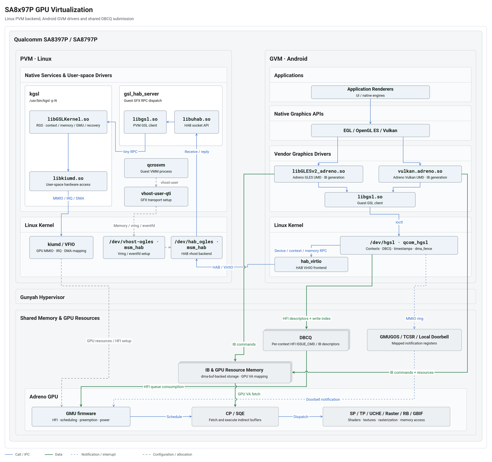
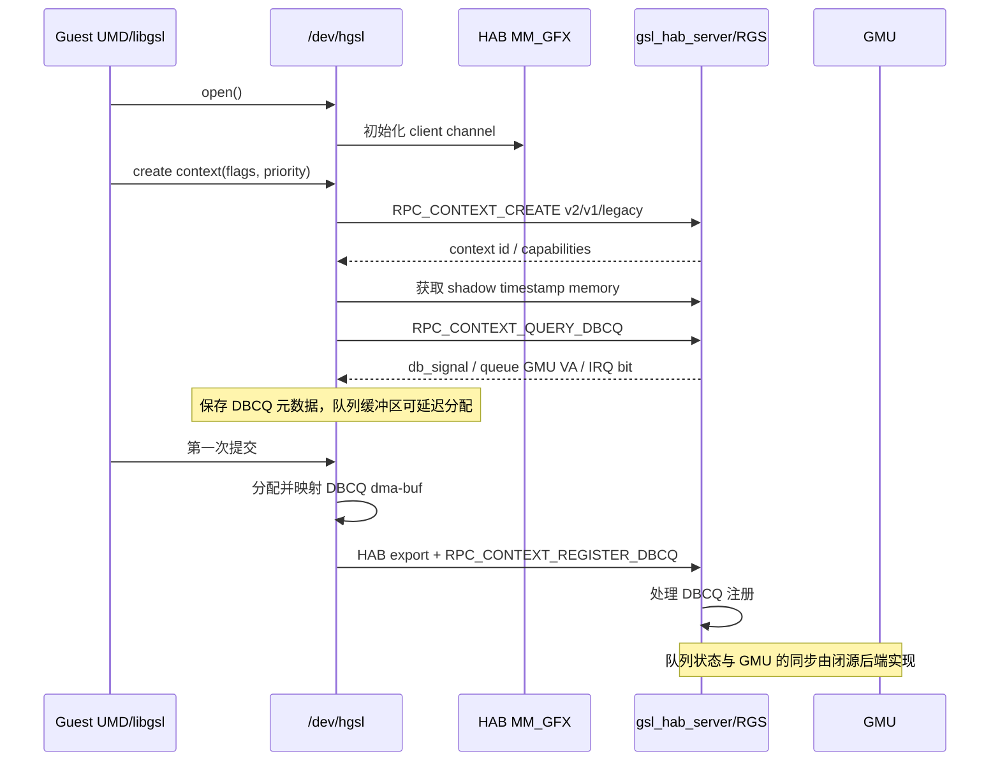
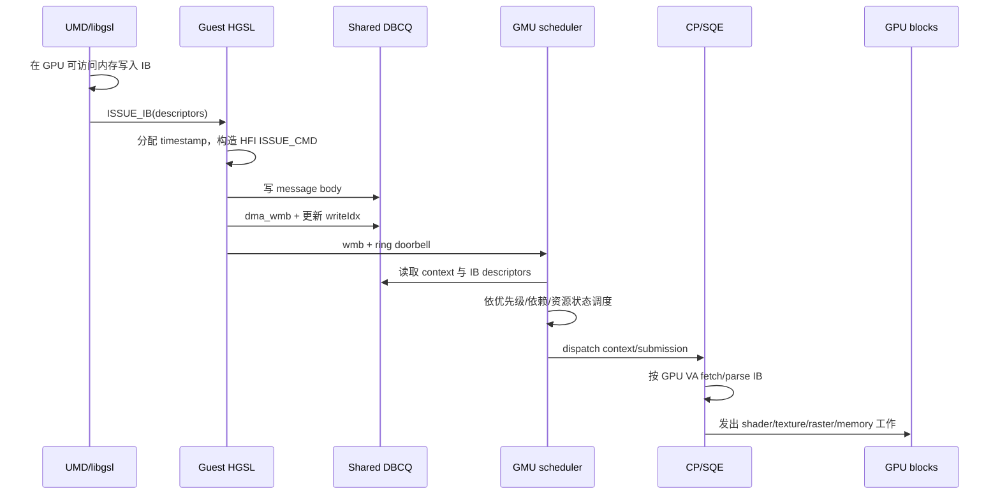
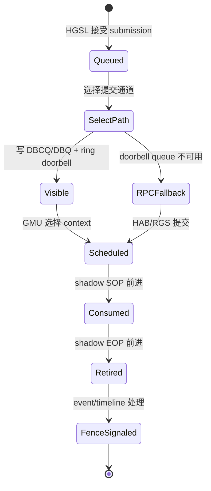
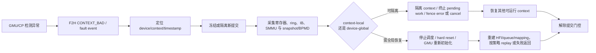

+++
date = '2026-07-19T10:00:00+08:00'
draft = true
ShowToc = true
TocOpen = true
title = 'SA8x97P（SA8397P/SA8797P）GPU 虚拟化工作原理与代码框架'
tags = ["Qualcomm", "SA8397P", "SA8797P", "Adreno", "GPU", "Gunyah", "HGSL", "RGS"]
+++

## 1. 概述

本文介绍 Qualcomm Gen5/SA8x97P BSP 中 SA8397P 与 SA8797P 平台的 GPU 虚拟化架构，涵盖软件分层、核心对象、命令提交、完成同步、故障恢复及相关源码与构建产物。

### 1.1 适用范围

本文适用于启用 Gunyah GPU 虚拟化的 Gen5 配置。该配置支持 `qti-vmm`；factory/test 等镜像变体可移除此特性。

- **软件共性**：SA8397P 与 SA8797P 同属 Gen5/SA8x97P 构建族，共享 `sa8x97p.dtsi`、HGSL 接口框架和 Gen5 Adreno 用户态软件包。
- **平台差异**：两者的 SoC `compatible`、`msm-id` 及 SoC/板级 DTS/DTBO 配置不同。当前已核验的双 GPU VFIO 资源定义来自 SA8797P，其 GPU 数量、实例编号、IRQ、SMMU SID 和 SCMI power domain 不作为 SA8397P 的资源配置依据。
- **闭源组件**：PVM 的 `/usr/bin/kgsl`、`libGSLKernel.so` 以二进制形式提供，符号已剥离或仅部分可见。本文依据服务定义、动态加载关系、符号与字符串分析其外部接口和职责；内部线程模型、调度算法及恢复状态机尚无源码验证。

**Gen5** 表示 automotive BSP 构建族；`graphics-kernel` 中的 **Gen7** 表示 Adreno 驱动及 HFI/硬件协议代际。本文沿用 BSP/DTS 中的 SA8397P、SA8797P 命名；公开产品资料采用 QAM8397P、QAM8797P 命名，具体软 SKU 与硬件资源对应关系不在本文确认范围内。

技术结论按证据类型区分如下：

| 标记 | 含义 |
|---|---|
| **源码可见** | 数据结构、函数和控制流可由当前源码直接确认 |
| **产物可证** | 组件关系可由 systemd unit、recipe、ELF 依赖、导出符号或镜像内容确认 |
| **实现推断** | 依据接口和二进制证据推断职责或行为，尚缺少内部实现的直接证据 |

### 1.2 架构职责与通信边界

1. **渲染与显示输出**：Adreno GPU 负责渲染，DPU 负责显示合成与扫描输出（scanout）。GPU retire、SurfaceFlinger latch、HWC present 和面板显示分别对应不同阶段的完成状态。
2. **控制与命令提交**：context、内存和 DBCQ 的建立主要通过 HAB 完成；DBCQ 可用时，常规 IB 提交通过共享队列与 doorbell 通知机制完成，无需逐次经过 `gsl_hab_server` 用户态 RPC。

## 2. 总体架构



[查看原尺寸图片](../../images/sa8797-sa8397-gpu-architecture.png) · [下载可编辑 draw.io 文件](../../images/sa8797-sa8397-gpu-architecture.drawio)

图中按 **PVM / GVM → Gunyah Hypervisor → 共享内存与 GPU** 展开部署关系，并区分三条路径：

- **控制 RPC**：Guest HGSL 经 HAB / VirtIO 到达 PVM 的 `gsl_hab_server`，由 `libuhab.so` 接收请求，再通过 `libgsl.so` 连接 `kgsl` 进程中的 `libGSLKernel.so`。后者依赖 `libkiumd.so` 访问内核提供的 GPU 资源。
- **DBCQ 快速提交**：HGSL 向共享队列写入 HFI 描述符，再通过映射的 doorbell 寄存器通知 GMU。该路径无需逐次经过 PVM 用户态 RPC。
- **IB 读取与执行**：Adreno UMD 生成 IB，GMU 调度后由 CP/SQE 按 GPU VA 读取并执行。DBCQ 存储提交描述符，IB 内存存储命令本体。

总体架构图展示 DBCQ 快速提交路径；DBQ / HAB 回退机制和 retire 同步分别见第 7、9 节。

### 2.1 GPU 提交处理流程

一次 GPU 提交的主要处理阶段如下：

1. UMD 将 OpenGL ES/Vulkan 请求转换为 Adreno 命令，并写入 GPU 可访问内存中的一个或多个 IB；Skia 等渲染框架的 GPU 后端通过相应图形 API 提交渲染请求。
2. Guest `libgsl` 通过 `/dev/hgsl` 提交 IB 的 GPU 地址和长度。
3. HGSL 为 context 分配 timestamp，构造 HFI `ISSUE_CMD`，其中包含 context、timestamp、flags 和 IB descriptor。
4. 优先将 HFI 消息写入该 context 的 DBCQ，更新写指针并触发 doorbell。
5. GMU 接收通知并进行调度；CP/SQE 按 descriptor 中的 GPU 地址读取 IB。
6. GPU 执行单元完成 shader、纹理、光栅化、混合和内存访问。
7. 完成状态通过 shadow timestamp 更新，并由 retire 通知唤醒等待者、推进 fence timeline。

DBCQ 主要承载提交描述信息；IB 命令流和渲染资源存放于独立的 GPU 可访问内存中。

## 3. 软件分层与组件职责

### 3.1 Android Guest

| 层 | 典型组件 | 主要职责 |
|---|---|---|
| 应用与渲染框架 | App、RenderThread、Skia、游戏引擎 | 生成 draw/dispatch/copy 等高层工作 |
| 图形 API | OpenGL ES、EGL、Vulkan | 定义资源、命令、同步和 present 语义 |
| Adreno UMD | GLES/Vulkan vendor driver | 编译 shader，组织状态和资源，生成 Adreno IB |
| Guest GSL | `libgsl.so` | 向 HGSL 提交 device/context/memory/command 请求 |
| Guest 内核前端 | `qcom_hgsl.ko`、`/dev/hgsl` | 管理 Guest 侧对象、HAB RPC、DBCQ/DBQ、timestamp 和 dma_fence |
| Guest 内存子系统 | dma-buf、IOMMU/SMMU、HGSL MMU | 建立 CPU、Guest、PVM 和 GPU 所需的地址映射 |

GSL/HGSL 负责驱动请求、资源管理与命令提交。UMD 将图形 API 请求转换为 GPU 命令，由 GPU 硬件执行。

### 3.2 跨 VM 传输

| 组件 | 职责 | 职责边界 |
|---|---|---|
| HAB `MM_GFX` | 建立 Guest 与 PVM 图形后端的逻辑通道；传递控制 RPC、资源句柄和回退请求 | 不参与 Adreno shader 或 IB 的解释执行 |
| `vhost-user-qti` / `/dev/vhost-ogles` | 用户态进程配置 memory/vring/eventfd，将通道连接至 kernel vhost；稳态 HAB 载荷由内核数据路径传输 | 提供传输配置与数据通道，不承担 virtio-gpu 渲染或 GPU 调度 |
| DBCQ | 每 context 的共享提交环，传递 HFI `ISSUE_CMD` 和 IB descriptors | 面向 GPU 命令提交，区别于 Android BufferQueue 和 framebuffer |
| Doorbell | 在共享内存写入完成后，通知 GMU/后端处理新提交 | 仅提供通知，不承载 IB 载荷 |

当前实现使用 `MM_GFX` 标识 HAB 图形通道。Guest `hgsl_hyp_socket.c` 封装 HAB socket 的 send/recv/export/import 操作，virtio/vhost 层负责跨 VM 传输。

### 3.3 PVM GPU 后端

Gen5 recipe 与镜像中的服务定义如下：

```text
kgsl@0.service  -> /usr/bin/kgsl -p 0
kgsl@1.service  -> /usr/bin/kgsl -p 1

gsl_hab_server.service
  After: kgsl@0, kgsl@1, vhost-user-gpu
  Requires: vhost-user-gpu
  ExecStart: /usr/bin/gsl_hab_server
```

- `/usr/bin/kgsl` 是服务进程入口。ELF 字符串证据表明，该进程通过 `dlopen()` 加载 `libGSLKernel.so`，并解析 `kgsl_init` 等入口。
- 根据产物与符号分析，`libGSLKernel.so` 承担 RGS 后端、GMU/HFI、物理 GPU 资源、fault/recovery 和 snapshot 等职责。
- `gsl_hab_server` 直接依赖 `libgsl.so` 与 `libuhab.so`，作为 GFX HAB 后端接收 Guest 控制请求并连接 RGS。
- `kgsl@0/@1` 是实例化服务配置；实际启用的服务实例与物理 GPU 数量由平台配置决定。

本文使用 `RGS` 指代 PVM GPU 服务端；当前源码未提供该缩写的完整名称。RGS 与 Android 非虚拟化路径中的内核驱动 `msm_kgsl.ko` 是不同实现。

### 3.4 GMU、CP/SQE 与执行单元

| 模块 | 主要职责 |
|---|---|
| GMU | GPU 电源和时钟协同、context 调度、优先级与抢占、HFI 消息处理、超时和 fault 上报 |
| CP/SQE | 获取、解析和推进 Adreno command stream；按 GPU VA 读取 IB |
| UCHE/缓存层 | 缓存 shader、纹理、顶点、常量和通用内存访问 |
| SP | 执行 vertex/fragment/compute shader 指令 |
| TP | 纹理寻址、过滤和采样 |
| 几何/光栅化单元 | 图元装配、裁剪、光栅化和 early depth/stencil 等 |
| RB | color/depth/stencil 后端、混合和写回 |
| GBIF/系统总线接口 | 连接 GPU 与系统内存 |

上述模块构成 Adreno 的概念性执行流水线。模块数量、缓存容量、并行宽度及产品型号由具体 SKU 与固件配置确定。

## 4. 核心对象

### 4.1 Client、device 与 context

- **Client**：通常对应打开 `/dev/hgsl` 的进程。`hgsl_open()` 为进程创建 `hgsl_priv`，保存 PID、内存树、HAB channel pool 和已激活的 device handle。
- **Device handle**：后端返回的逻辑 GPU 设备标识。源码支持 `DEV0/DEV1`；其与 systemd 实例、Profiler 的 `GPU 1/GPU 2` 标签及物理 GPU 编号的对应关系需由平台配置确认。
- **Context**：GPU 调度、timestamp、队列和同步的核心边界。不同 context 可以具有不同优先级、队列和 fence timeline；GPU VA/page table 是独立对象，通常归属于 client/process，多个 context 可以共享同一地址空间。
- **Address space/page table**：定义 GPU VA 如何映射到物理页或共享内存。是否由 Guest 本地 SMMU 路径完成，取决于 full virtualization 和当前配置。

一个进程可创建多个 context；同一帧的渲染可包含多个 context 或多个 submission。

### 4.2 IB 与 IB descriptor

IB（Indirect Buffer）是 GPU 命令缓冲区。HGSL UAPI 中的基本描述符定义如下：

```c
struct hgsl_ibdesc {
    uint64_t gpuaddr;
    uint64_t sizedwords;
};
```

描述符与命令本体的关系如下：

```text
IB descriptor = {IB 的 GPU 虚拟地址, IB 长度}
IB body       = 位于 GPU 可访问内存中的 Adreno 命令流
```

UAPI 字段 `sizedwords` 以 32 位 dword 为单位。HGSL 组装固件描述符时，通过 `sizedwords << 2` 将长度转换为字节；后文 HFI 字段表采用字节单位。

IB 与其他图形对象及执行粒度的关系如下：

- IB 存储 Adreno 命令流，区别于存储像素的图像 buffer 和 shader 源码。
- IB 长度表示命令流规模，不能直接反映 GPU 执行时长。
- API draw/dispatch、IB、submission 与帧之间不存在固定的一一对应关系。

当 descriptor 列表超过 HFI 消息的内联容量时，HGSL 使用 DBCQ 的 indirect descriptor 区保存列表，并由 HFI 消息间接引用。该区域存储描述符，IB 命令本体仍保留在原内存中。

### 4.3 DBCQ、DBQ 与 IPCQ

| 名称 | 作用域 | 用途 |
|---|---|---|
| DBCQ | per-context | 新版优先使用的 context 提交环 |
| DBQ | 可被多个 context 关联的兼容队列 | DBCQ 不可用时的 doorbell queue 兼容路径 |
| IPCQ | per-device/后端功能队列族 | 传递 HGSL、RGS、PKMD 等组件的控制或固件协作消息，区别于 context IB 提交环 |

DBCQ 对应源码类型 `doorbell_context_queue`，即每 context 的 Doorbell Context Queue。其用途是 GPU 命令提交，与 Android 图像生产/消费机制中的 `BufferQueue` 不同。

### 4.4 Timestamp 与 fence

context 的提交进度由以下状态表示：

| 状态 | HGSL 表示 | 含义 |
|---|---|---|
| queued | `queued_ts` | 提交已被驱动接受并排队 |
| consumed | shadow `sop` | 表示前端/硬件已消费至该提交的起始点，而非 shader 首条指令的执行起点 |
| retired | shadow `eop` | 该 context 中直到此 timestamp 的工作已到达完成点 |

timestamp 是 context 内的有序序号，不表示墙钟时间。`ISSUE_IB` ioctl 成功表示提交已被接受；GPU 完成状态由 retire 进度确认。

`dma_fence`/`sync_file` 将 timestamp 完成状态导出至 Android 图形栈。fence 是依赖同步对象，用于表示相关工作是否完成。

## 5. 启动、初始化与资源建立

### 5.1 PVM 服务启动

PVM 服务的启动依赖如下：

- VFIO device probe、resource manager 等前置服务为 `kgsl@N` 准备物理 GPU 资源。
- `kgsl@N.service` 启动 `/usr/bin/kgsl -p N`，动态加载 `libGSLKernel.so` 并初始化相应 RGS/GPU 实例。
- `vhost-user-gpu.service` 独立初始化 HAB 的 vhost-user 传输通道；现有 unit 未声明其与 `kgsl@N` 的严格启动顺序。
- `gsl_hab_server.service` 声明在 `kgsl@0/@1` 和 `vhost-user-gpu` 之后启动，随后接收 Guest GFX RPC。

各组件职责如下：

```text
vhost-user-gpu    = HAB transport
gsl_hab_server    = Guest GFX RPC backend
kgsl@N            = RGS 进程入口
libGSLKernel.so   = RGS/GMU/物理 GPU 核心实现
```

### 5.2 Guest HGSL probe

`qcom_hgsl_probe()` 执行以下初始化操作：

1. 注册 `/dev/hgsl` 字符设备与 ioctl 表；
2. 初始化 context、event、dispatch、debugfs/sysfs 等 Guest 数据结构；
3. 建立全局 HAB channel，执行 library open；
4. 向后端打开可用的 device handle；
5. 根据 feature flags 分配 per-device IPC queues；
6. 初始化 GMUGOS/TCSR doorbell 与 retire 通知；
7. 在 full virtualization 模式下绑定 HGSL SMMU component。

上述可选特性的启用状态由 DT、后端协商结果及镜像配置共同决定，可通过启动日志核验。

### 5.3 进程与 context 建立



HGSL 在 context 创建及队列初始化过程中执行版本与能力协商：

1. 优先使用新版 context create 接口。
2. 必要时回退至旧版本或 legacy RPC。
3. 优先通过 `RPC_CONTEXT_QUERY_DBCQ` 查询 DBCQ 能力。
4. 后端不支持 DBCQ 时，尝试兼容 DBQ 路径。
5. 无可用 doorbell queue 时，提交可回退至 HAB `RPC_COMMAND_ISSUEIB`。

该协商机制用于兼容不同 BSP 版本的 Guest driver、PVM RGS、GMU firmware 与 HFI 协议。

## 6. GPU 内存与地址空间

### 6.1 共享内存与跨 VM 数据访问

命令、纹理、vertex/index buffer 和 render target 等对象存储于可共享或可映射的内存中。系统通过 dma-buf、HAB export/import、VFIO 与 SMMU/IOMMU 建立 CPU、Guest、PVM 和 GPU 所需的映射：

```text
Guest CPU VA
    |
    | dma-buf / allocation
    v
Guest-visible memory object
    |
    | HGSL/RGS map + SMMU page table
    v
GPU VA  --------------------> physical/shared pages
```

提交请求传递 GPU VA、长度、context、timestamp 和 flags，GPU 通过地址翻译访问 IB 与资源。HAB/DBCQ 传输提交与控制信息，无需在每次提交时复制完整的渲染资源或像素数据。

### 6.2 两种映射模式

HGSL 支持以下两类映射路径：

- **后端映射路径**：Guest 通过 HAB 导出 dma-buf，RGS/后端执行 GPU SMMU 映射并返回 GPU VA 等信息。
- **Full virtualization 路径**：满足 feature、保护属性和 MMU 条件时，Guest HGSL 可自行选择 GPU VA 并在本地 HGSL SMMU context bank 建立映射。

映射路径由 `fv_on`、后端 feature mask、内存 flags、DT 和镜像配置共同选择。

### 6.3 共享队列的写入顺序与可见性

共享队列要求消息内容、写指针及 doorbell 通知按规定顺序对消费端可见。`dbcq_send_msg()` 的操作顺序如下：

1. 等待 ring 中有足够空间；
2. 处理环回并复制 HFI message；
3. `dma_wmb()`，保证 message body 先对设备可见；
4. 更新 `writeIdx`；
5. `wmb()`，保证写指针先于 doorbell；
6. 触发 GMUGOS、global TCSR 或 local GMU doorbell。

对于非一致性缓存内存，UMD 还需在提交前按内存属性完成相应缓存维护。doorbell 仅提供通知；写入顺序与内存可见性由内存屏障及缓存维护机制保证。

## 7. GPU 命令提交

### 7.1 UAPI 到 HFI 的调用链

legacy `ISSUE_IB` 路径的关键调用链为：

```text
HGSL_IOCTL_ISSUE_IB
  hgsl_ioctl_issueib()
    hgsl_db_issueib()
      hgsl_db_issue_cmd()
        hgsl_dbcq_issue_cmd()       # 首选 per-context DBCQ
          hgsl_dbcq_open()          # 首次使用时分配/注册队列
          dbcq_send_msg()
        db_send_msg()               # 兼容的旧 DBQ
    hgsl_hyp_issueib()              # HAB RPC 最终回退
```

新版 command/drawobj 接口构造 command object 与 sync object，再经 Guest dispatch 路径提交；底层提交模型仍由 context、IB descriptor、timestamp 和完成同步组成。

### 7.2 HFI `ISSUE_CMD`

HGSL 与开源 KGSL/HFI 参考代码均将 `ISSUE_CMD` 定义为 message id `130`。HGSL 构造的消息包含以下主要字段：

| 字段 | 作用 |
|---|---|
| HFI header | message id、类型、dword 数和 sequence number |
| context id | 指定调度与 timestamp 的 context |
| number of IBs | descriptor 数量 |
| command flags | notify、profiling、indirect descriptor 等 |
| timestamp | 本次 submission 的有序完成点 |
| user profile GPU VA | 可选的 profiling buffer |
| IB descriptors | 内联的 `{GPU VA, byte size}`，或指向共享 descriptor 区 |

HFI（Host/Firmware Interface）是主机驱动与固件之间的消息接口。HGSL 通过 HFI 描述待执行的 UMD 命令流，包括 context、timestamp 和 IB descriptor 等信息。

### 7.3 DBCQ 快速提交路径



DBCQ 快速提交路径减少逐次提交的跨 VM RPC 与用户态切换开销。设备、context、内存、策略及恢复仍由 RGS 统一管理。

### 7.4 HAB 回退路径

出现以下情况时，提交可能通过 `hgsl_hyp_issueib()` 回退至 HAB：

- 后端不支持当前 DBCQ/DBQ 协议；
- context 没有可用 doorbell queue；
- 使用了显式 remote channel；
- 新接口因兼容性退回 legacy remote issue。

回退路径将请求和 IB descriptors 封装为 `RPC_COMMAND_ISSUEIB`，经 HAB 发送至 `gsl_hab_server`/RGS，由后端完成提交。该路径用于协议兼容，其 CPU、RPC 与调度开销通常高于共享队列提交路径。

## 8. GMU 调度与 GPU 执行

### 8.1 GMU 调度职责

GMU 以携带 context、timestamp、flags 和 IB descriptors 的 submission 为调度单位，协调以下状态：

- context 优先级和可运行状态；
- 当前 GPU power state 与频点；
- context switch 和 preemption；
- ring/context queue 的前后关系；
- fault、timeout 和恢复状态。

Guest dispatch 在写入 DBCQ 前处理 sync object；同步条件未满足时，不发送 HFI `ISSUE_CMD`。提交进入 DBCQ 后处于 GMU 可消费状态，实际执行时机仍受其他 context、队列顺序、抢占、切换及电源状态约束。

### 8.2 CP/SQE 命令处理

GMU 完成调度后，CP/SQE 根据 IB descriptor 读取命令流。IB 可包含以下内容：

- 寄存器和状态设置；
- shader program 与常量绑定；
- vertex/index/texture/render target 地址；
- draw、dispatch、copy、barrier 和 event；
- 嵌套的 indirect buffer；
- timestamp/event write。

CP/SQE 负责命令解析与分发；shader 运算、纹理采样、光栅化和写回由相应 GPU 执行单元完成。

### 8.3 Long IB 故障语义

在故障语义中，Long IB 表示 submission 未在预期时间内到达 retire 点，描述的是完成时延而非 IB 或 descriptor 的字节长度。可能的影响因素包括：

- shader/dispatch 本身工作量大；
- 资源访问延迟或缓存命中率低；
- 同步、barrier 或循环使流水线无法推进；
- context 被延迟调度或抢占异常；
- GPU、GMU、总线、SMMU 或固件发生 fault。

Long IB 是超时状态标识，不能单独确定故障原因。超时阈值由 BSP、固件和策略配置决定。

## 9. Retire、timestamp 与 fence

### 9.1 正常完成链



HGSL 从共享 shadow timestamp 读取 `sop/eop`。retire doorbell/IRQ 到达后的处理流程如下：

1. ISR 将后续处理调度至 workqueue；
2. `hgsl_retire_common()` 检查 active wait；
3. 等待指定 timestamp 的线程被唤醒；
4. context event group 处理已满足的事件；
5. `hgsl_sync.c` 推进 hsync timeline 并 signal `dma_fence`；
6. Guest dispatch 回收已完成的 drawobj，并继续处理后续提交。

若 shadow timestamp 或 retire doorbell 通知不可用，读取与等待操作可回退至 HAB RPC。

### 9.2 Fence 传播与显示同步

GPU fence 表示相关 GPU 工作的完成状态。producer 可在 fence 尚未 signal 时调用 `queueBuffer()`，将 buffer 与依赖 fence 一并提交。典型异步流程如下：

```text
producer 提交 GPU render
  -> queueBuffer(buffer + 尚未 signal 的 acquire fence)
  -> SurfaceFlinger latch/传递该 fence
  -> GPU retire，fence signal
  -> HWC/DPU 在依赖满足后 present
  -> DPU composition/scanout
  -> panel refresh
```

上述阶段可流水重叠，client composition 还会产生新的 GPU submission 与 fence。GPU retire 与面板显示属于不同完成阶段；present fence 的延迟也可能来自 GPU 之外的显示链路，不能单独作为 GPU hang 的判据。

## 10. GPU 与显示链的接口

GPU 通常将渲染结果写入由 gralloc 分配、通过 GraphicBuffer 管理的 render target。该 buffer 及其 fence 随后传递至 SurfaceFlinger/HWC：

- **Client composition**：SurfaceFlinger 可能再次使用 GPU 合成多个 layer；
- **Device composition**：HWC/DPU 直接读取 layer buffer 完成硬件合成；
- **Mixed composition**：部分 layer 由 GPU 预合成，部分由 DPU overlay。

像素 buffer 通过共享内存及其句柄在组件间共享；DBCQ 传递 GPU 提交描述符。DPU scanout 由显示驱动和显示虚拟化链路处理。

相关显示架构与通信机制参见：

- [Android 图形渲染架构详解]()
- [Android Guest 显示数据通道深度解析]()
- [Qualcomm Display Architecture]()
- [HAB 通信机制]()

## 11. Fault 检测、快照与恢复

### 11.1 HFI fault 语义

开源 `graphics-kernel/adreno_hfi.h` 提供了同代 HFI 的协议语义参考：

| HFI error | 协议含义 |
|---|---|
| 600 | CP hardware error |
| 601 | GPU hardware hang |
| 602 | preemption timeout |
| 603 | software hang / Long IB timeout |
| 604 | bad opcode |
| 605 | protected-mode error |
| 606 | illegal instruction |
| 607 | CP microcode error |
| 608 | CP hardware fault |
| 609 | GPC error |

上述编号用于解释 HFI 错误码。PVM 的故障策略、阈值、过滤与恢复实现位于闭源 RGS/firmware 中，其行为取决于目标版本。

### 11.2 概念性恢复流程

下图依据可见接口与同代开源 KGSL 代码归纳恢复流程，用于说明故障处理阶段及其依赖关系。PVM RGS 的内部状态机尚未获得源码验证；具体阶段、线程、reset 粒度和 replay 策略由目标版本的 `libGSLKernel.so` 与 GMU firmware 实现。



恢复过程包含以下关键要求：

1. **保存故障状态**：在 reset 前采集 snapshot，保留关键寄存器与 ring 状态。
2. **结束受影响依赖**：按处理结果完成或终止相关 submission 的 timestamp/fence，向上层传递成功、取消或错误状态，避免无限等待。
3. **重建设备状态**：按恢复级别重新建立 GMU/HFI、context queue、页表及功耗状态。

开源 `graphics-kernel` 中的 `adreno_hwsched.c`、`adreno_gen7_hwsched*.c`、`kgsl_snapshot.c` 和 `adreno_snapshot.c` 提供 Gen7 HFI、snapshot、reset/replay 的参考实现。这些文件属于开源 KGSL，与 PVM `libGSLKernel.so` 的内部实现不具有已确认的函数或控制流对应关系。

## 12. 术语表

| 术语 | 含义 |
|---|---|
| GVM | Guest VM，本文主要指 Android VM |
| PVM | Primary VM，拥有或管理物理 GPU 资源的 Linux Host |
| UMD | User Mode Driver，将图形 API 请求转换为 GPU 命令 |
| GSL | Guest/PVM 图形服务接口层 |
| HGSL | Hypervisor Graphics System Layer，Guest 内核 GPU 前端 |
| RGS | 本文指 PVM GPU 服务端；当前源码未提供缩写的完整名称 |
| HAB | Hypervisor Abstraction，Qualcomm 跨 VM 通信框架 |
| HFI | Host/Firmware Interface，Host/RGS 与 GMU firmware 的消息协议 |
| GMU | GPU 管理微控制器，负责调度、电源、抢占和 fault 管理 |
| CP/SQE | GPU command processor / sequencer，读取并解释 IB |
| IB | Indirect Buffer，GPU 命令缓冲区 |
| DBCQ | per-context Doorbell Context Queue |
| DBQ | 兼容的 doorbell queue |
| IPCQ | 设备级后端/固件协作队列族 |
| Doorbell | 通知接收端读取共享队列的硬件/虚拟中断信号 |
| GPU VA | GPU 虚拟地址，经 SMMU/IOMMU 映射到内存页 |
| Submission | 一次带 context、IB descriptors 和 timestamp 的提交 |
| Timestamp | context 内有序完成序号 |
| Retire | submission 到达完成点；不表示相关内存立即释放 |
| Fence | 对 timestamp/依赖完成状态的可传递同步对象 |
| Ringbuffer | 环形命令/消息队列 |
| Framebuffer | 用于保存像素结果的图像缓冲区 |
| DPU | Display Processing Unit，负责显示合成和 scanout |

## 13. 总结

SA8x97P 虚拟化 GPU 栈由控制、提交、完成与恢复机制协同工作：

- **控制面**：Guest HGSL 通过 HAB 与 `gsl_hab_server`/RGS 建立 device、context、内存、shadow timestamp 和 DBCQ；
- **提交面**：UMD 向 GPU 可访问内存写入 IB，HGSL 向 DBCQ 写入 HFI `ISSUE_CMD`，更新写指针并触发 doorbell；GMU 完成调度后，由 CP/SQE 读取 IB；
- **完成与恢复面**：shadow timestamp、retire IRQ 和 dma_fence 传播正常完成；GMU/HFI fault 触发 snapshot、context 处置、reset/reinit 和 fence error 传播。

SA8397P 与 SA8797P 共享 Gen5/SA8x97P 软件框架；GPU 数量、资源映射、固件、频点、超时阈值及计数器能力由目标平台配置决定。
