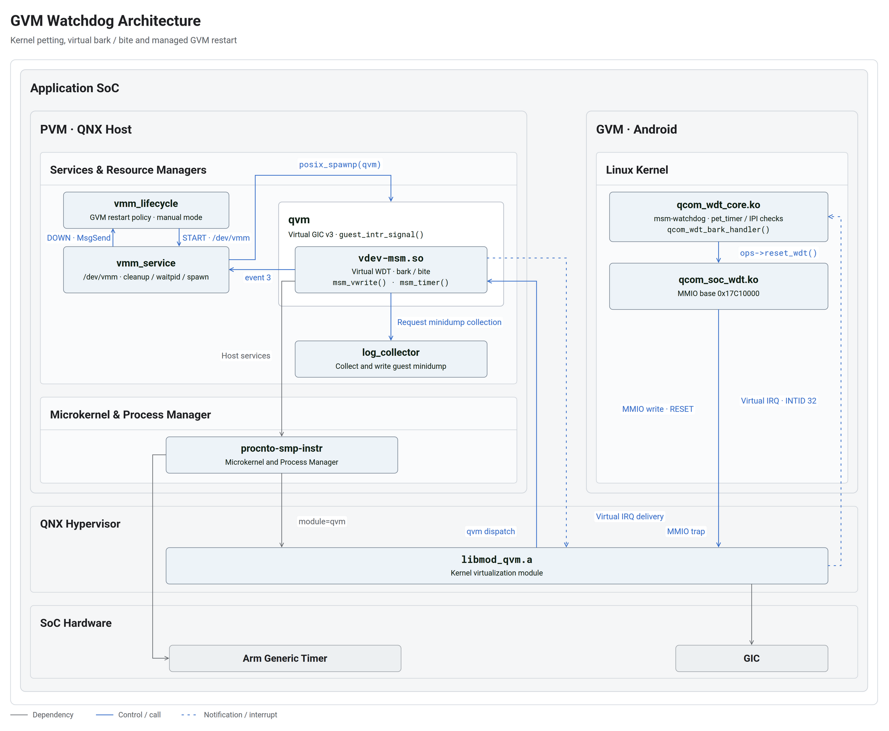

+++
date = '2026-10-20T00:00:00+08:00'
draft = false
title = 'GVM Watchdog 实现机制'
description = '解析 Android GVM 的内核喂狗、QNX 虚拟 watchdog、故障转储与生命周期恢复链路。'
tags = ['QNX', 'Hypervisor', 'Android', 'Watchdog', 'Minidump']
+++

GVM watchdog 通过 Guest 内核的周期性喂狗，检测 Android 虚拟机是否仍能执行关键内核路径。Guest 停止喂狗后，QNX Host 中的虚拟 watchdog 触发 bark 和 bite，按策略收集故障信息、终止对应的虚拟机，再由 VM 管理服务协调恢复。

本文介绍 Android GVM 与 QNX Host 配合的实现。这里的 GVM watchdog 是由 `vdev-msm.so` 模拟的虚拟设备，不是 Guest 直接控制 SoC 的物理 watchdog，也不是 Android Framework 的 `Watchdog` 服务。

## 1. 架构与组件职责



图中右侧是 Android GVM 的 Linux 内核，左侧是 QNX Host 中的虚拟设备和 VM 管理服务。蓝色实线表示控制或调用，包括 MMIO 陷入与分发、IPC；蓝色点线表示通知或虚拟中断，灰色实线表示依赖。

| 组件 | 执行环境 | 职责 |
| --- | --- | --- |
| `qcom_wdt_core.ko` | GVM Linux 内核 | 创建 `msm-watchdog` 线程，组织喂狗、CPU 响应检查及 bark 处理 |
| `qcom_soc_wdt.ko` | GVM Linux 内核 | 实现 watchdog 操作，将喂狗、使能和超时设置转换为 MMIO 寄存器读写 |
| `qvm` | QNX Host 用户态进程 | 承载对应 Guest 的虚拟机，加载虚拟设备库；该实例退出会终止对应 GVM |
| `vdev-msm.so` | `qvm` 进程内 | 模拟 watchdog 寄存器和定时器，处理 bark、bite、dump 策略及终止事件上报 |
| `log_collector` | QNX Host 服务进程 | 接收 minidump 收集请求，读取登记的 Guest 内存区域并写入文件 |
| `vmm_service` | QNX Host 服务进程 | 提供 `/dev/vmm` 接口，处理 VM 状态、协调客户端清理并启动 `qvm` |
| `vmm_lifecycle` | QNX Host 服务进程 | 接收 VM 生命周期通知，按策略决定何时重新启动 GVM |
| `procnto-smp-instr` | QNX Host 系统组件 | 提供微内核和进程管理能力 |
| `libmod_qvm.a` | 内核虚拟化模块 | 通过 `[module=qvm]` 与 `procnto` 绑定，提供内核侧虚拟化能力 |

`qvm` 进程与 `libmod_qvm.a` 不是同一个实体。前者是运行于内核之外的 Host 进程，后者是构建时绑定到内核的模块；图中的 `module=qvm` 表示构建绑定关系，不是两个独立服务之间的 IPC。[QNX Host 构建说明](https://qnx.com/developers/docs/7.1/com.qnx.doc.hypervisor.user/topic/build/build_host.html)、[qvm 进程说明](https://qnx.com/developers/docs/7.1/com.qnx.doc.hypervisor.user/topic/virt/qvm.html)。

## 2. 虚拟设备配置与初始化

Host 的 `linux-la.config` 加载 `vdev-msm.so`，其中与 watchdog 直接相关的参数为：

| 参数 | 本平台配置值 | 含义 |
| --- | --- | --- |
| `wdt_base` | `0x17C10000` | Guest watchdog 寄存器区域的基地址 |
| `wdt_hz` | `32765` | 模拟 watchdog 寄存器使用的计数频率，单位 Hz |
| `wdt_bark_irq` | `32` | bark 对应的 GIC 中断标识 |
| `wdt_bite_irq` | `33` | 配置中存在的 bite IRQ 参数；当前超时实现不通过它向 Guest 注入 bite |

Guest 设备树中的 watchdog 节点与之对应：

```dts
wdog: qcom,wdt@17c10000 {
    compatible = "qcom,msm-watchdog";
    reg = <0x17c10000 0x1000>;
    reg-names = "wdt-base";
    interrupts = <GIC_SPI 0 IRQ_TYPE_LEVEL_HIGH>,
                 <GIC_SPI 1 IRQ_TYPE_LEVEL_HIGH>;
};
```

这里的 `GIC_SPI 0` 对应 GIC INTID 32。架构图中的 `Virtual IRQ · INTID 32` 指虚拟中断的控制器标识，不应直接等同于 `/proc/interrupts` 左列的 Linux IRQ 编号。

初始化时，`vdev-msm.so` 通过 `guest_timer_create()` 创建虚拟定时器，并为 `wdt_base` 注册 Guest 地址空间 trap 区域。Guest 对该区域的寄存器访问由虚拟设备的 `msm_vread()`、`msm_vwrite()` 处理；bark 中断则通过 `qvm_parse_intr()` 建立对应关系。`linux-la.config` 中的 `vdev gic version 3` 启用 GICv3 虚拟设备。

因此，这条 watchdog 跨域链路使用的是 **MMIO trap 与虚拟中断**，不是 HAB RPC 或 VirtIO。配置行中的 `loc 0x1c400000` 也不能替代 watchdog 专用的 `wdt_base`；实现明确使用后者设置 watchdog trap 区域。

## 3. 正常运行时的喂狗链路

### 3.1 内核线程执行健康检查

`qcom_wdt_core.ko` 创建名为 `msm-watchdog` 的内核线程。正常循环中：

1. `pet_timer` 到期，回调设置 `timer_expired` 并唤醒线程。
2. 若启用 `do_ipi_ping`，线程同步检查相关在线 CPU 的 IPI 响应。
3. 若启用用户态喂狗参与机制，还需等待其完成标志；初始化默认关闭该机制。
4. watchdog 处于使能状态时，调用 `ops->reset_wdt()`，记录 `last_pet`，再安排下一次 `pet_timer`。

同步 IPI 检查意味着：如果受检查的 CPU 无法响应，喂狗线程可能停留在检查中，无法执行后续 RESET 写入。因此该机制检查的是关键内核路径的活性，并不能保证所有 Android 应用或系统服务均正常。

### 3.2 RESET 写入使 Host 重新计时

`qcom_soc_wdt.ko` 提供寄存器级操作：

| 寄存器 | 相对 `wdt_base` 的偏移 | 操作 |
| --- | --- | --- |
| RESET | `0x04` | 写入 `1`，重新开始 watchdog 计时 |
| ENABLE | `0x08` | 使能或关闭 watchdog |
| STATUS | `0x0C` | 读取状态 |
| BARK TIME | `0x10` | 设置 bark 计数 |
| BITE TIME | `0x14` | 设置 bite 计数 |

完整调用链为：

```text
pet_timer → msm-watchdog → ops->reset_wdt()
    → qcom_soc_reset_wdt()
    → MMIO write: 0x17C10000 + 0x04
    → QNX Hypervisor: MMIO trap
    → qvm: dispatch
    → vdev-msm.so: msm_vwrite()
    → wdog_timer_settime() → guest_timer_notify()
```

Guest 对已注册虚拟寄存器区域的访问触发 MMIO trap，经 Hypervisor 的虚拟化设施交给 `qvm` 分发，最终由 Host 用户态的 `msm_vwrite()` 模拟寄存器写入。

`msm_vwrite()` 收到 RESET 后清除已断言的 bark 中断，并在设备使能时重新安排定时器。它取 bark 与 bite 计数的较小值作为下一次到期点，同时更新内部状态，判断下一次到期应执行 bark 还是 bite。

日志中的 **`Reset the wdog` 表示这次 RESET 写入，也就是喂狗，不表示重启 GVM**。

### 3.3 喂狗周期与超时时间

本平台 `autogvm_GKI.config` 中的编译配置为：

| 参数 | 默认值 | 含义 |
| --- | --- | --- |
| `CONFIG_QCOM_WATCHDOG_PET_TIME` | `6000 ms` | 正常喂狗周期 |
| `CONFIG_QCOM_WATCHDOG_BARK_TIME` | `30000 ms` | 从最近一次有效喂狗开始计算的 bark 超时 |
| 初始化 bite 时间 | `bark_time + 3000 ms` | 在此配置下为 `33000 ms` |

## 4. 超时检测与 Bark / Bite 处理

GVM watchdog 使用两级超时：**Bark 通知 Guest 执行故障诊断，Bite 由 Host 执行后续故障处置。** 两个阶段的计时都由 QNX Host 中的 `vdev-msm.so` 管理；Guest 是否响应 Bark，不是 Host 继续处理 Bite 的前提。

### 4.1 Bark 到期：通知 Guest，同时安排 Bite

以默认的 Bark `30 s`、Bite `33 s` 为例，两者都从最后一次成功喂狗开始计算。如果此后一直没有新的 RESET，且超时阈值保持不变，时间关系为：

```text
t = 0       最后一次成功喂狗，Host 重新开始计时
    │
    │       持续没有新的喂狗
    ▼
t ≈ 30 s    Host 触发 Bark，通知 Guest 执行诊断
    │       同时安排剩余约 3 s 后触发 Bite
    ▼
t ≈ 33 s    Host 进入 Bite 故障处理
```

Bark 到期时，Host 的定时器回调 `msm_timer()` 执行两个动作：

1. 调用 `guest_intr_signal(..., GIS_ON)`，将 Bark 虚拟中断置为有效，经 `qvm` 的虚拟 GIC 和 Hypervisor 的中断递送设施向 Guest vCPU 投递 `INTID 32`。
2. 按剩余时间 `bite_cnt - bark_cnt` 重新安排定时器。在上述默认配置下，剩余时间约为 `3 s`。

**Host 发出通知后就继续计时，不会等待 Guest 确认。** “断言中断”指将中断信号置为有效；只有 Guest vCPU 能接收并处理中断时，Linux 才会执行对应的 Bark handler。因此，Host 发出了 Bark 与 Guest 执行了诊断，是两个不同的观察点。

### 4.2 Guest 能响应：诊断后提前触发 Bite

停止喂狗并不一定意味着 Guest 完全无法执行代码。例如，喂狗线程可能阻塞，但其他 CPU 仍能处理中断。

如果 Guest 能响应 Bark，Linux 会进入 `qcom_wdt_bark_handler()`，打印当前时间、最近一次喂狗时间和相关 CPU 状态，并调用诊断处理。随后，驱动调用 `qcom_wdt_trigger_bite()`，主动要求尽快进入 Bite：

```text
Guest 收到 Bark 虚拟中断
    → qcom_wdt_bark_handler()：记录诊断信息
    → qcom_wdt_trigger_bite()：将 Bite 阈值改为 1 ms
    → 写入 RESET：按新阈值重新计时
    → Host 定时器约 1 ms 后进入 Bite
```

这里的 **RESET 表示重新开始 watchdog 计时**。由于 Bite 阈值已经被改为 `1 ms`，Host 收到这次 RESET 后会安排很快到期的 Bite，而不是重新给予默认的 `33 s`。

因此，Guest 执行到这条路径时，Bite 可以早于原计划发生。`1 ms` 是重新设置的超时阈值，实际处理还受调度影响；它不代表转储或 GVM 重启能够在 `1 ms` 内完成。

### 4.3 Guest 无法响应：Host 按既定计时进入 Bite

如果 Guest 无法处理中断，或者 Bark handler 在重新设置 Bite 前卡住，Host 先前安排的定时器仍会继续运行。

在没有新的 RESET 或阈值修改的情况下，Host 会在 Bark 后剩余约 `3 s` 到期时进入 Bite，也就是距最后一次成功喂狗约 `33 s`。这条处理路径依赖 Host 和相关定时器仍可运行，但不依赖 Guest 执行任何确认、转储或重启操作。

### 4.4 Bite 到期：由 Host 执行故障处置

无论是 Guest 将 Bite 提前到 `1 ms`，还是 Host 等待原定的剩余时间到期，最终都会进入 Host 的 Bite 处理分支：

```text
Host：msm_timer() 检测到 Bite 到期
    → 发送 Host 内部事件 WDT_BITE_PULSE_CODE
    → msm_pulse_handler() 接收事件
    → 按生效策略执行故障处置
```

`WDT_BITE_PULSE_CODE` 是 Host 内部使用的 QNX pulse 事件，不需要 Guest 接收。在常规 Guest 故障处理路径中，Host 按配置收集或跳过 Guest dump，然后退出对应的 `qvm`；后续由 VM 管理服务协调清理和重新启动。Dump 策略及 Host RAM dump 调试分支见第 5 节，生命周期恢复流程见第 6 节。

虽然配置中存在 `wdt_bite_irq = 33`，当前实现没有通过它向 Guest 注入 Bite 中断。架构图中的虚拟中断返回路径表示 Bark；Bite 则沿 Host 内部的 dump、QVM 退出和生命周期恢复链路执行。

## 5. 故障转储与文件生成

### 5.1 Dump 策略选择

`msm_pulse_handler()` 先调用 `judge_if_dump()` 得到生效策略，再按下表处理：

| 生效策略 | 执行路径 | 影响范围 |
| --- | --- | --- |
| Host RAM dump | 调用 `force_ns_bite()` | 进入 Host watchdog 故障路径，不能再按普通 GVM 局部恢复理解 |
| 不收集 Guest dump | 直接退出 `qvm` | 不生成 Guest dump；并非禁用 watchdog |
| Guest minidump | 向 `log_collector` 发送收集请求，返回后退出 `qvm` | 收集已登记的 Guest 内存区域 |
| Guest full dump | 调用 QVM 的 `guest_write_core_file()`，返回后退出 `qvm` | 执行 Guest core dump 路径，不经过同一个 minidump 写文件流程 |

策略的优先级是：

1. 首先检查 `/persist/debug/` 下的调试文件，按 `enable_guestdump_hostramdump`、`enable_guestdump_fulldump`、`enable_guestdump_minidump`、`disable_guestdump` 的顺序匹配；首个命中项生效。
2. 没有上述调试文件时，采用 `trigger_hostramdump` 和 `trigger_guestdump` 配置。
3. 此时若 `IS_USER_BUILD` 严格等于 `"1"`，覆盖为 Host dump 关闭、Guest minidump 开启；其他值保留配置。

例如，配置文件中的 `trigger_guestdump 1` 表示 full dump，但在没有调试文件且 `IS_USER_BUILD=1` 时，最终会改走 minidump。不能只查看配置行就判断实际生成哪一种 dump。

### 5.2 Minidump 的请求者与文件写入者

架构图中 `vdev-msm.so → log_collector` 的蓝色箭头表示 **收集请求**，不是 dump 数据从虚拟设备流向服务：

```text
vdev-msm.so
    → devctl(DCMD_COLLECT_GUEST_MINIDUMP)
    → log_collector
    → md_collect_guest_minidump()
    → 映射已登记的内存区域，写入数据和 dump headers
    → <guest_minidump_path><vm_name>_guestminidump.bin
```

`vdev-msm.so` 传入 VM 名称和输出目录；`log_collector` 的 Resource Manager 分发命令，实际收集函数创建文件并写入内容。这个请求不是启动 `log_collector` 进程，而是调用已有服务。

以输出目录 `/var/log/`、VM 名称 `la` 为例，文件为 `/var/log/la_guestminidump.bin`。实现直接拼接路径，目录应包含末尾 `/`；文件以 `w+b` 打开，成功打开时会截断同名旧文件。成功生成还依赖内存区域登记、映射、服务响应和存储路径可用，不能仅凭发出请求的日志判定文件完整。

## 6. QVM 退出与 GVM 恢复

### 6.1 上报 watchdog 终止事件

Guest dump 策略处理后，`vdev-msm.so` 调用 `exit()` 退出所在的 `qvm`。终止回调 `VDEV_CTRL_TERMINATE` 检查 `bite_happened`，将此次终止归类为 `VM_EVENT_WDOG_BITE`，并向 `/dev/vmm` 写入 `event 3`。

`3` 是 VM 管理接口定义的事件值，不是 `qvm` 的 POSIX 退出码，也不是中断号。日志 **`VDEV_CTRL_TERMINATE wdog bite`** 表示已进入该终止分类和上报路径。

### 6.2 清理完成后重新启动

本平台配置 `vm_restart_mode_manual = <1>`，恢复链路为：

```text
VM_EVENT_WDOG_BITE
    → vmm_service 通知客户端 GVM_WDOG_BITE
    → 通知 GVM_SHUTDOWN_LEVEL_2，协调客户端清理
    → VM_STOPPED
    → 调用 waitpid() 等待旧 qvm
    → 通知 vmm_lifecycle: GVM_EVENT_DOWN
    → vmm_lifecycle 请求 START
    → /dev/vmm: control 1 2
    → vmm_service: launch_gvm() → posix_spawnp(qvm)
```

其中 `control 1 2` 表示 START 操作、目标 VMID 为 `2`。`vmm_lifecycle` 发出启动请求，实际创建新 `qvm` 的仍是 `vmm_service`。

这里的 manual mode 指启动时机交给外部生命周期管理程序，并非要求人工启动。`vmm_lifecycle` 在 manual/test 模式且未请求 shutdown 时，会自动响应 DOWN 并发出 START。自动恢复模式下，则由 `vmm_service` 的状态机直接尝试重新启动，不经过相同的 DOWN → lifecycle START 流程。

### 6.3 恢复链路的失败分支

客户端清理采用有超时控制的同步通知。若清理超时，`client_timedout` 会使状态机进入 `VM_INVALID_STATE`，对外报告 `GVM_EVENT_TIMEDOUT`，而不是继续正常启动。

`vmm_lifecycle` 对该通知记录“需要重启 SoC”的日志，但该分支本身没有执行 SoC 重启。类似地，代码虽然在 DOWN 通知前调用 `waitpid()`，却没有检查其返回值，不能把这一调用解释为无条件保证旧进程已成功回收。

因此，watchdog bite、旧 `qvm` 退出、资源清理完成、新 `qvm` 启动和 Android 启动完成，是恢复链中不同的观察点。

## 7. 日志判读与排查顺序

| 日志或现象 | 可以确认的阶段 | 不能据此直接得出的结论 |
| --- | --- | --- |
| `Reset the wdog` | Guest 的 RESET 写入已到达虚拟设备 | GVM 正在重启；所有 Android 服务均健康 |
| Guest `QCOM Apps Watchdog bark!` | Guest 已进入 bark handler | 原始故障已经恢复 |
| Host `Bite happened` | 虚拟 watchdog 进入 bite 分支 | dump 已完整生成 |
| `VDEV_CTRL_TERMINATE wdog bite` | `qvm` 正在按 watchdog 原因终止 | 最初是哪一个 CPU、线程或驱动阻塞 |
| `Received special DOWN event` | lifecycle 收到 VM 停止通知 | 新 GVM 已启动成功 |
| 新 `qvm` PID 出现并恢复喂狗 | 与新实例重新运行内核喂狗链相符 | Android Framework、应用和业务已全部恢复 |

排查时按同一 VMID 和同一代 `qvm` PID 串联日志，先定位最后一次正常喂狗，再查看 bark/bite、dump 返回、客户端清理、DOWN/START 和新实例日志。恢复耗时除了 watchdog 阈值，还包含转储、资源清理、进程启动和 Guest 引导时间，不能把“最后一次喂狗到新 GVM 就绪”的间隔全部当成 bite 阈值。

若喂狗停止，应结合 dump 检查 `msm-watchdog` 的等待位置、IPI 响应和 CPU 调度；若 bite 后没有新实例，优先检查 dump 调用、客户端清理超时以及 spawn 错误；若新实例已有 PID 但业务未恢复，则继续检查 Guest 引导和 Android 服务。

QNX Host 自身的 APSS 物理 watchdog 是另一条保护链，故障影响可涉及整个 SoC。常规 Guest 恢复依赖 Host 仍可工作，不能用 GVM 虚拟 watchdog 替代 Host 级保护。

## 8. 源码索引与参考资料


### Android Guest

| 路径 | 关键内容 |
| --- | --- |
| `android/android/kernel_platform/msm-kernel/arch/arm64/configs/vendor/autogvm_GKI.config` | watchdog 模块配置及 PET/BARK 默认时间 |
| `android/android/kernel_platform/msm-kernel/drivers/soc/qcom/qcom_wdt_core.c` | `qcom_wdt_kthread()`、`qcom_wdt_bark_handler()`、`qcom_wdt_trigger_bite()` |
| `android/android/kernel_platform/msm-kernel/drivers/soc/qcom/qcom_soc_wdt.c` | 寄存器定义、`qcom_soc_reset_wdt()` 及 `qcom_wdt_ops` |
| `android/android/kernel_platform/qcom/proprietary/devicetree/qcom/quin-vm-common.dtsi` | watchdog 地址和中断描述 |

### QNX Host

以下表格的路径前缀为 `bsp/apps/qnx_ap/`。

| 路径 | 关键内容 |
| --- | --- |
| `target/hypervisor/gvm/ivi/la/linux-la.config` | 虚拟 watchdog 和 dump 参数 |
| `target/hypervisor/host/out_8540/mifs_la_qcc6.build` | `procnto-smp-instr` 的 `module=qvm` 构建绑定 |
| `target/hypervisor/host/fdt_config/dtb/sdm-host_la.dts` | `vm_restart_mode_manual` 等 VM 管理配置 |
| `AMSS/platform/vm/vdev/vdev-msm/vdev-msm.c` | `msm_vwrite()`、`msm_timer()`、`judge_if_dump()`、`msm_pulse_handler()` 和终止上报 |
| `AMSS/platform/vm/resources/vmm_drv/protected/vdev_events.h` | `VM_EVENT_WDOG_BITE = 3` |
| `AMSS/platform/vm/resources/vmm_drv/src/vmm_fsm.c` | 清理通知、状态转换、`waitpid()`、`launch_gvm()` 和 `posix_spawnp()` |
| `AMSS/platform/services/applications/vmm_lifecycle/vmm_lifecycle.c` | DOWN/START 处理和 `/dev/vmm` 控制请求 |
| `AMSS/platform/services/daemons/log_collector/src/log_collect_resmgr.c` | `DCMD_COLLECT_GUEST_MINIDUMP` 分发 |
| `AMSS/platform/services/daemons/log_collector/src/vm_collect_minidump.c` | 内存区域采集及 minidump 文件写入 |
| `AMSS/platform/services/daemons/watchdog/src/watchdog.c` | Host APSS 物理 watchdog，与本文虚拟 watchdog 区分 |

QNX 官方资料：[Building the host](https://qnx.com/developers/docs/7.1/com.qnx.doc.hypervisor.user/topic/build/build_host.html)、[Virtual machines](https://qnx.com/developers/docs/7.1/com.qnx.doc.hypervisor.user/topic/virt/qvm.html)。
