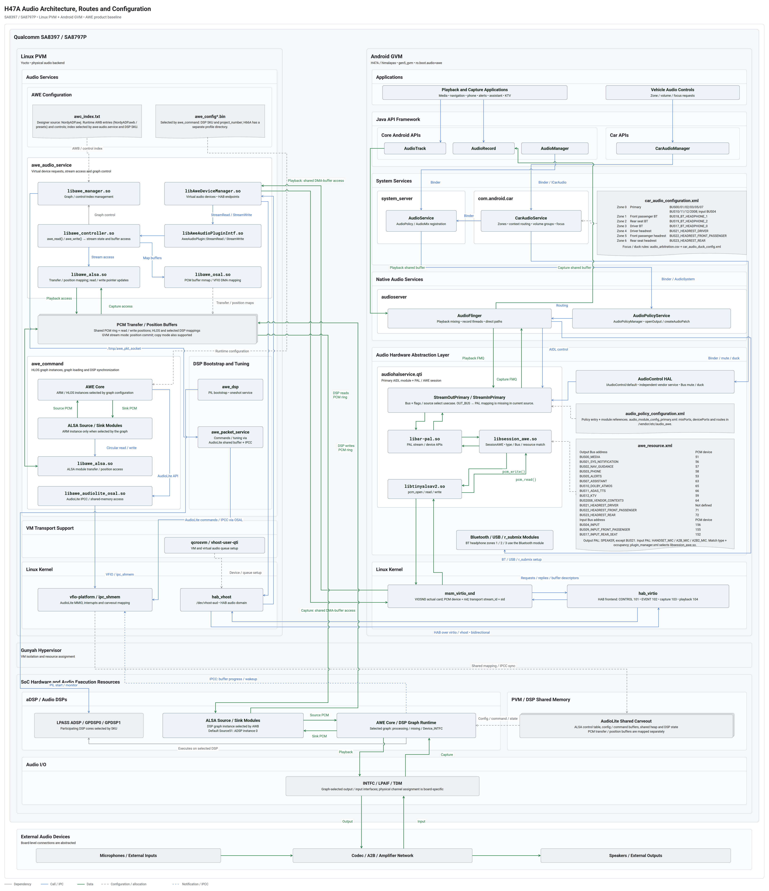
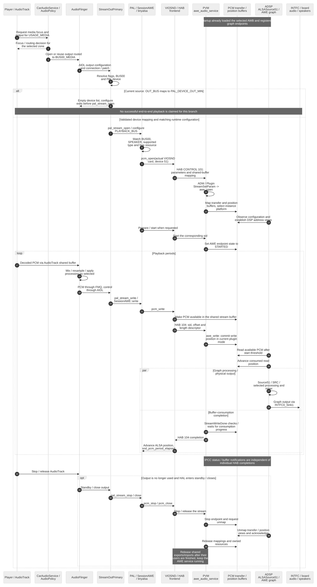
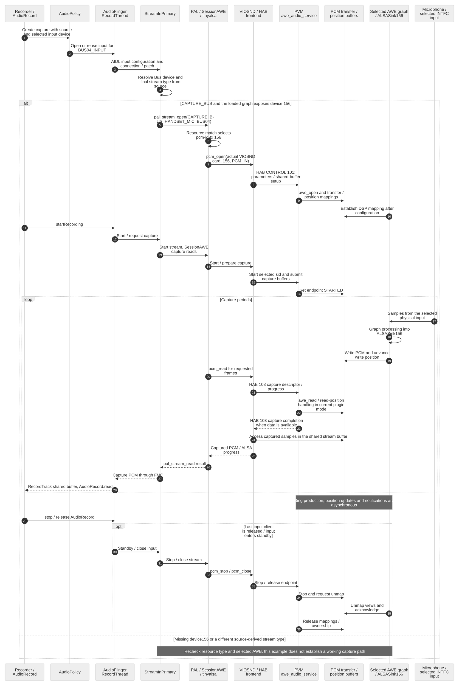
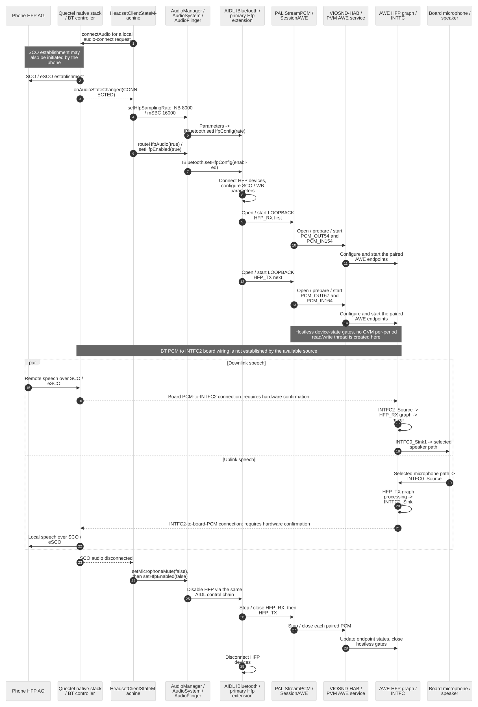
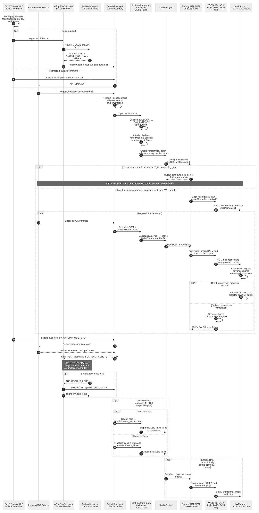

# H47A 8397 Audio 架构设计

> **平台**：Qualcomm SA8797P（项目称 IVI 8397），H47A / himalayas
>
> **架构**：Android GVM + Linux PVM，Gunyah Hypervisor
>
> **源码根**：`/home/ethen/workspace/voyah/projects/8397/code`
>
> **基线**：Android `gen5_gvm`、`ENABLE_HYP := true`、`ro.boot.audio=awe`；PVM `auto-voyah` / `sa8797`、`qti-audio-aw`
>
> **修订日期**：2026-10-23
>
> **验证范围**：当前源码、产品配置、配方和已有 AWE 预编译库；未编译、未上板验证。

本文描述当前产品选择的 **AWE 音频架构**。仓库中另有 AudioReach/CSD2 后端，其服务、stream metadata、device PP 和 `backends.xml` 不作为当前 AWE 数据面的实现依据。

**阅读边界**：当前源码存在 `OUT_BUS` 到 PAL 设备的转换断点；`BUS21_HEADREST_DRIVER` 缺少 AWE 资源项；BUS04/device156 在默认与非默认 SKU 图中的端点也不一致。下文区分“配置声明”“可见源码行为”“预编译库边界”和“待实机确认”，不能把分层示意图当作已验证可运行的端到端时序。详见 §6.2、§13。

---

## 1. 概述

Android GVM 承载应用、Car 音频策略、AudioFlinger、AIDL Audio HAL、PAL 和 AWE session 插件。内置音频经 `msm_virtio_snd` 虚拟声卡与 PVM 通信；GVM 的这条路径不直接管理物理 DSP/TDM/A2B。

Linux PVM 的当前构建选择 `awe_audio_service` 和 AWE 设备管理、音频插件。预编译库的依赖与符号表表明 AWE 自身具有 PCM 读写接口，不能将其仅定义为音量/静音控制服务。

跨 VM 通信分为两部分：PCM 样本放在导出/导入的共享 buffer 中，控制及 buffer 描述符经 HAB 消息传输。HAB 音频域底层使用 virtio/vhost；用户态 `vhost-user-qti` 配置设备和队列，PVM 内核 `hab_vhost` 实际收发 HAB 消息。

Bus 是 Android 侧的逻辑路由地址。必须分别识别 **Bus 地址、ALSA card、PCM device/nid、virtio-snd sid 和 HAB MMID**，不能将它们视为同一种编号。

USB、Bluetooth、r_submix 有各自的 HAL/policy 模块；本文的 AWE 主链聚焦 primary 内置音频。Bluetooth 耳机输出与车机 HFP 通话是不同路径，不能笼统宣称所有 Bluetooth 相关音频都绕过 AWE/A2B。

依据：S1–S8、S11–S14（见 §12）。

## 2. 术语与标识

| 术语/标识 | 本文含义 |
| --- | --- |
| GVM / PVM | Android guest VM / 管理内置音频后端的 Linux VM |
| AIDL Audio HAL | H47A 使用 `audiohalservice.qti`；本树接口文档说明 Android U（14）及以后采用 AIDL Audio HAL |
| PAL | Qualcomm Platform Audio Layer，`libar-pal.so` |
| AWE | Audio Weaver；本基线使用 AWE session、PVM AWE 服务、图及相关控制 |
| CSD2 / SPF | 仓库中另一套 AudioReach 图 API / Signal Processing Framework；本文在 §9.3 单独说明 |
| Bus 地址 | 如 `BUS00_MEDIA`，用于 Android policy/HAL 和 AWE resource 查找 |
| ALSA card | 声卡索引；PAL 找到 VIOSND 后使用该声卡的实际索引 |
| PCM device / nid | `pcm_open(card, device, …)` 的 device 参数；内核用 `PCM_INFO.hda_fn_nid` 创建 PCM 设备 |
| sid / stream_id | virtio-snd 子流枚举索引；内核设置 `substream->sid = i`，用于传输消息 |
| HAB MMID | 音频使用 `MM_AUD_1..4`，数值 101–104；它选择通信通道，不选择扬声器 |
| TDM / A2B | DSP/音频硬件接口与车载音频总线；具体节点、槽位和物理扬声器需结合目标图及硬件配置 |
| SSR | 子系统重启；恢复涉及清理、状态通知、重新配置/打开等步骤 |

## 3. 当前 AWE 架构

总图按部署域和软件层次展示组件，并叠加 PCM、控制/通知及配置关系。预览与当前可编辑 draw.io 源文件对应。



[打开原尺寸预览](diagrams/H47A_audio_overview.png) · [编辑 draw.io 原图](diagrams/H47A_audio_overview.drawio)

从图中读取架构时，先看部署，再沿对应类型的线追踪：

- **部署**：同一 SoC 内，Linux PVM 与 Android GVM 并列；Gunyah 在 VM 下方；aDSP、共享内存和音频 I/O 位于公共硬件区域；麦克风、Codec/A2B/功放和扬声器是板级外设。
- **PCM 数据**：绿色。GVM primary 流经虚拟声卡与 PVM 对接；DSP 的 ALSASource/Sink 访问映射后的 PCM transfer ring。ARM AWE runtime 是否参与样本处理，由所选图决定。
- **调用与控制**：蓝色实线。包括 Binder/AIDL、PAL 调用、HAB 消息、AWE 图控制和调参；这些线不表示 PCM 必须逐级复制。
- **通知**：蓝色点线。AWE DSP runtime 通过 IPCC 通知处理进度/唤醒；PCM 样本存放在共享 buffer 中。
- **依赖与配置**：灰色实线/虚线。XML/TXT/bin 使用文档形状；PCM buffer 和 AudioLite carveout 使用共享内存形状。配置文件不是运行时音频处理组件。

图表示已核实的职责、运行归属和连接机制。普通播放/录音以及蓝牙场景的建链、周期数据和停止顺序见 §16；源码/配置缺口在对应时序中显式保留。

### 3.1 构建选择的依据

1. `himalayas.mk` 设置 `ro.boot.audio=awe`；`init.target.rc` 在该属性下加载 `msm_virtio_snd audio_variant="awe"`。
2. `plugin_manager.xml` 为 `PAL_STREAM_PLAYBACK_BUS`、`PAL_STREAM_CAPTURE_BUS` 等类型配置 `libsession_awe.so`。
3. PVM `auto-voyah.conf` 与 `gen5.inc` 启用 `qti-audio-aw`；`packagegroup-qti-audio-prop.bb` 命中 `AUDIOAWE_RDEPENDS` 分支。
4. `awe-audio-service` 依赖 `awe-device-manager`；后者依赖 `awe-audio-plugin-intf`。已有预编译 ELF 对应 `libAweDeviceManager.so`、`libAweAudioPluginIntf.so` 和 `awe_read/write`。

既有 `voyah-image-sa8797-20260831052028.manifest` 也包含上述 AWE 包，但它只证明该次构建产物，不能证明当前设备刷入了同一镜像。

### 3.2 需要区分的两层传输

- **音频前端协议**：CONTROL、EVENT、TX、RX 分别对应 MMID 101、102、103、104。
- **HAB 底层传输**：GVM HAB virtio 前端与 PVM `hab_vhost` 搬运消息；`/dev/vhost-aud` 对应 HAB 音频域。

前者的四个逻辑队列不能直接当作后者 virtqueue 数量。PCM 样本共享内存与消息传输也是不同机制。

## 4. 架构图中的组件与运行归属

### 4.1 Android GVM

| 图中组件 | 所在进程或层 | 作用及与相邻组件的关系 |
| --- | --- | --- |
| Playback and Capture Applications | 应用层 | 播放器、导航、语音等创建音频流；普通音乐解码后的 PCM 交给 AudioTrack，录音样本由 AudioRecord 返回。 |
| Vehicle Audio Controls | 应用层 | 发起音区、音量、焦点等车载音频控制；通过 CarAudioManager 访问 Car 服务。 |
| `AudioTrack` / `AudioRecord` | 应用进程中的客户端 API/native client | 分别接入播放、录音；与 AudioFlinger 通过 Binder 管理流，通过共享 buffer 交换样本。它们不是独立系统服务。 |
| `AudioManager` / `CarAudioManager` | Java API Framework | 前者提供通用音频控制和策略接口，后者提供车载音区、音量等接口；不负责逐周期搬运 PCM。 |
| `AudioService` | Java 系统服务，`system_server` | 通用音量、模式和 AudioPolicy 注册入口，通过 AudioSystem/Binder 与 native 策略服务协作。 |
| `CarAudioService` | Java 系统服务，`com.android.car` | 将 context、zone、volume group、用户与设备地址关联，注册动态 AudioMix，并处理车载焦点/duck/mute 策略。 |
| `AudioPolicyService` | native 服务，`audioserver` | 内含 AudioPolicyManager，选择设备/output/input、建立 patch，并要求 AudioFlinger 打开或复用相应 I/O。与 AudioFlinger 在同一进程、同一层。 |
| `AudioFlinger` | native 服务，`audioserver` | 管理 Track、RecordThread、Mixer/FastMixer/direct 等线程。普通播放可混音/重采样，录音由 RecordThread 分发。控制 HAL 使用 AIDL，样本交换使用 FMQ。 |
| `StreamOutPrimary` / `StreamInPrimary` | `audiohalservice.qti` 的 primary AIDL 实现 | 按设备地址、flags/source 选择 usecase 和 PAL 属性，处理 PCM FMQ。当前输出 `OUT_BUS` 转换断点见 §6.2。 |
| `libar-pal.so` | 同一 HAL 进程中的 PAL | 管理 stream/device、属性、设备切换与生命周期；按插件配置选择 stream 实现和 session。 |
| `libsession_awe.so` | 同一 HAL 进程中的 `SessionAWE` | 按 PAL device、Bus、stream type、custom key 与占用状态匹配 `awe_resource.xml`，再打开相应虚拟 PCM。 |
| `libtinyalsav2.so` | 同一 HAL 进程中的 ALSA 用户库 | 使用实际 VIOSND card 执行 `pcm_open/read/write/start/stop/close`。PCM device 不等于 sid。 |
| AudioControl HAL | 独立 vendor 服务 | Car 侧设备 mute/duck 控制接口；不承载音乐 PCM 主链，不能仅凭该接口推定板级功放实现。 |
| Bluetooth / USB / r_submix Modules | 各自的音频 HAL/policy 模块 | 承接相应设备或软件回环。Bluetooth 耳机输出、A2DP Sink 音乐输入与 HFP 电话是不同场景，不能因名称含 Bluetooth 就合并成同一数据路径。 |
| `msm_virtio_snd` | GVM Linux kernel | 注册 VIOSND、枚举 PCM device/nid 与 sid，配置共享缓冲并提交播放/采集描述符，处理周期完成。 |
| `hab_virtio` | GVM Linux kernel | HAB 的 virtio 传输前端，与 PVM `hab_vhost` 交换消息；不是 PCM 混音或 DSP 算法模块。 |

`ModuleConfig.cpp` 优先查找 `/vendor/etc/audio_awe`，产品 `audio_vendor.mk` 将配置复制到该目录。Car 配置还按属性、车型 suffix 选择文件。图中的 `car_audio_configuration.xml`、`audio_policy_configuration.xml`、`awe_resource.xml` 分别控制车载路由、HAL/policy 端口和 AWE 资源匹配，具体内容见 §5。

### 4.2 Linux PVM

| 图中组件 | 所在进程或层 | 作用及证据边界 |
| --- | --- | --- |
| `awe_audio_service` | 音频服务进程 | 托管虚拟设备处理、stream 访问和图控制；接收 `-c` 指定的控制索引。进程内部的库依赖与主要调用由当前预编译 ELF 核实。 |
| `libAweDeviceManager.so` | `awe_audio_service` | 管理虚拟音频设备和 HAB 端点，将 stream 请求转给 AWE Audio Plugin。 |
| `libAweAudioPluginIntf.so` | `awe_audio_service` | `StreamWrite/StreamRead` 调用 controller 的 `awe_write/awe_read`；当前开流参数选择位置提交模式。 |
| `libawe_controller.so` | `awe_audio_service` | 管理流状态、buffer 映射和读写操作。调用 `libawe_alsa` 访问 ring/位置，调用 `libawe_osal` 建立内存映射；图控制依赖 manager。 |
| `libawe_manager.so` | `awe_audio_service` | 加载控制索引、管理 AWB/控件并访问 packet 服务；不是每块 PCM 的必经处理器。 |
| `libawe_alsa.so`（服务内） | `awe_audio_service` | 管理 transfer/position 映射与 ring 状态。当前插件模式的 write/read 主要提交写/读位置；另一模式支持 circular copy/格式转换，不能笼统宣称每次复制或全程零拷贝。 |
| `libawe_osal.so` | `awe_audio_service` | `awe_shmem_map` 执行 mmap，并经工具库完成 VFIO/SMMU DMA 映射。映射建立与周期 PCM 传输分开理解。 |
| PCM Transfer / Position Buffers | PVM 与所选 AWE 实例可访问的共享资源 | 保存样本及读写进度，具有 HLOS/DSP 地址映射。DSP ALSASource 从中读取播放 PCM，ALSASink 写入采集 PCM；不能未经核对就断言它与 GVM DMA buffer 永远相同或永远是另一份拷贝。 |
| `awe_command` | 独立服务进程 | 加载 `awe_config*.bin`，创建/管理 HLOS AWE 实例，组织 DSP 同步及 AudioLite 资源。它不是所有 PCM 到 aDSP 的中转站。 |
| AWE Core / ALSA Source-Sink Modules（ARM） | `awe_command` | 仅当所选图将相应实例/模块放在 ARM/HLOS 时参与样本处理。其 `libawe_alsa` 是同一库在另一进程的加载实例。 |
| `libawe_audiolite_osal.so` | 图中展开于 `awe_command`；其他 AWE 服务也可依赖它 | 提供 AudioLite IPCC、共享 carveout 和设备访问抽象；图中 packet 服务的控制边省略了其内部库层。 |
| `awe_dsp` | 独立 oneshot 服务 | 经 PIL 启动 DSP、设置故障监控。服务启动依赖不等于 PCM 调用顺序。 |
| `awe_packet_service` | 独立命令/调参服务 | manager 经 packet client 和 UNIX socket `/tmp/awe_pkt_socket` 访问它；经 AudioLite 命令缓冲/IPCC 与 DSP 交互。 |
| `qcrosvm` / `vhost-user-qti` | VM 传输支持 | 创建/配置虚拟设备与 vring；用户态 vhost 配置 `/dev/vhost-aud`，不在每个 PCM 样本的 DSP 算法链上。 |
| `hab_vhost` | PVM Linux kernel | 实际执行 HAB 消息收发，承担控制、描述符与完成消息的底层传输。 |
| `vfio-platform` / `ipc_shmem` | PVM Linux kernel 接口 | 图中合并表示 AudioLite MMIO/中断及 carveout 映射支持；IPCC 接收应理解为中断处理一侧，`ipc_shmem` 本身不是音频算法。 |

`awc_index.txt` 与 `awe_config*.bin` 的选择互相独立：前者由 audio service 的参数选择，后者由 command 的参数/车型/DSP SKU 选择，详见 §9.2。文件框的位置表示它们配置哪些组件，不表示随每个 period 重新加载。

### 4.3 Hypervisor、aDSP、共享内存与外部设备

| 图中组件 | 作用与边界 |
| --- | --- |
| Gunyah Hypervisor | 承载并隔离 PVM/GVM、分配资源。跨 VM 线经过该区域，不意味着 Hypervisor 逐个处理音频样本。 |
| LPASS ADSP / GPDSP0 / GPDSP1 | 可参与 AWE 的 DSP 核；实际参与集合由 SKU 及加载配置决定。 |
| ALSA Source / Sink Modules（DSP） | 所选 DSP 图中共享 PCM 流的入口/出口：Source 读 ring、Sink 写 ring；HFP 等 hostless 图还使用成对端点状态控制门控，并非通话样本都经过这些 ring。默认 `Source51` 位于 ADSP instance 0。 |
| AWE Core / DSP Graph Runtime | 执行所选图的处理、混音与设备端口模块，并发送进度/唤醒通知。`ChangeThread` 不必然跨 ARM/DSP：默认 Source51 示例中的 34/25 继承同一 instance。 |
| AudioLite Shared Carveout | 保存 ALSA 控制表、config、command、shared heap 和 DSP state。它与“流样本/位置缓冲”的逻辑资源角色不同；跨实例图也可按需使用 shared heap。 |
| INTFC / LPAIF / TDM | DSP 图连接到硬件音频接口的边界。端口号、槽位与物理设备需要加载图和板级资料共同确认。 |
| Microphones / External Inputs | 外部声音或数字输入的来源；具体麦克风通道不能只由 Bus 名推定。 |
| Codec / A2B / Amplifier Network | 板级采集、数字总线及功放链的抽象；并非宣称所有通路都逐个经过这三个器件。 |
| Speakers / External Outputs | 最终播放端；音区与某个实际扬声器的对应还取决于矩阵、增益、mute 和硬件连线。 |

依据：S1–S19，以及本轮补充的 S20–S22；蓝牙实际产品栈及各场景的证据另见 §16。

## 5. 产品配置、Bus 与音区

### 5.1 配置文件及生效范围

| 文件（路径简称见 §12） | 用途 |
| --- | --- |
| `V/vendor/voyah/prebuilts/audio/audio_module_config_primary.xml` | 当前 primary 模块的 mixPort、devicePort、route |
| 同目录 `audio_policy_configuration.xml` | policy 总入口及外部模块引用 |
| 同目录 `car_audio_configuration.xml` | 默认 Car 音区、context、volume group |
| 同目录 `audio_arbitration.csv` | 产品焦点交互矩阵；闪避配置还需结合 `car_audio_duck_config.xml` 和服务实现 |
| 同目录 `audio_vendor.mk` | 配置复制到 `/vendor/etc/audio_awe` 及产品属性 |
| `V/vendor/qcom/proprietary/mm-audio-auto/awe/pal_awe_plugin/configs/gen5/awe_resource.xml` | AWE Bus/设备/PCM/控件/支持类型 |
| 同目录 `plugin_manager.xml` | PAL stream type 到 session 插件 |
| `V/vendor/qcom/opensource/audio-hal-ar/primary-hal/configs/gen5_au/card-defs.xml` | AGM 虚拟 card100、PCM100–125 和插件配置；不能替代 VIOSND 的实际枚举 |
| `L/vendor/qcom/proprietary/awe/awe_config/NordAU/target_config/` | 默认 AWE 图与控制索引；H66A 和非默认 DSP SKU 有独立配置 |

### 5.2 端口数量

按当前 XML 解析统计，排除注释；devicePort 和 mixPort 均按声明计数，并非同时活跃设备/流数量。

| 模块 | device 总数 | 输出 | 输入 | mixPort 总数 | 输出 | 输入 |
| --- | ---: | ---: | ---: | ---: | ---: | ---: |
| primary / default | 22 | 13 | 9 | 36 | 28 | 8 |
| usb | 5 | 3 | 2 | 3 | 2 | 1 |
| r_submix | 2 | 1 | 1 | 2 | 1 | 1 |
| bluetooth | 7 | 7 | 0 | 5 | 5 | 0 |
| **合计** | **36** | **24** | **12** | **46** | **36** | **10** |

Primary 中有 **16 个 Bus devicePort：13 输出 + 3 输入**；Bluetooth 模块另有 3 个耳机 Bus。`mixPort` 表示流 profile/端口，不能当作并发实例上限。

### 5.3 输出 Bus：配置声明与 HAL 分支

表中 PAL device 和 PCM RX 来自 AWE resource；usecase 来自对应 Bus 地址与输出 flags 的匹配。它们不代表当前源码已能完成 `pal_stream_open()`，所有 primary `OUT_BUS` 都需先处理 §6.2 的转换断点。

| 当前 primary 输出 Bus | HAL usecase 分支 | AWE 声明的 PAL device | PCM RX device |
| --- | --- | --- | ---: |
| `BUS00_MEDIA` | `MEDIA_PLAYBACK` | `PAL_DEVICE_OUT_SPEAKER` | 51 |
| `BUS01_SYS_NOTIFICATION` | `SYS_NOTIFICATION_PLAYBACK` | `PAL_DEVICE_OUT_SPEAKER` | 56 |
| `BUS02_NAV_GUIDANCE` | `NAV_GUIDANCE_PLAYBACK` | `PAL_DEVICE_OUT_SPEAKER` | 57 |
| `BUS03_PHONE` | `PHONE_PLAYBACK` | `PAL_DEVICE_OUT_SPEAKER` | 58 |
| `BUS05_ALERTS` | `ALERTS_PLAYBACK` | `PAL_DEVICE_OUT_SPEAKER` | 53 |
| `BUS07_ASSISTANT` | `ASSISTANT_PLAYBACK` | `PAL_DEVICE_OUT_SPEAKER` | 63 |
| `BUS10_DOLBY_ATMOS` | `VENDOR_DOLBY_ATMOS_PLAYBACK` | `PAL_DEVICE_OUT_SPEAKER` | 65 |
| `BUS11_ADAS_TTS` | `VENDOR_ADAS_TTS_PLAYBACK` | `PAL_DEVICE_OUT_SPEAKER` | 66 |
| `BUS12_KTV` | `VENDOR_KTV_PLAYBACK` | `PAL_DEVICE_OUT_SPEAKER` | 59 |
| `BUS2008_VENDOR_CONTEXT3` | `VENDOR_OUTSIDE_CAR_PLAYBACK` | `PAL_DEVICE_OUT_SPEAKER` | 64 |
| `BUS21_HEADREST_DRIVER` | `DEEP_BUFFER_PLAYBACK`（当前 DEEP_BUFFER flags 命中通用分支） | **无对应 Bus 资源项** | **未定义** |
| `BUS22_HEADREST_FRONT_PASSENGER` | `FRONT_PASSANGER_PLAYBACK` | `PAL_DEVICE_OUT_SPEAKER` | 71 |
| `BUS23_HEADREST_REAR` | `REAR_SEAT_PLAYBACK` | `PAL_DEVICE_OUT_SPEAKER` | 72 |

补充边界：

- `BUS12_KTV` 已有 devicePort 和 route；三个头枕 Bus 也已暴露。
- `BUS21` 没有专用地址 usecase 分支、没有 `updatePalDeviceForBusAddr()` 条目，也没有 AWE Bus 资源项；不能补写为默认 speaker 或给它推定 PCM ID。
- `BUS22/23` 的 AWE 资源是 speaker + 71/72；不能因 usecase 仍叫前排/后排，就套用旧 BUS08/16 的 A2B/A2B2 设备映射。
- `BUS08_FRONT_PASSENGER`（A2B_SPKR/55）、`BUS16_REAR_SEAT`（A2B2_SPKR/52）仍在 AWE resource 中，但不在当前 primary 输出 devicePort 中。资源存在不等于产品已暴露。
- 各 Bus 的 `supported-types` 不完全相同。SessionAWE 还检查类型与 occupied 状态，不能仅按 Bus 地址判断可用性。

### 5.4 输入 Bus 与其他资源

| 当前 primary 输入 Bus | 普通录音的 PAL 类型 | AWE 声明的 PAL device | PCM TX device |
| --- | --- | --- | ---: |
| `BUS04_INPUT` | `PAL_STREAM_CAPTURE_BUS` | `PAL_DEVICE_IN_HANDSET_MIC` | 156 |
| `BUS09_INPUT_FRONT_PASSENGER` | `PAL_STREAM_CAPTURE_BUS` | `PAL_DEVICE_IN_A2B_MIC` | 155 |
| `BUS17_INPUT_REAR_SEAT` | `PAL_STREAM_CAPTURE_BUS` | `PAL_DEVICE_IN_A2B2_MIC` | 152 |

`StreamInPrimary` 在设定 CAPTURE_BUS 后仍会根据 source 覆盖类型：例如 ECHO_REFERENCE/UNPROCESSED 改为 RAW，VOICE_RECOGNITION/MIC_ECNR 改为 DEEP_BUFFER。以上三个 Bus 的资源仅声明 CAPTURE_BUS，因此该表不能泛化为所有 AudioRecord 请求的最终通路。

其他资源声明如下；具体使用还受设备、custom key、stream type 和资源占用条件约束。

| 资源 | PCM RX / TX device |
| --- | --- |
| Primary / Secondary / Tertiary Input | TX 162 / 158 / 160 |
| FM Input / Echo Ref / MIC ECNR | TX 159 / 163 / 169 |
| HFP_TX | RX 67 / TX 164 |
| HFP_RX | RX 54 / TX 154 |
| FM_RX_TX | RX 61 / TX 161 |
| EXTERIOR_TALK_TX | RX 68 / TX 165 |
| SWITCH_TX | RX 70 / TX 167 |

FM resource 的存在不等于标准 FM device/route 已启用；当前 primary XML 的 tuner 条目被注释，需结合产品 radio 实现分析。

### 5.5 七个 Car 音区

| audioZoneId | 配置名称 | 主要 Bus |
| ---: | --- | --- |
| 0（primary） | primary zone | 主音区 media/notification/navigation/phone/alerts/assistant/ADAS/KTV/Atmos/车外等 Bus |
| 1 | front passenger bt zone | `BUS18_BT_HEADPHONE_1` |
| 2 | rear seat bt zone | `BUS19_BT_HEADPHONE_2` |
| 3 | driver bt zone | `BUS17_BT_HEADPHONE_0` |
| 4 | driver headrest zone | `BUS21_HEADREST_DRIVER` |
| 5 | front passenger headrest zone | `BUS22_HEADREST_FRONT_PASSENGER` |
| 6 | rear seat headrest zone | `BUS23_HEADREST_REAR` |

必须按完整地址区分 Bluetooth 的 `BUS17_BT_HEADPHONE_0` 与输入的 `BUS17_INPUT_REAR_SEAT`。以上统计是默认配置；实际 suffix、overlay 和已打开流以目标设备为准。

## 6. 播放通路与当前断点

总图见 §3，音乐播放的建流、数据和停止时序见 §16.1。

### 6.1 应用、Framework 与资源选择

1. AudioTrack 与 AudioFlinger 通过共享 buffer 交换样本，并通过 Binder 管理控制操作。普通 Mixer/FastMixer 路径可混合多个 Track；Direct/Offload 需另行分析。
2. Car 音频策略与 AudioPolicy 参与 context/zone 到设备的路由，HAL 收到设备地址、输出 flags 等信息。
3. `AudioUsecase.cpp` 同时匹配 Bus 和 flags；`StreamOutPrimary` 设置 PAL stream 属性及 `bus_addr`。
4. 只有 PAL 设备转换、资源选择等条件满足后，SessionAWE 才能按 PAL device 名、Bus、支持类型和空闲状态选择 `pcmRxID`。

### 6.2 OUT_BUS → PAL 的源码断点

当前 primary 输出 devicePort 使用 `OUT_BUS`，`ModuleConfig.cpp` 保留该 AIDL 类型。可见调用链为：

```text
PlatformConverter::getPalDeviceId(OUT_BUS)
  → 映射缺失，返回 PAL_DEVICE_OUT_MIN
Platform::convertToPalDevices()
  → 返回空设备列表
StreamOutPrimary::configure()
  → 检测空列表，打印 no connected devices on stream!! 并返回
  → 后续 updatePalDeviceForBusAddr() / pal_stream_open() 尚未执行
```

`updatePalDeviceForBusAddr()` 的 Bus 覆盖发生在判空之后，不能修复此前的空列表。当前 map 还未覆盖 BUS21/22/23。不能用“未识别 Bus 后默认 speaker”解释该路径。

这是当前源码/配置之间的确定断点。文档修订不修改产品实现；设备是否使用同一 HAL 版本、是否有其他构建修正，仍需核对镜像。

### 6.3 PCM 与跨 VM 传输

在设备转换等前置条件满足的流上：

```text
SessionAWE::write()
  → pcm_write() / VIOSND
  → 当前子流 sid，HAB MM_AUD_4（104）发送描述符
  → HAB over virtio / PVM kernel hab_vhost
  → PVM AWE 音频服务边界
     libAweDeviceManager / AweAudioPlugin::StreamWrite / awe_write
  → libawe_controller / libawe_alsa：流状态及位置提交
  → 映射后的 PCM transfer ring
  → 所选 DSP 实例的 ALSASource → 图处理 / 混音 → 硬件端口
```

上述库依赖、主要读写/映射分支由配方、当前 ELF 和模块源码证实；私有实现内部仍非全部可见。当前 GVM 插件开流选择的位置提交模式，不应画成 PCM 在各个库之间逐级复制。PCM 样本使用共享 buffer，不随每个 HAB 描述符作为普通消息 payload 搬运；完成响应回到数据通道，驱动更新 PCM 进度。

### 6.4 从图到物理扬声器

默认 `NordAU/target_config/NordyADP.awj` 的静态连接示例：

```text
Source51 → SRC3 → Stream_ALSASource51 → ChangeThreadV2_34
         → MixerV3_3 → ChangeThreadV2_25
         → Device_INTFC1_Sink1 → INTFC0_Sink1
```

默认图的 Source51、Source71/72 均在 instance 0；`awecore.yml` 定义该实例为 ADSP。上述两个 ChangeThread 的 targetInstance 为 Inherit，不能由其名称推断 ARM→DSP 中转。OneDSP/TwoDSPs 的 Source51 同样在 instance 0，但不包含默认图的 Source71/72。

同图还可见 Source71/72 到该混音/输出结构的连接。`INTFC0_Sink1` 声明 32 channels、lpaifIdx=0、bitWidth=32。这里的模块名与参数来自该图；`Device_INTFC1_Sink1` 的名字不能替代实际末端模块属性。

该静态示例不证明每个输入在所有运行模式下都送到全部输出通道。要确定座位、扬声器、A2B 节点和槽位，必须继续核对实际加载图中的矩阵/控制状态与硬件配置。不能把另一套 CSD2 `backends.xml` 的 32/8/16 ch 分组直接当作 H47A AWE 的物理拓扑。

## 7. 捕获通路

总图见 §3，普通录音的建流、数据和停止时序见 §16.2。

```text
麦克风 / TDM 等实际输入
  → 所选 AWE 图的输入与处理模块
  → AWE 后端、awe_read / AweAudioPlugin::StreamRead 服务边界
  → HAB MM_AUD_3（103）的数据描述符/完成响应
  → VIOSND 对应 sid 的捕获子流
  → SessionAWE::read() / pcm_read()
  → StreamInPrimary / AudioFlinger::RecordThread / AudioRecord
```

- PCM device 156/155/152 是三个输入 Bus 的资源声明；它们不是已确认的 HAB sid。
- 此示意图表示样本与结果返回方向；控制、buffer 提交和完成消息涉及双向协议。
- 输入 source 可能改变 stream type，必须按 §5.4 核查实际匹配。
- **BUS04/device156 存在图版本差异**：默认及 H66A 的 NordyADP 图未找到 deviceID 156；OneDSP/TwoDSPs 图具有 ALSASink156。资源声明不证明当前默认图已经具备该输入端点，必须确认现场所选图。
- 本次未从所有 SKU 图证明三个输入 Bus 到物理麦克风的统一逐通道对应；不沿用 CSD2 后端的 `a2b-mic/a2b2-mic` 对应关系作为结论。

## 8. HAB、PCM 编号与共享内存

### 8.1 四个音频通道

下表按本分支实现命名；RX/TX 方向不可直接套用其他 virtio-snd 实现的习惯。

| 音频协议队列 | HAB MMID | 数值 | 当前实现用途 |
| --- | --- | ---: | --- |
| CONTROL | `MM_AUD_1` | 101 | 查询、配置与控制消息；特定 MMAP 路径也使用该通道导出 buffer |
| EVENT | `MM_AUD_2` | 102 | SSR、DC_NOTIFY 等事件和声卡状态相关处理 |
| TX | `MM_AUD_3` | 103 | 捕获相关数据消息/完成响应 |
| RX | `MM_AUD_4` | 104 | 播放相关数据消息/完成响应 |

普通 period 完成在 103/104 的消息完成处理里调用 `snd_pcm_period_elapsed()`，不是通过 EVENT 102 通知。同方向多个 sid 复用同一 HAB 通道。

### 8.2 Bus、card、PCM device、sid 的对应

```text
BUS00_MEDIA
  → awe_resource 声明 pcm-id-rx=51
  → SessionAWE: pcm_open(实际 VIOSND card, 51, ...)
  → 内核 PCM device/nid 对应的子流
  → PCM_INFO 枚举索引 sid
  → message.xfer.stream_id=sid，经 MMID 104 传输
```

内核 `sid=i`，`nid=PCM_INFO.hda_fn_nid`，`snd_pcm_new(..., nid, ...)`。没有后端枚举数据时，不能填入 `sid=51`。ALSA card 是另一维度；`card-defs.xml` 的 AGM card100/PCM100–125 也不能用来解释 AWE 的 51/156。

### 8.3 共享 buffer 与消息传输

1. 前端从 DMA heap 分配 dma_buf，再通过 `habmm_export()` 将已有 buffer 导出给 HAB。
2. 消息携带 `export_id`、offset、period、长度、stream_id 等元数据；后端按导入结果访问共享样本。
3. 消息本身经 HAB virtio/vhost 传递，存在消息复制；共享样本不意味着整个应用到 DSP 链路零拷贝。
4. buffer 生命周期、导入导出与完成响应需要协调。当前检查未找到文档可引用的音频 fence 协议，不将“fence 严格同步”作为实现结论。

PVM `/dev/vhost-aud` 由 `hab_vhost` 注册。用户态 vhost 服务负责配置桥接，内核 `physical_channel_send()` 和接收 worker 执行 HAB 消息收发。

### 8.4 异常与恢复

- 前端 HAB recv 返回 `-ENODEV` 后进入重新建链流程。
- EVENT 通道异常/恢复会触发声卡 offline/online 相关处理。
- 重连不等于所有音频会话、图与硬件状态已恢复；需继续核对 AWE 服务状态及上层重新打开流的行为。
- CSD2 后端的 SSR 回调可见清理与通知，不能据此推断 AWE 的恢复细节，也不能称 CSD2 插件自动完成全部会话重建。

### 8.5 PVM 到 aDSP：样本、映射与通知

这里有三种不同动作，时序图不能把它们合成“IPCC 传 PCM”：

1. **建立映射**：controller 根据 AWE instance 平台选择目标，将 transfer/position buffer 经 `libawe_osal` 的 mmap、VFIO/SMMU 路径映射，再交给 `libawe_alsa` 管理。当前 `awe_alsa.h` 同时定义 DSP/HLOS 地址视图。
2. **处理样本与进度**：DSP ALSASource 从 ring 读取播放样本，ALSASink 将采集结果写入 ring；当前 GVM 插件模式主要调用 `awe_alsa_set_write_pointer/read_pointer` 提交进度。copy 模式的 circular read/write 另外包含转换、复制及 cache 操作。
3. **通知及完成**：AWECore instance 发 IPCC 通知，PVM 处理唤醒；对 GVM 的周期完成响应最终通过 103/104 数据通道返回。当前播放 `StreamWriteDone` 读取并等待共享消费位置推进，ADM 再发送完成消息；不是每次 IPCC 一一触发一个 HAB period 完成。IPCC 信号、共享位置更新和 HAB 完成消息属于不同层次，不能将它们画成同一个协议。

AudioLite 固定 carveout 中的 ALSA 控制表、packet/config/shared heap，与流 PCM transfer/position buffer 分别表示。已有 `build-auto` sysroot 的 `awe_alsa.h` 旧于当前预编译 tar，本次补查以当前 tar 成员及同版本 ELF 为准（S20）。

## 9. AWE 图、控制项与可选 CSD2 后端

### 9.1 图的编号与控件

图内 annotation 将 ALSA I/O 编号分为 PVM Source 0–49、GVM Source 50–99、PVM Sink 100–149、GVM Sink 150–199。它解释图的设备命名范围，不定义 HAB sid。

当前资源中的 GVM 输出包括 51、53、56–59、63–66、71、72 等；不能把范围写死为 51–70。控件由具体索引文件声明，例如 `BUS00_MEDIA_Volume.gain`、`BUS00_MEDIA_Mute.isMuted`。

默认 `NordAU/target_config/awc_index.txt` 与 H66A 版本均可见 BUS16 Mute、未见 BUS16 Volume/BUS08 控件；非默认 `NordyADP_OneDSP/TwoDSPs.txt` 包含这些条目。因此资源中的控件名称必须与实际加载索引核对。BUS08/16 当前未暴露为 primary 输出，并不消除资源与图版本匹配的要求。

### 9.2 文件类型与加载选择

| 文件/入口 | 已核实的角色 |
| --- | --- |
| `NordyADP.awj` | 可读的图设计和连接结构，可用于静态追踪 |
| `NordyADP.awc` | AWE Designer 导出的 signalflow 描述，供 Target Configurator 引用；未见运行服务直接读取它的证据 |
| `NordyADP*.awb` | 索引 `_AWB_` 记录列出的图二进制及 preset；具体选择由索引决定 |
| `awc_index.txt` / `NordyADP_OneDSP/TwoDSPs.txt` | AWE-Manager 索引，含控件与 `_AWB_` 记录；服务 `-c` 参数选择索引 |
| `awe_config*.bin` | `awe_command` 读取的配置二进制；包含实例/thread/heap 等运行配置 |

默认 NordAU 文件安装到 `/etc`，H66A 另安装到 `/etc/awe_profiles/h66a`。当前已见启动逻辑分为两个独立入口：

- `awe-audio.service` 按 `/tmp/awe_dsp_sku_config` 的 0、1、2/3，分别将 `/etc/awc_index.txt`、`/etc/NordyADP_OneDSP.txt`、`/etc/NordyADP_TwoDSPs.txt` 作为 `awe_audio_service -c` 参数。
- gen5 的 `awe-command-v2.service` 不传 `-c`；程序根据 `bspconfig` 的 project_number 选择默认或 H66A bin 目录，再按 DSP 场景选择 `awe_config*.bin`。若显式传 `-c`，则优先使用该路径。

H66A 的自动选择目前只从源码确认适用于 `awe_command` 的 bin。不能推断服务的 TXT/AWB 也自动切到 H66A。排查时分别核对两个进程的实际参数和文件版本，不因仓库存在某份图就认定现场正在使用它。

### 9.3 AudioReach/CSD2 是另一套实现

仓库中的以下路径真实存在：

```text
audio_service / audio-umd
  → AudioDeviceManager
  → CSD2AudioPlugin::StreamWrite/StreamRead
  → csd2_write/csd2_read
  → AudioReach/CSD2 图
```

其 `csd2_platform_info.h` 定义 stream/PP KV，`backends.xml` 定义设备后端参数。它们适用于该后端的分析；当前 AWE 分支选择不允许把这些条目接到 §5 的 PCM 表后面，作为 AWE Bus 的确定 DSP/扬声器映射。

`BUS07/10/11/2008` 缺少某个 CSD2 stream 条目，只能说明 CSD2 表未定义该名称，不能推出“该 Bus 从 CSD2 自动转交 AWE”。新增 AWE Bus 也不意味着必须修改 CSD2 表；应沿实际选中的实现检查配置依赖。

## 10. 配置一致性与时延

### 10.1 AWE 路径的配置检查顺序

1. 确认镜像选择 AWE，核对实际加载的 HAL、session 插件与 PVM 服务。
2. 核对 Car context/zone/volume group、primary mixPort/devicePort/route。
3. 核对 Bus + flags/source 到 usecase/stream type、AIDL device 到 PAL device 的转换。
4. 核对 AWE resource 的 device、Bus、支持类型、PCM device 和控件。
5. 核对 PVM 所选 AWE 索引、图二进制、ALSA Source/Sink 和硬件端口配置。
6. 核对 VIOSND card、PCM device/nid 与 sid 枚举关系。

### 10.2 通道数、格式与硬件路由

以具体 mixPort/device profile 与所选图的参数为准。产品配置含立体声及 Dolby 多声道 profile，不能用统一“所有 Bus 8k–48k/16 bit”概括全部节点。

默认图中可见 48 kHz、不同位宽/通道数的端口模块；这些参数也不直接等于扬声器数量。本文不再列未经 AWE 图验证的“主舱32 / 前排8 / 后排16”物理分组。

### 10.3 缓冲与周期

- 前端驱动参数包括 `pcm_buffer_ms`、`pcm_period_ms_min/max`、`pcm_periods_min/max`；没有单独名为 `pcm_period_ms` 的参数。
- SessionAWE 根据 PAL media config 和 buffer 配置设置 PCM rate、format、channels、period_size/count。
- `no_period_wakeup` 路径的 DMA export 选择 CONTROL 通道；普通 period 完成经数据响应处理。
- 静态配置不能给出应用到扬声器的实际时延，需结合运行参数和测量。

## 11. 调试与验证

### 11.1 Android GVM：先确认配置和编号

```bash
getprop ro.boot.audio
getprop ro.hardware.audio.primary
cat /proc/asound/cards
cat /proc/asound/pcm
dumpsys media.audio_flinger
dumpsys media.audio_policy
dumpsys car_service
logcat -b all -d | grep -Ei 'SessionAWE|no connected devices on stream|Unable to find pcm device|pal device|bus address'
```

根据 `/proc/asound/cards` 确认 VIOSND 的实际 card，再填写以下占位符；播放/录音会打开真实音频通路，执行前应明确测试目标。

```bash
# 将 <VIOSND_CARD> 替换为确认的索引；不要直接写成 AGM card 100。
tinymix -D <VIOSND_CARD>
tinyplay /data/test.wav -D <VIOSND_CARD> -d 51
tinycap /data/cap.wav -D <VIOSND_CARD> -d 156
```

以上是直接 PCM 测试模板。应先确认相应 device 存在、格式参数受支持且未被占用。直接 tinyplay/tinycap 不经过 Car 路由和 primary HAL 的 OUT_BUS 转换，测试成功不能证明 AudioTrack/AudioRecord 的完整路径已通。

### 11.2 Linux PVM：核对 AWE 启动入口

```bash
systemctl status awe-audio awe-command vhost-user-aud aud-fastrpcd
systemctl cat awe-audio awe-command vhost-user-aud
cat /tmp/awe_dsp_sku_config
journalctl -u awe-audio -u awe-command -u vhost-user-aud -b
dmesg | grep -Ei 'hab|vhost|virtio|awe|adsp'
```

检查 `awe_audio_service` 的 `-c` 索引、`awe_command` 的配置选择及车型信息。`audio-umd`/CSD2 日志只在实际使用对应后端时检查，不作为 AWE 基线的必经步骤。

### 11.3 按问题选择证据

| 现象/疑问 | 首先核对 |
| --- | --- |
| HAL 尚未打开 PCM | OUT_BUS → PAL 转换、空设备列表、实际 HAL 二进制版本 |
| `Unable to find pcm device for bus address` | AWE resource 的 PAL device/Bus/type/occupied；BUS21 无专用资源 |
| Bus 音量或静音无效 | 实际加载索引中控件名称、类型及图版本 |
| 使用 PCM51 却找不到 stream_id51 | PCM device/nid 与 sid 是不同标识，读取/追踪 PCM_INFO 枚举 |
| PCM 直测成功但应用无声 | Car/policy/HAL 路由与 OUT_BUS 转换；直测绕过了这些层 |
| HAB 断开或虚拟声卡 offline | AWE 服务、HAB/vhost 连接和 EVENT 状态变化 |
| 输出位置或录音通道不符 | 实际 AWE 图的连接、矩阵/控制状态、TDM/A2B 硬件配置 |
| 出现 CSD2 stream_node 错误 | 先确认运行的是哪套后端；不要用 CSD2 报错解释未经过它的 AWE 路径 |

## 12. 源码与证据索引

路径简称均以本机源码根为准：

- `Q` = `/home/ethen/workspace/voyah/projects/8397/code/qssi`
- `V` = `/home/ethen/workspace/voyah/projects/8397/code/vendor`
- `L` = `/home/ethen/workspace/voyah/projects/8397/code/linux/apps/apps_proc`

行号为本次复核位置，后续源码修改可能使行号偏移；应同时按函数/符号定位。

| 编号 | 路径与定位 | 证明内容 |
| --- | --- | --- |
| S1 | `V/device/voyah/himalayas/himalayas.mk:882`；`init.target.rc:66–69` | AWE 属性与前端加载 |
| S2 | `V/vendor/voyah/prebuilts/audio/audio_vendor.mk:3–16`；同目录 primary/Car/Bluetooth XML | 产品配置复制、端口/Bus/音区统计 |
| S3 | `V/vendor/qcom/opensource/audio-hal-ar/primary-hal/hal/core/module_config/ModuleConfig.cpp:217–230,639–651` | AWE 配置目录与 OUT_BUS 类型转换 |
| S4 | 同 HAL 下 `core/platform/AudioUsecase.cpp:315–361`；`core/StreamOutPrimary.cpp:1114–1190` | flags+Bus usecase、PAL 属性与判空顺序 |
| S5 | 同 HAL 下 `converter/PlatformConverter.cpp:426–435`；`core/platform/Platform.cpp:286–300,366–380` | OUT_BUS 缺失映射后的返回路径 |
| S6 | 同 HAL 下 `core/StreamInPrimary.cpp:751–816` | 输入 Bus 设备映射及 source 覆盖 |
| S7 | `V/vendor/qcom/proprietary/mm-audio-auto/awe/pal_awe_plugin/configs/gen5/{awe_resource.xml,plugin_manager.xml}`；`session/SessionAWE/src/SessionAWE.cpp:347–393,1063–1093` | 资源声明、插件、PCM 打开和匹配条件 |
| S8 | `V/vendor/qcom/opensource/pal/resource_manager/src/ResourceManager.cpp:1619–1624` | 实际 VIOSND card |
| S9 | `V/vendor/qcom/opensource/audio-kernel-virtio/virtio_pcm.c:30–48,420–427,591`；`virtio_pcm_msg.c:159–233` | 参数、sid/nid、方向与周期完成 |
| S10 | 同驱动 `virtio_card.c:273–325,347–363,396–413,489`；`V/kernel_platform/soc-repo/include/uapi/linux/habmmid.h` | 重连、export、事件与 MMID |
| S11 | `L/layers/meta-voyah-bsp/conf/distro/auto-voyah.conf:13`；`layers/meta-qti-automotive/conf/machine/include/gen5.inc:73`；`layers/meta-qti-automotive-prop/recipes-core/packagegroups/packagegroup-qti-audio-prop.bb:36–84` | AWE / UMD 构建分支 |
| S12 | `L/layers/meta-qti-automotive-prop/recipes-audio/{awe-audio-service,awe-device-manager,awe-audio-plugin-intf}/*_git.bb` | AWE 包依赖及 awe-noship 源码来源 |
| S13 | `L/prebuilt_HY11/sa8797/` 下 AWE 服务与库的 `DT_NEEDED`、动态符号；`awe-audio-service/usr/lib/systemd/system/awe-audio.service:24–32`；既有镜像 manifest | AWE 设备管理/读写边界和服务索引选择；补充反汇编见 S20/S27，不能替代完整私有源码 |
| S14 | `L/vendor/qcom/opensource/mmhab-drv/hypervisor/virtio/hab_vhost.c:132,216–223,1023–1073,1162–1168`；`L/vendor/qcom/opensource/vhost-user/vhost-user-aud.service:38` | 音频域 vhost 节点及消息收发 |
| S15 | `L/vendor/qcom/proprietary/awe/awe_config/CMakeLists.txt:7–35`；`NordAU/target_config/{NordyADP.awj,awc_index.txt}`；`NordAU/awetc_config/config.yml:28–36` | 默认/H66A 安装位置、图/控件与 AWC 文件用途 |
| S16 | `L/vendor/qcom/proprietary/awe/awe_command/src/AWEProcess.c:884–940,1815–1889,3074–3205`；`awe-command-v2.service` | 配置 bin 的选择与加载 |
| S17 | `L/vendor/qcom/proprietary/audio-service/` 下 `audio_service`、`virtio_audio_device`、`audio_driver/csd2` | 可选 AudioReach/CSD2 后端，非 AWE 内部实现 |
| S18 | `Q/frameworks/av/media/libaudioclient`、`Q/frameworks/av/services/audioflinger`、`Q/packages/services/Car`；`Q/hardware/interfaces/audio/README.md:25–27` | Framework、Car 和 AIDL 接口背景 |
| S19 | `Q/packages/services/Car/service/src/com/android/car/audio/voyah/VoyahCarAudioParser.java:66–75`；同 audio 目录 `CarAudioService.java:2844–2855` | AWE Car 配置目录、suffix 与默认文件选择 |
| S20 | `L/prebuilt_HY11/sa8797/awe-alsa/awe-alsa-binaries.tar → usr/include/awe_alsa.h:241–250,352–354,449–463,490–528`；同路径各 AWE 预编译 ELF | 当前 ring、DSP/HLOS 映射、平台枚举及通知契约；controller `0xc250/0xc9ac` 为模式0写/读位置提交；`0xd654–0xd850` 建立映射 |
| S21 | `L/vendor/qcom/proprietary/awe/awe_command/src/ModALSASource.c:154–194,355–398,438–469`；`ModALSASink.c:303–321,358–366`；`CMakeLists.txt:118–121`；`AWEProcess.c:1742–1750,2790–2806` | Source/Sink 状态、样本、阈值通知、HLOS 链接及 AudioLite 资源；PVM OSAL 映射另由当前 ELF 的 mmap/SMMU 调用核实 |
| S22 | `L/vendor/qcom/proprietary/awe/awe_config/NordAU/awetc_config/awecore.yml:77–79,141–143`；`target_config/NordyADP.tsf:458,602,616`；`NordyADP.awj:1077,1119,1233–1275,1551–1581,1695–1713,376014,414719`；`non_default_skus/NordyADP_OneDSP.awj:927–957,1215–1227` | 默认 Source51/71/72 的 ADSP 实例；HFP 硬件样本链与成对 PCM 门控；非默认156输入图；默认/H66A无156是对相应图 deviceID 集合的静态检索结果 |
| S23 | `V/device/voyah/himalayas/himalayas.mk:715,727–728,909`；`Q/vendor/quectel/dynablue/quec-bluetooth.mk:4–8,22–29`；同目录 `vendor/etc/bluetooth/quec_bt.conf:186`；`Q/packages/modules/Bluetooth/android/app/src/com/android/bluetooth/btservice/AdapterService.java:1016`；`Q/vendor/quectel/dynablue/Android.bp:4–16,125–145` | 当前 Quectel native 加载、A2DP Source/Sink 与 HF/AG 角色、PCM SLAVE 配置；不是设备运行态取值 |
| S24 | `Q/packages/modules/Bluetooth/android/app/src/com/android/bluetooth/hfpclient/HeadsetClientStateMachine.java:1185–1200,1647,2089–2112,2331`；`HeadsetClientNativeInterface.java:307`；`Q/frameworks/base/media/java/android/media/AudioManager.java:3967`；`Q/frameworks/av/media/libaudioclient/AudioSystem.cpp:412`；`services/audioflinger/AudioFlinger.cpp:1912`；`media/libaudiohal/impl/DeviceHalAidl.cpp:1338` | HFP 连接回调、rate/enabled 顺序、停止解除静音与全局参数到 AIDL 的控制转发 |
| S25 | `V/vendor/qcom/opensource/audio-hal-ar/primary-hal/hal/core/Bluetooth.cpp:83`；`core/extensions/AudioExtension.cpp:271`；`core/extensions/Hfp.cpp:178–307,325–345,484–489`；`configs/gen5_au/gen5_au.mk:82,393`；S7 所在 `plugin_manager.xml:13,25`、`awe_resource.xml:232–256`、`SessionAWE.cpp:401–431,510–520,1120` | HFP extension 开关、双 LOOPBACK、RX先于TX、StreamPCM/SessionAWE选择及hostless PCM操作；8/16k限制与停止参数现状 |
| S26 | `Q/packages/modules/Bluetooth/android/app/src/com/android/bluetooth/avrcpcontroller/AvrcpControllerStateMachine.java:895,1477–1545`；`a2dpsink/A2dpSinkService.java:128,372–380`；`A2dpSinkStreamHandler.java:140–150,180–197,235,302–329`；`A2dpSinkNativeInterface.java:98` | AVRCP 播放/暂停、异步焦点、native gain、远端停止保留焦点、永久失焦处理 |
| S27 | `L/prebuilt_HY11/sa8797/awe-audio-plugin-intf/usr/lib/libAweAudioPluginIntf.so`：`StreamWriteDone 0x4574–0x4580,0x4630–0x46d4`、`StreamStop 0x3f74`、`StreamRelease 0x43a4`；`awe-device-manager/usr/lib/libAweDeviceManager.so:0xe07c,0xdd58`；S7 `SessionAWE.cpp:540–635` | 当前 ELF 中等待消费位置后返回完成、停止/释放；SessionAWE stop/close 和资源占用释放。十六进制数是该 ELF 静态虚拟地址，不是源码行号 |
| S28 | `Q/vendor/quectel/dynablue/lib64/libbt-platform-quec.so`：`BtifAvrcpAudioTrackCreate 0xa93c`，调用点 `0xa9d0,0xa9dc,0xa9fc`；输出 `open/write/stop/close` 符号；`Q/frameworks/av/media/libaaudio/src/core/AudioStreamBuilder.cpp:78–84,187–191`；`src/legacy/AudioStreamTrack.cpp:197–206,528` | 当前 Quectel 的 AAudio session=ALLOCATE、LOW_LATENCY、非MMAP native AudioTrack路径；预编译内部codec和关闭触发策略仍需运行/厂商证据 |

## 13. 当前缺口与待确认项

| 项目 | 已知事实 | 进一步确认所需证据 |
| --- | --- | --- |
| OUT_BUS 转换 | 当前源码返回空设备列表，先于 Bus 覆盖退出 | 实际 HAL 构建版本及配置；必要时单独修复实现 |
| BUS21 驾驶位头枕 | 产品端口/route 存在，无专用 AWE Bus 资源 | 产品预期、应使用的 PAL type/PCM/图及控件 |
| AWE 私有内部 | 已核实主要读写、映射、位置等待及释放分支；awe-noship 完整源码未交付 | 剩余实现的私有源码或运行 trace；不能据局部反汇编推定全部恢复语义 |
| PCM device ↔ sid | 前端按 nid 建设备、按枚举位置分配 sid | 目标 PCM_INFO 数据/运行日志 |
| 物理路由 | 默认图部分连接可静态追踪 | 实际加载图、运行矩阵、DTS/硬件原理图与逐通道测试 |
| 录音 source / device156 | source 可覆盖 CAPTURE_BUS；156 在 OneDSP/TwoDSPs 图存在，默认/H66A 图未找到 | 实际输入请求、VIOSND 枚举及现场 AWB |
| HFP 通话 | 已核实双 loopback 控制及默认图门控；BT PCM↔INTFC2 板级接线未闭合 | 硬件/设备树/运行证据；32k 分支及 stop_hfp SCO 参数需另外复核 |
| A2DP Sink 音乐 | 选中 Quectel 栈，PCM 输出经 AAudio/native AudioTrack | 实际 codec、厂商解码内部、焦点/路由及有效 primary 输出；没有 SINK_RX_TX 硬件 patch 证据 |
| 图与车型/SKU | 默认、H66A、OneDSP/TwoDSPs 有独立文件/选择逻辑 | 启动参数、project_number、DSP SKU 与配置版本 |
| 延迟与恢复 | 可见前端周期消息、重连和状态通知 | 端到端测量、AWE 内部恢复与重新开流记录 |

## 14. 图文件与维护方式

- [draw.io 总图](diagrams/H47A_audio_overview.drawio)：组件、容器和连接线的编辑源；本次保留用户手工修改，未改写该文件。
- [PNG 总图预览](diagrams/H47A_audio_overview.png)：从当前 draw.io 重新导出，已嵌入 §3。
- §16 的四个 Mermaid 源码块：直接随本文维护，分别表达音乐播放、录音、HFP 电话和 A2DP Sink 音乐的时序。

总图用于看部署、分层和依赖；时序图用于看一次场景中的控制与数据先后关系。两者共同保留配置前提和未验证边界，不以图中的连线证明设备现场已经跑通。

## 15. 本次修订与验证

- 从用户最新 `.drawio` 重新导出 PNG，并校验源文件在本次处理前后保持一致。
- 将总图嵌入本文，按 GVM、PVM、Hypervisor/aDSP/外设解释组件及运行归属。
- 补充 PVM 的 ring/位置提交、VFIO/SMMU 映射和 IPCC 通知证据，纠正 ARM runtime 必经的误读。
- 新增 §16 四类场景的 Mermaid 时序，覆盖建立、周期数据与停止，并将产品配置、预编译边界和缺口显式放入图中。
- 四张 Mermaid 已通过离线语法解析和渲染检查；总图嵌入、图片链接与组件表格已检查。
- 验证范围仍为静态源码/配置、当前预编译库、文档与图的渲染；未执行 qssi/vendor/Linux 构建，未上板证明现场音频通路。

## 16. 四类音频场景的完整时序

本节分别展开**请求/路由、建流、周期数据、停止/释放**。框架和服务初始化、加载 AWB 属于前置条件，不在每个播放 period 重复执行。为便于阅读，部分 participant 合并同一功能链的组件，真实进程归属以 §4 为准。`loop` 表示重复工作，不代表所有参与方锁步执行；返回箭头不代表搬运了同等大小的 PCM 数据。

| 场景 | 本节明确选择的例子 | 关键前提或边界 |
| --- | --- | --- |
| 音乐播放 | 本地播放器，主音区 `BUS00_MEDIA`，PCM device 51 | 当前 `OUT_BUS` 转换缺口未修复；成功分支是具备有效映射后的条件路径。 |
| 普通录音 | 显式选择 `BUS04_INPUT`，source 保持 CAPTURE_BUS，device 156 | OneDSP/TwoDSPs 图有 Sink156；默认/H66A 图未找到该端点，不能宣称默认配置已闭环。 |
| 蓝牙电话 | 手机为 AG，车机为 HF，HFP NB/WB 通话 | 两条 hostless loopback 控制 DSP 图；蓝牙 PCM 到板级 INTFC 的接线尚未核实。 |
| 蓝牙音乐 | 手机为 A2DP Source，车机为 Sink，向主音区播放 | 实际 Quectel 栈输出到 AAudio/native AudioTrack；后端仍受 `OUT_BUS` 缺口约束。 |

### 16.1 音乐播放：BUS00_MEDIA → PCM51 → ADSP

这是普通 PCM 音乐路径。解码在播放器/媒体框架侧完成，AudioTrack 接收 PCM；不以此图概括压缩 offload 或所有 direct 路径。Car/AudioPolicy 在创建/复用输出时选定 Bus，后续每个 period 不重复进行音区配置。



补充说明：

- `PCM device=51` 来自资源，`sid` 来自 PCM_INFO 枚举；`HAB 104` 是播放消息通道，不能把三者写成同一个编号。
- `libawe_alsa` 当前位置提交模式、DSP ring 读写和跨 VM DMA 共享共同构成该段交接；图未证明应用至 DSP 全程零拷贝。
- `StreamWriteDone` 读取共享消费位置并等待推进后返回，ADM 再发 HAB 完成。不能把每个 period 完成直接等同于一次 DSP IPCC。完成表示共享缓冲中的相应数据已被消费，不等于扬声器已完成物理播放。
- 默认静态图的 Source51 在 ADSP instance 0；输出矩阵和板级扬声器对应仍以实际 AWB/控件/硬件为准。

依据：S3–S10、S13–S16、S20–S22、S27。

### 16.2 普通录音：BUS04_INPUT → PCM156 → AudioRecord

例子限定为显式选择 BUS04、且 HAL 最终仍采用 `PAL_STREAM_CAPTURE_BUS` 的请求。`VOICE_RECOGNITION`、`UNPROCESSED` 等 source 可能走其他类型，不能直接复用 device156 结论。



BUS04 的静态核对结果：`awe_resource.xml` 指向 156；OneDSP/TwoDSPs 图中可追到 `INTFC8_Source → Device_INTFC8_Source → ChangeThreadV2_10 → Stream_ALSASink156 → ChangeThreadV2_15 → SINK7 → ALSASink156`。默认/H66A 图没有同一端点。这里的 INTFC8 不能未经板级证据就改写为“驾驶员麦克风”。录音图中的成功分支以所加载图确实提供 156 为前提。

依据：S6–S10、S20、S22、S27。

### 16.3 蓝牙电话：HFP 双向 hostless loopback

本产品配置车机为 HFP HF、手机为 AG，实际 native 蓝牙栈是 Quectel 预编译。HFP client 经 AudioManager/AudioSystem、AudioFlinger 的**控制转发**和 AIDL `IBluetooth.setHfpConfig()` 启动 primary HAL 的 HFP extension；通话样本不需要经过 App AudioTrack/AudioRecord 或 AudioFlinger MixerThread。

| 方向 | PAL loopback 及设备 | SessionAWE 打开的成对 PCM | 默认图中的实际样本路径 |
| --- | --- | --- | --- |
| 下行：远端说话 | `HFP_RX`：HFP_DOWNLINK → SPEAKER | OUT 54 + IN 154 | INTFC2_Source → HFP_RX 子图 → Mixer → INTFC0_Sink1 |
| 上行：车内说话 | `HFP_TX`：HANDSET_MIC → HFP_UPLINK | OUT 67 + IN 164 | INTFC0_Source → HFP_TX 子图 → SubSys1 等处理 → INTFC2_Sink |

54/154、67/164 的设备状态控制图中 hostless 路径的门控；不能把它们画成通话样本必须绕经 GVM 的四条数据通道。`BUS03_PHONE` 的 PCM58 是独立的普通播放资源。



需要保留的实现边界：

- `PAL_STREAM_LOOPBACK` 在当前 gen5 插件中选中 `libstream_pcm.so` 和 `libsession_awe.so`，不是仅凭名字选择 `StreamHFP`。
- Java 有 32 kHz LC3 分支，但当前 Hfp extension 只接受 8/16 kHz；本图不宣称 SWB 全链支持。
- `stop_hfp()` 当前仍设置 `bt_sco_on=true`。图如实表达双 loopback 的 stop/close 和设备断开，未将其擅改为 false；该参数的运行影响需单独核实。
- 当前板级配置可见 `QUEC_BT_PCM_ROLE=SLAVE`，不能仅据此认定其 PCM 引脚必接上述 INTFC2。图中两条明确标注待确认的连接是物理闭合缺口。

依据：S22–S25、S27。

### 16.4 蓝牙音乐：手机 A2DP Source → 车机 A2DP Sink

这里的“蓝牙音乐”特指手机向车机发送音乐，再由车机音响播放。当前 `AdapterService` 明确加载 `bluetooth_jni_quec`；产品启用 A2DP Sink，且所选 `libbt-platform-quec.so` 提供 AAudio PCM 输出接口。不能把仓库中未选中的 AOSP native 实现或未找到的 `SINK_RX_TX` 硬件 AudioPatch 通路当作实际主链。



停止与解码边界不能省略：

- 焦点请求与 AVRCP PLAY 是异步交错关系，所以图中使用 `par`，不虚构“焦点回调完成后才发 PLAY”的同步门。
- 当前 Quectel platform ELF 的 AAudio builder 设置 session=ALLOCATE、performance=LOW_LATENCY；当前 framework 因显式 session 选择非 MMAP 的 `AudioStreamTrack`，最终创建 native AudioTrack。这里不是 Java 应用自己 new AudioTrack。
- 所选库可见 SBC 解码及 PCM 输出符号，但一次连接具体协商什么 codec、每种 codec 的内部解码位置，仍属于厂商实现/运行证据边界。已证实的是其 PCM→AAudio 播放出口。
- 暂时失焦、duck、永久失焦和远端暂停不是同一操作：暂时失焦可调 gain=0，duck 调低 gain；远端 `SRC_STR_STOP` 不自动放弃焦点。native 哪种事件最终触发 platform close，不能仅由 Java 事件名推断。
- 若是**车机向蓝牙耳机播放**，则为 A2DP Source：App AudioTrack → AudioFlinger → Bluetooth audio HAL/module → 编码/蓝牙传输 → 耳机。产品 BUS17/18/19 耳机音区走该方向，不能套用手机→车机 Sink 图，也不经过车载扬声器的 PCM51。

依据：S23、S26–S28，以及音乐后端 S3–S10、S20–S22。
