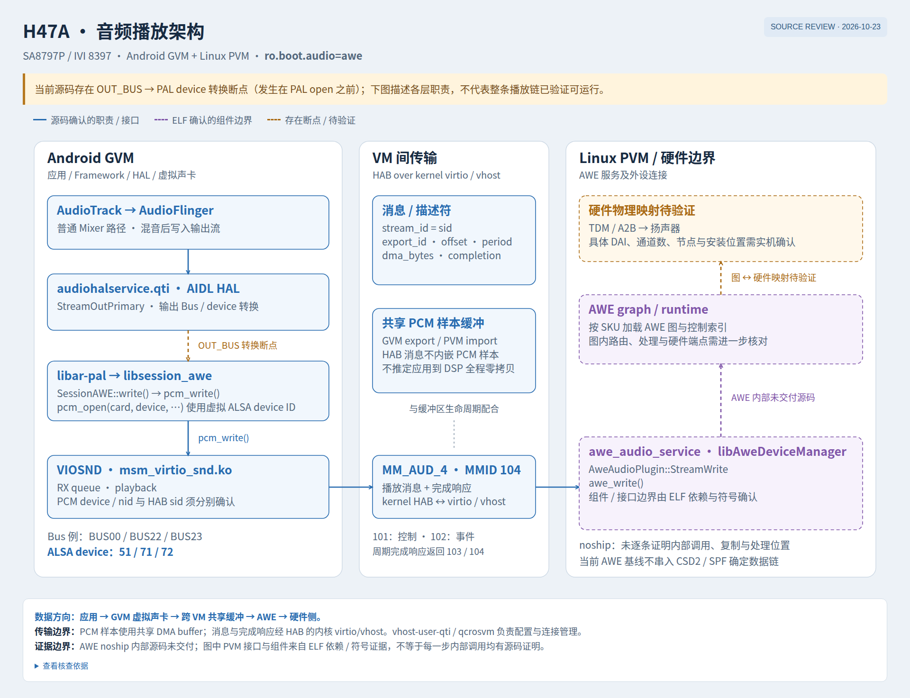
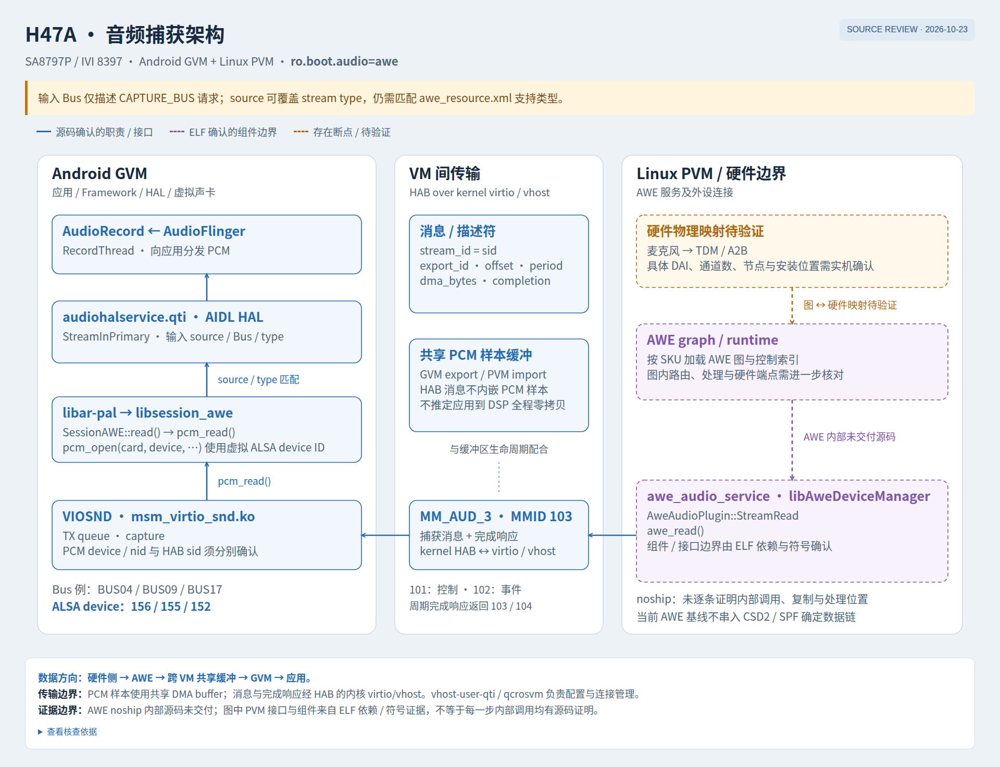

# H47A 8397 Audio 架构设计

> **文档**：H47A_8397_AUDIO_ARCHITECTURE
> **平台**：Qualcomm SA8797P（IVI 8397）
> **架构**：Android GVM（IVI）+ Linux PVM（Cluster / Audio Backend），Gunyah Hypervisor
> **源码根**：Android `/home/voyah/workspace/8397/vendor`；Linux PVM `/home/voyah/workspace/8397/linux/apps/apps_proc`
> **构建基线**：`gen5_gvm`，`ENABLE_HYP := true`，`ro.boot.audio=awe`
> **日期**：2026-10-23
> **修订**：2026-10-23 对照源码校正 AWE 控制项覆盖、两套 PCM 编号、`OUT_BUS` PAL 映射和 GVM/PVM 外部音频边界。

---

## 1. 概述

H47A 8397 的音频系统不是 Android 直接访问 Codec/DSP 的传统架构，而是**跨 VM 的分层音频通路**：

- **Android GVM** 承载 IVI 音频客户端、Car 音频策略、AudioFlinger、AudioReach AIDL HAL 以及 virtio-snd 前端。GVM 的内置音频不直接持有物理 DSP/A2B 设备；USB、Bluetooth 等外部音频仍由对应 HAL 模块管理。
- **Linux PVM** 承载内置音频后端：`AudioDeviceManager`、`csd2_audio_plugin`、`awe_audio_service`、AudioReach SPF 图（运行在 aDSP 上），并最终通过 TDM 连接 A2B 总线、扬声器和麦克风。
- **Gunyah Hypervisor** 提供 VM 隔离；GVM 与 PVM 之间的内置 PCM 数据/消息通过 **HAB 虚拟通道**传输（MMID 101–104），而不是 GVM 直接打开 PVM 的 ALSA 设备。
- **Bus 抽象**是整套设计的关键：Android 侧用 `BUSxx` 虚拟音频设备表达“主舱/前排/后排/输入”等音频路径；DSP 侧用 Bus 对应的 PCM 通道和 AWE 模块完成路由、音量、静音和混音，有独立 CSD2 条目的 Bus 还使用 CSD2 stream/device PP。

本文覆盖：整体架构、Bus/PCM 映射、播放与捕获全链路、HAB 传输、AWE/CSD2 DSP 图、配置与调试方法。

---

## 2. 术语

| 术语 | 说明 |
| --- | --- |
| GVM | Android Guest VM，IVI 侧 |
| PVM | Linux Primary VM，Cluster 与音频后端侧 |
| HAB | Hypervisor ABstraction，Gunyah 提供的跨 VM 虚拟通道 |
| MMID | HAB 多媒体通道 ID；音频使用 `MM_AUD_1`–`MM_AUD_4`（101–104） |
| AIDL HAL | Android 13 的 Audio HAL 接口；H47A 使用 `audiohalservice.qti` |
| PAL | Qualcomm Platform Audio Layer，`libar-pal.so` |
| AWE | Audio Weaver 音频图引擎；`awe_audio_service` 运行 AWE 图 |
| CSD2 | Qualcomm 音频图 API；`csd2_audio_plugin` 负责把 virtio PCM 流转成 CSD2 图读写 |
| SPF | AudioReach Signal Processing Framework，运行在 aDSP 上的音频图 |
| TDM | Time Division Multiplexing，DSP 与 A2B/Codec 之间的后端 DAI |
| A2B | Automotive Audio Bus，车载音频总线 |
| Bus | Android audio policy 中的虚拟音频端口（`BUS00_MEDIA` 等），不是 Linux `/dev/snd` 设备 |
| sid | virtio-snd PCM 流的 `stream_id`；同一 HAB 通道上复用多个 sid |
| SSR | SubSystem Restart，DSP 子系统重启/恢复 |

---

## 3. 总体架构

```
+--------------------------------------------------------------------------------------+
|                                   SA8797P SoC                                        |
|                                                                                      |
|  +-------------------------------------------+   +--------------------------------+  |
|  |            Android GVM (IVI)              |   |        Linux PVM (Audio)       |  |
|  |                                           |   |                                |  |
|  |  AudioTrack / AudioRecord                 |   |  AudioDeviceManager            |  |
|  |        |                                  |   |        |                       |  |
|  |  AudioFlinger::PlaybackThread /           |   |  CSD2AudioPlugin               |  |
|  |  AudioFlinger::RecordThread               |   |        |                       |  |
|  |        |  AIDL                            |   |  csd2_write / csd2_read        |  |
|  |  audiohalservice.qti                      |   |        |                       |  |
|  |    StreamOutPrimary / StreamInPrimary     |   |  AudioReach SPF (aDSP graph)   |  |
|  |    libar-pal / libsession_awe             |   |        |                       |  |
|  |        |  pcm_write / pcm_read            |   |  TDM-LPAIF_* backend DAI       |  |
|  |  msm_virtio_snd.ko (RX/TX)                |   |        |                       |  |
|  |        |                                  |   |  A2B / speaker / mic           |  |
|  |        +------ HAB MM_AUD_1..4 ---------->|   |                                |  |
|  +-------------------------------------------+   +--------------------------------+  |
|                                                                                      |
|  +--------------------------------------------------------------------------------+  |
|  |                              Gunyah Hypervisor                                 |  |
|  +--------------------------------------------------------------------------------+  |
|                                                                                      |
|  +--------------------------------------------------------------------------------+  |
|  |  Shared Audio Hardware: A2B speaker/mic networks, DAC/ADC/amplifiers,          |  |
|  |  transducers                                                                    |  |
|  +--------------------------------------------------------------------------------+  |
+--------------------------------------------------------------------------------------+
```

### 3.1 音频设计要点

1. **GVM 的内置音频不直接持有物理设备**：GVM 只看到 `msm_virtio_snd` 注册的虚拟声卡；物理 DSP、TDM、A2B 由 PVM 管理。USB、Bluetooth 等外部音频是例外，由对应 HAL 模块处理。
2. **Bus 是一等公民**：Android audio policy 用 `BUSxx` 选择路径；HAL/PAL 传递 `bus_addr`，`awe_resource.xml` 将其映射为 PCM `sid`，CSD2 stream metadata 再以 `STREAMRX=BUSxx` 携带 Bus 名称。跨 VM 的 HAB 消息只携带 `sid`，不携带 Bus 字符串。
3. **PCM 号不是物理设备号**：GVM 的 `pcm-id-rx/tx`（如 51、55、52、156）是 AWE 图和 virtio-snd 的 stream id，不是 Linux card/device 号。
4. **HAB 按队列分通道，PCM 按 stream_id 复用**：播放共享 `MM_AUD_4`，捕获共享 `MM_AUD_3`；不是每个 PCM 一个 HAB 设备。
5. **AWE/CSD2 负责 Bus 级控制与图构建**：AWE 提供 `BUSxx_Volume` / `BUSxx_Mute` 等控制，但具体哪些 Bus 有 Volume/Mute 取决于目标 SKU 实际加载的 `awc_index.txt`/`NordyADP_*`；CSD2 用 stream/device PP KV 在 aDSP 上建图。
6. **A2B 是内置音频的最终后端**：主舱、前排、后排分别走 32 ch / 8 ch / 16 ch 的 TDM-A2B 路径；USB/Bluetooth 不经过这条内置 A2B 路径。

---

## 4. 软件分层与关键组件

### 4.1 Android GVM

| 层 | 组件 | 职责 |
| --- | --- | --- |
| 应用 | `AudioTrack` / `AudioRecord` | PCM 播放/捕获客户端 |
| Framework API | `CarAudioManager`、`AudioManager` | 面向应用的音频 API |
| System Services | `CarAudioService`、`AudioPolicyService` | Zone/Context 到 Bus 的路由、焦点与音量 |
| System Services | `AudioFlinger::PlaybackThread` / `RecordThread` | 混音、重采样、HAL 流管理 |
| HAL | `audiohalservice.qti` | AudioReach AIDL HAL 服务进程 |
| HAL | `StreamOutPrimary` / `StreamInPrimary` | Bus 设备选择、usecase 映射、PAL 调用 |
| HAL | `libar-pal.so` / `libsession_awe.so` | PAL 与 AWE PAL session 插件 |
| HAL | `libtinyalsav2.so` | 通过 `pcm_open/pcm_write/pcm_read` 访问虚拟声卡 |
| Kernel | `msm_virtio_snd.ko` | virtio-snd 前端；RX 播放、TX 捕获 |
| Kernel | HAB `MM_AUD_1..4` | 与 PVM 的音频控制/事件/播放/捕获通道 |

关键点：

- **播放线程**：`AudioFlinger::PlaybackThread`（Mixer/FastMixer）把多个 `AudioTrack` 混音后写入 HAL 输出流。
- **捕获线程**：`AudioFlinger::RecordThread` 从 HAL 输入流读取 PCM，再分发给 `AudioRecord`。
- **AIDL HAL**：`audiohalservice.qti` 以 `vendor.audio-hal-aidl` 服务运行，加载 `libaudiocorehal.qti.so`、`libaudioeffecthal.qti.so`、`libpalipcservice.so` 等。
- **HAL 配置目录**：`ModuleConfig.cpp` 优先查找 `/vendor/etc/audio_awe`，Voyah 的 `audio_vendor.mk` 把配置复制到该目录。

### 4.2 Linux PVM

| 组件 | 职责 |
| --- | --- |
| `AudioDeviceManager`（`libAudioDeviceManager.so`，由 `audio_service` 托管） | 打开 HAB MM_AUD_1..4，接收/发送 virtio-snd 消息；创建/使用 CSD2 插件 |
| `CSD2AudioPlugin` | `StreamWrite` / `StreamRead`，调用 `csd2_write` / `csd2_read`，解析 stream metadata KV |
| `awe_audio_service` | 按 SKU 加载 `awc_index.txt` 或 `NordyADP_OneDSP/TwoDSPs`，运行 AWE 图；Bus 控制项以实际加载的配置文件为准 |
| `AudioReach SPF` | 运行在 aDSP 上的音频图，负责混音、路由、PP 处理 |
| `TDM-LPAIF_*` | DSP 后端 DAI，连接 A2B/Codec |
| `A2B speaker/mic network` | 最终扬声器/麦克风网络 |

> **控制项差异**：`awe_resource.xml` 为 BUS08/BUS16 声明了 Volume/Mute，但 `h66a/awc_index.txt` 中 BUS08 没有 `BUS08_FRONT_PASSENGER_*` 控件，BUS16 只有 `BUS16_REAR_SEAT_Mute`、没有 Volume；`NordyADP_OneDSP/TwoDSPs` 中则包含这些条目。`awe-audio.service` 按 `/tmp/awe_dsp_sku_config` 选择配置，目标 SKU 需以实际加载的 `awc_index`/`NordyADP` 为准。

> **注意**：`vhost-user-qti` / `/dev/vhost-aud` 是 PVM 侧的 vhost 音频后端设备，负责 virtio/vhost 设备管理与 VMM 注册；本音频驱动的 PCM 消息/缓冲区走 HAB `MM_AUD_1..4`，vhost 不是 PCM 消息的传输通道。

---

## 5. 配置与 Bus 设计

### 5.1 配置文件

| 文件 | 作用 |
| --- | --- |
| `vendor/voyah/prebuilts/audio/audio_module_config_primary.xml` | Primary Audio HAL module：Attached devices、MixPorts、DevicePorts、Routes |
| `vendor/voyah/prebuilts/audio/audio_policy_configuration.xml` | Audio policy 总入口，包含 USB、r_submix、Bluetooth 模块 |
| `vendor/voyah/prebuilts/audio/car_audio_configuration.xml` | Car 音频 Zone / Context / Volume group 到 Bus 地址的映射 |
| `vendor/voyah/prebuilts/audio/audio_arbitration.csv` | 焦点/并发/闪避策略矩阵 |
| `vendor/voyah/prebuilts/audio/audio_vendor.mk` | 把上述配置复制到 `/vendor/etc/audio_awe/`，并设置 `ro.vendor.audio.*` 属性 |
| `.../configs/gen5_au/card-defs.xml` | AGM 虚拟声卡定义（card 100、PCM100–125、`libagm_pcm_plugin.so`） |
| `.../configs/gen5_au/mixer_paths_VIOSND.xml` | VIOSND 混音器路径 |

> **两套 PCM 编号**：`card-defs.xml` 的 PCM100–125 是 AGM 虚拟卡的 PCM 插件配置；`awe_resource.xml` 的 `pcm-id-rx/tx`（51–70、152–169）是 AWE 图的 ALSA-IO 通道号。二者不是同一套编号，不能直接用 `card-defs` 的设备号去解释 AWE PCM 号，反之亦然。

### 5.2 数量统计

**Primary HAL module（`default`）**

| 项目 | 总数 | 输出 | 输入 |
| --- | ---: | ---: | ---: |
| Audio device（`devicePort`） | 19 | 11 | 8 |
| Stream（`mixPort`） | 33 | 26 | 7 |
| Audio Bus | 14 | 11 | 3 |

**加上 USB / r_submix / Bluetooth 模块**

| Module | Device | 输出 | 输入 | Stream | 输出 | 输入 |
| --- | ---: | ---: | ---: | ---: | ---: | ---: |
| primary / default | 19 | 11 | 8 | 33 | 26 | 7 |
| usb | 5 | 3 | 2 | 3 | 2 | 1 |
| r_submix | 2 | 1 | 1 | 2 | 1 | 1 |
| bluetooth | 6 | 6 | 0 | 4 | 4 | 0 |
| **合计** | **32** | **21** | **11** | **42** | **33** | **9** |

> `mixPort` 是 HAL 声明的流类型/端口，不是并发流数量上限；AudioFlinger 可以按 profile 打开多个同类 stream 实例。

### 5.3 Bus → PCM → DSP → Speaker 映射

下表是 H47A 当前 primary HAL 配置的核心映射。PCM 号来自 `awe_resource.xml` 的 `pcm-id-rx/tx`；CSD2 stream/PP 来自 `csd2_platform_info.h`；TDM/后端来自 `backends.xml`。

#### 输出 Bus（播放）

| Bus | HAL usecase | PAL device | GVM PCM RX | CSD2 stream | DSP device PP | TDM backend | A2B / 扬声器 |
| --- | --- | --- | ---: | --- | --- | --- | --- |
| `BUS00_MEDIA` | `MEDIA_PLAYBACK` | `PAL_DEVICE_OUT_SPEAKER` | 51 | `CSD2_STREAM_PCM_PLAYBACK_BUS_MEDIA` | `DEVICEPP_RX_BUS00_MEDIA` | `TDM-LPAIF_RXTX-RX-PRIMARY`（32 ch） | `a2bspeaker` / 主舱 |
| `BUS01_SYS_NOTIFICATION` | `SYS_NOTIFICATION_PLAYBACK` | `PAL_DEVICE_OUT_SPEAKER` | 56 | `CSD2_STREAM_PCM_PLAYBACK_BUS_SYS_NOTIF` | `DEVICEPP_RX_BUS01_SYS_NOTIFICATION` | 同上 | 主舱 |
| `BUS02_NAV_GUIDANCE` | `NAV_GUIDANCE_PLAYBACK` | `PAL_DEVICE_OUT_SPEAKER` | 57 | `CSD2_STREAM_PCM_PLAYBACK_BUS_NAV` | `DEVICEPP_RX_BUS02_NAV_GUIDANCE` | 同上 | 主舱 |
| `BUS03_PHONE` | `PHONE_PLAYBACK` | `PAL_DEVICE_OUT_SPEAKER` | 58 | `CSD2_STREAM_PCM_PLAYBACK_BUS_PHONE` | `DEVICEPP_RX_BUS03_PHONE` | 同上 | 主舱 |
| `BUS05_ALERTS` | `ALERTS_PLAYBACK` | `PAL_DEVICE_OUT_SPEAKER` | 53 | `CSD2_STREAM_PCM_PLAYBACK_BUS_ALERTS` | `DEVICEPP_RX_BUS05_ALERTS` | 同上 | 主舱 |
| `BUS07_ASSISTANT` | `ASSISTANT_PLAYBACK` | `PAL_DEVICE_OUT_SPEAKER` | 63 | —（AWE 图） | —（AWE 图控制项） | 同上 | 主舱 |
| `BUS10_DOLBY_ATMOS` | `VENDOR_DOLBY_ATMOS_PLAYBACK` | `PAL_DEVICE_OUT_SPEAKER` | 65 | —（AWE 图） | —（AWE 图控制项） | 同上 | 主舱 |
| `BUS11_ADAS_TTS` | `VENDOR_ADAS_TTS_PLAYBACK` | `PAL_DEVICE_OUT_SPEAKER` | 66 | —（AWE 图） | —（AWE 图控制项） | 同上 | 主舱 |
| `BUS2008_VENDOR_CONTEXT3` | `VENDOR_OUTSIDE_CAR_PLAYBACK` | `PAL_DEVICE_OUT_SPEAKER` | 64 | —（AWE 图） | —（AWE 图控制项） | 同上 | 主舱 |
| `BUS08_FRONT_PASSENGER` | `FRONT_PASSANGER_PLAYBACK` | `PAL_DEVICE_OUT_A2B_SPKR` | 55 | `CSD2_STREAM_PCM_PLAYBACK_BUS_FRONT_PASSENGER` | `DEVICEPP_RX_BUS08_FRONT_PASSENGER` | `TDM-LPAIF-RX-PRIMARY`（8 ch） | `speaker` / 前排 |
| `BUS16_REAR_SEAT` | `REAR_SEAT_PLAYBACK` | `PAL_DEVICE_OUT_A2B2_SPKR` | 52 | `CSD2_STREAM_PCM_PLAYBACK_BUS_REAR_SEAT` | `DEVICEPP_RX_BUS16_REAR_SEAT` | `TDM-LPAIF_VA-RX-PRIMARY`（16 ch） | `a2b2speaker` / 后排 |

> `BUS12_KTV` 出现在 AWE resource（RX 59）和 HAL 的 Bus 映射中，但当前 `audio_module_config_primary.xml` 没有暴露它，因此不在 14 路 Bus 内。

> **PAL device 口径**：表中 `PAL_DEVICE_OUT_SPEAKER` 等来自 `awe_resource.xml` 的 Bus→PAL 映射。HAL 侧 `StreamOutPrimary::updatePalDeviceForBusAddr()` 只显式覆盖 `BUS07/08/10/11/16/2008` 和 `BUS12`；`BUS00/01/02/03/05` 未在该 map 中，实际 PAL device 由 `configureAndFetchPalDevices()` 生成，需以目标构建日志核对。日志出现 `unknown bus address` 不一定代表流失败。
>
> **CSD2 条目差异**：`BUS07/10/11/2008` 在 `csd2_platform_info.h` 中没有独立的 `CSD2_STREAM_PCM_PLAYBACK_BUS_*` 条目；表中的“—（AWE 图）”表示由 AWE 图/控制项承接，不能按 CSD2 stream 名检索。
>
> **物理位置**：主舱/前排/后排是按 Bus 名称与 `backends.xml` 的 `snd_device_name` 做的分组；具体扬声器位置、A2B 节点级联关系需结合 DTS/原理图确认。

#### 输入 Bus（捕获）

| Bus | HAL usecase | PAL device | GVM PCM TX | CSD2 stream | DSP device PP | TDM backend | 麦克风 |
| --- | --- | --- | ---: | --- | --- | --- | --- |
| `BUS04_INPUT` | `PCM_RECORD` / `PAL_STREAM_CAPTURE_BUS` | `PAL_DEVICE_IN_HANDSET_MIC` | 156 | `CSD2_STREAM_BUS04_INPUT` | `DEVICEPP_TX_BUS04_INPUT` | `TDM-LPAIF_RXTX-TX-PRIMARY` | `a2b-mic` / 主输入 |
| `BUS09_INPUT_FRONT_PASSENGER` | 同上 | `PAL_DEVICE_IN_A2B_MIC` | 155 | `CSD2_STREAM_BUS09_INPUT_FRONT_PASSENGER` | `DEVICEPP_TX_BUS09_INPUT_FRONT_PASSENGER` | 同上 | `a2b-mic` / 前排 |
| `BUS17_INPUT_REAR_SEAT` | 同上 | `PAL_DEVICE_IN_A2B2_MIC` | 152 | `CSD2_STREAM_BUS17_INPUT_REAR_SEAT` | `DEVICEPP_TX_BUS17_REAR_SEAT` | `TDM-LPAIF_VA-TX-PRIMARY` | `a2b2-mic` / 后排 |

> `BUS04` 与 `BUS09` 的 TDM 后端相同（`TDM-LPAIF_RXTX-TX-PRIMARY` / `a2b-mic`），但 `stream_id`、CSD2 stream 和 device PP 不同；不能只按 TDM 后端区分这两路输入。

#### 其他非 Bus PCM（补充）

`awe_resource.xml` 还定义了以下 PCM，供非 Bus 路径使用：

| 用途 | PCM RX/TX | 说明 |
| --- | --- | --- |
| Primary Input | TX 162 | 主输入（非 Bus 通道） |
| Secondary Input | TX 158 | 次输入 |
| Tertiary Input | TX 160 | 第三输入 |
| FM Input | TX 159 | FM 调谐 |
| Echo Ref | TX 163 | AEC 参考 |
| MIC ECNR | TX 169 | ECNR 麦克风 |
| HFP TX/RX | RX 67 / TX 164、RX 54 / TX 154 | HFP 上下行 |
| FM RX/TX | RX 61 / TX 161 | FM loopback |
| Exterior Talk | RX 68 / TX 165 | 车外对讲 |
| Switch TX | RX 70 / TX 167 | 切换通道 |

> FM 相关 PCM 在 `awe_resource.xml` 中有定义，但当前 `audio_module_config_primary.xml` 的 `fm_tuner` device 和 `mixport_tuner0` route 被注释（自定义 radio 实现）；是否启用需按产品配置确认。

### 5.4 Car 音频 Zone / Context

`car_audio_configuration.xml` 定义三个 Zone：

- **primary zone**：Media、Notification、Navigation、Phone、Alerts 等主舱上下文。
- **front passenger zone**：前排乘客音频。
- **rear seat zone**：后排音频。

每个 Zone 内按 Volume Group 把 context 映射到 Bus 地址（如 `BUS00_MEDIA`、`BUS01_SYS_NOTIFICATION`、`BUS02_NAV_GUIDANCE`、`BUS03_PHONE`、`BUS05_ALERTS`、`BUS07_ASSISTANT`、`BUS10_DOLBY_ATMOS`、`BUS11_ADAS_TTS`、`BUS2008_VENDOR_CONTEXT3` 等）。`audio_arbitration.csv` 定义焦点冲突时的并发/闪避策略。

---

## 6. 播放数据流（AudioTrack → Speaker）

详细可交互图：[H47A_audio_playback.html](diagrams/H47A_audio_playback.html)

```
AudioTrack
  -> AudioFlinger::PlaybackThread (Mixer / FastMixer)
  -> StreamOutPrimary (AIDL HAL)
  -> BUSxx (AIDL AudioDevice address)
  -> libar-pal / libsession_awe
  -> pcm_write() on virtual sound card
  -> msm_virtio_snd.ko RX queue
  -> HAB MM_AUD_4 (MMID 104), message.stream_id = sid
  -> AudioDeviceManager (PVM)
  -> CSD2AudioPlugin::StreamWrite
  -> csd2_write()
  -> AudioReach SPF (aDSP graph)
  -> TDM-LPAIF_* -> A2B -> Speaker
```

### 6.1 应用与 Framework

1. 应用通过 `AudioTrack` 写入 PCM；`AudioTrack` 通过共享 buffer + binder 与 `AudioFlinger` 交互。
2. `AudioFlinger::PlaybackThread`（Mixer/FastMixer）把多个 Track 混音，按输出流的采样率/格式写入 HAL。
3. `AudioPolicyService` / `CarAudioService` 根据 `car_audio_configuration.xml` 的 context 选择 Bus 设备，`AudioFlinger` 打开对应输出流。

### 6.2 HAL 与 PAL

4. `StreamOutPrimary` 从 `AudioDevice.address` 取出 Bus 地址（例如 `BUS00_MEDIA`），设置 `pal_stream_attributes.bus_addr`。
5. `AudioUsecase.cpp` 按 Bus 地址选择 usecase：
   - `BUS00_MEDIA` → `MEDIA_PLAYBACK`
   - `BUS01_SYS_NOTIFICATION` → `SYS_NOTIFICATION_PLAYBACK`
   - `BUS02_NAV_GUIDANCE` → `NAV_GUIDANCE_PLAYBACK`
   - `BUS03_PHONE` → `PHONE_PLAYBACK`
   - `BUS05_ALERTS` → `ALERTS_PLAYBACK`
   - `BUS08_FRONT_PASSENGER` → `FRONT_PASSANGER_PLAYBACK`
   - `BUS16_REAR_SEAT` → `REAR_SEAT_PLAYBACK`
   - `BUS07_ASSISTANT` → `ASSISTANT_PLAYBACK`
   - `BUS10_DOLBY_ATMOS` / `BUS11_ADAS_TTS` / `BUS2008_VENDOR_CONTEXT3` → 对应 `VENDOR_*` usecase
6. `StreamOutPrimary::updatePalDeviceForBusAddr()` 对部分 Bus 做 PAL device 覆盖：
   - `BUS08_FRONT_PASSENGER` → `PAL_DEVICE_OUT_A2B_SPKR`
   - `BUS16_REAR_SEAT` → `PAL_DEVICE_OUT_A2B2_SPKR`
   - `BUS07_ASSISTANT` / `BUS11_ADAS_TTS` / `BUS10_DOLBY_ATMOS` / `BUS2008_VENDOR_CONTEXT3` → `PAL_DEVICE_OUT_SPEAKER`
7. `SessionAWE` 按 PAL device 名称和 `bus_addr` 在 `deviceInfoMAP` 中查找 `awe_resource.xml` 配置的 PCM 设备，并打开对应的 `pcm-id-rx`（如 `BUS00_MEDIA` → 51）。

### 6.3 GVM 虚拟声卡与 HAB

8. `SessionAWE::write()` 调用 `pcm_write()`，把 PCM 写入 `msm_virtio_snd` 注册的虚拟声卡。
9. `msm_virtio_snd` 播放使用 **RX 队列**，对应 HAB **MM_AUD_4（104）**；消息中 `xfer.stream_id = substream->sid`（即 Bus 的 PCM 号）。
10. PCM buffer 通过 `habmm_export()` 导出为 DMABUF，消息只携带 `export_id`、`offset`、`period`、`dma_bytes` 等描述符，数据本身零拷贝共享。

### 6.4 PVM 与 DSP

11. PVM 的 `audio_service`（托管 `AudioDeviceManager`）打开 `MM_AUD_1..4`，接收 HAB 消息；播放方向分发到 `CSD2AudioPlugin::StreamWrite`。
12. `csd2_audio_plugin` 解析 stream metadata 中的 GKV（如 `STREAMRX=BUS00_MEDIA`、`VMID=LA_GVM_1`），在 `csd2_platform_info.h` 的 `stream_nodes` 中匹配 `CSD2_STREAM_PCM_PLAYBACK_BUS_*`（有独立 CSD2 条目的 Bus），并选择 `DEVICEPP_RX_BUSxx_*` 设备 PP；`BUS07/10/11/2008` 没有独立 CSD2 条目，走 AWE 图/控制项。
13. `csd2_write()` 把数据写入 CSD2 会话；SPF 在 aDSP 上执行混音、PP 处理和图路由。
14. `awe_audio_service` 运行 AWE 图，提供 `BUSxx_Volume` / `BUSxx_Mute` 等控制；AWE 图与 CSD2/SPF 都使用 `BUSxx` 命名，但具体图项/控制项是否一致需按目标 SKU 核对。

### 6.5 TDM / A2B / Speaker

15. SPF 输出到 TDM 后端，按 Bus 组走不同 TDM/A2B：
   - **主舱组**（`BUS00/01/02/03/05/07/10/11/2008`）→ `TDM-LPAIF_RXTX-RX-PRIMARY`（32 ch）→ `a2bspeaker` → 主舱扬声器网络。
   - **前排**（`BUS08_FRONT_PASSENGER`）→ `TDM-LPAIF-RX-PRIMARY`（8 ch）→ `speaker` → 前排乘客扬声器。
   - **后排**（`BUS16_REAR_SEAT`）→ `TDM-LPAIF_VA-RX-PRIMARY`（16 ch）→ `a2b2speaker` → 后排扬声器网络。
16. 主舱组内部的多路 Bus 不是各接一个物理扬声器，而是在 DSP 图内按 Bus 做音量/静音/混音后，汇总到同一条 32 ch A2B 主网络；前排/后排是独立 A2B 后端。

---

## 7. 捕获数据流（Microphone → AudioRecord）

详细可交互图：[H47A_audio_capture.html](diagrams/H47A_audio_capture.html)

```
A2B mic network
  -> TDM-LPAIF_RXTX-TX-PRIMARY (a2b-mic) / TDM-LPAIF_VA-TX-PRIMARY (a2b2-mic)
  -> AudioReach SPF (aDSP graph)
  -> csd2_read()
  -> CSD2AudioPlugin::StreamRead
  -> AudioDeviceManager (PVM)
  -> HAB MM_AUD_3 (MMID 103), message.stream_id = sid
  -> msm_virtio_snd.ko TX queue
  -> pcm_read()
  -> libar-pal / libsession_awe (capture)
  -> BUS04_INPUT / BUS09_INPUT_FRONT_PASSENGER / BUS17_INPUT_REAR_SEAT
  -> StreamInPrimary
  -> AudioFlinger::RecordThread
  -> AudioRecord
```

### 7.1 硬件到 DSP

1. A2B 麦克风网络采集音频，经 `TDM-LPAIF_RXTX-TX-PRIMARY`（`a2b-mic`）或 `TDM-LPAIF_VA-TX-PRIMARY`（`a2b2-mic`）进入 aDSP。
2. SPF 图对输入做 PP 处理（如 ECNS/增益），CSD2 通过 `csd2_read()` 读取图输出。

### 7.2 PVM 到 GVM

3. `AudioDeviceManager` 在捕获方向调用 `CSD2AudioPlugin::StreamRead`。
4. 捕获使用 HAB **MM_AUD_3（103，TX 队列）**；消息中 `stream_id` 对应输入 Bus 的 PCM 号（156/155/152）。
5. `msm_virtio_snd` TX 队列接收消息，`SessionAWE::read()` 通过 `pcm_read()` 读取虚拟声卡。
6. `StreamInPrimary` 根据输入 Bus 选择 `PAL_STREAM_CAPTURE_BUS`，并把 Bus 地址传给 PAL。

### 7.3 输入 Bus 到应用

7. `BUS04_INPUT` / `BUS09_INPUT_FRONT_PASSENGER` / `BUS17_INPUT_REAR_SEAT` 经 `StreamInPrimary` 进入 `AudioFlinger::RecordThread`，最终由 `AudioRecord` 返回应用。
8. `BUS04` 与 `BUS09` 共用 `a2b-mic` 这条 TDM 后端，靠 `stream_id` 和 CSD2 的 stream/device KV 区分；`BUS17` 走独立的 `a2b2-mic`。

---

## 8. HAB 传输设计

### 8.1 四个音频 HAB 通道

| virtio-snd 队列 | HAB MMID | 数值 | 用途 |
| --- | --- | ---: | --- |
| `VIRTIO_SND_VQ_CONTROL` | `MM_AUD_1` | 101 | 控制（open/set params 等） |
| `VIRTIO_SND_VQ_EVENT` | `MM_AUD_2` | 102 | 事件/周期通知 |
| `VIRTIO_SND_VQ_TX` | `MM_AUD_3` | 103 | 捕获（PVM → GVM） |
| `VIRTIO_SND_VQ_RX` | `MM_AUD_4` | 104 | 播放（GVM → PVM） |

代码依据：

- `virtio_card.c`：每个队列创建一个 kthread，`thread_data.mmid = MM_AUD_1 + i`，并 `habmm_socket_open()`。
- `habmmid.h`：`MM_AUD_1=101`、`MM_AUD_2=102`、`MM_AUD_3=103`、`MM_AUD_4=104`。
- `virtio_pcm_msg.c`：播放使用 RX 队列的 HAB socket，捕获使用 TX 队列的 HAB socket；`msg->xfer.stream_id = substream->sid`。
- `virtio_card.c`：`vsnd_dma_area_export()` 通过 `habmm_export()` 导出 DMA_BUF。

### 8.2 PCM 号与 HAB 通道的关系

- **不是一个 PCM 号对应一个 HAB 设备**。
- 一个 HAB 通道（如 `MM_AUD_4`）承载所有播放 PCM；每个 PCM 用 `stream_id = sid` 区分。
- 捕获 PCM 共享 `MM_AUD_3`，同样用 `stream_id` 区分。
- 控制/参数走 `MM_AUD_1`，事件走 `MM_AUD_2`。

### 8.3 零拷贝

- PCM buffer 由 `habmm_export()` 导出为 DMABUF，PVM 通过 `export_id` 映射同一块内存。
- HAB socket 只传递消息/描述符（`export_id`、`offset`、`period`、`dma_bytes`、`stream_id`），不复制 PCM 数据。
- 这降低了跨 VM 的 CPU 拷贝开销，但要求 GVM/PVM 两侧 buffer 生命周期和 fence 严格同步。

### 8.4 恢复与异常

- HAB `habmm_socket_recv()` 返回 `-ENODEV` 时，驱动进入重连循环，重新 `habmm_socket_open()`。
- `MM_AUD_2`（event）连接异常时，驱动会把虚拟声卡标记为 offline/online，通知上层。
- PVM 侧 `audio_service`（`audio-umd`）/ `awe_audio_service` / `vhost-user-aud` / `aud-fastrpcd` 重启时，GVM 侧 HAB 可能断开并重连；需要检查 systemd 服务状态和 dmesg。
- CSD2 插件注册 SSR 回调，DSP 重启后清理并重建会话。

---

## 9. AWE / CSD2 / DSP 图设计

### 9.1 PCM ID 号段

AWE 图 `NordyADP.awj` 中的图内 legend/annotation 定义了 ALSA-IO PCM ID 号段：

| 号段 | 用途 |
| --- | --- |
| 0–49 | PVM ALSA Source |
| 50–99 | **GVM ALSA Source（GVM 播放）** |
| 100–149 | PVM ALSA Sink |
| 150–199 | **GVM ALSA Sink（GVM 捕获）** |

因此：

- 播放 Bus 的 `pcm-id-rx` 在 50–99（如 51、55、52）。
- 捕获 Bus 的 `pcm-id-tx` 在 150–199（如 156、155、152）。

### 9.2 AWE 图与 Bus 控制

- `awc_index.txt` 中包含 `BUS00_MEDIA_Volume.gain`、`BUS00_MEDIA_Mute.isMuted`、`BUS01_SYS_NOTIFICATION_Volume` 等模块/控件；但不是每套 SKU 配置都同时覆盖所有 Bus：`h66a/awc_index.txt` 中 `BUS16_REAR_SEAT` 只有 Mute、`BUS08_FRONT_PASSENGER` 没有条目；`NordyADP_OneDSP.txt`/`NordyADP_TwoDSPs.txt` 中则包含 BUS08 和 BUS16_Volume。服务按 `/tmp/awe_dsp_sku_config` 选择配置，排查时必须确认实际 SKU。
- `NordyADP.awc` 是 AWE 图配置；`awc_index.txt` 是控件索引。`awe_audio_service` 按 SKU 选择 `awc_index.txt` 或 `NordyADP_OneDSP.txt`/`NordyADP_TwoDSPs.txt` 启动图。
- 修改 Bus、PCM ID 或图结构时，`awe_resource.xml`、`awc_index.txt`、`NordyADP.awc` 必须同步更新；目标 SKU 若使用 `NordyADP_*` 配置，也要同步核对对应文件。

### 9.3 CSD2 stream / device PP

- 播放：有独立 CSD2 条目的 Bus 使用 `CSD2_STREAM_PCM_PLAYBACK_BUS_*` + `DEVICEPP_RX_BUSxx_*`；`BUS07/10/11/2008` 在 `csd2_platform_info.h` 中没有独立 stream/PP，走 AWE 图/控制项。
- 捕获：`CSD2_STREAM_BUSxx_INPUT` + `DEVICEPP_TX_BUSxx_*`。
- stream metadata 中的 GKV 例子：`STREAMRX=BUS00_MEDIA`、`VMID=LA_GVM_1`；CSD2 用这些 KV 匹配 `stream_nodes`，找不到会打印 `Couldn't find the correct stream_node_id for the given KVs`。
- device PP 由 `AnalyzeStrdevMetadata()` 根据 `DEVICEPP_RX/TX` KV 选择。

### 9.4 `awe_audio_service` 与 `csd2_audio_plugin` 的分工

- PVM 的 `audio_service`（`audio-umd.service`）链接 `AudioDeviceManager` 库；`AudioDeviceManager` 创建/使用 `CSD2AudioPlugin`，PCM 数据实际经 `CSD2AudioPlugin::StreamWrite/StreamRead` → `csd2_write/csd2_read` 进入 CSD2 图。
- `awe_audio_service` 负责 AWE 图的运行与 Bus 级控制（Volume/Mute），是图/控制面的服务。
- 两者都使用 `BUSxx` 命名，但**是否共用同一张图、同一组控制项取决于目标 SKU**：需同时核对 `awc_index.txt`/`NordyADP` 与 `csd2_platform_info.h`，不能假设任一侧的条目自动存在于另一侧。

---

## 10. 关键设计点与约束

### 10.1 Bus 抽象

- Bus 是 Android audio policy 的虚拟端口，用 `address=BUSxx` 表达；不是 Linux `/dev/snd` 节点。
- 同一个 Bus 名称贯穿：`audio_module_config_primary.xml` → HAL `bus_addr` → `awe_resource.xml` → `csd2_platform_info.h`（仅限有独立 CSD2 条目的 Bus）；`backends.xml` 由 PAL device 映射到 TDM/DAI，不再使用 Bus 名称。
- `awe_resource.xml` 的 AWE PCM 编号（51–70、152–169）与 `card-defs.xml` 的 AGM PCM 编号（100–125）是两套，不要把 51/156 与 PCM100–125 直接对应。
- 新增 Bus 必须同时修改上述配置，否则会出现 `unknown bus address`、`Unable to find pcm device`、`Couldn't find stream_node_id` 等错误。

### 10.2 VM 隔离

- GVM 的内置音频只能看到 `msm_virtio_snd` 虚拟声卡；不能直接访问内置 aDSP、TDM、A2B。USB、Bluetooth 等外部音频由对应 HAL 模块处理。
- PVM 管理内置物理音频资源，负责 A2B/Codec 的初始化、SSR 和电源管理。
- 跨 VM 的内置音频只通过 HAB 音频通道和 vhost/VMM 控制通道交互。

### 10.3 通道容量

| 后端 | 通道数 | 典型用途 |
| --- | ---: | --- |
| `TDM-LPAIF_RXTX-RX-PRIMARY` | 32 ch | 主舱 Bus 组混音输出 |
| `TDM-LPAIF-RX-PRIMARY` | 8 ch | 前排乘客 |
| `TDM-LPAIF_VA-RX-PRIMARY` | 16 ch | 后排 |
| `TDM-LPAIF_RXTX-TX-PRIMARY` | 32 ch | A2B 主麦克风 |
| `TDM-LPAIF_VA-TX-PRIMARY` | 16 ch | A2B2 后排麦克风 |

默认采样率 48 kHz；Bus mixPort 支持 8k–48k，PCM 16-bit 为主，低时延/深缓冲/压缩/直通等流类型按 `mixPort` flags 区分。

### 10.4 时延与缓冲

- 播放流按 `mixPort` flags 选择 `PAL_STREAM_PLAYBACK_BUS`、`PAL_STREAM_LOW_LATENCY`、`PAL_STREAM_DEEP_BUFFER`、`PAL_STREAM_COMPRESSED` 等。
- HAB 按 period 发送消息；`pcm_period_ms`、`pcm_buffer_ms` 是驱动模块参数。
- `MMAP_NOIRQ` 流使用 `no_period_wakeup`，DMA 导出走 CONTROL 通道。

### 10.5 配置一致性

以下配置必须保持一致：

1. `audio_module_config_primary.xml`：Bus 地址、usecase、mixPort/devicePort。
2. `awe_resource.xml`：Bus → PAL device、`pcm-id-rx/tx`、Volume/Mute 控件。
3. `csd2_platform_info.h`：`CSD2_STREAM_*`、`DEVICEPP_*`、`VMID`。
4. `backends.xml`：PAL device → TDM/DAI → `snd_device_name`。
5. `card-defs.xml`：AGM 虚拟卡的 PCM 设备和 plugin（与 AWE PCM 号不是同一套编号）。
6. `awc_index.txt` / `NordyADP_*`：目标 SKU 的 AWE 图与 Bus 控制项；需与 `awe_resource.xml` 的声明对齐。

任何一处不一致，都可能导致“能打开流但没声音”“Bus 音量无效”“路由到错误扬声器”等问题。

---

## 11. 调试与验证

### 11.1 Android GVM

```bash
# AudioFlinger / AudioPolicy 状态
dumpsys media.audio_flinger
dumpsys audio

# Car 音频 Zone / Context
dumpsys car_service

# 虚拟声卡与 PCM 设备
# 先确认实际 card/device：AWE resource 的 51/156 是 PCM 通道号，
# 不一定等于 card-defs 的 PCM100–125
cat /proc/asound/cards
ls -l /dev/snd

# 确认 card/device 后再执行播放/录音
tinymix -D 100
tinyplay /data/test.wav -D 100 -d 51
tinycap /data/cap.wav -D 100 -d 156

# 日志
logcat -b all -s AudioFlinger AudioPolicyManager audio_hw
```

### 11.2 Linux PVM

```bash
# 音频后端服务
systemctl status audio-umd
systemctl status awe-audio
systemctl status vhost-user-aud
systemctl status aud-fastrpcd

# 日志
journalctl -u audio-umd -f
journalctl -u awe-audio -f
journalctl -u vhost-user-aud -f

# 声卡/DAI
cat /proc/asound/cards
tinymix
tinyplay /data/test.wav
tinycap /data/cap.wav

# 驱动/HAB/DSP 日志
dmesg | grep -Ei "hab|vsnd|virtio|csd2|awe|adsp"
```

### 11.3 Bus 到扬声器的验证

1. 在 `car_audio_configuration.xml` 找到目标 context 对应的 Bus 地址。
2. 在 `awe_resource.xml` 查该 Bus 的 `pcm-id-rx` 和 `BUSxx_Volume` / `BUSxx_Mute`。
3. 在 `csd2_platform_info.h` 查对应的 `CSD2_STREAM_*` 和 `DEVICEPP_RX_*`。
4. 在 `backends.xml` 查 PAL device → TDM/DAI → `snd_device_name`。
5. 播放测试音，分别验证主舱/前排/后排扬声器输出；用 `tinymix` 调 `BUSxx_Volume`，确认只影响目标 Bus。
6. 捕获测试：分别用 `BUS04`、`BUS09`、`BUS17` 录音，确认 `stream_id` 和麦克风通道对应。

### 11.4 常见问题

| 现象 | 可能原因 | 排查 |
| --- | --- | --- |
| `unknown bus address` | HAL `updatePalDeviceForBusAddr` 只显式覆盖部分 Bus；BUS00/01/02/03/05 等不在 map 中时可能打印该日志 | 检查 `StreamOutPrimary.cpp`/`StreamInPrimary.cpp` 的 map；确认流是否仍使用默认 PAL device 正常出声 |
| `Unable to find pcm device for bus address` | `awe_resource.xml` 缺少 Bus，或 `supported-types` 不包含当前 stream 类型 | 检查 `pcm-id-rx/tx` 和 `PAL_STREAM_*` |
| `Couldn't find the correct stream_node_id` | CSD2 收不到 `STREAMRX=BUSxx` / `VMID` KV，或 `csd2_platform_info.h` 缺少对应 stream | 检查 metadata、`stream_nodes` |
| 能打开流但无声音 | TDM/A2B 后端未通、A2B 功放未上电、`BUSxx_Mute` 为 true | 检查 `backends.xml`、A2B 硬件、AWE Mute |
| 主舱有声音、前排/后排无声 | 对应 Bus 未路由到 A2B/A2B2，或 TDM 通道数不匹配 | 检查 `BUS08`/`BUS16` 的 PAL device、TDM、A2B |
| 录音只有主麦 | `BUS09`/`BUS17` 的 stream_id 或 device PP 不对 | 检查输入 Bus 映射和 A2B mic |
| HAB `-ENODEV` | PVM 后端重启、`awe_audio_service`/`vhost-user-aud` 异常 | 检查 PVM 服务、dmesg |
| 虚拟声卡 offline | `MM_AUD_2` 事件通道断开 | 检查 HAB 连接、PVM 服务 |

---

## 12. 代码索引

> 下表 Android 路径相对于 `/home/voyah/workspace/8397/vendor`；PVM 路径相对于 `/home/voyah/workspace/8397/linux/apps/apps_proc`。`kernel_platform` 位于 Android 树内。

| 模块 | 路径 |
| --- | --- |
| AudioTrack / AudioRecord | `frameworks/av/media/libaudioclient/AudioTrack.cpp`、`AudioRecord.cpp` |
| AudioFlinger | `frameworks/av/services/audioflinger/AudioFlinger.cpp`、`Threads.cpp` |
| CarAudioService | `packages/services/Car/service/src/com/android/car/audio/CarAudioService.java` |
| AIDL HAL 服务 | `vendor/qcom/opensource/audio-hal-ar/primary-hal/hal/service/Android.bp`、`audiohalservice_qti.rc` |
| StreamOut / StreamIn | `vendor/qcom/opensource/audio-hal-ar/primary-hal/hal/core/StreamOutPrimary.cpp`、`StreamInPrimary.cpp` |
| Bus → usecase | `vendor/qcom/opensource/audio-hal-ar/primary-hal/hal/core/platform/AudioUsecase.cpp` |
| PAL | `vendor/qcom/opensource/pal/Android.mk`、`pal/stream/src/Stream.cpp` |
| AWE PAL session | `vendor/qcom/proprietary/mm-audio-auto/awe/pal_awe_plugin/session/SessionAWE/src/SessionAWE.cpp` |
| AWE Bus/PCM 资源 | `vendor/qcom/proprietary/mm-audio-auto/awe/pal_awe_plugin/configs/gen5/awe_resource.xml` |
| virtio-snd / HAB | `vendor/qcom/opensource/audio-kernel-virtio/virtio_card.c`、`virtio_pcm.c`、`virtio_pcm_msg.c` |
| HAB MMID | `kernel_platform/soc-repo/include/uapi/linux/habmmid.h` |
| PVM audio_service | `linux/apps/apps_proc/vendor/qcom/proprietary/audio-service/audio_service/src/main.c`、`coreinit.c` |
| PVM AudioDeviceManager | `linux/apps/apps_proc/vendor/qcom/proprietary/audio-service/virtio_audio_device/audio_device_manager/src/AudioDeviceManager.cpp` |
| CSD2 插件 | `linux/apps/apps_proc/vendor/qcom/proprietary/audio-service/virtio_audio_device/audio_plugin_intf/csd2_audio_plugin/src/csd2_audio_plugin.cpp` |
| CSD2 stream/PP | `linux/apps/apps_proc/vendor/qcom/proprietary/audio-service/audio_driver/csd2/config/csd2_platform_info.h` |
| PVM 后端 DAI | `linux/apps/apps_proc/vendor/qcom/proprietary/audio-service/virtio_audio_device/sound_card_info_util/libs/xml_parser/configs/backends.xml` |
| AWE 图 | `linux/apps/apps_proc/vendor/qcom/proprietary/awe/awe_config/NordAU/target_config/h66a/awc_index.txt`、`NordyADP.awc` |
| HAL 配置 | `vendor/voyah/prebuilts/audio/audio_module_config_primary.xml`、`audio_policy_configuration.xml` |
| Car 音频配置 | `vendor/voyah/prebuilts/audio/car_audio_configuration.xml`、`audio_arbitration.csv` |
| 设备/属性 | `device/voyah/himalayas/himalayas.mk`、`vendor/voyah/prebuilts/audio/audio_vendor.mk` |

---

## 13. 已知限制与待确认项

1. **物理 A2B 拓扑**：代码只给出 `a2bspeaker`/`a2b2speaker` 和 32/8/16 ch 后端，具体扬声器位置、A2B 节点级联关系需结合硬件 DTS/原理图确认。
2. **Codec/功放型号**：仓库中没有明确的 Codec/AMP 器件型号，本文只写到 `Audio DAC / ADC & Amplifiers` 类别层级。
3. **AWE 图版本**：`NordyADP.awc`、`awc_index.txt` 必须与目标构建一致；修改 Bus 或 PCM ID 后需要重新生成图。
4. **CSD2 与 AWE 服务的数据面**：代码显示 `AudioDeviceManager` 加载 `CSD2AudioPlugin`，`awe_audio_service` 负责 AWE 图/控制；不同构建若启用不同的 graph 后端，需要以实际镜像为准。
5. **`BUS12_KTV`**：AWE resource 中存在（RX 59），但当前 primary HAL 配置未暴露。
6. **Bus 数量差异**：`car_audio_configuration.xml` 直接引用的 Bus 地址与 HAL 的 14 路 Bus 不完全一一对应（部分前排/后排 Bus 可能走动态路由或其他配置），本文以 HAL/`awe_resource.xml` 为准。
7. **HAB MMID**：101–104 来自内核 UAPI；如目标内核版本不同，需要复核。
8. **未做运行时 trace 验证**：本文基于静态代码与配置；实际播放/捕获的时序、HAB 延迟、A2B 输出需在目标硬件上复测。
9. **AWE 控制项覆盖差异**：`h66a/awc_index.txt` 中 BUS08 无控件条目、BUS16 只有 Mute，而 `NordyADP_OneDSP/TwoDSPs` 中包含这些条目；`awe_audio_service` 按 `/tmp/awe_dsp_sku_config` 选择配置，必须按实际 SKU 核对。
10. **两套 PCM 编号**：`awe_resource.xml` 的 AWE PCM 号（51–70/152–169）与 `card-defs.xml` 的 AGM PCM 号（PCM100–125）不是同一套；调试时必须先确认实际 card/device。
11. **`OUT_BUS` 的 PAL device 映射**：`PlatformConverter` 当前没有显式的 `OUT_BUS` 条目；`BUS00/01/02/03/05` 的最终 PAL device 由 `configureAndFetchPalDevices()` 生成，需以目标构建日志核对，不能只按 `awe_resource.xml` 推断。

---

## 14. 相关图

### 播放数据流



可交互版本：[H47A_audio_playback.html](diagrams/H47A_audio_playback.html)

### 捕获数据流



可交互版本：[H47A_audio_capture.html](diagrams/H47A_audio_capture.html)

---

## 15. 参考

- `vendor/voyah/prebuilts/audio/audio_module_config_primary.xml`
- `vendor/voyah/prebuilts/audio/audio_policy_configuration.xml`
- `vendor/voyah/prebuilts/audio/car_audio_configuration.xml`
- `vendor/qcom/opensource/audio-hal-ar/primary-hal/hal/core/StreamOutPrimary.cpp`
- `vendor/qcom/opensource/audio-hal-ar/primary-hal/hal/core/platform/AudioUsecase.cpp`
- `vendor/qcom/proprietary/mm-audio-auto/awe/pal_awe_plugin/configs/gen5/awe_resource.xml`
- `vendor/qcom/opensource/audio-kernel-virtio/virtio_card.c` / `virtio_pcm_msg.c`
- `linux/apps/apps_proc/vendor/qcom/proprietary/audio-service/virtio_audio_device/audio_device_manager/src/AudioDeviceManager.cpp`
- `linux/apps/apps_proc/vendor/qcom/proprietary/audio-service/audio_driver/csd2/config/csd2_platform_info.h`
- `linux/apps/apps_proc/vendor/qcom/proprietary/audio-service/virtio_audio_device/sound_card_info_util/libs/xml_parser/configs/backends.xml`
- `linux/apps/apps_proc/vendor/qcom/proprietary/awe/awe_config/NordAU/target_config/h66a/awc_index.txt`