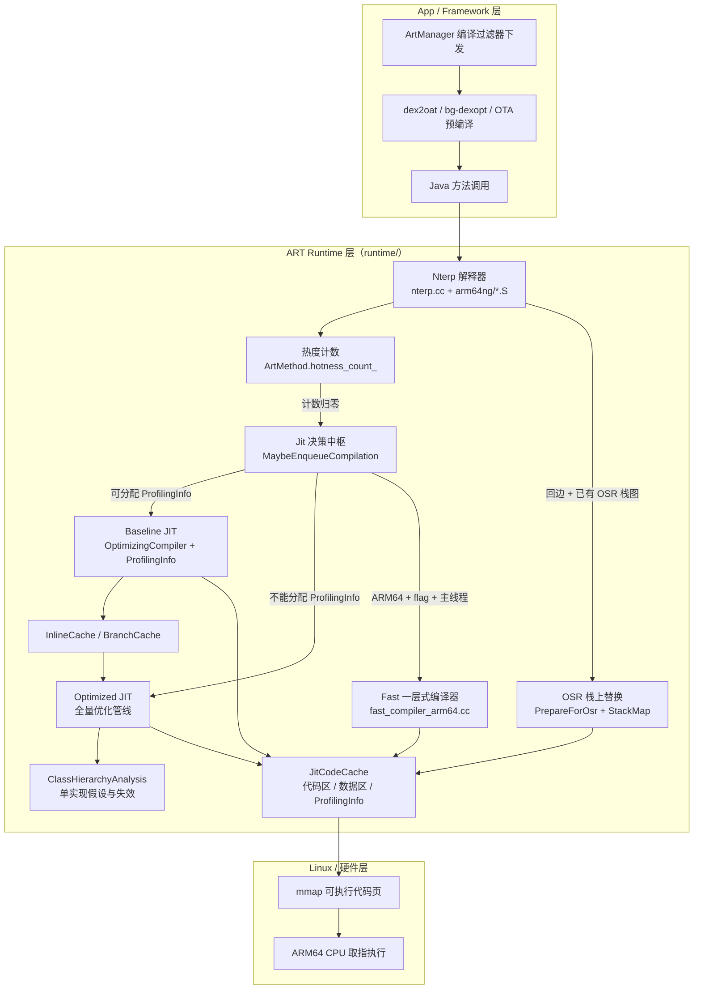
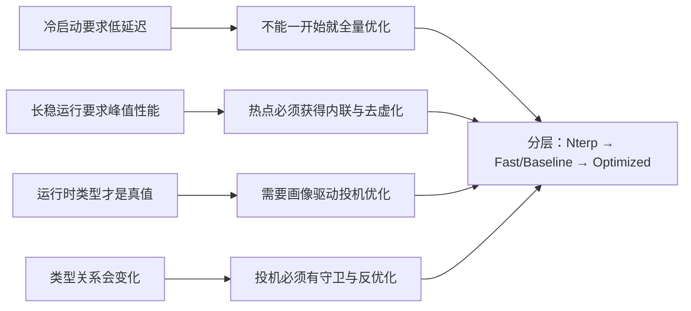
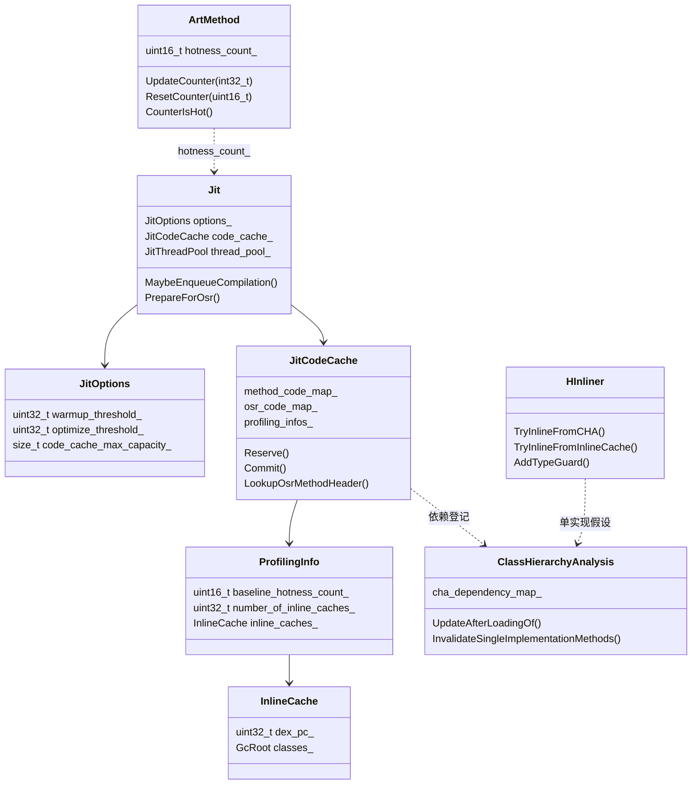
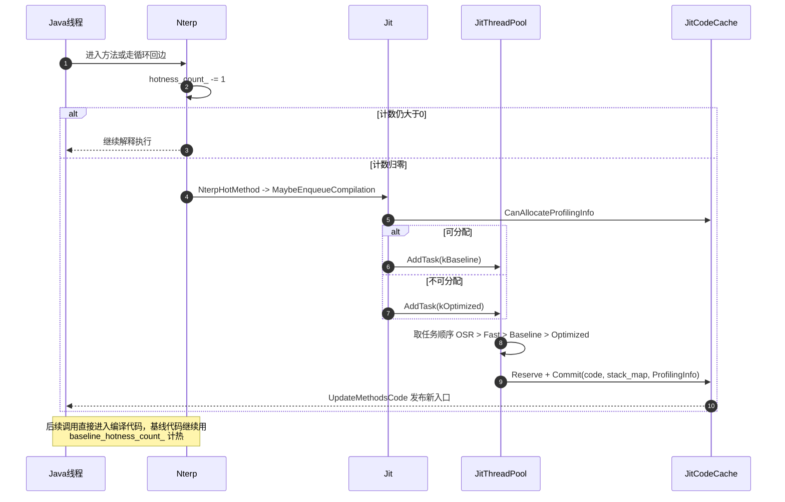
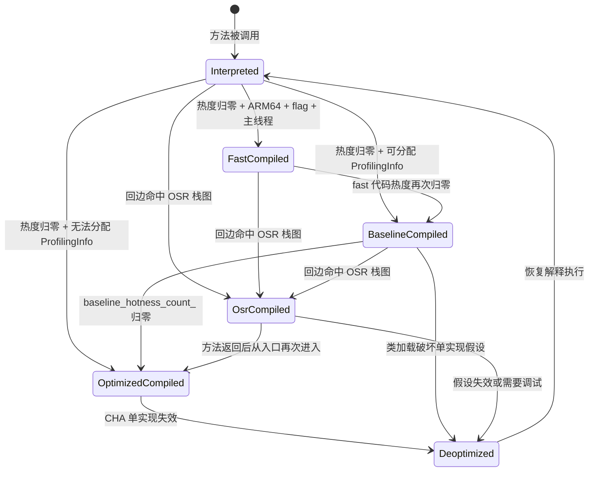

# ART 混合执行引擎与分层编译机制（Nterp / Fast / Baseline / Optimized / OSR / AOT）

| 项目 | 内容 |
|---|---|
| 机制定位 | ART 运行时"解释执行 → 轻量编译 → 基线 JIT → 优化 JIT → AOT"的分层执行与编译决策中枢 |
| 源码模块 | `runtime/interpreter/mterp/`、`runtime/jit/`、`compiler/jit/`、`compiler/optimizing/`、`runtime/cha.cc` |
| 核心类/入口 | `ArtMethod`（热度计数）、`Jit`、`JitOptions`、`JitCodeCache`、`JitThreadPool`、`ProfilingInfo`、`InlineCache`、`HInliner`、`ClassHierarchyAnalysis`、`FastCompilerARM64` |
| 关键参数 | `-Xusejit`、`-Xjitwarmupthreshold`、`-Xjitthreshold`、`-Xjitinitialsize`、`-Xjitmaxsize`、`-XX:DumpJITInfoOnShutdown`、`--compiler-filter`（AOT） |
| Feature Flag | `com::android::art::flags::fast_baseline_compiler()`（ARM64 一层式快速编译器） |
| 源码基线 | `9a380e425f1270a51e0d7bf14363aa66b49509c2`（RC6.2，2026-01-30） |
| 一句话结论 | 每个 `ArtMethod` 用一个原子容忍的 `hotness_count_` 计热；计数归零后按"能否分配 `ProfilingInfo`"决定进 Baseline 还是 Optimized 编译队列，循环回边再用 OSR 栈图把解释器栈帧原地换成编译栈帧，从而在不牺牲启动速度的前提下让热点代码逐级获得更强优化。 |

> [!IMPORTANT]
> 本机制的关键不是"有一个 JIT"，而是**所有层级共享同一套 ArtMethod 入口点、同一种 Quick 栈帧和同一张热度计数表**。Nterp 之所以能"零转换"，是因为它直接使用编译代码的 native 栈布局，并在指令流里用 `blr` 直接跳到 `ArtMethod` 的 Quick 入口；也正因如此，OSR 才能把解释器帧按 `StackMap` 逐槽搬进编译帧后直接 `br` 过去。

## 1. What：机制是什么？（概念界定与架构全景）

### 1.1 职责边界

这套机制解决的是"**一段 Java 代码在生命周期内应该以什么形态执行**"的问题，边界覆盖：

- **执行形态选择**：Nterp（汇编解释器）、Fast（一层式快速编译）、Baseline（带画像的基线 JIT）、Optimized（优化 JIT）、AOT（`dex2oat` 产物）五种形态。
- **热度度量与升级**：谁计数、计多少、阈值多少、何时重置、何时降级。
- **编译产物管理**：`JitCodeCache` 的代码区/数据区、`ProfilingInfo`、内联缓存、栈图、入口点发布。
- **投机优化的可信度维护**：Inline Cache 与 CHA（Class Hierarchy Analysis）单实现假设的建立、守卫、失效与反优化。
- **执行中的切换**：OSR（On-Stack Replacement）栈上替换、反优化回退解释器。

不覆盖的部分：AOT 编译任务调度（`artd`/`bg-dexopt`，见 Task 02）、Boot Image/AppImage 加载（Task 03）、JNI 跨界（Task 04）。

### 1.2 核心术语表

| 术语 | 含义 | 源码锚点 |
|---|---|---|
| Nterp | 用汇编实现的快速解释器，方法入口直接指向 `ExecuteNterpImpl` | [`GetNterpEntryPoint`](file:///home/voyah/workspace/8397/qssi/art/runtime/interpreter/mterp/nterp.cc#L76-L90) |
| Quick 栈帧 | ART 编译代码约定的 native 栈帧；Nterp 复用同一布局 | [`IsNterpSupported`](file:///home/voyah/workspace/8397/qssi/art/runtime/interpreter/mterp/nterp.cc#L37-L57) |
| `hotness_count_` | `ArtMethod` 内的 16 位热度计数，初始为 warmup 阈值，归零即热 | [`ArtMethod` 字段](file:///home/voyah/workspace/8397/qssi/art/runtime/art_method.h#L1154-L1162) |
| Warmup threshold | 进入 **Baseline** 编译的热度阈值，默认 `0xffff` | [`JitOptions`](file:///home/voyah/workspace/8397/qssi/art/runtime/jit/jit_options.cc#L26-L40) |
| Optimize threshold | 进入 **Optimized** 编译的阈值，默认 `0xffff`；设为 0 表示 "JIT at first use" | [`GetOptimizeThreshold`](file:///home/voyah/workspace/8397/qssi/art/runtime/jit/jit_options.cc#L66-L83) |
| Fast compiler | ARM64 专用、逐条 dex 指令一遍生成机器码的轻量编译器 | [`FastCompiler`](file:///home/voyah/workspace/8397/qssi/art/compiler/optimizing/fast_compiler.h#L36-L60) |
| Baseline | 使用优化编译框架但以较小内联预算编译，并采集 `ProfilingInfo` | [`IsInliningEncouraged`](file:///home/voyah/workspace/8397/qssi/art/compiler/optimizing/inliner.cc#L1544-L1600) |
| Optimized | 全量优化管线：内联、GVN、LSE、CHA 守卫消除等 | [优化 Pass 列表](file:///home/voyah/workspace/8397/qssi/art/compiler/optimizing/optimizing_compiler.cc#L642-L706) |
| OSR | 在方法执行中途，把解释器帧替换为同一方法的编译帧并跳入 | [`Jit::PrepareForOsr`](file:///home/voyah/workspace/8397/qssi/art/runtime/jit/jit.cc#L356-L447) |
| Inline Cache | 每个 invoke 点记录最多 5 个接收者类型，驱动单态/多态内联 | [`InlineCache`](file:///home/voyah/workspace/8397/qssi/art/runtime/jit/profiling_info.h#L46-L53) |
| CHA | 类层次分析；若某虚方法只有一个实现，可去虚化并生成守卫 | [`FindMethodFromCHA`](file:///home/voyah/workspace/8397/qssi/art/compiler/optimizing/inliner.cc#L353-L389) |
| 反优化 | 假设失效后通过 `should_deoptimize` 标志把栈上编译帧退回解释器 | [`CHAStackVisitor`](file:///home/voyah/workspace/8397/qssi/art/runtime/cha.cc#L179-L226) |

### 1.3 分层架构定位



### 1.4 五种执行形态对照

| 形态 | 触发条件 | 代码来源 | 画像/内联能力 | 典型场景 |
|---|---|---|---|---|
| Nterp | 默认入口，`CanRuntimeUseNterp()` 为真 | 手写汇编解释器 | 无编译，仅记录内联缓存 | 冷启动、冷方法、调试器外运行 |
| Fast | 热度归零且 `fast_baseline_compiler()` 开启、ARM64、JIT-sensitive 线程 | 一层式快速编译器 | 无优化、无画像 | 车机主线程首屏热点方法，需极低编译延迟 |
| Baseline | 热度归零且可分配 `ProfilingInfo` | 优化编译框架，低预算 | 采集 Inline/Branch Cache，可小幅内联 | 需要画像但还不值得全量优化的温方法 |
| Optimized | 热度归零但无法分配画像；或基线计数归零；或 `JitAtFirstUse()` | 全量优化管线 | 内联、去虚化、GVN、LSE、逃逸分析 | 长稳热点、主线程业务逻辑 |
| OSR | 解释器循环回边命中已有 OSR 栈图 | 优化编译器单独生成的 OSR 入口 | 同 Optimized（不支持 HDeoptimize） | 一次性长循环、启动期大循环 |
| AOT | `dex2oat` 按 `--compiler-filter` 预编译 | 优化编译器离线产物 | 可用 profile（`speed-profile`） | 系统 App、核心服务、OTA 后预热 |

## 2. Why：为什么需要它？（痛点模型与演进动机）

### 2.1 纯解释执行的代价

Switch 解释器每执行一条字节码都要回到 C++ 大循环，方法调用要切换解释器状态、构造 ShadowFrame，且完全没有类型反馈。结果是：启动阶段可以接受，但任意一段持续运行的热点代码都会把 CPU 吃满；更致命的是**没有画像就无法内联**，虚调用永远走 vtable/IMT 查找。

Nterp 的动机是把"解释"做到接近编译代码的调用约定：直接使用 native 栈与 Quick 帧，方法入口就是一段汇编，`invoke` 直接 `blr` 到目标入口。这样即使方法没被编译，调用开销也不再包含"解释器 ↔ 编译器"的桥接。

### 2.2 纯 AOT 的代价

`dex2oat` 只能基于**离线画像**做优化。没有画像时：

- 虚调用无法去虚化，内联只能做静态可判定的部分；
- 为了覆盖率必须编译大量冷方法，增大 odex/oat 体积与首次安装时间；
- OTA 后画像失效，优化质量回退；
- 对车机这种"装机应用多、OTA 频繁"的场景，纯 AOT 无法覆盖动态下发/插件化代码。

### 2.3 纯 JIT 的代价

所有方法一上来就 JIT 也不可行：

- 编译线程会与业务线程抢 CPU，启动期尤其明显；
- 冷方法编译是纯浪费，还会挤爆代码缓存；
- 高优化等级编译延迟大，冷启动首帧等不起；
- 优化依赖运行时类型反馈，方法刚开始执行时反馈为空，过早优化会频繁反优化。

### 2.4 方案演进对比矩阵

| 方案 | 启动开销 | 峰值性能 | 内存/体积 | 类型反馈 | 失效回退 | 车机适配性 |
|---|---|---|---|---|---|---|
| Switch 解释器 | 最低 | 最差 | 最小 | 无 | 不需要 | 冷启动可用，长稳不可用 |
| Nterp | 很低 | 中等 | 很小 | 仅内联缓存 | 不需要 | 冷启动与中等负载的默认层 |
| Fast 一层式编译 | 低（一遍扫描） | 中上 | 小（代码缓存） | 无 | 直接丢弃代码 | 主线程短时热点首选 |
| Baseline JIT | 中 | 良 | 中（含 ProfilingInfo） | 完整 Inline/Branch Cache | 可反优化 | 温方法，为优化编译蓄画像 |
| Optimized JIT | 高 | 最优 | 大 | 完整 | 可反优化 | 长稳热点、核心业务 |
| AOT（speed/speed-profile） | 安装/OTA 期成本 | 优 | 最大 | 依赖离线 profile | 无法运行时修正 | 系统组件与核心 App 的底座 |

### 2.5 痛点根因示意



## 3. How：源码级实现原理深度剖析

### 3.1 核心数据结构与内存布局

#### 3.1.1 `ArtMethod` 的热度字段

`ArtMethod` 把热度计数与接口方法 IMT 索引放在同一个 union 中：非抽象方法使用 `hotness_count_`，抽象接口方法使用 `imt_index_`，因此**不额外占用对象头空间**。

```text
ArtMethod（runtime/art_method.h）
┌──────────────────────────────────────────────────────────────┐
│ declaring_class_            GcRoot<mirror::Class>            │
│ access_flags_               uint32_t                         │
│ dex_method_index_ / data_   ...                              │
│ entry_point_from_quick_compiled_code_  void*                 │
│   ├─ ExecuteNterpImpl                （解释执行）             │
│   ├─ JIT fast / baseline / optimized （编译执行）             │
│   ├─ GenericJNI trampoline           （JNI）                  │
│   └─ oat 代码入口                     （AOT）                  │
│ ...                                                          │
│ union {                                                      │
│   uint16_t hotness_count_;   ← 非抽象方法：热度计数            │
│   uint16_t imt_index_;       ← 抽象接口方法：IMT 索引          │
│ };                                                           │
└──────────────────────────────────────────────────────────────┘
        HotnessCountOffset() = OFFSETOF_MEMBER(ArtMethod, hotness_count_)
```

对应操作非常克制：`UpdateCounter(new_samples)` 做饱和减到 0，`ResetCounter()` 重置为 warmup 阈值，`CounterIsHot()` 只在计数恰为 0 时为真。源码注释明确说明计数**允许丢失**——"Not atomic, as we allow missing increments: if the method is hot, we will see it eventually"（见 [`ArtMethod` 字段注释](file:///home/voyah/workspace/8397/qssi/art/runtime/art_method.h#L1154-L1162)），这是避免 `atomic` 开销的关键设计。

#### 3.1.2 `ProfilingInfo` 与 `InlineCache`

`ProfilingInfo` 是基线 JIT 的"画像载体"，采用变长对象：头部固定字段之后紧跟内联缓存数组与分支缓存数组。

```text
ProfilingInfo（runtime/jit/profiling_info.h，变长对象）
┌──────────────────────────────────────────────┐
│ baseline_hotness_count_ : uint16_t           │ ← baseline → optimized 的计数
│ method_                 : ArtMethod*         │
│ number_of_inline_caches_: uint32_t           │
│ number_of_branch_caches_: uint32_t           │
│ current_inline_uses_    : uint16_t           │ ← 防止 GC 清空正在被内联的缓存
├──────────────────────────────────────────────┤
│ InlineCache[number_of_inline_caches_]        │
│   ├─ dex_pc_      : uint32_t                 │
│   └─ classes_[5]  : GcRoot<Class>            │ ← 1=单态，2~4=多态，5=巨态
├──────────────────────────────────────────────┤
│ BranchCache[number_of_branch_caches_]        │
│   ├─ dex_pc_ : uint32_t                      │
│   ├─ false_  : uint16_t                      │
│   └─ true_   : uint16_t                      │
└──────────────────────────────────────────────┘
```

`InlineCache::kIndividualCacheSize` 固定为 5，源码注释指出该值被汇编桩 `art_quick_update_inline_cache` 硬编码依赖（见 [`InlineCache`](file:///home/voyah/workspace/8397/qssi/art/runtime/jit/profiling_info.h#L46-L53)）。缓存类型判定在 [`GetInlineCacheType`](file:///home/voyah/workspace/8397/qssi/art/compiler/optimizing/inliner.cc#L331-L345)：0 个类型 = 未初始化，1 个 = 单态，2~4 个 = 多态，达到 5 个即判定巨态并放弃内联。

`ProfilingInfo` 构造时把 `baseline_hotness_count_` 初始化为 optimize 阈值（[`ProfilingInfo::ProfilingInfo`](file:///home/voyah/workspace/8397/qssi/art/runtime/jit/profiling_info.cc#L27-L52)）。这一点是"编译代码内部继续计热"的关键：解释器层用 `ArtMethod::hotness_count_`，基线代码层改用 `ProfilingInfo::baseline_hotness_count_`。

#### 3.1.3 Nterp 栈帧

Nterp 帧的尺寸由 `registers_size` 与 `outs_size` 决定，汇编里直接算：

```text
frame_size = ((2 × registers_size) + outs_size) × 4 + 24   （再按 16B 对齐）
              └── 引用槽位 8B + dex 寄存器 4B ──┘   └─ 前一帧/PC/ArtMethod ─┘

高地址
┌────────────────────────────────────────────┐
│ outs 出参区                                 │
├────────────────────────────────────────────┤
│ dex 寄存器 vreg[]（每项 4B）                 │
├────────────────────────────────────────────┤
│ 引用槽位 refs[]（每个 vreg 一个指针宽度）     │
├────────────────────────────────────────────┤
│ 前一帧 SP、dex pc、对齐填充                   │
├────────────────────────────────────────────┤
│ ArtMethod*（当前方法，位于 sp）               │
└────────────────────────────────────────────┘
低地址（16 字节对齐）
```

该公式与寄存器约定直接写在 [`SETUP_STACK_FRAME`](file:///home/voyah/workspace/8397/qssi/art/runtime/interpreter/mterp/arm64ng/main.S#L338-L376) 中；上图为示意图，实际偏移由汇编按公式与 `-16` 对齐计算。Nterp 的固定寄存器分工见 [main.S 头部注释](file:///home/voyah/workspace/8397/qssi/art/runtime/interpreter/mterp/arm64ng/main.S#L55-L104)：`x19=xSELF`、`x20=wMR` 标记寄存器、`x29=xFP`、`x22=xPC`、`x25=xREFS` 等。

#### 3.1.4 关键类关系



### 3.2 Nterp：零转换栈帧的实现

#### 3.2.1 入口点直接装在 ArtMethod 上

`CanRuntimeUseNterp()` 决定运行时是否可用 Nterp，条件是：ISA 支持、非 Java 可调试、未安装 entry/exit 桩、非 InterpretOnly、非 AOT 编译器、无 listener 慢速解释需求、无异步异常、且不是 `JitAtFirstUse()`（见 [`CanRuntimeUseNterp`](file:///home/voyah/workspace/8397/qssi/art/runtime/interpreter/mterp/nterp.cc#L60-L73)）。

可用时，加载 AppImage 的过程中会把原本指向 `nterp_trampoline_` 的方法入口直接改成 `ExecuteNterpImpl`，注释写明目的就是"allows taking the fast path when doing a nterp->nterp call"（见 [`ClassLinker` 镜像处理](file:///home/voyah/workspace/8397/qssi/art/runtime/class_linker.cc#L2360-L2382)）。运行期切换统一走 [`Instrumentation::UpdateMethodsCode`](file:///home/voyah/workspace/8397/qssi/art/runtime/instrumentation.cc#L1222-L1225)。

入口函数很短：`ExecuteNterpImpl` 与带 clinit 检查的 `ExecuteNterpWithClinitImpl` 两个汇编符号，Nterp 的代码区间就是这两个符号之间的字节（[`GetNterpEntryPoint`](file:///home/voyah/workspace/8397/qssi/art/runtime/interpreter/mterp/nterp.cc#L76-L106)）。这样 JIT/Instrumentation 只要替换 `ArtMethod` 的 Quick 入口即可完成全部形态切换。

#### 3.2.2 调用不换栈

Nterp 的 `invoke-*` 先检查目标方法入口是不是 `ExecuteNterpImpl`：

- 是 → 直接调用 `nterp_to_nterp_*` 辅助例程，在 native 栈上继续压一个新 Nterp 帧；
- 否 → 读取 `ART_METHOD_QUICK_CODE_OFFSET_64` 并 `blr` 过去，**不经过任何解释器桥接**。

关键汇编见 [`COMMON_INVOKE_NON_RANGE`](file:///home/voyah/workspace/8397/qssi/art/runtime/interpreter/mterp/arm64ng/main.S#L829-L905)：

```text
DO_ENTRY_POINT_CHECK .Lcall_compiled_code
GET_CODE_ITEM
bl  nterp_to_nterp_instance_non_range     ← 目标也是 Nterp
...
.Lcall_compiled_code:
ldr lr, [x0, #ART_METHOD_QUICK_CODE_OFFSET_64]
blr lr                                     ← 目标是编译代码
```

这就是"零转换栈帧"的实质：**Nterp 帧本身满足 Quick 帧约定**，所以解释代码调用编译代码、编译代码回调解释代码都不需要额外的状态切换或栈复制。

#### 3.2.3 方法入口与回边的热度递减

Nterp 在方法入口执行 [`START_EXECUTING_INSTRUCTIONS`](file:///home/voyah/workspace/8397/qssi/art/runtime/interpreter/mterp/arm64ng/main.S#L379-L420)：读取 `hotness_count_`，非零则减 1；为零则跳到 `nterp_hot_method`。`nterp_hot_method` 是 [`NterpHotMethod`](file:///home/voyah/workspace/8397/qssi/art/runtime/interpreter/mterp/nterp.cc#L984-L1020) 的汇编别名，C++ 侧会：

1. 重置计数为 warmup 阈值，并 `SetPreviouslyWarm()`；
2. 若 `dex_pc_ptr != nullptr`（说明来自回边），先尝试 OSR；
3. 再调用 `MaybeEnqueueCompilation()` 入编译队列。

回边分支由 [`BRANCH`](file:///home/voyah/workspace/8397/qssi/art/runtime/interpreter/mterp/arm64ng/main.S#L302-L312) 引导：偏移量小于等于 0 时跳 `NterpHotnessCheck`，同样先减计数，再走 OSR/编译请求。也就是说**方法入口与循环回边共用同一套计数逻辑**。

另有一条"查表热度"路径：解析字段/方法/类/字符串并回填线程局部缓存时，一次加 `0xf` 个样本（[`UpdateHotness`](file:///home/voyah/workspace/8397/qssi/art/runtime/interpreter/mterp/nterp.cc#L138-L150)）。在该函数里还能看到 Fast 编译器的触发条件：仅当 `fast_baseline_compiler()` 开启、ISA 为 ARM64、当前线程是 JIT-sensitive 且 `counter % 1024 < 0xf` 时，调用 `NterpTryFastCompile()`。

### 3.3 热度计数、阈值与升级路径

#### 3.3.1 计数 API

[`ArtMethod` 计数实现](file:///home/voyah/workspace/8397/qssi/art/runtime/art_method-inl.h#L724-L781) 只有四个动作：

| API | 行为 | 用途 |
|---|---|---|
| `CounterHasChanged(threshold)` | 比较当前值是否等于 warmup 阈值 | 判断是否已被重置 |
| `ResetCounter(new_value)` | 直接写入阈值（仅允许 warmup 阈值） | 入队后重新计热 |
| `UpdateCounter(new_samples)` | `new <= old ? 0 : old - new`，饱和减 | 每次调用/回边/查表减计数 |
| `CounterIsHot()` | `hotness_count_ == 0` | 触发编译请求 |

`Jit::AddSamples` 是解释器（Switch 解释器）侧的入口：[`AddSamples`](file:///home/voyah/workspace/8397/qssi/art/runtime/jit/jit-inl.h#L31-L55)。它区分普通方法与内存共享方法：普通方法热了就重置计数并 `MaybeEnqueueCompilation`，否则 `UpdateCounter(1)`；内存共享方法（jimage/JIT-zygote 场景）则使用线程级的 `DecrementSharedMethodHotness()`，避免对所有进程共享的 ArtMethod 写计数。

#### 3.3.2 阈值常量

| 常量 | 值 | 含义 | 源码 |
|---|---|---|---|
| `kJitDefaultWarmupThreshold` | `0xffff` | 进入 Baseline 的默认阈值 | [jit_options.cc](file:///home/voyah/workspace/8397/qssi/art/runtime/jit/jit_options.cc#L26-L40) |
| `kJitDefaultOptimizeThreshold` | `0xffff` | Baseline → Optimized 的默认阈值 | 同上 |
| `kJitMaxThreshold` | `uint16_t` 最大值 | 阈值上限 | 同上 |
| `kIndividualSharedMethodHotnessThreshold` | `0x3f` | 内存共享方法的独立计数阈值 | [MaybeEnqueueCompilation](file:///home/voyah/workspace/8397/qssi/art/runtime/jit/jit.cc#L1736-L1755) |
| `kFastCompilerFrequencyCheck` | `1024` | 主线程快速编译检查频率（2 的幂） | [jit.h](file:///home/voyah/workspace/8397/qssi/art/runtime/jit/jit.h#L63-L70) |
| `kHotnessCounter`（Nterp 查表） | `0xf` | 每次查表回填记 15 个样本 | [nterp.cc](file:///home/voyah/workspace/8397/qssi/art/runtime/interpreter/mterp/nterp.cc#L138-L150) |

阈值可通过运行时参数覆盖：`-Xjitwarmupthreshold:N` 对应 [`JITWarmupThreshold`](file:///home/voyah/workspace/8397/qssi/art/runtime/parsed_options.cc#L281-L287)，`-Xjitthreshold:N` 对应 [`JITOptimizeThreshold`](file:///home/voyah/workspace/8397/qssi/art/runtime/parsed_options.cc#L178-L182)。注意 `-Xjitthreshold` 是 **optimize** 阈值，不是 warmup 阈值；把 optimize 阈值设为 0 会触发 `JitAtFirstUse()`（[`Jit::JitAtFirstUse` 与 `MethodEntered`](file:///home/voyah/workspace/8397/qssi/art/runtime/jit/jit.cc#L1481-L1496)），此时方法首次进入就同步尝试 Fast，失败再退 Baseline。

> [!WARNING]
> `JitOptions` 会对 `-Xjitprithreadweight` 与 `-Xjittransitionweight` 做 `> warmup threshold` 与 `== 0` 的致命校验（[jit_options.cc](file:///home/voyah/workspace/8397/qssi/art/runtime/jit/jit_options.cc#L86-L113)）。这两个权重在本源码树的 JIT 热路径中已不再参与 `AddSamples` 计算，但参数仍可解析，误配会直接 `LOG(FATAL)` 拉起进程。

#### 3.3.3 升级决策：Baseline 还是 Optimized

热度归零后的决策集中在 [`Jit::MaybeEnqueueCompilation`](file:///home/voyah/workspace/8397/qssi/art/runtime/jit/jit.cc#L1700-L1757)：

```text
MaybeEnqueueCompilation(method, self):
    if thread_pool == null or not UseJitCompilation: return
    if JitAtFirstUse(): return                 # 首用同步编译，不入队
    if IgnoreSamplesForMethod(method): return  # clinit / 不可编译 / MethodHandle native

    if CodeCache.ContainsPc(method.entry):
        if not native and not IsOsrCompiled(method):
            AddCompileTask(kOsr)               # 已在循环里，补 OSR
        return

    if method 是内存共享方法:
        shared_method_counters_ 计数（阈值 0x3f），未到阈值直接 return

    if not native and CanAllocateProfilingInfo():
        AddCompileTask(kBaseline)
    else:
        AddCompileTask(kOptimized)
```

两个细节值得注意：

1. **已有编译代码但仍解释执行**意味着方法正卡在解释器循环里（编译代码只在方法入口生效），于是这里补一个 OSR 任务；
2. **`CanAllocateProfilingInfo()` 为假**时直接跳到 Optimized，避免在代码缓存紧张时还申请画像内存（见 [`EnqueueBaselineCompilation`](file:///home/voyah/workspace/8397/qssi/art/runtime/jit/jit.cc#L1431-L1462)）。

Fast 编译请求走独立通道 [`MaybeEnqueueFastCompilation`](file:///home/voyah/workspace/8397/qssi/art/runtime/jit/jit.cc#L1762-L1806)，额外要求：启动已完成（`GetStartupCompleted()`）、当前线程是 JIT-sensitive、方法已有编译代码则直接返回、非内存共享、非 native。最后入 `kFast` 队列。

#### 3.3.4 端到端升级时序



编译线程的取任务优先级在 [`JitThreadPool::TryGetTaskLocked`](file:///home/voyah/workspace/8397/qssi/art/runtime/jit/jit.cc#L1917-L1934)：先 generic 任务，再 `OSR → Fast → Baseline → Optimized`。入队时对方法去重，避免同一方法堆积多个同类型任务（[`AddTask`](file:///home/voyah/workspace/8397/qssi/art/runtime/jit/jit.cc#L1873-L1888)）。

另外，`CompilationKind` 的枚举顺序本身就是"优化等级"（`kOsr=0, kFast=1, kBaseline=2, kOptimized=3`，见 [`compilation_kind.h`](file:///home/voyah/workspace/8397/qssi/art/runtime/compilation_kind.h#L27-L32)），`JitCodeCache::NotifyCompilationOf` 用 `existing_kind >= compilation_kind` 阻止低等级编译覆盖已发布的高等级代码（[`NotifyCompilationOf`](file:///home/voyah/workspace/8397/qssi/art/runtime/jit/jit_code_cache.cc#L1663-L1685)）。编译类型最终记录在 `CodeInfo` 的 flag 里，可通过 `IsFast/IsBaseline/IsOptimized` 查询（[`CodeInfo`](file:///home/voyah/workspace/8397/qssi/art/runtime/oat/stack_map.h#L511-L530)）。

### 3.4 Fast 一层式编译器（ARM64）

`FastCompiler` 的自我描述是"A lightweight, one-pass compiler. Goes over each dex instruction and emits native code for it."（[fast_compiler.h](file:///home/voyah/workspace/8397/qssi/art/compiler/optimizing/fast_compiler.h#L36-L60)）。它**不构建 HGraph**，因此没有 GVN、内联、寄存器分配图着色这些开销，只做：

- 参数初始化：把入参放到寄存器或栈槽（`InitializeParameters`）；
- 逐条指令生成：`ProcessInstructions` 顺序扫描 dex 指令，遇到分支目标时打标签并修复寄存器位置掩码（[ProcessInstructions](file:///home/voyah/workspace/8397/qssi/art/compiler/optimizing/fast_compiler_arm64.cc#L728-L815)）；
- 按需建帧：只有出现需要保存状态/调用/异常时才 `EnsureHasFrame → GenerateFrame → GenerateSuspendCheck`（[EnsureHasFrame](file:///home/voyah/workspace/8397/qssi/art/compiler/optimizing/fast_compiler_arm64.cc#L1149-L1165)）；
- 生成栈图与 JIT root 表，供 GC/栈遍历使用。

它使用 VIXL 宏汇编器，可用 callee-save 寄存器与临时寄存器各 8 个（`kAvailableCalleeSaveRegisters` / `kAvailableTempRegisters`），vreg 多于 8 个时溢出到栈（见 [`FastCompilerARM64` 构造函数](file:///home/voyah/workspace/8397/qssi/art/compiler/optimizing/fast_compiler_arm64.cc#L122-L160) 与 [`GetFrameSize`](file:///home/voyah/workspace/8397/qssi/art/compiler/optimizing/fast_compiler_arm64.cc#L208-L222)）。

失败即放弃：`unimplemented_reason_` 记录首个不支持的原因（例如 `"BackwardsCatch"`），`Compile()` 返回 `false`，JIT 侧退回 Baseline（[`OptimizingCompiler::JitCompile` 的 Fast 分支](file:///home/voyah/workspace/8397/qssi/art/compiler/optimizing/optimizing_compiler.cc#L1456-L1470)）。Fast 只有在 `!compiler_options.GetDebuggable()` 时才会被调用；调试可运行（debuggable）进程直接返回失败。

Fast 编译只由主线程（`jit_sensitive_thread_`）在启动完成后触发，这是刻意的资源控制：**只给最影响用户感知的线程做低延迟编译**，其他线程仍走 Baseline/Optimized 队列。

### 3.5 Baseline 与 Optimized 的编译管线

#### 3.5.1 优化 Pass 序列

Optimized（以及大部分 Baseline）共用 [`RunOptimizations` 的 Pass 列表](file:///home/voyah/workspace/8397/qssi/art/compiler/optimizing/optimizing_compiler.cc#L642-L706)，顺序要点：

1. `constant_folding` / `instruction_simplifier` / `dead_code_elimination`
2. **`inliner`**（内联，包含 CHA 与 Inline Cache 两条路径）
3. 内联后再次常量折叠/简化/DCE
4. `global_value_numbering` → `reference_type_propagation`
5. 控制流简化、循环优化（`induction_var_analysis`、`bounds_check_elimination`、`loop_optimization`）
6. **`load_store_elimination`**（消费逃逸分析结果）
7. **`cha_guard_optimization`**（消除/提升 CHA 守卫）
8. `code_sinking`、收尾简化、`constructor_fence_redundancy_elimination`
9. 架构相关：`instruction_simplifier_arm64`、`GVN$after_arch`、`scheduling`

Baseline 的特殊之处在于：

- 若开启分支画像（`ProfileBranches()`），只跑必需 Pass，**不跑优化**，以免破坏分支计数；
- 否则照常跑优化管线，但内联预算显著收紧（`kBaselineInlineMaxCodeUnits = 14`，见 [compiler_options.h](file:///home/voyah/workspace/8397/qssi/art/compiler/driver/compiler_options.h#L76-L80)）；一旦触发基线专属上限（code units 或内联深度），就调用 `SetUsefulOptimizing()` 把产物明确钉在 Baseline 等级；
- 提交时若整趟编译都没有发生过基线专属行为（`!graph->IsUsefulOptimizing()`），说明产物与优化编译器的结果一致，直接把编译类型记作 `kOptimized`，避免后续重复优化编译（[optimizing_compiler.cc](file:///home/voyah/workspace/8397/qssi/art/compiler/optimizing/optimizing_compiler.cc#L1588-L1594)）。

Baseline 编译完还会创建 `ProfilingInfo`（若尚未存在），入口点发布后，编译代码在每次 suspend check 时递减 `baseline_hotness_count_`；归零时进入 `CompileOptimizedSlowPath`，通过线程入口 `kQuickCompileOptimized` 调到 [`artCompileOptimized`](file:///home/voyah/workspace/8397/qssi/art/runtime/entrypoints/quick/quick_thread_entrypoints.cc#L72-L84)，最终走 `EnqueueOptimizedCompilation`。相关代码：[`MaybeIncrementHotness`](file:///home/voyah/workspace/8397/qssi/art/compiler/optimizing/code_generator_arm64.cc#L1382-L1422) 与 [`CompileOptimizedSlowPathARM64`](file:///home/voyah/workspace/8397/qssi/art/compiler/optimizing/code_generator_arm64.cc#L908-L946)。

#### 3.5.2 代码缓存与发布

`JitCodeCache` 把代码与元数据分区管理：`Reserve()` 先尝试在现有区域分配，失败且未到最大容量则扩容后重试，到了最大容量直接返回失败（[Reserve](file:///home/voyah/workspace/8397/qssi/art/runtime/jit/jit_code_cache.cc#L1039-L1080)）。默认最大容量 `kMaxCapacity = 64 MB`，初始容量在 release 下为 `max(64 KB, 2 × page_size)`（[jit_code_cache.h](file:///home/voyah/workspace/8397/qssi/art/runtime/jit/jit_code_cache.h#L183-L196)）。

`Commit()` 完成三件事：把代码复制进可执行区、写入 roots/stack map、更新 `ArtMethod` 入口点；同时按 `CompilationKind` 累加统计。OSR 代码不更新方法入口，而是写入 `osr_code_map_`（[Commit 的 OSR 分支](file:///home/voyah/workspace/8397/qssi/art/runtime/jit/jit_code_cache.cc#L828-L840)）。

### 3.6 Inline Cache 驱动的内联与去虚化

#### 3.6.1 两条内联路径

[`HInliner::TryInline`](file:///home/voyah/workspace/8397/qssi/art/compiler/optimizing/inliner.cc#L453-L598) 对虚/接口调用先试 CHA，再试 Inline Cache：

1. **CHA 路径**：`FindMethodFromCHA(resolved_method)` → 若该方法带 `HasSingleImplementation` 且能拿到唯一实现，直接 `TryInlineAndReplace`，然后 `AddCHAGuard` 并登记 CHA 依赖；
2. **Inline Cache 路径**：从 `ProfilingInfo`（JIT）或 AOT profile 中取接收者类型，按单态/多态分别内联。

`FindMethodFromCHA` 有四道闸门：AOT 编译器不做 CHA 去虚化、Zygote 不做（它按离线画像编译）、**OSR 编译不做**（因为 OSR 不支持 `HDeoptimize`）、代理方法不做（[FindMethodFromCHA](file:///home/voyah/workspace/8397/qssi/art/compiler/optimizing/inliner.cc#L353-L389)）。这解释了一个常见现象：同一个方法在 AOT 产物里没有 CHA 内联，在 JIT 版本里却有。

#### 3.6.2 单态与多态

单态路径 [`TryInlineMonomorphicCall`](file:///home/voyah/workspace/8397/qssi/art/compiler/optimizing/inliner.cc#L855-L899)：

```text
monomorphic_type = classes[0]
resolved_method  = ResolveMethodFromInlineCache(monomorphic_type, invoke)
TryInlineAndReplace(invoke, resolved_method, exact type, is_speculative = true)
AddTypeGuard(receiver, ..., with_deoptimization = true)   ← 类型不符则反优化
```

多态路径 [`TryInlinePolymorphicCall`](file:///home/voyah/workspace/8397/qssi/art/compiler/optimizing/inliner.cc#L1023-L1120) 对 2~4 个类型逐个内联并生成级联类型守卫；若全部目标都内联成功，最后一个守卫用"反优化"兜底，否则保留原始 invoke。达到 5 个类型即巨态，直接放弃内联并记录统计。

特殊模式 `UseOnlyPolymorphicInliningWithNoDeopt()`（AOT 或 OSR）**不生成反优化**：因为 AOT 反优化后未必能重新收集到新类型，可能陷入"永久反优化"或"系统服务只能解释执行"的死循环（[inliner.cc 注释](file:///home/voyah/workspace/8397/qssi/art/compiler/optimizing/inliner.cc#L602-L628)）。

#### 3.6.3 内联预算

[`IsInliningEncouraged`](file:///home/voyah/workspace/8397/qssi/art/compiler/optimizing/inliner.cc#L1544-L1600) 与文件头常量共同限制膨胀：

| 限制 | 值 | 说明 |
|---|---|---|
| 递归内联次数 | 4 | `kMaximumNumberOfRecursiveCalls` |
| 多态递归内联次数 | 0 | 多态递归一律不内联 |
| 累计 dex 寄存器 | 32 | `kMaximumNumberOfCumulatedDexRegisters` |
| 单个被内联方法 dex code units | `GetInlineMaxCodeUnits()` | 超限拒绝 |
| Baseline 额外上限 | 14 | `kBaselineInlineMaxCodeUnits` |
| Baseline 内联深度 | `InlineCache::MaxDexPcEncodingDepth()` | 受 dex pc 编码长度限制，超限标记 `SetUsefulOptimizing()` |

### 3.7 CHA：单实现假设的建立、守卫与失效

#### 3.7.1 依赖登记

编译期一旦基于"某虚方法只有一个实现"做了去虚化，就把"被假设的方法 → 依赖它的编译方法/方法头"登记到 `cha_dependency_map_`：

```text
cha_dependency_map_ : ArtMethod* -> ListOfDependentPairs
┌────────────────────────────────────┬─────────────────────────────────────────────┐
│ 被假设为单实现的虚方法                │ 依赖该假设的编译产物 (method, method_header) │
├────────────────────────────────────┼─────────────────────────────────────────────┤
│ A.foo()  HasSingleImplementation=1  │ { B.run(), header@0x7fxxxx }                 │
│ A.bar()  HasSingleImplementation=1  │ { C.loop(), header@0x7fyyyy }                │
└────────────────────────────────────┴─────────────────────────────────────────────┘
```

实现见 [`AddDependency` / `GetDependents`](file:///home/voyah/workspace/8397/qssi/art/runtime/cha.cc#L35-L53)。注意 `Commit()` 持有 `cha_lock_` 检查单实现标志，保证"代码提交"与"假设失效"不会交叉。

#### 3.7.2 守卫的优化

`AddCHAGuard` 插入的是 `HShouldDeoptimizeFlag != 0 → HDeoptimize(kCHA)`。`cha_guard_optimization` 在**单趟**中做三件事：参数接收者可证明类型匹配则删除守卫、有支配守卫则删除冗余守卫、把守卫提升到更靠前的基本块（[cha_guard_optimization.cc](file:///home/voyah/workspace/8397/qssi/art/compiler/optimizing/cha_guard_optimization.cc#L20-L45)）。源码注释特别说明不能依赖 GVN 等后续 Pass 删除守卫，否则多守卫之间的删除顺序会出错。

#### 3.7.3 失效与反优化

类加载时 [`UpdateAfterLoadingOf`](file:///home/voyah/workspace/8397/qssi/art/runtime/cha.cc#L542-L596) 逐 vtable 槽比较新类与父类，收集被破坏的单实现方法，再交给 [`InvalidateSingleImplementationMethods`](file:///home/voyah/workspace/8397/qssi/art/runtime/cha.cc#L618-L697)：

1. 在 `cha_lock_` 下清 `HasSingleImplementation`、清 `single_implementation`；
2. 对每个依赖者调用 `JitCodeCache::InvalidateCompiledCodeFor`；
3. 收集失效的 method header，跑一次 `RunCheckpoint`，[`CHAStackVisitor`](file:///home/voyah/workspace/8397/qssi/art/runtime/cha.cc#L179-L226) 遍历所有线程栈，把正在执行的这些方法帧的 `should_deoptimize` 置为 `kCHA`；
4. 线程回到安全点/返回时看到标志，转入反优化，由 `Thread::DeoptimizeWithDeoptimizationException` 恢复解释执行。

这就是"编译时激进、运行时安全"的闭环：**假设失效不会让错误代码继续跑**，最坏情况只是把栈上方法退回解释器。

### 3.8 逃逸分析：让分配消失

[`escape.cc`](file:///home/voyah/workspace/8397/qssi/art/compiler/optimizing/escape.cc#L20-L95) 从 `HNewInstance` / `HNewArray` 出发遍历所有使用点，判定四类性质：

| 性质 | 含义 | 用途 |
|---|---|---|
| `is_singleton` | 方法内没有别名（Phi、字段存储、数组存储都会破坏） | 别名分析 |
| `is_singleton_and_not_returned` | 且不作为返回值逃逸 | `DoesNotEscape` 的依据 |
| `is_singleton_and_not_deopt_visible` | 且不出现在反优化环境 | 删除分配前必须满足 |
| `is_singleton_and_not_read_by_invoke` | 且不被只读调用观察到 | LSE 保守判定 |

具体判定见 [`CalculateEscape` / `DoesNotEscape`](file:///home/voyah/workspace/8397/qssi/art/compiler/optimizing/escape.cc#L97-L160)。消费方有两处：

- **LSE（LoadStoreElimination）**：`ReferenceInfo::IsSingletonAndRemovable()` 为真时，把对象视为可删除分配，Phase 4 删除不再被使用的分配与构造屏障，Phase 5 把只在部分路径逃逸的分配下沉到逃逸点（[load_store_analysis.h](file:///home/voyah/workspace/8397/qssi/art/compiler/optimizing/load_store_analysis.h#L36-L70)、[LSE 尾部删除逻辑](file:///home/voyah/workspace/8397/qssi/art/compiler/optimizing/load_store_elimination.cc#L2941-L2955)）；
- **指令简化**：无使用的 `StringBuffer.toString` 内建，若接收者不逃逸，则连同步语义一起安全删除（[instruction_simplifier.cc](file:///home/voyah/workspace/8397/qssi/art/compiler/optimizing/instruction_simplifier.cc#L3131-L3141)）。

### 3.9 OSR：循环中途切换执行形态

#### 3.9.1 触发与帧构造

OSR 的触发点是解释器回边。Nterp 在 `NterpHotnessCheck` 里先调 [`NterpHotMethod`](file:///home/voyah/workspace/8397/qssi/art/runtime/interpreter/mterp/nterp.cc#L984-L1020)，后者用当前 `dex_pc` 调 `Jit::PrepareForOsr`。执行流程：

1. `PrepareForOsr` 先做廉价检查：方法入口是否已有编译代码；没有则直接返回（[PrepareForOsr](file:///home/voyah/workspace/8397/qssi/art/runtime/jit/jit.cc#L356-L447)）；
2. 从 `osr_code_map_` 取 OSR 方法头（[`LookupOsrMethodHeader`](file:///home/voyah/workspace/8397/qssi/art/runtime/jit/jit_code_cache.cc#L1476-L1483)）；
3. 用 `CodeInfo::GetOsrStackMapForDexPc(dex_pc)` 找该 dex pc 对应的栈图；找不到就继续解释，等下一个分支；
4. 按 `DexRegisterMap` 把每个仍存活、位于栈上的 vreg 复制到 `OsrData::memory`；常量与已死寄存器跳过；
5. 计算 `native_pc = 栈图 native 偏移 + 方法入口`，返回 `OsrData`（含 frame_size、memory、native_pc）。

随后 nterp 汇编（[`NterpHotnessCheck` 的 OSR 分支](file:///home/voyah/workspace/8397/qssi/art/runtime/interpreter/mterp/arm64ng/main.S#L1802-L1862)）做三件事：丢弃当前解释器帧、按 `OSR_DATA_FRAME_SIZE` 在栈上开编译帧、把 `OSR_DATA_MEMORY` 原样拷贝过去，最后 `br xFP` 跳进编译代码。Switch 解释器则走 `Jit::MaybeDoOnStackReplacement` + `art_quick_osr_stub`（[MaybeDoOnStackReplacement](file:///home/voyah/workspace/8397/qssi/art/runtime/jit/jit.cc#L450-L510)）。

#### 3.9.2 OSR 的约束

| 约束 | 源码依据 | 原因 |
|---|---|---|
| 共享区域不做 OSR | [CompileMethodInternal](file:///home/voyah/workspace/8397/qssi/art/runtime/jit/jit.cc#L206-L213) | JIT-zygote 共享代码不允许方法级 OSR 入口 |
| OSR 不做 CHA 去虚化 | [FindMethodFromCHA](file:///home/voyah/workspace/8397/qssi/art/compiler/optimizing/inliner.cc#L353-L389) | OSR 不支持 `HDeoptimize` |
| 接近栈上限时不做 OSR | [MaybeDoOnStackReplacement](file:///home/voyah/workspace/8397/qssi/art/runtime/jit/jit.cc#L456-L466) | 解释器帧仍在栈上，复制会放大栈溢出风险 |
| 单步/局部变量被修改时不 OSR | 同上 | 避免打断调试器与栈上状态一致性 |
| 无对应 dex pc 栈图则放弃 | [PrepareForOsr](file:///home/voyah/workspace/8397/qssi/art/runtime/jit/jit.cc#L383-L390) | 只能从栈图点进入编译代码 |

#### 3.9.3 方法执行状态机



### 3.10 反优化回退

反优化有两个来源：

1. **CHA 失效**：如上节，方法级 `should_deoptimize` 标志；
2. **指令级投机**：内联时插入的 `HTypeGuard` / `HDeoptimize`，类型不符即跳反优化。

反优化的公共收尾是 `Thread::DeoptimizeWithDeoptimizationException`：取回反优化上下文、恢复挂起异常、把 ShadowFrame 重新压栈，然后 `EnterInterpreterFromDeoptimize` 继续解释执行（[thread.cc](file:///home/voyah/workspace/8397/qssi/art/runtime/thread.cc#L4849-L4875)）。因此"反优化"不是重新编译，而是**带着当前局部变量回到解释器**，之后热度计数会再次积累，可能重新走一遍升级路径。

## 4. 能利用这个机制做什么？（工程实战指南与排障手册）

### 4.1 编译过滤器选型（AOT 侧）

`CompilerFilter` 的可选值在本树中为 `assume-verified / verify / space / space-profile / speed-profile / speed / everything-profile / everything`（[compiler_filter.h](file:///home/voyah/workspace/8397/qssi/art/libartbase/base/compiler_filter.h#L32-L42)），名字映射与遗留别名见 [compiler_filter.cc](file:///home/voyah/workspace/8397/qssi/art/libartbase/base/compiler_filter.cc#L139-L208)）。

| 过滤器 | 是否产出可执行代码 | 适用场景 | 车机建议 |
|---|---|---|---|
| `verify` | 否 | 只做校验，最快安装 | 仅调试/救砖 |
| `speed-profile` | 是（仅画像命中方法） | 有 baseline profile 的核心 App | **首选**：启动快、体积可控 |
| `speed` | 是（全部方法） | 无画像但要确定性性能 | 系统服务、开机关键路径 |
| `everything` | 是（含 JNI/全部） | 极端确定性场景 | 谨慎，体积与安装时间大 |

实践要点：

- 核心车机应用（桌面、地图、语音、仪表）应固化 **Baseline Profile**，用 `speed-profile` 预编译，让冷启动阶段就命中已编译代码；
- 对"OTA 后首次启动"场景，AOT 产物可能因校验和变化失效，需要配合 Task 02 的 `bg-dexopt`/`PreRebootDexopt` 重建，否则启动期会退化到 Nterp + JIT；
- `-Xusejit:false` 仅用于定位"JIT 本身引入的问题"，关闭后所有方法回到 Nterp/AOT，性能特征会显著变化。

### 4.2 JIT 阈值与代码缓存调参

ART 侧可用参数（选项名在 [`parsed_options.cc`](file:///home/voyah/workspace/8397/qssi/art/runtime/parsed_options.cc#L270-L292) 中定义）：

| 参数 | 映射 | 调大 | 调小 |
|---|---|---|---|
| `-Xjitwarmupthreshold:N` | `JITWarmupThreshold` | 更晚进 Baseline，启动更稳、峰值更迟 | 更早编译，启动 CPU 升高 |
| `-Xjitthreshold:N` | `JITOptimizeThreshold` | 更晚进 Optimized，代码缓存更省 | 更早优化，编译线程压力大 |
| `-Xjitinitialsize:N` | `JITCodeCacheInitialCapacity`（KiB） | 减少早期扩容 | 省内存 |
| `-Xjitmaxsize:N` | `JITCodeCacheMaxCapacity`（KiB） | 容纳更多热点代码 | 更早触发代码缓存回收 |
| `-XX:DumpJITInfoOnShutdown` | `DumpJITInfoOnShutdown` | — | 退出时打印 JIT 统计 |

示例（每次只选一组；参数最终如何从系统属性透传到 ART 取决于上层 framework，本仓库只负责解析 `-X` 参数）：

```bash
# 降低 warmup 阈值，让核心业务更早进入 Baseline JIT
adb shell setprop dalvik.vm.extra-opts "-Xjitwarmupthreshold:2048"

# 限制 JIT 代码缓存上限为 8 MiB（单位 KiB）
adb shell setprop dalvik.vm.extra-opts "-Xjitmaxsize:8192 -XX:DumpJITInfoOnShutdown"

# 仅观察不改变阈值时，可在启动日志中打开 jit 详细日志（-verbose:jit）
adb shell setprop dalvik.vm.extra-opts "-verbose:jit"
```

调参判据（结合 4.3 的转储）：

- **`baseline` 计数很高、`optimized` 很低** → optimize 阈值过高或代码缓存不足，热点停在基线层；
- **`collections` 次数很高** → 代码缓存过小或方法粒度过碎，优先扩容或减少动态 dex；
- **`fast` 计数很高但 `optimized` 不涨** → 主线程大量短时方法被快速编译，属正常现象；若伴随 CPU 飙高，应下调 Fast 触发频率（需改 flag，不是运行时参数）。

### 4.3 产物解读：JIT 日志与退出转储

**（1）编译日志。** `VLOG(jit)` 的典型行（源码原文，含原拼写）：

```text
Compiling method void com.example.Foo.bar() kind=baseline
Method void com.example.Foo.bar() reached threadshold from fast to baseline
Not adding void com.example.Foo.baz() to JIT queue as it is already compiled optimized
JIT not osr compiling void com.example.Foo.loop() due to using shared region
```

逐行含义：

| 日志 | 含义 | 排查价值 |
|---|---|---|
| `kind=baseline/fast/optimized/osr` | 本次编译类型 | 判断方法最终停在哪一层 |
| `reached threadshold from fast to baseline` | Fast 代码热度再次归零，升级 Baseline | Fast 只是过渡层，不是终点 |
| `already compiled optimized` | 已有更高等级代码，拒绝低等级任务 | 若频繁出现，说明重复入队被正确拦截 |
| `JIT not osr compiling ... shared region` | 共享区域禁止 OSR | JIT-zygote 场景下长循环只能留在解释器/基线 |

**（2）退出转储。** `-XX:DumpJITInfoOnShutdown` 会在 JIT 析构时调用 `Jit::DumpInfo` → `JitCodeCache::Dump`（[DumpInfo](file:///home/voyah/workspace/8397/qssi/art/runtime/jit/jit.cc#L72-L77)、[Dump](file:///home/voyah/workspace/8397/qssi/art/runtime/jit/jit_code_cache.cc#L1862-L1890)）。真实字段包括：

```text
Current JIT code cache size (used / resident): 512KB / 640KB
Current JIT data cache size (used / resident): 128KB / 160KB
Current JIT capacity: 1MB
Current number of JIT code cache entries: 1834
Total number of JIT baseline compilations: 1203
Total number of JIT fast compilations: 254
Total number of JIT optimized compilations: 87
Total number of JIT compilations for on stack replacement: 12
Total number of JIT code cache collections: 3
```

判读方法：

- `fast` 远大于 `baseline`：主线程短方法多，Fast 层承担了主要工作；若 `optimized` 占比过低，检查 optimize 阈值；
- `OSR` 很少但业务有长循环：说明循环所在方法尚未产生编译代码，或循环太短、回边栈图不命中；
- `code cache collections > 0` 且持续增长：代码缓存压力大，热点代码会被反复回收重编，应考虑扩容或减少 dex 动态加载。

### 4.4 写出"对编译器友好"的代码

结合本机制，可落地的代码级优化：

1. **让虚调用可去虚化**：优先 `final` 类/方法、`sealed` 层级、避免在热路径上使用多实现接口。单实现假设成立时 JIT 会走 CHA 内联；一旦新类加载破坏假设，代码会被反优化并重编，频繁变更加速抖动。
2. **控制多态度**：同一 invoke 点接收者类型不超过 4 个，JIT 可做多态内联；达到 5 个即巨态，完全放弃内联。车机中常见的"万能 Listener 接口"很容易变成巨态，建议按业务拆分接口。
3. **方法体保持小而热**：Baseline 内联上限只有 14 个 16 位 code unit，大方法既难被内联，也会增加栈图与 OSR 成本。把热路径拆成小方法，让编译器有机会内联。
4. **让分配可被消除**：逃逸分析要求对象不被返回、不被写入字段/数组、不作为参数传给有写副作用的调用。日志拼接、临时 DTO 在热路径上应尽量"就地消费"，不要返回或存入成员。
5. **长循环放在可 OSR 的方法里**：OSR 需要该 dex pc 存在栈图，且方法不能是 native/代理/共享区域方法。若长循环位于一个从未被调用的巨型方法中，先确保它至少被执行到热并产生编译代码。
6. **避免调试态性能误判**：`CanRuntimeUseNterp()` 在 Java debuggable 时返回 false，`FastCompiler` 在 debuggable 时直接失败（[JitCompile Fast 分支](file:///home/voyah/workspace/8397/qssi/art/compiler/optimizing/optimizing_compiler.cc#L1456-L1470)）。性能数据必须在非 debuggable 进程采集。

### 4.5 CPU 热点剖析时的注意事项

- JIT 生成的代码不在 APK/oat 文件里，`simpleperf`/`perf` 需要 `/data/misc/trace/perf-<pid>.map` 才能解析符号；该文件由 `JitLogger` 写出（[jit_logger.cc](file:///home/voyah/workspace/8397/qssi/art/compiler/jit/jit_logger.cc#L36-L47)），user 版本可能因权限无法创建。
- 看到同一方法既有解释器帧又有编译帧是正常的：方法入口已编译，但循环可能仍在解释器里（等待 OSR）。
- 反优化会让采样火焰图出现"编译代码 → 解释器"的断裂，结合 `-verbose:deopt` 与 CHA 失效日志一起看，避免误判为性能回归。

### 4.6 避坑清单

| 坑 | 现象 | 正确做法 |
|---|---|---|
| 把 `-Xjitthreshold` 当成 warmup 阈值 | 方法很早就被优化编译，启动 CPU 飙高 | warmup 用 `-Xjitwarmupthreshold` |
| 调试版本做性能对比 | Nterp 被禁用、Fast 编译失败，全面变慢 | 使用 user/userdebug 非 debuggable 进程 |
| 期待 AOT 里也有 CHA 内联 | AOT 产物无 CHA 去虚化（本树明确禁用） | 依赖 Baseline Profile 或运行时 JIT |
| 热点方法频繁被新类加载打断 | 反复反优化、性能抖动 | 避免在稳态期动态加载实现同一接口的类 |
| 代码缓存过小 | `collections` 持续增长、热点反复重编 | 提高 `-Xjitmaxsize` 或减少动态 dex |
| 长循环不在编译方法内 | OSR 计数为 0、主线程卡顿 | 拆分方法/确保方法先热，或改为可被 JIT 的整体方法 |

## 5. 核心源码对照索引表

| 源文件 | 核心符号/行号 | 职责 |
|---|---|---|
| [`runtime/interpreter/mterp/nterp.cc`](file:///home/voyah/workspace/8397/qssi/art/runtime/interpreter/mterp/nterp.cc#L37-L150) | `CanRuntimeUseNterp`、`GetNterpEntryPoint`、`UpdateHotness`、`NterpTryFastCompile` | Nterp 可用性判定、入口点导出、查表热度与 Fast 触发 |
| [`runtime/interpreter/mterp/nterp.cc`](file:///home/voyah/workspace/8397/qssi/art/runtime/interpreter/mterp/nterp.cc#L984-L1020) | `NterpHotMethod` | 热度归零后的 OSR 尝试与编译入队 |
| [`runtime/interpreter/mterp/nterp.h`](file:///home/voyah/workspace/8397/qssi/art/runtime/interpreter/mterp/nterp.h#L41-L47) | `kNterpHotnessValue`、`kNterpMaxFrame`、`kNterpHandlerSize` | Nterp 常量约束 |
| [`runtime/interpreter/mterp/arm64ng/main.S`](file:///home/voyah/workspace/8397/qssi/art/runtime/interpreter/mterp/arm64ng/main.S#L338-L415) | `SETUP_STACK_FRAME`、`START_EXECUTING_INSTRUCTIONS` | 栈帧布局、入口计数递减、suspend check |
| [`runtime/interpreter/mterp/arm64ng/main.S`](file:///home/voyah/workspace/8397/qssi/art/runtime/interpreter/mterp/arm64ng/main.S#L829-L905) | `COMMON_INVOKE_NON_RANGE` | nterp→nterp 与 nterp→编译代码的直接调用 |
| [`runtime/interpreter/mterp/arm64ng/main.S`](file:///home/voyah/workspace/8397/qssi/art/runtime/interpreter/mterp/arm64ng/main.S#L1777-L1862) | `NterpHotnessCheck` | 回边计数与 OSR 帧复制跳转 |
| [`runtime/art_method.h`](file:///home/voyah/workspace/8397/qssi/art/runtime/art_method.h#L1154-L1162) | `hotness_count_` / `imt_index_` union | 热度字段与 IMT 索引复用 |
| [`runtime/art_method-inl.h`](file:///home/voyah/workspace/8397/qssi/art/runtime/art_method-inl.h#L724-L781) | `ResetCounter`、`UpdateCounter`、`CounterIsHot` | 计数读写与饱和语义 |
| [`runtime/jit/jit_options.cc`](file:///home/voyah/workspace/8397/qssi/art/runtime/jit/jit_options.cc#L26-L113) | 默认阈值、参数覆盖、致命校验 | JIT 阈值策略 |
| [`runtime/jit/jit.h`](file:///home/voyah/workspace/8397/qssi/art/runtime/jit/jit.h#L63-L70) | `kFastCompilerFrequencyCheck` 等 | 快速编译检查频率 |
| [`runtime/jit/jit-inl.h`](file:///home/voyah/workspace/8397/qssi/art/runtime/jit/jit-inl.h#L31-L55) | `Jit::AddSamples` | Switch 解释器侧热度累积 |
| [`runtime/jit/jit.cc`](file:///home/voyah/workspace/8397/qssi/art/runtime/jit/jit.cc#L1407-L1462) | `EnqueueOptimizedCompilation`、`EnqueueBaselineCompilation` | 入队与阈值重置 |
| [`runtime/jit/jit.cc`](file:///home/voyah/workspace/8397/qssi/art/runtime/jit/jit.cc#L1481-L1496) | `MethodEntered`、`JitAtFirstUse` | 首用同步编译与采样分流 |
| [`runtime/jit/jit.cc`](file:///home/voyah/workspace/8397/qssi/art/runtime/jit/jit.cc#L1700-L1806) | `MaybeEnqueueCompilation`、`MaybeEnqueueFastCompilation` | 分层决策与 Fast 条件 |
| [`runtime/jit/jit.cc`](file:///home/voyah/workspace/8397/qssi/art/runtime/jit/jit.cc#L1917-L1934) | `JitThreadPool::TryGetTaskLocked` | OSR > Fast > Baseline > Optimized 取任务顺序 |
| [`runtime/jit/jit.cc`](file:///home/voyah/workspace/8397/qssi/art/runtime/jit/jit.cc#L356-L510) | `PrepareForOsr`、`MaybeDoOnStackReplacement` | OSR 帧构造与跳转约束 |
| [`runtime/jit/jit_code_cache.cc`](file:///home/voyah/workspace/8397/qssi/art/runtime/jit/jit_code_cache.cc#L1039-L1080) | `Reserve` | 代码/数据区扩容与失败 |
| [`runtime/jit/jit_code_cache.cc`](file:///home/voyah/workspace/8397/qssi/art/runtime/jit/jit_code_cache.cc#L1663-L1685) | `NotifyCompilationOf` | 阻止低等级编译覆盖高等级代码 |
| [`runtime/jit/jit_code_cache.cc`](file:///home/voyah/workspace/8397/qssi/art/runtime/jit/jit_code_cache.cc#L1862-L1890) | `JitCodeCache::Dump` | 退出转储字段 |
| [`runtime/jit/profiling_info.h`](file:///home/voyah/workspace/8397/qssi/art/runtime/jit/profiling_info.h#L46-L190) | `InlineCache`、`baseline_hotness_count_` | 画像布局与阈值 |
| [`runtime/compilation_kind.h`](file:///home/voyah/workspace/8397/qssi/art/runtime/compilation_kind.h#L27-L32) | `CompilationKind` | 编译等级顺序 |
| [`runtime/oat/stack_map.h`](file:///home/voyah/workspace/8397/qssi/art/runtime/oat/stack_map.h#L511-L530) | `CodeInfo::IsFast/IsBaseline/IsOptimized` | 编译类型解码 |
| [`compiler/optimizing/optimizing_compiler.cc`](file:///home/voyah/workspace/8397/qssi/art/compiler/optimizing/optimizing_compiler.cc#L642-L706) | 优化 Pass 列表 | 优化管线组成 |
| [`compiler/optimizing/optimizing_compiler.cc`](file:///home/voyah/workspace/8397/qssi/art/compiler/optimizing/optimizing_compiler.cc#L1456-L1470) | `CompilationKind::kFast` 分支 | Fast 编译调用与 debuggable 拒绝 |
| [`compiler/optimizing/optimizing_compiler.cc`](file:///home/voyah/workspace/8397/qssi/art/compiler/optimizing/optimizing_compiler.cc#L1588-L1594) | Baseline 升格 Optimized | 优化充分性判定 |
| [`compiler/optimizing/fast_compiler.h`](file:///home/voyah/workspace/8397/qssi/art/compiler/optimizing/fast_compiler.h#L36-L60) | `FastCompiler` | 一层式编译器接口 |
| [`compiler/optimizing/fast_compiler_arm64.cc`](file:///home/voyah/workspace/8397/qssi/art/compiler/optimizing/fast_compiler_arm64.cc#L122-L205) | `FastCompilerARM64` | ARM64 实现与帧尺寸 |
| [`compiler/optimizing/inliner.cc`](file:///home/voyah/workspace/8397/qssi/art/compiler/optimizing/inliner.cc#L64-L76) | 内联预算常量 | 递归/寄存器/预算限制 |
| [`compiler/optimizing/inliner.cc`](file:///home/voyah/workspace/8397/qssi/art/compiler/optimizing/inliner.cc#L331-L598) | `GetInlineCacheType`、`FindMethodFromCHA`、`TryInline` | 内联决策主干 |
| [`compiler/optimizing/inliner.cc`](file:///home/voyah/workspace/8397/qssi/art/compiler/optimizing/inliner.cc#L855-L1120) | 单态/多态内联 | 类型守卫与反优化 |
| [`runtime/cha.cc`](file:///home/voyah/workspace/8397/qssi/art/runtime/cha.cc#L35-L53) | `AddDependency`、`GetDependents` | CHA 依赖表 |
| [`runtime/cha.cc`](file:///home/voyah/workspace/8397/qssi/art/runtime/cha.cc#L542-L697) | `UpdateAfterLoadingOf`、`InvalidateSingleImplementationMethods` | 单实现失效与栈上反优化 |
| [`compiler/optimizing/cha_guard_optimization.cc`](file:///home/voyah/workspace/8397/qssi/art/compiler/optimizing/cha_guard_optimization.cc#L20-L45) | `CHAGuardVisitor` | 守卫删除/提升 |
| [`compiler/optimizing/escape.cc`](file:///home/voyah/workspace/8397/qssi/art/compiler/optimizing/escape.cc#L20-L160) | `VisitEscapes`、`CalculateEscape`、`DoesNotEscape` | 逃逸判定 |
| [`compiler/optimizing/load_store_elimination.cc`](file:///home/voyah/workspace/8397/qssi/art/compiler/optimizing/load_store_elimination.cc#L2941-L2955) | 分配与构造屏障删除 | 逃逸分析收益落地 |
| [`compiler/optimizing/code_generator_arm64.cc`](file:///home/voyah/workspace/8397/qssi/art/compiler/optimizing/code_generator_arm64.cc#L908-L946) | `CompileOptimizedSlowPathARM64` | 基线热度归零后的优化编译入口 |
| [`compiler/optimizing/code_generator_arm64.cc`](file:///home/voyah/workspace/8397/qssi/art/compiler/optimizing/code_generator_arm64.cc#L1382-L1422) | `MaybeIncrementHotness` | 编译代码内的双阈值递减 |
| [`runtime/entrypoints/quick/quick_thread_entrypoints.cc`](file:///home/voyah/workspace/8397/qssi/art/runtime/entrypoints/quick/quick_thread_entrypoints.cc#L72-L84) | `artCompileOptimized` | 优化编译入队入口点 |
| [`libartbase/base/compiler_filter.h`](file:///home/voyah/workspace/8397/qssi/art/libartbase/base/compiler_filter.h#L32-L42) | `CompilerFilter::Filter` | AOT 过滤器定义 |
| [`runtime/parsed_options.cc`](file:///home/voyah/workspace/8397/qssi/art/runtime/parsed_options.cc#L178-L182) | `-Xjitthreshold` | optimize 阈值参数 |
| [`runtime/parsed_options.cc`](file:///home/voyah/workspace/8397/qssi/art/runtime/parsed_options.cc#L274-L287) | `-Xjitinitialsize`、`-Xjitmaxsize`、`-Xjitwarmupthreshold` | 缓存与 warmup 参数 |
| [`compiler/jit/jit_logger.cc`](file:///home/voyah/workspace/8397/qssi/art/compiler/jit/jit_logger.cc#L36-L47) | `OpenPerfMapLog` | JIT 代码的 perf map 输出 |
| [`runtime/class_linker.cc`](file:///home/voyah/workspace/8397/qssi/art/runtime/class_linker.cc#L2360-L2382) | 镜像方法入口改写 | 让 nterp→nterp 走快路径 |
| [`runtime/instrumentation.cc`](file:///home/voyah/workspace/8397/qssi/art/runtime/instrumentation.cc#L1222-L1225) | `UpdateMethodsCode` | 运行期入口点切换 |
| [`runtime/thread.cc`](file:///home/voyah/workspace/8397/qssi/art/runtime/thread.cc#L4849-L4875) | `DeoptimizeWithDeoptimizationException` | 反优化回退解释器 |