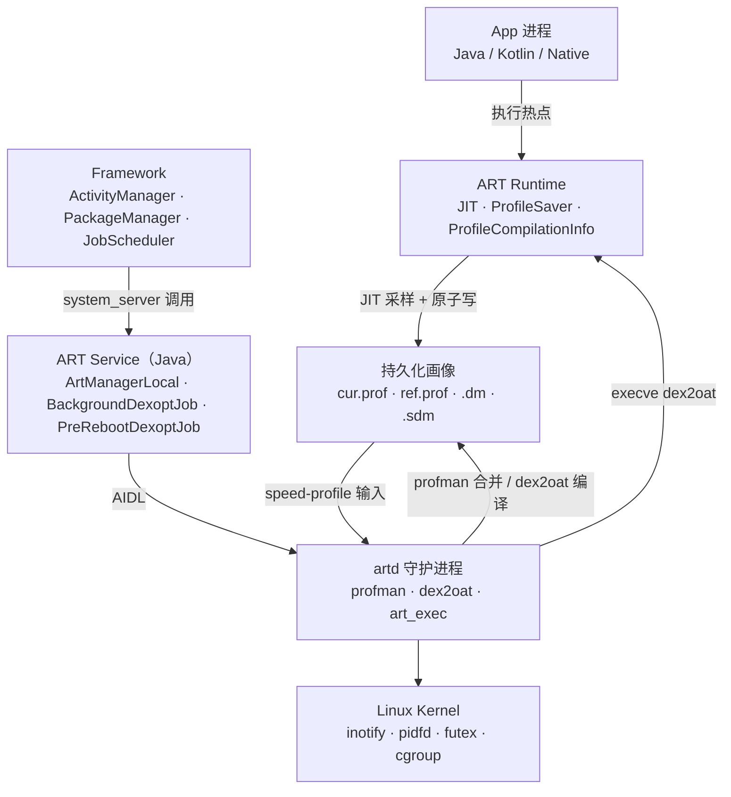
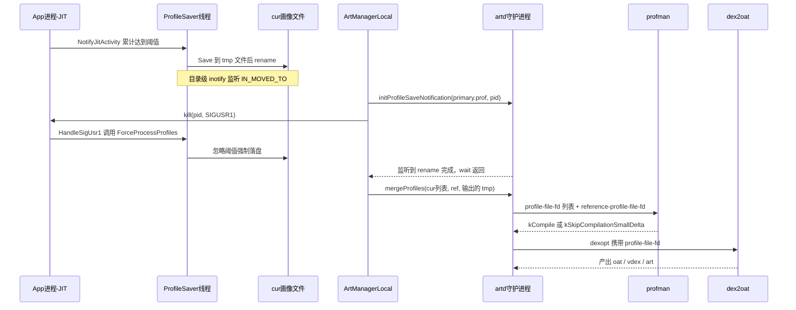
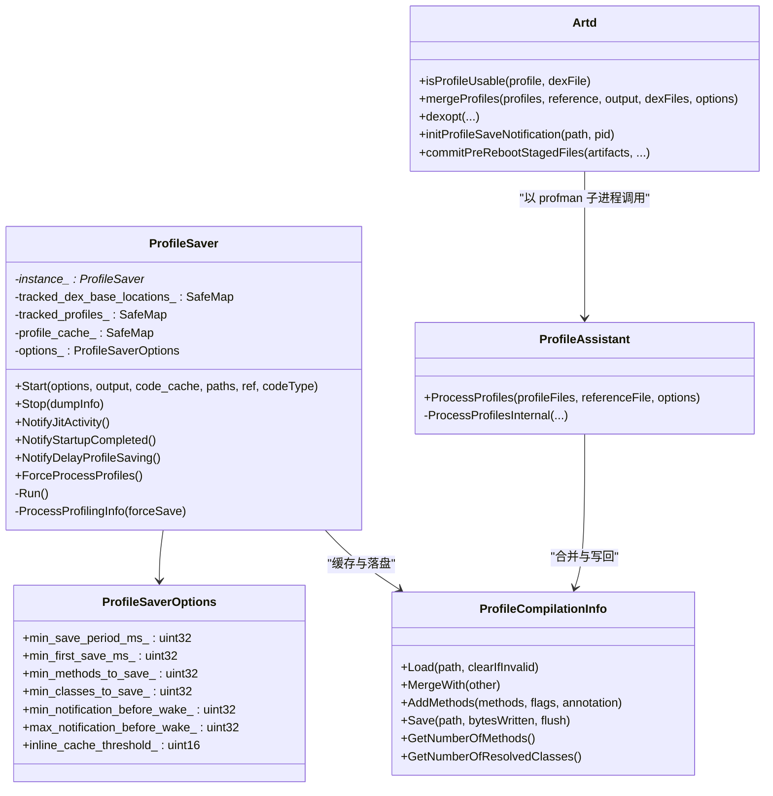
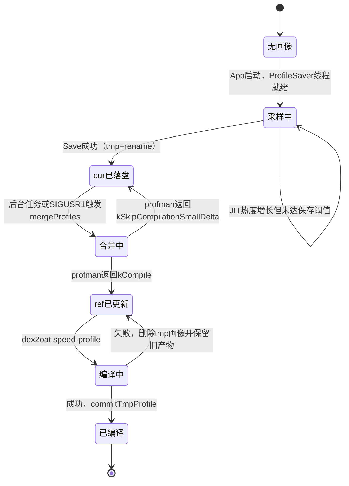

# 02 · PGO 热点画像采集与编译治理闭环

> [!IMPORTANT]
> **一句话核心结论**：ART 的 PGO 闭环不是"一个采样器"，而是 **运行时 ProfileSaver 采样 → `.cur.prof` 原子落盘 → profman 增量合并为 `.prof` 参考画像 → dex2oat 以 `speed-profile` 消费** 的四级流水线；框架侧用 `artd` + ART Service（bg-dexopt / Pre-reboot Dexopt / Post-UR）把这条流水线调度成"闲时、充电、灭屏"的后台治理循环，其中每一级都有独立的阈值与失败兜底。

| 项目 | 内容 |
| :--- | :--- |
| **机制定位** | App 执行期热点采集、画像合并、编译过滤器决策与后台编译调度 |
| **源码模块（相对 `qssi/art/`）** | `runtime/jit/`、`profman/`、`libartservice/service/java/com/android/server/art/`、`artd/`、`libprofile/` |
| **核心类 / 入口** | `ProfileSaver`、`ProfileCompilationInfo`、`ProfileAssistant`、`ArtManagerLocal`、`BackgroundDexoptJob`、`PreRebootDexoptJob`、`Artd`、`Dexopter` |
| **关键系统属性** | `pm.dexopt.bg-dexopt`、`pm.dexopt.bg-dexopt.concurrency`、`pm.dexopt.disable_bg_dexopt`、`dalvik.vm.bgdexopt.new-methods-percent`、`dalvik.vm.bgdexopt.new-classes-percent`、`dalvik.vm.enable_pr_dexopt`、`dalvik.vm.pr_dexopt_retention` |
| **关键文件** | `primary.prof`（主 dex 画像）、`<dex>.cur.prof`（二级 dex 当前画像）、`base.dm`（由 `base.apk` 替换扩展名得到的 Dex Metadata）、`base.arm64.sdm`（Secure Dex Metadata） |
| **源码基线** | `/home/voyah/workspace/8397/qssi/art`（Android 15/16 主线级 QSSI，只读） |

## 1. What：机制是什么？

### 1.1 职责边界

PGO（Profile-Guided Optimization）在 ART 中的职责是回答三个问题：

1. **哪些代码值得编译**：App 以 Nterp/JIT 混合执行，只有被反复执行的方法才有资格进入 AOT 编译。
2. **编译成什么形态**：`speed-profile` 只编译画像命中的方法与类，未命中部分保留解释执行或 `verify` 级校验，从而在启动收益、磁盘占用、编译耗时之间取平衡。
3. **什么时候编译**：不能占用前台，于是交给 `bg-dexopt`（闲时后台）、Pre-reboot Dexopt（OTA 前在 chroot 中预编译）、Post-UR（无人值守重启后补编译）三类任务。

输入是进程内 JIT 的热度计数与已解析类集合，输出是可供 `dex2oat` 消费的 profile 文件。它**不负责**方法内联、寄存器分配等编译优化本身，那些属于 `compiler/optimizing/`（见 Task 01）。

### 1.2 核心术语表

| 术语 | 含义 | 源码锚点 |
| :--- | :--- | :--- |
| `.cur.prof` | 运行期"当前画像"，ProfileSaver 持续覆写；主 dex 位于 `misc/profiles/cur/<user>/<pkg>/primary.prof`，二级 dex 位于 `<dex_dir>/oat/<dex>.cur.prof` | [path_utils.cc](file:///home/voyah/workspace/8397/qssi/art/artd/path_utils.cc#L237-L267) |
| `.prof`（reference profile） | 经过 profman 合并后的"参考画像"，dex2oat 的正式输入；主 dex 位于 `misc/profiles/ref/<pkg>/primary.prof` | [path_utils.cc](file:///home/voyah/workspace/8397/qssi/art/artd/path_utils.cc#L218-L235) |
| Hotness flags | 每个方法的采样标记：`kFlagHot`、`kFlagStartup`、`kFlagPostStartup`，boot image 另加 32/64 位标记 | [profile_compilation_info.h](file:///home/voyah/workspace/8397/qssi/art/libprofile/profile/profile_compilation_info.h#L181-L191) |
| `.dm`（Dex Metadata） | 随 APK 预置的画像包，本质是 zip，含 `primary.prof` 条目，可选含 vdex 条目；扩展名替换为 `.dm`（如 `base.apk` → `base.dm`） | [ArtConstants.aidl](file:///home/voyah/workspace/8397/qssi/art/artd/binder/com/android/server/art/ArtConstants.aidl#L32-L55) |
| `.sdm`（Secure Dex Metadata） | 带安全校验的 Dex Metadata，扩展名替换为 `<isa>.sdm`（如 `base.apk` → `base.arm64.sdm`），仅用于主 dex | [file_utils.cc](file:///home/voyah/workspace/8397/qssi/art/libartbase/base/file_utils.cc#L659-L667) |
| `speed-profile` | 画像引导过滤器：只 AOT 编译热点，其余保持轻量 | [ArtShellCommand.java](file:///home/voyah/workspace/8397/qssi/art/libartservice/service/java/com/android/server/art/ArtShellCommand.java#L966-L974) |
| bg-dexopt | 每日一次的闲时批量编译任务 | [BackgroundDexoptJob.java](file:///home/voyah/workspace/8397/qssi/art/libartservice/service/java/com/android/server/art/BackgroundDexoptJob.java#L65-L73) |
| Pre-reboot Dexopt | OTA/主line 更新后、重启前在新系统镜像的 chroot 中预编译 | [PreRebootDexoptJob.java](file:///home/voyah/workspace/8397/qssi/art/libartservice/service/java/com/android/server/art/PreRebootDexoptJob.java#L65-L81) |

### 1.3 架构定位



### 1.4 画像路径家族

| 场景 | 路径形态 | 构造点 |
| :--- | :--- | :--- |
| 主 dex 当前画像 | `<android_data>/misc/profiles/cur/<userId>/<pkg>/primary.prof` | [path_utils.cc](file:///home/voyah/workspace/8397/qssi/art/artd/path_utils.cc#L237-L247) |
| 主 dex 参考画像 | `<android_data>/misc/profiles/ref/<pkg>/primary.prof` | [path_utils.cc](file:///home/voyah/workspace/8397/qssi/art/artd/path_utils.cc#L218-L232) |
| 二级 dex 当前画像 | `<dex_dir>/oat/<dex>.cur.prof` | [path_utils.cc](file:///home/voyah/workspace/8397/qssi/art/artd/path_utils.cc#L259-L267) |
| 预置画像 | `<dex_location>.prof`（如 `base.apk` → `base.apk.prof`） | [path_utils.cc](file:///home/voyah/workspace/8397/qssi/art/artd/path_utils.cc#L233-L235) |
| Pre-reboot 暂存 | 上述路径追加 `.staged` 后缀 | [path_utils.cc](file:///home/voyah/workspace/8397/qssi/art/artd/path_utils.cc#L65-L70) |

## 2. Why：为什么需要它？

### 2.1 朴素方案的三个死结

**死结一：纯解释/JIT 的冷启动不可控。** 不做 AOT 时，App 每次冷启动都要重新经历 Nterp 解释、方法热度爬坡、JIT 编译，首帧时间被 CPU 调度与后台负载放大。车机座舱的倒车影像、仪表切换等场景对首帧极其敏感，纯 JIT 的方差不可接受。

**死结二：全量 `speed` 编译的代价过高。** 若对所有方法做 `speed` 编译，OTA 后首启需要编译数万个方法，占用大量 CPU 与磁盘；生成的 oat 体积膨胀，低端车机 eMMC 寿命与存储配额都吃不消。

**死结三：没有治理的采样会自我强化。** 只按"被调用次数"采样而不区分启动阶段，会把冷启动路径与稳态路径混在一起；只合并不设增量阈值，则每次后台任务都为极小收益重编所有应用，形成"后台 dexopt 永不收敛"的耗电黑洞。

### 2.2 方案演进对比矩阵

| 维度 | 纯解释 + JIT | 全量 `speed` AOT | 画像引导 `speed-profile` |
| :--- | :--- | :--- | :--- |
| 冷启动 | 差且方差大 | 最好 | 接近 `speed`（热点已编译） |
| 稳态执行 | JIT 热身后可用 | 最好 | 好（热点全覆盖） |
| 磁盘占用 | 最小 | 最大 | 中等（只含热点代码） |
| 编译耗时 | 无 | 极长 | 与画像规模成正比 |
| OTA 后首启 | 无额外负担 | 可能长时间卡顿 | Pre-reboot 可提前摊销 |
| 可治理性 | 无画像可观测 | 无差异化 | 阈值、增量、调度均可调 |
| 典型失败模式 | 掉帧、ANR | 存储告警、后台 CPU 抢占 | 画像缺失时静默降级为 `verify` |

### 2.3 车机场景的代价模型

高通 8397 座舱同时跑仪表、中控、HUD、DMS 多屏，CPU 与 IO 带宽长期被图形与 Camera 占用。PGO 闭环在这里的价值不是"跑分更高"，而是：

- **把编译成本挪出前台**：`bg-dexopt` 要求设备 idle + 充电 + 电量不低，天然避开行车高负载时段。
- **把 OTA 后首启编译挪到重启前**：Pre-reboot Dexopt 在旧系统里用新镜像的 chroot 预编译，重启后直接 `commit`，减少"升级后第一次上车卡顿"。
- **让压缩收益可预期**：`speed-profile` 只编译热点，oat 体积与编译时间随画像规模线性增长，便于做存储预算。

## 3. How：源码级实现原理深度剖析

### 3.1 全链路四阶段



### 3.2 阶段 A：ProfileSaver 运行时采样

#### 采样时间轴

```text
┌──────────────────── ProfileSaver 时间轴（默认值，profile_saver_options.h） ────────────────────┐
│ t=0         App 启动，ProfileSaver 线程创建（priority = 9，设备最低前台优先级）                 │
│             │                                                                                   │
│             ├─ 等待 StartupCompleted ─────────────────────────► FetchAndCacheResolvedClasses     │
│             │   （等待期间仍可被 JIT 通知唤醒）                  标记 kFlagStartup                 │
│             │                                                                                   │
│ t=0..40s    ├─ 睡眠 min_save_period_ms = 40 000 ms                                              │
│             │   wait_for_jit_notifications = true：等到 JIT 通知累计 > 10 次                    │
│             │   wait_for_jit_notifications = false：指数退避 40s→80s→…→640s（上限 16×）          │
│             │                                                                                   │
│ t≈40s       ├─ ProcessProfilingInfo(force_save = false)                                         │
│             │   delta_methods < 10 且 delta_classes < 10 → 跳过写盘                             │
│             │   否则 Save(tmp) + rename                                                         │
│             │                                                                                   │
│ 延迟信号     │ NotifyDelayProfileSaving()：2 000 ms 有效窗口内顺延，单次最多放大到 2× 周期        │
│ SIGUSR1     └─ ForceProcessProfiles()：忽略全部 IO 阈值，强制落盘                                │
└─────────────────────────────────────────────────────────────────────────────────────────────────┘
```

时间轴依据：[profile_saver_options.h](file:///home/voyah/workspace/8397/qssi/art/runtime/jit/profile_saver_options.h#L24-L46)、[profile_saver.cc](file:///home/voyah/workspace/8397/qssi/art/runtime/jit/profile_saver.cc#L143-L258)。

#### 画像数据结构

```text
┌──────────────── ProfileCompilationInfo 文件布局（v015，boot image 用 v016） ────────────────┐
│ Header: magic "pro\0" + version "015\0"（boot image profile 为 "016\0"）                    │
│                                                                                             │
│ DexFiles（必选，明文）                                                                       │
│   number_of_dex_files                                                                       │
│   (checksum, num_type_ids, num_method_ids, profile_key)[number_of_dex_files]                 │
│                                                                                             │
│ ExtraDescriptors（可选，zip 压缩）: 额外类型描述符                                           │
│ Classes（可选，zip 压缩）                                                                    │
│   profile_index | number_of_classes | type_index_diff[]（差分编码，利于压缩）                │
│ Methods（可选，zip 压缩）                                                                    │
│   profile_index | following_data_size | method_flags | bitmap_data | method_encoding[]       │
│                                                                                             │
│ Hotness flag 语义（method_flags 与 bitmap_data 共同表达）                                    │
│   bit0 kFlagHot   bit1 kFlagStartup   bit2 kFlagPostStartup                                  │
│   bit3 kFlag32bit   bit4 kFlag64bit（后两者仅 boot image profile）                           │
│                                                                                             │
│ 合并语义: Load 解码 → MergeWith 按 dex checksum 对齐 → Save 重编码                           │
│ 版本/校验不匹配: Load 失败，调用方 clear_if_invalid 后重建                                   │
└─────────────────────────────────────────────────────────────────────────────────────────────┘
```

布局定义见 [profile_compilation_info.cc](file:///home/voyah/workspace/8397/qssi/art/libprofile/profile/profile_compilation_info.cc#L980-L1012)，magic/版本常量见 [profile_compilation_info.cc](file:///home/voyah/workspace/8397/qssi/art/libprofile/profile/profile_compilation_info.cc#L71-L74)。

#### 核心类关系



#### 源码精读

1. **启动过滤**：`ProfileSaver::Start` 先用 `ShouldProfileLocation` 过滤已 `speed`/`everything` 编译的 oat，避免对已全量编译的代码重复采样；无 oat 文件时反而继续采样，寄望后台 dexopt 修复状态（[profile_saver.cc](file:///home/voyah/workspace/8397/qssi/art/runtime/jit/profile_saver.cc#L989-L1013)）。
2. **启动期采集**：`Run()` 在 `StartupCompleted` 前只阻塞等待，完成后一次性 `FetchAndCacheResolvedClassesAndMethods(true)`，把启动阶段加载的类与方法整体标记 `kFlagStartup`，缓存到 `profile_cache_`，避免频繁写盘（[profile_saver.cc](file:///home/voyah/workspace/8397/qssi/art/runtime/jit/profile_saver.cc#L143-L166)）。
3. **唤醒节流**：JIT 每次热方法通知只累加计数；超过 `min_notification_before_wake = 10` 且距上次唤醒超过一个保存周期才唤醒；若瞬时超过 `max_notification_before_wake = 50`，视为 hot spike 立即唤醒，防止大批方法丢失（[profile_saver.cc](file:///home/voyah/workspace/8397/qssi/art/runtime/jit/profile_saver.cc#L307-L339)）。
4. **增量落盘**：`ProcessProfilingInfo` 先读取磁盘旧画像，`AddMethods` 加入 JIT 采样的方法，`MergeWith` 合并 `profile_cache_`；只有 `delta_methods >= 10` 或 `delta_classes >= 10` 才写盘，`force_save = true` 时无条件写（[profile_saver.cc](file:///home/voyah/workspace/8397/qssi/art/runtime/jit/profile_saver.cc#L802-L964)）。
5. **完成信号约定**：写盘前把 `primary.prof` 排到列表最后，因为 `artd` 以"主画像文件被 rename"作为一次 profile save 完成的判据（[profile_saver.cc](file:///home/voyah/workspace/8397/qssi/art/runtime/jit/profile_saver.cc#L820-L827)）。
6. **原子写**：`ProfileCompilationInfo::Save` 在 Android U 且启用 ART Service 时使用 `mkostemps` 创建 `filename + ".XXXXXX.tmp"`，写完后 `rename` 到目标路径（[profile_compilation_info.cc](file:///home/voyah/workspace/8397/qssi/art/libprofile/profile/profile_compilation_info.cc#L826-L874)）。这正是 artd 能用 `IN_MOVED_TO` 侦测完成的根因。
7. **退出兜底**：`Stop()` 在 `shutting_down_` 置位后先 `ProcessProfilingInfo(force_save = true)` 再 join 线程，保证进程退出前不丢画像（[profile_saver.cc](file:///home/voyah/workspace/8397/qssi/art/runtime/jit/profile_saver.cc#L1095-L1137)）。
8. **SIGUSR1 快速通道**：`SignalCatcher::HandleSigUsr1` 先做一次 GC，再调用 `ProfileSaver::ForceProcessProfiles()`；注意这意味着一键"刷画像"同时会触发 GC 抖动（[signal_catcher.cc](file:///home/voyah/workspace/8397/qssi/art/runtime/signal_catcher.cc#L185-L189)）。

运行时注册入口在 `Runtime::RegisterAppInfo` → `Jit::StartProfileSaver`（[runtime.cc](file:///home/voyah/workspace/8397/qssi/art/runtime/runtime.cc#L2925-L2957)、[jit.cc](file:///home/voyah/workspace/8397/qssi/art/runtime/jit/jit.cc#L278-L292)）；`-Xps-*` 参数族可覆盖保存周期、最小方法数等阈值（[parsed_options.cc](file:///home/voyah/workspace/8397/qssi/art/runtime/parsed_options.cc#L306-L322)）。

### 3.3 阶段 B：profman 增量合并

`ProfileAssistant::ProcessProfilesInternal` 是"是否值得重编"的唯一裁决点：

1. 先加载参考画像（`merge_classes = true`）。若加载失败直接返回 `kErrorBadProfiles`；若请求 boot image 合并但参考画像不是 boot image 格式，则返回错误（[profile_assistant.cc](file:///home/voyah/workspace/8397/qssi/art/profman/profile_assistant.cc#L30-L46)）。
2. 逐个加载当前画像并 `MergeWith`。若某个文件因版本不匹配加载失败，会用相反 boot-image 标志再试一次，用于区分 `kErrorDifferentVersions` 与普通损坏（[profile_assistant.cc](file:///home/voyah/workspace/8397/qssi/art/profman/profile_assistant.cc#L48-L75)）。
3. 增量判定：绝对下限 `kMinNewMethodsForCompilation = 100`、`kMinNewClassesForCompilation = 50`；百分比下限默认 2%（`kMinNewMethodsPercentChangeForCompilation` / `kMinNewClassesPercentChangeForCompilation`），实际阈值取二者较大值；两项增量都低于阈值则返回 `kSkipCompilationSmallDelta`（[profile_assistant.cc](file:///home/voyah/workspace/8397/qssi/art/profman/profile_assistant.cc#L25-L28)、[profile_assistant.h](file:///home/voyah/workspace/8397/qssi/art/profman/profile_assistant.h#L33-L36)）。
4. 只有达到阈值才清空参考文件并写回，返回 `kCompile` 驱动 dex2oat（[profile_assistant.cc](file:///home/voyah/workspace/8397/qssi/art/profman/profile_assistant.cc#L109-L119)）。



### 3.4 阶段 C：artd 守护与 dexopt 执行

`artd` 是 system_server 与 ART 原生工具之间的最小权限代理。与本机制相关的四类能力：

- **画像可用性校验**：`isProfileUsable` 用 `profman --reference-profile-file-fd + --apk-fd` 做一次无当前画像的加载校验，只有返回 `kSkipCompilationSmallDelta` 才认为参考画像与当前 dex 匹配可用（[artd.cc](file:///home/voyah/workspace/8397/qssi/art/artd/artd.cc#L742-L792)）。
- **画像合并**：`mergeProfiles` 把当前画像与参考画像的 fd 传给 profman；若没有任何现有画像则直接返回 false；`forceMerge` 时追加 `--force-merge-and-analyze`，boot image 时追加 `--boot-image-merge`；百分比阈值来自 `dalvik.vm.bgdexopt.new-classes-percent` 与 `new-methods-percent`（[artd.cc](file:///home/voyah/workspace/8397/qssi/art/artd/artd.cc#L943-L1072)）。
- **编译执行**：`dexopt` 把 `--profile-file-fd`、`--dm-fd`、`--input-vdex-fd`、`--app-image-fd` 等一并交给 dex2oat，短操作超时 60 秒、编译超时 570 秒（小于 PackageManager 的 10 分钟看门狗）（[artd.cc](file:///home/voyah/workspace/8397/qssi/art/artd/artd.cc#L161-L168)、[artd.cc](file:///home/voyah/workspace/8397/qssi/art/artd/artd.cc#L1320-L1382)）。
- **落盘完成通知**：`initProfileSaveNotification` 用 `inotify_add_watch(dir, IN_MOVED_TO)` 监听画像目录，同时 `PidfdOpen` 监听进程退出；`ArtdNotification::wait` 用 `poll` 同时等待 inotify 与 pidfd，超时或进程消失都会返回（[artd.cc](file:///home/voyah/workspace/8397/qssi/art/artd/artd.cc#L1634-L1745)）。

框架侧的 `ArtManagerLocal.flushProfiles` 正是这条链路的调用方：对包内每个运行进程先建通知，再 `kill(pid, SIGUSR1)`，然后最多等待 1000 ms 确认画像落盘（[ArtManagerLocal.java](file:///home/voyah/workspace/8397/qssi/art/libartservice/service/java/com/android/server/art/ArtManagerLocal.java#L1370-L1411)）。

编译器过滤器决策在 `Dexopter` 中完成：若过滤器和画像相关，先尝试复用 `ref` 画像，否则从预置 `.prof`、`.dm`、内嵌 `assets/art-profile/baseline.prof` 初始化；随后合并 `cur` 画像。**若最终没有可用画像，`speed-profile` 会被显式降级为 `verify`**（[Dexopter.java](file:///home/voyah/workspace/8397/qssi/art/libartservice/service/java/com/android/server/art/Dexopter.java#L140-L184)）。dexopt 成功后才会 `commitTmpProfile`，并可选清理已合并的 `cur` 画像（[Dexopter.java](file:///home/voyah/workspace/8397/qssi/art/libartservice/service/java/com/android/server/art/Dexopter.java#L342-L362)）。

外部画像的优先级顺序由 `Utils.initReferenceProfile` 决定：预置 `.prof` → `.dm`（两者顺序由 `getExternalProfiles` 给出）→ 内嵌画像，非嵌入画像优先（[Utils.java](file:///home/voyah/workspace/8397/qssi/art/libartservice/service/java/com/android/server/art/Utils.java#L453-L520)、[PrimaryDexUtils.java](file:///home/voyah/workspace/8397/qssi/art/libartservice/service/java/com/android/server/art/PrimaryDexUtils.java#L359-L362)）。

### 3.5 阶段 D：三类后台编译调度

#### bg-dexopt

`BackgroundDexoptJob` 用 JobScheduler 注册周期任务：间隔 1 天，要求 `requiresDeviceIdle`、`requiresCharging`、`requiresBatteryNotLow`；`pm.dexopt.disable_bg_dexopt = true` 时直接拒绝调度（[BackgroundDexoptJob.java](file:///home/voyah/workspace/8397/qssi/art/libartservice/service/java/com/android/server/art/BackgroundDexoptJob.java#L133-L173)）。

批量执行分三个 pass（[ArtManagerLocal.java](file:///home/voyah/workspace/8397/qssi/art/libartservice/service/java/com/android/server/art/ArtManagerLocal.java#L535-L582)）：

| pass | 触发条件 | 作用 |
| :--- | :--- | :--- |
| `PASS_DOWNGRADE` | 存储低于 `DOWNGRADE_THRESHOLD_ABOVE_LOW_BYTES = 500 MB` | 把长期未使用应用降级，释放空间 |
| `PASS_MAIN` | 总是执行 | 按 `pm.dexopt.bg-dexopt` 过滤器批量编译 |
| `PASS_SUPPLEMENTARY` | 主 pass 中因画像增量过小被 `DEXOPT_SKIPPED` 的画像引导包 | 带 `FLAG_FORCE_MERGE_PROFILE` 强制合并后重编，吃掉"差一点就够阈值"的增量 |

补充 pass 是闭环能收敛的关键：它避免应用因"每次增量都差一点"而永远停留在旧画像上（[ArtManagerLocal.java](file:///home/voyah/workspace/8397/qssi/art/libartservice/service/java/com/android/server/art/ArtManagerLocal.java#L1475-L1512)）。

#### Pre-reboot Dexopt

`PreRebootDexoptJob` 的开关是 `dalvik.vm.enable_pr_dexopt` 或 DeviceConfig `enable_pr_dexopt`，且 `force_disable_pr_dexopt` / `pm.dexopt.disable_bg_dexopt` 任一为真即关闭（[PreRebootDexoptJob.java](file:///home/voyah/workspace/8397/qssi/art/libartservice/service/java/com/android/server/art/PreRebootDexoptJob.java#L586-L610)）。调度要求同样严格：idle、充电、电量不低，并额外设置 10 分钟最小延迟等 update_engine 完成（[PreRebootDexoptJob.java](file:///home/voyah/workspace/8397/qssi/art/libartservice/service/java/com/android/server/art/PreRebootDexoptJob.java#L317-L363)）。

预编译产物与画像以 `.staged` 后缀落盘，并写一份元数据：

```text
PRE_REBOOT_STAGED_METADATA_001
<build_fingerprint>
<apex_timestamps>
```

重启后 `ArtManagerLocal.onBoot` 校验指纹与 APEX 时间戳：匹配才 `commit`，不匹配则整批丢弃并清理（[artd.cc](file:///home/voyah/workspace/8397/qssi/art/artd/artd.cc#L528-L604)、[ArtManagerLocal.java](file:///home/voyah/workspace/8397/qssi/art/libartservice/service/java/com/android/server/art/ArtManagerLocal.java#L938-L999)）。提交分两阶段：开机时先提交主 dex（包管理器初始化后应用立即使用），boot complete 后再提交二级 dex（此前未解密）。暂存文件保留 30 天，由 `dalvik.vm.pr_dexopt_retention` 控制（[PreRebootDexoptJob.java](file:///home/voyah/workspace/8397/qssi/art/libartservice/service/java/com/android/server/art/PreRebootDexoptJob.java#L644-L657)）。

#### Post-UR（无人值守重启后）

`JobType.POST_UNATTENDED_REBOOT`（jobId 27873782）复用 bg-dexopt 的过滤器与并发度；当 `pm.dexopt.post-ur` 未显式设置时，`ReasonMapping.getCompilerFilterForReason` 回落到 `pm.dexopt.bg-dexopt`（[BackgroundDexoptJob.java](file:///home/voyah/workspace/8397/qssi/art/libartservice/service/java/com/android/server/art/BackgroundDexoptJob.java#L307-L335)、[ReasonMapping.java](file:///home/voyah/workspace/8397/qssi/art/libartservice/service/java/com/android/server/art/ReasonMapping.java#L146-L163)）。

### 3.6 关键阈值总表

| 阈值 | 默认值 | 作用点 |
| :--- | :--- | :--- |
| `kProfileSaverPthreadPriority` | 9 | ProfileSaver 线程优先级（最低前台） |
| `kProfileDelaySignalValidWindowMs` | 2 000 ms | 延迟保存信号有效窗口 |
| `kMinSavePeriodMs` | 40 000 ms | 两次画像保存最小间隔 |
| `kMinMethodsToSave` | 10 | 触发写盘的最小新增方法数 |
| `kMinClassesToSave` | 10 | 触发写盘的最小新增类数 |
| `kMinNotificationBeforeWake` | 10 | 唤醒 saver 的最小 JIT 通知数 |
| `kMaxNotificationBeforeWake` | 50 | hot spike 立即唤醒阈值 |
| `kInlineCacheThreshold` | 4 000 | JIT 记录的 inline cache 上限 |
| `kMinNewMethodsForCompilation` | 100 | profman 绝对方法增量下限 |
| `kMinNewClassesForCompilation` | 50 | profman 绝对类增量下限 |
| 百分比增量 | 2% / 2% | profman 相对增量下限（可被属性覆盖） |
| `kShortTimeoutSec` | 60 s | profman / 短操作超时 |
| `kLongTimeoutSec` | 570 s | dex2oat 编译超时 |
| bg-dexopt 间隔 | 1 天 | JobScheduler 周期 |
| Pre-reboot 最小延迟 | 10 分钟 | 等待 update_engine |

## 4. 能利用这个机制做什么？

### 4.1 五个落地场景

1. **核心应用 Baseline Profile 固化**：把车机桌面、倒车、空调等冷启动敏感应用的画像随 APK 预置（`<apk>.prof` 或 `.dm`），首次安装后 `speed-profile` 即可命中启动路径，避免"首版永远慢"。
2. **解释"为什么没被编译成 speed-profile"**：依次检查画像是否存在、profman 是否因增量不足 skip、`pm.dexopt.disable_bg_dexopt` 是否打开、设备是否从未满足 idle+充电、存储是否低于降级阈值。
3. **OTA 后首启卡顿治理**：确认 `dalvik.vm.enable_pr_dexopt` 打开、Pre-reboot 任务真的在重启前跑完、staged 指纹与当前系统匹配；不匹配的 staged 文件会被整批丢弃，这是"预编译白做"的最常见原因。
4. **定制后台编译节奏**：通过 `pm.dexopt.bg-dexopt` 换过滤器、`pm.dexopt.bg-dexopt.concurrency` 调并发、`dalvik.vm.bgdexopt.new-methods-percent` / `new-classes-percent` 调增量门限，把后台 CPU 占用与编译覆盖率调到车机可接受区间。
5. **线上画像可观测**：`ArtManagerLocal.getArtManagedFileStats` 可按包统计 `artifactsSize / refProfilesSize / curProfilesSize`，配合 ProfileSaver 的计数器判断"画像在写但没有合并"还是"根本没采样"（[ArtManagerLocal.java](file:///home/voyah/workspace/8397/qssi/art/libartservice/service/java/com/android/server/art/ArtManagerLocal.java#L1156-L1200)）。

### 4.2 实操命令与配置模板

```bash
# 1) 查看某包当前 dexopt 状态与实际过滤器
adb shell dumpsys package dexopt | grep -A 20 com.example.app

# 2) 立即用画像引导过滤器重编（前台验证收益）
adb shell cmd package compile -m speed-profile -f com.example.app

# 3) 手动跑一次后台 dexopt（仍受 JobScheduler 约束）
adb shell cmd package bg-dexopt-job

# 4) 取消正在运行的后台任务
adb shell cmd package bg-dexopt-job --cancel

# 5) 临时关闭/恢复后台编译
adb shell setprop pm.dexopt.disable_bg_dexopt true
adb shell setprop pm.dexopt.disable_bg_dexopt false

# 6) 调整 bg-dexopt 过滤器与并发
adb shell setprop pm.dexopt.bg-dexopt speed-profile
adb shell setprop pm.dexopt.bg-dexopt.concurrency 4

# 7) 调整 profman 增量门限（artd 每次 merge 时读取）
adb shell setprop dalvik.vm.bgdexopt.new-methods-percent 5
adb shell setprop dalvik.vm.bgdexopt.new-classes-percent 5

# 8) 打开 Pre-reboot Dexopt 并本地触发一次
adb shell setprop dalvik.vm.enable_pr_dexopt true
adb shell pm art pr-dexopt-job --run

# 9) 导出某包画像为文本（先 SIGUSR1 强刷，再输出到 /data/misc/profman/）
adb shell cmd package dump-profiles --dump-classes-and-methods com.example.app

# 10) 导出二进制画像并在设备上用 profman 离线分析
adb shell cmd package snapshot-profile com.example.app
adb shell /apex/com.android.art/bin/profman \
    --profile-file=/data/misc/profman/com.example.app.prof --dump-classes-and-methods
```

命令依据：`pm compile` / `bg-dexopt-job` / `pr-dexopt-job` 的帮助文本见 [ArtShellCommand.java](file:///home/voyah/workspace/8397/qssi/art/libartservice/service/java/com/android/server/art/ArtShellCommand.java#L960-L980)、[ArtShellCommand.java](file:///home/voyah/workspace/8397/qssi/art/libartservice/service/java/com/android/server/art/ArtShellCommand.java#L1026-L1055)、[ArtShellCommand.java](file:///home/voyah/workspace/8397/qssi/art/libartservice/service/java/com/android/server/art/ArtShellCommand.java#L1126-L1145)。

### 4.3 产物解读

**artd 日志中的关键行**（`logcat -s artd`）：

```text
Running profman: /apex/com.android.art/bin/art_exec --keep-fds=... -- /apex/.../profman --profile-file-fd=... --reference-profile-file-fd=... --force-merge-and-analyze
profman returned code 1
```

profman 返回码对应 `ProfmanResult::ProcessingResult`：`0` 为 `kSuccess`（仅 `--force-merge` 或非分析场景），`1` 为 `kCompile`（参考画像已更新），`2` 为 `kSkipCompilationSmallDelta`（增量不足或画像过期/为空），`7` 为 `kSkipCompilationEmptyProfiles`，`3`–`6` 分别是坏画像、IO 错误、加锁失败、版本不一致。枚举定义见 [profman_result.h](file:///home/voyah/workspace/8397/qssi/art/profman/include/profman/profman_result.h#L38-L60)，返回点见 [profile_assistant.cc](file:///home/voyah/workspace/8397/qssi/art/profman/profile_assistant.cc#L109-L119)。

**ProfileSaver 统计**（启动参数 `-XX:DumpJITInfoOnShutdown` 时在进程退出输出，见 [parsed_options.cc](file:///home/voyah/workspace/8397/qssi/art/runtime/parsed_options.cc#L234-L238)）：

```text
ProfileSaver total_bytes_written=...
ProfileSaver total_number_of_writes=...
ProfileSaver total_number_of_code_cache_queries=...
ProfileSaver total_number_of_skipped_writes=...
ProfileSaver total_number_of_failed_writes=...
ProfileSaver total_ms_of_sleep=...
ProfileSaver total_ms_of_work=...
ProfileSaver total_number_of_hot_spikes=...
ProfileSaver total_number_of_wake_ups=...
```

字段含义见 [profile_saver.cc](file:///home/voyah/workspace/8397/qssi/art/runtime/jit/profile_saver.cc#L1213-L1224)。若 `skipped_writes` 持续增长而 `writes` 不涨，说明应用热点太少，达不到 10 方法/10 类的写盘阈值。

**`dumpsys package dexopt`**：关注 `status`（`DEXOPT_PERFORMED / DEXOPT_SKIPPED`）、`compiler filter`、`reason`。若 `reason=bg-dexopt` 且 `status=DEXOPT_SKIPPED`、过滤器为 `speed-profile`，下一轮补充 pass 会以强制合并再试一次。

### 4.4 避坑指南

> [!WARNING]
> 画像与 APK 的 dex checksum 强绑定。任何 APK 更新都会让旧画像失效，profman 会将其判为不匹配；不要指望"安装新版本后旧画像继续生效"，必须在版本发布前重新采集或预置新画像。

- **不要把 `speed-profile` 当成一定生效**：无画像时 `Dexopter` 会显式降级到 `verify`（[Dexopter.java](file:///home/voyah/workspace/8397/qssi/art/libartservice/service/java/com/android/server/art/Dexopter.java#L171-L183)）。验证收益前先确认 `ref` 画像非空。
- **不要用 `SIGUSR1` 做高频刷新**：它会先触发一次 GC，再强刷画像；在低内存或前台敏感场景反复触发会放大掉帧（[signal_catcher.cc](file:///home/voyah/workspace/8397/qssi/art/runtime/signal_catcher.cc#L185-L189)）。
- **不要手工维护 `.cur.prof`**：合并成功后框架会清理当前画像以减少运行期重复写入；手工塞入的画像会被下一次保存覆盖（[Dexopter.java](file:///home/voyah/workspace/8397/qssi/art/libartservice/service/java/com/android/server/art/Dexopter.java#L342-L362)）。
- **staged 文件不是"写了就一定生效"**：build fingerprint 或 APEX 时间戳不匹配会被整批丢弃，排查 OTA 预编译失败时先看这条（[artd.cc](file:///home/voyah/workspace/8397/qssi/art/artd/artd.cc#L549-L577)）。
- **后台任务不是"设了就马上跑"**：bg-dexopt 要求 idle + 充电 + 电量不低，且周期为 1 天；台架调试请用 `cmd package compile` 或 `bg-dexopt-job` 手动触发。

## 5. 核心源码对照索引表

| 源文件 | 核心符号 | 行号区间 | 职责 |
| :--- | :--- | :--- | :--- |
| [runtime/jit/profile_saver.cc](file:///home/voyah/workspace/8397/qssi/art/runtime/jit/profile_saver.cc#L143-L258) | `ProfileSaver::Run` | L143-L258 | 采样线程主循环、启动等待、保存周期与延迟窗口 |
| [runtime/jit/profile_saver.cc](file:///home/voyah/workspace/8397/qssi/art/runtime/jit/profile_saver.cc#L307-L339) | `NotifyJitActivityInternal` | L307-L339 | JIT 通知节流与 hot spike 唤醒 |
| [runtime/jit/profile_saver.cc](file:///home/voyah/workspace/8397/qssi/art/runtime/jit/profile_saver.cc#L605-L735) | `GetClassesAndMethodsHelper::UpdateProfile` | L605-L735 | 类/方法采集、hotness flag 组装 |
| [runtime/jit/profile_saver.cc](file:///home/voyah/workspace/8397/qssi/art/runtime/jit/profile_saver.cc#L802-L964) | `ProcessProfilingInfo` | L802-L964 | 增量判定、合并缓存、原子写盘 |
| [runtime/jit/profile_saver.cc](file:///home/voyah/workspace/8397/qssi/art/runtime/jit/profile_saver.cc#L1015-L1137) | `Start` / `Stop` | L1015-L1137 | 线程生命周期与退出前强制落盘 |
| [runtime/jit/profile_saver.h](file:///home/voyah/workspace/8397/qssi/art/runtime/jit/profile_saver.h#L133-L171) | 跟踪表与条件变量 | L133-L171 | `tracked_dex_base_locations_`、`tracked_profiles_`、`profile_cache_` |
| [runtime/jit/profile_saver_options.h](file:///home/voyah/workspace/8397/qssi/art/runtime/jit/profile_saver_options.h#L24-L46) | 默认阈值常量 | L24-L46 | 保存周期、方法/类阈值、通知阈值 |
| [profman/profile_assistant.cc](file:///home/voyah/workspace/8397/qssi/art/profman/profile_assistant.cc#L30-L120) | `ProcessProfilesInternal` | L30-L120 | 参考画像加载、合并、增量裁决、写回 |
| [profman/profile_assistant.h](file:///home/voyah/workspace/8397/qssi/art/profman/profile_assistant.h#L31-L84) | `ProfileAssistant::Options` | L31-L84 | force merge / boot image merge / 百分比阈值 |
| [libprofile/profile/profile_compilation_info.cc](file:///home/voyah/workspace/8397/qssi/art/libprofile/profile/profile_compilation_info.cc#L826-L897) | `ProfileCompilationInfo::Save` | L826-L897 | tmp 文件 + rename 原子落盘 |
| [libartservice/.../ArtManagerLocal.java](file:///home/voyah/workspace/8397/qssi/art/libartservice/service/java/com/android/server/art/ArtManagerLocal.java#L1370-L1411) | `flushProfiles` | L1370-L1411 | SIGUSR1 + inotify 等待画像落盘 |
| [libartservice/.../ArtManagerLocal.java](file:///home/voyah/workspace/8397/qssi/art/libartservice/service/java/com/android/server/art/ArtManagerLocal.java#L535-L582) | `dexoptPackagesWithParams` | L535-L582 | downgrade / main / supplementary 三 pass |
| [libartservice/.../ArtManagerLocal.java](file:///home/voyah/workspace/8397/qssi/art/libartservice/service/java/com/android/server/art/ArtManagerLocal.java#L938-L1025) | `onBoot` | L938-L1025 | OTA 后 staged 文件校验与提交 |
| [libartservice/.../BackgroundDexoptJob.java](file:///home/voyah/workspace/8397/qssi/art/libartservice/service/java/com/android/server/art/BackgroundDexoptJob.java#L133-L270) | `schedule` / `run` | L133-L270 | 周期任务约束与批量编译执行 |
| [libartservice/.../PreRebootDexoptJob.java](file:///home/voyah/workspace/8397/qssi/art/libartservice/service/java/com/android/server/art/PreRebootDexoptJob.java#L317-L440) | `scheduleLocked` / `startLocked` | L317-L440 | Pre-reboot 调度与 chroot 任务启动 |
| [libartservice/.../PreRebootDexoptJob.java](file:///home/voyah/workspace/8397/qssi/art/libartservice/service/java/com/android/server/art/PreRebootDexoptJob.java#L586-L657) | `isEnabled` / `checkStagedFilesAge` | L586-L657 | 开关、DeviceConfig、保留期 |
| [libartservice/.../Dexopter.java](file:///home/voyah/workspace/8397/qssi/art/libartservice/service/java/com/android/server/art/Dexopter.java#L140-L184) | 画像引导过滤器决策 | L140-L184 | 初始化参考画像、合并 cur、无画像降级 verify |
| [libartservice/.../Dexopter.java](file:///home/voyah/workspace/8397/qssi/art/libartservice/service/java/com/android/server/art/Dexopter.java#L342-L362) | 画像提交与清理 | L342-L362 | 成功后 commit tmp、清理 cur |
| [libartservice/.../Utils.java](file:///home/voyah/workspace/8397/qssi/art/libartservice/service/java/com/android/server/art/Utils.java#L453-L520) | `getOrInitReferenceProfile` / `initReferenceProfile` | L453-L520 | 外部画像优先级与初始化 |
| [libartservice/.../ReasonMapping.java](file:///home/voyah/workspace/8397/qssi/art/libartservice/service/java/com/android/server/art/ReasonMapping.java#L146-L236) | `getCompilerFilterForReason` / `getConcurrencyForReason` | L146-L236 | `pm.dexopt.<reason>` 过滤器与并发度 |
| [artd/artd.cc](file:///home/voyah/workspace/8397/qssi/art/artd/artd.cc#L742-L792) | `Artd::isProfileUsable` | L742-L792 | profman 校验参考画像可用性 |
| [artd/artd.cc](file:///home/voyah/workspace/8397/qssi/art/artd/artd.cc#L943-L1072) | `Artd::mergeProfiles` | L943-L1072 | profman 合并、force merge、boot image merge |
| [artd/artd.cc](file:///home/voyah/workspace/8397/qssi/art/artd/artd.cc#L1173-L1382) | `Artd::dexopt` | L1173-L1382 | 组装 dex2oat 命令行并执行 |
| [artd/artd.cc](file:///home/voyah/workspace/8397/qssi/art/artd/artd.cc#L1634-L1745) | `initProfileSaveNotification` / `ArtdNotification::wait` | L1634-L1745 | inotify + pidfd 等待画像落盘 |
| [artd/artd.cc](file:///home/voyah/workspace/8397/qssi/art/artd/artd.cc#L528-L604) | `PreRebootStagedMetadata` | L528-L604 | staged 元数据 magic / fingerprint / APEX 校验 |
| [artd/path_utils.cc](file:///home/voyah/workspace/8397/qssi/art/artd/path_utils.cc#L218-L267) | `BuildPrimaryRefProfilePath` 等 | L218-L267 | 画像路径构造规则 |
| [artd/binder/.../ArtConstants.aidl](file:///home/voyah/workspace/8397/qssi/art/artd/binder/com/android/server/art/ArtConstants.aidl#L32-L55) | 文件扩展名常量 | L32-L55 | `.dm` / `.prof` / `.sdm` / `primary.prof` |
| [runtime/signal_catcher.cc](file:///home/voyah/workspace/8397/qssi/art/runtime/signal_catcher.cc#L185-L189) | `HandleSigUsr1` | L185-L189 | GC + 强制画像保存 |
| [runtime/parsed_options.cc](file:///home/voyah/workspace/8397/qssi/art/runtime/parsed_options.cc#L306-L322) | `-Xps-*` 参数族 | L306-L322 | profile saver 运行期参数覆盖 |