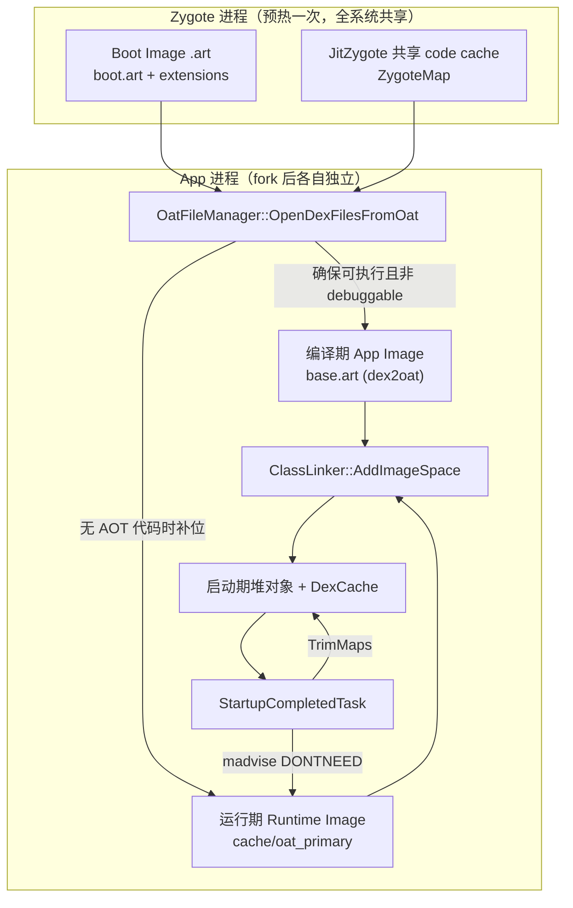
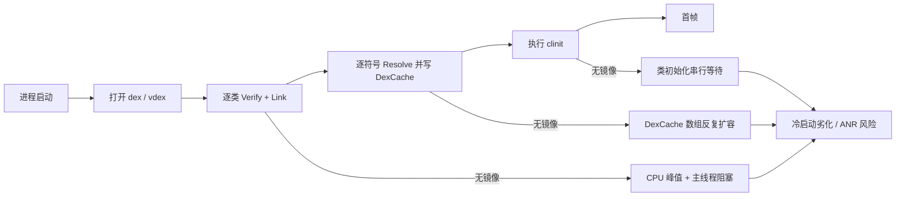
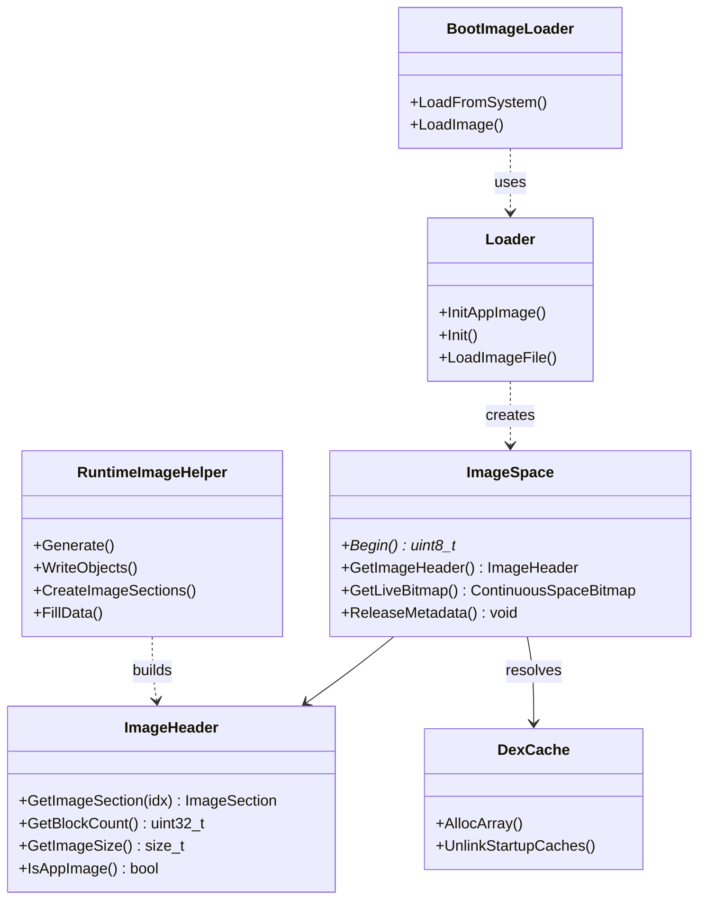
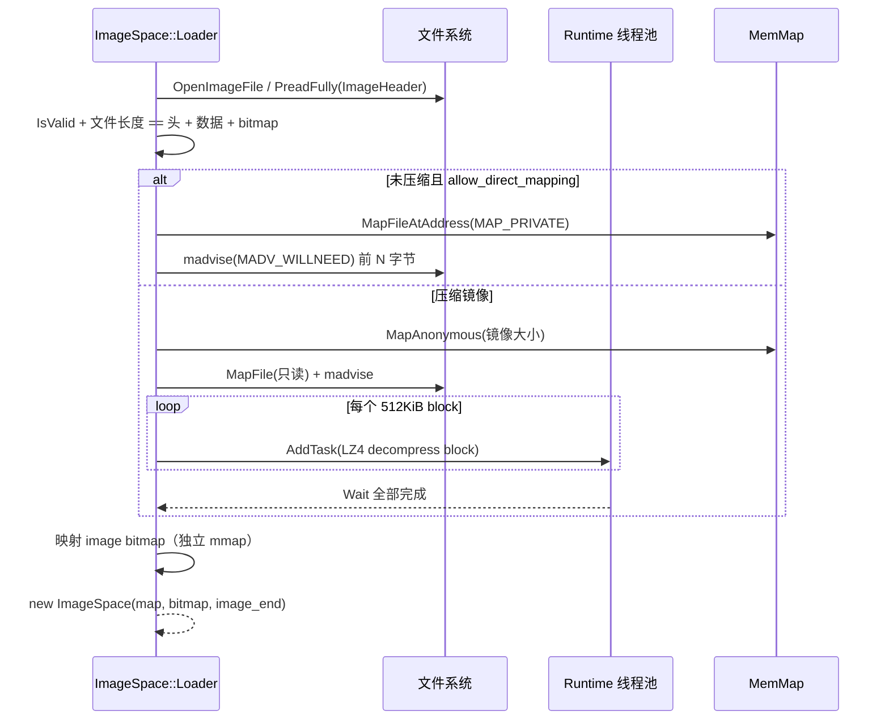
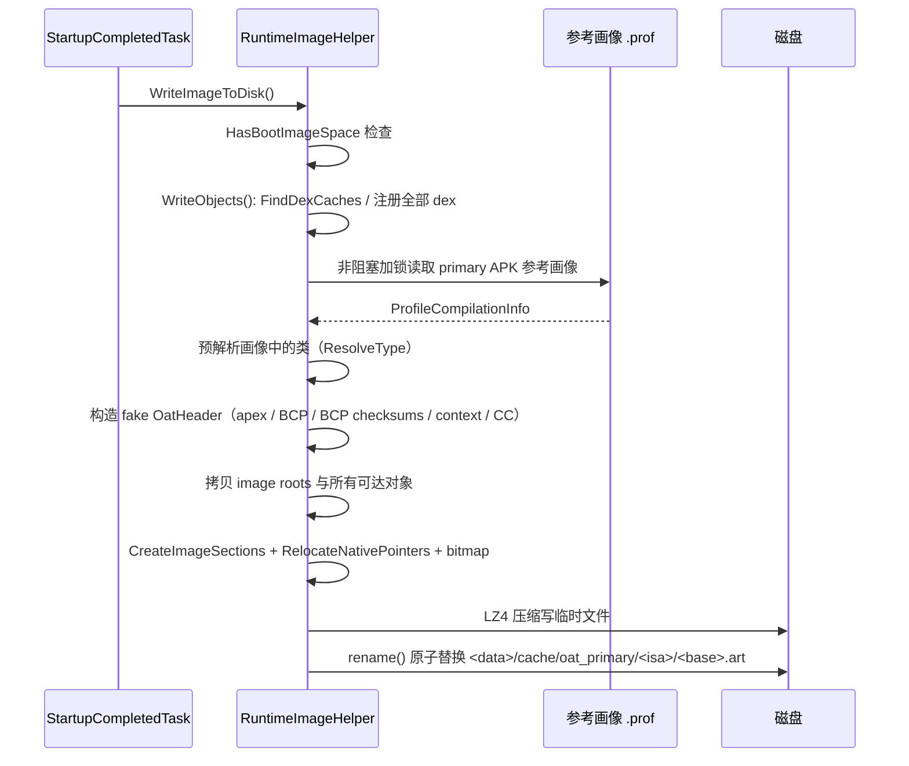
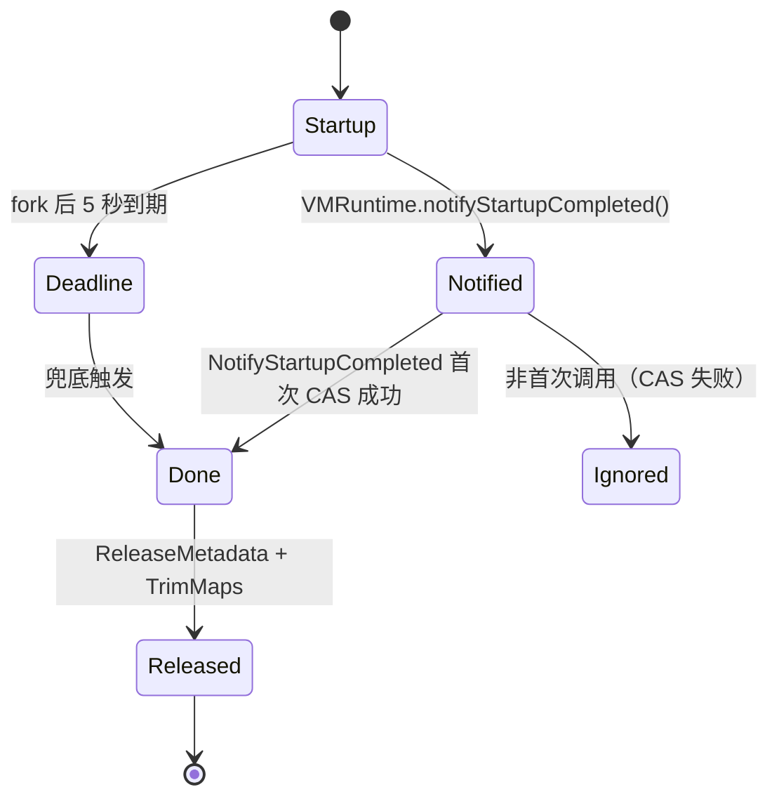
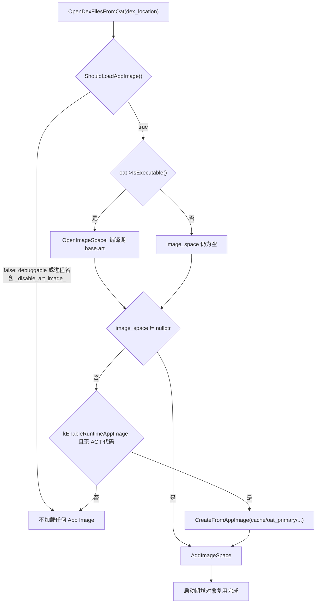

# 03 · App 启动加速与类/镜像预热机制

| 项 | 内容 |
| :--- | :--- |
| **机制定位** | ART 冷启动主链路上的「镜像预热层」：用预生成的 `.art` 镜像把「类加载 → 校验 → 链接 → 静态初始化 → 解析缓存填充」从每个进程的运行时开销，转成一次性的编译期/首次启动期成本 |
| **源码模块** | `runtime/gc/space/image_space.cc`、`runtime/runtime_image.cc`、`runtime/class_linker.cc`、`runtime/startup_completed_task.cc`、`runtime/native/dalvik_system_ZygoteHooks.cc` |
| **核心类 / 入口** | `ImageSpace`、`ImageSpace::Loader`、`ImageSpace::BootImageLoader`、`RuntimeImageHelper`、`ClassLinker::AppImageLoadingHelper`、`StartupCompletedTask` |
| **关键系统属性 / 参数** | `dalvik.vm.parallel-image-loading`、`dalvik.vm.appimageformat`、`-XMadviseWillNeedArtFileSize`、`-XMadviseWillNeedOdexFileSize`、`-Ximage-dex2oat`、`-verbose:image` |
| **一句话核心结论** | 镜像把「堆对象 + ArtMethod/ArtField + DexCache 解析结果」固化到文件里，靠 `mmap` 让全系统共享页缓存；启动完成后再用 `madvise(MADV_DONTNEED)` 把只服务于启动的 metadata 段和 startup `LinearAlloc` 还回去，做到「启动快」与「常驻省」两不误 |

> [!IMPORTANT]
> 本机制只预热「对象图与解析结果」，不改变 Java 语义；运行期自动生成的 Runtime Image 里 **没有 AOT 机器码**（`oat_checksum` 写 0），它替代的是类加载与解析成本，而不是编译成本。

## 1. What：机制是什么？（概念界定与架构全景）

### 1.1 职责边界

ART 的启动成本可以拆成四段：**找 dex → 校验字节码 → 链接/解析符号 → 执行 `<clinit>`**。镜像机制的做法是：在「编译期」或「上一次启动结束时」，把已经完成上述工作的**堆内存快照**按段落盘；下一次启动直接把文件映射回地址空间，对象指针、`ArtMethod` 入口、`DexCache` 里的解析结果一并恢复。进程只需做重定位和少量修补，无需重新走一遍加载链。

它**不负责**：JIT/AOT 机器码的生成（那是 `oat`/`vdex` 的事）、GC 策略、线程调度。镜像与 `oat` 文件是伴生关系，通过 checksum、boot classpath、class loader context 互相校验。

### 1.2 核心术语表

| 术语 | 含义 | 关键源码 |
| :--- | :--- | :--- |
| **Boot Image** | zygote 启动时加载的系统镜像，含 boot classpath（BCP）核心类；所有 App 通过 `fork` 继承同一份映射 | [image_space.cc](file:///home/voyah/workspace/8397/qssi/art/runtime/gc/space/image_space.cc#L3319-L3378) |
| **Boot Image Extension** | 主镜像之外按 BCP 分段编译的扩展镜像，支持「部分类更新后只重编扩展」 | [image_space.cc](file:///home/voyah/workspace/8397/qssi/art/runtime/gc/space/image_space.cc#L2089-L2222) |
| **App Image（编译期）** | dex2oat 随 oat 一起产出的 `.art`，与 APK 的 oat 目录同级，文件名同 `base.oat` 换扩展名 | [oat_file_assistant.cc](file:///home/voyah/workspace/8397/qssi/art/runtime/oat/oat_file_assistant.cc#L895-L906) |
| **Runtime Image（运行期）** | ART 在应用「启动完成」后自动生成的 `.art`，用于没有 AOT 产物的应用 | [runtime_image.cc](file:///home/voyah/workspace/8397/qssi/art/runtime/runtime_image.cc#L1877-L1944) |
| **ImageSpace** | 镜像在堆中的表示，本质是一段 `MemMap` + 一份 live bitmap | [image_space.cc](file:///home/voyah/workspace/8397/qssi/art/runtime/gc/space/image_space.cc#L755-L800) |
| **Image Roots** | 镜像内的根数组：`kDexCaches`、`kClassRoots`、`kSpecialRoots`（App Image 里存 class loader 或 fake OatHeader） | [image.h](file:///home/voyah/workspace/8397/qssi/art/runtime/oat/image.h#L224-L236) |
| **Metadata Section** | 只服务启动期的段（如超大 dex 的全量解析数组），启动结束即 `MADV_DONTNEED` | [image_space.cc](file:///home/voyah/workspace/8397/qssi/art/runtime/gc/space/image_space.cc#L3794-L3805) |
| **Startup LinearAlloc** | 启动期专属的线性分配器，用于临时 `DexCache` 数组；启动完成后整体销毁 | [runtime.cc](file:///home/voyah/workspace/8397/qssi/art/runtime/runtime.cc#L1930-L1937) |
| **JitZygote 共享区** | zygote 进程编译出的 code cache 共享内存，子进程只读访问，避免重复编译核心方法 | [jit_code_cache.h](file:///home/voyah/workspace/8397/qssi/art/runtime/jit/jit_code_cache.h#L95-L180) |

### 1.3 架构定位图



### 1.4 三类镜像的分工

| 维度 | Boot Image | App Image（编译期） | Runtime Image（运行期） |
| :--- | :--- | :--- | :--- |
| 产生者 | `dex2oat --image`（系统镜像编译） | `dex2oat`（随 odex 一起） | 应用自己，启动完成时 |
| 落点 | `/system/framework/<isa>/boot.art` | `/data/app/.../oat/<isa>/base.art` | `<data_dir>/cache/oat_primary/<isa>/base.art` |
| 覆盖面 | BCP 核心类 | 该 APK 的启动类 | 该 APK 本次实际加载/画像内声明的类 |
| 含机器码 | 否（含 `ArtMethod` 入口桩） | 否（代码在 oat） | 否（`oat_checksum=0`） |
| 生效条件 | 无条件（无镜像则 imageless 回退） | oat 可执行、非 debuggable、非 `_disable_art_image_` 进程 | 无可用 AOT 代码且镜像文件校验通过 |
| 生命周期 | 与 zygote 同生共死 | 随 dexopt 重编而失效 | 可被 `cleanup` 回收，dexopt 后自动删除 |

## 2. Why：为什么需要它？（痛点模型与演进动机）

### 2.1 缺失镜像时的四笔账

1. **重复的类加载**：每个应用进程都要自己 `openDexFile → 建 DexCache → ResolveType` 一遍。BCP 里的 `java.lang.*`、`android.*` 每个 App 都要重来，纯浪费。
2. **重复的校验与链接**：字节码校验、`ArtMethod` 链接、vtable/iftable 填充，都是 O(类数 × 方法数) 的 CPU 工作。
3. **COW 污染与内存膨胀**：即使 zygote 已经加载好类，子进程只要写一次 `ArtMethod`（热计数、入口点、解析缓存），对应物理页就从共享变成私有。
4. **冷 IO 放大**：几百 MB 的 dex 分散读，随机 IO 远多于一次顺序读一个紧凑镜像。

### 2.2 方案演进对比

| 方案 | 类加载 | 校验/链接 | 解析缓存 | 跨进程共享 | 典型代价 |
| :--- | :--- | :--- | :--- | :--- | :--- |
| 纯解释执行（无镜像） | 每进程重复 | 每进程重复 | 运行时逐个填 | 无 | 冷启动最慢，CPU 峰值高 |
| 仅 Boot Image | BCP 部分预置 | BCP 跳过 | BCP 预置 | 页缓存共享 | App 自身类仍要现场加载 |
| Boot Image + 编译期 App Image | App 启动类预置 | 跳过 | 预置 | 页缓存共享（`MAP_PRIVATE`） | 安装/OTA 时 dexopt 变慢，镜像占磁盘 |
| 上述 + 运行期 Runtime Image | 补足无 AOT 的应用 | 跳过 | 预置 | 页缓存共享 | 首次启动后台写盘，增加一次 IO |

### 2.3 痛点根因示意



对车机座舱这类「多屏高负载 + 长稳运行 + 频繁冷启动第三方应用」的场景，第 3 笔账尤其致命：镜像一旦被写脏，省下的加载时间会被 COW 缺页和内存增长吃掉。因此 ART 在镜像设计上非常克制：**B boot image 段严格只读共享，App Image 用 `MAP_PRIVATE` 文件映射**，写时复制只影响真正被改的页。

## 3. How：源码级实现原理深度剖析

### 3.1 镜像文件布局与内存结构

`.art` 文件由 `ImageHeader` 加若干 `ImageSection` 顺序拼成，段偏移和大小都存在头里，加载端只按头解释，不做额外格式解析。

```text
.art 文件布局（偏移从 0 开始，段间按 kElfSegmentAlignment 对齐）

┌────────────────────────────────────────────┐ 0
│ ImageHeader                                │  固定头：image_begin_ / image_size_
│  ├─ sections_[kSectionCount]               │  data_size_ / image_methods_
│  ├─ image_methods_[kImageMethodsCount]     │  blocks_offset_ / blocks_count_
│  └─ image_roots = image_begin + sizeof(hdr)│
├────────────────────────────────────────────┤ sizeof(ImageHeader)
│ kSectionObjects        mirror 对象（类、字符串、DexCache…）
├────────────────────────────────────────────┤
│ kSectionArtFields      ArtField 数组
│ kSectionArtMethods     ArtMethod 数组（含入口点/热计数）
│ kSectionImTables       Interface Method Table
│ kSectionIMTConflictTables
│ kSectionRuntimeMethods 运行时方法桩
│ kSectionJniStubMethods JNI 桩
│ kSectionInternedStrings 驻留字符串表
│ kSectionClassTable     类表（加速首次查类）
│ kSectionStringReferenceOffsets 字符串引用修复表
│ kSectionDexCacheArrays 常驻解析数组（小 dex）
│ kSectionMetadata       仅启动期数据（大 dex 全量数组）← 启动结束释放
├────────────────────────────────────────────┤ RoundUp(…, kElfSegmentAlignment)
│ kSectionImageBitmap    对象存活位图（单独 mmap 同一文件）
└────────────────────────────────────────────┘ EOF
```

段枚举定义在 [image.h](file:///home/voyah/workspace/8397/qssi/art/runtime/oat/image.h#L259-L274)，运行时镜像构造段顺序的逻辑在 [runtime_image.cc](file:///home/voyah/workspace/8397/qssi/art/runtime/runtime_image.cc#L285-L336)。注意最后一段 bitmap 的偏移要按 `kElfSegmentAlignment` 对齐（[runtime_image.cc](file:///home/voyah/workspace/8397/qssi/art/runtime/runtime_image.cc#L104-L176)），这样加载端才能把文件里的 bitmap 直接 `mmap` 成只读映射：

```cpp
// image_space.cc: 校验文件长度后，单独映射 bitmap
const size_t image_bitmap_offset =
    RoundUp(sizeof(ImageHeader) + image_header.GetDataSize(), kElfSegmentAlignment);
const size_t end_of_bitmap = image_bitmap_offset + bitmap_section.Size();
if (end_of_bitmap != image_file_size) { /* 截断或多余数据 → 拒绝加载 */ }
```

### 3.2 核心类关系



`RuntimeImageHelper` 的成员本身就是「按段组织的缓冲区」：`objects_`、`art_fields_`、`art_methods_`、`im_tables_`、`intern_table_`、`class_table_`、`dex_cache_arrays_`、`metadata_`，每块在 `CreateImageSections()` 里被赋予段偏移（[runtime_image.cc](file:///home/voyah/workspace/8397/qssi/art/runtime/runtime_image.cc#L78-L103)）。

### 3.3 加载快路径：直接 mmap 与慢路径：解压拷贝

`ImageSpace::Loader::LoadImageFile` 是决定启动快慢的分叉点（[image_space.cc](file:///home/voyah/workspace/8397/qssi/art/runtime/gc/space/image_space.cc#L991-L1100)）：

- **快路径**：镜像未压缩且允许直接映射时，`MemMap::MapFileAtAddress(PROT_READ|PROT_WRITE, MAP_PRIVATE, fd, start)` 把 `.art` 直接映射到预留地址。页缓存全系统共享，写才复制。
- **慢路径**：镜像被压缩时，先 `MapAnonymous` 申请匿名内存，再 `MapFile` 只读映射文件，逐块 `LZ4` 解压进目标区；解压失败则整体加载失败。



关键点：**压缩镜像的解压可以并行**，块数达到 `kMinBlocks = 2` 且线程池可用时，每个 block 变成一个 `FunctionTask`，主线程 `pool->Wait()` 收口（[image_space.cc](file:///home/voyah/workspace/8397/qssi/art/runtime/gc/space/image_space.cc#L1058-L1098)）。线程池来自 `dalvik.vm.parallel-image-loading`：默认 `false`，开启后创建 `min(hardware_concurrency, 4)` 个 worker、64KB 栈（[runtime.cc](file:///home/voyah/workspace/8397/qssi/art/runtime/runtime.cc#L1266-L1283)）。这个池是**启动期临时资源**，`StartupCompletedTask` 结束时直接删除（[startup_completed_task.cc](file:///home/voyah/workspace/8397/qssi/art/runtime/startup_completed_task.cc#L74-L76)）。

### 3.4 `madvise` 预读：让内核提前把页拉进 page cache

`Runtime::MadviseFileForRange` 把文件按 **128KiB** 分块 `MADV_WILLNEED`（[runtime.cc](file:///home/voyah/workspace/8397/qssi/art/runtime/runtime.cc#L3427-L3480)）：

1. 首尾按页对齐；
2. Android T 及以上，若进程不处于 `kProcessStateJankPerceptible`，**直接短路返回 0**，避免后台进程与前台抢 IO；
3. 读取上限来自 `-XMadviseWillNeedArtFileSize`（默认 0，即不预读），只预读 `min(map_size, limit)` 字节；
4. 按 128KiB 步进，逐段 `madvise(MADV_WILLNEED)`。

对应的运行时选项定义在 [runtime_options.def](file:///home/voyah/workspace/8397/qssi/art/runtime/runtime_options.def#L91-L93)，解析在 [parsed_options.cc](file:///home/voyah/workspace/8397/qssi/art/runtime/parsed_options.cc#L258-L266)。镜像加载、odex 加载都走同一套逻辑（[image_space.cc](file:///home/voyah/workspace/8397/qssi/art/runtime/gc/space/image_space.cc#L1003-L1027)）。

### 3.5 App Image 装载：六道校验门

`ClassLinker::AddImageSpace` 在真正把镜像并入堆之前，会逐项核对「镜像与当前运行环境是否仍匹配」（[class_linker.cc](file:///home/voyah/workspace/8397/qssi/art/runtime/class_linker.cc#L2163-L2340)）：

| 门 | 校验内容 | 失败后果 |
| :--- | :--- | :--- |
| 指针宽度 | 镜像 `GetPointerSize()` 必须等于运行时 | 拒绝加载 |
| 根数量 | `NumberOfImageRoots(app_image)` 与 header 一致 | 拒绝加载 |
| 类根一致性 | 每个 `ClassRoot` 与 boot image 的指针相等 | 拒绝加载 |
| Dex 校验和 | fake `OatHeader` 后的 checksums 与本次 dex 逐项比对 | 拒绝加载 |
| ClassLoader Context | `VerifyClassLoaderContextMatch` | 拒绝加载 |
| Apex / BCP / BCP checksums / CC 标志 | 全部字符串比对 | 拒绝加载 |

校验通过后，`AppImageLoadingHelper::Update` 做三件事（[class_linker.cc](file:///home/voyah/workspace/8397/qssi/art/runtime/class_linker.cc#L1772-L1843)）：修补 dex cache location、注册 dex cache、处理驻留字符串去重；同时把 image 里漂移的 `ArtMethod`「数据指针 = code item 偏移」还原成真实指针，并重置热计数（[class_linker.cc](file:///home/voyah/workspace/8397/qssi/art/runtime/class_linker.cc#L2355-L2400)）。

**zygote 专属优化**：zygote 加载 BCP 方法时会把 `kAccMemorySharedMethod` 打上，热计数固定为 0（视为已热），让这些方法在任何子进程里都不再触发重编译（[class_linker.cc](file:///home/voyah/workspace/8397/qssi/art/runtime/class_linker.cc#L4204-L4215)）。子进程若 profiler 需要或 Java debuggable，则统一清掉该标志（[class_linker.cc](file:///home/voyah/workspace/8397/qssi/art/runtime/class_linker.cc#L2348-L2360)）。配合 JIT 侧的 `ZygoteMap`（zygote 写、子进程读的 `ArtMethod → code` 共享表，[jit_code_cache.h](file:///home/voyah/workspace/8397/qssi/art/runtime/jit/jit_code_cache.h#L109-L180)），核心方法在全系统只编译一次。

### 3.6 运行期 Runtime Image：没有 AOT 产物时的补位

触发点只有一处：`StartupCompletedTask::Run`（[startup_completed_task.cc](file:///home/voyah/workspace/8397/qssi/art/runtime/startup_completed_task.cc#L47-L76)）：

```cpp
if (runtime->NotifyStartupCompleted()) {
  if (!runtime->IsJavaDebuggable()) {
    std::string compiler_filter, compilation_reason, primary_apk_path = ...;
    runtime->GetAppInfo()->GetPrimaryApkOptimizationStatus(&compiler_filter, &compilation_reason);
    CompilerFilter::Filter filter;
    if (CompilerFilter::ParseCompilerFilter(compiler_filter.c_str(), &filter) &&
        !CompilerFilter::IsAotCompilationEnabled(filter) &&
        !runtime->GetHeap()->HasAppImageSpaceFor(primary_apk_path)) {
      std::string error_msg;
      if (!RuntimeImage::WriteImageToDisk(&error_msg)) {
        LOG(DEBUG) << "Could not write temporary image to disk " << error_msg;
      }
    }
  }
  ScopedObjectAccess soa(self);
  DeleteStartupDexCaches(self, /* called_by_gc= */ false);
}
```

四个前置条件缺一不可：**首次通知**、**非 debuggable**、**当前编译过滤器不产出 AOT 代码**、**堆中没有该 APK 的 App Image**。`HasAppImageSpaceFor` 通过比对 image space 的 oat 首个 dex location 判断（[heap.cc](file:///home/voyah/workspace/8397/qssi/art/runtime/gc/heap.cc#L5039-L5052)）。

生成流程（`RuntimeImageHelper`）：



其中 **`LoadClassesFromReferenceProfile` 是运行期镜像的「质量补偿」**：如果本次运行没加载全启动类，就按参考画像把类补解析进来，避免生成的镜像只覆盖「这一次恰好用到的类」（[runtime_image.cc](file:///home/voyah/workspace/8397/qssi/art/runtime/runtime_image.cc#L1005-L1062)）。画像文件用 `O_RDONLY` + `block=false` 打开——启动路径上**绝不阻塞等锁**。

写盘参数（[runtime_image.cc](file:///home/voyah/workspace/8397/qssi/art/runtime/runtime_image.cc#L1911-L1944)）：

| 参数 | 取值 | 原因 |
| :--- | :--- | :--- |
| 压缩算法 | `kStorageModeLZ4` | LZ4HC 压缩耗时约 10 倍，启动后台不值得 |
| block 大小 | 512 KiB | 让下次加载能并行解压（≥2 块即并行） |
| `update_checksum` | `false` | 运行期镜像没有使用方读取该 checksum，省 CPU |
| 落盘方式 | 临时文件 + `rename()` | 崩溃或并发时不会留下半个镜像 |

### 3.7 启动期专属 `LinearAlloc` 与 metadata 回收

这是「启动快」不变成「常驻胖」的关键闭环。

**分配侧**：`Runtime::CreateLinearAlloc` 按需创建 `LinearAlloc`，其中一个专门存进 `startup_linear_alloc_`（[runtime.cc](file:///home/voyah/workspace/8397/qssi/art/runtime/runtime.cc#L1930-L1937)、[runtime.cc](file:///home/voyah/workspace/8397/qssi/art/runtime/runtime.cc#L3143-L3148)）。`DexCache::AllocArray` 在 `startup == true` 时优先用这个分配器（[dex_cache-inl.h](file:///home/voyah/workspace/8397/qssi/art/runtime/mirror/dex_cache-inl.h#L57-L84)）：

```cpp
LinearAlloc* startup_linear_alloc = runtime->GetStartupLinearAlloc();
LinearAlloc* alloc = (startup && startup_linear_alloc != nullptr)
    ? startup_linear_alloc
    : runtime->GetClassLinker()->GetOrCreateAllocatorForClassLoader(GetClassLoader());
MutexLock mu(self, *Locks::dex_cache_lock_);   // 多线程只分配一次
if (array != nullptr) { return array; }        // 别的线程刚分配好
array = alloc->AllocAlign16(self, RoundUp(num * sizeof(T), 16), kind);
```

**阈值侧**：解析数组的「全量 vs 1024 槽 pair cache」由 `ShouldAllocateFullArray(num_ids, 1024)` 决定（[dex_cache.h](file:///home/voyah/workspace/8397/qssi/art/runtime/mirror/dex_cache.h#L394-L396)、[dex_cache.h](file:///home/voyah/workspace/8397/qssi/art/runtime/mirror/dex_cache.h#L265-L290)）。当前基线里 `kEnableFullArraysAtStartup = false`（[dex_cache.cc](file:///home/voyah/workspace/8397/qssi/art/runtime/mirror/dex_cache.cc#L41-L44)），`ShouldAllocateFullArrayAtStartup()` 因此恒为 false（[dex_cache.cc](file:///home/voyah/workspace/8397/qssi/art/runtime/mirror/dex_cache.cc#L167-L204)），运行期主要走「小 dex 全量、大 dex 1024 槽」的策略；镜像里的超大数组则被放进 **metadata 段**，等启动结束统一释放。

**回收侧**：`StartupCompletedTask::DeleteStartupDexCaches` 的顺序设计得很讲究（[startup_completed_task.cc](file:///home/voyah/workspace/8397/qssi/art/runtime/startup_completed_task.cc#L78-L148)）：

```text
1. ReleaseStartupLinearAlloc()      ← 先摘分配器，之后没人能再往里分配
2. RunCheckpoint()                  ← 保证所有线程都已看到 startup 结束
3. VisitDexCaches(UnlinkStartupCaches)  ← 把只服务启动的数组字段置空
4. RunCheckpoint()                  ← 保证没人正在读 image metadata / dex cache
5. WaitForGcToComplete(kGcCauseDeletingDexCacheArrays)  ← 等 GC 走完
6. 对每个 App ImageSpace 调 ReleaseMetadata()  ← madvise(MADV_DONTNEED)
7. startup_linear_alloc.reset() + arena_pool->TrimMaps()  ← 把 arena 还给系统
```

第 2 步的 checkpoint 解决的是这个竞态：线程 T1 取到 startup alloc 并准备写入 dex cache，主线程 T0 同时在清空数组并释放 alloc。加 checkpoint 后 T0 会等 T1 到达安全点，第 3 步就不可能落在 T1 的写之后。

`ReleaseMetadata` 只对 metadata 段做页内对齐后的 `MADV_DONTNEED`（[image_space.cc](file:///home/voyah/workspace/8397/qssi/art/runtime/gc/space/image_space.cc#L3794-L3805)），不用清零式释放，避免非字对齐写入的撕裂问题。

**提前回收路径**：如果启动尚未完成就有 class loader 被卸载，`ClassLinker::DeleteClassLoader` 会检查 `GetStartupLinearAlloc() != nullptr` 并主动调一次 `DeleteStartupDexCaches(..., called_by_gc=true)`（[class_linker.cc](file:///home/voyah/workspace/8397/qssi/art/runtime/class_linker.cc#L11375-L11381)）。镜像侧也有对称逻辑：如果加载 App Image 时启动已经结束，`AppImageLoadingHelper::Update` 会直接 `UnlinkStartupCaches`，并在所有 dex cache 都没数组时调用 `ReleaseMetadata`（[class_linker.cc](file:///home/voyah/workspace/8397/qssi/art/runtime/class_linker.cc#L1795-L1824)）。

### 3.8 启动完成的两种触发与 5 秒兜底



- **框架主动通知**：`VMRuntime.notifyStartupCompleted()` 在 `now` 时刻投递 `StartupCompletedTask`（[dalvik_system_VMRuntime.cc](file:///home/voyah/workspace/8397/qssi/art/runtime/native/dalvik_system_VMRuntime.cc#L339-L341)）。
- **5 秒兜底**：`nativePostForkChild` 里，只要不是 zygote 进程就投递一个 `target_run_time = now + MsToNs(5000)` 的任务（[dalvik_system_ZygoteHooks.cc](file:///home/voyah/workspace/8397/qssi/art/runtime/native/dalvik_system_ZygoteHooks.cc#L347-L355)），防止应用不通知导致启动期内存永不释放。
- **只执行一次**：`Runtime::NotifyStartupCompleted` 用 CAS 把 `startup_completed_` 从 false 翻到 true，第二次调用直接返回 false（[runtime.cc](file:///home/voyah/workspace/8397/qssi/art/runtime/runtime.cc#L3376-L3395)）。但 `DeleteThreadPool()` 在每次 `Run` 都会执行，因为它是幂等清理。
- 任务本身跑在 `gc::TaskProcessor` 线程上，属于 `HeapTask`，按 `target_run_time` 排序执行（[task_processor.h](file:///home/voyah/workspace/8397/qssi/art/runtime/gc/task_processor.h#L27-L50)）。

### 3.9 加载决策点：什么时候用哪种镜像



对应源码在 [oat_file_manager.cc](file:///home/voyah/workspace/8397/qssi/art/runtime/oat/oat_file_manager.cc#L288-L318)，开关常量与进程名豁免词在 [oat_file_manager.cc](file:///home/voyah/workspace/8397/qssi/art/runtime/oat/oat_file_manager.cc#L69-L76)。注意 `_disable_art_image_` 是**进程名**命中，用于「宁愿多花 CPU 也要省内存」的进程（注释引用 b/292210260）。

### 3.10 镜像生命周期与清理对齐

运行期镜像不是「一次生成永久有效」：

- **dexopt 之后**：`Dexopter` 会在 dexopt 成功后删除已有 runtime artifacts，即使它仍可用——目的是让 dex 状态确定、并尽早释放磁盘（[Dexopter.java](file:///home/voyah/workspace/8397/qssi/art/libartservice/service/java/com/android/server/art/Dexopter.java#L605-L618)）。
- **日常 cleanup**：`ArtManagerLocal.cleanup` 只在「dexopt 产物可用且其中不含 AOT 代码」时保留 runtime artifacts，这条判据必须与 `OatFileManager::OpenDexFilesFromOat` 的加载判据对齐，否则会出现「保留了不用」或「要用时已删」（[ArtManagerLocal.java](file:///home/voyah/workspace/8397/qssi/art/libartservice/service/java/com/android/server/art/ArtManagerLocal.java#L1247-L1253)）。

## 4. 能利用这个机制做什么？（工程实战指南与排障手册）

### 4.1 场景一：车机应用冷启动耗时拆解

Perfetto 里这几条 slice 名字就是镜像链路的「计时器」，直接决定时间花在哪：

| Slice 名 | 出处 | 含义 |
| :--- | :--- | :--- |
| `AppImage:Loading` | [oat_file_manager.cc](file:///home/voyah/workspace/8397/qssi/art/runtime/oat/oat_file_manager.cc#L288-L288) | 整个 App Image 装载阶段 |
| `MapImageFile` | [image_space.cc](file:///home/voyah/workspace/8397/qssi/art/runtime/gc/space/image_space.cc#L1000-L1000) | mmap / 解压阶段 |
| `LZ4 decompress block` | [image_space.cc](file:///home/voyah/workspace/8397/qssi/art/runtime/gc/space/image_space.cc#L1072-L1074) | 单块解压（并行时多线程各一条） |
| `AppImage:Updating` | [class_linker.cc](file:///home/voyah/workspace/8397/qssi/art/runtime/class_linker.cc#L1781-L1781) | dex cache 注册、字符串去重 |
| `Releasing dex caches and app image spaces metadata` | [startup_completed_task.cc](file:///home/voyah/workspace/8397/qssi/art/runtime/startup_completed_task.cc#L82-L82) | 启动后回收阶段 |
| `Generating runtime image` / `Writing runtime image to disk` | [runtime_image.cc](file:///home/voyah/workspace/8397/qssi/art/runtime/runtime_image.cc#L1888-L1894) | 运行期镜像生成与落盘 |

判读方法：`AppImage:Loading` 占比高 → 磁盘/解压问题；`AppImage:Updating` 占比高 → 类/字符串数量问题；两条都没有但 `ExecuteNterpImpl` 长 → 压根没用上镜像。

### 4.2 场景二：确认某应用到底用了哪种镜像

```bash
# 1) 看应用数据目录下是否有运行期镜像（无 AOT 应用才走这条）
adb shell ls -l /data/user/0/<pkg>/cache/oat_primary/arm64/ 2>/dev/null

# 2) 看 APK 的 oat 目录是否有编译期镜像
adb shell ls -l /data/app/*/<pkg>*/oat/arm64/

# 3) 直接 dump 镜像头与分段
adb shell /apex/com.android.art/bin/oatdump --app-image=/data/app/.../oat/arm64/base.art --header-only
adb shell /apex/com.android.art/bin/oatdump --image=/system/framework/arm64/boot.art --header-only
```

`oatdump` 走的就是 `ImageSpace::CreateFromAppImage` 同一条装载路径（[oatdump.cc](file:///home/voyah/workspace/8397/qssi/art/oatdump/oatdump.cc#L2468-L2472)），所以它失败通常意味着设备上也会失败。

### 4.3 场景三：打开并行镜像解压与预读

```bash
# 并行镜像加载（默认 false）；需重启应用或 zygote 生效
adb shell setprop dalvik.vm.parallel-image-loading true

# 给 .art 预读配额（字节）。0 表示不预读；车机建议按镜像体积给有限额度
adb shell setprop dalvik.vm.extra-opts "-XMadviseWillNeedArtFileSize=4194304"
adb shell setprop dalvik.vm.extra-opts "-XMadviseWillNeedOdexFileSize=2097152"

# 打开镜像相关 verbose 日志（框架把 extra-opts 透传给 Runtime::Start）
adb shell setprop dalvik.vm.extra-opts "-verbose:image,startup"
```

注意 `-XMadviseWillNeedArtFileSize` 是「上限」而不是「全量预读」：内核只会按 128KiB 分段把前 N 字节拉进 page cache，且后台进程会被直接短路（[runtime.cc](file:///home/voyah/workspace/8397/qssi/art/runtime/runtime.cc#L3435-L3449)）。

### 4.4 场景四：控制镜像产出，平衡「启动快」与「磁盘/内存省」

| 目标 | 做法 | 依据 |
| :--- | :--- | :--- |
| 全局关闭 App Image 生成 | 清空 `dalvik.vm.appimageformat`（`Dexopter.isAppImageEnabled()` 以非空为开关） | [Dexopter.java](file:///home/voyah/workspace/8397/qssi/art/libartservice/service/java/com/android/server/art/Dexopter.java#L512-L514) |
| 单进程不加载 App Image | 进程名包含 `_disable_art_image_` | [oat_file_manager.cc](file:///home/voyah/workspace/8397/qssi/art/runtime/oat/oat_file_manager.cc#L74-L76) |
| 关闭运行期镜像 | 不满足四个前置条件即可：让应用有 AOT 产物（`speed`/`speed-profile`），或保持 debuggable | [startup_completed_task.cc](file:///home/voyah/workspace/8397/qssi/art/runtime/startup_completed_task.cc#L47-L70) |
| 让应用重新生成运行期镜像 | `adb shell cmd package compile -m verify -f <pkg>`（清掉 AOT 代码），再冷启动一次 | 策略来自 `GetPrimaryApkOptimizationStatus` 判定 |
| 回收运行期镜像磁盘 | `adb shell cmd package bg-dexopt-job` 触发 cleanup | [ArtManagerLocal.java](file:///home/voyah/workspace/8397/qssi/art/libartservice/service/java/com/android/server/art/ArtManagerLocal.java#L1233-L1300) |

车机建议：**导航 / 仪表 / 语音等常驻或高频冷启动应用走 `speed-profile`（有 AOT 代码，不生成运行期镜像）；低频第三方应用保持 `verify`，让运行期镜像补位**。

### 4.5 场景五：用内存指标验证「回收到底做了没」

```bash
# 1) 启动完成后看进程 smaps 里的 .art 映射
adb shell cat /proc/<pid>/smaps | grep -A 6 -E "\.art$"

# 2) 看 dex cache 相关统计（ART 内建指标，需 metrics 初始化）
adb shell dumpsys meminfo <pkg> | head -40

# 3) 触发一次显式 trim 验证页回收是否生效
adb shell am send-trim-memory <pid> RUNNING_LOW
```

判断标准：启动完成若干秒后，`cache/oat_primary/*.art` 的 `Rss` 应明显小于 `Pss` 初值对应的文件大小，且 metadata 段对应页不再常驻。若长期居高不下，先确认 `StartupCompletedTask` 是否真的执行过（`-verbose:startup` 里会有 `StartupCompletedTask running`）。

### 4.6 常见坑与边界

1. **`dalvik.vm.parallel-image-loading` 不是越大越好**：worker 上限写死 4 个、64KB 栈，且线程池在启动结束时整体删除。开太大只会在启动瞬间和主线程抢 CPU。
2. **压缩镜像 + 小镜像会退化**：block 数 < 2 时并行分支不生效，反而多一次「读文件 → 解压 → 拷贝」。小镜像建议不压缩直接映射。
3. **debuggable 应用完全不走镜像**：`ShouldLoadAppImage()` 与运行期镜像生成都以 debuggable 为一票否决（[oat_file_manager.cc](file:///home/voyah/workspace/8397/qssi/art/runtime/oat/oat_file_manager.cc#L178-L193)）。调试版本测出的冷启动数据不能代表线上。
4. **镜像与 dex 必须严格同源**：任何一次 dexopt / APK 更新都会让旧镜像的 checksum 失配，加载会被拒绝并静默回退（日志是 `Failed to open app image` 或 `Could not load runtime generated app image`）。做 A/B 实验时要先清镜像。
5. **不要指望 Runtime Image 提升代码执行速度**：它只恢复对象图，不含机器码（`oat_checksum = 0`）。真正的执行加速仍来自 `speed-profile` 的 AOT。
6. **`_disable_art_image_` 是进程级豁免**，不是应用级；改进程名会影响 `dumpsys`、`ps` 以及若干框架侧的分支判断，线上慎用。
7. **5 秒兜底是「最迟」，不是「最优」**：如果应用启动超过 5 秒，回收会在启动还没结束时触发，反而和前台争内存。长启动应用应让框架尽早调用 `notifyStartupCompleted()`。

## 5. 核心源码对照索引表

| 源文件 | 核心符号 | 职责 | 行号 |
| :--- | :--- | :--- | :--- |
| [image_space.cc](file:///home/voyah/workspace/8397/qssi/art/runtime/gc/space/image_space.cc) | `ImageSpace::Loader::InitAppImage` | App Image 装载入口，含 oat/boot image 依赖校验 | [L562-L660](file:///home/voyah/workspace/8397/qssi/art/runtime/gc/space/image_space.cc#L562-L660) |
| [image_space.cc](file:///home/voyah/workspace/8397/qssi/art/runtime/gc/space/image_space.cc) | `ImageSpace::Loader::Init` / `LoadImageFile` | 头校验、mmap 快路径、解压慢路径、bitmap 映射 | [L693-L800](file:///home/voyah/workspace/8397/qssi/art/runtime/gc/space/image_space.cc#L693-L800) |
| [image_space.cc](file:///home/voyah/workspace/8397/qssi/art/runtime/gc/space/image_space.cc) | 并行解压分支 | `kMinBlocks=2`，`ScopedThreadPoolUsage` + `AddTask` | [L1058-L1098](file:///home/voyah/workspace/8397/qssi/art/runtime/gc/space/image_space.cc#L1058-L1098) |
| [image_space.cc](file:///home/voyah/workspace/8397/qssi/art/runtime/gc/space/image_space.cc) | `BootImageLayout::Load` | 多组件镜像布局解析与扩展回退 | [L2089-L2222](file:///home/voyah/workspace/8397/qssi/art/runtime/gc/space/image_space.cc#L2089-L2222) |
| [image_space.cc](file:///home/voyah/workspace/8397/qssi/art/runtime/gc/space/image_space.cc) | `ImageSpace::LoadBootImage` | Boot Image 总入口，失败回退 imageless | [L3319-L3378](file:///home/voyah/workspace/8397/qssi/art/runtime/gc/space/image_space.cc#L3319-L3378) |
| [image_space.cc](file:///home/voyah/workspace/8397/qssi/art/runtime/gc/space/image_space.cc) | `ImageSpace::ReleaseMetadata` | metadata 段 `MADV_DONTNEED` 回收 | [L3794-L3805](file:///home/voyah/workspace/8397/qssi/art/runtime/gc/space/image_space.cc#L3794-L3805) |
| [runtime_image.cc](file:///home/voyah/workspace/8397/qssi/art/runtime/runtime_image.cc) | `RuntimeImageHelper` | 分段缓冲区与镜像生成主体 | [L78-L103](file:///home/voyah/workspace/8397/qssi/art/runtime/runtime_image.cc#L78-L103) |
| [runtime_image.cc](file:///home/voyah/workspace/8397/qssi/art/runtime/runtime_image.cc) | `Generate` / `FillData` | 段布局、bitmap、header 构造与回填 | [L104-L215](file:///home/voyah/workspace/8397/qssi/art/runtime/runtime_image.cc#L104-L215) |
| [runtime_image.cc](file:///home/voyah/workspace/8397/qssi/art/runtime/runtime_image.cc) | `LoadClassesFromReferenceProfile` | 按参考画像补齐启动类 | [L1005-L1062](file:///home/voyah/workspace/8397/qssi/art/runtime/runtime_image.cc#L1005-L1062) |
| [runtime_image.cc](file:///home/voyah/workspace/8397/qssi/art/runtime/runtime_image.cc) | `WriteObjects` | DexCache 收集、fake OatHeader、image roots | [L1063-L1240](file:///home/voyah/workspace/8397/qssi/art/runtime/runtime_image.cc#L1063-L1240) |
| [runtime_image.cc](file:///home/voyah/workspace/8397/qssi/art/runtime/runtime_image.cc) | `CopyNativeDexCacheArray` | 大 dex 数组进 metadata、小 dex 进常驻段 | [L1245-L1300](file:///home/voyah/workspace/8397/qssi/art/runtime/runtime_image.cc#L1245-L1300) |
| [runtime_image.cc](file:///home/voyah/workspace/8397/qssi/art/runtime/runtime_image.cc) | `WriteImageToDisk` | LZ4 / 512KiB 分块 / 临时文件 + rename | [L1877-L1944](file:///home/voyah/workspace/8397/qssi/art/runtime/runtime_image.cc#L1877-L1944) |
| [startup_completed_task.cc](file:///home/voyah/workspace/8397/qssi/art/runtime/startup_completed_task.cc) | `StartupCompletedTask::Run` | 启动完成触发点与运行期镜像生成条件 | [L47-L76](file:///home/voyah/workspace/8397/qssi/art/runtime/startup_completed_task.cc#L47-L76) |
| [startup_completed_task.cc](file:///home/voyah/workspace/8397/qssi/art/runtime/startup_completed_task.cc) | `DeleteStartupDexCaches` | checkpoint、unlink、等 GC、ReleaseMetadata、TrimMaps | [L78-L148](file:///home/voyah/workspace/8397/qssi/art/runtime/startup_completed_task.cc#L78-L148) |
| [class_linker.cc](file:///home/voyah/workspace/8397/qssi/art/runtime/class_linker.cc) | `AppImageLoadingHelper::Update` | 注册 dex cache、字符串去重、提前释放 | [L1772-L1843](file:///home/voyah/workspace/8397/qssi/art/runtime/class_linker.cc#L1772-L1843) |
| [class_linker.cc](file:///home/voyah/workspace/8397/qssi/art/runtime/class_linker.cc) | `ClassLinker::AddImageSpace` | 六道校验门与 ArtMethod 修补 | [L2163-L2478](file:///home/voyah/workspace/8397/qssi/art/runtime/class_linker.cc#L2163-L2478) |
| [class_linker.cc](file:///home/voyah/workspace/8397/qssi/art/runtime/class_linker.cc) | `VisitDexCaches` | 启动结束时批量 unlink startup 数组 | [L11269-L11279](file:///home/voyah/workspace/8397/qssi/art/runtime/class_linker.cc#L11269-L11279) |
| [class_linker.cc](file:///home/voyah/workspace/8397/qssi/art/runtime/class_linker.cc) | GC 侧提前回收 | class loader 卸载时触发 startup 清理 | [L11375-L11381](file:///home/voyah/workspace/8397/qssi/art/runtime/class_linker.cc#L11375-L11381) |
| [dalvik_system_ZygoteHooks.cc](file:///home/voyah/workspace/8397/qssi/art/runtime/native/dalvik_system_ZygoteHooks.cc) | `ZygoteHooks_nativePostForkChild` | fork 后投递 5 秒兜底任务 | [L294-L367](file:///home/voyah/workspace/8397/qssi/art/runtime/native/dalvik_system_ZygoteHooks.cc#L294-L367) |
| [dalvik_system_VMRuntime.cc](file:///home/voyah/workspace/8397/qssi/art/runtime/native/dalvik_system_VMRuntime.cc) | `VMRuntime_notifyStartupCompleted` | 框架主动通知启动完成 | [L339-L341](file:///home/voyah/workspace/8397/qssi/art/runtime/native/dalvik_system_VMRuntime.cc#L339-L341) |
| [runtime.cc](file:///home/voyah/workspace/8397/qssi/art/runtime/runtime.cc) | `NotifyStartupCompleted` | CAS 保证只执行一次 | [L3376-L3395](file:///home/voyah/workspace/8397/qssi/art/runtime/runtime.cc#L3376-L3395) |
| [runtime.cc](file:///home/voyah/workspace/8397/qssi/art/runtime/runtime.cc) | `MadviseFileForRange` | 128KiB 分段 `MADV_WILLNEED` 与后台短路 | [L3427-L3480](file:///home/voyah/workspace/8397/qssi/art/runtime/runtime.cc#L3427-L3480) |
| [runtime.cc](file:///home/voyah/workspace/8397/qssi/art/runtime/runtime.cc) | 运行期镜像线程池 | `dalvik.vm.parallel-image-loading`，最多 4 worker | [L1266-L1283](file:///home/voyah/workspace/8397/qssi/art/runtime/runtime.cc#L1266-L1283) |
| [dex_cache-inl.h](file:///home/voyah/workspace/8397/qssi/art/runtime/mirror/dex_cache-inl.h) | `DexCache::AllocArray` | startup LinearAlloc 选择与并发保护 | [L57-L84](file:///home/voyah/workspace/8397/qssi/art/runtime/mirror/dex_cache-inl.h#L57-L84) |
| [dex_cache.cc](file:///home/voyah/workspace/8397/qssi/art/runtime/mirror/dex_cache.cc) | `ShouldAllocateFullArrayAtStartup` / `UnlinkStartupCaches` | 阈值判定与启动数组置空 | [L167-L220](file:///home/voyah/workspace/8397/qssi/art/runtime/mirror/dex_cache.cc#L167-L220) |
| [oat_file_manager.cc](file:///home/voyah/workspace/8397/qssi/art/runtime/oat/oat_file_manager.cc) | `ShouldLoadAppImage` / 运行期镜像回退 | 加载决策点 | [L178-L318](file:///home/voyah/workspace/8397/qssi/art/runtime/oat/oat_file_manager.cc#L178-L318) |
| [image.h](file:///home/voyah/workspace/8397/qssi/art/runtime/oat/image.h) | `ImageHeader` / `ImageSections` | 镜像头与段枚举 | [L259-L274](file:///home/voyah/workspace/8397/qssi/art/runtime/oat/image.h#L259-L274) |
| [jit_code_cache.h](file:///home/voyah/workspace/8397/qssi/art/runtime/jit/jit_code_cache.h) | `ZygoteMap` / `ZygoteCompilationState` | zygote 编译结果跨进程共享 | [L95-L180](file:///home/voyah/workspace/8397/qssi/art/runtime/jit/jit_code_cache.h#L95-L180) |
| [globals.h](file:///home/voyah/workspace/8397/qssi/art/libartbase/base/globals.h) | `kElfSegmentAlignment` | 段对齐常量（= 最大页大小） | [L56-L56](file:///home/voyah/workspace/8397/qssi/art/libartbase/base/globals.h#L56-L56) |