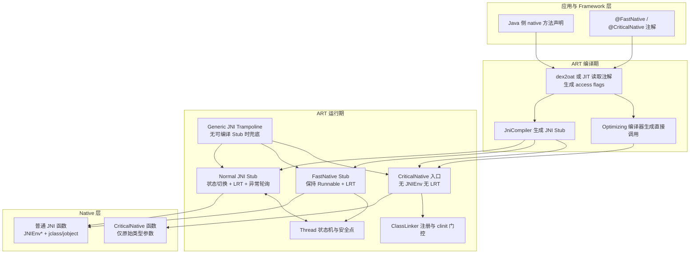
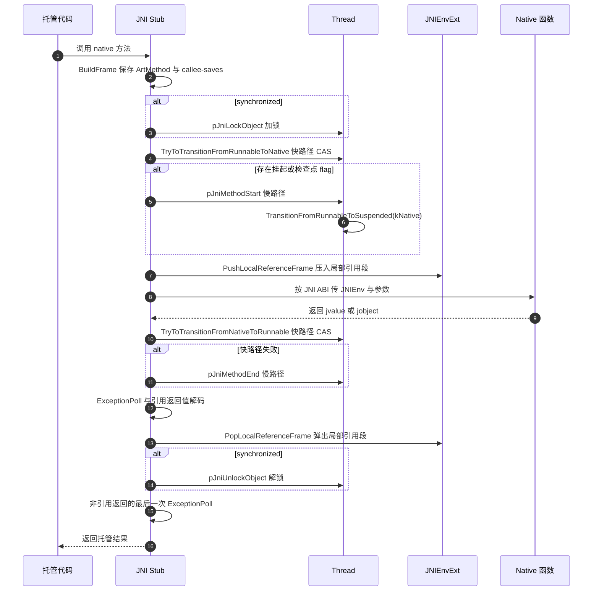
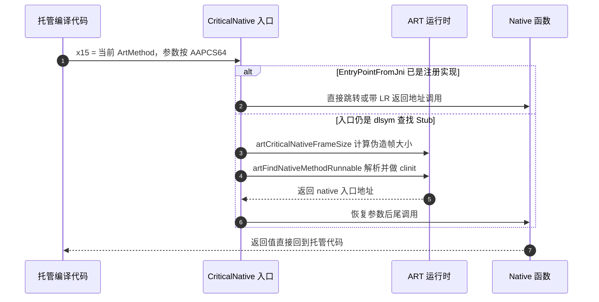
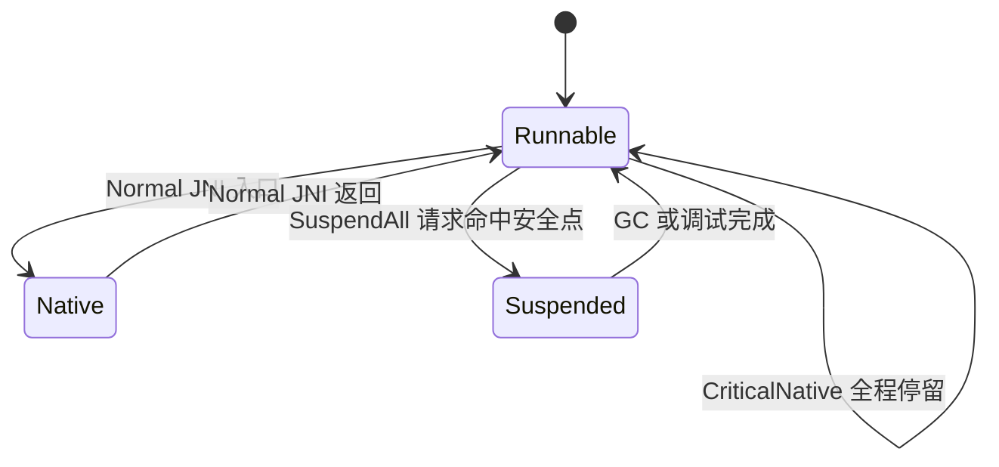
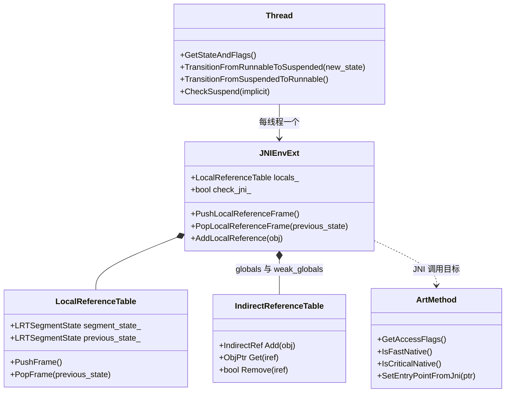

# 高性能 JNI 跨界调用优化机制

> [!IMPORTANT]
> ART 把 Java 到 Native 的调用边界分成三档：Normal JNI 完成 `kRunnable ↔ kNative` 状态切换并维护局部引用表；`@FastNative` 保持 Runnable，省掉两次状态切换；`@CriticalNative` 再省掉 `JNIEnv*`、局部引用表、异常轮询和全部安全点检查，把一次跨界调用压缩成一条直接的 AAPCS64 调用，满足条件时甚至是尾调用。后两档的代价是线程始终对 GC 可见为 Runnable，长耗时或阻塞会把一次 GC 的安全点等待放大成 SuspendAll 超时。

| 元信息 | 内容 |
|---|---|
| 机制定位 | 托管代码（Java/Kotlin）与 Native 代码（C/C++）之间的调用门；ART 执行引擎最外层的性能与稳定性边界之一 |
| 源码模块 | `runtime/entrypoints/quick/`、`runtime/entrypoints/jni/`、`compiler/jni/quick/`、`runtime/jni/`、`runtime/native/`、`runtime/arch/arm64/` |
| 核心类与入口 | `JNIEnvExt`、`LocalReferenceTable`、`IndirectReferenceTable`、`ArtMethod`、`Thread`；`ArtJniCompileMethodInternal`、`artJniMethodStart/End`、`GenericJniMethodEnd`、`artQuickGenericJniTrampoline` |
| 关键开关 | 注解 `@FastNative` / `@CriticalNative`（编译期转为 `kAccFastNative` / `kAccCriticalNative`）；运行时参数 `-Xcheck:jni`、`-Xjnitrace:`、`-Xopaque-jni-ids:`、`-XX:ThreadSuspendTimeout=` |
| 系统属性 | 本篇机制本身不读取 `dalvik.vm.*` 属性；注解是加速的唯一开关。运行时参数如何注入设备属于 Framework 侧约定，ART 侧只负责解析 |
| 一句话结论 | 三种模式的本质差别不是“调用快慢”，而是**是否愿意让线程在 Native 执行期间对 GC 不可见**：Normal 愿意，FastNative 不愿意但仍保留引用能力，CriticalNative 连引用能力一起放弃。 |
| 源码基线 | `/home/voyah/workspace/8397/qssi/art`（Android 15/16 主线级 QSSI 仓库，只读） |

## 1. What：机制是什么？（概念界定与架构全景）

### 1.1 职责边界

JNI 跨界调用机制负责回答四个问题：

1. **状态怎么切**：Java 线程在 ART 中默认处于 `ThreadState::kRunnable`，此时持有 `mutator_lock_` 的共享锁，可以把 Java 堆中的对象当作裸指针访问。进入普通 native 方法前必须切换到任何“非 Runnable”状态（典型是 `kNative`），让 GC 可以在需要时独占 mutator lock；返回时再切回 Runnable。
2. **引用怎么传**：托管侧的引用是压缩引用（`CompressedReference`），Native 侧看到的是 `jobject`。`jobject` 是一个带 2 bit kind 的间接引用，解码后才能得到对象地址。
3. **局部引用怎么管**：每次 JNI 调用都要压入一个局部引用段（segment），Native 代码通过 `NewLocalRef` 等 JNI 函数创建的引用都落在这个段里；返回时整段弹掉，避免局部引用跨调用泄漏。
4. **异常与挂起怎么收尾**：Native 返回后要检查 pending exception、解码引用返回值，并在回到托管代码前响应挂起/检查点请求。

三档模式就是在这四件事上逐级做减法。

### 1.2 核心术语表

| 术语 | 含义 | 源码位置 |
|---|---|---|
| `kRunnable` / `kNative` | 线程状态。`kRunnable` 是唯一允许访问 Java 堆、且持有 mutator lock 共享份额的状态；`kNative` 表示线程正在执行 native 代码，GC 可以独占 mutator lock | [thread_state.h](file:///home/voyah/workspace/8397/qssi/art/runtime/thread_state.h#L30-L64) |
| JNI transition | 一次 Java→Native 调用的边界；`IndirectRefKind::kJniTransition` 也用它命名“指向过渡栈槽”的 jobject | [indirect_reference_table.h](file:///home/voyah/workspace/8397/qssi/art/runtime/jni/indirect_reference_table.h#L47-L74) |
| JNI Stub | 由 `JniCompiler` 在 dex2oat/JIT 阶段生成的机器码胶水层，负责建栈帧、状态切换、引用包装、调用 native 函数、清理现场 | [jni_compiler.cc](file:///home/voyah/workspace/8397/qssi/art/compiler/jni/quick/jni_compiler.cc#L72-L166) |
| Generic JNI | 没有可用编译 Stub 时的兜底路径：`art_quick_generic_jni_trampoline` + C++ 的 `artQuickGenericJniTrampoline` | [quick_trampoline_entrypoints.cc](file:///home/voyah/workspace/8397/qssi/art/runtime/entrypoints/quick/quick_trampoline_entrypoints.cc#L2052-L2155) |
| LRT | `LocalReferenceTable`，线程私有的局部引用表；用 `segment_state_` / `previous_state_` 两个 32 位栈顶实现段的压入与弹出 | [local_reference_table.h](file:///home/voyah/workspace/8397/qssi/art/runtime/jni/local_reference_table.h#L106-L111) |
| IRT | `IndirectReferenceTable`，全局/弱全局引用表；返回的 `IndirectRef` 用低 2 bit 表示 kind | [indirect_reference_table.h](file:///home/voyah/workspace/8397/qssi/art/runtime/jni/indirect_reference_table.h#L217-L248) |
| `@FastNative` | 方法级注解；带此注解的 native 方法保持 `kRunnable`，不切换线程状态，但仍接收 `JNIEnv*` 并支持引用 | [art_method.h](file:///home/voyah/workspace/8397/qssi/art/runtime/art_method.h#L470-L481) |
| `@CriticalNative` | 方法级注解；必须 static、非 synchronized、参数与返回值只能是原始类型；调用时连 `JNIEnv*` 都没有 | [art_method.h](file:///home/voyah/workspace/8397/qssi/art/runtime/art_method.h#L483-L503) |
| hidden argument | `@CriticalNative` 用架构专用寄存器额外传一个 `ArtMethod*`，用于栈回溯和 dlsym 查找；ARM64 上是 `x15` | [calling_convention_arm64.cc](file:///home/voyah/workspace/8397/qssi/art/compiler/jni/quick/arm64/calling_convention_arm64.cc#L379-L405) |
| tail call | `@CriticalNative` 的 Stub 在无栈上参数且无需扩展返回值时，直接跳转到 native 实现，不建立自己的返回地址 | [calling_convention_arm64.cc](file:///home/voyah/workspace/8397/qssi/art/compiler/jni/quick/arm64/calling_convention_arm64.cc#L289-L311) |
| SuspendAll | GC/调试等需要独占 mutator lock 时，要求所有其他线程进入安全点的全局操作；有超时与肇事线程击杀逻辑 | [thread_list.cc](file:///home/voyah/workspace/8397/qssi/art/runtime/thread_list.cc#L1035-L1073) |
| CheckJNI | `-Xcheck:jni` 打开的 JNI 契约校验模式；所有 JNI 调用改走带检查的函数表 | [parsed_options.cc](file:///home/voyah/workspace/8397/qssi/art/runtime/parsed_options.cc#L128-L129) |

### 1.3 架构全景



## 2. Why：为什么需要它？（痛点模型与设计动机）

### 2.1 朴素 JNI 的四项固定开销

只要走 Normal JNI，下面四项开销就一定会发生，与 native 函数本身是否高效无关：

| 开销项 | 具体动作 | 源码依据 |
|---|---|---|
| 线程状态切换 | 进入时从 `kRunnable` CAS 到 `kNative` 并清 `held_mutexes[kMutatorLock]`，返回时反向 CAS 并恢复锁记录；慢路径还要处理挂起/检查点请求 | [jni_macro_assembler_arm64.cc](file:///home/voyah/workspace/8397/qssi/art/compiler/utils/arm64/jni_macro_assembler_arm64.cc#L709-L771) |
| 局部引用段管理 | Stub 保存 `LRTSegmentState`、把当前段顶写到 `previous_state_`，返回时弹回 | [jni_compiler.cc](file:///home/voyah/workspace/8397/qssi/art/compiler/jni/quick/jni_compiler.cc#L279-L306) |
| 引用包装与解码 | 引用参数被 spill 到栈槽，以“槽地址 + kind”作为 `jobject` 传入；引用返回值再解码回托管引用 | [jni_compiler.cc](file:///home/voyah/workspace/8397/qssi/art/compiler/jni/quick/jni_compiler.cc#L498-L516) |
| 异常轮询与安全点 | 返回路径做 `ExceptionPoll`，普通 native 的状态切换本身就是一次挂起机会 | [jni_compiler.cc](file:///home/voyah/workspace/8397/qssi/art/compiler/jni/quick/jni_compiler.cc#L464-L477) |

源码里对 `!bang JNI`（旧的快速 JNI 写法）的注释直接把动机写清楚了：一次普通 JNI 调用通常要从 `kRunnable` 切到 `kNative`，而 native 函数若访问 Java 对象又要切回 `kRunnable`，**“There is a cost to this double transition. For a JNI call that should be quick, this cost may dominate the call cost.”** 同一段注释还给出了 `@FastNative` 的收益口径：至少比 `!bang JNI` 快 1.5 倍，且旧写法已废弃并改为告警。

见 [jni_internal.cc](file:///home/voyah/workspace/8397/qssi/art/runtime/jni/jni_internal.cc#L2690-L2723) 与 [jni_internal.cc](file:///home/voyah/workspace/8397/qssi/art/runtime/jni/jni_internal.cc#L2771-L2781)。

### 2.2 三档模式的取舍矩阵

| 维度 | Normal JNI | `@FastNative` | `@CriticalNative` |
|---|---|---|---|
| 线程状态 | `kRunnable → kNative → kRunnable` | 全程 `kRunnable` | 全程 `kRunnable` |
| 状态切换次数 | 2 次 CAS（快路径） | 0 | 0 |
| `JNIEnv*` | 有 | 有 | **无** |
| 局部引用表段 | 压入 / 弹出 | 压入 / 弹出 | **无** |
| 引用参数与返回值 | 支持 | 支持 | **禁止**（shorty 不得含 `L`） |
| 异常轮询 | 返回时 1 次 | 返回时 1 次 | **无** |
| 显式挂起检查 | 状态切换路径内 | 出口 1 次 `SuspendCheck` | **无** |
| `synchronized` | 支持 | **禁止**（校验期报错） | **禁止**（校验期报错） |
| 可阻塞 / 长耗时 | 可以 | 不应 | 绝对不应 |
| 典型场景 | 常规 JNI、可能阻塞或回调 Java | 高频信号、图形、音频短调用，且需要传对象 | 纯数值热路径，如计数器、时间戳、简单数学 |

关键认识：`@FastNative` 省掉的只是“两次状态切换”，**没有省掉 LRT 和引用包装**，所以它仍可安全地访问 Java 对象；`@CriticalNative` 省掉的是“整个 JNI 环境”，因此它连抛 Java 异常、调用 JNI 函数的资格都没有。两者的风险性质也不同：FastNative 是“拖延 GC 的安全点”，CriticalNative 是“GC 完全看不见这段 native 执行”。

### 2.3 缺失优化时的性能痛点

- **高频小调用**：车载场景里，信号读写、音频时间戳、图形队列游标这类 JNI 调用单次只有几十条 native 指令，但每次都要付状态切换、LRT、引用解码的固定成本。调用频率到每秒数万次时，固定成本占比会超过业务本身。
- **掉帧与卡顿**：Normal JNI 的返回路径要等 `TransitionFromSuspendedToRunnable`，如果此刻正好有 GC 请求，线程会在返回点被挂起，表现为“native 很快就返回了，但 Java 侧迟迟拿不到结果”。
- **稳定性事故**：把本该 Normal 的阻塞调用标成 `@FastNative` 或 `@CriticalNative`，会让 GC 的 `SuspendAll` 一直等不到安全点；累计超过超时阈值后，ART 会选出“肇事线程”并直接 `AbortInThis`，现场只剩一条 `SuspendAll timeout` 日志。

## 3. How：源码级实现原理深度剖析

### 3.1 从注解到 access flag：加速的起点

`@FastNative` / `@CriticalNative` 在运行期并不是反射注解，而是被编译期折叠进方法的 access flags。`GetNativeMethodAnnotationAccessFlags` 在 dex 注解集中匹配两个描述符：

```cpp
// runtime/dex/dex_file_annotations.cc
if (IsMethodBuildAnnotationPresent(
        dex_file, annotation_set,
        "Ldalvik/annotation/optimization/FastNative;", ...)) {
  access_flags |= kAccFastNative;      // 0x00080000
}
if (IsMethodBuildAnnotationPresent(
        dex_file, annotation_set,
        "Ldalvik/annotation/optimization/CriticalNative;", ...)) {
  access_flags |= kAccCriticalNative;  // 0x00100000
}
CHECK_NE(access_flags, kAccFastNative | kAccCriticalNative);
```

见 [dex_file_annotations.cc](file:///home/voyah/workspace/8397/qssi/art/runtime/dex/dex_file_annotations.cc#L1303-L1322)，flag 常量定义见 [modifiers.h](file:///home/voyah/workspace/8397/qssi/art/libdexfile/dex/modifiers.h#L85-L86)。

`ArtMethod` 侧的两个谓词都要求 `kAccNative` 同时存在，因为这两个 bit 在非 native 方法上有别的含义：

```cpp
static bool IsFastNative(uint32_t access_flags) {
  constexpr uint32_t mask = kAccFastNative | kAccNative;
  return (access_flags & mask) == mask;
}
static bool IsCriticalNative(uint32_t access_flags) {
  constexpr uint32_t mask = kAccCriticalNative | kAccNative;
  return (access_flags & mask) == mask;
}
```

见 [art_method.h](file:///home/voyah/workspace/8397/qssi/art/runtime/art_method.h#L470-L503)。

dex2oat 在编译 native 方法时查询这两个 flag，再交给 JNI 编译器生成对应 Stub；如果 boot image 里已有等价 Stub（`FindBootJniStub`），则直接复用，避免重复生成：

```cpp
// dex2oat/driver/compiler_driver.cc
access_flags |= annotations::GetNativeMethodAnnotationAccessFlags(
    dex_file, dex_file.GetClassDef(class_def_idx), method_idx);
const void* boot_jni_stub = nullptr;
if (!Runtime::Current()->GetHeap()->GetBootImageSpaces().empty()) {
  boot_jni_stub = class_linker->FindBootJniStub(access_flags, shorty);
}
if (boot_jni_stub == nullptr) {
  compiled_method =
      driver->GetCompiler()->JniCompile(access_flags, method_idx, dex_file, dex_cache);
}
```

见 [compiler_driver.cc](file:///home/voyah/workspace/8397/qssi/art/dex2oat/driver/compiler_driver.cc#L479-L501)。

### 3.2 编译期校验：哪些组合根本不允许存在

`MethodVerifier` 在“方法没有代码且是 native”这一分支里集中检查注解组合，违规会让整个类校验失败：

| 组合 | 结果 | 源码 |
|---|---|---|
| `@FastNative` + `synchronized` | `fast native methods cannot be synchronized` | [method_verifier.cc](file:///home/voyah/workspace/8397/qssi/art/runtime/verifier/method_verifier.cc#L1604-L1642) |
| `@CriticalNative` + `synchronized` | `critical native methods cannot be synchronized` | 同上 |
| `@CriticalNative` + 非 static | `critical native methods must be static` | 同上 |
| `@CriticalNative` + 引用参数/返回值 | `critical native methods must not have references as arguments or return type` | 同上 |
| 同时标两个注解 | dex2oat 的 `JniCompile` 直接 `LOG(FATAL)`（debug build） | [jni_compiler.cc](file:///home/voyah/workspace/8397/qssi/art/compiler/jni/quick/jni_compiler.cc#L118-L144) |

这些限制不是“建议”，而是机制成立的前提：`synchronized` 需要传 `this` 或 `jclass`，而 `@CriticalNative` 的设计目标就是**不传任何引用**；`@FastNative` 因为不切状态，如果在 native 里等一把 Java 锁，会直接制造“持锁线程等 GC、GC 等持锁线程”的死锁。

### 3.3 Normal JNI Stub 的端到端结构

普通 JNI Stub 由 `ArtJniCompileMethodInternal` 按顺序发射，主路径可以概括为 8 步：

1. `BuildFrame`：保存 `ArtMethod*` 与全部 callee-save 寄存器（ARM64 上是 `X19–X29 + LR` 与 `D8–D15`）。
2. 静态方法的 `jclass` 读屏障：GC 正在标记时走慢路径修正 declaring class。
3. spill 引用型寄存器参数：保证它们在栈上有 GC 可见的根。
4. 把当前栈顶写入 `Thread::top_quick_frame`，此后栈回溯可识别该 JNI 帧。
5. 若方法 `synchronized`，调用 `pJniLockObject` 加锁。
6. 普通 native 走 `TryToTransitionFromRunnableToNative` 快路径；失败则调用 `pJniMethodStart` 慢路径。
7. 压入 LRT 段，把参数按 JNI ABI 搬到出参区，调用 native 函数。
8. 返回路径：切回 Runnable、弹 LRT、异常轮询、解码引用返回值、解锁、拆除栈帧。

对应源码见 [jni_compiler.cc](file:///home/voyah/workspace/8397/qssi/art/compiler/jni/quick/jni_compiler.cc#L167-L238)、[jni_compiler.cc](file:///home/voyah/workspace/8397/qssi/art/compiler/jni/quick/jni_compiler.cc#L240-L306)、[jni_compiler.cc](file:///home/voyah/workspace/8397/qssi/art/compiler/jni/quick/jni_compiler.cc#L308-L425)、[jni_compiler.cc](file:///home/voyah/workspace/8397/qssi/art/compiler/jni/quick/jni_compiler.cc#L464-L524)、[jni_compiler.cc](file:///home/voyah/workspace/8397/qssi/art/compiler/jni/quick/jni_compiler.cc#L526-L596)。

ARM64 普通 JNI Stub 的栈帧布局如下（`FrameSize()` 由 method 指针、12 个 core callee-save、8 个 FP callee-save 组成；LRT cookie 借用某个 spill 槽）：

```text
高地址
┌───────────────────────────────────────────────┐
│ 调用者栈帧 / 返回地址                           │
├───────────────────────────────────────────────┤
│ managed frame FrameSize()                      │
│  ┌─────────────────────────────────────────┐  │
│  │ X19..X29 + LR、D8..D15（callee-saves）    │  │  ← 帧内高地址
│  │ LRT cookie（借用一个 spill 槽）            │  │
│  │ ArtMethod*（帧底，栈回溯识别 JNI 帧）      │  │  ← 帧内低地址
│  └─────────────────────────────────────────┘  │
├───────────────────────────────────────────────┤
│ 出参区 OutFrameSize()                          │  ← 调用 Native 时的 SP
│   栈上参数，每个 8 字节，16 字节对齐              │
└───────────────────────────────────────────────┘
低地址
```

帧尺寸与 callee-save 列表见 [calling_convention_arm64.cc](file:///home/voyah/workspace/8397/qssi/art/compiler/jni/quick/arm64/calling_convention_arm64.cc#L270-L287) 与 [calling_convention_arm64.cc](file:///home/voyah/workspace/8397/qssi/art/compiler/jni/quick/arm64/calling_convention_arm64.cc#L50-L86)。

### 3.4 状态切换的机器码快路径

`TryToTransitionFromRunnableToNative` 没有调用运行时，而是在 Stub 内联了一段 CAS：

```text
retry:
  LDXR  w_scratch, [xSELF + #THREAD_FLAGS_OFFSET]   // 读 state_and_flags
  MOV   w_scratch2, #kNativeStateValue
  CBNZ  w_scratch, slow_path                        // 有任何 flag 就进慢路径
  STLXR w_status, w_scratch2, [xSELF + #THREAD_FLAGS_OFFSET]
  CBNZ  w_status, retry
  STR   xzr, [xSELF + #HELD_MUTEX_MUTATOR_LOCK]     // 清掉 mutator lock 记录
```

返回方向对称：只有状态恰好是 `kNative` 且没有 flag 时才用 `STXR` 写回 `kRunnable`，随后把 `mutator_lock_` 重新写入 `held_mutexes[kMutatorLock]`。任何 flag（挂起请求、检查点、flip function）都会把控制权交给 `artJniMethodStart/End` 慢路径。

见 [jni_macro_assembler_arm64.cc](file:///home/voyah/workspace/8397/qssi/art/compiler/utils/arm64/jni_macro_assembler_arm64.cc#L709-L735) 与 [jni_macro_assembler_arm64.cc](file:///home/voyah/workspace/8397/qssi/art/compiler/utils/arm64/jni_macro_assembler_arm64.cc#L737-L771)。

慢路径最终落到：

```cpp
extern "C" void artJniMethodStart(Thread* self) {
  // debug build 会 CHECK 调用者不是 FastNative / CriticalNative
  self->TransitionFromRunnableToSuspended(ThreadState::kNative);
}

extern "C" void artJniMethodEnd(Thread* self) {
  self->TransitionFromSuspendedToRunnable();
}
```

见 [quick_jni_entrypoints.cc](file:///home/voyah/workspace/8397/qssi/art/runtime/entrypoints/quick/quick_jni_entrypoints.cc#L62-L73) 与 [quick_jni_entrypoints.cc](file:///home/voyah/workspace/8397/qssi/art/runtime/entrypoints/quick/quick_jni_entrypoints.cc#L120-L128)；线程状态机实现见 [thread-inl.h](file:///home/voyah/workspace/8397/qssi/art/runtime/thread-inl.h#L333-L349) 与 [thread-inl.h](file:///home/voyah/workspace/8397/qssi/art/runtime/thread-inl.h#L351-L379)。

时序图（Normal JNI）：



### 3.5 引用包装的真实成本：jobject 到底是什么

`jobject` 不是对象指针，而是带 2 bit kind 的间接引用。`IndirectRefKind` 的四个取值直接对应低 2 bit：

```text
31                              2 1 0
┌─────────────────────────────────┬───┐
│  引用存储地址 / 表索引 / 序列号     │kind│
└─────────────────────────────────┴───┘
  kind = 00  kJniTransition  指向 JNI Stub spill 槽里的 CompressedReference
  kind = 01  kLocal          指向 LocalReferenceTable 中的 LrtEntry
  kind = 10  kGlobal         指向全局 IndirectReferenceTable 的索引
  kind = 11  kWeakGlobal     指向弱全局 IndirectReferenceTable 的索引
```

源码定义见 [indirect_reference_table.h](file:///home/voyah/workspace/8397/qssi/art/runtime/jni/indirect_reference_table.h#L47-L74)，解码逻辑见 [thread-inl.h](file:///home/voyah/workspace/8397/qssi/art/runtime/thread-inl.h#L51-L74)。

因此一次普通 JNI 调用里，每个引用型参数都要经历“寄存器 → 栈槽 → jobject（槽地址）→ Native 侧按需解码”的往返；引用型返回值则要经历“Native 返回 jobject → `DecodeJNITransitionOrLocalJObject` 快路径或 `JniDecodeReferenceResult` 慢路径 → 托管引用”。`JniDecodeReferenceResult` 还会在 CheckJNI 下额外做 `CheckReferenceResult`，并做 `VerifyObject`：

```cpp
extern mirror::Object* JniDecodeReferenceResult(jobject result, Thread* self) {
  DCHECK(!self->IsExceptionPending());
  ObjPtr<mirror::Object> o = self->DecodeJObject(result);
  if (UNLIKELY(self->GetJniEnv()->IsCheckJniEnabled())) {
    StackHandleScope<1> hs(self);
    HandleWrapperObjPtr<mirror::Object> h_obj(hs.NewHandleWrapper(&o));
    CheckReferenceResult(h_obj, self);
  }
  VerifyObject(o);
  return o.Ptr();
}
```

见 [quick_jni_entrypoints.cc](file:///home/voyah/workspace/8397/qssi/art/runtime/entrypoints/quick/quick_jni_entrypoints.cc#L130-L143)。

局部引用段本身很轻：`PushFrame` 只做两次 32 位赋值，`PopFrame` 反向恢复；真正的语义是“本段新建的引用在弹出后全部失效（段顶回退到进入时的位置）”，这也是 Native 代码不能把 `jobject` 存到全局的原因。

```cpp
LRTSegmentState PushFrame() {
  LRTSegmentState result = previous_state_;
  previous_state_ = segment_state_;
  return result;
}
void PopFrame(LRTSegmentState previous_state) {
  segment_state_ = previous_state_;
  previous_state_ = previous_state;
}
```

见 [local_reference_table.h](file:///home/voyah/workspace/8397/qssi/art/runtime/jni/local_reference_table.h#L330-L347)；`JNIEnvExt` 的转发见 [jni_env_ext.h](file:///home/voyah/workspace/8397/qssi/art/runtime/jni/jni_env_ext.h#L82-L87)。

### 3.6 `@FastNative`：只砍状态切换

`@FastNative` 与 Normal JNI 共用同一个 JNI 编译器，差别集中在三处条件判断：

| 阶段 | Normal JNI | `@FastNative` |
|---|---|---|
| 构建帧 | 有 managed frame | 有 managed frame |
| 状态切换 | `TryToTransitionFromRunnableToNative` + 慢路径 | **整段跳过**（`!is_critical_native && !is_fast_native` 才发） |
| LRT | 压入 / 弹出 | 压入 / 弹出（`!is_critical_native` 即发） |
| 引用返回 | 异常轮询后解码 | 异常轮询后**先做一次提前挂起检查**，再解码 |
| 普通返回 | 状态切换回 Runnable | 只做一次 `SuspendCheck` |

对应源码：

```cpp
// jni_compiler.cc 2.2 状态切换
if (LIKELY(!is_critical_native && !is_fast_native)) {
  __ TryToTransitionFromRunnableToNative(...);
  ...
}

// jni_compiler.cc 5.3 引用返回的 FastNative 提前挂起检查
if (UNLIKELY(is_fast_native) && reference_return) {
  __ SuspendCheck(suspend_check_slow_path.get());
}

// jni_compiler.cc 7.4 普通返回的 FastNative 挂起检查
if (UNLIKELY(is_fast_native) && !reference_return) {
  __ SuspendCheck(suspend_check_slow_path.get());
}
```

见 [jni_compiler.cc](file:///home/voyah/workspace/8397/qssi/art/compiler/jni/quick/jni_compiler.cc#L264-L277)、[jni_compiler.cc](file:///home/voyah/workspace/8397/qssi/art/compiler/jni/quick/jni_compiler.cc#L487-L496)、[jni_compiler.cc](file:///home/voyah/workspace/8397/qssi/art/compiler/jni/quick/jni_compiler.cc#L562-L568)。

`SuspendCheck` 的实现只是读 `Thread::thread_flags_` 并测试挂起/检查点位：

```text
LDR  w_scratch, [xSELF + #THREAD_FLAGS_OFFSET]
TST  w_scratch, #SuspendOrCheckpointRequestFlags
B.NE slow_path                      // 慢路径 -> pTestSuspend
```

见 [jni_macro_assembler_arm64.cc](file:///home/voyah/workspace/8397/qssi/art/compiler/utils/arm64/jni_macro_assembler_arm64.cc#L773-L779)；挂起/检查点 flag 集合见 [thread.h](file:///home/voyah/workspace/8397/qssi/art/runtime/thread.h#L1783-L1787)。

ART 内部的 `@FastNative` 实现通过 `ScopedFastNativeObjectAccess` 直接访问 Java 对象；第三方 native 代码则沿用 JNI 函数，因为线程已经处于 `kRunnable`。它的构造函数在 debug build 下断言三件事：mutator lock 已被共享持有、当前 quick frame 的方法确实是 `@FastNative`、线程状态是 `kRunnable`：

```cpp
inline ScopedFastNativeObjectAccess::ScopedFastNativeObjectAccess(JNIEnv* env)
    : ScopedObjectAccessAlreadyRunnable(env) {
  Locks::mutator_lock_->AssertSharedHeld(Self());
  DCHECK((*Self()->GetManagedStack()->GetTopQuickFrame())->IsFastNative());
  DCHECK_EQ(Self()->GetState(), ThreadState::kRunnable);
}
```

见 [scoped_fast_native_object_access-inl.h](file:///home/voyah/workspace/8397/qssi/art/runtime/native/scoped_fast_native_object_access-inl.h#L27-L33) 与 [scoped_fast_native_object_access.h](file:///home/voyah/workspace/8397/qssi/art/runtime/native/scoped_fast_native_object_access.h#L27-L38)。

### 3.7 `@CriticalNative`：连 JNI 环境都省掉

#### 3.7.1 ABI 层面的三个删除

`@CriticalNative` 的调用约定与普通 JNI 完全不同，`JniCallingConvention` 用三个谓词集中表达：

```cpp
bool SpillsMethod() const { return !IsCriticalNative(); }                 // 不保存 ArtMethod*
bool HasLocalReferenceSegmentState() const { return !IsCriticalNative(); } // 不压 LRT
bool HasExtraArgumentsForJni() const { return !IsCriticalNative(); }       // 不传 JNIEnv* 与 jclass
```

见 [calling_convention.h](file:///home/voyah/workspace/8397/qssi/art/compiler/jni/quick/calling_convention.h#L359-L383) 与 [calling_convention.h](file:///home/voyah/workspace/8397/qssi/art/compiler/jni/quick/calling_convention.h#L412-L431)。`NumberOfExtraArgumentsForJni()` 在 `@CriticalNative` 下返回 0，见 [calling_convention.cc](file:///home/voyah/workspace/8397/qssi/art/compiler/jni/quick/calling_convention.cc#L303-L322)。

#### 3.7.2 ARM64 上的两种落点：尾调用或最小帧

`Arm64JniCallingConvention` 对 `@CriticalNative` 做了专门处理：

- `FrameSize()` 返回 0：没有 managed frame，没有 method 指针，没有 LRT cookie。
- `CoreSpillMask()` / `FpSpillMask()` 返回 0：不保存任何 callee-save。
- `OutFrameSize()` 只计算栈上参数；若需要栈上参数，或返回类型是 `B/C/S/Z` 需要调用点扩展，则额外加一个 8 字节 LR 槽。
- `UseTailCall()` 的条件就是 `OutFrameSize() == 0`。

```text
A. 可尾调用：OutFrameSize() == 0（无栈上参数，且返回类型无需扩展）
   ┌───────────────────────────────┐
   │ 无 Stub 栈帧                    │   x0..x7 / d0..d7 直接传参
   │ 无 callee-save                  │   x15 = 当前 ArtMethod*
   └───────────────────────────────┘
   JNI Stub 用 br 尾跳转（不是 bl），返回地址仍是托管调用者的 LR

B. 不可尾调用：有栈上参数，或返回 B/C/S/Z
   ┌────────────────────────────────────┐
   │ LR（返回地址，仅此一个 8 字节寄存器槽） │  ← 帧内高地址
   ├────────────────────────────────────┤
   │ 出参区（栈上参数，每项 8 字节）        │  ← SP
   └────────────────────────────────────┘
   16 字节对齐；无 ArtMethod 指针、无 LRT cookie、无 FP callee-save
```

源码见 [calling_convention_arm64.cc](file:///home/voyah/workspace/8397/qssi/art/compiler/jni/quick/arm64/calling_convention_arm64.cc#L234-L330) 与 [jni_frame_arm64.h](file:///home/voyah/workspace/8397/qssi/art/runtime/arch/arm64/jni_frame_arm64.h#L46-L85)。

#### 3.7.3 hidden argument：x15 传的是“当前方法”，不是参数

普通 JNI 用 `JNIEnv*` 和 `jclass/jobject` 占掉前两个参数位；`@CriticalNative` 没有这两个参数，但运行时仍需要知道“当前在调用哪个方法”，否则无法栈回溯、无法在未注册时做 dlsym 查找。ART 的解法是额外用 `x15` 传 `ArtMethod*`：

```cpp
ManagedRegister Arm64JniCallingConvention::HiddenArgumentRegister() const {
  DCHECK(IsCriticalNative());
  AssertX15IsNeitherCalleeSaveNorArgumentRegister();
  return Arm64ManagedRegister::FromXRegister(X15);
}
bool Arm64JniCallingConvention::UseTailCall() const {
  CHECK(IsCriticalNative());
  return OutFrameSize() == 0u;
}
```

见 [calling_convention_arm64.cc](file:///home/voyah/workspace/8397/qssi/art/compiler/jni/quick/arm64/calling_convention_arm64.cc#L379-L411)。`x15` 的选择有静态约束：既不能是 managed callee-save，也不能是参数寄存器，见同文件 `AssertX15IsNeitherCalleeSaveNorArgumentRegister`。

从托管编译代码直接调用 `@CriticalNative` 时，Optimizing 编译器会走 `CodePtrLocation::kCallCriticalNative`：不加载普通方法入口，而是直接加载 `ArtMethod::EntryPointFromJni` 并调用，同时把当前方法放进 `x15`。

```cpp
// compiler/optimizing/sharpening.cc
if (method_load_kind != MethodLoadKind::kRuntimeCall && callee->IsCriticalNative()) {
  DCHECK_NE(method_load_kind, MethodLoadKind::kRecursive);
  DCHECK(callee->IsStatic());
  code_ptr_location = CodePtrLocation::kCallCriticalNative;
}
```

见 [sharpening.cc](file:///home/voyah/workspace/8397/qssi/art/compiler/optimizing/sharpening.cc#L150-L154)、[code_generator_arm64.cc](file:///home/voyah/workspace/8397/qssi/art/compiler/optimizing/code_generator_arm64.cc#L5140-L5153)、[code_generator_arm64.cc](file:///home/voyah/workspace/8397/qssi/art/compiler/optimizing/code_generator_arm64.cc#L1018-L1021)。位置分配上，`x15` 被登记为“当前方法”的输入位置，见 [code_generator.cc](file:///home/voyah/workspace/8397/qssi/art/compiler/optimizing/code_generator.cc#L462-L471)。

#### 3.7.4 clinit 门控：为什么入口可能暂时不是 native 代码

普通 native 方法可以在类未初始化时就把 `EntryPointFromJni` 指向实现；`@CriticalNative` 不行，因为它没有 `jclass`，调用点无法再做类初始化检查。`ClassLinker::RegisterNative` 因此采用延迟安装：

```cpp
if (method->IsCriticalNative()) {
  MutexLock lock(self, critical_native_code_with_clinit_check_lock_);
  if (method->GetDeclaringClass()->IsVisiblyInitialized()) {
    method->SetEntryPointFromJni(new_native_method);
  } else {
    critical_native_code_with_clinit_check_.emplace(method, new_native_method);
  }
} else {
  method->SetEntryPointFromJni(new_native_method);
}
```

见 [class_linker.cc](file:///home/voyah/workspace/8397/qssi/art/runtime/class_linker.cc#L469-L511)。

如果调用发生在类尚未可见初始化时，`EntryPointFromJni` 仍然指向 `art_jni_dlsym_lookup_critical_stub`。这个汇编 Stub 会：

1. 用 `artCriticalNativeFrameSize` 算出需要伪造的 `SaveRefsAndArgs` 帧大小（区分“从 JNI Stub 尾调用进来”和“从托管编译代码直接调用进来”两种调用者）。
2. 构造一个带 GenericJNI tag 的假帧，让栈回溯和 GC 看到的是合法帧。
3. 调用 `artFindNativeMethodRunnable` 解析目标方法、做类初始化检查、注册 native 代码。
4. 恢复参数寄存器后 `br x13` 尾调用真正的 native 实现。

见 [jni_entrypoints_arm64.S](file:///home/voyah/workspace/8397/qssi/art/runtime/arch/arm64/jni_entrypoints_arm64.S#L65-L95)、[jni_entrypoints_arm64.S](file:///home/voyah/workspace/8397/qssi/art/runtime/arch/arm64/jni_entrypoints_arm64.S#L240-L287)、[jni_entrypoints.cc](file:///home/voyah/workspace/8397/qssi/art/runtime/entrypoints/jni/jni_entrypoints.cc#L51-L125) 与 [jni_entrypoints.cc](file:///home/voyah/workspace/8397/qssi/art/runtime/entrypoints/jni/jni_entrypoints.cc#L135-L197)。

`artFindNativeMethodRunnable` 处理“直接调用”路径时还有一个关键细节：它看到的方法指针其实是**调用者**，于是通过 dex pc 反查 `invokestatic` 目标、补做 clinit、替换栈上的方法，再给栈顶打上 GenericJNI tag：

```cpp
if (!method->IsNative()) {
  uint32_t method_idx = GetInvokeStaticMethodIndex(method, dex_pc);
  ArtMethod* target_method = class_linker->ResolveMethodId(method_idx, method);
  DCHECK(target_method->IsCriticalNative());
  ...
  *sp = target_method;
  self->SetTopOfStackGenericJniTagged(sp);  // Fake GenericJNI frame.
  method = target_method;
}
```

见 [jni_entrypoints.cc](file:///home/voyah/workspace/8397/qssi/art/runtime/entrypoints/jni/jni_entrypoints.cc#L59-L98)。栈回溯侧也明确承认这条路径：“fake a Generic JNI frame in art_jni_dlsym_lookup_critical_stub”，见 [stack.cc](file:///home/voyah/workspace/8397/qssi/art/runtime/stack.cc#L790-L800)。

#### 3.7.5 CriticalNative 的完整时序



### 3.8 Generic JNI 兜底路径

当方法没有可用的编译 Stub（解释执行、`-Xint`、JIT 不可用、或 debuggable 运行时的 `@CriticalNative`），ART 使用 `art_quick_generic_jni_trampoline`。它建立一个 `SaveRefsAndArgs` 帧，然后调用 C++ 的 `artQuickGenericJniTrampoline`：

```cpp
bool critical_native = called->IsCriticalNative();
bool fast_native = called->IsFastNative();
bool normal_native = !critical_native && !fast_native;

// 类初始化检查
if (called->StillNeedsClinitCheck()) { ... EnsureInitialized ... }

// 只有 Normal JNI 才调用 artJniMethodStart
if (LIKELY(normal_native)) {
  if (called->IsSynchronized()) { lock->MonitorEnter(self); }
  if (self->ReadFlag(ThreadFlag::kMonitorJniEntryExit)) {
    artJniMonitoredMethodStart(self);
  } else {
    artJniMethodStart(self);
  }
} else {
  DCHECK(!called->IsSynchronized())
      << "@FastNative/@CriticalNative and synchronize is not supported";
}

// 只有非 CriticalNative 才压 LRT
if (LIKELY(!critical_native)) {
  uint32_t cookie = bit_cast<uint32_t>(env->PushLocalReferenceFrame());
  *(sp32 - 1) = cookie;
}
```

见 [quick_trampoline_entrypoints.cc](file:///home/voyah/workspace/8397/qssi/art/runtime/entrypoints/quick/quick_trampoline_entrypoints.cc#L2052-L2155)，汇编侧见 [quick_entrypoints_arm64.S](file:///home/voyah/workspace/8397/qssi/art/runtime/arch/arm64/quick_entrypoints_arm64.S#L1770-L1830)。

返回侧统一走 `GenericJniMethodEnd`，它按方法类型分支：Normal 做状态切换；FastNative 只做一次 `CheckSuspend`；CriticalNative 什么都不做；非 critical 还要弹 LRT、解码引用返回值。

```cpp
bool critical_native = called->IsCriticalNative();
bool fast_native = called->IsFastNative();
bool normal_native = !critical_native && !fast_native;

if (LIKELY(normal_native)) {
  if (UNLIKELY(self->ReadFlag(ThreadFlag::kMonitorJniEntryExit))) {
    artJniMonitoredMethodEnd(self);
  } else {
    artJniMethodEnd(self);
  }
} else if (fast_native) {
  DCHECK(Locks::mutator_lock_->IsSharedHeld(self));
  self->CheckSuspend();
}
if (called->IsSynchronized()) {
  DCHECK(normal_native) << "@FastNative/@CriticalNative and synchronize is not supported";
  ...
}
```

见 [quick_jni_entrypoints.cc](file:///home/voyah/workspace/8397/qssi/art/runtime/entrypoints/quick/quick_jni_entrypoints.cc#L145-L231)；C++ 与汇编的衔接见 [quick_trampoline_entrypoints.cc](file:///home/voyah/workspace/8397/qssi/art/runtime/entrypoints/quick/quick_trampoline_entrypoints.cc#L2168-L2181)。`CheckSuspend` 本体见 [thread-inl.h](file:///home/voyah/workspace/8397/qssi/art/runtime/thread-inl.h#L84-L112)。

### 3.9 线程状态与安全点的关系



对 Normal JNI，`TransitionFromRunnableToSuspended` 会先 `TransitionToSuspendedAndRunCheckpoints`，再释放 mutator lock 共享份额，最后检查 suspend barrier；因此线程在 native 期间的任何时刻都是 GC 可挂起的。对 FastNative/CriticalNative，线程始终 Runnable，GC 只能等它自己回到安全点。

### 3.10 挂起超时与肇事线程击杀

`SuspendAll` 等待其他线程进入安全点时，按 4 次尝试等待，每次超时基准是 `thread_suspend_timeout_ns_`：

- 默认值：release build 4 秒，debug build 2 秒（[thread_list.h](file:///home/voyah/workspace/8397/qssi/art/runtime/thread_list.h#L53-L54)）。
- 每次等待使用基准值的 1/4（`attempt_of_4 == 0` 的同步检查点路径才用完整基准值）；user build 下所有等待再翻倍，低优先级线程从第 2 次起继续放大（最后一次最多 5 倍）（[thread_list.cc](file:///home/voyah/workspace/8397/qssi/art/runtime/thread_list.cc#L768-L805)）。
- 第 3 次超时开始收集“仍未挂起的线程”作为候选；第 4 次仍超时就对肇事线程调用 `AbortInThis("SuspendAll timeout; ...")`（[thread_list.cc](file:///home/voyah/workspace/8397/qssi/art/runtime/thread_list.cc#L1035-L1073)）。

把这段和 JNI 模式连起来看：一个标了 `@FastNative` 却在 native 里阻塞等锁的函数，或者一个标了 `@CriticalNative` 却执行了长循环的函数，只要持续时间超过超时窗口，就会让 `SuspendAll` 的 4 次等待全部落空，最终被当作肇事线程击杀。日志里通常只能看到 `SuspendAll timeout`，看不到“是这个 JNI 方法超时”，所以定位时要结合 native 栈和注解信息反查。

### 3.11 其他边界条件

| 边界 | 行为 | 源码 |
|---|---|---|
| debuggable 运行时 | `@CriticalNative` 不 JIT Stub，退回 Generic JNI，因为还没有为它实现 method entry/exit hook | [optimizing_compiler.cc](file:///home/voyah/workspace/8397/qssi/art/compiler/optimizing/optimizing_compiler.cc#L1360-L1373) |
| JIT 可调试 Stub | `needs_entry_exit_hooks` 与 `@CriticalNative` 互斥（DCHECK） | [jni_compiler.cc](file:///home/voyah/workspace/8397/qssi/art/compiler/jni/quick/jni_compiler.cc#L93-L98) |
| CheckJNI | 引用返回值解码走 `CheckReferenceResult`；JNI 函数表切换为带检查版本 | [jni_env_ext.h](file:///home/voyah/workspace/8397/qssi/art/runtime/jni/jni_env_ext.h#L101-L108) |
| native bridge | 注册时按 `IsCriticalNative()` 选择 `kJNICallTypeCriticalNative`，让 bridge 生成匹配的 trampoline | [java_vm_ext.cc](file:///home/voyah/workspace/8397/qssi/art/runtime/jni/java_vm_ext.cc#L285-L294) |
| 卸载注册 | `UnregisterNative` 对 `@CriticalNative` 恢复 `GetJniDlsymLookupCriticalStub`，普通 native 恢复普通 lookup Stub | [class_linker.cc](file:///home/voyah/workspace/8397/qssi/art/runtime/class_linker.cc#L498-L511) |

类关系图：



## 4. 能利用这个机制做什么？（工程实战指南与排障手册）

### 4.1 场景一：高频车载信号 / 音频 / 图形 JNI 接口减负

判断标准只有一条：**native 函数是否短小、是否可能访问 Java 对象**。

- 会访问 Java 对象（传 `jobject`、回调 Java、调用 JNI 函数），但执行时间短、不会阻塞 → 用 `@FastNative`。它保留 `JNIEnv*` 和 LRT，能正常解码引用；省掉两次状态切换。
- 只做纯数值计算、只接收原始类型、完全不需要 `JNIEnv` → 用 `@CriticalNative`。在无栈上参数且无需扩展返回值时，它在 ARM64 上可以做到 0 栈帧、0 callee-save、尾调用。
- 会阻塞（等锁、I/O、长循环、回调可能重新进入 ART）→ 保持普通 native。不要为了省切换成本把阻塞调用标成 Fast/Critical。

```java
import dalvik.annotation.optimization.FastNative;
import dalvik.annotation.optimization.CriticalNative;

public final class SignalBridge {
    // 高频、短小、需要传对象
    @FastNative
    private static native int nativeWriteSignal(Object token, int slot, int value);

    // 纯原始类型、静态、无 JNIEnv
    @CriticalNative
    private static native long nativeReadCounter(int index);
}
```

Native 侧签名差异必须与注解匹配：

```c
// @FastNative：仍然是标准 JNI 签名，有 JNIEnv* 与 jclass
JNIEXPORT jint JNICALL
Java_com_example_SignalBridge_nativeWriteSignal(JNIEnv* env, jclass clazz,
                                                jobject token, jint slot, jint value) {
    return write_signal(env, token, slot, value);
}

// @CriticalNative：没有 JNIEnv*、没有 jclass，只有声明里的原始类型参数
int64_t NativeReadCounter(int32_t index) {
    return read_counter(index);
}
```

注意 `@CriticalNative` 若通过 `RegisterNatives` 注册，`JNINativeMethod.signature` 仍是 Java 方法签名，但函数指针必须按“无 JNIEnv/jclass”的 ABI 实现；ART 侧由 `HasExtraArgumentsForJni()` 统一处理，见 [calling_convention.cc](file:///home/voyah/workspace/8397/qssi/art/compiler/jni/quick/calling_convention.cc#L303-L322)。

### 4.2 场景二：用 JNI 注册告警识别旧写法

`RegisterNatives` 遇到签名以 `!` 开头的旧式 fast JNI 会打印：

```text
!bang JNI is deprecated. Switch to @FastNative for <method>
```

源码见 [jni_internal.cc](file:///home/voyah/workspace/8397/qssi/art/runtime/jni/jni_internal.cc#L2771-L2781)。这条告警意味着代码还在用已经废弃的 `!` 前缀，且当前实现会把 `is_fast` 重置为 false，实际并不会走 FastNative 优化——看到就应改成 Java 侧注解。

### 4.3 场景三：确认某个方法到底走了哪条路径

按下面顺序查，不需要抓完整 trace：

1. **看注解**：`@FastNative` / `@CriticalNative` 是否存在且合法（static、非 synchronized、无引用参数）。
2. **看是否被 JIT/AOT 编译出 Stub**：debuggable 运行时下 `@CriticalNative` 会退回 Generic JNI；此时用 Perfetto/simpleperf 看到的是 `art_quick_generic_jni_trampoline` 而不是直接调用。
3. **看 `EntryPointFromJni` 是否已注册**：若是 `@CriticalNative` 且类尚未可见初始化，入口仍是 `art_jni_dlsym_lookup_critical_stub`，第一次调用会走 dlsym 解析。
4. **看日志**：`SuspendAll timeout` 出现时，结合线程名与 native 栈判断是否落在 Fast/Critical native 内。

### 4.4 场景四：线上/压测环境的 JNI 观测开关

ART 侧确认支持的运行时参数（`parsed_options.cc`）：

| 参数 | 作用 | 源码 |
|---|---|---|
| `-Xcheck:jni` | 打开 CheckJNI，所有 JNI 调用走校验函数表，并启用 `-Xjnitrace` 的 trace 逻辑 | [parsed_options.cc](file:///home/voyah/workspace/8397/qssi/art/runtime/parsed_options.cc#L128-L129) |
| `-Xjnitrace:<子串>` | 仅记录 declaring class 描述符包含该子串的 JNI 调用；需要 CheckJNI 开启 | [parsed_options.cc](file:///home/voyah/workspace/8397/qssi/art/runtime/parsed_options.cc#L146-L148) |
| `-XX:ThreadSuspendTimeout=<毫秒>` | 调整 SuspendAll 等待基准，便于复现/延长观察窗口 | [parsed_options.cc](file:///home/voyah/workspace/8397/qssi/art/runtime/parsed_options.cc#L412-L414) |
| `-Xopaque-jni-ids:` | 控制 `jmethodID` / `jfieldID` 的表示形式（`true` / `false` / `swapable` / `pointer` / `indices`）；`indices` 表示它们不再是指针，只能作为不透明标识传给 JNI 函数 | [parsed_options.cc](file:///home/voyah/workspace/8397/qssi/art/runtime/parsed_options.cc#L454-L468) |

设备上把这些参数送进 ART 通常经 `dalvik.vm.extra-opts`（Framework/zygote 约定），例如：

```bash
# 打开 CheckJNI 与按类名过滤的 JNI 调用跟踪
adb shell setprop dalvik.vm.extra-opts "-Xcheck:jni -Xjnitrace:com.example.signal"
adb shell am force-stop com.example.app
adb shell monkey -p com.example.app 1

# 复现 SuspendAll 超时，把基准等待延长到 2 秒
adb shell setprop dalvik.vm.extra-opts "-XX:ThreadSuspendTimeout=2000"
```

`-Xjnitrace` 的输出由 CheckJNI 的 `Check()` 打印，格式类似 `JNI: <method> -> <function>(...)`，见 [check_jni.cc](file:///home/voyah/workspace/8397/qssi/art/runtime/jni/check_jni.cc#L552-L589)。注意它记录的是 **JNI 函数调用**，不是每次 Java→Native 进入；要测进入开销，用 simpleperf/Perfetto 看 Stub 与 native 函数的占比更直接。

### 4.5 场景五：ANR/卡死现场的 JNI 归因

当 `logcat` 或 tombstone 出现 `SuspendAll timeout`，按下面顺序判断：

1. 找到被 `AbortInThis` 点名的线程，确认其状态与 Java/native 优先级（日志里会打印 `state&flags` 与优先级）。
2. 看该线程当前栈顶是否在 native 库中，且 Java 栈顶方法带 `@FastNative` / `@CriticalNative`。
3. 如果是 `@FastNative`：检查它是否在 native 内等锁、做 I/O、回调 Java 后再次进入 JNI；这些都会让线程长时间不回到挂起检查点。
4. 如果是 `@CriticalNative`：检查循环边界与最坏执行时间；这条路径没有任何挂起检查，只能靠函数自己尽快返回。
5. 如果日志显示类还没初始化就进了 native：检查 `RegisterNative` 的时机与 `artFindNativeMethodRunnable` 的 clinit 路径。

常见日志与含义：

| 日志片段 | 含义 | 依据 |
|---|---|---|
| `fast native methods cannot be synchronized` | 校验期拒绝：`@FastNative` 不能与 `synchronized` 组合 | [method_verifier.cc](file:///home/voyah/workspace/8397/qssi/art/runtime/verifier/method_verifier.cc#L1604-L1642) |
| `critical native methods must be static` | `@CriticalNative` 只能是静态方法 | 同上 |
| `critical native methods must not have references as arguments or return type` | `@CriticalNative` 的 shorty 不得含 `L` | 同上 |
| `JniCompile: Method cannot be both @CriticalNative and @FastNative` | debug build 下同时标两个注解，dex2oat 直接失败 | [jni_compiler.cc](file:///home/voyah/workspace/8397/qssi/art/compiler/jni/quick/jni_compiler.cc#L118-L144) |
| `!bang JNI is deprecated. Switch to @FastNative for ...` | 旧式 `!` 前缀已被废弃，当前实际未启用 fast 路径 | [jni_internal.cc](file:///home/voyah/workspace/8397/qssi/art/runtime/jni/jni_internal.cc#L2771-L2781) |
| `SuspendAll timeout; ...` | 有线程在超时窗口内没有到达安全点，最终被击杀 | [thread_list.cc](file:///home/voyah/workspace/8397/qssi/art/runtime/thread_list.cc#L1035-L1073) |

### 4.6 避坑清单

- **不要给可能阻塞的方法加 `@FastNative`**：它不切状态，GC 的 `SuspendAll` 会一直等它；等锁还可能形成“持锁线程等 GC、GC 等持锁线程”的死锁。
- **不要把 `@CriticalNative` 当万能加速**：它没有 `JNIEnv`，不能创建引用、不能抛 Java 异常、不能调用任何 JNI 函数；只适合纯数值路径。
- **不要忽略返回值扩展**：ARM64 上 `B/C/S/Z` 返回值需要调用点做零/符号扩展；`@CriticalNative` 的 `UseTailCall()` 正是因此被禁用，见 [jni_frame_arm64.h](file:///home/voyah/workspace/8397/qssi/art/runtime/arch/arm64/jni_frame_arm64.h#L68-L80)。
- **不要用 `jobject` 做全局缓存**：局部引用段弹出后，`jobject` 立即失效；跨调用保存必须 `NewGlobalRef`。
- **不要在 debuggable 包上评估 CriticalNative 收益**：debuggable 运行时不为它生成 JIT Stub，会退回 Generic JNI，测出来的不是最终形态。
- **不要只看 Java 栈**：`@CriticalNative` 在入口尚未注册时会经 `x15` 与伪造的 Generic JNI 帧完成解析与栈回溯；抓 native 栈时要确认 unwind 信息完整。

## 5. 核心源码对照索引表

| 源文件 | 核心符号 / 行号 | 职责 |
|---|---|---|
| [jni_compiler.cc](file:///home/voyah/workspace/8397/qssi/art/compiler/jni/quick/jni_compiler.cc#L77-L166) | `ArtJniCompileMethodInternal` | 三种 JNI Stub 的总入口，识别 static/synchronized/fast/critical |
| [jni_compiler.cc](file:///home/voyah/workspace/8397/qssi/art/compiler/jni/quick/jni_compiler.cc#L167-L238) | `BuildFrame`、读屏障、引用 spill | 建立 managed frame 与 GC 可见的引用根 |
| [jni_compiler.cc](file:///home/voyah/workspace/8397/qssi/art/compiler/jni/quick/jni_compiler.cc#L240-L306) | 同步锁、状态切换、LRT 压入 | Normal JNI 的三项核心动作 |
| [jni_compiler.cc](file:///home/voyah/workspace/8397/qssi/art/compiler/jni/quick/jni_compiler.cc#L464-L524) | 状态切回、引用返回、LRT 弹出 | 返回路径与 FastNative 的提前挂起检查 |
| [jni_compiler.cc](file:///home/voyah/workspace/8397/qssi/art/compiler/jni/quick/jni_compiler.cc#L526-L596) | 拆帧、解锁、异常轮询 | 最终清理与慢路径出口 |
| [calling_convention.h](file:///home/voyah/workspace/8397/qssi/art/compiler/jni/quick/calling_convention.h#L359-L431) | `SpillsMethod`、`HasLocalReferenceSegmentState`、`HasExtraArgumentsForJni` | CriticalNative 的 ABI 减法 |
| [calling_convention.cc](file:///home/voyah/workspace/8397/qssi/art/compiler/jni/quick/calling_convention.cc#L303-L322) | `NumberOfExtraArgumentsForJni`、`HasSelfClass` | JNIEnv/jclass 参数的有无 |
| [calling_convention_arm64.cc](file:///home/voyah/workspace/8397/qssi/art/compiler/jni/quick/arm64/calling_convention_arm64.cc#L234-L330) | `FrameSize`、`OutFrameSize`、callee-save 掩码 | ARM64 栈帧尺寸与尾调用条件 |
| [calling_convention_arm64.cc](file:///home/voyah/workspace/8397/qssi/art/compiler/jni/quick/arm64/calling_convention_arm64.cc#L379-L411) | `HiddenArgumentRegister`、`UseTailCall` | x15 hidden arg 与尾调用判定 |
| [jni_frame_arm64.h](file:///home/voyah/workspace/8397/qssi/art/runtime/arch/arm64/jni_frame_arm64.h#L46-L85) | `GetNativeOutArgsSize`、`GetCriticalNativeStubFrameSize`、`GetCriticalNativeDirectCallFrameSize` | 出参区与 CriticalNative 帧公式 |
| [jni_macro_assembler_arm64.cc](file:///home/voyah/workspace/8397/qssi/art/compiler/utils/arm64/jni_macro_assembler_arm64.cc#L709-L779) | `TryToTransitionFromRunnableToNative`、`TryToTransitionFromNativeToRunnable`、`SuspendCheck` | 状态切换与挂起检查的机器码 |
| [quick_jni_entrypoints.cc](file:///home/voyah/workspace/8397/qssi/art/runtime/entrypoints/quick/quick_jni_entrypoints.cc#L62-L143) | `artJniMethodStart`、`artJniMethodEnd`、`JniDecodeReferenceResult` | 慢路径状态切换与引用解码 |
| [quick_jni_entrypoints.cc](file:///home/voyah/workspace/8397/qssi/art/runtime/entrypoints/quick/quick_jni_entrypoints.cc#L145-L241) | `GenericJniMethodEnd`、`artJniMonitoredMethodStart/End` | Generic JNI 返回侧统一三档处理 |
| [jni_entrypoints.cc](file:///home/voyah/workspace/8397/qssi/art/runtime/entrypoints/jni/jni_entrypoints.cc#L51-L197) | `artFindNativeMethodRunnable`、`artCriticalNativeFrameSize` | 未注册 native 的解析与 CriticalNative 帧计算 |
| [jni_entrypoints_arm64.S](file:///home/voyah/workspace/8397/qssi/art/runtime/arch/arm64/jni_entrypoints_arm64.S#L65-L287) | `art_jni_dlsym_lookup_critical_stub` | CriticalNative 查找 Stub 与伪造 Generic JNI 帧 |
| [quick_trampoline_entrypoints.cc](file:///home/voyah/workspace/8397/qssi/art/runtime/entrypoints/quick/quick_trampoline_entrypoints.cc#L2052-L2181) | `artQuickGenericJniTrampoline`、`artQuickGenericJniEndTrampoline` | Generic JNI 的 C++ 入口与出口 |
| [quick_entrypoints_arm64.S](file:///home/voyah/workspace/8397/qssi/art/runtime/arch/arm64/quick_entrypoints_arm64.S#L1770-L1830) | `art_quick_generic_jni_trampoline` | Generic JNI 汇编桩 |
| [class_linker.cc](file:///home/voyah/workspace/8397/qssi/art/runtime/class_linker.cc#L469-L511) | `ClassLinker::RegisterNative`、`UnregisterNative` | CriticalNative 的 clinit 门控与入口安装 |
| [jni_internal.cc](file:///home/voyah/workspace/8397/qssi/art/runtime/jni/jni_internal.cc#L2638-L2796) | `RegisterNatives` | 注册 native、旧式 `!` 前缀告警、native bridge |
| [jni_internal.cc](file:///home/voyah/workspace/8397/qssi/art/runtime/jni/jni_internal.cc#L2690-L2723) | fast JNI 注释块 | 解释双切换成本与 FastNative 的设计动机 |
| [dex_file_annotations.cc](file:///home/voyah/workspace/8397/qssi/art/runtime/dex/dex_file_annotations.cc#L1303-L1322) | `GetNativeMethodAnnotationAccessFlags` | 注解 → access flag |
| [method_verifier.cc](file:///home/voyah/workspace/8397/qssi/art/runtime/verifier/method_verifier.cc#L1604-L1642) | FastNative/CriticalNative 校验 | 非法组合在类校验期拒绝 |
| [art_method.h](file:///home/voyah/workspace/8397/qssi/art/runtime/art_method.h#L470-L503) | `IsFastNative`、`IsCriticalNative` | 运行期 flag 谓词 |
| [compiler_driver.cc](file:///home/voyah/workspace/8397/qssi/art/dex2oat/driver/compiler_driver.cc#L479-L501) | native 方法编译分支 | 注解查询与 boot JNI Stub 复用 |
| [sharpening.cc](file:///home/voyah/workspace/8397/qssi/art/compiler/optimizing/sharpening.cc#L150-L154) | `kCallCriticalNative` | 托管编译代码直呼 CriticalNative |
| [code_generator_arm64.cc](file:///home/voyah/workspace/8397/qssi/art/compiler/optimizing/code_generator_arm64.cc#L5140-L5153) | `GenerateStaticOrDirectCall` | 直接加载 EntryPointFromJni 并调用 |
| [code_generator_arm64.cc](file:///home/voyah/workspace/8397/qssi/art/compiler/optimizing/code_generator_arm64.cc#L1018-L1021) | `GetMethodLocation` | CriticalNative 方法指针放 x15 |
| [thread-inl.h](file:///home/voyah/workspace/8397/qssi/art/runtime/thread-inl.h#L51-L112) | `DecodeJObject`、`CheckSuspend` | jobject 解码与挂起检查 |
| [thread-inl.h](file:///home/voyah/workspace/8397/qssi/art/runtime/thread-inl.h#L333-L379) | `TransitionFromRunnableToSuspended`、`TransitionFromSuspendedToRunnable` | 状态机慢路径 |
| [thread_state.h](file:///home/voyah/workspace/8397/qssi/art/runtime/thread_state.h#L30-L64) | `ThreadState` | `kRunnable` / `kNative` 等状态定义 |
| [thread_list.cc](file:///home/voyah/workspace/8397/qssi/art/runtime/thread_list.cc#L768-L805) | `WaitForSuspendBarrier` | SuspendAll 超时与放大策略 |
| [thread_list.cc](file:///home/voyah/workspace/8397/qssi/art/runtime/thread_list.cc#L1035-L1073) | `SuspendAll` 超时处理 | 肇事线程击杀 |
| [local_reference_table.h](file:///home/voyah/workspace/8397/qssi/art/runtime/jni/local_reference_table.h#L106-L127) | `LRTSegmentState`、`LrtEntry` 位域 | 局部引用段的存储格式 |
| [local_reference_table.h](file:///home/voyah/workspace/8397/qssi/art/runtime/jni/local_reference_table.h#L330-L347) | `PushFrame`、`PopFrame` | 段压入与弹出 |
| [indirect_reference_table.h](file:///home/voyah/workspace/8397/qssi/art/runtime/jni/indirect_reference_table.h#L47-L74) | `IndirectRefKind` | jobject 的 2 bit kind |
| [jni_env_ext.h](file:///home/voyah/workspace/8397/qssi/art/runtime/jni/jni_env_ext.h#L82-L108) | `PushLocalReferenceFrame`、CheckJNI 开关 | JNIEnvExt 对 LRT 与校验模式的封装 |
| [scoped_fast_native_object_access-inl.h](file:///home/voyah/workspace/8397/qssi/art/runtime/native/scoped_fast_native_object_access-inl.h#L27-L33) | `ScopedFastNativeObjectAccess` 构造 | FastNative 访问 Java 对象的断言 |
| [stack.cc](file:///home/voyah/workspace/8397/qssi/art/runtime/stack.cc#L790-L800) | 栈帧分类注释 | CriticalNative 伪造 Generic JNI 帧的栈回溯依据 |
| [optimizing_compiler.cc](file:///home/voyah/workspace/8397/qssi/art/compiler/optimizing/optimizing_compiler.cc#L1360-L1373) | debuggable 下的 native 分支 | CriticalNative 不 JIT 的限制 |
| [parsed_options.cc](file:///home/voyah/workspace/8397/qssi/art/runtime/parsed_options.cc#L128-L148) | `-Xcheck:jni`、`-Xjnitrace:` | 观测开关 |
| [parsed_options.cc](file:///home/voyah/workspace/8397/qssi/art/runtime/parsed_options.cc#L412-L468) | `-XX:ThreadSuspendTimeout=`、`-Xopaque-jni-ids:` | 稳定性观测与 jmethodID 表示 |

---

**验证方式**：`python3 /home/voyah/ethenslab/work/art-wiki/_materials/verify_art_wikis.py`。本篇所有 `file://` 链接均指向 `/home/voyah/workspace/8397/qssi/art` 真实文件与合法行号区间；实操命令仅为模板，本运行环境没有目标设备，未执行设备侧验证。