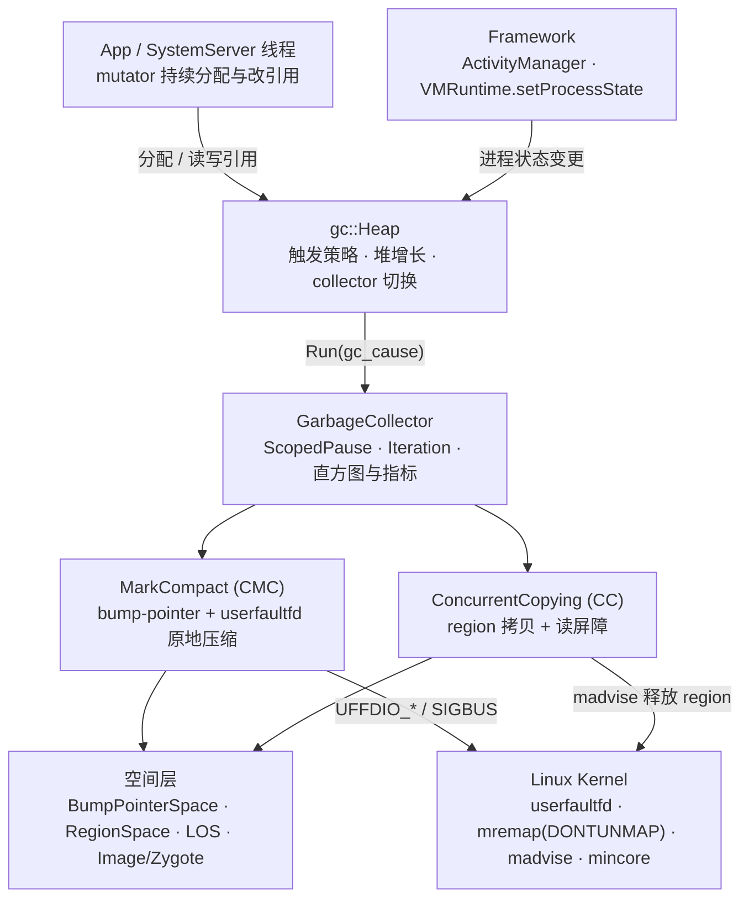
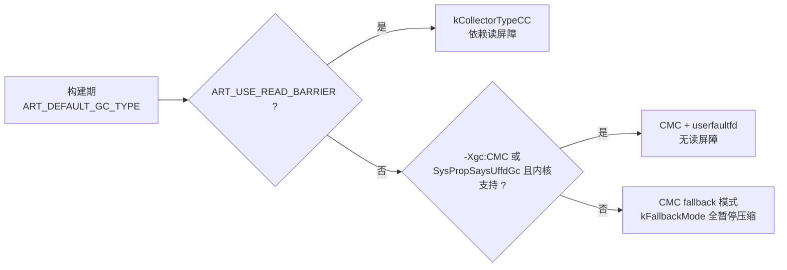
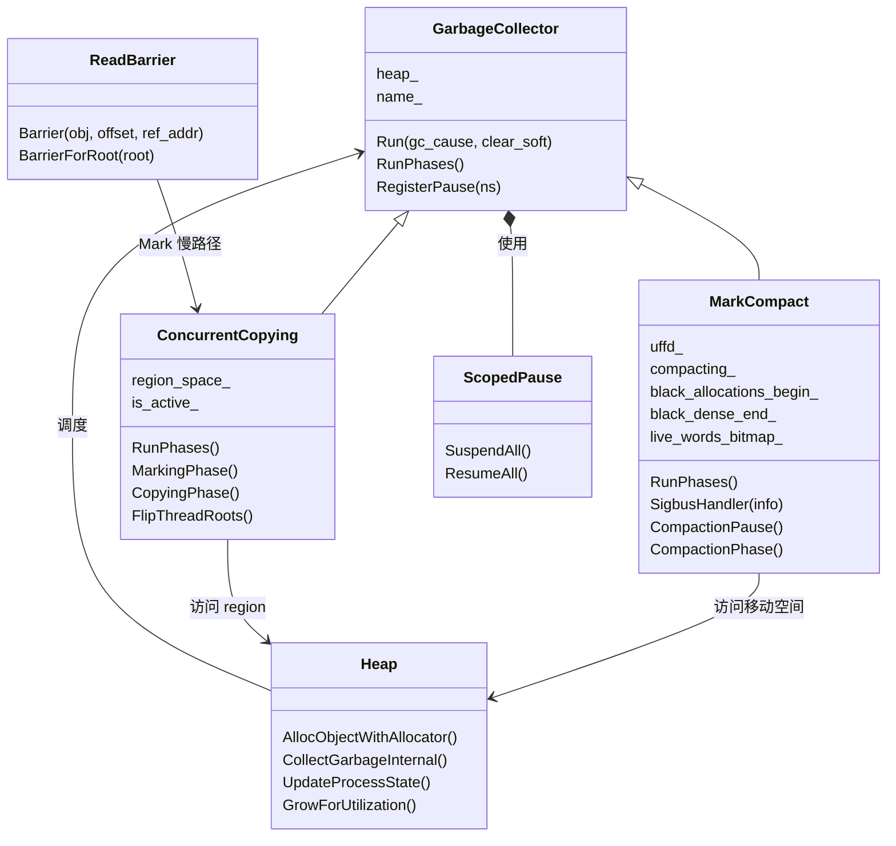
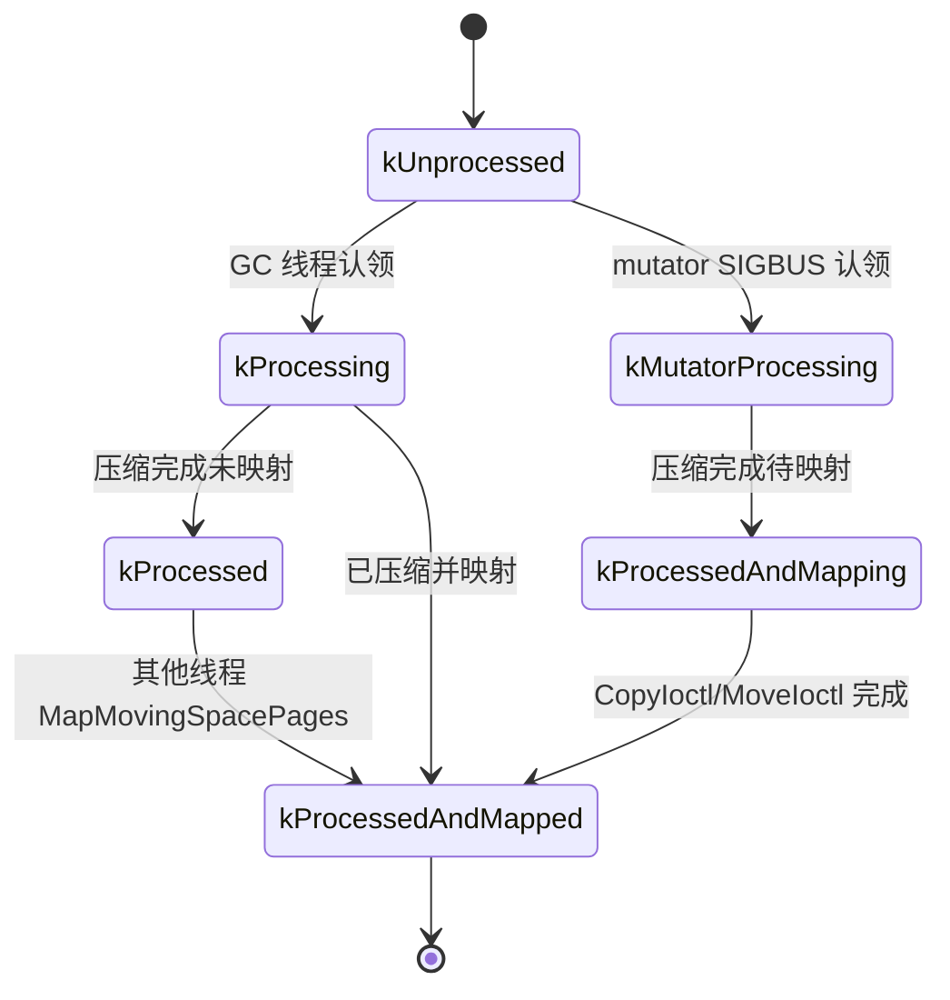
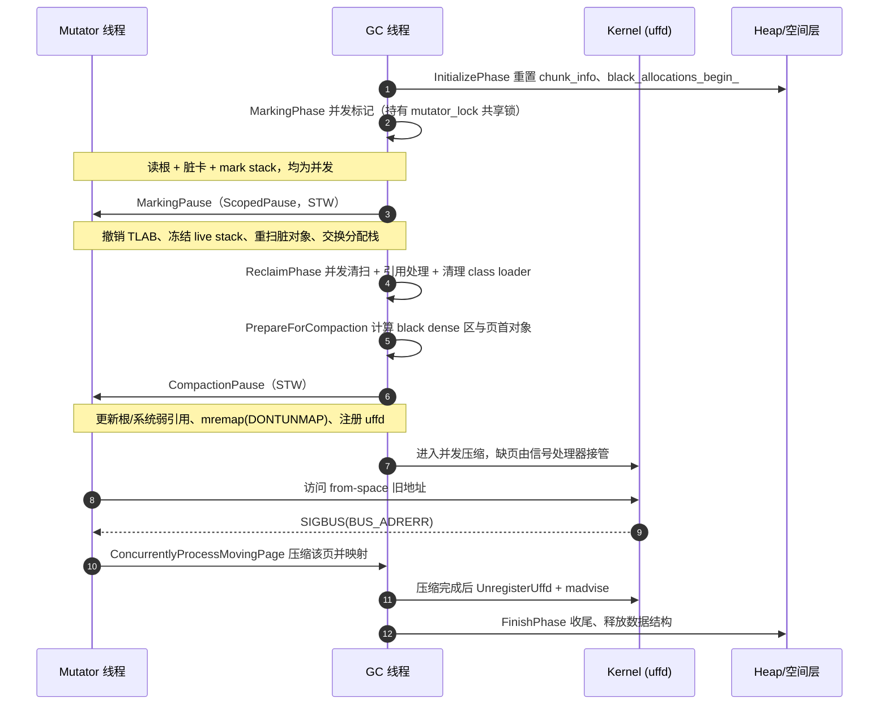

# 05 · 并发垃圾回收与亚毫秒级 STW 机制

> [!IMPORTANT]
> **一句话核心结论**：ART 在 Android 15/16 基线上有两条并发的移动式 GC 主线——`ConcurrentCopying`（CC，256 KB 区域 + Baker/表查读屏障 + 半空间拷贝）与 `ConcurrentMarkCompact`（CMC，bump-pointer 移动空间 + `userfaultfd` 缺页代偿读屏障 + 原地压缩）；二者都把「标记、清扫、压缩」的重活放到并发线程，把 STW 压缩到**根重扫 + TLAB 撤销 + 内核重映射**这几个可枚举的短动作上，再叠加前台/后台 `ProcessState` 的堆增长倍率与时间驱动触发，实现「内存与掉帧」的可调平衡。

| 项目 | 内容 |
| :--- | :--- |
| **机制定位** | 托管堆的并发标记 / 并发压缩 / 停顿控制 / 触发与增长策略 |
| **源码模块（相对 `qssi/art/`）** | `runtime/gc/collector/`、`runtime/gc/`、`runtime/read_barrier-inl.h` |
| **核心类 / 入口** | `gc::collector::MarkCompact`、`gc::collector::ConcurrentCopying`、`gc::collector::GarbageCollector`、`gc::Heap`、`ReadBarrier` |
| **关键构建开关** | `ART_DEFAULT_GC_TYPE`（默认 `CMC`）、`ART_USE_READ_BARRIER`、`ART_READ_BARRIER_TYPE`（默认 `BAKER`）、`ART_USE_TLAB` |
| **关键系统属性** | `persist.device_config.runtime_native_boot.enable_uffd_gc_2`、`persist.device_config.runtime_native_boot.force_disable_uffd_gc`、`ro.dalvik.vm.enable_uffd_gc`、`persist.device_config.runtime_native_boot.use_generational_gc`、`persist.device_config.runtime_native_boot.use_uffd_move_ioctl` |
| **关键启动参数** | `-Xgc:`、`-Xmx` / `-Xms`、`-XX:HeapGrowthLimit`、`-XX:HeapTargetUtilization`、`-XX:EnableTimeBasedGcTrigger`、`-XX:UseTLAB` |
| **源码基线** | `/home/voyah/workspace/8397/qssi/art`（Android 15/16 主线级 QSSI，只读） |

## 1. What：机制是什么？

### 1.1 职责边界

ART 的并发 GC 子系统要同时回答四个互相牵制的问题：

1. **何时回收**：分配速率、剩余堆空间、进程前后台状态、以及（可选）时间驱动阈值共同决定触发时机，见 [heap.cc](file:///home/voyah/workspace/8397/qssi/art/runtime/gc/heap.cc#L3811-L3830)。
2. **如何标记**：并发标记必须与 mutator 的写操作共存。CC 选择「读屏障 + 三色标记」，CMC 选择「卡表 + 脏对象重扫」。
3. **如何搬迁对象**：CC 拷贝到 to-space 区域；CMC 在移动空间内**原地**滑移压缩，并用 `userfaultfd` 把「对象已搬家」这一事实延迟到缺页时处理。
4. **如何把停顿压到亚毫秒级**：把所有 O(存活对象数) 的工作移出 STW，只保留 O(线程数 × 根数) 的根重扫、TLAB 撤销与内核页表操作。

它**不负责**：对象分配策略（属于 `Heap` 与空间分配器）、引用处理的完整语义（属于 `ReferenceProcessor`）、以及 Java 层的 `System.gc()` 语义（属于 Framework 的 `VMRuntime`）。

### 1.2 核心术语表

| 术语 | 含义 | 源码锚点 |
| :--- | :--- | :--- |
| Mutator | 应用线程（`kRunnable` 态），与 GC 并发执行并持续改堆 | [read_barrier-inl.h](file:///home/voyah/workspace/8397/qssi/art/runtime/read_barrier-inl.h#L35-L45) |
| STW（Stop-The-World） | 通过 `SuspendAll` 让全部 mutator 停在安全点，GC 独占 mutator 锁的窗口 | [garbage_collector.cc](file:///home/voyah/workspace/8397/qssi/art/runtime/gc/collector/garbage_collector.cc#L427-L451) |
| TLAB | 线程本地分配缓冲，一段私有 bump-pointer 区间，分配只需移动指针 | [thread-inl.h](file:///home/voyah/workspace/8397/qssi/art/runtime/thread-inl.h#L441-L447) |
| Moving space / BumpPointerSpace | CMC 的主分配区，对象向高地址线性生长，是压缩的舞台 | [mark_compact.cc](file:///home/voyah/workspace/8397/qssi/art/runtime/gc/collector/mark_compact.cc#L789-L813) |
| Region | CC 的堆切分单位，固定 `256 KB` | [region_space.h](file:///home/voyah/workspace/8397/qssi/art/runtime/gc/space/region_space.h#L233-L237) |
| From-space / To-space | 拷贝式 GC 的两个半空间；CC 以**区域**为粒度决定去留 | [region_space.h](file:///home/voyah/workspace/8397/qssi/art/runtime/gc/space/region_space.h#L154-L160) |
| Immune space | Image / Zygote 空间，永不回收、也永不搬迁，只需更新内部引用 | [mark_compact.cc](file:///home/voyah/workspace/8397/qssi/art/runtime/gc/collector/mark_compact.cc#L669-L700) |
| Black allocation | 在标记暂停后新分配的对象，天然存活，不参与本轮标记 | [mark_compact.cc](file:///home/voyah/workspace/8397/qssi/art/runtime/gc/collector/mark_compact.cc#L1555-L1560) |
| Black dense region | 堆头部连续「高存活密度」区间，CMC 不做搬迁、只原地改引用 | [mark_compact.cc](file:///home/voyah/workspace/8397/qssi/art/runtime/gc/collector/mark_compact.cc#L1240-L1290) |
| Read barrier | 引用加载时的检查点：对象为灰色则先标记/搬迁再返回 | [read_barrier-inl.h](file:///home/voyah/workspace/8397/qssi/art/runtime/read_barrier-inl.h#L35-L105) |
| Flip | 暂停窗口内把所有线程根从 from-space 语义翻转到 to-space 语义 | [concurrent_copying.cc](file:///home/voyah/workspace/8397/qssi/art/runtime/gc/collector/concurrent_copying.cc#L753-L775) |
| ProcessState | Framework 下发的进程前后台状态，决定堆增长倍率与压缩策略 | [process_state.h](file:///home/voyah/workspace/8397/qssi/art/runtime/process_state.h#L26-L32) |

### 1.3 架构定位



### 1.4 两条路线的分野

构建期由 `ART_DEFAULT_GC_TYPE` 决定默认收集器，QSSI 默认值是 `CMC`（[art.go](file:///home/voyah/workspace/8397/qssi/art/build/art.go#L49-L52)）。运行期再叠加两层判断：

- 若产物编译时启用了读屏障（`ART_USE_READ_BARRIER=1`），`gUseReadBarrier` 为真，`Heap` 构造时会把 collector 强制改写为 `kCollectorTypeCC`（[runtime.cc](file:///home/voyah/workspace/8397/qssi/art/runtime/runtime.cc#L1843-L1844)）。
- 否则走 CMC，但**是否启用 `userfaultfd` 由属性与内核算力共同裁决**：`SysPropSaysUffdGc()` 读三个属性，`KernelSupportsUffd()` 探测内核能力，二者与命令行 `-Xgc:CMC` 一起决定 `gUseUserfaultfd`（[mark_compact.cc](file:///home/voyah/workspace/8397/qssi/art/runtime/gc/collector/mark_compact.cc#L278-L313)）。

这条「读屏障」与「缺页」二选一的分叉，是理解整个模块的钥匙：`gUseUserfaultfd = !gUseReadBarrier`。



## 2. Why：为什么需要它？

### 2.1 朴素实现的痛点模型

如果 ART 只有一个「暂停—全堆标记—全堆压缩—恢复」的收集器，在车机座舱这类「多屏常驻 + 长稳运行 + 内存水位高」的场景下会出现三类灾难：

1. **停顿时间随堆大小线性增长**：存活对象越多，标记与压缩越久，必然超过一帧预算（60 fps 下约 16.7 ms），表现为可感知的掉帧与触摸延迟。
2. **内存碎片不可控**：只做标记-清扫（mark-sweep）会让空闲块碎片化，长时间运行后即使总空闲足够，也找不到连续大块，触发无谓的 GC 风暴甚至 OOM。
3. **改造代价外溢到全局**：用读屏障解决并发搬迁，等于给**每次引用加载**加税——包括解释器、JIT 代码与 C++ 运行时，CPU 与代码尺寸长期变差。

### 2.2 方案演进对比矩阵

| 维度 | STW Mark-Sweep | ConcurrentCopying (CC) | ConcurrentMarkCompact (CMC) |
| :--- | :--- | :--- | :--- |
| 停顿来源 | 标记 + 清扫全程 | 根翻转（flip）+ 少量检查点 | 根重扫 + TLAB 撤销 + 内核重映射 |
| 并发标记 | 无 | 有，脏卡 + 读屏障 | 有，脏卡 + 卡表老化 |
| 并发搬迁 | 无 | 有，region 粒度拷贝 | 有，缺页驱动的原地滑移 |
| 读屏障开销 | 无 | **全量引用加载均有成本** | 无（延迟转成缺页） |
| 抗碎片 | 差 | 好（区域紧凑化） | 好（原地压缩，无半空间浪费） |
| 额外内存 | 最低 | 需 to-space 区域 | 需 from-space 影子映射 |
| 内核依赖 | 无 | 无 | `userfaultfd` + `mremap(MREMAP_DONTUNMAP)` |
| 典型适用 | 小堆 / 低端兜底 | 读屏障已启用或内核不支持 uffd | Android 15+ 主流默认 |

### 2.3 为什么 CMC 值得付出内核复杂度

CMC 的核心洞察是：**「对象已搬迁」这件事只在 mutator 真正访问旧地址时才需要被感知**。于是它把：

- 旧页面的读访问 → 变成 `userfaultfd` 缺页 → 内核回调 SIGBUS → ART 在信号处理器里就地把该页压缩并映射到新位置；
- 新分配（black allocation）→ 放在标记结束后的地址区间，天然不被回收，也不参与压缩。

这样一来，读屏障的「每次加载都付费」被替换成「每页首次访问付一次费」，而且只在压缩窗口内有效。代价是必须依赖内核特性，并在不支持时退回全暂停的 `kFallbackMode`（[mark_compact.cc](file:///home/voyah/workspace/8397/qssi/art/runtime/gc/collector/mark_compact.cc#L5150-L5200)）。

## 3. How：源码级实现原理深度剖析

### 3.1 堆与分配器的内存布局

```text
                    ART 托管堆（32 位压缩引用视角）
 ┌──────────────────────────────────────────────────────────────────────┐
 │ Image Space (boot/app image)        retention: NeverCollect          │  ← Immune，只更新引用
 ├──────────────────────────────────────────────────────────────────────┤
 │ Zygote Space                        retention: FullCollect / Never   │  ← Immune，只更新引用
 ├──────────────────────────────────────────────────────────────────────┤
 │ Non-moving Space (DlMalloc/RosAlloc) 类对象、dex cache 等             │  ← 原地不动
 ├──────────────────────────────────────────────────────────────────────┤
 │ Moving Space / BumpPointerSpace                                       │
 │  ┌──────┬──────┬──────┬──────────────────┬──────────────────────────┐ │
 │  │ TLAB │ TLAB │ obj  │ black dense 区   │ black allocations 区     │ │
 │  │线程A │线程B │ ...  │ 原地改引用不搬迁 │ 标记后新分配，天然存活   │ │
 │  └──────┴──────┴──────┴──────────────────┴──────────────────────────┘ │
 │   ↑ moving_space_begin_         ↑ black_dense_end_   ↑ black_alloc_begin_
 ├──────────────────────────────────────────────────────────────────────┤
 │ Large Object Space (LOS)            大对象，独立 bitmap               │
 └──────────────────────────────────────────────────────────────────────┘

  压缩后（concurrent compaction）：
  ┌───────────────────────────────┬──────────────────────────────────────┐
  │ 存活对象紧凑排列（post_compact_end_） │ 空闲页：ZEROPAGE / MOVE 复用    │
  └───────────────────────────────┴──────────────────────────────────────┘
   from-space 影子映射 ── mremap(DONTUNMAP) ──→ 供缺页处理器读取旧页
```

CMC 的搬迁不是「整体搬完再改引用」，而是**页级按需**：`moving_pages_status_` 为每一页维护一个状态字节（[mark_compact.h](file:///home/voyah/workspace/8397/qssi/art/runtime/gc/collector/mark_compact.h#L218-L227)），状态机保证「GC 线程压缩」与「mutator 缺页自救」不会重复劳动。





### 3.2 TLAB 无锁分配快路径

分配热路径完全不碰堆锁。`Heap::AllocObjectWithAllocator` 在确认剩余空间足够后，直接调用：

```cpp
// runtime/gc/heap-inl.h
if (IsTLABAllocator(allocator) && byte_count <= self->TlabSize()) {
  obj = self->AllocTlab(byte_count);   // 仅移动 thread_local_pos
  ...
}
```

`Thread::AllocTlab` 的实现只有三行——取当前指针、指针前移、返回，天然线程私有、无原子操作（[thread-inl.h](file:///home/voyah/workspace/8397/qssi/art/runtime/thread-inl.h#L441-L447)）：

```cpp
mirror::Object* ret = reinterpret_cast<mirror::Object*>(tlsPtr_.thread_local_pos);
tlsPtr_.thread_local_pos += bytes;
return ret;
```

TLAB 用尽时进入慢路径 `Heap::AllocWithNewTLAB`（[heap.cc](file:///home/voyah/workspace/8397/qssi/art/runtime/gc/heap.cc#L4719-L4760)）。这里有两个关键策略：

- **部分 TLAB（partial TLAB）**：若申请量不超过本线程 TLAB 容量余量，则只把 TLAB 扩到刚好够用，避免为一个对象浪费整块 32 KB；常量 `kPartialTlabSize = 16 * KB`（[heap.h](file:///home/voyah/workspace/8397/qssi/art/runtime/gc/heap.h#L136-L152)）。
- **大小自适应**：新 TLAB 尺寸经 `heap_sampler_.NextTlabSize(...)` 计算，与 Java 堆采样剖析共享同一套采样器，从而在不增加额外随机源的前提下对分配做无偏采样。

对应的分配器选择在 collector 切换时完成：CC 用 `kAllocatorTypeRegionTLAB`，CMC 用 `kAllocatorTypeTLAB`，非移动收集器退回 `RosAlloc`/`DlMalloc`（[heap.cc](file:///home/voyah/workspace/8397/qssi/art/runtime/gc/heap.cc#L2337-L2390)）。

### 3.3 CMC 端到端控制流

`MarkCompact::RunPhases()` 把一轮 GC 切成「并发段—暂停段」交替的七步（[mark_compact.cc](file:///home/voyah/workspace/8397/qssi/art/runtime/gc/collector/mark_compact.cc#L872-L925)）：



#### 3.3.1 标记暂停：只做必须暂停的事

`MarkingPause()` 是整轮 GC 的第一个 STW 窗口，它持有 `heap_bitmap_lock_` 写锁依次完成（[mark_compact.cc](file:///home/voyah/workspace/8397/qssi/art/runtime/gc/collector/mark_compact.cc#L1529-L1598)）：

1. 遍历线程列表，`VisitRoots` 抓取每个线程的栈根与寄存器根；
2. `RevokeThreadLocalAllocationStack()` 与 `bump_pointer_space_->RevokeThreadLocalBuffers(thread)` —— **撤销 TLAB 是暂停的核心成本之一**，因为 TLAB 里的对象未在 bitmap 中登记；
3. 处理并发标记期间残留的 mark stack；
4. 记录 `black_allocations_begin_`，并向上对齐到页边界——此后所有分配都算 black；
5. 重标记根集合、重扫脏卡、交换 live/mark 位图并冻结 live stack 大小。

值得注意的工程取舍是：`black_allocations_begin_` 必须页对齐，既是为了后续按页切分，也是为了让卡表的 `ClearCardRange()` 能按整卡区间操作。

#### 3.3.2 压缩计划：black dense 区阈值 95%

`PrepareForCompaction()` 先假设「全部存活对象向前滑移」，再**截断头部高密度区间**（[mark_compact.cc](file:///home/voyah/workspace/8397/qssi/art/runtime/gc/collector/mark_compact.cc#L1189-L1310)）：

```cpp
static constexpr uint kBlackDenseRegionThreshold = 95U;   // mark_compact.cc:113

// 逐页累加存活字节，记录最后一个「累计存活率 >= 95%」的页
if (live_bytes * 100U >= total_bytes * kBlackDenseRegionThreshold) {
  threshold_passing_marker = pages_live_bytes.size();
}
```

为什么要 95% 这么高的阈值？因为对一段已经几乎填满的页面做滑移，收益只是「挤出零星空洞」，却要为每个对象重算地址、改引用、弄脏卡表。截断后：

- `[moving_space_begin_, black_dense_end_)`：**只改引用，不搬迁**，对象地址不变；
- `[black_dense_end_, black_allocations_begin_)`：参与原地压缩；
- `[black_allocations_begin_, moving_space_end_)`：black 对象，只做地址调整。

接着 `InitMovingSpaceFirstObjects()` 为每个待压缩页登记页首对象与压缩前偏移，形成 `first_objs_moving_space_[]` 与 `pre_compact_offset_moving_space_[]` 两个数组——缺页处理器正是靠它们在不加锁的前提下定位「这一页从哪个对象开始」。

#### 3.3.3 压缩暂停：把内核页表操作算进 STW

`CompactionPause()`（[mark_compact.cc](file:///home/voyah/workspace/8397/qssi/art/runtime/gc/collector/mark_compact.cc#L4188-L4362)）在 `FlipThreadRoots` 的回调中执行，包含：

1. `UpdateMovingSpaceBlackAllocations()` / `UpdateNonMovingSpaceBlackAllocations()`：把标记暂停后新分配的对象补登到 live-words 位图；
2. 置 `compacting_ = true`，让读屏障的 from-space 分支开始生效；
3. `ReferenceProcessor::UpdateRoots(this)` 更新引用队列根；
4. 遍历 immune spaces（image/zygote）更新其中指向移动空间的引用；
5. 访问并发根、非线程根、class loader 根，清扫系统弱引用；
6. 把 linear-alloc arena 逐个登记进 `linear_alloc_arenas_`，因为 ArtMethod/ArtField 等元数据也持有堆引用；
7. `KernelPreparation()` 完成 `mremap` 与 `userfaultfd` 注册。

其中第 7 步是整个设计最「吃内核」的部分（[mark_compact.cc](file:///home/voyah/workspace/8397/qssi/art/runtime/gc/collector/mark_compact.cc#L4365-L4466)）：

```cpp
int mremap_flags = MREMAP_MAYMOVE | MREMAP_FIXED;
if (gHaveMremapDontunmap) {
  mremap_flags |= MREMAP_DONTUNMAP;   // 关键：源映射保留，作为 from-space 影子
}
void* ret = mremap(to_addr, map_size, map_size, mremap_flags, from_addr);
```

`MREMAP_DONTUNMAP` 让「移动空间」被搬到 `from_space_begin_` 处的同时，**原地址的映射不被拆除**，于是原地址依然可读，只是内容会被 `userfaultfd` 拦截。没有该特性时，代码会 `mmap(MAP_FIXED_NOREPLACE)` 重新占位，代价是必须整段重新建立匿名映射。

注册顺序也有讲究：若使用 `UFFDIO_MOVE`，可以「先注册再 mremap」，从而避免 vma 被拆分导致后续无法合并；否则只能「先 mremap、fault-in 一页强制分配 `anon_vma`、再注册、再 `madvise(DONTNEED)` 清空」。源码注释直接点明了这个内核约束。

#### 3.3.4 缺页处理器：SIGBUS 里的原地压缩

`SigbusHandler()` 只接受 `BUS_ADRERR`（这是 uffd 的约定），其余一律返回 `false` 交还默认处理（[mark_compact.cc](file:///home/voyah/workspace/8397/qssi/art/runtime/gc/collector/mark_compact.cc#L4505-L4579)）。它用两个 `sigbus_in_progress_count_` 计数器与 GC 线程做「压缩完成 / 注销完成」的两阶段握手，最高位 `kSigbusCounterCompactionDoneMask` 是完成标志（[mark_compact.h](file:///home/voyah/workspace/8397/qssi/art/runtime/gc/collector/mark_compact.h#L120-L133)）。

`ConcurrentlyProcessMovingPage()` 分三种情况（[mark_compact.cc](file:///home/voyah/workspace/8397/qssi/art/runtime/gc/collector/mark_compact.cc#L4593-L4700)）：

- **页在已用区间之外**：直接 `UFFDIO_ZEROPAGE` 装零页，且会顺带把整个 TLAB 尾部一次装完，减少 ioctl 次数；
- **页在 black-dense 区**：`UpdateNonMovingPage(...)` 以 from-space 副本 `curr_obj + from_space_diff` 为描述信息来源，**就地更新引用而不搬迁对象**（[mark_compact.cc](file:///home/voyah/workspace/8397/qssi/art/runtime/gc/collector/mark_compact.cc#L3592-L3600)）；随后以 `fault_page + from_space_slide_diff_` 处的副本为源，把改好的整页 Move/Copy 回移动空间；
- **页在待压缩区**：为 mutator 从 2048 个预分配缓冲中领一块（`kMutatorCompactionBufferCount`，[mark_compact.cc](file:///home/voyah/workspace/8397/qssi/art/runtime/gc/collector/mark_compact.cc#L352-L356)），`CompactPage()` 或 `SlideBlackPage()` 生成新页，再用 `MoveIoctl` / `CopyIoctl` 完成映射。

这里刻意**不获取 `heap_bitmap_lock_`**（信号处理器中不能拿锁），而是用 `FakeMutexLock` 断言「GC 线程在整个压缩阶段持锁」这一外部不变量。

#### 3.3.5 地址换算：live-words 位图与 chunk_info 向量

压缩需要回答「旧地址 → 新地址」，ART 用两级结构实现 O(1) 级换算（[mark_compact.h](file:///home/voyah/workspace/8397/qssi/art/runtime/gc/collector/mark_compact.h#L244-L270)）：

```text
 kOffsetChunkSize = kBitsPerVectorWord × kAlignment
                  = 64 × 8 = 512 字节（64 位目标）

 live_words_bitmap_（每 bit 对应一个 object-alignment 字）
 ┌───┬───┬───┬───┬───┬───┬───┬───┬───┬───┬───┬───┬───┬───┬───┬───┐
 │ 1 │ 1 │ 1 │ 1 │ 0 │ 0 │ 1 │ 1 │ 1 │ 1 │ 1 │ 0 │ 0 │ 0 │ 0 │ 0 │ ...
 └───┴───┴───┴───┴───┴───┴───┴───┴───┴───┴───┴───┴───┴───┴───┴───┘
  ↑ 对象 A（4 字）  ↑ 空洞     ↑ 对象 B（5 字）

 chunk_info_vec_[i]（每 512 字节一个 uint32，存该 chunk 的存活字节数）
 ┌───────────────┬───────────────┬───────────────┬───────────────┐
 │      32       │       0       │      40       │      ...      │
 └───────────────┴───────────────┴───────────────┴───────────────┘
        ↑ 512B chunk 内累计存活字节，exclusive_scan 后变为前缀和

 新地址 = 旧地址 − (已扫描 live words 数 × kAlignment)
        = 旧地址 − popcount 前缀 × 8
```

`UpdateLivenessInfo()` 在标记对象时同步维护两张表：`SetLiveWords()` 置位，`chunk_info_vec_[chunk_idx]` 累加该对象落在各 chunk 的字节数（[mark_compact.cc](file:///home/voyah/workspace/8397/qssi/art/runtime/gc/collector/mark_compact.cc#L5697-L5732)）。压缩前用一次 `std::exclusive_scan` 把「每 chunk 存活量」转成「前缀和」，此后任意旧地址都只需一次 popcount 即可求出目标地址——这是并发压缩能在信号处理器里以常数时间完成的关键。

### 3.4 ConcurrentCopying：读屏障路线的实现

CC 的相位骨架与 CMC 类似，但没有 uffd：`RunPhases()` 依次是 `InitializePhase` → （分代时）`MarkingPhase` → `GrayAllDirtyImmuneObjects` → `FlipThreadRoots` → `CopyingPhase` → `ReclaimPhase` → `FinishPhase`（[concurrent_copying.cc](file:///home/voyah/workspace/8397/qssi/art/runtime/gc/collector/concurrent_copying.cc#L214-L269)）。

读屏障是它的灵魂（[read_barrier-inl.h](file:///home/voyah/workspace/8397/qssi/art/runtime/read_barrier-inl.h#L35-L105)）：

```cpp
if (kUseBakerReadBarrier) {
  uintptr_t fake_address_dependency;                      // 必须为 0
  bool is_gray = IsGray(obj, &fake_address_dependency);    // 读对象头灰位
  ref_addr = reinterpret_cast<...>(fake_address_dependency | reinterpret_cast<uintptr_t>(ref_addr));
  MirrorType* ref = ref_addr->template AsMirrorPtr<kIsVolatile>();
  if (is_gray) {                                           // 慢路径
    ref = reinterpret_cast<MirrorType*>(Mark(ref));        // 触发搬迁
    ...
  }
}
```

`fake_address_dependency` 是一个刻意的编译期技巧：把灰位加载结果「或」进引用地址，制造**人工数据依赖**，从而无需显式的 load-load 屏障，编译器也不能把它优化掉。

两种读屏障的选择由构建期宏决定（[read_barrier_config.h](file:///home/voyah/workspace/8397/qssi/art/runtime/read_barrier_config.h#L60-L73)）：

| 类型 | 判据 | 慢路径触发 | 代价 |
| :--- | :--- | :--- | :--- |
| Baker | 对象头 `rb_state` 灰位 | `Mark(ref)` 搬迁 | 每次加载读一次对象头 |
| TableLookup | 外部 `ReadBarrierTable` 位图 | `IsSet(old_ref)` | 每次加载查一次侧表 |

CC 的停顿集中在 `FlipThreadRoots()`：暂停全部 mutator，把每个线程的栈根、寄存器根、TLAB 从 from-space 语义翻转到 to-space 语义，然后立刻恢复。这解释了为什么 CC 的 pause 与**线程数 × 根数**相关，而不是与堆大小相关。

### 3.5 ScopedPause：STW 的统一封装

所有收集器的暂停都走同一个 RAII：

```cpp
GarbageCollector::ScopedPause::ScopedPause(GarbageCollector* collector, bool with_reporting) {
  runtime->GetThreadList()->SuspendAll(__FUNCTION__);     // 协作式挂起
  if (with_reporting) {
    GcPauseListener* pause_listener = runtime->GetHeap()->GetGcPauseListener();
    if (pause_listener != nullptr) pause_listener->StartPause();
  }
}
```

析构时先 `RegisterPause(NanoTime() - start_time_)` 记录本次暂停，再 `ResumeAll()`（[garbage_collector.cc](file:///home/voyah/workspace/8397/qssi/art/runtime/gc/collector/garbage_collector.cc#L427-L451)）。`GcPauseListener` 是一个极薄的抽象接口（[gc_pause_listener.h](file:///home/voyah/workspace/8397/qssi/art/runtime/gc/gc_pause_listener.h#L25-L32)），由 Framework 侧注入，用于把 GC 暂停与系统级「卡顿归因」打通。

暂停时长随后进入三个出口：

1. `pause_histogram_`（按 GC 名称分桶），`DumpPerformanceInfo()` 会打印 99% 置信区间；
2. `metrics::ArtMetrics` 的 `WorldStopTimeDuringGCAvg` / `GcWorldStopTime` / `GcWorldStopCount`；
3. `Iteration::pause_times_`，最终落到 `Heap::LogGC()` 的 `paused` 字段。

`Heap::Run` 里还有一个重要细节：若整轮 GC 都持有 mutator 锁独占（例如 fallback 全暂停压缩），代码会**丢弃中间记录的伪暂停**，用整轮时长替代（[garbage_collector.cc](file:///home/voyah/workspace/8397/qssi/art/runtime/gc/collector/garbage_collector.cc#L230-L237)）。否则统计会出现「暂停总和大于总时长」的荒谬结果。

### 3.6 前后台 ProcessState 与堆增长策略

Framework 通过 `VMRuntime.updateProcessState(int)` 下发状态（[dalvik_system_VMRuntime.cc](file:///home/voyah/workspace/8397/qssi/art/runtime/native/dalvik_system_VMRuntime.cc#L330-L337)），一路走到 `Runtime::UpdateProcessState` 与 `Heap::UpdateProcessState`（[heap.cc](file:///home/voyah/workspace/8397/qssi/art/runtime/gc/heap.cc#L1139-L1156)）：

```cpp
if (jank_perceptible) {
  RequestCollectorTransition(foreground_collector_type_, 0);  // 立刻切回前台收集器
  GrowHeapOnJankPerceptibleSwitch();                          // 抬升目标 footprint
} else {
  RequestCollectorTransition(background_collector_type_, 0);
}
```

`GrowHeapOnJankPerceptibleSwitch()` 做的是「**只升不降**」的兜底（[heap.cc](file:///home/voyah/workspace/8397/qssi/art/runtime/gc/heap.cc#L1119-L1136)）：把 `target_footprint_`、`concurrent_start_bytes_`、`time_based_gc_threshold_` 三个值分别抬到前台期记录的最小值 `min_foreground_*`。这样切回前台瞬间不会因为后台收缩过的堆而立刻触发一次 GC。

增长倍率来自 `foreground_heap_growth_multiplier_`，默认 `kDefaultHeapGrowthMultiplier = 2.0`（[heap.h](file:///home/voyah/workspace/8397/qssi/art/runtime/gc/heap.h#L153-L155)）。`GrowForUtilization()` 用目标利用率反推增长量（[heap.cc](file:///home/voyah/workspace/8397/qssi/art/runtime/gc/heap.cc#L3811-L3900)）：

```text
delta      = bytes_allocated × (1 / target_utilization − 1)      // 默认 0.6
grow_bytes = clamp(delta, min_free_, max_free_)                   // 默认 8 MB ~ 32 MB
target     = bytes_allocated + grow_bytes × multiplier
```

当估算的 sticky GC 吞吐已经不低于非 sticky 收集器时，下一轮继续做 sticky（只回收新分配区），否则升级为 partial/full——这是「**按 ROI 选择回收力度**」的直接实现。

### 3.7 时间驱动 GC：把「分配速度」纳入触发条件

传统触发只看「已分配字节数是否逼近 footprint」，对「缓慢但持续泄漏」或「低速率长时间运行」不敏感。时间驱动触发改为监控**分配率 × 时间**的乘积（[heap.cc](file:///home/voyah/workspace/8397/qssi/art/runtime/gc/heap.cc#L4320-L4385)）：

```cpp
size_t bytes_since_last_gc_kb = (bytes_allocated - num_bytes_alive_after_gc_) / KB;
uint64_t time_since_last_gc_ms = NsToMs(now - last_gc_start_time_);
if (bytes_since_last_gc_kb * time_since_last_gc_ms >= time_based_gc_threshold_) {
  RequestConcurrentGC(self, kGcCauseBackground, false, GetCurrentGcNum());
}
```

阈值本身不是拍脑袋的常数，而是由上一轮 GC 的实测成本推导（[heap.cc](file:///home/voyah/workspace/8397/qssi/art/runtime/gc/heap.cc#L3902-L3924)）：

```text
time_based_gc_threshold_ = 100 × expected_gc_cost_ms × memory_gc_cost_factor_kb
```

即「预期本轮 GC 的 CPU 时间」与「每 KB 内存的 GC 成本因子」的乘积，再乘 100 的安全系数；前后台切换时再乘 `foreground_heap_growth_multiplier_`。下一次检查时间用平方根收敛，避免每次分配都重排任务：

```text
K = sqrt(M / (T × B))      // M 阈值、T 已过时间、B 已分配字节
K × T = sqrt(T × M / B)
```

此外，`RequestTimeBasedGcThresholdCheck()` 会把检查任务的最早执行时间钳到 `now + 10 ms`，防止高频空转（[heap.cc](file:///home/voyah/workspace/8397/qssi/art/runtime/gc/heap.cc#L4368-L4382)）。

### 3.8 关键阈值一览

| 常量 / 属性 | 值 | 位置 | 作用 |
| :--- | :--- | :--- | :--- |
| `kDefaultTLABSize` | `32 * KB` | [heap.h](file:///home/voyah/workspace/8397/qssi/art/runtime/gc/heap.h#L150) | 新 TLAB 的基准大小 |
| `kPartialTlabSize` | `16 * KB` | [heap.h](file:///home/voyah/workspace/8397/qssi/art/runtime/gc/heap.h#L138) | 部分 TLAB 扩容粒度 |
| `kDefaultTargetUtilization` | `0.6` | [heap.h](file:///home/voyah/workspace/8397/qssi/art/runtime/gc/heap.h#L151) | 堆目标利用率，决定增长量 |
| `kDefaultHeapGrowthMultiplier` | `2.0` | [heap.h](file:///home/voyah/workspace/8397/qssi/art/runtime/gc/heap.h#L153-L155) | 前台堆增长倍率 |
| `kDefaultMaxFree` / `kDefaultMinFree` | `32 MB` / `8 MB` | [heap.h](file:///home/voyah/workspace/8397/qssi/art/runtime/gc/heap.h#L144-L145) | 单轮增长上下限 |
| `kDefaultLongPauseLogThreshold` | `5 ms` | [heap.h](file:///home/voyah/workspace/8397/qssi/art/runtime/gc/heap.h#L146) | 超阈值即打印 GC 日志 |
| `kDefaultLongGCLogThreshold` | `100 ms` | [heap.h](file:///home/voyah/workspace/8397/qssi/art/runtime/gc/heap.h#L148) | 整轮 GC 慢日志阈值 |
| `kMinLargeObjectThreshold` | `12 * KB` | [heap.h](file:///home/voyah/workspace/8397/qssi/art/runtime/gc/heap.h#L157-L159) | 超过即进 LOS |
| `kBlackDenseRegionThreshold` | `95`（百分比） | [mark_compact.cc](file:///home/voyah/workspace/8397/qssi/art/runtime/gc/collector/mark_compact.cc#L113) | 决定头部区间是否免搬迁 |
| `kMutatorCompactionBufferCount` | `2048` | [mark_compact.cc](file:///home/voyah/workspace/8397/qssi/art/runtime/gc/collector/mark_compact.cc#L352-L356) | mutator 缺页压缩缓冲池大小 |
| `kMinFromSpaceMadviseSize` | `8 * MB` | [mark_compact.cc](file:///home/voyah/workspace/8397/qssi/art/runtime/gc/collector/mark_compact.cc#L354-L355) | 批量 madvise 的最小粒度 |
| `RegionSpace::kRegionSize` | `256 * KB` | [region_space.h](file:///home/voyah/workspace/8397/qssi/art/runtime/gc/space/region_space.h#L235-L236) | CC 的区域粒度 |

## 4. 能利用这个机制做什么？工程实战指南与排障手册

### 4.1 先确认「当前跑的是哪条路线」

这是所有后续调优的前提。ART 启动时会在日志里打印 `Using <collector> GC.`（`Heap` 构造函数），同时可以用 `Debug.getRuntimeStat` 与 GC 日志交叉验证。

```bash
# 1. 看 ART 选中的收集器
adb logcat -b main -s art:V | grep -m1 "Using .* GC"

# 2. 确认 uffd 相关属性与内核能力
adb shell getprop ro.dalvik.vm.enable_uffd_gc
adb shell getprop persist.device_config.runtime_native_boot.enable_uffd_gc_2
adb shell getprop persist.device_config.runtime_native_boot.force_disable_uffd_gc
adb shell cat /proc/sys/vm/unprivileged_userfaultfd

# 3. 确认是否走了 fallback（无 uffd 会退化为全暂停压缩）
adb logcat -b main -s art:I | grep -i "userfaultfd\|MOVE ioctl"
```

### 4.2 实战一：用 GC 日志定位「掉帧是否由 GC 引起」

ART 的 GC 日志行格式由 `Heap::LogGC()` 固定拼接（[heap.cc](file:///home/voyah/workspace/8397/qssi/art/runtime/gc/heap.cc#L2992-L3005)）。典型形态如下（**示例，数值随设备与堆状态变化**）：

```text
Background concurrent mark compact GC freed 12480KB AllocSpace bytes, 42(2100KB) LOS objects,
38% free, 210MB/340MB, paused 412us,318us total 68.221ms
```

逐字段解读：

| 字段 | 含义 | 判读要点 |
| :--- | :--- | :--- |
| `Background` | `GcCause` 的 `PrettyCause` 输出 | `Alloc` 表示分配失败触发的阻塞 GC，最伤帧 |
| `concurrent mark compact` | `GarbageCollector::name_` | 与 `concurrent copying` 对照即可确认路线 |
| `freed 12480KB AllocSpace bytes` | 普通空间回收量 | 长期接近 0 说明存活率高，需查泄漏 |
| `42(2100KB) LOS objects` | 大对象数量与字节 | LOS 持续增长常见于大 Bitmap / 大数组 |
| `38% free` | `GetPercentFree()` | 长期低于 20% 说明堆已接近上限 |
| `210MB/340MB` | 已分配 / `GetTotalMemory()` | 与 `dumpsys meminfo` 的 Java Heap 对照 |
| `paused 412us,318us` | 各次 STW 暂停时长 | **这是「亚毫秒」的直接证据** |
| `total 68.221ms` | 整轮 GC 时长（含并发） | 只有超过 `100 ms` 才会被当作慢 GC 关注 |

判读原则：**看 `paused` 不看 `total`**。并发 GC 的 `total` 很长但 mutator 几乎不受影响；反之若 `paused` 接近或超过 5 ms（`kDefaultLongPauseLogThreshold`），才是真正的掉帧嫌疑。

### 4.3 实战二：Perfetto 切片与 GC 阶段归因

`GarbageCollector::Run()` 的外层 trace 名由原因与收集器名拼成（[garbage_collector.cc](file:///home/voyah/workspace/8397/qssi/art/runtime/gc/collector/garbage_collector.cc#L197-L200)），内层还会切出 `(Paused)MarkingPause`、`CompactionPause`、`KernelPreparation`、`CompactionPhase` 等子切片，并在结束时上报 `freed_normal_object_bytes` / `freed_large_object_bytes` / `freed_bytes` 三个 ATrace 计数器。

```bash
# 采集 GC 相关切片
adb shell perfetto -o /data/misc/perfetto-traces/gc.pftx -t 10s \
  -a com.example.app \
  sched freq idle am wm gfx view binder_driver hal dalvik \
  camera input res memory
adb pull /data/misc/perfetto-traces/gc.pftx
```

在 Perfetto UI 中重点看三处：

1. `Background concurrent mark compact GC` 切片内部各子切片的**宽度占比**——若 `CompactionPause` 明显宽于 `MarkingPause`，说明暂停成本集中在 root 更新与 mremap；
2. `Minflt-GC` / `Majflt-GC` 计数器（由 `TraceFaults()` 用 `getrusage` 上报，[mark_compact.cc](file:///home/voyah/workspace/8397/qssi/art/runtime/gc/collector/mark_compact.cc#L852-L866)）——`Majflt-GC` 偏高说明 GC 线程在被换页/压缩内存拖累；
3. GC 切片与渲染帧的对齐关系——只有 STW 子切片落在帧边界内，才是掉帧的直接原因。

### 4.4 实战三：按场景调节堆增长与触发策略

| 场景 | 调整手段 | 风险 |
| :--- | :--- | :--- |
| 前台频繁 `Alloc` GC 掉帧 | 提高 `dalvik.vm.heapgrowthlimit`，让 `target_footprint_` 更大、触发更晚 | 抬升常驻内存，可能触达 LMKD 水位 |
| 后台内存占用过高 | 依赖 `UpdateProcessState(kProcessStateJankImperceptible)` 自动切后台收集器并收缩 | 切回前台瞬间会有一次补偿性 GC |
| 长稳运行缓慢膨胀 | 打开 `-XX:EnableTimeBasedGcTrigger`（默认关闭，`kDefaultEnableTimeBasedGcTrigger = false`） | 阈值基于上一轮成本估算，抖动期可能过早触发 |
| 大对象频繁进 LOS | 降低单对象尺寸或拆分数组，阈值 `kMinLargeObjectThreshold = 12 KB` | 改变数据布局有业务成本 |
| 启动阶段希望少 GC | 叠加 `VMRuntime.notifyStartupCompleted()` 让堆任务延后 | 启动完成后仍需回归正常水位 |

时间驱动开关默认关闭，是一个容易被忽略的调优点：`kDefaultEnableTimeBasedGcTrigger = false`（[heap.h](file:///home/voyah/workspace/8397/qssi/art/runtime/gc/heap.h#L153)），且受 `com::android::art::rw::flags::enable_time_based_gc_triggering()` 的 aconfig 开关二次控制。

### 4.5 实战四：TLAB 与分配路径调优

```bash
# 观察当前 allocator 与 TLAB 相关统计
adb shell dumpsys meminfo com.example.app | sed -n '/Java Heap/,/^$/p'

# 触发一次堆转储前的强制 GC（仅调试用，会引入长暂停）
adb shell am dumpheap com.example.app /data/local/tmp/heap.hprof
```

要点：

- TLAB 关闭（`-XX:-UseTLAB` 或构建期未定义 `ART_USE_TLAB`）会退回 `BumpPointer`/`Region` 的 CAS 分配，多核争用下吞吐明显下降，**不建议在生产关闭**；
- 部分 TLAB 让「大对象恰好卡在 TLAB 边界」的场景不再浪费整块缓冲，是 `kUsePartialTlabs = true` 的默认收益；
- 若发现某线程 `TlabSize()` 长期为 0 且分配缓慢，通常是 allocator 处于 `kAllocatorTypeRosAlloc`（非移动收集器），说明路线判断与预期不符，应回到 4.1 重新确认。

### 4.6 实战五：uffd 异常排查

CMC 的失败模式与 CC 完全不同，常见三类：

1. **`userfaultfd` 被 seccomp 拦截**：内核返回 `EPERM`，`CreateUserfaultfd()` 会把 `uffd_` 置为 `kFallbackMode`（[mark_compact.cc](file:///home/voyah/workspace/8397/qssi/art/runtime/gc/collector/mark_compact.cc#L381-L423)），随后整轮压缩退化为暂停执行。表现为 `paused` 时长骤增一个数量级。
2. **`UFFDIO_MOVE` 不支持**：源码会在 `PrepareForCompaction()` 里打印 `WARNING ... MOVE ioctl seems unsupported` 并关闭 `use_move_ioctl_`，退化为 `CopyIoctl`，多一次内存拷贝，RSS 峰值更高。
3. **SIGSYS 命中**：`SigsysHandler()` 专门识别「seccomp 拒绝的 syscall」并把错误转成可读日志（[mark_compact.cc](file:///home/voyah/workspace/8397/qssi/art/runtime/gc/collector/mark_compact.cc#L4467-L4503)），看到它就意味着沙箱策略与 GC 需求冲突。

排查顺序应是：先确认属性开关，再看内核版本（`MREMAP_DONTUNMAP` 需要 5.7+），最后看 seccomp 策略。

### 4.7 避坑清单

- **不要用 `total` 时长判断卡顿**：并发 GC 的 `total` 包含后台线程时间，与用户可感知延迟无关。
- **不要在压缩窗口内做 `GetPrimitiveArrayCritical`**：`disable_moving_gc_count_` 非零时整轮移动 GC 会被直接跳过并打印 `Skipping GC due to disable moving GC count`（[heap.cc](file:///home/voyah/workspace/8397/qssi/art/runtime/gc/heap.cc#L2858-L2868)）。
- **不要在生产开启 `-Xgc:CMC` 以外的验证参数**：`kVerifyPostGCObjects` 等校验只在 debug 构建生效，强行打开会让单轮 GC 时间膨胀数十倍。
- **`dalvik.vm.*` 属性多在 zygote 启动时读取**：部分属性（如 uffd 开关）明确要求「重启后生效」，运行期 `setprop` 可能只影响新 fork 的进程。
- **fallback 模式下别期待亚毫秒**：没有 uffd 就没有并发压缩，这是硬件/内核能力决定的硬边界，调参无法弥补。

## 5. 核心源码对照索引表

| 源码文件 | 关键行区间 | 核心符号 | 职责 |
| :--- | :--- | :--- | :--- |
| [mark_compact.cc](file:///home/voyah/workspace/8397/qssi/art/runtime/gc/collector/mark_compact.cc#L278-L313) | L278-L313 | `SysPropSaysUffdGc` / `ShouldUseUserfaultfd` / `gUseUserfaultfd` | 决定 CMC 是否启用 uffd |
| [mark_compact.cc](file:///home/voyah/workspace/8397/qssi/art/runtime/gc/collector/mark_compact.cc#L381-L423) | L381-L423 | `MarkCompact::CreateUserfaultfd` | 创建并初始化 uffd，失败退 fallback |
| [mark_compact.cc](file:///home/voyah/workspace/8397/qssi/art/runtime/gc/collector/mark_compact.cc#L872-L925) | L872-L925 | `MarkCompact::RunPhases` | 编排并发段与暂停段 |
| [mark_compact.cc](file:///home/voyah/workspace/8397/qssi/art/runtime/gc/collector/mark_compact.cc#L1529-L1598) | L1529-L1598 | `MarkingPause` | 第一个 STW：根扫描 + TLAB 撤销 + 栈交换 |
| [mark_compact.cc](file:///home/voyah/workspace/8397/qssi/art/runtime/gc/collector/mark_compact.cc#L1189-L1310) | L1189-L1310 | `PrepareForCompaction` | black dense 区判定与页首对象登记 |
| [mark_compact.cc](file:///home/voyah/workspace/8397/qssi/art/runtime/gc/collector/mark_compact.cc#L4188-L4362) | L4188-L4362 | `CompactionPause` | 第二个 STW：root 更新 + 内核准备 |
| [mark_compact.cc](file:///home/voyah/workspace/8397/qssi/art/runtime/gc/collector/mark_compact.cc#L4365-L4466) | L4365-L4466 | `KernelPrepareRangeForUffd` / `KernelPreparation` | mremap(DONTUNMAP) 与 uffd 注册 |
| [mark_compact.cc](file:///home/voyah/workspace/8397/qssi/art/runtime/gc/collector/mark_compact.cc#L4505-L4579) | L4505-L4579 | `SigbusHandler` | 缺页入口，两阶段计数器握手 |
| [mark_compact.cc](file:///home/voyah/workspace/8397/qssi/art/runtime/gc/collector/mark_compact.cc#L4593-L4700) | L4593-L4700 | `ConcurrentlyProcessMovingPage` | 页级原地压缩与映射 |
| [mark_compact.cc](file:///home/voyah/workspace/8397/qssi/art/runtime/gc/collector/mark_compact.cc#L5150-L5210) | L5150-L5210 | `CompactionPhase` | 并发压缩主体与注销 |
| [mark_compact.cc](file:///home/voyah/workspace/8397/qssi/art/runtime/gc/collector/mark_compact.cc#L5697-L5732) | L5697-L5732 | `UpdateLivenessInfo` | live-words 与 chunk_info 维护 |
| [mark_compact.h](file:///home/voyah/workspace/8397/qssi/art/runtime/gc/collector/mark_compact.h#L218-L227) | L218-L227 | `PageState` | 页状态机定义 |
| [mark_compact.h](file:///home/voyah/workspace/8397/qssi/art/runtime/gc/collector/mark_compact.h#L244-L270) | L244-L270 | `LiveWordsBitmap` / `kOffsetChunkSize` | 地址换算的两级结构 |
| [concurrent_copying.cc](file:///home/voyah/workspace/8397/qssi/art/runtime/gc/collector/concurrent_copying.cc#L214-L269) | L214-L269 | `ConcurrentCopying::RunPhases` | CC 相位编排 |
| [concurrent_copying.cc](file:///home/voyah/workspace/8397/qssi/art/runtime/gc/collector/concurrent_copying.cc#L753-L775) | L753-L775 | `FlipThreadRoots` | CC 的核心暂停点 |
| [concurrent_copying.cc](file:///home/voyah/workspace/8397/qssi/art/runtime/gc/collector/concurrent_copying.cc#L1370-L1427) | L1370-L1427 | `MarkingPhase` | CC 并发标记 |
| [concurrent_copying.cc](file:///home/voyah/workspace/8397/qssi/art/runtime/gc/collector/concurrent_copying.cc#L1443-L1470) | L1443-L1470 | `CopyingPhase` | CC 并发拷贝 |
| [read_barrier-inl.h](file:///home/voyah/workspace/8397/qssi/art/runtime/read_barrier-inl.h#L35-L105) | L35-L105 | `ReadBarrier::Barrier` | Baker / 表查读屏障快慢路径 |
| [read_barrier-inl.h](file:///home/voyah/workspace/8397/qssi/art/runtime/read_barrier-inl.h#L107-L155) | L107-L155 | `ReadBarrier::BarrierForRoot` | 根加载的读屏障 |
| [read_barrier_config.h](file:///home/voyah/workspace/8397/qssi/art/runtime/read_barrier_config.h#L60-L73) | L60-L73 | `kUseBakerReadBarrier` / `kUseTableLookupReadBarrier` | 构建期类型选择 |
| [garbage_collector.cc](file:///home/voyah/workspace/8397/qssi/art/runtime/gc/collector/garbage_collector.cc#L197-L288) | L197-L288 | `GarbageCollector::Run` | trace、计时、直方图与指标 |
| [garbage_collector.cc](file:///home/voyah/workspace/8397/qssi/art/runtime/gc/collector/garbage_collector.cc#L427-L451) | L427-L451 | `ScopedPause` | STW 统一封装 |
| [garbage_collector.cc](file:///home/voyah/workspace/8397/qssi/art/runtime/gc/collector/garbage_collector.cc#L459-L482) | L459-L482 | `ShouldEagerlyReleaseMemoryToOS` | 前后台决定是否立即还内存给 OS |
| [heap.cc](file:///home/voyah/workspace/8397/qssi/art/runtime/gc/heap.cc#L1119-L1156) | L1119-L1156 | `GrowHeapOnJankPerceptibleSwitch` / `UpdateProcessState` | 前后台堆策略切换 |
| [heap.cc](file:///home/voyah/workspace/8397/qssi/art/runtime/gc/heap.cc#L2337-L2390) | L2337-L2390 | `Heap::ChangeCollector` | collector 与 allocator 联动切换 |
| [heap.cc](file:///home/voyah/workspace/8397/qssi/art/runtime/gc/heap.cc#L2805-L2965) | L2805-L2965 | `CollectGarbageInternal` | 单次 GC 的完整调度 |
| [heap.cc](file:///home/voyah/workspace/8397/qssi/art/runtime/gc/heap.cc#L3811-L3900) | L3811-L3900 | `GrowForUtilization` | 基于利用率的堆增长 |
| [heap.cc](file:///home/voyah/workspace/8397/qssi/art/runtime/gc/heap.cc#L4320-L4385) | L4320-L4385 | `TimeBasedGcThresholdCheck` | 时间驱动触发与平方根调度 |
| [heap.cc](file:///home/voyah/workspace/8397/qssi/art/runtime/gc/heap.cc#L4719-L4760) | L4719-L4760 | `AllocWithNewTLAB` | TLAB 慢路径与部分 TLAB |
| [heap-inl.h](file:///home/voyah/workspace/8397/qssi/art/runtime/gc/heap-inl.h#L105-L135) | L105-L135 | `AllocObjectWithAllocator` | 分配快路径（TLAB 命中） |
| [thread-inl.h](file:///home/voyah/workspace/8397/qssi/art/runtime/thread-inl.h#L441-L447) | L441-L447 | `Thread::AllocTlab` | 无锁 bump 指针分配 |
| [allocator_type.h](file:///home/voyah/workspace/8397/qssi/art/runtime/gc/allocator_type.h#L27-L47) | L27-L47 | `AllocatorType` / `IsTLABAllocator` | 分配器枚举与判定 |
| [region_space.h](file:///home/voyah/workspace/8397/qssi/art/runtime/gc/space/region_space.h#L154-L160) | L154-L160 | `RegionType` | CC 的区域类型 |
| [process_state.h](file:///home/voyah/workspace/8397/qssi/art/runtime/process_state.h#L26-L32) | L26-L32 | `ProcessState` | 前后台状态枚举 |
| [runtime.cc](file:///home/voyah/workspace/8397/qssi/art/runtime/runtime.cc#L3194-L3197) | L3194-L3197 | `Runtime::UpdateProcessState` | 状态下发的运行时入口 |
| [dalvik_system_VMRuntime.cc](file:///home/voyah/workspace/8397/qssi/art/runtime/native/dalvik_system_VMRuntime.cc#L330-L337) | L330-L337 | `VMRuntime_updateProcessState` | Framework JNI 入口 |
| [art.go](file:///home/voyah/workspace/8397/qssi/art/build/art.go#L49-L127) | L49-L127 | `ART_DEFAULT_GC_TYPE` / `ART_USE_READ_BARRIER` / `ART_USE_TLAB` | 构建期路线选择 |
| [runtime_options.def](file:///home/voyah/workspace/8397/qssi/art/runtime/runtime_options.def#L62-L85) | L62-L85 | `HeapTargetUtilization` / `EnableTimeBasedGcTrigger` / `UseTLAB` | 启动参数默认值 |

> [!NOTE]
> 本篇所有行号均以 `/home/voyah/workspace/8397/qssi/art` 当前快照为准；跨版本阅读时请以符号名而非行号定位。文中命令仅作方法说明，未在目标设备上执行，实际属性名与可写性随项目配置而变。