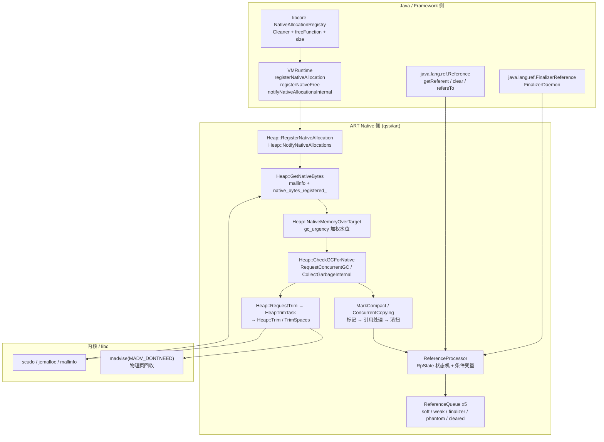
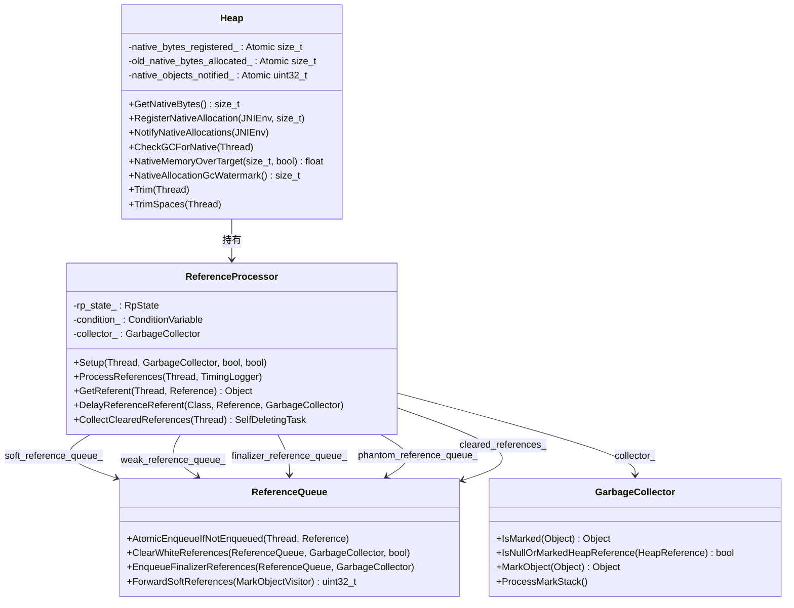
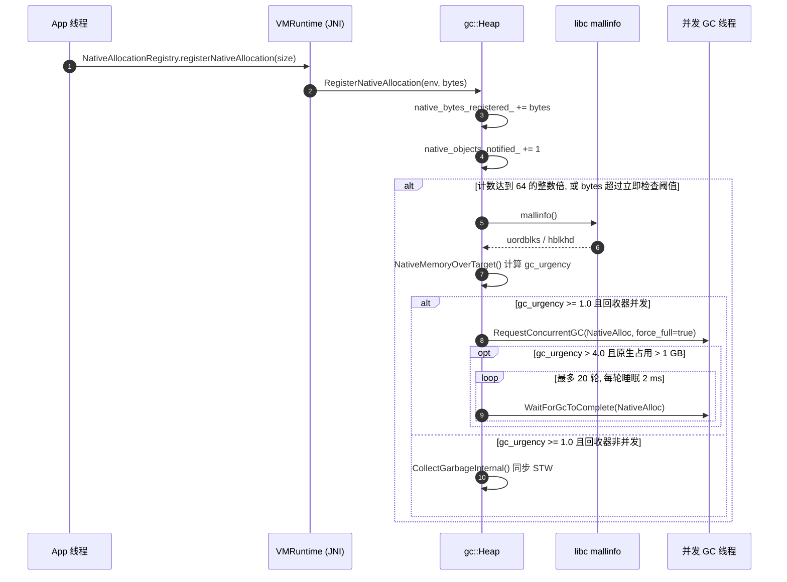
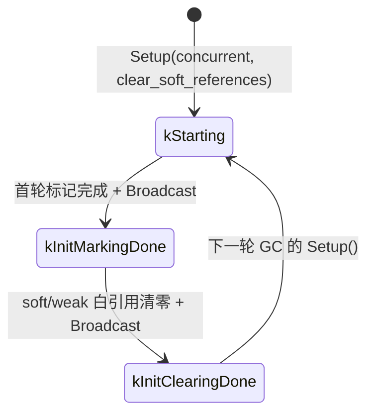
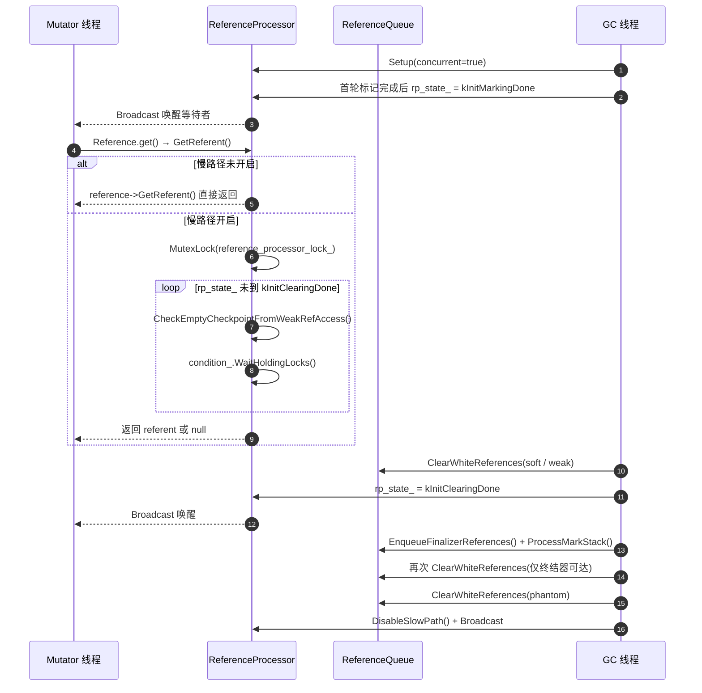

# 06 · Native 内存压力联动与引用处理防卡顿

> [!IMPORTANT]
> **一句话核心结论**：ART 用「`mallinfo()` 采样 + 显式注册字节」把 **Java 堆之外的原生内存**纳入 GC 触发决策——`gc_urgency` 加权水位超过 1.0 就请求回收，超过 4.0 且原生占用破 1 GB 时以 20 轮 × 2 ms 的有限睡眠逼停高速分配者；每次 GC 结束时用 5 秒去重的后台 `Heap::Trim` 把托管空间的物理页 `madvise` 还给内核；而 `ReferenceProcessor` 用 `kStarting → kInitMarkingDone → kInitClearingDone` 三段状态加条件变量慢路径，把「引用处理期间不许解引用」的阻塞面压到最小——但 `FinalizerReference` 与 native weak（JNI `WeakGlobalRef`、`String` intern 表）在二次标记窗口内**原理上无法安全返回强指针**，`getReferent()` 只能等待，这正是弱引用/终结器卡顿的结构性根因。

| 项目 | 内容 |
| :--- | :--- |
| **机制定位** | Native 内存压力感知的 GC 触发策略 + 后台堆裁剪 + 引用（软/弱/幽灵/终结器）并发处理与阻塞控制 |
| **源码模块（相对 `qssi/art/`）** | `runtime/gc/heap.cc`、`runtime/gc/heap.h`、`runtime/gc/reference_processor.cc`、`runtime/gc/reference_processor.h`、`runtime/gc/reference_queue.cc` |
| **核心类 / 入口** | `gc::Heap`、`gc::ReferenceProcessor`、`gc::ReferenceQueue`、`gc::GarbageCollector`、`marker::MarkCompact`、`collector::ConcurrentCopying` |
| **Java 侧配合** | `libcore.util.NativeAllocationRegistry`、`VMRuntime.registerNativeAllocation/registerNativeFree/notifyNativeAllocationsInternal`、`java.lang.ref.Reference`、`java.lang.ref.FinalizerReference` |
| **关键常量 / 启动参数** | `kNotifyNativeInterval = 64`、`kCheckImmediatelyThreshold = 10 MB / 64`、`kStopForNativeFactor = 4.0`、`kGcWaitIters = 20`、`kGcWaitSleepMicros = 2000`、`kHeapTrimWait = 5000 ms`、`-XX:StopForNativeAllocs`（默认 1 GB）、`-XX:ForegroundHeapGrowthMultiplier`、`-XX:HeapMaxFree` |
| **关键系统属性** | `dalvik.vm.heapmaxfree`、`dalvik.vm.heapminfree`、`dalvik.vm.foreground-heap-growth-multiplier`、`dalvik.vm.gctype` |
| **关键 GC Cause** | `kGcCauseForNativeAlloc`（日志打印为 `NativeAlloc`）、`kGcCauseTrim`（`HeapTrim`） |
| **源码基线** | `/home/voyah/workspace/8397/qssi/art`（Android 15/16 主线级 QSSI，只读） |

## 1. What：机制是什么？

### 1.1 问题域：Java 堆看不见的那一半

Android 进程的内存由两部分组成：

- **托管堆（Java Heap）**：ART 的 `Heap` 管理，分配大小对 GC 完全可见，是传统 GC 触发的唯一依据。
- **原生堆（Native Heap）**：`malloc`/`new`/`mmap`/GPU 驱动/硬件 Buffer 等分配，生命周期往往由 Java 对象间接持有（典型如 `Bitmap` 的像素、`MediaCodec` 的编解码缓冲、`Surface` 的图形缓冲）。

这两半的「计量单位」和「回收路径」完全不同：Java 对象可能只有几十字节，却持有着几十 MB 的原生缓冲；只要 Java 对象仍可达，这块原生内存就无法释放。传统 GC 只看 Java 堆占用，于是出现 **Java 堆一片平静、进程 RSS 已经逼近上限** 的致命盲区。ART 的两套机制分别针对这个盲区的两端：

1. **触发端**：让 GC 能感知原生内存压力，在 Java 堆还没满时就提前介入（`Heap::NativeMemoryOverTarget` / `CheckGCForNative`）。
2. **回收端**：GC 之后把已经空出来的托管空间物理页归还内核（`Heap::Trim`），并把「引用处理」对 mutator 的阻塞控制到可解释的范围内（`ReferenceProcessor`）。

```
                    ┌──────────────────────────────────────────────┐
                    │             一个 Android 进程                 │
                    ├──────────────────────┬───────────────────────┤
   Java 对象 ──────►│   托管堆 (GC 可见)    │   原生堆 (GC 盲区)     │
   (几十字节)        │  num_bytes_allocated_│  mallinfo().uordblks  │
                    │                      │  + 显式注册字节        │
                    └──────────────────────┴───────────────────────┘
                              ▲                        ▲
                              │                        │
                  NativeMemoryOverTarget 把两者加权求和后比较水位
```

### 1.2 核心术语表

| 术语 | 含义 | 源码锚点 |
| :--- | :--- | :--- |
| `NativeAllocationRegistry` | libcore 提供的「Java 对象持有原生内存」注册器，用 `Cleaner` 在对象不可达后调用 `freeFunction` | [NativeAllocationRegistry.java](file:///home/voyah/workspace/8397/qssi/libcore/luni/src/main/java/libcore/util/NativeAllocationRegistry.java#L501-L530) |
| `native_bytes_registered_` | 通过 `registerNativeAllocation` 显式登记、尚未 `registerNativeFree` 的净字节数；**不含** malloc 分配（那部分由 `mallinfo` 隐式统计） | [heap.h](file:///home/voyah/workspace/8397/qssi/art/runtime/gc/heap.h#L1526-L1531) |
| `old_native_bytes_allocated_` | 上一次 GC 结束时 `GetNativeBytes()` 的快照，用于计算「本轮 GC 之后新增的原生字节」 | [heap.cc](file:///home/voyah/workspace/8397/qssi/art/runtime/gc/heap.cc#L2941-L2948) |
| `gc_urgency` | 加权后的「Java + Native 实际占用」相对「允许水位」的比值；`>= 1.0` 触发，`> 4.0` 进入危险区 | [heap.cc](file:///home/voyah/workspace/8397/qssi/art/runtime/gc/heap.cc#L4403-L4427) |
| `NativeAllocationGcWatermark()` | 允许的原生内存水位基线：`target_footprint_ / 8 + max_free_` | [heap.h](file:///home/voyah/workspace/8397/qssi/art/runtime/gc/heap.h#L1301-L1306) |
| `HeapGrowthMultiplier()` | 前台（jank 可感知）返回配置倍率，后台返回 `1.0`；用于放缩原生内存允许量 | [heap.cc](file:///home/voyah/workspace/8397/qssi/art/runtime/gc/heap.cc#L3803-L3810) |
| `Heap::Trim` | GC 之后的后台裁剪：收缩监视器、裁剪 JNI 引用表、归还托管空间物理页、裁剪 JIT/校验器 Arena | [heap.cc](file:///home/voyah/workspace/8397/qssi/art/runtime/gc/heap.cc#L1619-L1637) |
| `RpState` | 引用处理三段状态：`kStarting` / `kInitMarkingDone` / `kInitClearingDone` | [reference_processor.h](file:///home/voyah/workspace/8397/qssi/art/runtime/gc/reference_processor.h#L117-L121) |
| 慢路径（slow path） | 引用处理期间，`Reference.get()` 必须进锁等待的代码路径；CMC 用 `Reference.slowPathEnabled` 静态字段，CC 用每线程 `weak_ref_access_enabled` | [reference_processor.cc](file:///home/voyah/workspace/8397/qssi/art/runtime/gc/reference_processor.cc#L92-L166) |
| Native weak reference | JNI `WeakGlobalRef` 与 ART 内部系统弱引用（如 `String` intern 表）：**终结器可达期间不清空**，但**可以解引用成强指针** | [java_vm_ext.cc](file:///home/voyah/workspace/8397/qssi/art/runtime/jni/java_vm_ext.cc#L867-L895) |
| 二次标记（finalizer marking） | 首轮标记完成后，从待终结对象出发再标记一遍，防止其引用对象被提前回收 | [reference_processor.cc](file:///home/voyah/workspace/8397/qssi/art/runtime/gc/reference_processor.cc#L204-L317) |

### 1.3 架构定位



图中可以看到三个闭环：

- **压力闭环**：`NativeAllocationRegistry` → `VMRuntime` → `Heap` → GC。
- **回收闭环**：GC → `RequestTrim` → 后台任务线程 → `madvise`。
- **阻塞闭环**：mutator 调 `Reference.get()` → `ReferenceProcessor::GetReferent` → GC 线程推进 `RpState` 后广播唤醒。

### 1.4 职责边界（它不做什么）

- **不统计 mmap/显存/DMA-BUF 的全部原生内存**：`mallinfo()` 只覆盖系统分配器（scudo/jemalloc）的堆；直接 `mmap` 的图形缓冲、`ashmem`、`ION/DMA-BUF` 必须由调用方通过 `NativeAllocationRegistry.createNonmalloced()` 显式登记。
- **不保证「注册的大小」精确**：`NativeAllocationRegistry.size` 只是估算值，代码注释明确允许近似（Approximate values are acceptable）。
- **不主动释放原生内存**：GC 只负责让持有者变得不可达，真正的 `free` 由 `Cleaner`/`freeFunction` 执行；ART 的 `Heap::Trim` 只归还 **托管空间** 的物理页。
- **不保证引用处理零阻塞**：`ReferenceProcessor` 的目标是「把不可避免的阻塞限制在特定引用类型和特定窗口」，而不是消除等待。

## 2. Why：为什么需要它？

### 2.1 痛点一：Java 堆平静 ≠ 进程安全

如果没有 native 触发机制，GC 只看 Java 堆占用。考虑一个典型车机场景：

| 对象 | Java 侧大小 | 持有的原生内存 | GC 看到的压力 |
| :--- | ---: | ---: | :--- |
| 一个 4K 视频帧 `Bitmap` | ~64 B | ~33 MB | 64 B |
| `MediaCodec` 输出缓冲 | ~200 B | ~8 MB | 200 B |
| 一块 GPU 纹理（经 JNI 持有） | ~100 B | ~16 MB | 100 B |
| 一个 native 解析树（第三方库） | ~50 B | ~40 MB | 50 B |

只要这些 Java 对象仍被 Activity/Task 引用，GC 就认为「堆很空」，不会回收；而进程的 native 占用可以在几分钟内涨到数 GB，最终触发 LMKD 杀进程或系统级 OOM。上游文档记录过一个极端案例：Google Calculator 因 `BigInteger` 背后的十进制数字数组估算严重偏低，直接导致系统进程重启。

显式注册（`registerNativeAllocation`）看似能解决，但工程上极难准确：一个 Java 对象往往持有一整棵 C++ 对象树，大小依赖运行期计算，还可能被多个 Java 对象共享，第三方库更不会暴露内部对象大小。

于是 ART 采用 **「系统分配器总量」为主、显式注册为辅** 的折中：

```text
原生内存总量 = mallinfo().uordblks（系统分配器在用字节）
             + native_bytes_registered_（非 malloc 且显式登记的净字节）
```

这样会丢失「哪个 Java 对象拥有多少」的归属信息，但换来对 **总量** 的数量级准确感知——这正是触发决策真正需要的。

### 2.2 痛点二：引用处理的「二次标记窗口」

引用处理的正确性依赖两个阶段：

1. **首轮标记**：确定强可达对象，从而决定哪些 `WeakReference` 要清空、哪些对象需要终结。
2. **二次标记**：从「即将被终结的对象」出发再标记，保证终结器运行期间它引用的对象不会被回收，也保证 `PhantomReference` 只在终结器确定无法复活 referent 之后才入队。

问题出在第 2 阶段：此时若 mutator 调用 `WeakReference.get()` / `JNI GetObject` / `String` intern 查询，会试图把弱引用解引用成强指针。而对 **native weak reference**：

- **referent 尚未标记**：只能返回 `null`。但终结器随后可能标记它，甚至把它放进永久数据结构——返回 `null` 就是错的。
- **referent 已标记**：看似可以返回强指针。但它可能是在终结器标记过程中刚被标记的，其 **下游对象还没被 trace**。让 mutator 看到这个强指针，等于要求 mutator 参与标记——而 GC 的实现前提是「mutator 可见对象在首轮标记中已全部处理完」，并不准备支持这种中途加入。

结论：在二次标记窗口内，native weak reference **无法安全解引用**，只能阻塞。这正是 [reference_processing_jank.md](file:///home/voyah/workspace/8397/qssi/art/runtime/reference_processing_jank.md) 所描述的核心矛盾，也是 `GetReferent` 慢路径中大量等待逻辑的来源。

### 2.3 朴素实现 vs ART 实现：代价矩阵

| 维度 | 朴素实现 | ART 机制 | 代价 / 边界 |
| :--- | :--- | :--- | :--- |
| 原生内存触发 | 只看 Java 堆 → 原生暴涨不触发 | `mallinfo` + 注册字节构成 `gc_urgency` | `mallinfo()` 约 1 μs，必须采样节流 |
| 采样频率 | 每次分配都调 `mallinfo` | 每 64 次注册检查一次，超大分配立即检查 | 两次检查之间最多可分配约 10 MB |
| 危险区止损 | 无 | `urgency > 4.0` 且原生 > 1 GB 时等待 GC，最多 20×2 ms | 最多阻塞约 40 ms，之后放弃等待 |
| 物理页归还 | 只释放对象，虚拟页仍驻留 | GC 后 5 s 去重调度 `Heap::Trim`，`madvise` 归还 | 前台不裁 dlmalloc（持锁久易卡顿） |
| 引用读取 | 直接读 referent → 可能读到白对象 | 慢路径按 `RpState` 返回「已标记转发指针」或等待 | 终结器引用与 `kStarting` 阶段只能等待 |
| 阻塞可观测 | 无 | ATrace `GetReferent blocked` + 超 10 ms 告警 | 只能告警，不能消除 |

### 2.4 设计演进：为什么最终选择 `mallinfo`

1. **早期：`VMRuntime.registerNativeAllocation`** —— 由调用方报告精确字节。优点是归属清晰、GC 可精确判断；缺点是几乎没人能报准。
2. **中期：`NativeAllocationRegistry`** —— 把「注册 + 释放 + 估算大小」封装成可复用 API，并用 `Cleaner` 自动化释放。它改善了易用性，但没有解决估算不准的根本问题。
3. **当前：`mallinfo()` 为主** —— GC 定期读取系统分配器总量，假设「这些内存都可能需要 GC 帮忙回收」。代价是丢失归属信息，收益是总量准确且无需应用配合。
4. **补充通道**：非 malloc 分配（`mmap`/`ashmem`/显存）仍通过 `createNonmalloced()` 显式登记，进入 `native_bytes_registered_`。

## 3. How：源码级实现原理深度剖析

### 3.1 核心数据结构与内存布局

#### 3.1.1 `NativeAllocationRegistry.size` 的位域编码

`size` 是一个 Java `long`，最低位被复用为「是否主要由 malloc 分配」的标志位，其余位才是估算字节数。这种编码方式避免了给每个注册器再加一个字段，同时让 ahat 等堆分析工具可以继续读取。

```text
 NativeAllocationRegistry.size  (Java long, 64 bit)
 ┌──────────┬───────────────────────────────────────────────────────────┐
 │  bit 0   │  bit 1 .. bit 63                                          │
 ├──────────┼───────────────────────────────────────────────────────────┤
 │ IS_MALLOCED │  估算字节数（仅非 malloc 部分参与精确记账）             │
 │   0x1    │  取值范围 0 .. 2^63-1                                     │
 └──────────┴───────────────────────────────────────────────────────────┘
   isMalloced()  ==  (size & IS_MALLOCED) == IS_MALLOCED
   DEFAULT_SIZE  ==  98   // malloced 且调用方未给大小时的偶数占位值
```

对应的源码在 [NativeAllocationRegistry.java](file:///home/voyah/workspace/8397/qssi/libcore/luni/src/main/java/libcore/util/NativeAllocationRegistry.java#L587-L605)：

- `isMalloced()` 为真时，注册走 `notifyNativeAllocation()` / `notifyNativeAllocationsInternal()`，**只推动 GC 采样**，不增加 `native_bytes_registered_`（避免与 `mallinfo` 重复计数）。
- `isMalloced()` 为假时，走 `registerNativeAllocation(size)`，字节数进入精确账本。
- 释放时只对非 malloc 的分配调用 `registerNativeFree(size)`。

#### 3.1.2 Heap 侧的原生字节账本

```text
             ┌──────────────────── GetNativeBytes() ───────────────────────────┐
             │                                                                  │
  mallinfo() │  uordblks  (系统分配器在用字节)                                   │
  ──────────►│  glibc 特例: max(uordblks, hblkhd)                                │
             │            +                                                     │
  register-  │  native_bytes_registered_  (非 malloc 且显式注册的净字节)          │
  Native     │                                                                  │
  Allocation │  = current_native_bytes ─────────────────────┐                    │
             └──────────────────────────────────────────────┼────────────────────┘
                                                            │
  old_native_bytes_allocated_ (上次 GC 结束快照) ───────────┤
                                                            ▼
                                     new_native = current - old  (若 current < old 则结束)
                                                            │
                                                            ▼
              gc_urgency = ( Java 已分配字节 + new_native/2 + old_native/65536 )
                           ─────────────────────────────────────────────────────
                           ( java_gc_start_bytes + watermark × multiplier / 2 )
```

`GetNativeBytes()` 的实现见 [heap.cc](file:///home/voyah/workspace/8397/qssi/art/runtime/gc/heap.cc#L2757-L2792)。其中有两个值得注意的工程细节：

- **glibc 的符号扩展问题**：glibc 把 `uordblks`/`hblkhd` 声明为 `int`，当 `size_t` 更宽时必须强制转成 `unsigned int`，否则超过 2 GB 会出现符号扩展错误。
- **`hblkhd` 语义分歧**：jemalloc 把它解释为「整个堆的映射块」，glibc 解释为「直接 mmap 的大对象」。因此代码只在 glibc 下取 `max(uordblks, hblkhd)`，bionic 下只信 `uordblks`。
- **为什么不用 RSS**：代码注释明确否决了 `/proc/self/statm`——RSS 会随内存压力下页面的 unmapped/remapped 而波动，用它触发 GC 风险太高。

#### 3.1.3 `ReferenceProcessor` 与五个引用队列



五类队列的分工在 [reference_processor.cc](file:///home/voyah/workspace/8397/qssi/art/runtime/gc/reference_processor.cc#L38-L46) 初始化，处理顺序决定了正确性：

```text
 ReferenceProcessor
 ├── soft_reference_queue_      SoftReference       首轮后清白引用；内存紧张时优先放弃
 ├── weak_reference_queue_      WeakReference       首轮后清白引用
 ├── finalizer_reference_queue_ FinalizerReference  白的 referent 搬进 zombie + 触发二次标记
 ├── phantom_reference_queue_   PhantomReference    二次标记完成后才清（保证不被复活）
 └── cleared_references_        本轮被清空的引用      GC 结束后统一投递到 Java ReferenceQueue
```

### 3.2 Native 内存压力触发链路

#### 3.2.1 入口：Java 侧注册 → JNI → Heap

`NativeAllocationRegistry.registerNativeAllocation(referent, nativePtr)` 先创建 `Cleaner` 与 `CleanerThunk`，再按 `size` 的低位选择注册方式；随后 `CleanerThunk.run()` 在对象不可达时执行 `applyFreeFunction()` 并 `registerNativeFree()`。JNI 侧在 [dalvik_system_VMRuntime.cc](file:///home/voyah/workspace/8397/qssi/art/runtime/native/dalvik_system_VMRuntime.cc#L300-L324) 把 `jlong` 校验、裁剪成 `size_t` 后交给 `Heap`。

#### 3.2.2 两级节流：64 次采样 + 超大分配立即检查

`mallinfo()` 单次约 1 微秒，不能每次分配都调。ART 用了两个常量（[heap.h](file:///home/voyah/workspace/8397/qssi/art/runtime/gc/heap.h#L174-L192)）：

| 常量 | Android 取值 | Host 取值 | 作用 |
| :--- | ---: | ---: | :--- |
| `kNotifyNativeInterval` | 64 | 384 | 每 64 次注册才调用一次 `mallinfo`；Host 的 `mallinfo` 慢且内存不紧张 |
| `kCheckImmediatelyThreshold` | `10'000'000 / 64` ≈ 156 KB | `10'000'000 / 384` ≈ 26 KB | 单次注册超过此值立即检查；与间隔相乘约 10 MB，保证两次检查之间不会分配过多 |

`Heap::RegisterNativeAllocation` 的判定条件是：

```cpp
uint32_t objects_notified =
    native_objects_notified_.fetch_add(1, std::memory_order_relaxed);
if (objects_notified % kNotifyNativeInterval == kNotifyNativeInterval - 1
    || bytes > kCheckImmediatelyThreshold) {
  CheckGCForNative(Thread::ForEnv(env));
}
```

而 malloc 路径（`NativeAllocationRegistry` 的 `IS_MALLOCED` 分支）不调 `RegisterNativeAllocation`，而是调 `NotifyNativeAllocations()`：它一次把计数器加 64，然后同样进入 `CheckGCForNative`。这意味着 **纯 malloc 的应用也能被感知**，但采样粒度更粗。

这条链路的完整时序：



#### 3.2.3 水位公式逐项拆解

`NativeMemoryOverTarget()`（[heap.cc](file:///home/voyah/workspace/8397/qssi/art/runtime/gc/heap.cc#L4392-L4427)）返回的是比值而非布尔值，这样上层可以直接分级处理。两个折扣因子是理解公式的关键：

```cpp
static constexpr size_t kOldNativeDiscountFactor = 65536;  // Approximately infinite for now.
static constexpr size_t kNewNativeDiscountFactor = 2;
```

- `new_native_bytes / 2`：**本轮 GC 之后新增**的原生字节只按一半计入压力——因为其中一部分可能马上被应用自己释放，不需要 GC 插手。
- `old_native_bytes / 65536`：**历史存量**原生字节几乎完全折价。注释直白地写着「approximately infinite」，即当前策略是「只看增量、不看存量」。
- 分子中的 `GetBytesAllocated()` 是 Java 堆已分配字节，也就是把两边的压力加在一起。
- 分母 `java_gc_start_bytes`：并发回收器用 `concurrent_start_bytes_`，非并发用 `target_footprint_`。
- 分母中的原生允许量是 `NativeAllocationGcWatermark() × HeapGrowthMultiplier() / 2`。

`HeapGrowthMultiplier()` 的取值需要特别注意（[runtime.cc](file:///home/voyah/workspace/8397/qssi/art/runtime/runtime.cc#L1799-L1809)）：

```cpp
foreground_heap_growth_multiplier =
    runtime_options.GetOrDefault(Opt::ForegroundHeapGrowthMultiplier) + 1.0f;
```

即配置默认值 `2.0` 在启动时被 **加一** 成 `3.0`，这才是前台实际使用的倍率；而后台（`!CareAboutPauseTimes()`）直接返回 `1.0`。代入公式：

| 进程状态 | `HeapGrowthMultiplier()` | 原生允许量相对 watermark | 含义 |
| :--- | ---: | ---: | :--- |
| 后台（jank 不可感知） | 1.0 | 0.5 × watermark | 原生净增超过约 1 个 watermark 就触发 |
| 前台（jank 可感知，默认配置） | 3.0 | 1.5 × watermark | 原生净增超过约 3 个 watermark 才触发 |

以 `target_footprint_ = 256 MB`、`max_free_ = 32 MB` 为例：

```text
watermark = 256 MB / 8 + 32 MB = 64 MB
后台允许原生净增 ≈ 64 MB
前台允许原生净增 ≈ 192 MB
```

这解释了为什么「同一份代码在后台更容易被 native GC 打断」——后台的允许水位只有前台的三分之一。

#### 3.2.4 urgency 分级与 20 轮睡眠

`CheckGCForNative()` 把比值分成三档（[heap.cc](file:///home/voyah/workspace/8397/qssi/art/runtime/gc/heap.cc#L4430-L4466)）：

| `gc_urgency` | 附加条件 | 动作 | 阻塞时间 |
| :--- | :--- | :--- | :--- |
| `< 1.0` | 无 | 什么都不做 | 0 |
| `>= 1.0` | 并发回收器 | `RequestConcurrentGC(..., force_full=true)` | 0（异步） |
| `>= 1.0` | 非并发回收器 | `CollectGarbageInternal(NonStickyGcType(), kGcCauseForNativeAlloc, ...)` | 整个 GC 时长（同步 STW） |
| `> 4.0` | 并发 + 原生 > `stop_for_native_allocs_` | 请求 GC 后进入有限等待循环 | 最多约 40 ms |

有限等待循环的常量：

```cpp
static constexpr int kGcWaitIters = 20;
static constexpr int kGcWaitSleepMicros = 2000;
```

每轮先检查 GC 是否已完成；未完成则睡 2 ms，并在第 10、20 轮打印 `Slept N times in native allocation, waiting for GC` 警告。设计意图是 **给刚请求的 GC 一点启动时间**，而不是无上限地把分配线程挂死——40 ms 后无论 GC 是否完成都放行，避免「等 GC 变成新的 OOM」。

`stop_for_native_allocs_` 来自启动参数 `-XX:StopForNativeAllocs`，[runtime_options.def](file:///home/voyah/workspace/8397/qssi/art/runtime/runtime_options.def#L61-L68) 中默认 `1 * GB`。它是一道额外的保险：只有当原生占用本身已经很大时，才值得用「阻塞分配」这种激烈手段去逼 GC。

#### 3.2.5 为什么非并发回收器会同步 STW

`IsGcConcurrent()`（[heap.h](file:///home/voyah/workspace/8397/qssi/art/runtime/gc/heap.h#L1263-L1271)）只有在回收器为 `CC` / `CMC` / `CMS` 及其 Background 变体时才为真。若设备配置成 `-Xgc:SS`（半空间）等非并发回收器，`CheckGCForNative` 只能调用 `CollectGarbageInternal` 同步完成 GC——**分配线程自己变成 GC 线程**，这一次原生分配会直接承担整个 STW。这是「低端/特殊配置设备上 native 分配偶发长卡顿」的一个可解释来源。

### 3.3 `Heap::Trim`：后台物理页回收

#### 3.3.1 触发与节流：GC 后 5 秒去重调度

每次 `CollectGarbageInternal` 完成后都会调用 `RequestTrim(self)`（[heap.cc](file:///home/voyah/workspace/8397/qssi/art/runtime/gc/heap.cc#L2941-L2948)），但真正的 `Trim` 不会立刻执行：

- `pending_heap_trim_` 在 `pending_task_lock_` 保护下去重：已有一个待执行裁剪任务时，新的请求直接返回。
- `HeapTrimTask` 的触发时间设为 `NanoTime() + kHeapTrimWait`，即 **5 秒后**（[heap.cc](file:///home/voyah/workspace/8397/qssi/art/runtime/gc/heap.cc#L4194-L4221)）。
- 任务由 `task_processor_` 的后台线程执行，不占用 GC 线程，也不占用 mutator。
- `CanAddHeapTask()` 会检查 Runtime 已启动完成、未在关闭、且当前线程没有 native 栈溢出（[heap.cc](file:///home/voyah/workspace/8397/qssi/art/runtime/gc/heap.cc#L4063-L4069)）。

5 秒窗口的意义：GC 刚结束时页面往往还会被马上复用，立刻裁剪等于白做；延迟 5 秒可以让「真正空闲」的页面暴露出来，同时用去重避免 GC 风暴把裁剪任务堆爆。

#### 3.3.2 `Heap::Trim` 的四段动作

```cpp
void Heap::Trim(Thread* self) {
  if (!CareAboutPauseTimes()) {                 // 后台进程
    ScopedGCCriticalSection gcs(self, kGcCauseTrim, kCollectorTypeHeapTrim);
    ScopedSuspendAll ssa(__FUNCTION__);
    runtime->GetMonitorList()->DeflateMonitors();
  }
  TrimIndirectReferenceTables(self);            // JNI 全局/局部引用表
  TrimSpaces(self);                             // 托管空间物理页
  runtime->GetArenaPool()->TrimMaps();          // JIT / 校验器 Arena
}
```

四段动作的语义：

| 阶段 | 动作 | 前台是否执行 | 卡顿风险 |
| :--- | :--- | :--- | :--- |
| 监视器收缩 | `DeflateMonitors()` 把空闲 fat monitor 退回 thin lock | 否 | 需要 `ScopedSuspendAll`，后台才做 |
| JNI 引用表 | `TrimGlobals()` + 对每个线程 checkpoint 执行 `TrimLocals()` | 是 | checkpoint 需要线程配合，但通常很短 |
| 托管空间 | `MallocSpace::Trim()` 释放空间尾部/空洞页面 | RosAlloc 是；DlMalloc 仅后台 | dlmalloc 裁剪会长时间持空间锁 |
| Arena | `ArenaPool::TrimMaps()` 归还 JIT/校验器用的映射 | 是 | 低 |

前台不裁 dlmalloc 的原因写在代码注释里：`Don't trim dlmalloc spaces if we care about pauses since this can hold the space lock for a long period of time.` 这是「省内存」与「不卡顿」之间的显式取舍。

#### 3.3.3 物理页真正还给内核的位置

`TrimSpaces()`（[heap.cc](file:///home/voyah/workspace/8397/qssi/art/runtime/gc/heap.cc#L1718-L1762)）先伪装成一次 GC（`StartGC(kGcCauseTrim, kCollectorTypeHeapTrim)`），防止后台压缩在裁剪期间删除正在遍历的空间；随后遍历所有连续空间：

```cpp
for (const auto& space : continuous_spaces_) {
  if (space->IsMallocSpace()) {
    gc::space::MallocSpace* malloc_space = space->AsMallocSpace();
    if (malloc_space->IsRosAllocSpace() || !CareAboutPauseTimes()) {
      managed_reclaimed += malloc_space->Trim();
    }
    total_alloc_space_size += malloc_space->Size();
  }
}
```

两种分配器的页释放方式不同：

- **RosAlloc**（[rosalloc_space.cc](file:///home/voyah/workspace/8397/qssi/art/runtime/gc/space/rosalloc_space.cc#L313-L330)）：先 `rosalloc_->Trim()` 收缩尾部，若分配器不能「释放所有空页」再调 `ReleasePages()`，把空闲 run 的页 `madvise` 掉。
- **DlMalloc**（[dlmalloc_space.cc](file:///home/voyah/workspace/8397/qssi/art/runtime/gc/space/dlmalloc_space.cc#L333-L343)）：`mspace_trim(mspace_, 0)` 收缩堆尾，再用 `mspace_inspect_all(DlmallocMadviseCallback)` 扫描页级空洞并逐页 `madvise`。

注意：这里归还的是 **托管堆（Java 对象所在空间）** 的物理页。原生 `malloc` 堆的页由 libc（scudo/jemalloc）自己的回收策略管理，`Heap::Trim` 不会替它做决定——所以「native 内存涨上去下不来」时，裁剪托管堆通常无济于事，必须回到分配源头。

### 3.4 `ReferenceProcessor` 并发状态机

#### 3.4.1 三态定义



| 状态 | 含义 | `GetReferent` 的行为 |
| :--- | :--- | :--- |
| `kStarting` | 已开始引用处理，但首轮标记尚未确认完成 | 无法判断标记状态，**无条件等待** |
| `kInitMarkingDone` | 首轮标记完成，二次标记尚未开始 | 可按 `collector_->IsMarked()` 预测：已标记返回转发指针，未标记返回 `null` |
| `kInitClearingDone` | 所有 mutator 可见数据已标记为黑，软/弱引用已处理 | 直接返回最终 referent，不再等待 |

状态迁移与广播都在持有 `reference_processor_lock_` 时完成（[reference_processor.cc](file:///home/voyah/workspace/8397/qssi/art/runtime/gc/reference_processor.cc#L204-L317)），因此 `GetReferent` 一旦拿到锁，就能看到稳定的状态。

#### 3.4.2 端到端时序：mutator 被阻塞与唤醒



#### 3.4.3 `GetReferent` 慢路径逐段精读

[reference_processor.cc](file:///home/voyah/workspace/8397/qssi/art/runtime/gc/reference_processor.cc#L92-L166) 是整篇最关键的代码。它的快路径是一个**无锁布尔读**：

```cpp
auto slow_path_required = [this, self]() REQUIRES_SHARED(Locks::mutator_lock_) {
  return gUseReadBarrier ? !self->GetWeakRefAccessEnabled() : SlowPathEnabled();
};
if (!slow_path_required()) {
  return reference->GetReferent();
}
```

- **CMC（无读屏障）**：读 `java.lang.ref.Reference` 类的静态字段 `slowPathEnabled`。字段偏移通过「类的最后一个字段」动态计算（`GetSlowPathFlagOffset`），避免依赖 `WellKnownClasses` 尚未初始化的时机。设置该字段必须暂停所有 mutator，因此快路径可以完全无锁。
- **CC（有读屏障）**：读当前线程的 `weak_ref_access_enabled`。GC 通过 checkpoint 逐线程关闭（[concurrent_copying.cc](file:///home/voyah/workspace/8397/qssi/art/runtime/gc/collector/concurrent_copying.cc#L986-L996)），再在 `ReenableWeakRefAccess()` 中统一打开并广播（[concurrent_copying.cc](file:///home/voyah/workspace/8397/qssi/art/runtime/gc/collector/concurrent_copying.cc#L1704-L1720)）。

进入慢路径后，先做一次「空引用快速返回」，因为 null 不会在引用处理过程中变成非 null：

```cpp
ObjPtr<mirror::Object> referent = reference->template GetReferent<kWithoutReadBarrier>();
if (referent.IsNull()) {
  return referent;
}
```

随后是关键循环。三类情况会被无条件挂起：

```cpp
if (UNLIKELY(reference->IsFinalizerReferenceInstance()
             || rp_state_ == RpState::kStarting
             || (other_read_barrier && reference->IsPhantomReferenceInstance()))) {
  self->CheckEmptyCheckpointFromWeakRefAccess(Locks::reference_processor_lock_);
  ATraceBegin("GetReferent blocked");
  condition_.WaitHoldingLocks(self);
  continue;
}
```

- `FinalizerReference`：即使已经拿到 referent，也不能返回。终结器引用的 referent 会被搬进 `zombie` 字段，可达性语义特殊，必须等整个引用处理结束。
- `kStarting`：标记状态未知，返回任何值都可能错。
- Baker 读屏障之外的 phantom：同理，幽灵引用的入队时机必须晚于二次标记。

等待前调用 `CheckEmptyCheckpointFromWeakRefAccess` 是必要的：线程挂起需要空 checkpoint 才能完成，而一个正持有 `reference_processor_lock_` 阻塞在条件变量上的线程，必须允许空 checkpoint 穿透进来，否则会与「暂停所有线程」互相死锁。这条约束在 `runtime/mutator_gc_coord.md` 中有完整论证。

在 `kInitMarkingDone` 状态下则可以立即给出正确答案：

```cpp
referent = reference->GetReferent<kWithoutReadBarrier>();
ObjPtr<mirror::Object> forwarded_ref =
    referent.IsNull() ? nullptr : collector_->IsMarked(referent.Ptr());
return forwarded_ref;
```

- referent 已标记：`IsMarked()` 返回转发后的地址（CC 下可能是 to-space 指针），可以安全返回。
- referent 未标记：返回 `nullptr`，与「它将被本轮回收」一致。

最后是阻塞可观测性：整个等待期间会开 ATrace 切片 `GetReferent blocked`，若累计超过 10 ms 就打一条 WARNING：

```cpp
static constexpr uint64_t kReportMillis = 10;  // Long enough to risk dropped frames.
if (millis > kReportMillis) {
  LOG(WARNING) << "Weak pointer dereference blocked for " << millis << " milliseconds.";
}
```

这条日志是线上定位「弱引用卡顿」最直接的证据。

#### 3.4.4 `ProcessReferences` 的三段推进

`ProcessReferences`（[reference_processor.cc](file:///home/voyah/workspace/8397/qssi/art/runtime/gc/reference_processor.cc#L204-L317)）的状态推进必须与 `GetReferent` 的假设严格对应：

1. **补齐软引用**：若本轮不清软引用，先把 `soft_reference_queue_` 中迟到的软引用 `ForwardSoftReferences` 转发并处理标记栈，直到队列为空。
2. **进入 `kInitMarkingDone`**：在锁内断言「慢路径开关与 `concurrent_` 一致」，然后置状态并广播。此时首轮标记已完成，mutator 可以安全地按标记位预测结果。
3. **清软/弱白引用**：`ClearWhiteReferences` 遍历队列，对未标记的 referent 执行 `ClearReferent` 并把引用放入 `cleared_references_`。注释特别说明「This misses references only reachable through finalizers」——只从终结器可达的引用这一轮先不处理。
4. **进入 `kInitClearingDone`**：在锁内置状态并广播。注释解释了安全性：所有 mutator 可见数据已标记为黑，软/弱引用只指向黑对象，因此后续阶段可以放开常规读引用。
5. **终结器二次标记**：`EnqueueFinalizerReferences` 把白 referent 标记、搬进 `zombie`、清空 referent、加入待投递队列；随后 `collector_->ProcessMarkStack()` 从这些对象出发完成二次标记。ATrace 切片 `Marking from N / M finalizers` 记录本轮终结器数量。
6. **补清终结器可达的软/弱引用**：再次 `ClearWhiteReferences(..., report_cleared=true)`。这一段对应 `reference_processing_jank.md` 中描述的语义困境（可能清空一个「已被终结器复活」对象的弱引用），代码选择按普通引用规则处理，并只打印一次警告 `Cleared Reference was only reachable from finalizer`。
7. **清幽灵引用**：二次标记结束后才清 `phantom_reference_queue_`，保证幽灵引用不会早于终结器决策入队。
8. **关闭慢路径**：在 CMC 路径下，锁内调用 `DisableSlowPath(self)` 并广播，唤醒所有等待者。

#### 3.4.5 `FinalizerReference` 为什么成为阻塞根因

`FinalizerReference` 的特殊性来自三重叠加：

- 它的 `get()` 在 Java 层直接返回 `zombie` 字段（[FinalizerReference.java](file:///home/voyah/workspace/8397/qssi/libcore/luni/src/main/java/java/lang/ref/FinalizerReference.java#L44-L56)），而 native 层 `getReferent` 仍会走 `ReferenceProcessor::GetReferent`（[java_lang_ref_FinalizerReference.cc](file:///home/voyah/workspace/8397/qssi/art/runtime/native/java_lang_ref_FinalizerReference.cc#L36-L44)）——终结器守护线程取引用时同样可能被挂起。
- 终结器可达的对象在二次标记中会被重新标记，其下游对象可能尚未 trace 完；此时任何「提前返回强指针」都可能让 mutator 看到未被完整标记的对象图。
- native weak reference（JNI `WeakGlobalRef`、`String` intern 表）还有额外约束：**终结器可达期间不清空**，且**可以解引用成强指针**。这两条组合起来，使得在二次标记窗口内既不能返回 `null`（会误判对象已死），也不能返回强指针（下游未 trace）——唯一安全的选择就是等。

上游文档讨论过一种受限改进：在终结器标记开始时单独记录 referent 的标记位，已标记的可以安全返回。但这需要额外的位图与工作量，收益不明确；另一种更窄的方案是对 `String` intern 表特判——`String` 没有出边，referent 已标记即可安全早返回。两者都只是部分解，不是通用方案。

### 3.5 关键源码对照片段

触发判定核心（[heap.cc](file:///home/voyah/workspace/8397/qssi/art/runtime/gc/heap.cc#L4403-L4427)）：

```cpp
size_t old_native_bytes = old_native_bytes_allocated_.load(std::memory_order_relaxed);
if (old_native_bytes > current_native_bytes) {
  old_native_bytes_allocated_.store(current_native_bytes, std::memory_order_relaxed);
  return 0.0;                                   // 净减少：本轮不触发
}
size_t new_native_bytes = UnsignedDifference(current_native_bytes, old_native_bytes);
size_t weighted_native_bytes = new_native_bytes / kNewNativeDiscountFactor
    + old_native_bytes / kOldNativeDiscountFactor;
size_t add_bytes_allowed =
    static_cast<size_t>(NativeAllocationGcWatermark() * HeapGrowthMultiplier());
size_t java_gc_start_bytes = is_gc_concurrent
    ? concurrent_start_bytes_
    : target_footprint_.load(std::memory_order_relaxed);
size_t adj_start_bytes = UnsignedSum(java_gc_start_bytes,
                                     add_bytes_allowed / kNewNativeDiscountFactor);
return static_cast<float>(GetBytesAllocated() + weighted_native_bytes)
     / static_cast<float>(adj_start_bytes);
```

危险区等待（[heap.cc](file:///home/voyah/workspace/8397/qssi/art/runtime/gc/heap.cc#L4430-L4466)）：

```cpp
static constexpr int kGcWaitIters = 20;
for (int i = 1; i <= kGcWaitIters; ++i) {
  if (!GCNumberLt(GetCurrentGcNum(), max_gc_requested_.load(std::memory_order_relaxed))
      || WaitForGcToComplete(kGcCauseForNativeAlloc, self) != collector::kGcTypeNone) {
    break;
  }
  CHECK(GCNumberLt(starting_gc_num, max_gc_requested_.load(std::memory_order_relaxed)));
  if (i % 10 == 0) {
    LOG(WARNING) << "Slept " << i << " times in native allocation, waiting for GC";
  }
  static constexpr int kGcWaitSleepMicros = 2000;
  usleep(kGcWaitSleepMicros);  // Encourage our requested GC to start.
}
```

裁剪前的去重（[heap.cc](file:///home/voyah/workspace/8397/qssi/art/runtime/gc/heap.cc#L4194-L4221)）：

```cpp
MutexLock mu(self, *pending_task_lock_);
if (pending_heap_trim_ != nullptr) {
  return;                                  // 已有一个待执行任务
}
added_task = new HeapTrimTask(kHeapTrimWait);  // 5 秒后执行
pending_heap_trim_ = added_task;
task_processor_->AddTask(self, added_task);
```

## 4. 能利用这个机制做什么？

> [!WARNING]
> 下面的命令涉及系统属性与运行时参数，修改后通常需要重启 zygote 或目标进程才生效；`libc.debug.malloc.*` 仅建议在 userdebug/eng 版本使用，量产车机禁止长期开启。

### 4.1 用途一：判断「内存涨」到底涨在 Java 还是 Native

这是车机长稳排查的第一步。先看进程总体，再决定是否深入 native 分配栈：

```bash
# 1) 进程总览：看 Java Heap / Native Heap / Graphics / GL 的分项
adb shell dumpsys meminfo com.example.app

# 2) 原生映射明细：按映射段聚合，找异常大的 so / anon 区间
adb shell showmap -a $(adb shell pidof com.example.app)

# 3) 连续采样，算增长斜率（长稳问题必须看斜率，不看单点）
for i in 1 2 3 4 5; do
  adb shell dumpsys meminfo com.example.app | grep -E "Native Heap|Java Heap"
  sleep 60
done
```

判读规则：

- **Java Heap 平稳、Native Heap 持续上升**：优先怀疑 `Bitmap`/`MediaCodec`/图形缓冲/第三方 native 库；继续用 4.2 的 heapprofd 定位。
- **Java Heap 与 Native Heap 同步上升**：先排查 Java 侧泄漏（静态集合、Handler、监听器），因为 Java 对象是原生内存的持有者。
- **Graphics / GL 单项上涨**：多为 Surface/纹理未释放，属于 DMA-BUF/显存，`mallinfo` 看不到，必须显式 `createNonmalloced()` 登记才会进入 `gc_urgency`。

### 4.2 用途二：Native 分配归因（heapprofd / malloc_debug）

```bash
# 方式 A：perfetto heapprofd，抓 30 秒原生分配调用栈
cat > /data/misc/perfetto-configs/native-heap.cfg <<'EOF'
buffers: { size_kb: 65536 }
data_sources: {
  config: {
    name: "android.heapprofd"
    target_buffer: 0
    heapprofd_config: {
      sampling_interval_bytes: 4096
      process_cmdline: "com.example.app"
      duration_ms: 30000
    }
  }
}
EOF
adb shell perfetto -c /data/misc/perfetto-configs/native-heap.cfg -o /data/misc/perfetto-traces/native.pftrace
adb pull /data/misc/perfetto-traces/native.pftrace

# 方式 B：libc malloc_debug（仅 userdebug，需重启进程）
adb shell setprop libc.debug.malloc.options "backtrace=8"
adb shell setprop libc.debug.malloc.program app_process
adb shell am force-stop com.example.app
adb shell am start -n com.example.app/.MainActivity
adb logcat -s libc | grep -i "malloc"
```

heapprofd 的价值在于把「Native Heap 涨了 200 MB」变成「某解码库的 `av_malloc` 占 180 MB」，从而判断是**泄漏**（只增不减）还是**缓存未回收**（随场景波动）。

### 4.3 用途三：定位弱引用/终结器卡顿

这类卡顿的典型特征是：主线程 trace 里出现 `Reference.get()` 或 JNI `GetObject`，且附近有 GC 活动。可按下面顺序取证：

```bash
# 1) 抓 Perfetto，关注 ATrace 切片
#    GetReferent blocked
#    Marking from N / M finalizers
#    Marking for N SoftReferences
#    Deflating monitors
adb shell perfetto -o /data/misc/perfetto-traces/jank.pftrace -t 15s sched freq idle am wm gfx view binder_driver

# 2) 同时抓 ART 的阻塞告警（阈值 10 ms）
adb logcat -s art:I | grep -E "Weak pointer dereference blocked|Cleared Reference was only reachable|Slept .* times in native allocation"

# 3) 如果怀疑 native GC 风暴，观察 GC 行里是否有 NativeAlloc
adb logcat -s art:I | grep -E "NativeAlloc .* GC freed"
```

判读要点：

- **`GetReferent blocked` 很长且与 `Marking from N / M finalizers` 重叠**：说明二次标记里有大量终结器，根因通常在「应用还在用 `finalize()` 释放 native 资源」。治理方向是替换为 `Cleaner`/`NativeAllocationRegistry`，减少终结器数量。
- **`Weak pointer dereference blocked for N milliseconds` 频繁出现**：结合 `N` 的量级判断。几十毫秒已经足以掉帧；持续出现说明引用处理窗口过长，需要减少弱引用总量（尤其 `String` intern 与 JNI WeakGlobalRef）。
- **`Slept .* times in native allocation`**：说明进程处于 native 内存危险区（`gc_urgency > 4.0` 且原生 > 1 GB），GC 已经追不上分配速度。这不是「调大参数」能解决的，必须找分配源头。
- **注意 GC 日志不是全量**：`LogGC` 只在「显式 GC、暂停 >= 5 ms、或整轮 >= 100 ms、或原因不是 ForAlloc 的慢 GC」等条件下打印（[heap.cc](file:///home/voyah/workspace/8397/qssi/art/runtime/gc/heap.cc#L2972-L2993)），且 `kLogAllGCs` 是编译期常量 `false`。因此「没看到 NativeAlloc 日志」不等于「没有 native 触发」，只说明没有慢到阈值。

### 4.4 用途四：参数调优模板

以下参数通过 `dalvik.vm.*` 属性或启动参数生效，修改系统属性后需重启 zygote：

```bash
# 原生内存允许水位相关：watermark = target_footprint/8 + max_free
# 调大 heapmaxfree 会让原生允许量同步变大，native GC 更少但更晚
adb shell setprop dalvik.vm.heapmaxfree 32m
adb shell setprop dalvik.vm.heapminfree 8m

# 前台堆增长倍率（实际生效值 = 配置值 + 1.0，默认配置 2.0 → 实际 3.0）
# 调小会更早触发 native GC，用内存换流畅
adb shell setprop dalvik.vm.foreground-heap-growth-multiplier 1.0

# 换回收器：并发回收器下 native 触发是异步请求，非并发则是同步 STW
adb shell setprop dalvik.vm.gctype CMC

# 重启 zygote 使属性生效
adb shell stop && adb shell start
```

参数取舍：

| 目标 | 调整 | 副作用 |
| :--- | :--- | :--- |
| 减少 native GC 频次 | 调大 `dalvik.vm.heapmaxfree` 或 `foreground-heap-growth-multiplier` | 原生内存峰值更高，OOM 风险上升 |
| 更早回收原生内存 | 调小上述两个值 | GC 次数增加，CPU 与前台卡顿风险上升 |
| 避免 native 分配同步 STW | 确认 `dalvik.vm.gctype` 为 `CMC` 或 `CC` | 并发回收器本身有更高的 CPU/内存开销 |
| 危险区等待更久 | `-XX:StopForNativeAllocs` 调大（启动参数） | 本树中该参数没有对应 sysprop，只能改启动命令行 |

### 4.5 用途五：从源头减少「引用处理阻塞」

| 做法 | 原理 | 收益 |
| :--- | :--- | :--- |
| 用 `Cleaner` / `NativeAllocationRegistry` 替代 `finalize()` | 终结器越少，二次标记队列越短，`Marking from N / M finalizers` 越快 | 直接缩短 `GetReferent` 等待窗口 |
| 用 `createNonmalloced()` 准确登记 mmap/显存/ashmem | 这部分内存 `mallinfo` 看不到，不登记就永远不会触发 native GC | 让 `gc_urgency` 反映真实占用 |
| malloc 分配用 `createMalloced()`（走 notify 路径） | 避免与 `mallinfo` 重复计数导致虚高水位 | 减少误触发 |
| 大块、频繁申请释放的缓冲改用 `mmap` 直接管理 | 绕过系统分配器，`mallinfo` 不会因这些波动而推高 `gc_urgency` | 减少无意义的 native GC |
| 控制 `String.intern()` 与 JNI `WeakGlobalRef` 数量 | 它们属于 native weak，且 `String` intern 表常驻 | 减少引用处理期的阻塞源 |

### 4.6 车机 8397 长稳专项建议

高通 8397 座舱是多屏、长时间、高并发的典型负载。建议把下面几项纳入长稳测试的观测面板：

| 观测项 | 采集方式 | 建议基线 |
| :--- | :--- | :--- |
| Native Heap 增长斜率 | `dumpsys meminfo` 每小时采样，做线性回归 | 24 小时斜率接近 0；持续正斜率视为泄漏 |
| `NativeAlloc` GC 频次 | 解析 `logcat -s art:I` 中 `NativeAlloc .* GC freed` 行 | 稳态下不出现密集突发；突发即定位分配场景 |
| 弱引用阻塞告警 | `Weak pointer dereference blocked` 计数与毫秒分布 | 单次 < 10 ms；10 ms 以上按帧率影响评估 |
| 危险区等待 | `Slept .* times in native allocation` | 出现即视为严重问题，必须归因到具体进程 |
| 托管堆裁剪效果 | `VLOG(heap)` 的 `Heap trim of managed` 行（debug 版本） | 裁剪回收量长期为 0 说明裁剪不是瓶颈 |

一个容易被忽略的点：多屏车机的图形缓冲往往走 DMA-BUF/ION，完全不在 `mallinfo` 视野内。如果只看到「Native Heap 不高但整机内存紧张」，应优先怀疑未登记的显存类分配，而不是继续调 GC 参数。

## 5. 核心源码对照索引表

| 文件 | 核心符号 | 职责 |
| :--- | :--- | :--- |
| [heap.cc](file:///home/voyah/workspace/8397/qssi/art/runtime/gc/heap.cc#L2757-L2792) | `Heap::GetNativeBytes` | 组合 `mallinfo()` 与 `native_bytes_registered_` 得到原生内存总量 |
| [heap.cc](file:///home/voyah/workspace/8397/qssi/art/runtime/gc/heap.cc#L4392-L4427) | `NativeMemoryOverTarget`、`kOldNativeDiscountFactor`、`kNewNativeDiscountFactor` | 计算 `gc_urgency` 加权水位比值 |
| [heap.cc](file:///home/voyah/workspace/8397/qssi/art/runtime/gc/heap.cc#L4430-L4466) | `Heap::CheckGCForNative`、`kStopForNativeFactor`、`kGcWaitIters` | 分级触发并发/同步 GC 与危险区有限等待 |
| [heap.cc](file:///home/voyah/workspace/8397/qssi/art/runtime/gc/heap.cc#L4468-L4489) | `NotifyNativeAllocations`、`RegisterNativeAllocation` | 采样节流与显式字节登记 |
| [heap.cc](file:///home/voyah/workspace/8397/qssi/art/runtime/gc/heap.cc#L4490-L4503) | `RegisterNativeFree` | 以 CAS 扣减已注册字节，避免下溢 |
| [heap.h](file:///home/voyah/workspace/8397/qssi/art/runtime/gc/heap.h#L174-L192) | `kNotifyNativeInterval`、`kCheckImmediatelyThreshold`、`kHeapTrimWait` | 采样与裁剪节流常量 |
| [heap.h](file:///home/voyah/workspace/8397/qssi/art/runtime/gc/heap.h#L1301-L1306) | `NativeAllocationGcWatermark` | 原生内存水位基线 |
| [heap.h](file:///home/voyah/workspace/8397/qssi/art/runtime/gc/heap.h#L1526-L1531) | `native_bytes_registered_`、`old_native_bytes_allocated_`、`native_objects_notified_` | 原生字节账本与采样计数器 |
| [heap.h](file:///home/voyah/workspace/8397/qssi/art/runtime/gc/heap.h#L1263-L1271) | `IsGcConcurrent` | 决定 native 触发是异步请求还是同步 STW |
| [heap.cc](file:///home/voyah/workspace/8397/qssi/art/runtime/gc/heap.cc#L1619-L1637) | `Heap::Trim` | 后台裁剪四段动作 |
| [heap.cc](file:///home/voyah/workspace/8397/qssi/art/runtime/gc/heap.cc#L1718-L1762) | `Heap::TrimSpaces` | 托管空间裁剪与利用率统计 |
| [heap.cc](file:///home/voyah/workspace/8397/qssi/art/runtime/gc/heap.cc#L4194-L4221) | `Heap::RequestTrim`、`HeapTrimTask` | 5 秒去重调度 |
| [heap.cc](file:///home/voyah/workspace/8397/qssi/art/runtime/gc/heap.cc#L4063-L4069) | `CanAddHeapTask` | 任务可入队前置条件 |
| [rosalloc_space.cc](file:///home/voyah/workspace/8397/qssi/art/runtime/gc/space/rosalloc_space.cc#L313-L330) | `RosAllocSpace::Trim` | RosAlloc 尾部收缩与空页释放 |
| [dlmalloc_space.cc](file:///home/voyah/workspace/8397/qssi/art/runtime/gc/space/dlmalloc_space.cc#L333-L343) | `DlMallocSpace::Trim` | `mspace_trim` + 页级 `madvise` |
| [reference_processor.cc](file:///home/voyah/workspace/8397/qssi/art/runtime/gc/reference_processor.cc#L92-L166) | `ReferenceProcessor::GetReferent` | 快路径无锁判定、慢路径三态等待与预测返回 |
| [reference_processor.cc](file:///home/voyah/workspace/8397/qssi/art/runtime/gc/reference_processor.cc#L204-L317) | `ReferenceProcessor::ProcessReferences` | 三态推进、软/弱/终结器/幽灵引用处理 |
| [reference_processor.cc](file:///home/voyah/workspace/8397/qssi/art/runtime/gc/reference_processor.cc#L72-L90) | `EnableSlowPath`、`DisableSlowPath`、`SlowPathEnabled` | 慢路径开关与广播 |
| [reference_processor.h](file:///home/voyah/workspace/8397/qssi/art/runtime/gc/reference_processor.h#L117-L121) | `RpState` | 引用处理状态机定义 |
| [reference_queue.cc](file:///home/voyah/workspace/8397/qssi/art/runtime/gc/reference_queue.cc#L134-L164) | `ReferenceQueue::ClearWhiteReferences` | 清空白 referent 并投递到 cleared 列表 |
| [reference_queue.cc](file:///home/voyah/workspace/8397/qssi/art/runtime/gc/reference_queue.cc#L166-L193) | `ReferenceQueue::EnqueueFinalizerReferences` | referent 搬 zombie、标记并触发二次标记 |
| [mark_compact.cc](file:///home/voyah/workspace/8397/qssi/art/runtime/gc/collector/mark_compact.cc#L1585-L1594) | `MarkCompact::MarkingPhase` | mutator 暂停时开启 CMC 慢路径 |
| [mark_compact.cc](file:///home/voyah/workspace/8397/qssi/art/runtime/gc/collector/mark_compact.cc#L1663-L1681) | `MarkCompact::ReclaimPhase` | 并发执行 `ProcessReferences` 与系统弱引用清扫 |
| [concurrent_copying.cc](file:///home/voyah/workspace/8397/qssi/art/runtime/gc/collector/concurrent_copying.cc#L986-L996) | CC checkpoint | 逐线程关闭弱引用访问 |
| [concurrent_copying.cc](file:///home/voyah/workspace/8397/qssi/art/runtime/gc/collector/concurrent_copying.cc#L1704-L1720) | `ReenableWeakRefAccess` | 统一恢复弱引用访问并广播 |
| [thread-inl.h](file:///home/voyah/workspace/8397/qssi/art/runtime/thread-inl.h#L114-L130) | `CheckEmptyCheckpointFromWeakRefAccess` | 阻塞等待期间允许空 checkpoint 穿透 |
| [java_vm_ext.cc](file:///home/voyah/workspace/8397/qssi/art/runtime/jni/java_vm_ext.cc#L867-L895) | `DecodeWeakGlobal` | native weak 解引用在引用处理期必须等待 |
| [gc_cause.h](file:///home/voyah/workspace/8397/qssi/art/runtime/gc/gc_cause.h#L38-L46) | `kGcCauseForNativeAlloc`、`kGcCauseTrim` | 原生触发与裁剪的 GC Cause |
| [runtime_options.def](file:///home/voyah/workspace/8397/qssi/art/runtime/runtime_options.def#L61-L68) | `StopForNativeAllocs`、`ForegroundHeapGrowthMultiplier` | 默认 1 GB 与前台增长倍率配置 |
| [runtime.cc](file:///home/voyah/workspace/8397/qssi/art/runtime/runtime.cc#L1799-L1809) | `foreground_heap_growth_multiplier` | 配置值加一后传给 Heap |
| [dalvik_system_VMRuntime.cc](file:///home/voyah/workspace/8397/qssi/art/runtime/native/dalvik_system_VMRuntime.cc#L300-L324) | `VMRuntime_registerNativeAllocation` 等 | Java 注册 API 的 JNI 入口与参数校验 |
| [java_lang_ref_Reference.cc](file:///home/voyah/workspace/8397/qssi/art/runtime/native/java_lang_ref_Reference.cc#L30-L38) | `Reference_getReferent` | Java `Reference.get()` 的 native 实现 |
| [java_lang_ref_FinalizerReference.cc](file:///home/voyah/workspace/8397/qssi/art/runtime/native/java_lang_ref_FinalizerReference.cc#L36-L44) | `FinalizerReference_getReferent` | 终结器引用同样走慢路径 |
| [NativeAllocationRegistry.java](file:///home/voyah/workspace/8397/qssi/libcore/luni/src/main/java/libcore/util/NativeAllocationRegistry.java#L587-L605) | `registerNativeAllocation`、`registerNativeFree` | malloc / 非 malloc 两条注册分支 |
| [FinalizerReference.java](file:///home/voyah/workspace/8397/qssi/libcore/luni/src/main/java/java/lang/ref/FinalizerReference.java#L44-L56) | `zombie` 字段 | 二次标记后 referent 的暂存位置 |