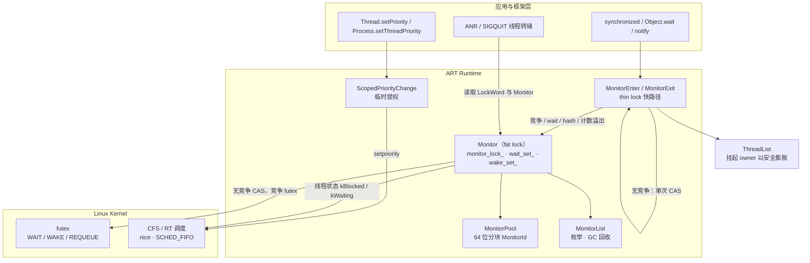
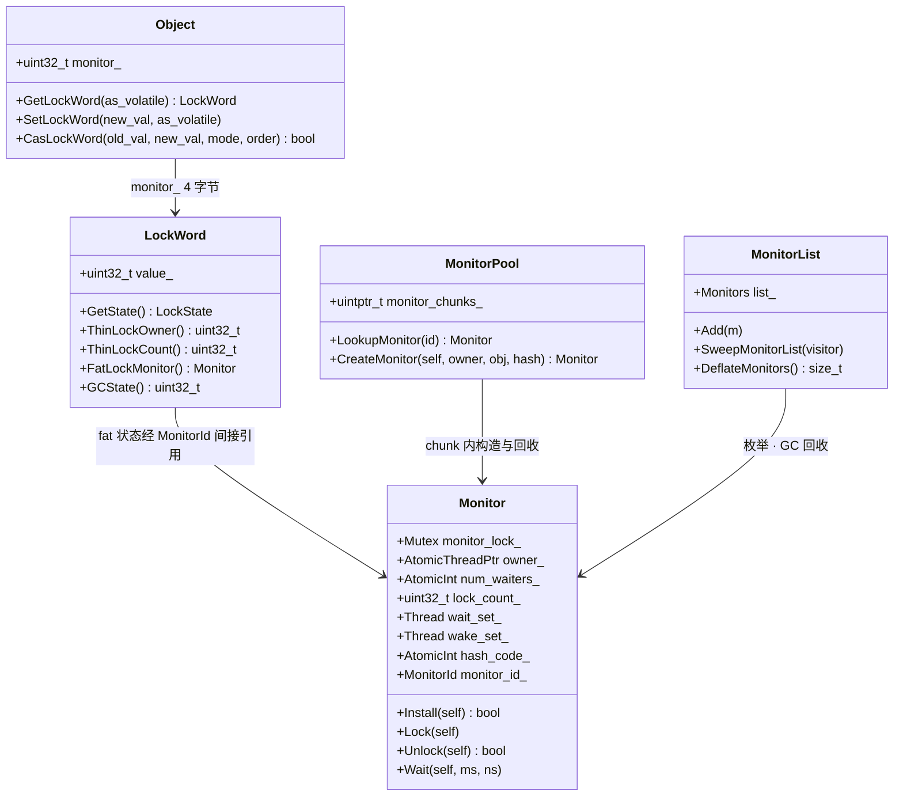
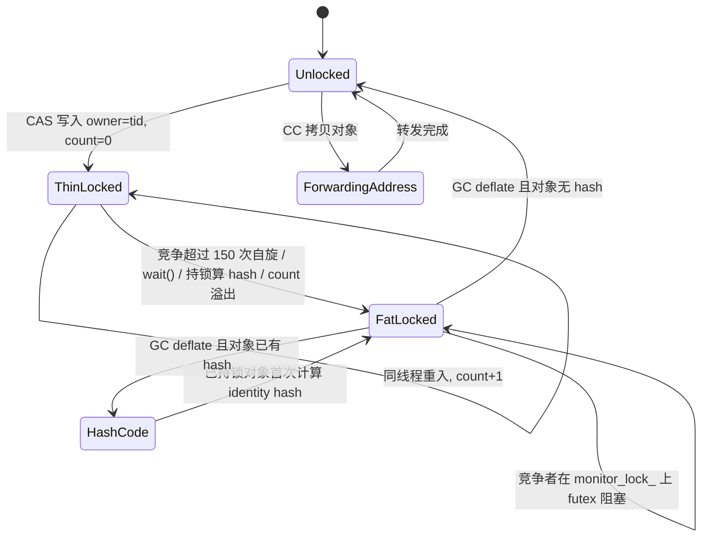
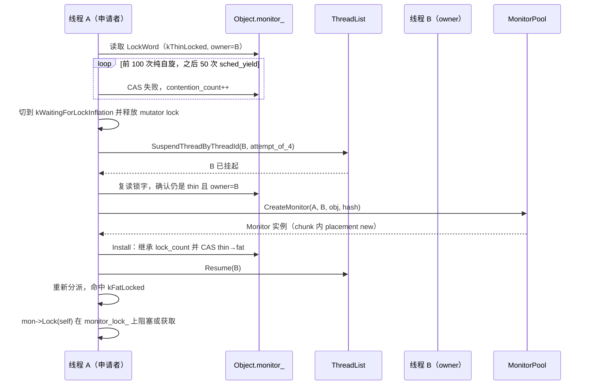
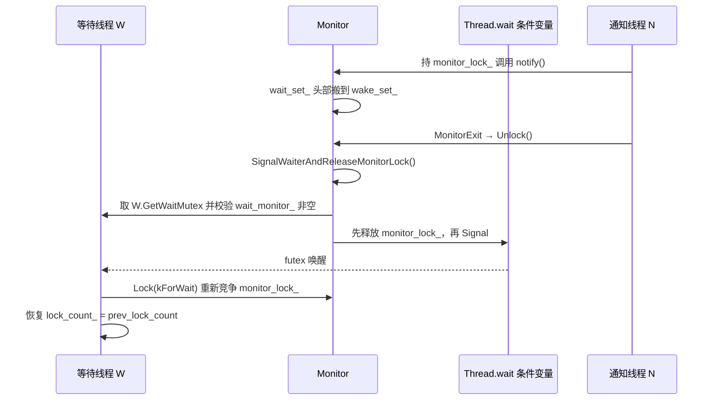
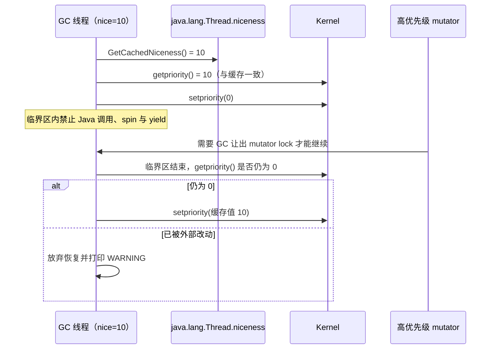

# 07 · Java 锁膨胀状态机与优先级防反转机制

> [!IMPORTANT]
> **一句话核心结论**：ART 把每个 Java 对象的锁状态压缩进对象头里一个 32 位 `LockWord`——无竞争时一次 CAS 就能完成 `synchronized` 加锁，只有出现竞争、`Object.wait()`、加锁对象需要 identity hash 或递归计数溢出时，才把锁「膨胀」为堆上的 `Monitor`；`Monitor` 内部再用一把基于 `futex` 的 `monitor_lock_` 承担真正的阻塞与唤醒。与锁膨胀正交的另一条主线是线程优先级：ART 识别 niceness / Java priority / RT priority 三套语义，并在 GC、编译等「会让高优先级线程等我」的临界区用 `ScopedPriorityChange` 临时把自身 niceness 降到 0，以此规避无内核优先级继承可用时的优先级反转。

| 项目 | 内容 |
| :--- | :--- |
| **机制定位** | Java 对象锁的状态机（thin/fat）、Monitor 池、GC 锁收缩、线程优先级映射与临时提权 |
| **源码模块（相对 `qssi/art/`）** | `runtime/lock_word.h`、`runtime/monitor.cc`、`runtime/base/mutex.cc`、`runtime/monitor_pool.*`、`runtime/scoped_thread_priority_change.cc` |
| **核心类 / 入口** | `art::LockWord`、`art::Monitor`、`MonitorPool`、`MonitorList`、`art::Mutex`、`art::ConditionVariable`、`ScopedPriorityChange` |
| **关键系统属性** | `dalvik.vm.lockprof.threshold`、`dalvik.vm.extra-opts`、`debug.art.monitor.app` |
| **关键启动参数** | `-Xlockprofthreshold:`、`-Xstackdumplockprofthreshold:`、`-XX:MaxSpinsBeforeThinLockInflation=`、`-XX:MonitorTimeoutEnable=`、`-XX:MonitorTimeout=`、`-verbose:systrace_lock_logging` |
| **源码基线** | `/home/voyah/workspace/8397/qssi/art`（Android 15/16 主线级 QSSI，只读） |

## 1. What：机制是什么？

### 1.1 职责边界

这套机制要同时解决四个问题：

1. **让「无竞争加锁」足够便宜**：绝大多数 `synchronized` 块在生命周期内根本不会遇到并发。ART 用对象头里的 `LockWord` 表示「谁持有、重入几次」，快路径只有一次原子比较交换（CAS），不进入内核、不分配内存。
2. **让「有竞争」有地方排队**：`LockWord` 只有 32 位，没有空间放等待队列、条件变量和 hash code。一旦需要排队，必须切换到堆上的 `Monitor`，这一步叫**锁膨胀（inflation）**。
3. **让「膨胀过的锁」能还回去**：`Monitor` 由 `MonitorPool` 分块供给，若只增不减，长稳运行的车机进程会被历史竞争峰值永久占住内存。GC 在合适的时机执行**锁收缩（deflation）**，把无主、无等待者的 `Monitor` 回收进池。
4. **让「谁等谁」不要演变成优先级反转**：高优先级线程等低优先级持锁者时，若内核不提供优先级继承，低优先级线程可能长期得不到 CPU。ART 用 `ScopedPriorityChange` 在关键临界区内临时抬高自身优先级，缩短高优先级线程的等待。

它**不负责**：Java 语言层的 `synchronized` 语义（由编译器和解释器入口决定）、`java.util.concurrent` 的 `AQS`/`park()` 实现（那是 Java 层锁，不走 `Monitor`）、以及 Linux 调度器的策略本身（`SCHED_OTHER` / `SCHED_FIFO` 由内核与 `libartpalette` 决定）。

### 1.2 核心术语表

| 术语 | 含义 | 源码锚点 |
| :--- | :--- | :--- |
| `LockWord` | 存放在 `mirror::Object::monitor_` 中的 32 位锁状态字，同时承载锁、hash、转发地址三种语义 | [lock_word.h](file:///home/voyah/workspace/8397/qssi/art/runtime/lock_word.h#L36-L67) |
| Thin lock | 无竞争的单持有者锁：16 位 owner tid + 12 位递归计数，完全靠 CAS 维护 | [lock_word.h](file:///home/voyah/workspace/8397/qssi/art/runtime/lock_word.h#L70-L92) |
| Fat lock | 膨胀后的锁：`LockWord` 里只留 28 位 `MonitorId`，其余状态在 `Monitor` 中 | [lock_word.h](file:///home/voyah/workspace/8397/qssi/art/runtime/lock_word.h#L46-L51) |
| Inflation（膨胀） | thin → fat 的不可逆（本轮内）转换，需要为该对象分配 `Monitor` | [monitor.cc](file:///home/voyah/workspace/8397/qssi/art/runtime/monitor.cc#L1038-L1057) |
| Deflation（收缩） | fat → thin/hash/unlocked 的回收，GC 在 mutator 全停时执行 | [monitor.cc](file:///home/voyah/workspace/8397/qssi/art/runtime/monitor.cc#L996-L1036) |
| `MonitorId` | 28 位监视器编号；32 位下是「指针右移」，64 位下是分块池内的索引 | [monitor_pool.h](file:///home/voyah/workspace/8397/qssi/art/runtime/monitor_pool.h#L176-L214) |
| `MonitorPool` | 64 位下按 4 KB chunk 组织、按需扩容的 `Monitor` 分配器 | [monitor_pool.cc](file:///home/voyah/workspace/8397/qssi/art/runtime/monitor_pool.cc#L41-L89) |
| `MonitorList` | 全进程所有存活 `Monitor` 的枚举链表，GC 收缩与 weak sweep 的入口 | [monitor.cc](file:///home/voyah/workspace/8397/qssi/art/runtime/monitor.cc#L1628-L1702) |
| `monitor_lock_` | `Monitor` 内部的互斥量，无竞争用 CAS、竞争用 `futex` 睡眠 | [monitor.cc](file:///home/voyah/workspace/8397/qssi/art/runtime/monitor.cc#L446-L646) |
| niceness | `setpriority()` 的 -20..19 值，越大优先级越低，作用于 `SCHED_OTHER` | [thread_priorities.md](file:///home/voyah/workspace/8397/qssi/art/runtime/thread_priorities.md#L10-L14) |
| java-priority | `Thread.setPriority()` 的 1..10 值，经 `libartpalette` 映射到 niceness | [thread_priorities.md](file:///home/voyah/workspace/8397/qssi/art/runtime/thread_priorities.md#L16-L18) |
| rt-priority | `SCHED_FIFO` / `SCHED_RR` 的 `sched_priority`，可抢占所有 `SCHED_OTHER` 线程 | [thread_priorities.md](file:///home/voyah/workspace/8397/qssi/art/runtime/thread_priorities.md#L19-L24) |
| 优先级反转 | 高优先级线程 A 等待低优先级线程 B 持有的锁，而 B 得不到 CPU | [thread_priorities.md](file:///home/voyah/workspace/8397/qssi/art/runtime/thread_priorities.md#L162-L169) |
| `ScopedPriorityChange` | 作用域内把当前线程 niceness 临时降到 0、退出时按缓存值恢复的 RAII 工具 | [scoped_thread_priority_change.cc](file:///home/voyah/workspace/8397/qssi/art/runtime/scoped_thread_priority_change.cc#L27-L49) |

### 1.3 架构定位



图中三条边需要特别记住：

- **`MonitorEnter` → `ThreadList`**：膨胀一个正被其他线程持有的 thin lock 时，必须先把 owner **挂起**，否则 owner 可能在 CAS 之间解锁，导致锁字被覆盖。
- **`Monitor` → `futex`**：fat lock 的阻塞不靠自旋，靠 `monitor_lock_` 上的 futex 睡眠，这是「不烧 CPU 的等待」。
- **`ScopedPriorityChange` → `setpriority`**：它只改 niceness，不改调度策略，也不碰 Java priority 缓存。

### 1.4 两条正交主线

本机制常被误解为「锁和优先级是一件事」。实际上它们是两条独立的演进线，只在「GC 临界区」处相交：

| 维度 | 锁状态机 | 优先级防反转 |
| :--- | :--- | :--- |
| 作用对象 | 每个 Java 对象 | 每个 OS 线程 |
| 状态载体 | `Object::monitor_`（32 位 `LockWord`） | `java.lang.Thread.niceness` 缓存 + 内核 nice 值 |
| 快路径 | thin lock 单次 CAS | 无（提权本身要 2 次 `setpriority` + 3 次 `getpriority`） |
| 慢路径 | 自旋 → 挂起 owner → 膨胀 → futex 阻塞 | 临时把 niceness 降到 0 → 临界区 → 按缓存恢复 |
| 触发者 | 应用代码的并发 | ART 自身的 GC / 编译 / 阻塞式分配 |
| 内核依赖 | futex | `setpriority`；**不使用** `FUTEX_LOCK_PI` |

## 2. Why：为什么需要它？

### 2.1 朴素方案的三笔代价

**第一笔：每对象常驻内核互斥量。** 若每个 Java 对象都绑定一个 `pthread_mutex_t`，Android 进程动辄数十万到数百万对象，仅锁对象就要吃掉几十到上百 MB；更糟的是每次 `synchronized` 进出都至少一次系统调用。ART 的选择是：对象头只留 4 字节（`mirror::Object::monitor_`，[object.h](file:///home/voyah/workspace/8397/qssi/art/runtime/mirror/object.h#L809)），无竞争路径完全不进内核。这就是 Bacon 等人 «Thin locks: featherweight synchronization for Java» 思路在 ART 中的落地（[monitor.cc](file:///home/voyah/workspace/8397/qssi/art/runtime/monitor.cc#L56-L82)）。

**第二笔：无法表达等待与哈希。** `LockWord` 没有等待队列的位置，也没有地方同时存「锁 + identity hash」。所以必须有第二条路径：需要 `wait()/notify()`、需要在持锁对象上算 identity hash、或竞争到一定程度的锁，升级为堆上的 `Monitor`。`Monitor` 同时扮演互斥量与条件变量两个角色（[monitor_inflation.md](file:///home/voyah/workspace/8397/qssi/art/runtime/monitor_inflation.md#L1-L18)）。

**第三笔：膨胀只增不减。** 竞争是脉冲式的：某一帧内大量线程抢同一把锁，之后长期无人竞争。如果 `Monitor` 不回收，进程的 native 内存会被历史峰值钉死。ART 的做法是把回收挂到 GC 的空闲时机：`Heap::Trim()` 在「不在意暂停」时调用 `DeflateMonitors()`（[heap.cc](file:///home/voyah/workspace/8397/qssi/art/runtime/gc/heap.cc#L1619-L1634)），GC 的 weak sweep 也会顺手回收对象已死的 `Monitor`（[runtime.cc](file:///home/voyah/workspace/8397/qssi/art/runtime/runtime.cc#L894-L900)）。

### 2.2 方案演进对比矩阵

| 方案 | 每对象成本 | 无竞争开销 | 等待队列 | identity hash | 可收缩 | 结论 |
| :--- | :--- | :--- | :--- | :--- | :--- | :--- |
| 每对象 `pthread_mutex` | 数十字节 + 内核资源 | 系统调用 + 原子操作 | 有 | 需额外字段 | 否 | 内存与 CPU 都不可接受 |
| 全 fat `Monitor` | 指针 + 预分配 `Monitor` | 原子操作 + 可能的 futex | 有 | 有 | 难 | 分配风暴，且小对象吃亏 |
| thin + 按需 fat | 4 字节 | 单次 CAS | 膨胀后才有 | 膨胀后才有 | 是 | ART 采用 |
| thin + fat + 分块池 + GC 收缩 | 4 字节 | 单次 CAS | 有 | 有 | 是 | 当前实现，兼顾峰值与长稳 |

### 2.3 优先级反转：比死锁更隐蔽的稳定性事故

优先级反转不是死锁：所有线程都在「正常」运行，只是高优先级线程被一个永远排不上 CPU 的低优先级线程卡住。在车机座舱场景中，这类事故表现为：

- 渲染/合成线程（或音频线程）等一个低优先级后台线程释放 `synchronized` 锁，掉帧但无 ANR；
- GC 线程以较高 niceness 运行，持有 mutator lock 期间被高优先级线程等待，形成长尾卡顿；
- 阻塞式分配触发 GC 时，分配线程本身优先级很低，却让一整批高优先级线程等它（[heap.cc](file:///home/voyah/workspace/8397/qssi/art/runtime/gc/heap.cc#L2030-L2041)）。

内核虽有 `FUTEX_LOCK_PI` 与 `PTHREAD_PRIO_INHERIT`，但 ART 目前**基本不用**：内核直到 6.12 才支持非实时线程的优先级继承；用户态支持只覆盖 `pthread_mutex`，而 Java monitor、ART 内部锁、`java.util.concurrent` 的 `park/unpark` 都不在其列（[thread_priorities.md](file:///home/voyah/workspace/8397/qssi/art/runtime/thread_priorities.md#L162-L196)）。因此 ART 只能「自己动手」：在明知会让别人等自己的临界区里，临时把自身 niceness 降到 0。

## 3. How：源码级实现原理深度剖析

### 3.1 LockWord 的 32 位内存布局

`LockWord` 的四个状态由最高 2 位编码；低 28 位在不同状态下含义不同（[lock_word.h](file:///home/voyah/workspace/8397/qssi/art/runtime/lock_word.h#L36-L67)）：

```text
Thin / Unlocked 状态（state = 00）
 31      30 29 28 27                     16 15                              0
┌──────────┬────┬────┬──────────────────────┬─────────────────────────────────┐
│ state=00 │ m  │ rb │ thin lock count (12) │ thin lock owner thread id (16)  │
└──────────┴────┴────┴──────────────────────┴─────────────────────────────────┘
   m  = mark bit（GC 标记位，1 bit）
   rb = read barrier state（读屏障位，1 bit）

Fat 状态（state = 01）
 31      30 29 28 27                                              0
┌──────────┬────┬────┬──────────────────────────────────────────────┐
│ state=01 │ m  │ rb │              MonitorId (28 bits)             │
└──────────┴────┴────┴──────────────────────────────────────────────┘

Hash 状态（state = 10）
 31      30 29 28 27                                              0
┌──────────┬────┬────┬──────────────────────────────────────────────┐
│ state=10 │ m  │ rb │           identity HashCode (28 bits)        │
└──────────┴────┴────┴──────────────────────────────────────────────┘

Forwarding 状态（state = 11，仅 CC 并发拷贝 GC 使用）
 31      30 29 28 27                                              0
┌──────────┬────┬────┬──────────────────────────────────────────────┐
│ state=11 │          ForwardingAddress >> 3 (28 bits)            │
└──────────┴────┴────┴──────────────────────────────────────────────┘
```

关键常量（[lock_word.h](file:///home/voyah/workspace/8397/qssi/art/runtime/lock_word.h#L70-L140)）：

| 常量 | 值 | 含义 |
| :--- | :--- | :--- |
| `kStateSize` | 2 | 最高两位表示锁状态 |
| `kThinLockOwnerSize` | 16 | owner 线程 id 位宽，`kThinLockMaxOwner = 0xFFFF` |
| `kThinLockCountSize` | 12 | 递归计数位宽，`kThinLockMaxCount = 0xFFF`（4095） |
| `kThinLockCountShift` | 16 | 计数从第 16 位开始 |
| `kReadBarrierStateShift` | 28 | 读屏障位在第 28 位 |
| `kMarkBitStateShift` | 29 | 标记位在第 29 位 |
| `kStateShift` | 30 | 状态位在第 30-31 位 |
| `kHashSize` | 28 | identity hash 可用 28 位 |
| `kMonitorIdSize` | 28 | fat 状态下 `MonitorId` 可用 28 位 |
| `kMonitorIdAlignmentShift` | 4 | 32 位下 `MonitorId` 左移 4 位还原指针 |

有一个容易读错的语义：**thin 状态的 count 为 0 表示「只加锁一次」，不是「未加锁」**。未加锁由 `GetState() == kUnlocked` 判定（owner 位也为 0，见 [lock_word.h](file:///home/voyah/workspace/8397/qssi/art/runtime/lock_word.h#L177-L206)）。`FromThinLockId(thread_id, count, gc_state)` 中 count 是「额外重入次数」（[lock_word.h](file:///home/voyah/workspace/8397/qssi/art/runtime/lock_word.h#L142-L150)），所以 `MonitorEnter` 每次重入写的是 `ThinLockCount() + 1`。

另一点是 GC 位：启用读屏障（CC）或 `userfaultfd`（CMC）时，`GetState()` 先看「除 GC 两位外是否全零」来判断未加锁（[lock_word.h](file:///home/voyah/workspace/8397/qssi/art/runtime/lock_word.h#L185-L206)）。这意味着 thin/fat/hash 三种状态在 CAS 时都必须原样带上 `GCState()`，否则会破坏 GC 的标记或读屏障协议。

### 3.2 对象、锁字、Monitor 的类关系



`LockWord` 是 32 位值类型，锁状态迁移一律通过整体 CAS 完成；它只对 GC 位提供原位修改方法（`SetReadBarrierState` / `SetMarkBitState`），且显式删除了 `operator==`，要求调用方用 `Equal(lw1, lw2)` 明确是否比较 GC 位（[lock_word.h](file:///home/voyah/workspace/8397/qssi/art/runtime/lock_word.h#L216-L264)）。`Monitor` 则是**原地构造、原地析构**的池化对象：64 位下由 `MonitorPool` 在 chunk 内 `placement new`，回收时只调析构、不还给 malloc（[monitor_pool.cc](file:///home/voyah/workspace/8397/qssi/art/runtime/monitor_pool.cc#L108-L132)、[monitor_pool.cc](file:///home/voyah/workspace/8397/qssi/art/runtime/monitor_pool.cc#L134-L159)）。

### 3.3 快路径：thin lock 的 CAS 与递归计数

`Monitor::MonitorEnter` 是一个 `while (true)` 状态分派循环（[monitor.cc](file:///home/voyah/workspace/8397/qssi/art/runtime/monitor.cc#L1106-L1223)）。

**未加锁 → 加锁**：把 `LockWord` 从「仅含 GC 位的默认值」CAS 成 `FromThinLockId(tid, 0, gc_state)`：

```cpp
case LockWord::kUnlocked: {
  LockWord thin_locked(LockWord::FromThinLockId(thread_id, 0, lock_word.GCState()));
  if (h_obj->CasLockWord(lock_word, thin_locked, CASMode::kWeak,
                         std::memory_order_acquire)) {
    AtraceMonitorLock(self, h_obj.Get(), /* is_wait= */ false);
    return h_obj.Get();  // Success!
  }
  continue;  // CAS 失败：重新读锁字
}
```

**同线程重入**：读 `ThinLockCount()`，加一后写回；若新值超过 `kThinLockMaxCount`（4095），说明计数会溢出，必须膨胀（[monitor.cc](file:///home/voyah/workspace/8397/qssi/art/runtime/monitor.cc#L1141-L1171)）。这里有一个实现细节：未启用读屏障时用普通 `SetLockWord`（只有 owner 自己会读计数，relaxed 足够）；启用读屏障时必须用 CAS，以保住 rb 位。

**其他线程持有**：进入竞争处理，见下一节。

`MonitorExit` 走对称逻辑：thin 状态下递减计数，计数为 0 时把锁字写回默认值（保留 `GCState()`）；owner 不是自己则抛 `IllegalMonitorStateException`（[monitor.cc](file:///home/voyah/workspace/8397/qssi/art/runtime/monitor.cc#L1225-L1285)）。fat 状态则直接转 `Monitor::Unlock`。

### 3.4 慢路径：自旋、让出、挂起 owner 与膨胀

竞争处理是整篇最关键的时序。先看自旋预算（[monitor.cc](file:///home/voyah/workspace/8397/qssi/art/runtime/monitor.cc#L1115-L1196)）：

- `kExtraSpinIters = 100`：前 100 次纯自旋重试 CAS；
- 超过 100 次后，每次重试前调用 `self->CheckSuspend()` 再 `sched_yield()`；
- 总预算 = `100 + Runtime::GetMaxSpinsBeforeThinLockInflation()`，后者默认 50（[monitor.h](file:///home/voyah/workspace/8397/qssi/art/runtime/monitor.h#L61-L63)、[runtime_options.def](file:///home/voyah/workspace/8397/qssi/art/runtime/runtime_options.def#L70)），即最多约 150 次失败后才膨胀。

代码注释明确解释了为什么用 `sched_yield()` 而不是 `NanoSleep()`：`NanoSleep` 的实际睡眠可能远长于参数，导致线程挂起检查被拖延、全局停顿变长（b/16307460）。这一段是理解「ART 为什么在高竞争下仍能响应 `SuspendAll`」的关键。

超过预算后调用 `InflateThinLocked`（[monitor.cc](file:///home/voyah/workspace/8397/qssi/art/runtime/monitor.cc#L1059-L1092)）：

1. 如果 owner 就是自己（递归计数溢出场景），直接 `Inflate(self, self, obj, hash)`；
2. 否则把自己切到 `kWaitingForLockInflation` 并释放 mutator lock，调用 `ThreadList::SuspendThreadByThreadId(owner_tid, kInternal, attempt_of_4)` 挂起 owner；
3. owner 挂起后**复读锁字**，确认仍是 thin 且 owner 没变；
4. 调用 `Monitor::Inflate` 分配并安装 `Monitor`；
5. `Resume(owner)`。

`attempt_of_4` 的语义在头文件里写得很清楚：非零表示最多重试 4 次，每次只用 1/4 的挂起超时，避免膨胀路径把 `SuspendAll` 的超时预算耗尽（[monitor.h](file:///home/voyah/workspace/8397/qssi/art/runtime/monitor.h#L158-L167)）。

`Monitor::Install` 是膨胀的线性化点（[monitor.cc](file:///home/voyah/workspace/8397/qssi/art/runtime/monitor.cc#L227-L276)）：

```cpp
case LockWord::kThinLocked: {
  DCHECK(owner != nullptr);
  CHECK_EQ(owner->GetThreadId(), lw.ThinLockOwner());
  lock_count_ = lw.ThinLockCount();
  monitor_lock_.ExclusiveLockUncontendedFor(owner);  // 代持锁：把 mutex 记在 owner 名下
  LockWord fat(this, lw.GCState());
  bool success = GetObject()->CasLockWord(lw, fat, CASMode::kWeak,
                                          std::memory_order_release);
  if (success) { ... return true; }
  monitor_lock_.ExclusiveUnlockUncontended();
  return false;
}
```

三个要点：

- `ExclusiveLockUncontendedFor(owner)` 是**代替被挂起的 owner** 把 `monitor_lock_` 置为已持有（[mutex.cc](file:///home/voyah/workspace/8397/qssi/art/runtime/base/mutex.cc#L656-L668)）。这样 owner 之后执行 `MonitorExit` 时，看到的是 fat lock，会在 `monitor_lock_` 上正常解锁，锁的所有权语义不丢。
- thin 的 `lock_count_` 被继承进 `Monitor`，所以膨胀不会丢失重入深度。
- CAS 失败说明有别的线程抢先改了锁字，此时释放刚才代持的 mutex 并返回 false，上层重新读锁字重试。若锁字已经是 fat，说明另一个膨胀者赢了，直接返回 false。

用状态机表示锁字的一生：



膨胀的端到端时序：



### 3.5 Fat lock：monitor_lock_、futex 等待队列与 wait/notify

到了 fat 状态，`Monitor::Lock` 才真正处理阻塞（[monitor.cc](file:///home/voyah/workspace/8397/qssi/art/runtime/monitor.cc#L446-L646)）。

**第一步仍是乐观尝试**：`TryLock(self, /*spin=*/true)` 先看 owner 是否是自己（重入只加 `lock_count_`），否则 `monitor_lock_.ExclusiveTryLockWithSpinning(self)`——后者最多做 5 轮「trylock + `WaitBrieflyFor`」的短自旋（[mutex.cc](file:///home/voyah/workspace/8397/qssi/art/runtime/base/mutex.cc#L637-L654)）。

**第二步进入阻塞**：失败后 `num_waiters_.fetch_add(1)`（这个计数同时被 deflation 用来判断「有没有人在等」），然后：

```cpp
self->SetMonitorEnterObject(GetObject().Ptr());
{
  ScopedThreadSuspension tsc(self, ThreadState::kBlocked);  // 释放 mutator lock
  monitor_lock_.ExclusiveLock(self);                        // 可能 futex 睡眠
}
owner_.store(self, std::memory_order_relaxed);
num_waiters_.fetch_sub(1, std::memory_order_relaxed);
```

注意 `ScopedThreadSuspension(kBlocked)` 期间线程处于 **blocked 状态**，GC 可以安全挂起它；这也是 ART 不在持有 mutator lock 的情况下睡眠的原因。

`monitor_lock_` 的底层是 ART 自研的 futex 互斥量（[mutex.cc](file:///home/voyah/workspace/8397/qssi/art/runtime/base/mutex.cc#L452-L532)）：

- `state_and_contenders_` 低 1 位表示「已持有」，高位是等待者计数（`kHeldMask = 1`、`kContenderIncrement = 2`，[mutex.h](file:///home/voyah/workspace/8397/qssi/art/runtime/base/mutex.h#L256-L284)）；
- 拿不到锁时先 `WaitBrieflyFor`：最多 50 次、每次 `BackOff(min(i, 3))`。`BackOff` 本身分「忙等 / `sched_yield` / `NanoSleep`」三档，但此处参数被钳到 `kMaxBackOff = 3`，所以这个调用点始终是极短的纯忙等——设计意图是「临界区很短就别睡」，睡眠留给真正进入 futex 的路径（[mutex.cc](file:///home/voyah/workspace/8397/qssi/art/runtime/base/mutex.cc#L101-L148)）；
- 仍然失败才 `increment_contenders()` + `futex(FUTEX_WAIT_PRIVATE)`；
- 解锁时 CAS 清除持有位，若有等待者则 `FUTEX_WAKE_PRIVATE, 1` 唤醒一个（[mutex.cc](file:///home/voyah/workspace/8397/qssi/art/runtime/base/mutex.cc#L679-L740)）。

> [!NOTE]
> `monitor_lock_` 的竞争计数不仅是性能优化：`Mutex::ExclusiveUnlock` 只有在状态字显示仍有 contender 时才发 `FUTEX_WAKE`，因此 `increment_contenders()` 必须先于 `FUTEX_WAIT` 完成；否则新来的等待者可能错过这次唤醒，只能等下一次超时或解锁。源码注释专门论证了这对顺序（[mutex.cc](file:///home/voyah/workspace/8397/qssi/art/runtime/base/mutex.cc#L700-L720)）。

**`Object.wait()` 的三段式**（[monitor.cc](file:///home/voyah/workspace/8397/qssi/art/runtime/monitor.cc#L828-L954)）：

1. 若当前是 thin lock，先 `Inflate(self, self, obj, 0)`——等待队列只存在于 `Monitor`（[monitor.cc](file:///home/voyah/workspace/8397/qssi/art/runtime/monitor.cc#L1304-L1335)）；
2. 保存 `prev_lock_count`、清零 `lock_count_`、`num_waiters_++`，切到 `kWaiting` / `kTimedWaiting`；
3. 在持 `self->GetWaitMutex()` 的前提下把自己挂到 `wait_set_`，设置 `wait_monitor_`，然后 `SignalWaiterAndReleaseMonitorLock` 释放 `monitor_lock_`；
4. 在每线程条件变量上 `Wait()`（底层是 futex），被唤醒后重新 `Lock<LockReason::kForWait>(self)`，恢复 `lock_count_`，`num_waiters_--`，从 `wait_set_` 摘除。

**`notify()` 只搬队列、不直接唤醒**：持锁线程调用 `Notify` 只是把 `wait_set_` 头部搬到 `wake_set_`（[monitor.cc](file:///home/voyah/workspace/8397/qssi/art/runtime/monitor.cc#L956-L994)）。真正的唤醒发生在解锁的 `SignalWaiterAndReleaseMonitorLock` 里：先取等待者的 `GetWaitMutex`、确认 `wait_monitor_` 仍非空，然后**先释放 `monitor_lock_` 再 `Signal`**，避免被唤醒者立刻又撞上还没释放的锁（[monitor.cc](file:///home/voyah/workspace/8397/qssi/art/runtime/monitor.cc#L781-L826)）。

thin 状态下的 `notify()` 是 no-op：没有 `Monitor` 就没有等待者，直接成功返回（[monitor.cc](file:///home/voyah/workspace/8397/qssi/art/runtime/monitor.cc#L1347-L1357)）。因此「notify 不会引起膨胀」这一结论在源码中是成立的。



### 3.6 64 位下的 MonitorId 与分块池

32 位进程里 `MonitorId` 可以直接编码指针：`MonitorPool::MonitorFromMonitorId` 把 id 左移 4 位（`kMonitorIdAlignmentShift = 32 - 28`），并要求 `posix_memalign` 到 16 字节对齐（[lock_word-inl.h](file:///home/voyah/workspace/8397/qssi/art/runtime/lock_word-inl.h#L37-L42)、[monitor.h](file:///home/voyah/workspace/8397/qssi/art/runtime/monitor.h#L177-L181)）。

64 位进程没有足够位数放 64 位指针，于是 `MonitorId` 变成一个「池内索引」。`MonitorPool` 用 4 KB chunk 组织 `Monitor`，每个 `Monitor` 按 8 字节对齐（[monitor_pool.h](file:///home/voyah/workspace/8397/qssi/art/runtime/monitor_pool.h#L188-L214)）：

```text
MonitorId（28 位）在 LP64 下的解码
 27          25 24                        9 8                          0
┌──────────────┬───────────────────────────┬─────────────────────────────┐
│ list index(3)│  chunk index in list(16)  │ offset in chunk / 8 (9)     │
└──────────────┴───────────────────────────┴─────────────────────────────┘
       │                    │                            │
       │                    │                            └─ 4 KB / 8 = 512 个槽位
       │                    └─ monitor_chunks_[list] 内的 chunk 序号
       └─ monitor_chunks_ 的 8 个「行」，行容量按 2 倍递增

monitor_chunks_ 结构（逻辑上的「类三角」二维数组）
  row 0: [ 256 个 chunk 指针 ]                 ← 初始行
  row 1: [ 512 个 chunk 指针 ]
  row 2: [1024 个 chunk 指针 ]
   ...
  row 7: [32768 个 chunk 指针]                 ← kMaxListSize = 256 << 7
```

设计取舍写在源码注释里：行按 2 倍扩容、`Monitor` 槽位循环复用，使索引开销最多为实际需求的 2 倍；chunk 与行都按需分配；`Monitor` 永不移动，因此 `MonitorId` 一旦发布就永远有效（[monitor_inflation.md](file:///home/voyah/workspace/8397/qssi/art/runtime/monitor_inflation.md#L29-L46)）。

分配路径 `CreateMonitorInPool` 持 `allocated_monitor_ids_lock_`，从空闲链表取一个槽，用 `placement new` 构造 `Monitor`（[monitor_pool.cc](file:///home/voyah/workspace/8397/qssi/art/runtime/monitor_pool.cc#L108-L132)）。空闲链表为空时 `AllocateChunk()` 分配新 chunk，并**预先算好该 chunk 内所有 `MonitorId`**，这样运行期取 id 不需要再加锁（[monitor_pool.cc](file:///home/voyah/workspace/8397/qssi/art/runtime/monitor_pool.cc#L41-L89)）。

查找路径 `LookupMonitor` 是无锁的：`MonitorId` 一旦被写进锁字，对应的 chunk 映射就不再变化；写锁字用 release、读锁字用 acquire，保证「先看到 id，就一定能看到映射」（[monitor_pool.h](file:///home/voyah/workspace/8397/qssi/art/runtime/monitor_pool.h#L138-L150)）。

容量上限：`kInitialChunkStorage = 256`（debug 构建为 8），`kMaxChunkLists = 8`，即最多约 255 × 256 个 chunk；按源码注释，上限约为 **0.25 GB 的 `Monitor` 内存**；若把初始行改成 512，则可到约 0.5 GB（[monitor_pool.h](file:///home/voyah/workspace/8397/qssi/art/runtime/monitor_pool.h#L199-L226)）。这解释了为什么「无限膨胀」在 ART 里最终会以 `Out of space for inflated monitors` 致命错误收场（[monitor_pool.cc](file:///home/voyah/workspace/8397/qssi/art/runtime/monitor_pool.cc#L44-L50)）。

### 3.7 锁收缩：GC 驱动的 deflation

`Monitor::Deflate` 的前置条件非常严格（[monitor.cc](file:///home/voyah/workspace/8397/qssi/art/runtime/monitor.cc#L996-L1036)）：

1. 锁字必须是 `kFatLocked`；
2. `num_waiters_ == 0`——既没有阻塞的竞争者，也没有 `wait()` 的等待者；
3. 能 `ExclusiveTryLock</*check=*/false>` 拿到 `monitor_lock_`——说明当前无人持有；
4. `lock_count_ == 0` 且 `owner_ == nullptr`。

满足后按「是否保留 identity hash」二选一写回锁字：

```cpp
if (monitor->HasHashCode()) {
  LockWord new_lw = LockWord::FromHashCode(monitor->GetHashCode(), lw.GCState());
  obj->SetLockWord(new_lw, false);
} else {
  LockWord new_lw = LockWord::FromDefault(lw.GCState());
  obj->SetLockWord(new_lw, false);
}
monitor->obj_ = GcRoot<mirror::Object>(nullptr);  // 标记为待回收
```

两个触发点：

- **`Heap::Trim()`**：仅当 `!CareAboutPauseTimes()`（通常是后台/空闲进程）时执行 `DeflateMonitors()`；前台进程在意暂停，不会为了省内存做全堆扫描（[heap.cc](file:///home/voyah/workspace/8397/qssi/art/runtime/gc/heap.cc#L1619-L1634)）。
- **`Runtime::SweepSystemWeaks()`**：GC 标记结束后，对象已死的 `Monitor` 通过 `SweepMonitorList` 直接释放（[runtime.cc](file:///home/voyah/workspace/8397/qssi/art/runtime/runtime.cc#L894-L900)、[monitor.cc](file:///home/voyah/workspace/8397/qssi/art/runtime/monitor.cc#L1677-L1702)）。

`MonitorDeflateVisitor` 还有一个刻意为之的例外：**zygote space 与 boot image space 里的对象不收缩**，因为写这些共享页会破坏「干净页共享」，得不偿失（[monitor.cc](file:///home/voyah/workspace/8397/qssi/art/runtime/monitor.cc#L1704-L1723)）。

> [!WARNING]
> 常规路径下 Deflation 只在 mutator 全部挂起时进行（`Heap::Trim` 里先 `ScopedSuspendAll`），因此它看到的 `lock_count_`、`owner_`、`num_waiters_` 是一致的快照。唯一例外是 dex2oat 的 `ImageWriter`：进程单线程且堆即将丢弃，所以源码允许它跳过挂起协议（[monitor_inflation.md](file:///home/voyah/workspace/8397/qssi/art/runtime/monitor_inflation.md#L70-L72)）。任何试图在并发状态下「顺手收缩」的改动都会引入锁字被覆盖的竞态。

### 3.8 线程优先级映射与 ScopedPriorityChange

**三套优先级语义**必须先分清（[thread_priorities.md](file:///home/voyah/workspace/8397/qssi/art/runtime/thread_priorities.md#L10-L24)）：

| 语义 | 范围 | 作用 | 设置方式 |
| :--- | :--- | :--- | :--- |
| niceness | -20..19，越大越低 | `SCHED_OTHER` 的 CPU 份额 | `setpriority()` |
| java-priority | 1..10，越大越高 | Java API 表层 | `Thread.setPriority()` |
| rt-priority | 由策略与权限决定 | `SCHED_FIFO` / `SCHED_RR` | `sched_setscheduler()` |

Java priority 经平台侧 `libartpalette` 映射为 niceness（历史上是 `PaletteSetSchedPriority`，现在优先用 `PaletteMapPriority` + `setpriority`），因为 ART 内部守护线程需要直接使用 niceness，且 `android.os.Process.setThreadPriority(int)` 本来就以 niceness 为参数（[thread_priorities.md](file:///home/voyah/workspace/8397/qssi/art/runtime/thread_priorities.md#L147-L160)）。

**缓存一致性**：`Thread.getPriority()` 要返回 Java 层最后一次设置的值，所以 ART 在 `java.lang.Thread` 对象里缓存 niceness：`Thread::GetCachedNiceness()` 直接读 `java.lang.Thread.niceness` 字段（[thread.cc](file:///home/voyah/workspace/8397/qssi/art/runtime/thread.cc#L5232-L5243)）。`Thread.setPriority()` 会同时更新缓存与内核 nice 值；而通过 `Process.setThreadPriority(tid, nice)` 这种带 tid 的跨线程调用则**绕过缓存**，效果可能是临时的（ART 或应用随时会用缓存值覆盖它，[thread_priorities.md](file:///home/voyah/workspace/8397/qssi/art/runtime/thread_priorities.md#L60-L71)）。

**提权协议**：`ScopedPriorityChange::SetToNormalOrBetter()` 只做一件事——如果「缓存 niceness > 0」且「内核实际 niceness 恰好等于缓存值」，就 `setpriority(0)`（[scoped_thread_priority_change.cc](file:///home/voyah/workspace/8397/qssi/art/runtime/scoped_thread_priority_change.cc#L27-L49)）：

```cpp
int cached_niceness = self_->GetCachedNiceness();
if (cached_niceness > 0 /* excludes no Java peer case */) {
  int old_niceness = getpriority(PRIO_PROCESS, 0);
  if (old_niceness == cached_niceness) {
    int ret = setpriority(PRIO_PROCESS, 0, 0);
    if (ret == 0) { priority_changed_ = true; }
  } else if (old_niceness > 0) {
    LOG(WARNING) << "Cached niceness = " << cached_niceness
                 << "; actual niceness = " << old_niceness;
  }
}
```

恢复路径更谨慎（[scoped_thread_priority_change.cc](file:///home/voyah/workspace/8397/qssi/art/runtime/scoped_thread_priority_change.cc#L51-L78)）：

- 先 `getpriority()`，只有仍是 0 才恢复；
- 恢复成「当前缓存值」，并在循环里重新读缓存，防止恢复期间 `Thread.setPriority()` 又改了值；
- 若发现 nice 已被别人改动（非 0），打印 `Priority change inside ScopedPriorityChange` 并**放弃恢复**，绝不覆盖别人的设置。

这段代码刻意不做「保存旧值再恢复旧值」，因为旧值可能已经过期；协议要求「恢复成 Java 缓存值」，这样与 `Thread.setPriority()` 的缓存语义对齐（[thread_priorities.md](file:///home/voyah/workspace/8397/qssi/art/runtime/thread_priorities.md#L124-L145)）。

该工具的真实使用点都在「我阻塞会让高优先级线程等我」的位置：

- 阻塞式分配触发 GC 前（[heap.cc](file:///home/voyah/workspace/8397/qssi/art/runtime/gc/heap.cc#L2030-L2041)）；
- CC 在禁止弱引用访问前（[concurrent_copying.cc](file:///home/voyah/workspace/8397/qssi/art/runtime/gc/collector/concurrent_copying.cc#L1625-L1633)）；
- CC 分代标记开始时（[concurrent_copying.cc](file:///home/voyah/workspace/8397/qssi/art/runtime/gc/collector/concurrent_copying.cc#L230-L239)）；
- CMC 的 `RunPhases` 进入标记阶段时（[mark_compact.cc](file:///home/voyah/workspace/8397/qssi/art/runtime/gc/collector/mark_compact.cc#L874-L885)）。

提权时序与竞态窗口：



注意它的能力边界：**只能把 niceness 从正数降到 0，不能提到负数，也不能改变调度策略**。因此它对「后台线程 vs 普通线程」有效，对「`SCHED_FIFO` 实时线程 vs 普通线程」无效——后者需要内核优先级继承，而 ART 目前没有接入（[thread_priorities.md](file:///home/voyah/workspace/8397/qssi/art/runtime/thread_priorities.md#L162-L196)）。

### 3.9 关键阈值与开关速查

| 常量 / 开关 | 默认值 | 位置 | 含义 |
| :--- | :--- | :--- | :--- |
| `kExtraSpinIters` | 100 | [monitor.cc](file:///home/voyah/workspace/8397/qssi/art/runtime/monitor.cc#L1115-L1118) | 膨胀前的纯自旋次数 |
| `kDefaultMaxSpinsBeforeThinLockInflation` | 50 | [monitor.h](file:///home/voyah/workspace/8397/qssi/art/runtime/monitor.h#L61-L63) | 之后带 `sched_yield` 的额外次数 |
| `kMaxInflationAttempts` | 100 | [monitor.cc](file:///home/voyah/workspace/8397/qssi/art/runtime/monitor.cc#L1122-L1126) | 单次 `MonitorEnter` 的膨胀重试上限，超过即 FATAL |
| `kThinLockMaxCount` | 4095 | [lock_word.h](file:///home/voyah/workspace/8397/qssi/art/runtime/lock_word.h#L88-L92) | 递归计数上限，溢出即膨胀 |
| `kLongWaitMs` | 100 ms | [monitor.cc](file:///home/voyah/workspace/8397/qssi/art/runtime/monitor.cc#L53-L54) | 「长竞争」WARNING 阈值（debug 构建 ×10） |
| `lock_profiling_threshold_` | 0（关闭） | [monitor.cc](file:///home/voyah/workspace/8397/qssi/art/runtime/monitor.cc#L84-L95) | `-Xlockprofthreshold:`；与 `MilliTime()` 的毫秒值比较 |
| `stack_dump_lock_profiling_threshold_` | 0（关闭） | [runtime_options.def](file:///home/voyah/workspace/8397/qssi/art/runtime/runtime_options.def#L125-L126) | `-Xstackdumplockprofthreshold:`，超过则抓双方栈 |
| `kDefaultMonitorTimeoutMs` | 500 ms | [monitor.h](file:///home/voyah/workspace/8397/qssi/art/runtime/monitor.h#L65-L69) | `-XX:MonitorTimeout=` 默认值，实际钳制在 200..999 ms |
| `kMonitorTimeoutTryMax` | 5 | [mutex.cc](file:///home/voyah/workspace/8397/qssi/art/runtime/base/mutex.cc#L42-L45) | 一次阻塞最多转储 5 次 owner 栈 |
| `kIntervalMillis` | 50 ms | [mutex.cc](file:///home/voyah/workspace/8397/qssi/art/runtime/base/mutex.cc#L42-L45) | 同一线程的转储节流基数（乘尝试次数） |
| `kChunkSize` | 4096 B | [monitor_pool.h](file:///home/voyah/workspace/8397/qssi/art/runtime/monitor_pool.h#L193-L198) | `Monitor` chunk 大小 |
| `kMonitorAlignment` | 8 B | [monitor_pool.h](file:///home/voyah/workspace/8397/qssi/art/runtime/monitor_pool.h#L188-L192) | `MonitorId` 低 9 位的对齐单位 |
| `kInitialChunkStorage` | 256（debug 8） | [monitor_pool.h](file:///home/voyah/workspace/8397/qssi/art/runtime/monitor_pool.h#L199-L205) | 初始行容量 |
| `kMaxChunkLists` | 8 | [monitor_pool.h](file:///home/voyah/workspace/8397/qssi/art/runtime/monitor_pool.h#L206-L214) | 行数，由 `MonitorId` 高 3 位决定 |

## 4. 能利用这个机制做什么？工程实战指南与排障手册

以下命令按「先判定、再定位、最后调参」的顺序组织。所有操作只写入文档，不在本 runtime 执行。

### 4.1 第一步：判定锁形态与膨胀程度

**看 Java 栈里的锁标注。** `kill -3` / ANR trace 中，ART 会把线程状态与持有的 monitor 一起打印。关键判据：

- 栈帧上出现 `- locked <0x...>` 表示当前线程持有该对象的锁（thin 或 fat 均可）；
- 出现 `- waiting to lock <0x...>` 表示正在等锁；
- 出现 `- waiting on <0x...>` 表示在 `Object.wait()`；
- 若同一对象地址在多个线程的 `waiting to lock` 中出现，说明该锁已高度竞争，大概率已膨胀。

```bash
# 触发一次全线程 Java 栈转储（userdebug / root 座舱版本可用）
adb shell kill -3 $(adb shell pidof com.example.cockpit)
adb shell ls -lt /data/anr/ | head
adb pull /data/anr/anr_xxx.txt
```

**看 native 内存里的 Monitor 池。** `MonitorPool` 通过 `TrackingAllocator` 走 malloc，会计入进程 Native Heap，但没有独立分项；如果某进程 native heap 随锁竞争脉冲式上涨且不回落，应怀疑 monitor 未收缩（[monitor_pool.h](file:///home/voyah/workspace/8397/qssi/art/runtime/monitor_pool.h#L240-L241)）。

```bash
adb shell dumpsys meminfo com.example.cockpit | sed -n '/Native Heap/,+3p'
```

### 4.2 实战一：用 lock profiling 抓「谁在持锁」

ART 的竞争采样默认关闭（阈值为 0）。打开后，超过阈值的竞争会：

- 在 logcat 打 `Long monitor contention with owner ...`；
- 向 EventLog 写 `dvm_lock_sample`（tag 20003），字段依次为进程名、是否敏感线程、线程名、等待毫秒、竞争方文件/行号/方法、owner 文件/行号/方法、采样百分比（[monitor_android.cc](file:///home/voyah/workspace/8397/qssi/art/runtime/monitor_android.cc#L31-L119)）。

```bash
# 阈值单位与 MilliTime() 的毫秒直接比较；先设属性再重启目标进程
adb shell setprop dalvik.vm.lockprof.threshold 500
adb shell am force-stop com.example.cockpit
adb shell monkey -p com.example.cockpit -c android.intent.category.LAUNCHER 1

adb logcat -b main -s art:W | grep -i "monitor contention"
adb logcat -b events | grep dvm_lock_sample
```

采样公式值得记住：`wait_ms >= threshold` 时采样率 100%，否则 `100 * wait_ms / threshold`，再与 `rand() % 100` 比较（[monitor.cc](file:///home/voyah/workspace/8397/qssi/art/runtime/monitor.cc#L526-L546)）。因此「没看到日志」不等于「没竞争」，只说明竞争低于阈值或没被采样到。

若要连 owner 与竞争者的调用栈一起抓，再叠加栈转储阈值：

```bash
adb shell setprop dalvik.vm.extra-opts "-Xstackdumplockprofthreshold:100"
adb shell am force-stop com.example.cockpit
# 超过 100ms 的竞争会打印 Current owner stack / Contender stack
adb logcat -b main -s art:W | grep -A 40 "Long monitor contention"
```

栈转储通过 `RequestSynchronousCheckpoint` 在 owner 线程的安全点抓取，不会强杀线程（[monitor.cc](file:///home/voyah/workspace/8397/qssi/art/runtime/monitor.cc#L559-L600)）。

### 4.3 实战二：Perfetto / atrace 看 monitor contention 时间线

ART 的锁切片受 VLOG 标签 `systrace_lock_logging` 控制，且需要 atrace 的 `dalvik` 类别开启（`ATraceEnabled()`）。打开后线程轨道上会出现：

- `Locking <obj> at File.java:line`：`MonitorEnter` 的持有区间；
- `Waiting on <obj> at File.java:line`：`Object.wait()` 区间；
- `monitor contention with owner <name> (<tid>) at <method>(<file>:<line>) blocking from ...`：竞争者在 `Monitor::Lock` 上的等待区间（[monitor.cc](file:///home/voyah/workspace/8397/qssi/art/runtime/monitor.cc#L468-L496)）；
- `Lock contention on <mutex name> (owner tid: N)`：ART 内部 mutex 的阻塞区间（[mutex.cc](file:///home/voyah/workspace/8397/qssi/art/runtime/base/mutex.cc#L169-L189)）。

```bash
# 1. 打开锁切片标签（需重启目标进程）
adb shell setprop dalvik.vm.extra-opts "-verbose:systrace_lock_logging"
adb shell am force-stop com.example.cockpit

# 2. 采集 15 秒，dalvik 类别包含 ART 切片
adb shell perfetto -o /data/misc/perfetto-traces/monitor.pftrace -t 15s \
  sched freq idle am wm gfx view binder_driver dalvik
adb pull /data/misc/perfetto-traces/monitor.pftrace
```

在 Perfetto UI 中按「线程 → 切片名 `Locking` / `Waiting on`」筛选，重点看：

1. 某个 `Locking` 切片是否异常长（持锁做 IO / binder / 大循环）；
2. `Waiting on` 与 `Locking` 是否在同一对象地址上首尾相接（锁传递链）；
3. 低优先级线程的 `Locking` 切片是否恰好卡住高优先级线程的 `monitor contention with owner ...` 等待切片——这就是优先级反转的直接证据。

### 4.4 实战三：PerfMonitor 抓长时间阻塞栈

`-XX:MonitorTimeoutEnable=true` 会让 `Monitor` 内部的 `monitor_lock_` 在 futex 等待超时后转储 owner 栈，用于定位「锁住了但看不到持锁者在干嘛」。它需要同时满足两个条件（[monitor.cc](file:///home/voyah/workspace/8397/qssi/art/runtime/monitor.cc#L1774-L1783)）：

1. 运行时开关打开（`-XX:MonitorTimeoutEnable=true`）；
2. 当前进程是 `android`（system_server）或 `debug.art.monitor.app=true`。

```bash
adb shell setprop dalvik.vm.extra-opts \
  "-XX:MonitorTimeoutEnable=true -XX:MonitorTimeout=500"
adb shell setprop debug.art.monitor.app true
adb shell am force-stop com.example.cockpit

adb logcat -b main -s art:W | grep -i "Monitor contention with tid"
```

日志形如 `Monitor contention with tid <tid>, wait time: <N>ms, monitor id: <id>` 并附 owner 栈；同一线程的转储按 `50ms × 尝试次数` 节流，最多 5 次（[mutex.cc](file:///home/voyah/workspace/8397/qssi/art/runtime/base/mutex.cc#L534-L590)）。注意 `MonitorTimeout` 会被钳制：设 0 会抬到 200 ms，设 1000 及以上会压到 999 ms（[runtime.cc](file:///home/voyah/workspace/8397/qssi/art/runtime/runtime.cc#L1716-L1726)）。

这是**诊断**能力，不是**解锁**能力：超时只打印栈，不会中断持锁者，也不会抛异常。

### 4.5 实战四：车机 RT 线程的优先级反转避坑

在座舱 8397 的典型配置中，显示/音频/相机回调线程可能被设为 `SCHED_FIFO` 或高优先级。结合源码，需要遵守四条硬规则：

1. **不要在可能以 `SCHED_FIFO` 运行的代码里自旋或 `sched_yield()` 轮询。** `thread_priorities.md` 明确写道：自旋消耗 CPU、`sched_yield()` / `Thread.yield()` 只是把 CPU 让给同优先级线程，在有 RT 线程参与时都是错误写法；至少要短暂睡眠，最好直接使用 OS 等待原语（mutex 或 `Object.wait()`）（[thread_priorities.md](file:///home/voyah/workspace/8397/qssi/art/runtime/thread_priorities.md#L41-L49)）。
2. **不要指望 Java monitor 继承优先级。** 内核的 `FUTEX_LOCK_PI` / `PTHREAD_PRIO_INHERIT` 只覆盖 `pthread_mutex`，Java monitor 与 `park/unpark` 都不在其列（[thread_priorities.md](file:///home/voyah/workspace/8397/qssi/art/runtime/thread_priorities.md#L181-L196)）。
3. **缩短持锁临界区，尤其不要跨 binder / IO / `Thread.sleep()` 持锁。** thin lock 的 150 次自旋预算很短，一次跨进程调用足以让所有竞争者膨胀并阻塞。
4. **调优先级只走 `Thread.setPriority()` 或 `Process.setThreadPriority(int)`。** 带 tid 的跨线程改优先级会绕过 Java 缓存，可能被 ART 随时覆盖；反过来，外部进程也不要随意改正在跑托管代码的线程优先级（[thread_priorities.md](file:///home/voyah/workspace/8397/qssi/art/runtime/thread_priorities.md#L86-L122)）。

一个典型的反转现场与处置：

| 现场 | 机理 | 处置 |
| :--- | :--- | :--- |
| 渲染线程 `waiting to lock`，持锁者是 nice=10 的后台线程 | 后台线程拿不到 CPU，锁迟迟不释放 | 缩短临界区；后台线程不要持 UI 共享锁；必要时在持锁段前后用阻塞原语而非轮询 |
| GC 期间 UI 线程长时间停顿 | GC 线程 niceness 偏高，且持有 mutator lock | ART 已在阻塞式 GC / 弱引用禁用前调用 `ScopedPriorityChange`，应用侧应减少大对象分配与锁内分配 |
| `Object.wait()` 线程一直不醒 | notify 只搬队列，真正唤醒在解锁时 | 确认 notify 与 wait 使用同一对象，且通知线程确实退出 `synchronized` |

### 4.6 实战五：膨胀与收缩的调优

**先判断该不该调。** 默认值（100 次纯自旋 + 50 次带让出）是通用折中；只有在明确场景下才调整：

| 场景 | 调整 | 代价 |
| :--- | :--- | :--- |
| 临界区极短但竞争极密（计数器的全局锁） | 提高 `-XX:MaxSpinsBeforeThinLockInflation=`，减少无谓膨胀 | CPU 空转增加，线程挂起响应变慢 |
| 实时性优先，宁愿早阻塞也不愿自旋 | 降低该值（如 10） | `Monitor` 数量与 native 内存上升，futex 唤醒开销增加 |
| 长稳运行 native 内存偏高，怀疑 monitor 池 | 确认进程是否长期前台（前台不做 `Heap::Trim` 的 deflation）；把重锁拆细或改为无锁结构 | 需要改业务代码 |
| 持锁对象又要算 `identityHashCode()` | 避免在锁内首次计算 hash，或改用专用锁对象 | 一旦「持锁 + hash」同时发生，必然膨胀 |

**验证方法**：同一场景下对比 `dumpsys meminfo` 的 Native Heap、`/proc/<pid>/status` 的 `VmRSS`，以及 `kill -3` 栈中 `waiting to lock` 的对象数量；膨胀减少通常表现为 native heap 峰值下降、futex 唤醒次数下降。

### 4.7 避坑清单

> [!CAUTION]
> 以下每一条都对应源码中的真实约束，违反后往往表现为「偶发卡顿 / 无法复现的 ANR / native 内存缓涨」，而不是立即崩溃。

- `-Xlockprofthreshold` 默认 0，等于**完全关闭**竞争采样；线上排障必须先确认它已被打开。
- 竞争日志有采样率，没打日志不代表没竞争；长尾问题要靠 `stackdumplockprofthreshold` 或 PerfMonitor 补齐。
- `MonitorTimeout` 只是诊断转储，不会打破死锁；不要把它当成「锁超时失败」使用。
- `Object.notify()` 在 thin lock 上是 no-op；「notify 丢失」的真正原因通常是等待者尚未进入 `wait_set_`，或 wait/notify 用了不同的对象。
- `Monitor` 的 `num_waiters_` 同时统计阻塞竞争者和 `wait()` 等待者，因此**只要有人排队，deflation 就不会发生**；这是设计而非 bug。
- `Heap::Trim` 的 deflation 只发生在「不在意暂停」的进程；前台应用的 fat lock 可能存活到进程结束。
- `ScopedPriorityChange` 只能把 niceness 降到 0，不能提负值、不能改 RT 策略；不要指望它解决 RT 与普通线程之间的反转。
- `ScopedPriorityChange` 的作用域内不要调用 Java 代码，否则可能与 `Thread.setPriority()` 的缓存交互错位；若期间 niceness 被改动，恢复逻辑会放弃并打印 WARNING（[scoped_thread_priority_change.h](file:///home/voyah/workspace/8397/qssi/art/runtime/scoped_thread_priority_change.h#L30-L44)）。
- 不要修改 `qssi/art` 源码来「修」锁行为；本篇所有结论均来自只读源码，任何改动都应走 AOSP/平台升级流程。

## 5. 核心源码对照索引表

| 源码文件 | 关键行区间 | 核心符号 | 职责 |
| :--- | :--- | :--- | :--- |
| [lock_word.h](file:///home/voyah/workspace/8397/qssi/art/runtime/lock_word.h#L36-L67) | L36-L67 | `LockWord` 位域注释 | 四种锁状态的 32 位布局定义 |
| [lock_word.h](file:///home/voyah/workspace/8397/qssi/art/runtime/lock_word.h#L70-L140) | L70-L140 | `SizeShiftsAndMasks` | owner/count/state/GC 位的移位与掩码 |
| [lock_word.h](file:///home/voyah/workspace/8397/qssi/art/runtime/lock_word.h#L142-L206) | L142-L206 | `FromThinLockId`、`FromHashCode`、`GetState` | 锁字构造与状态判定 |
| [lock_word-inl.h](file:///home/voyah/workspace/8397/qssi/art/runtime/lock_word-inl.h#L25-L67) | L25-L67 | `ThinLockOwner`、`FatLockMonitor` | 位域读取与 `MonitorId` 反解 |
| [monitor.cc](file:///home/voyah/workspace/8397/qssi/art/runtime/monitor.cc#L56-L95) | L56-L95 | 文件头注释、`Monitor::Init` | thin/fat 设计说明与 profiling 阈值初始化 |
| [monitor.cc](file:///home/voyah/workspace/8397/qssi/art/runtime/monitor.cc#L227-L276) | L227-L276 | `Monitor::Install` | 膨胀的线性化点：代持 mutex + CAS thin→fat |
| [monitor.cc](file:///home/voyah/workspace/8397/qssi/art/runtime/monitor.cc#L446-L646) | L446-L646 | `Monitor::Lock` | fat lock 的阻塞、竞争采样与长等待转储 |
| [monitor.cc](file:///home/voyah/workspace/8397/qssi/art/runtime/monitor.cc#L746-L826) | L746-L826 | `Unlock`、`SignalWaiterAndReleaseMonitorLock` | 解锁与「先放锁再唤醒」 |
| [monitor.cc](file:///home/voyah/workspace/8397/qssi/art/runtime/monitor.cc#L828-L954) | L828-L954 | `Monitor::Wait` | 释放锁、挂 wait_set、futex 等待与重获锁 |
| [monitor.cc](file:///home/voyah/workspace/8397/qssi/art/runtime/monitor.cc#L996-L1092) | L996-L1092 | `Deflate`、`Inflate`、`InflateThinLocked` | 收缩条件、分配安装、挂起 owner 后膨胀 |
| [monitor.cc](file:///home/voyah/workspace/8397/qssi/art/runtime/monitor.cc#L1106-L1285) | L1106-L1285 | `MonitorEnter`、`MonitorExit` | thin 快路径、自旋预算与状态分派 |
| [monitor.cc](file:///home/voyah/workspace/8397/qssi/art/runtime/monitor.cc#L1628-L1735) | L1628-L1735 | `MonitorList`、`MonitorDeflateVisitor` | Monitor 枚举、GC 回收与批量收缩 |
| [monitor.cc](file:///home/voyah/workspace/8397/qssi/art/runtime/monitor.cc#L1774-L1783) | L1774-L1783 | `MaybeEnableTimeout` | PerfMonitor 的包名/属性开关 |
| [monitor.h](file:///home/voyah/workspace/8397/qssi/art/runtime/monitor.h#L61-L69) | L61-L69 | 自旋与超时常量 | 默认 50 次自旋、500ms 超时、200..1000 钳制 |
| [monitor.h](file:///home/voyah/workspace/8397/qssi/art/runtime/monitor.h#L154-L167) | L154-L167 | `GetMonitorId`、`InflateThinLocked` | `MonitorId` 与 4 次挂起重试语义 |
| [monitor_pool.h](file:///home/voyah/workspace/8397/qssi/art/runtime/monitor_pool.h#L176-L214) | L176-L214 | `MonitorIdToOffset`、`kChunkSize` | 28 位 id 的偏移换算与容量上限 |
| [monitor_pool.h](file:///home/voyah/workspace/8397/qssi/art/runtime/monitor_pool.h#L216-L231) | L216-L231 | `monitor_chunks_` | 3/16/9 位索引结构与无锁读前提 |
| [monitor_pool.cc](file:///home/voyah/workspace/8397/qssi/art/runtime/monitor_pool.cc#L41-L132) | L41-L132 | `AllocateChunk`、`CreateMonitorInPool` | chunk 扩容、预计算 id、placement new |
| [monitor_inflation.md](file:///home/voyah/workspace/8397/qssi/art/runtime/monitor_inflation.md#L1-L73) | L1-L73 | 设计文档 | 膨胀/收缩的全景说明与 64 位池的动机 |
| [base/mutex.cc](file:///home/voyah/workspace/8397/qssi/art/runtime/base/mutex.cc#L452-L532) | L452-L532 | `Mutex::ExclusiveLock` | futex 等待、contender 计数与空检查点响应 |
| [base/mutex.cc](file:///home/voyah/workspace/8397/qssi/art/runtime/base/mutex.cc#L637-L740) | L637-L740 | `ExclusiveTryLockWithSpinning`、`ExclusiveUnlock` | 短自旋、代持锁、解锁唤醒一个 |
| [base/mutex.cc](file:///home/voyah/workspace/8397/qssi/art/runtime/base/mutex.cc#L101-L148) | L101-L148 | `BackOff`、`WaitBrieflyFor` | 自适应忙等/让出/短睡 |
| [base/mutex.cc](file:///home/voyah/workspace/8397/qssi/art/runtime/base/mutex.cc#L1074-L1128) | L1074-L1128 | `RequeueWaiters`、`WaitHoldingLocks` | 条件变量用 `FUTEX_REQUEUE` 迁移等待者 |
| [base/mutex.h](file:///home/voyah/workspace/8397/qssi/art/runtime/base/mutex.h#L256-L299) | L256-L299 | `kHeldMask`、`kContenderIncrement` | 状态字位定义与 PerfMonitor 字段 |
| [scoped_thread_priority_change.cc](file:///home/voyah/workspace/8397/qssi/art/runtime/scoped_thread_priority_change.cc#L27-L78) | L27-L78 | `SetToNormalOrBetter`、`ResetInternal` | 提权条件、恢复循环与放弃策略 |
| [thread_priorities.md](file:///home/voyah/workspace/8397/qssi/art/runtime/thread_priorities.md#L1-L196) | L1-L196 | 设计文档 | 三套优先级语义、协议、内核 PI 的现状 |
| [thread.cc](file:///home/voyah/workspace/8397/qssi/art/runtime/thread.cc#L5232-L5243) | L5232-L5243 | `Thread::GetCachedNiceness` | 从 `java.lang.Thread.niceness` 读缓存 |
| [runtime_options.def](file:///home/voyah/workspace/8397/qssi/art/runtime/runtime_options.def#L70-L77) | L70-L77 | 运行时选项默认值 | 自旋、超时、profiling 阈值的默认值 |
| [parsed_options.cc](file:///home/voyah/workspace/8397/qssi/art/runtime/parsed_options.cc#L348-L421) | L348-L421 | `-Xlockprofthreshold:`、`-XX:MonitorTimeout*` | 命令行开关定义 |
| [gc/heap.cc](file:///home/voyah/workspace/8397/qssi/art/runtime/gc/heap.cc#L1619-L1634) | L1619-L1634 | `Heap::Trim` | 后台/空闲时的批量 deflation |
| [gc/collector/concurrent_copying.cc](file:///home/voyah/workspace/8397/qssi/art/runtime/gc/collector/concurrent_copying.cc#L1625-L1633) | L1625-L1633 | `ScopedPriorityChange` | 禁止弱引用访问前的提权 |
| [gc/collector/mark_compact.cc](file:///home/voyah/workspace/8397/qssi/art/runtime/gc/collector/mark_compact.cc#L874-L885) | L874-L885 | `RunPhases` | CMC 标记阶段的提权 |
| [mirror/object.h](file:///home/voyah/workspace/8397/qssi/art/runtime/mirror/object.h#L156-L166) | L156-L166 | `GetLockWord`、`SetLockWord`、`CasLockWord` | 对象头锁字访问器 |
| [mirror/object.h](file:///home/voyah/workspace/8397/qssi/art/runtime/mirror/object.h#L809) | L809 | `uint32_t monitor_` | 每个对象固定 4 字节的锁字字段 |
| [monitor_android.cc](file:///home/voyah/workspace/8397/qssi/art/runtime/monitor_android.cc#L31-L119) | L31-L119 | `LogContentionEvent` | `dvm_lock_sample`（tag 20003）字段布局 |
| [runtime.cc](file:///home/voyah/workspace/8397/qssi/art/runtime/runtime.cc#L894-L900) | L894-L900 | `SweepSystemWeaks` | GC 结束时回收死亡对象的 Monitor |
| [runtime.cc](file:///home/voyah/workspace/8397/qssi/art/runtime/runtime.cc#L1716-L1726) | L1716-L1726 | MonitorTimeout 初始化 | 200..999ms 的钳制逻辑 |

---

**边界说明**：本篇只讨论 ART 侧的锁与优先级实现。`libartpalette` 的 Java→niceness 映射表、`Thread.setPriority()` 的 binder/框架下发路径、以及 `java.util.concurrent` 的 `AQS` 锁均在本篇范围之外；它们与 `Monitor` 的交互仅限「同一 OS 线程的 niceness 被共同修改」这一点。
