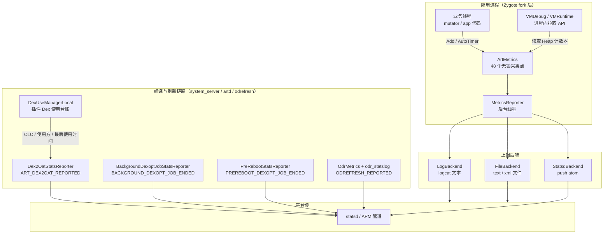
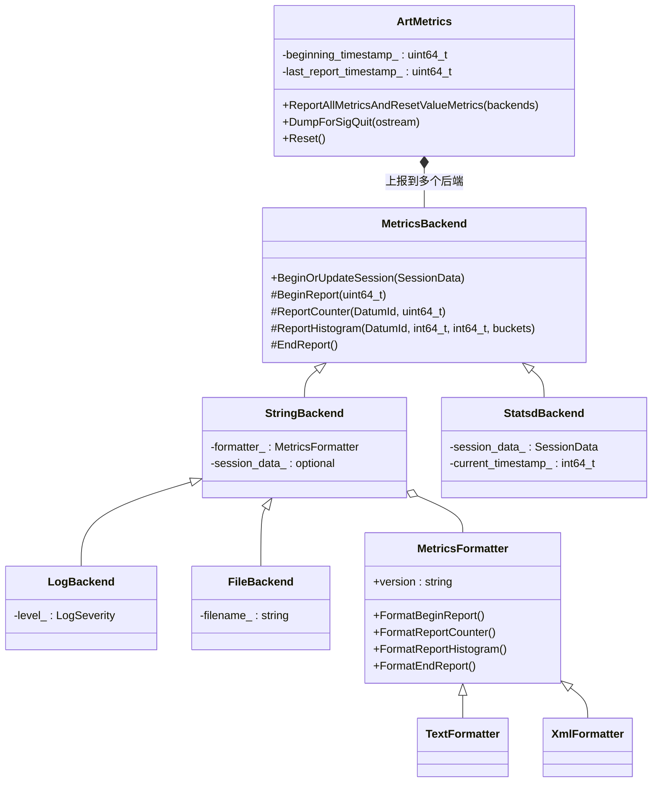
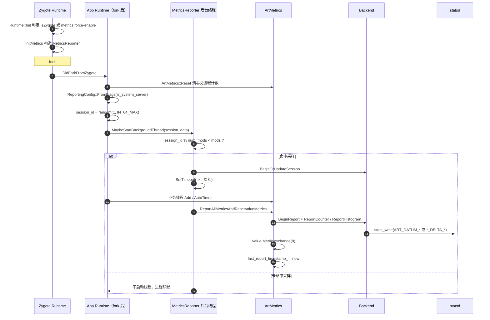
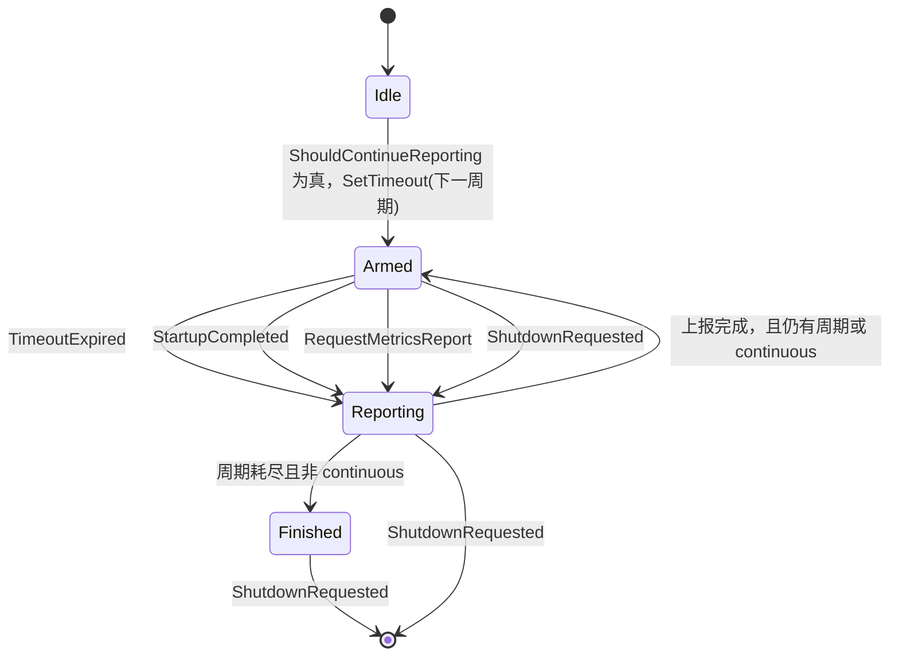
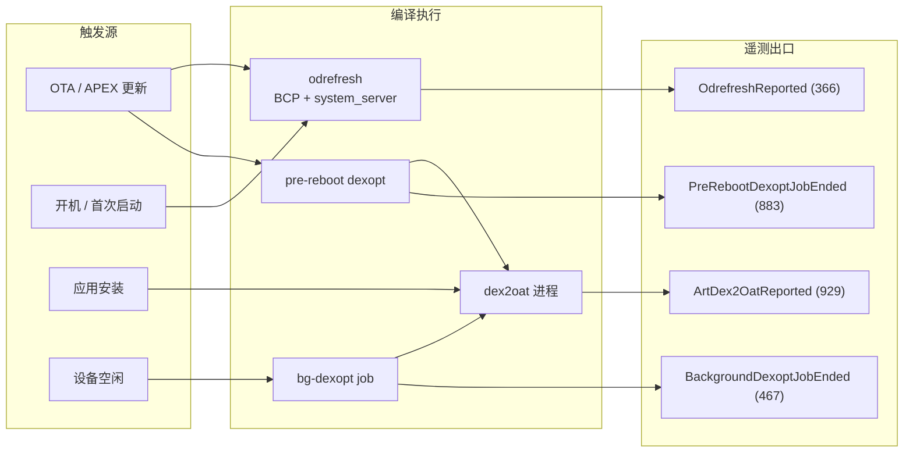

# 08 · ART 运行时与编译服务遥测指标体系

> [!IMPORTANT]
> **一句话核心结论**：ART 的性能遥测由三条互补通道组成——进程内 `ArtMetrics` 以 **48 个无锁原子采集点**（28 个累计事件指标 + 20 个增量指标）在独立后台线程按 `reporting-spec` 周期快照，经 logcat / XML 文件 / statsd 三个 Backend 输出；`Debug.getRuntimeStat()` 提供 11 个 GC 相关拉取项用于线上自监控；编译与刷新侧则由 `Dex2OatStatsReporter`、`BackgroundDexoptJobStatsReporter`、`PreRebootStatsReporter`、`OdrMetrics` 把 dex2oat / 后台编译 / 预重启编译 / odrefresh 的结果写成 statsd atom，`DexUseManagerLocal` 维护插件（secondary）Dex 的使用台账，作为"该编谁、按什么 ClassLoaderContext 编"的决策输入。

| 项目 | 内容 |
| :--- | :--- |
| **机制定位** | ART 运行时指标采集 / 周期上报 / 进程内拉取 / 编译服务全链路遥测 / 插件 Dex 使用监测 |
| **源码模块（相对 `qssi/art/`）** | `libartbase/base/metrics/`、`runtime/metrics/`、`libartbase/base/flags.*`、`runtime/native/`、`libartservice/service/java/com/android/server/art/`、`odrefresh/` |
| **核心类 / 入口** | `metrics::ArtMetrics`、`metrics::MetricsReporter`、`metrics::MetricsBackend`、`metrics::StatsdBackend`、`Dex2OatStatsReporter`、`BackgroundDexoptJobStatsReporter`、`PreRebootStatsReporter`、`odrefresh::OdrMetrics`、`DexUseManagerLocal` |
| **关键系统属性** | `dalvik.vm.metrics.reporting-spec`、`persist.device_config.runtime_native.metrics.reporting-spec`、`dalvik.vm.metrics.reporting-mods`、`dalvik.vm.metrics.reporting-num-mods`、`dalvik.vm.metrics.write-to-statsd`；其中 spec / mods / num-mods 对 system_server 另有 `*-server` 变体 |
| **关键启动参数** | `-Xmetrics-reporting-spec:`、`-Xmetrics-write-to-logcat:true`、`-Xmetrics-write-to-file:`、`-Xmetrics-format:xml`、`-Xmetrics-force-enable:true` |
| **statsd atom** | `ART_DATUM_REPORTED`(332)、`ART_DATUM_DELTA_REPORTED`(565)、`ART_DEVICE_STATUS`(10205，拉取)、`ART_DEX2OAT_REPORTED`(929)、`BACKGROUND_DEXOPT_JOB_ENDED`(467)、`PREREBOOT_DEXOPT_JOB_ENDED`(883)、`ODREFRESH_REPORTED`(366) |
| **源码基线** | `/home/voyah/workspace/8397/qssi/art`（Android 15/16 主线级 QSSI，`9a380e4`，只读） |

## 1. What：机制是什么？

### 1.1 职责边界：三条遥测通道

ART 的遥测不是一个子系统，而是**同一份进程内状态 + 三套消费方式**。先把边界划清楚，后文的源码细节才不会混在一起：

| 通道 | 采集源 | 触发方式 | 典型出口 | 数据时效 | 适用问题 |
| :--- | :--- | :--- | :--- | :--- | :--- |
| **A. 周期推送** | `ArtMetrics` 的 48 个原子 | 后台线程定时器 / 进程退出 / 显式请求 | statsd atom、logcat、XML 文件 | 秒级到小时级 | 云端 APM 大盘、趋势与回归 |
| **B. 进程内拉取** | `gc::Heap` 的 11 个统计项 | 应用或系统主动调用 Java API | 返回值 / SIGQUIT 文本转储 | 调用即取 | 现场排障、ANR 前后快照 |
| **C. 编译链路离线遥测** | ART Service / odrefresh / 预重启作业 | 每次安装、后台编译、OTA、开机 | statsd atom（部分先落 XML/protobuf） | 编译结束即上报 | 编译失败率、OTA 后卡顿归因 |

**它不负责**：statsd 之后的聚合与上传（属于平台 statsd/APM 管道）、Java 侧 `Debug` 类的封装语义（属于 libcore）、以及 `dumpsys meminfo` 之类的系统级内存快照（属于 Framework）。ART 只保证"把正确的计数写到正确的 atom"。

### 1.2 核心术语表

| 术语 | 含义 | 源码锚点 |
| :--- | :--- | :--- |
| Datum / DatumId | 一个可上报的数据项及其枚举 ID；48 个 datum 由宏统一生成 | [metrics.h](file:///home/voyah/workspace/8397/qssi/art/libartbase/base/metrics/metrics.h#L129-L133) |
| Event Metric | 进程生命周期内的**累计**指标（计数 / 均值 / 直方图），上报后不清零 | [metrics.h](file:///home/voyah/workspace/8397/qssi/art/libartbase/base/metrics/metrics.h#L43-L71) |
| Value Metric | 自上次上报以来的**增量**指标，`ReportAndReset` 时原子交换为 0 | [metrics.h](file:///home/voyah/workspace/8397/qssi/art/libartbase/base/metrics/metrics.h#L74-L94) |
| Session | 一次 ART 进程生命周期；`session_id` 用于把同一进程的多条 atom 关联起来 | [metrics.h](file:///home/voyah/workspace/8397/qssi/art/libartbase/base/metrics/metrics.h#L253-L263) |
| Backend | 指标落地目标（logcat / 文件 / statsd） | [metrics.h](file:///home/voyah/workspace/8397/qssi/art/libartbase/base/metrics/metrics.h#L267-L322) |
| Formatter | 把指标渲染成 text 或 XML 的格式化器 | [metrics.h](file:///home/voyah/workspace/8397/qssi/art/libartbase/base/metrics/metrics.h#L583-L599) |
| Reporting Spec | 上报时间表，语法 `(S,)?(\d+,)*\*?`，如 `S,1,2,4,*` | [reporter.cc](file:///home/voyah/workspace/8397/qssi/art/runtime/metrics/reporter.cc#L311-L351) |
| mods / num-mods | 会话采样率：`session_id % num_mods < mods` 才上报 | [reporter.cc](file:///home/voyah/workspace/8397/qssi/art/runtime/metrics/reporter.cc#L57-L59) |
| CompilationReason | 编译原因枚举（`bg-dexopt` / `install` / `boot-after-ota` 等 25 项） | [metrics.h](file:///home/voyah/workspace/8397/qssi/art/libartbase/base/metrics/metrics.h#L136-L177) |
| CompilerFilterReporting | 上报用的编译过滤器枚举（含 `run-from-apk` 等增强值） | [metrics.h](file:///home/voyah/workspace/8397/qssi/art/libartbase/base/metrics/metrics.h#L199-L230) |
| atom（push） | ART 主动 `stats_write` 写入 statsd 的事件 | [statsd.cc](file:///home/voyah/workspace/8397/qssi/art/runtime/metrics/statsd.cc#L368-L404) |
| atom（pull） | statsd 反向拉取设备状态，如 boot image 形态 | [statsd.cc](file:///home/voyah/workspace/8397/qssi/art/runtime/metrics/statsd.cc#L426-L450) |
| secondary dex | 应用运行时从数据目录加载的插件/动态 Dex，是"插件 Dex 监控"的对象 | [DexUseManagerLocal.java](file:///home/voyah/workspace/8397/qssi/art/libartservice/service/java/com/android/server/art/DexUseManagerLocal.java#L668-L698) |

### 1.3 架构定位



### 1.4 48 项采集点全景

`ART_METRICS = ART_EVENT_METRICS + ART_VALUE_METRICS`（[metrics.h](file:///home/voyah/workspace/8397/qssi/art/libartbase/base/metrics/metrics.h#L96-L98)）。逐项清点：**28 + 20 = 48**。

**28 个 Event Metric（累计，不清零）**

| # | 指标 | 类型 | 语义 |
| :--- | :--- | :--- | :--- |
| 1 | `ClassLoadingTotalTime` | Counter | 类加载累计耗时（微秒） |
| 2 | `ClassVerificationTotalTime` | Counter | 类校验累计耗时（微秒） |
| 3 | `ClassVerificationCount` | Counter | 校验过的类数量 |
| 4 | `WorldStopTimeDuringGCAvg` | Average | 每次 GC 的 STW 平均时长 |
| 5 | `YoungGcCount` | Counter | 新生代 GC 次数 |
| 6 | `FullGcCount` | Counter | 全堆 GC 次数 |
| 7 | `TotalBytesAllocated` | Counter | 累计分配字节数 |
| 8 | `TotalGcCollectionTime` | Counter | GC 累计耗时 |
| 9 | `YoungGcThroughputAvg` | Average | 新生代 GC 吞吐均值（MB/s） |
| 10 | `FullGcThroughputAvg` | Average | 全堆 GC 吞吐均值（MB/s） |
| 11 | `YoungGcTracingThroughputAvg` | Average | 新生代并发标记吞吐均值 |
| 12 | `FullGcTracingThroughputAvg` | Average | 全堆并发标记吞吐均值 |
| 13 | `JitMethodCompileTotalTime` | Counter | JIT 编译累计耗时 |
| 14 | `JitMethodCompileCount` | Counter | JIT 编译方法数 |
| 15 | `YoungGcCollectionTime` | Histogram(15, 0, 60000) | 新生代 GC 时长分布（毫秒） |
| 16 | `FullGcCollectionTime` | Histogram(15, 0, 60000) | 全堆 GC 时长分布（毫秒） |
| 17 | `YoungGcThroughput` | Histogram(15, 0, 10000) | 新生代 GC 吞吐分布 |
| 18 | `FullGcThroughput` | Histogram(15, 0, 10000) | 全堆 GC 吞吐分布 |
| 19 | `YoungGcTracingThroughput` | Histogram(15, 0, 10000) | 新生代标记吞吐分布 |
| 20 | `FullGcTracingThroughput` | Histogram(15, 0, 10000) | 全堆标记吞吐分布 |
| 21 | `GcWorldStopTime` | Counter | STW 累计时长 |
| 22 | `GcWorldStopCount` | Counter | STW 次数 |
| 23 | `YoungGcScannedBytes` | Counter | 新生代扫描字节 |
| 24 | `YoungGcFreedBytes` | Counter | 新生代回收字节 |
| 25 | `YoungGcDuration` | Counter | 新生代 GC 累计时长 |
| 26 | `FullGcScannedBytes` | Counter | 全堆扫描字节 |
| 27 | `FullGcFreedBytes` | Counter | 全堆回收字节 |
| 28 | `FullGcDuration` | Counter | 全堆 GC 累计时长 |

**20 个 Value Metric（增量，上报即清零）**

| # | 指标 | 对应累计量 | 用途 |
| :--- | :--- | :--- | :--- |
| 29 | `GcWorldStopTimeDelta` | `GcWorldStopTime` | 本周期新增 STW 时长 |
| 30 | `GcWorldStopCountDelta` | `GcWorldStopCount` | 本周期新增 STW 次数 |
| 31 | `YoungGcScannedBytesDelta` | `YoungGcScannedBytes` | 本周期扫描量 |
| 32 | `YoungGcFreedBytesDelta` | `YoungGcFreedBytes` | 本周期回收量 |
| 33 | `YoungGcDurationDelta` | `YoungGcDuration` | 本周期 GC 耗时 |
| 34 | `FullGcScannedBytesDelta` | `FullGcScannedBytes` | 本周期全堆扫描量 |
| 35 | `FullGcFreedBytesDelta` | `FullGcFreedBytes` | 本周期全堆回收量 |
| 36 | `FullGcDurationDelta` | `FullGcDuration` | 本周期全堆 GC 耗时 |
| 37 | `JitMethodCompileTotalTimeDelta` | `JitMethodCompileTotalTime` | 本周期 JIT 耗时 |
| 38 | `JitMethodCompileCountDelta` | `JitMethodCompileCount` | 本周期 JIT 方法数 |
| 39 | `ClassVerificationTotalTimeDelta` | `ClassVerificationTotalTime` | 本周期校验耗时 |
| 40 | `ClassVerificationCountDelta` | `ClassVerificationCount` | 本周期校验类数 |
| 41 | `ClassLoadingTotalTimeDelta` | `ClassLoadingTotalTime` | 本周期类加载耗时 |
| 42 | `TotalBytesAllocatedDelta` | `TotalBytesAllocated` | 本周期分配量 |
| 43 | `TotalGcCollectionTimeDelta` | `TotalGcCollectionTime` | 本周期 GC 总耗时 |
| 44 | `YoungGcCountDelta` | `YoungGcCount` | 本周期新生代次数 |
| 45 | `FullGcCountDelta` | `FullGcCount` | 本周期全堆次数 |
| 46 | `TimeElapsedDelta` | 无（时间基准） | 距上次上报的毫秒数 |
| 47 | `AppSlowPathDuringYoungGcDurationDelta` | 无 | 新生代 GC 期间应用慢路径时长 |
| 48 | `AppSlowPathDuringFullGcDurationDelta` | 无 | 全堆 GC 期间应用慢路径时长 |

> [!NOTE]
> 48 项在 `StatsdBackend::EncodeDatumId` 中**全部有 atom 映射**（switch 共 48 个 case，[statsd.cc](file:///home/voyah/workspace/8397/qssi/art/runtime/metrics/statsd.cc#L46-L209)）；但 6 个 Histogram 走的是 `ReportHistogram`，而该方法当前只打一条 DEBUG 日志就返回（[statsd.cc](file:///home/voyah/workspace/8397/qssi/art/runtime/metrics/statsd.cc#L406-L412)）。因此**真正到达 statsd 的是 42 个标量指标，6 个直方图只出现在 logcat / XML / SIGQUIT 转储里**。

## 2. Why：为什么需要它？

### 2.1 缺失这套机制时的四类盲区

| 盲区 | 现场表现 | 没有遥测时的排障方式 | 有遥测后的定位方式 |
| :--- | :--- | :--- | :--- |
| **GC 健康度不可见** | 车机长稳后偶发掉帧、内存缓慢上涨 | 只能抓 Perfetto 复现，问题不复现就断线 | `FullGcCountDelta` / `GcWorldStopTimeDelta` / `YoungGcCollectionTime` 直方图看趋势 |
| **JIT / 类加载异常** | 冷启动慢、某版本 CPU 偏高 | 猜是应用代码问题，无基线和分位数 | `JitMethodCompileCountDelta`、`ClassLoadingTotalTimeDelta` 按版本对比 |
| **编译链路黑盒** | OTA 后首次开机卡、安装慢 | 只能看 logcat 里 dex2oat 的零散日志 | `ART_DEX2OAT_REPORTED` 的 status/exit/signal/size/time 四元组聚合失败率 |
| **插件 Dex 失控** | 动态加载包越装越多、dexopt 反复编译 | 不知道谁加载了哪个 Dex、CLASS_LOADER_CONTEXT 是什么 | `DexUseManagerLocal` 台账 + `pm art dump` 查使用方与最后使用时间 |

### 2.2 车机（高通 8397）场景的特殊约束

座舱与手机的最大差异不是"性能更差"，而是**运行形态**：多屏常驻、长时间不关机、OTA 后必须在用户上车前完成预编译、且没有用户主动反馈渠道。这决定了遥测设计的三条硬要求：

1. **必须常开且低开销**。采集点全部是 `std::atomic` 的 relaxed 加减与固定桶数组，没有锁、没有内存分配（直方图上报除外），单次 `Add()` 是几条指令级别；这才能在每帧、每次分配上无脑埋点。
2. **必须能承受进程长期运行**。Event Metric 是"自 fork 起的累计量"，不会因为上报而丢失；Value Metric 用"上报即清零"把每个周期的增量独立出来，两者配合既保留全生命周期基线，又能做周期归因。
3. **必须采样，不能全量**。默认只有约 **2%** 的进程会话上报（`mods=2 / num-mods=100`），把云端成本压到可接受，同时保留统计显著性；系统服务有独立的 spec 与采样参数。

### 2.3 设计权衡矩阵

| 维度 | 选择 | 代价 | 收益 |
| :--- | :--- | :--- | :--- |
| 采集数据结构 | 固定大小原子 + 宏生成 48 项 | 指标维度固定，新增要改头文件 | 零分配、无锁、可静态断言 `is_always_lock_free` |
| 累计 vs 增量 | 事件指标累计 + 增量指标清零 | 两套 datum 名字与语义要分清 | 既支持"全程均值"，也支持"本周期速率" |
| 直方图桶 | 线性插值，15 桶，上限固定 60 s / 10 GB/s | 超出上限的值挤进最后一桶，精度有限 | 固定内存、可跨版本比较 |
| 采样 | session 级哈希采样 2% | 小样本进程可能完全不上报 | 云端成本可控，且同一会话内数据完整 |
| 传输 | statsd push atom 为主 | 依赖 statsd 管道 | 与 Android 平台 APM 生态天然对接 |
| 调试输出 | logcat / XML 文件（仅命令行开启） | 需要重启进程或重新拉起 | 现场可拿到完整 48 项，不依赖云端 |

### 2.4 采样模型：为什么默认是 2%

`IsMetricsReportingEnabled` 只做一次取模：

```text
enabled  ⇔  session_id % reporting_num_mods < reporting_mods
默认值   ⇔  session_id % 100 < 2      // 约 2%
```

`session_id` 在每次 zygote fork 时用 `GetRandomNumber<int64_t>(1, INT64_MAX)` 重新生成（[runtime.cc](file:///home/voyah/workspace/8397/qssi/art/runtime/runtime.cc#L1296-L1302)），因此采样单位是**进程会话**而不是指标点：被选中的会话会完整上报 48 项，未被选中的会话一条都不发。system_server 使用独立的 `MetricsReportingSpecSystemServer` 与 `reporting-mods-server / num-mods-server`（[reporter.cc](file:///home/voyah/workspace/8397/qssi/art/runtime/metrics/reporter.cc#L269-L309)），可以在不放大应用侧数据量的前提下单独提高系统服务的采样率。

> [!TIP]
> 做车机项目验收时，把 `metrics.reporting-mods` 临时调到 100（分母 100）即可让**所有**新拉起的进程上报，不必改代码；验证完务必改回，否则云端数据量会放大 50 倍。

## 3. How：源码级实现原理深度剖析

### 3.1 核心数据结构与内存布局

`ArtMetrics` 是一个**编译期展开的对象**：48 个 metric 成员直接内嵌，没有虚函数表之外的间接层。宏 `ART_METRICS(METRIC)` 同时生成枚举、访问器和成员（[metrics.h](file:///home/voyah/workspace/8397/qssi/art/libartbase/base/metrics/metrics.h#L774-L798)）。

```text
ArtMetrics（libartbase/base/metrics/metrics.h:774）
┌──────────────────────────────────────────────────────────────────────────┐
│ beginning_timestamp_    : uint64_t   ← 构造 / Reset 时的 MilliTime()      │
│ last_report_timestamp_  : uint64_t   ← 上次上报时刻，用于 TimeElapsedDelta │
├──────────────────────────────────────────────────────────────────────────┤
│ ART_EVENT_METRICS（28 个，累计，不随上报清零）                              │
│   MetricsCounter      ×17   ClassLoading / GC count / bytes / duration …  │
│   MetricsAverage      ×5    WorldStopTimeDuringGCAvg / 各类 ThroughputAvg │
│   MetricsHistogram    ×6    Young/FullGc CollectionTime / Throughput      │
├──────────────────────────────────────────────────────────────────────────┤
│ ART_VALUE_METRICS（20 个，上报即 exchange(0)）                             │
│   MetricsDeltaCounter ×20   …Delta 系列 + TimeElapsedDelta                │
└──────────────────────────────────────────────────────────────────────────┘
```

每个 metric 对象的布局都被 `static_assert` 锁死为一个 vtable 指针加一个原子值，防止 padding 造成意外膨胀：

```text
MetricsCounter<DatumId, T>                 MetricsAverage<DatumId, T>
┌───────────┬──────────────────┐           ┌───────────┬──────────────┬──────────────┐
│ vptr 8 B  │ value_ : atomic T│           │ vptr 8 B  │ value_:atom T│ count_:atom T│
└───────────┴──────────────────┘           └───────────┴──────────────┴──────────────┘
       ▲ Add() = fetch_add(value, relaxed)        ▲ Add() 先加 value，再 release 加 count
       ▲ Report() = load(relaxed)                 ▲ Report() = value / count（acquire 读 count）

MetricsDeltaCounter<DatumId, T>            MetricsHistogram<id, 15, 0, 60000>
┌───────────┬──────────────────┐           ┌───────────┬───────────────────────────────┐
│ vptr 8 B  │ value_ : atomic T│           │ vptr 8 B  │ buckets_[15] : atomic uint32_t│
└───────────┴──────────────────┘           └───────────┴───────────────────────────────┘
       ▲ ReportAndReset() = exchange(0)          ▲ Add(v) = buckets_[bucket_id(v)]++
```

直方图桶号由 `FindBucketId` 线性插值得到（[metrics.h](file:///home/voyah/workspace/8397/qssi/art/libartbase/base/metrics/metrics.h#L505-L517)）：小于等于下限进 0 号桶，大于等于上限进最后一桶，其余按 `(value - min) * num_buckets / (max - min)` 计算。以 `YoungGcCollectionTime` 的 `(15, 0, 60000)` 为例：

```text
桶号:     0        1        2      ...      14
区间:  [0,4s)  [4s,8s)  [8s,12s)  ...  [56s, ∞)
        ▲                                   ▲
   value <= 0                          value >= 60000
   （含 0，实际为 [0,4000)）            （所有超长 GC 都堆在最后一桶）
```

类关系如下（Backend 是策略层，Formatter 是渲染层，二者正交组合）：



> [!NOTE]
> `MetricsAccumulator`（自定义二元累加函数 + CAS 循环，[metrics.h](file:///home/voyah/workspace/8397/qssi/art/libartbase/base/metrics/metrics.h#L537-L579)）在本基线中**没有任何指标使用**；48 项只用到 Counter / Average / DeltaCounter / Histogram 四种。读代码时不要把它当成已启用的采集点。

### 3.2 生命周期：从 Zygote 到进程退出

ART 只在两种情况下初始化指标子系统：

```cpp
// runtime.cc:2162-2166
if (IsZygote() || gFlags.MetricsForceEnable.GetValue()) {
  LOG(INFO) << "Initializing ART runtime metrics";
  InitMetrics();
}
```

也就是说，**普通应用进程并不自己初始化指标**，而是从 zygote 继承 `ArtMetrics` 对象；fork 后立刻清零，避免把父进程的数据算到子进程头上（[runtime.cc](file:///home/voyah/workspace/8397/qssi/art/runtime/runtime.cc#L1283-L1306)）：

```text
Zygote fork
   │
   ├─ heap_->ResetGcPerformanceInfo()
   ├─ GetMetrics()->Reset()                     // 48 项全部归零，时间戳重置
   ├─ ReportingConfig::FromFlags(is_system_server)   // 系统服务换成 *-server 参数
   ├─ session_data.session_id = random(1, INT64_MAX)
   ├─ MaybeStartBackgroundThread(session_data)  // 采样命中才起线程
   └─ NotifyAppInfoUpdated(&app_info_)          // 补 compiler_filter / reason
```

`NotifyAppInfoUpdated` 会从主 APK 的优化状态反查 `compilation_reason` 与 `compiler_filter`，写进 `SessionData`（[reporter.cc](file:///home/voyah/workspace/8397/qssi/art/runtime/metrics/reporter.cc#L89-L99)）。这两个字段会随**每一条** atom 一起发出，是云端做"编译原因 × 指标"切片的关键维度。



### 3.3 上报调度：ReportingPeriodSpec 与消息队列

`ReportingPeriodSpec::Parse` 支持四种语法元素（[reporter.cc](file:///home/voyah/workspace/8397/qssi/art/runtime/metrics/reporter.cc#L311-L351)）：

| 写法 | 含义 |
| :--- | :--- |
| `S` | 首次上报等待"启动完成"事件，而不是等第一个定时器 |
| `1,5,30` | 依次在启动后 1 s、5 s、30 s 上报，然后停止 |
| `1,5,*` | 先 1 s、5 s，之后每 5 s 持续上报 |
| `*` / 空串 / `S,*` | 非法（连续的 `*` 前必须有一个数字间隔） |

默认值在 `flags.h` 中（[flags.h](file:///home/voyah/workspace/8397/qssi/art/libartbase/base/flags.h#L266-L292)）：

| 进程 | 默认 spec | 行为 |
| :--- | :--- | :--- |
| 普通应用 | `1,5,30,60,600` | 启动后 1/5/30/60/600 秒各上报一次，共 5 次，之后静默 |
| system_server | `1,10,60,3600,*` | 启动后 1/10/60/3600 秒各一次，此后每小时持续上报 |

```text
普通应用（1,5,30,60,600）
t=0      1s     5s        30s       60s              600s
│        │      │          │         │                 │
fork     R1     R2         R3        R4                R5 ──► 线程休眠，等待进程退出

system_server（1,10,60,3600,*）
t=0      1s     10s        60s       3600s             7200s
│        │      │          │         │                 │
fork     R1     R2         R3        R4                R5 ──► 每 3600s 重复
```

调度核心是一个 `MessageQueue` + 单后台线程（线程名 `Metrics Background Reporting Thread`，daemon，且标记为 runtime thread 避免被 JVMTI 采样），[reporter.cc](file:///home/voyah/workspace/8397/qssi/art/runtime/metrics/reporter.cc#L117-L198)。线程主循环用 `SwitchReceive` 处理五类消息：

| 消息 | 触发源 | 动作 |
| :--- | :--- | :--- |
| `ShutdownRequestedMessage` | 进程退出 / `MaybeStopBackgroundThread` | 最后上报一次后退出 |
| `RequestMetricsReportMessage` | `Runtime::RequestMetricsReport`（可同步等待） | 立即上报；同步模式回 ACK |
| `TimeoutExpiredMessage` | `MessageQueue` 定时器 | 上报并按 spec 排下一次 |
| `StartupCompletedMessage` | `StartupCompletedTask` → `Runtime::NotifyStartupCompleted` | 上报并把 `startup_reported_` 置真 |
| `CompilationInfoMessage` | `NotifyAppInfoUpdated` / `SetCompilationInfo` | 只更新 SessionData，并同步给已开始的 Backend |



`ShouldContinueReporting` 是总闸门：采样命中、spec 存在且周期非空、若要求等启动则已上报过启动、且"还有剩余周期或处于 continuous 模式"四个条件同时成立（[reporter.cc](file:///home/voyah/workspace/8397/qssi/art/runtime/metrics/reporter.cc#L235-L249)）。`GetNextPeriodSeconds` 用 `min(report_interval_index_, size-1)` 取当前间隔，非 continuous 时递增索引直到耗尽；continuous 时索引停在最后一个值上无限重复（[reporter.cc](file:///home/voyah/workspace/8397/qssi/art/runtime/metrics/reporter.cc#L251-L267)）。

### 3.4 上报内容：累计与增量如何分开

`ArtMetrics::ReportAllMetricsAndResetValueMetrics` 是整个体系的"心脏"，顺序不可交换（[metrics_common.cc](file:///home/voyah/workspace/8397/qssi/art/libartbase/base/metrics/metrics_common.cc#L70-L94)）：

```text
1. now = MilliTime()
2. 每个 Backend: BeginReport(now - beginning_timestamp_)
3. 28 个 EVENT 指标: Report(backends)          ← 只读，不清零
4. TimeElapsedDelta()->Add(now - last_report_timestamp_)   ← 必须先补时间差
5. 20 个 VALUE 指标: ReportAndReset(backends)  ← exchange(0) 后再上报
6. 每个 Backend: EndReport()
7. last_report_timestamp_ = now
```

第 4 步的顺序是刻意设计的：`TimeElapsedDelta` 本身也是 Value Metric，但它必须先把"距上次上报的真实间隔"写进去，然后才在第 5 步被一起上报并清零；否则云端无法把 `*Delta` 换算成速率。

### 3.5 Backend 与格式化：三种落地形态

**文本格式**（logcat / 文件默认）。真实输出结构如下（格式串见 [metrics_common.cc](file:///home/voyah/workspace/8397/qssi/art/libartbase/base/metrics/metrics_common.cc#L139-L189)）：

```text
*** ART internal metrics ***
  Metadata:
    timestamp_since_start_ms: 60000
    session_id: 5123456789012345
    uid: 10123
    compilation_reason: bg-dexopt
    compiler_filter: speed-profile
  Metrics:
    ClassLoadingTotalTime: count = 184223
    YoungGcCount: count = 42
    YoungGcCollectionTime: range = 0...60000, buckets: 30,8,3,1,0,0,0,0,0,0,0,0,0,0,0
    ...
*** Done dumping ART internal metrics ***
```

**XML 格式**（`-Xmetrics-format:xml` + `-Xmetrics-write-to-file:<path>`）。根元素 `art_runtime_metrics`，内含 `version`、`metadata`、`metrics`；计数器写成 `<DatumName><counter_type>count</counter_type><value>…</value>`，直方图额外带 `minimum_value` / `maximum_value` / `buckets`（[metrics_common.cc](file:///home/voyah/workspace/8397/qssi/art/libartbase/base/metrics/metrics_common.cc#L192-L251)）。XML 是 `odrefresh` 等离线组件的同类做法，便于先落盘、后上传。

**statsd 格式**（生产主通道）。`StatsdBackend` 只做三件事：把 `DatumId` 编码成 atom 内的 `kind` 枚举、判定用 push 还是 delta atom、调用 `stats_write`（[statsd.cc](file:///home/voyah/workspace/8397/qssi/art/runtime/metrics/statsd.cc#L357-L420)）。atom 字段布局：

```text
ArtDatumReported (332) / ArtDatumDeltaReported (565)
┌───────────┬─────┬──────────────┬──────────────────┬───────────┬───────┬───────┬─────┐
│session_id │ uid │ compile_filter│ compilation_reason│timestamp  │ kind  │ value │ isa │
│   1       │  2  │      3       │        4         │     5     │   7   │   8   │ 11  │
└───────────┴─────┴──────────────┴──────────────────┴───────────┴───────┴───────┴─────┘
                                                                          └─ 12: gc type
已废弃字段（源码显式写 0）：6 thread_type / 9 dex_metadata_type / 10 apk_type / 13 uffd_support
```

`ReportCounter` 的 switch 用宏把 datum 分成两组：命中 `ART_EVENT_METRICS` 走 `ART_DATUM_REPORTED`，命中 `ART_VALUE_METRICS` 走 `ART_DATUM_DELTA_REPORTED`（[statsd.cc](file:///home/voyah/workspace/8397/qssi/art/runtime/metrics/statsd.cc#L375-L387)）。每次写入还会现算 `EncodeInstructionSet(kRuntimeISA)` 与 `EncodeGcCollectorType(Heap::GetForegroundCollectorType())`（[statsd.cc](file:///home/voyah/workspace/8397/qssi/art/runtime/metrics/statsd.cc#L389-L403)），因此同一条 datum 在不同 ISA / GC 类型下会自动带上区分维度。

四个编码器的取值来源都在源码里可查：

| 编码器 | 覆盖范围 | 锚点 |
| :--- | :--- | :--- |
| `EncodeDatumId` | 48 个 DatumId → `ArtDatumId` / `ArtDatumDeltaId` | [statsd.cc](file:///home/voyah/workspace/8397/qssi/art/runtime/metrics/statsd.cc#L46-L209) |
| `EncodeCompileFilter` | 14 个上报过滤器（含 absent/unknown/other 与 2 个 run-from-apk 增强值） | [statsd.cc](file:///home/voyah/workspace/8397/qssi/art/runtime/metrics/statsd.cc#L211-L243) |
| `EncodeCompilationReason` | 25 个编译原因 | [statsd.cc](file:///home/voyah/workspace/8397/qssi/art/runtime/metrics/statsd.cc#L245-L303) |
| `EncodeInstructionSet` | arm/thumb2 → ARM、arm64、riscv64、x86、x86_64、none | [statsd.cc](file:///home/voyah/workspace/8397/qssi/art/runtime/metrics/statsd.cc#L305-L322) |
| `EncodeGcCollectorType` | MS/CMS/CMC/CMC-BG/SS/CC/CC-BG，其余归 UNKNOWN | [statsd.cc](file:///home/voyah/workspace/8397/qssi/art/runtime/metrics/statsd.cc#L324-L355) |

**拉取式 atom**：除了 push，ART 还注册了 `ART_DEVICE_STATUS` 的 pull callback，由 statsd 在需要时反向查询 boot image 形态。判定逻辑是"有 boot image 且带 profile → FULL；有 boot image 但 profile 列表为空 → MINIMAL；否则 NONE"（[statsd.cc](file:///home/voyah/workspace/8397/qssi/art/runtime/metrics/statsd.cc#L426-L464)）。这条数据用于评估"设备是否真的用上了 profile 驱动的 boot image"。同一判定还被 `ReportDeviceMetrics()` 复制了一份，在 system_server 启动时 push 一条已废弃的 `ART_DEVICE_DATUM_REPORTED`(550)，作为 pull 通道的兼容兜底（[statsd.cc](file:///home/voyah/workspace/8397/qssi/art/runtime/metrics/statsd.cc#L452-L464)）。

### 3.6 进程内自监控：Debug.getRuntimeStat()

`VMDebug` 暴露 11 个运行时统计项，枚举与实现一一对应（[dalvik_system_VMDebug.cc](file:///home/voyah/workspace/8397/qssi/art/runtime/native/dalvik_system_VMDebug.cc#L417-L484)）：

| statId | Java 名称 | 原生取值 | 单位 | 车机用途 |
| :--- | :--- | :--- | :--- | :--- |
| 0 | `art.gc.gc-count` | `Heap::GetGcCount()` | 次 | GC 频次突增定位 |
| 1 | `art.gc.gc-time` | `NsToMs(Heap::GetGcTime())` | ms | GC 总耗时 |
| 2 | `art.gc.bytes-allocated` | `GetBytesAllocatedEver()` | B | 分配速率基线 |
| 3 | `art.gc.bytes-freed` | `GetBytesFreedEver()` | B | 回收效率 |
| 4 | `art.gc.blocking-gc-count` | `GetBlockingGcCount()` | 次 | 同步 GC 次数（直接卡线程） |
| 5 | `art.gc.blocking-gc-time` | `NsToMs(GetBlockingGcTime())` | ms | 同步 GC 累计停顿 |
| 6 | `art.gc.gc-count-rate-histogram` | `DumpGcCountRateHistogram()` | 文本直方图 | 单位时间 GC 次数分布 |
| 7 | `art.gc.blocking-gc-count-rate-histogram` | `DumpBlockingGcCountRateHistogram()` | 文本直方图 | 阻塞 GC 频率分布 |
| 8 | `art.gc.objects-allocated` | `GetObjectsAllocated()` | 个 | 当前存活对象数 |
| 9 | `art.gc.total-time-waiting-for-gc` | `GetTotalTimeWaitingForGC()` | ns | 等 GC 锁耗时 |
| 10 | `art.gc.pre-oome-gc-count` | `GetPreOomeGcCount()` | 次 | OOM 前抢救式 GC 次数 |

其中 **`pre-oome-gc-count` 是 OOM 预警的核心信号**：它统计"已接近堆上限、系统在抛 OOM 前强制做的最后一轮 GC"次数。该值非 0 且持续增长，说明进程已经在堆边界反复挣扎，比等到 `java.lang.OutOfMemoryError` 再抓现场要早得多。

`getRuntimeStatInternal` 是单点查询（switch 分支，[dalvik_system_VMDebug.cc](file:///home/voyah/workspace/8397/qssi/art/runtime/native/dalvik_system_VMDebug.cc#L432-L484)）；`getRuntimeStatsInternal` 一次性构造 11 元字符串数组。需要注意：**批量版本只填充了 0–7 号槽位**（[dalvik_system_VMDebug.cc](file:///home/voyah/workspace/8397/qssi/art/runtime/native/dalvik_system_VMDebug.cc#L502-L572)），8/9/10 三个槽位保持 null。Java 侧 `getRuntimeStats()` 按名字装配 Map 时会取到 null，因此"对象数 / 等 GC 时间 / pre-OOM GC 次数"必须用单点 `getRuntimeStat(name)` 读取，批量接口拿不到。

另一条进程内读取路径是 `VMRuntime.getFullGcCount()`：它通过 `MetricsCounter` 的 friend 声明直接读 `ArtMetrics::FullGcCount()->Value()`（[metrics.h](file:///home/voyah/workspace/8397/qssi/art/libartbase/base/metrics/metrics.h#L338-L373)、[dalvik_system_VMRuntime.cc](file:///home/voyah/workspace/8397/qssi/art/runtime/native/dalvik_system_VMRuntime.cc#L547-L550)），不走 VMDebug 的枚举。

SIGQUIT 是第三种快照方式：`Runtime::DumpForSigQuit` 在打印完线程栈、Heap、JIT 之后调用 `GetMetrics()->DumpForSigQuit(os)`（[runtime.cc](file:///home/voyah/workspace/8397/qssi/art/runtime/runtime.cc#L2514-L2531)），后者用一个临时 `StringBackend` 把当前 48 项按文本格式渲染出来（[metrics_common.cc](file:///home/voyah/workspace/8397/qssi/art/libartbase/base/metrics/metrics_common.cc#L96-L100)）。

> [!WARNING]
> `ArtMetrics::DumpForSigQuit` 复用了 `ReportAllMetricsAndResetValueMetrics`，因此**一次 SIGQUIT / bugreport 会顺手把 20 个 Value Metric 清零**。如果排障时连续抓了两次转储，第二次看到的 `*Delta` 只是两次转储之间的增量，而不是一个完整上报周期的增量；用它做因果推断前必须先确认是否触发过 SIGQUIT。

### 3.7 编译服务全链路遥测

应用进程的 48 项指标回答"运行时健不健康"，但不回答"为什么这个应用没被编译好"。后者由编译链路上的四个上报器回答，它们分布在 system_server（ART Service）、artd、odrefresh 三个进程：



#### 3.7.1 Dex2OatStatsReporter：一次编译、每 ABI 一条 atom

`Dex2OatStatsReporter` 是 ART Service（system_server）侧的 dex2oat 结果上报器（[Dex2OatStatsReporter.java](file:///home/voyah/workspace/8397/qssi/art/libartservice/service/java/com/android/server/art/Dex2OatStatsReporter.java#L34-L40)）。它的设计要点是 **Session 对象按"一次 dexopt 请求"聚合、按 ABI 展开**：

- 构造时为每个 ABI 预置 `notRun()` 结果，`sizeBytes=0`、`wallTimeMs=0`（[Dex2OatStatsReporter.java](file:///home/voyah/workspace/8397/qssi/art/libartservice/service/java/com/android/server/art/Dex2OatStatsReporter.java#L171-L187)）。
- 每完成一个 ABI 调 `recordResultForAbi`，替换结果并把该 ABI 从待办列表移除（[Dex2OatStatsReporter.java](file:///home/voyah/workspace/8397/qssi/art/libartservice/service/java/com/android/server/art/Dex2OatStatsReporter.java#L197-L201)）。
- 提前结束时调 `recordResultForRemainingAbis`，用同一个终态（如 cancelled）填满剩余 ABI，避免漏报（[Dex2OatStatsReporter.java](file:///home/voyah/workspace/8397/qssi/art/libartservice/service/java/com/android/server/art/Dex2OatStatsReporter.java#L203-L209)）。
- `report()` 对每个 ABI 各写一条 `ART_DEX2OAT_REPORTED`（[Dex2OatStatsReporter.java](file:///home/voyah/workspace/8397/qssi/art/libartservice/service/java/com/android/server/art/Dex2OatStatsReporter.java#L211-L227)）。

写入字段与源码语义：

| atom 字段 | 取值来源 | 备注 |
| :--- | :--- | :--- |
| `uid` | `mAppId` | 应用 ID，不是 uid 全量 |
| `compiler_filter` | `translateCompilerFilter(mCompilerFilter)` | 8 个标准过滤器 + skip + unknown |
| `compilation_reason` | `translateCompilationReason(mCompilationReason)` | 13 个显式原因 + unknown |
| `dex_metadata_type` | `DexMetadata.TYPE_*` | PROFILE / VDEX / PROFILE_AND_VDEX / NONE / ERROR / UNKNOWN |
| `apk_type` | `getApkType(dexInfo)` | BASE / SPLIT / SECONDARY / UNKNOWN |
| `isa` | `translateIsa(abi.isa())` | 每 ABI 一条 |
| `result_status` | `Dex2OatResult.status` | NOT_RUN / EXITED / SIGNALED / TIMED_OUT / START_FAILED / CANCELLED |
| `result_exit_code` | `Dex2OatResult.exitCode` | 非 EXITED 时为 -1 |
| `result_signal` | `Dex2OatResult.signal` | 非 SIGNALED 时为 0 |
| `artifacts_size_kb` | `(int) (sizeBytes / 1024)` | 整数除法，注意精度损失 |
| `compilation_time_ms` | `wallTimeMs` | 墙钟时间，不是 CPU 时间 |

`Session.disable()` 用于"这个文件不该编译"的场景（如不可 dexopt 的 APK），直接抑制上报（[Dex2OatStatsReporter.java](file:///home/voyah/workspace/8397/qssi/art/libartservice/service/java/com/android/server/art/Dex2OatStatsReporter.java#L189-L191)）。`Dexopter` 在真正开始编译前创建 Session，并在调整过滤器后回写（[Dexopter.java](file:///home/voyah/workspace/8397/qssi/art/libartservice/service/java/com/android/server/art/Dexopter.java#L108-L125)）。

#### 3.7.2 BackgroundDexoptJobStatsReporter：按 pass 上报后台编译

后台编译由 `BackgroundDexoptJob` 调度。任务结束时，只有 `JobType.BG_DEXOPT` 会调用 `writeStats`（[BackgroundDexoptJob.java](file:///home/voyah/workspace/8397/qssi/art/libartservice/service/java/com/android/server/art/BackgroundDexoptJob.java#L91-L113)）。上报器按 **pass** 逐条写 `BACKGROUND_DEXOPT_JOB_ENDED`（atom 467），字段包括：

| 字段 | 含义 |
| :--- | :--- |
| `status` | JOB_FINISHED / ABORT_BY_CANCELLATION / ABORT_NO_SPACE_LEFT / ABORT_THERMAL / ABORT_BATTERY / ABORT_BY_API / FATAL_ERROR |
| `stop_reason` | 取消时透传 `JobParameters.STOP_REASON_*` |
| `duration_ms` | 该 pass 的耗时 |
| `optimized_packages_count` / `total_packages_count` | 该 pass 实际优化与总包数 |
| `packages_depending_on_boot_classpath_count` | 依赖 BCP 的包数（评估 BCP 变更连带影响） |
| `pass` | PASS_DOWNGRADE(0) / PASS_MAIN(1) / PASS_SUPPLEMENTARY(2)（[ArtFlags.java](file:///home/voyah/workspace/8397/qssi/art/libartservice/service/java/com/android/server/art/model/ArtFlags.java#L254-L293)） |

失败路径单独写一条 `STATUS_FATAL_ERROR`，其他计数全为 0，pass 归到 MAIN（[BackgroundDexoptJobStatsReporter.java](file:///home/voyah/workspace/8397/qssi/art/libartservice/service/java/com/android/server/art/BackgroundDexoptJobStatsReporter.java#L42-L51)）。这三档 pass 的存在意味着**一次 job 最多产生三条 atom**，云端聚合时必须按 `pass` 分组，否则会把降级 pass 和补充 pass 混进主 pass 的成功率。

#### 3.7.3 PreRebootStatsReporter：跨重启的预编译遥测

pre-reboot dexopt 的特殊性在于**作业在重启前执行、结果在重启后才能确认**。因此它不直接写 atom，而是先把进度持久化到 `/data/system/pre-reboot-stats.pb`，重启后再补全"产物是否真的可用"等字段并上报 `PREREBOOT_DEXOPT_JOB_ENDED`（atom 883）。

关键状态字段（[PreRebootStatsReporter.java](file:///home/voyah/workspace/8397/qssi/art/libartservice/service/java/com/android/server/art/prereboot/PreRebootStatsReporter.java#L71-L100)）：

- 调度阶段：`recordJobScheduled(isAsync, isOtaUpdate)` / `recordJobNotScheduled(reason, isOtaUpdate)`，用于区分"没跑"和"跑了失败"。
- 执行阶段：`recordJobStarted()`、`recordJobEnded(result)`。
- 重启后确认：`artifacts_end_status` 取 COMMITTED / MISSING / ERROR / EXPIRED / OBSOLETE / SUPERSEDED，配合 `artifacts_age_ms` 与 `job_run_count`，可以区分"编译失败"与"编译成功但产物在重启后失效/过期"——这是 OTA 后首帧卡顿最常见的两类根因。

#### 3.7.4 OdrMetrics：odrefresh 的落盘 XML 与二次上报

odrefresh 负责在主系统启动前刷新 boot classpath 与 system_server 的 AOT 产物，运行环境不适合直接连 statsd，因此采用**两段式**：

1. 运行期用 `OdrMetrics` 把结果累积在内存，析构时写 XML 到 `/data/misc/odrefresh/odrefresh-metrics.xml`（默认路径见 `kOdrefreshMetricsFile`，[odr_metrics_record.h](file:///home/voyah/workspace/8397/qssi/art/odrefresh/odr_metrics_record.h#L31-L31)）。
2. system_server 启动时（`DidForkFromZygote` 的 `IsSystemServer()` 分支）调用 `UploadStatsIfAvailable`：读取该 XML、`stats_write(ODREFRESH_REPORTED, ...)`、成功后 `unlink` 文件（[runtime.cc](file:///home/voyah/workspace/8397/qssi/art/runtime/runtime.cc#L1326-L1335)、[odr_statslog_android.cc](file:///home/voyah/workspace/8397/qssi/art/odrefresh/odr_statslog_android.cc#L54-L98)）。同一分支还会调用 `ReportDeviceMetrics()` 补写设备状态 atom，因此 odrefresh 的统计实际上是由**下一次 system_server 启动**完成跨进程投递的。

`OdrMetrics` 的枚举是解读 atom 的钥匙（[odr_metrics.h](file:///home/voyah/workspace/8397/qssi/art/odrefresh/odr_metrics.h#L33-L89)）：

| 枚举 | 取值 | 含义 |
| :--- | :--- | :--- |
| `Stage` | 0 / 10 / 20 / 30 / 40 / 50 / 60 | UNKNOWN → CHECK → PREPARATION → PRIMARY_BCP → SECONDARY_BCP → SYSTEM_SERVER → COMPLETE（**值有间隔，为未来阶段预留**） |
| `Status` | 0/1/2/3/4/6/7/8 | UNKNOWN / OK / NO_SPACE / IO_ERROR / DEX2OAT_ERROR / STAGING_FAILED / INSTALL_FAILED / DALVIK_CACHE_PERMISSION_DENIED（**5 已废弃**，原 TIMED_OUT 改为在 dex2oat 退出码里表达） |
| `Trigger` | 0/1/2/3 | UNKNOWN / APEX_VERSION_MISMATCH / DEX_FILES_CHANGED / MISSING_ARTIFACTS |
| `BcpCompilationType` | 0/1/2 | UNKNOWN / PRIMARY_AND_MAINLINE / MAINLINE |

记录体 `OdrMetricsRecord` 有 15 个字段：版本（当前 4）、ART APEX 版本、trigger / stage / status、缓存空闲空间起止（MiB）、三段编译耗时（primary BCP / secondary BCP / system_server，毫秒）、三段 dex2oat 的 `{status, exit_code, signal}` 三元组、两段 BCP 的编译类型（[odr_metrics_record.h](file:///home/voyah/workspace/8397/qssi/art/odrefresh/odr_metrics_record.h#L48-L86)）。

> [!IMPORTANT]
> `Stage` 与 `Status` 的数值直接镜像 `OdrefreshReported` proto；枚举里刻意留出的空洞（5、以及 Stage 的十位间隔）不是笔误，而是为了**跨版本兼容**——新增阶段不能改动既有数值。写云端解析器时必须按枚举名映射，不能假设连续自增。

#### 3.7.5 DexUseManagerLocal：插件 Dex 的使用台账

`DexUseManagerLocal` 不是指标上报器，而是**编译决策的数据面**：它记录"哪个包加载了哪个 Dex、用什么 ClassLoaderContext、最后一次使用是什么时候"，供 dexopt 判断是否需要编译 secondary dex、能否共享编译结果。对 APM 而言，它是插件 Dex 规模与活跃度的唯一权威来源。

数据模型是一棵四层树：

```text
DexUse
└── mPackageDexUseByOwningPackageName : Map<拥有者包名, PackageDexUse>
    └── PackageDexUse
        ├── mPrimaryDexUseByDexFile : Map<dexPath, PrimaryDexUse>
        │   └── mRecordByLoader : Map<DexLoader, PrimaryDexUseRecord>
        │       └── { mLastUsedAtMs }
        └── mSecondaryDexUseByDexFile : Map<dexPath, SecondaryDexUse>   ← 每拥有者 ≤ 500 条
            └── SecondaryDexUse
                ├── mUserHandle
                └── mRecordByLoader : Map<DexLoader, SecondaryDexUseRecord>
                    └── { mClassLoaderContext, mAbiName, mLastUsedAtMs }

DexLoader = (loadingPackageName, isolatedProcess)
```

写入入口是 `notifyDexContainersLoaded(snapshot, loadingPackageName, map)`（[DexUseManagerLocal.java](file:///home/voyah/workspace/8397/qssi/art/libartservice/service/java/com/android/server/art/DexUseManagerLocal.java#L413-L455)），由应用/系统通过 ART Service 上报。代码注释明确写着"数据由应用直接提供，应尽可能不信任"（[DexUseManagerLocal.java](file:///home/voyah/workspace/8397/qssi/art/libartservice/service/java/com/android/server/art/DexUseManagerLocal.java#L92-L101)），因此做了四层防护：

| 防护 | 阈值 | 源码 |
| :--- | :--- | :--- |
| 单 path 长度 | `MAX_PATH_LENGTH = 4096` | [DexUseManagerLocal.java](file:///home/voyah/workspace/8397/qssi/art/libartservice/service/java/com/android/server/art/DexUseManagerLocal.java#L119-L125) |
| ClassLoaderContext 长度 | `MAX_CLASS_LOADER_CONTEXT_LENGTH = 10000` | 同上 |
| 每拥有者 secondary dex 条数 | `MAX_SECONDARY_DEX_FILES_PER_OWNER = 500` | 同上 |
| 磁盘写去抖 | `INTERVAL_MS = 15_000` | [DexUseManagerLocal.java](file:///home/voyah/workspace/8397/qssi/art/libartservice/service/java/com/android/server/art/DexUseManagerLocal.java#L107-L117) |

持久化文件是 `/data/system/package-dex-usage.pb`，`save()` 用"临时文件 + `ATOMIC_MOVE`"保证原子替换，并用 `mRevision / mLastCommittedRevision` 做 ABA 防护（[DexUseManagerLocal.java](file:///home/voyah/workspace/8397/qssi/art/libartservice/service/java/com/android/server/art/DexUseManagerLocal.java#L709-L746)）。关机时会注册阻塞式 receiver 做最后一次保存（[DexUseManagerLocal.java](file:///home/voyah/workspace/8397/qssi/art/libartservice/service/java/com/android/server/art/DexUseManagerLocal.java#L192-L204)）。`cleanup()` 会扫描包与文件可见性，清掉已消失的包、Dex 与 loader 记录（[DexUseManagerLocal.java](file:///home/voyah/workspace/8397/qssi/art/libartservice/service/java/com/android/server/art/DexUseManagerLocal.java#L850-L897)）。

这份台账同时是排障入口：`pm art dump [PACKAGE_NAME]` 会经 `ArtShellCommand` 调用 `ArtManagerLocal.dump` / `dumpPackage`，把每个包的 dexopt 状态与 secondary dex 的使用方、CLC、ABI 一起打印出来（[ArtShellCommand.java](file:///home/voyah/workspace/8397/qssi/art/libartservice/service/java/com/android/server/art/ArtShellCommand.java#L178-L185)、[DumpHelper.java](file:///home/voyah/workspace/8397/qssi/art/libartservice/service/java/com/android/server/art/DumpHelper.java#L92-L108)）。

### 3.8 关键常量与阈值总表

| 常量 / 参数 | 值 | 位置 | 影响 |
| :--- | :--- | :--- | :--- |
| Event / Value 指标数 | 28 / 20 | [metrics.h](file:///home/voyah/workspace/8397/qssi/art/libartbase/base/metrics/metrics.h#L43-L94) | 总 48 项 |
| 直方图桶数 | 15 | metrics.h | GC 时长 4 s/桶，吞吐 666.67 MB/s/桶 |
| 直方图时长上限 | 60 000 ms | metrics.h | 超过 60 s 的 GC 全进最后一桶 |
| 直方图吞吐上限 | 10 000 MB/s | metrics.h | 超过上限全进最后一桶 |
| 应用默认 spec | `1,5,30,60,600` | [flags.h](file:///home/voyah/workspace/8397/qssi/art/libartbase/base/flags.h#L266-L267) | 5 次后停止 |
| system_server 默认 spec | `1,10,60,3600,*` | [flags.h](file:///home/voyah/workspace/8397/qssi/art/libartbase/base/flags.h#L270-L271) | 每小时持续 |
| 默认采样 | 2 / 100 = 2% | [flags.h](file:///home/voyah/workspace/8397/qssi/art/libartbase/base/flags.h#L280-L292) | 会话级 |
| statsd 开关 | 默认 true | [flags.h](file:///home/voyah/workspace/8397/qssi/art/libartbase/base/flags.h#L297-L297) | 生产默认开启 |
| logcat 开关 | 默认 false，仅命令行 | [flags.h](file:///home/voyah/workspace/8397/qssi/art/libartbase/base/flags.h#L302-L302) | setprop 无效 |
| odrefresh 指标版本 | 4 | [odr_metrics_record.h](file:///home/voyah/workspace/8397/qssi/art/odrefresh/odr_metrics_record.h#L34-L34) | 解析 XML 时校验 |
| odrefresh XML 路径 | `/data/misc/odrefresh/odrefresh-metrics.xml` | [odr_metrics_record.h](file:///home/voyah/workspace/8397/qssi/art/odrefresh/odr_metrics_record.h#L31-L31) | 上报成功后删除 |
| pre-reboot 统计路径 | `/data/system/pre-reboot-stats.pb` | [PreRebootStatsReporter.java](file:///home/voyah/workspace/8397/qssi/art/libartservice/service/java/com/android/server/art/prereboot/PreRebootStatsReporter.java#L88-L88) | 跨重启保留 |
| DexUse 持久化路径 | `/data/system/package-dex-usage.pb` | [DexUseManagerLocal.java](file:///home/voyah/workspace/8397/qssi/art/libartservice/service/java/com/android/server/art/DexUseManagerLocal.java#L105-L105) | 原子替换写入 |
| secondary dex 上限 | 500 / 拥有者 | [DexUseManagerLocal.java](file:///home/voyah/workspace/8397/qssi/art/libartservice/service/java/com/android/server/art/DexUseManagerLocal.java#L125-L125) | 超出丢弃并告警 |

## 4. 能利用这个机制做什么？

### 4.1 车机云端 APM 大盘：三层指标模型

把 48 项 + 编译 atom 按"回答什么问题"分三层，避免把不同生命周期的数据混在同一张图里：

| 层 | 数据源 | 核心指标 | 告警思路 |
| :--- | :--- | :--- | :--- |
| **L1 运行时健康** | `ART_DATUM_*`(332/565) | `FullGcCountDelta`、`GcWorldStopTimeDelta`、`YoungGcCollectionTime` 直方图、`TotalBytesAllocatedDelta` | 同一车型/版本的 P95 偏离基线 30% 持续 3 个上报周期 |
| **L2 编译健康** | 929 / 467 / 883 / 366 | dex2oat 失败率（按 status/exit/signal）、bg-dexopt 各 pass 成功率、odrefresh stage 卡点、pre-reboot 产物可用率 | 失败率 >1% 或 `STAGING_FAILED` / `NO_SPACE` 出现即告警 |
| **L3 插件 Dex 规模** | DexUse 台账 | 每包 secondary dex 数量、被其他包复用的 Dex 数、最后使用时间分布 | 单包接近 500 上限、长期未使用的 Dex 仍被编译 |

关键维度：`uid` × `compiler_filter` × `compilation_reason` × `isa` × `gc`。其中 `compiler_filter` 与 `compilation_reason` 来自 `SessionData`，能直接回答"这个包是不是根本没被 AOT 编译"——这类问题在只看来电/内存指标时永远查不出来。

### 4.2 实战一：线上 GC/JIT 指标接入与验证

1. 确认设备默认已开 statsd：`metrics.write-to-statsd` 默认 true（[flags.h](file:///home/voyah/workspace/8397/qssi/art/libartbase/base/flags.h#L294-L297)）。
2. 测试阶段临时全量采样：

```bash
adb shell setprop dalvik.vm.metrics.reporting-mods 100
adb shell setprop dalvik.vm.metrics.reporting-num-mods 100
adb shell setprop dalvik.vm.metrics.reporting-spec "S,1,5,30,60,*"
adb shell am force-stop com.example.cockpit
adb shell monkey -p com.example.cockpit 1
```

3. 在 statsd/APM 侧按 `session_id` 聚合，确认同一会话内 48 项齐全；验证完恢复：

```bash
adb shell setprop dalvik.vm.metrics.reporting-mods 2
adb shell setprop dalvik.vm.metrics.reporting-num-mods 100
adb shell setprop dalvik.vm.metrics.reporting-spec "1,5,30,60,600"
```

> [!CAUTION]
> `dalvik.vm.*` 属性只影响**新启动**的进程；`force-stop` 或重启应用后才会生效。直接改正在运行进程的属性不会改变已建立的上报线程配置。另外 `dalvik.vm.*` 会被 `persist.device_config.runtime_native.*` 覆盖，改之前先 `adb shell getprop persist.device_config.runtime_native.metrics.reporting-spec` 看一眼有没有更高优先级的设备配置。

### 4.3 实战二：现场卡顿/内存快照

无需云端，直接在设备上取一份完整 48 项：

```bash
# 方式 A：SIGQUIT，输出进入 logcat / bugreport 的 ART 转储段
adb shell kill -3 $(adb shell pidof com.example.cockpit)
adb logcat -d -s art | grep -A 60 "ART internal metrics"

# 方式 B：应用内或 instrumentation 调用（推荐只读单点）
adb shell am instrument -w -e class com.example.GcProbe ...
```

Java 侧探针示例（放在 `Application.onCreate` 或定时任务里）：

```java
import dalvik.system.VMDebug;

long preOome = Long.parseLong(VMDebug.getRuntimeStat("art.gc.pre-oome-gc-count"));
long blockingCount = Long.parseLong(VMDebug.getRuntimeStat("art.gc.blocking-gc-count"));
long blockingMs = Long.parseLong(VMDebug.getRuntimeStat("art.gc.blocking-gc-time"));
long bytesAllocated = Long.parseLong(VMDebug.getRuntimeStat("art.gc.bytes-allocated"));
// 注意：getRuntimeStats() 批量接口对 objects-allocated / total-time-waiting-for-gc /
// pre-oome-gc-count 返回 null，必须用单点接口。
```

判读建议：`pre-oome-gc-count` 增长但 `gc-count` 不增长，说明堆已顶到上限、GC 在空转；`blocking-gc-time / blocking-gc-count` 的比值超过 16 ms，单次同步 GC 已足以造成掉帧；`bytes-allocated` 的斜率配合 `YoungGcFreedBytesDelta` 可以粗算"分配速率 / 回收速率"是否失衡。

### 4.4 实战三：OTA 后编译链路体检

按顺序查四个点，逐层排除：

```bash
# 1) odrefresh 是否跑完、卡在哪个 stage
adb shell ls -l /data/misc/odrefresh/odrefresh-metrics.xml
adb shell cat /data/misc/odrefresh/odrefresh-metrics.xml

# 2) pre-reboot 产物是否在重启后可用
adb shell ls -l /data/system/pre-reboot-stats.pb

# 3) 手动触发一次后台编译（会真实消耗 CPU/IO，注意功耗与温升）
adb shell pm bg-dexopt-job

# 4) 单个包的 dexopt 现状与插件 Dex 使用方
adb shell pm art dump com.example.cockpit
```

读 odrefresh XML 时按 `stage_reached` 与 `status` 两个字段定位：`stage_reached` 停在 30/40/50 说明对应 BCP 阶段失败；`status=2 (NO_SPACE)` 是缓存分区不足，`status=6 (STAGING_FAILED)` 是产物落盘/校验失败，`status=8 (DALVIK_CACHE_PERMISSION_DENIED)` 是权限配置问题。注意 XML 在上报成功后会被删除，**看到文件不存在既可能是"已成功上报"，也可能是"根本没跑"**，要结合 `trigger` 字段和设备日志区分。

### 4.5 实战四：插件 Dex 监控与治理

插件/Dex 动态加载是座舱上常见的性能雷区。用台账回答三个问题：

```bash
# 某包的 dexopt 现状、secondary dex 使用方、CLC、ABI（shell/root）
adb shell pm art dump com.example.cockpit
```

输出为调试文本，ART 明确不保证格式稳定，脚本解析时要按字段名而非固定列宽。

治理口径：

1. **长期未使用**：`mLastUsedAtMs` 距今超过一个大版本周期，说明该 Dex 只是历史残留，收益是减少 dexopt 工作与磁盘占用。
2. **CLC 不一致**：同一个 Dex 被多个不同 `ClassLoaderContext` 加载时，`getSecondaryDexInfoImpl` 会把它标成 `VARYING_CLASS_LOADER_CONTEXTS`，这类 Dex **无法被编译**（[DexUseManagerLocal.java](file:///home/voyah/workspace/8397/qssi/art/libartservice/service/java/com/android/server/art/DexUseManagerLocal.java#L369-L378)），是"插件加载慢"的常见结构性原因。
3. **数量逼近上限**：单拥有者 500 条上限一旦触发，新 Dex 会被静默丢弃（只打一条 `AsLog.w`，[DexUseManagerLocal.java](file:///home/voyah/workspace/8397/qssi/art/libartservice/service/java/com/android/server/art/DexUseManagerLocal.java#L676-L687)），此后的编译决策就基于不完整数据。
4. **孤立进程加载**：`isolatedProcess=true` 的 loader 与普通 loader 分开记账；若插件在隔离进程中被加载却按主进程统计，会低估使用面。

### 4.6 实操命令与配置模板

| 目标 | 命令 / 属性 | 生效范围 | 风险 |
| :--- | :--- | :--- | :--- |
| 提高采样率 | `setprop dalvik.vm.metrics.reporting-mods 100` | 新进程 | 数据量放大 50 倍 |
| 改上报时间表 | `setprop dalvik.vm.metrics.reporting-spec "S,1,5,30,60,*"` | 新进程 | 持续上报增加功耗 |
| 关闭 statsd | `setprop dalvik.vm.metrics.write-to-statsd false` | 新进程 | 云端断流 |
| 设备配置覆盖 | `setprop persist.device_config.runtime_native.metrics.reporting-spec "S,1,2,4,*"` | 新进程，优先级最高 | 重启后仍保留，需手动清除 |
| 输出到文件（仅命令行） | `-Xmetrics-write-to-file:/data/local/tmp/art-metrics.xml -Xmetrics-format:xml` | 自行拉起的 ART 进程 | 文件可能含包名/UID，注意脱敏 |
| 输出到 logcat（仅命令行） | `-Xmetrics-write-to-logcat:true` | 自行拉起的 ART 进程 | 日志量大 |
| 强制初始化（非 zygote） | `-Xmetrics-force-enable:true` | dalvikvm / 测试二进制 | 普通应用无法直接使用 |
| SIGQUIT 转储 | `kill -3 <pid>` | 任意进程 | **会清零 Value Metric** |
| 查看 dexopt 现场 | `pm art dump [包名]` | shell/root | 输出无稳定性保证 |

> [!WARNING]
> 标志位的优先级顺序是**设备配置 > 系统属性 > 命令行 > 默认值**（[flags.h](file:///home/voyah/workspace/8397/qssi/art/libartbase/base/flags.h#L32-L36)、[flags.h](file:///home/voyah/workspace/8397/qssi/art/libartbase/base/flags.h#L197-L209)、[flags.cc](file:///home/voyah/workspace/8397/qssi/art/libartbase/base/flags.cc#L119-L147)）。这与多数"命令行最高"的直觉相反：如果设备上已下发 `persist.device_config.runtime_native.metrics.*`，命令行参数会被静默忽略。调参前先读一遍 `getprop`。

### 4.7 产物解读与避坑指南

**坑 1：把 Event Metric 当增量累加。** `YoungGcCount` 是自 fork 起的累计值，每次上报都重复发送同一个递增后的绝对值；`YoungGcCountDelta` 才是本周期增量。云端如果对 Event Metric 做 `sum()`，会把同一段 GC 重复计数 N 次。**正确做法**：趋势看 Event，速率看 Delta。

**坑 2：以为 48 项都进了 statsd。** 6 个直方图在 `StatsdBackend::ReportHistogram` 被丢弃（[statsd.cc](file:///home/voyah/workspace/8397/qssi/art/runtime/metrics/statsd.cc#L406-L412)），只有 42 个标量进入 atom。要拿 GC 时长分布，必须走 logcat/XML/SIGQUIT 或自建上报。

**坑 3：SIGQUIT 污染周期数据。** 见 3.6 的 WARNING：抓 bugreport 会清零 Value Metric。

**坑 4：`getRuntimeStats()` 批量接口缺三项。** 8/9/10 号槽位原生未填充，批量 Map 里对应 null；用单点 `getRuntimeStat(name)`。

**坑 5：session 采样导致"没数据"。** 默认 2%，单台车几个进程很可能一个都没命中。复现验证时把 mods 调到 100，或直接看本机 logcat/文件输出。

**坑 6：odrefresh XML 文件消失不等于成功。** 上报成功会 `unlink`；要结合 trigger、stage 与 boot 日志判断。

**坑 7：把 `artifacts_size_kb` 当精确值。** 源码是 `(int)(sizeBytes / 1024)` 的整数除法，小于 1 KB 的产物会记 0。

**坑 8：引擎枚举当连续整数用。** odrefresh 的 `Stage` / `Status` 有刻意空洞（5 已废弃），`ExecResultStatus` 也有固定编号；解析器必须按名字映射。

## 5. 核心源码对照索引表

| 源码文件 | 核心符号 / 行号 | 职责 |
| :--- | :--- | :--- |
| [libartbase/base/metrics/metrics.h](file:///home/voyah/workspace/8397/qssi/art/libartbase/base/metrics/metrics.h) | `ART_EVENT_METRICS`(L43-71)、`ART_VALUE_METRICS`(L74-94)、`DatumId`(L129-133)、`SessionData`(L253-263)、`MetricsBackend`(L267-322)、`MetricsCounter`(L338-373)、`MetricsAverage`(L375-427)、`MetricsDeltaCounter`(L429-465)、`MetricsHistogram`(L467-535)、`AutoTimer`(L732-769)、`ArtMetrics`(L774-798) | 48 项指标定义、数据结构、Backend 抽象 |
| [libartbase/base/metrics/metrics_common.cc](file:///home/voyah/workspace/8397/qssi/art/libartbase/base/metrics/metrics_common.cc) | `ReportAllMetricsAndResetValueMetrics`(L70-94)、`DumpForSigQuit`(L96-100)、`Reset`(L102-108)、Text/XML Formatter(L139-251) | 上报顺序、文本/XML 渲染 |
| [runtime/metrics/reporter.cc](file:///home/voyah/workspace/8397/qssi/art/runtime/metrics/reporter.cc) | `IsMetricsReportingEnabled`(L57-59)、`MaybeStartBackgroundThread`(L61-73)、`BackgroundThreadRun`(L117-198)、`ReportMetrics`(L208-219)、`ShouldContinueReporting`(L235-249)、`GetNextPeriodSeconds`(L251-267)、`FromFlags`(L269-309)、`ReportingPeriodSpec::Parse`(L311-351) | 采样、后台线程、周期调度、配置解析 |
| [runtime/metrics/statsd.cc](file:///home/voyah/workspace/8397/qssi/art/runtime/metrics/statsd.cc) | `EncodeDatumId`(L46-209)、四个编码器(L211-355)、`StatsdBackend`(L357-420)、`DeviceStatusCallback`(L426-445)、`SetupCallbackForDeviceStatus`(L447-450)、`ReportDeviceMetrics`(L452-464) | statsd atom 映射与写入、pull atom |
| [libartbase/base/flags.h](file:///home/voyah/workspace/8397/qssi/art/libartbase/base/flags.h) | `FlagType`(L47-53)、`Flag::GetValueAndOrigin`(L197-209)、`Flags`(L256-317)、metrics 相关 flag(L262-316) | 配置项定义、优先级模型 |
| [libartbase/base/flags.cc](file:///home/voyah/workspace/8397/qssi/art/libartbase/base/flags.cc) | 前缀常量(L33-35)、`GenerateCmdLineArgName`(L84-89)、`GenerateSysPropName`(L91-93)、`GeneratePhenotypeName`(L95-97)、`Flag::Reload`(L119-147) | 命令行/属性/设备配置的名字生成与加载 |
| [runtime/native/dalvik_system_VMDebug.cc](file:///home/voyah/workspace/8397/qssi/art/runtime/native/dalvik_system_VMDebug.cc) | `VMDebugRuntimeStatId`(L417-430)、`getRuntimeStatInternal`(L432-484)、`getRuntimeStatsInternal`(L502-572)、JNI 注册表(L674-716) | 11 项进程内自监控的 JNI 实现 |
| [runtime/native/dalvik_system_VMRuntime.cc](file:///home/voyah/workspace/8397/qssi/art/runtime/native/dalvik_system_VMRuntime.cc) | `VMRuntime_getFullGcCount`(L547-550) | 直接读 `FullGcCount` 的 friend 通道 |
| [libartservice/.../Dex2OatStatsReporter.java](file:///home/voyah/workspace/8397/qssi/art/libartservice/service/java/com/android/server/art/Dex2OatStatsReporter.java) | 编码器(L41-158)、`Session`(L160-230)、`Dex2OatResult`(L232-257) | dex2oat 逐 ABI 结果上报 |
| [libartservice/.../BackgroundDexoptJob.java](file:///home/voyah/workspace/8397/qssi/art/libartservice/service/java/com/android/server/art/BackgroundDexoptJob.java) | `onStartJob` → `writeStats`(L91-113) | 后台编译任务收尾触发上报 |
| [libartservice/.../BackgroundDexoptJobStatsReporter.java](file:///home/voyah/workspace/8397/qssi/art/libartservice/service/java/com/android/server/art/BackgroundDexoptJobStatsReporter.java) | `reportFailure`(L42-51)、`reportSuccess`(L53-60)、`reportPass`(L62-79) | 按 pass 上报 bg-dexopt 结果 |
| [libartservice/.../PreRebootDexoptJob.java](file:///home/voyah/workspace/8397/qssi/art/libartservice/service/java/com/android/server/art/PreRebootDexoptJob.java) | `recordJobNotScheduled`(L248-L250)、`recordJobScheduled`(L252)、`recordJobStarted`(L396-L398)、`recordJobEnded`(L405-L417) | 预重启编译生命周期埋点 |
| [libartservice/.../prereboot/PreRebootStatsReporter.java](file:///home/voyah/workspace/8397/qssi/art/libartservice/service/java/com/android/server/art/prereboot/PreRebootStatsReporter.java) | `FILENAME`(L88)、`recordJobEnded`(L165-L223)、`writeStats`(L413-L425) | 跨重启统计持久化与 atom 883 |
| [odrefresh/odr_metrics.h](file:///home/voyah/workspace/8397/qssi/art/odrefresh/odr_metrics.h) | `OdrMetrics`(L33-189)、`Stage`(L40-48)、`Status`(L54-66)、`Trigger`(L72-77)、`BcpCompilationType`(L83-89)、`ToRecord`(L139) | odrefresh 运行时指标模型 |
| [odrefresh/odr_metrics_record.h](file:///home/voyah/workspace/8397/qssi/art/odrefresh/odr_metrics_record.h) | `kOdrefreshMetricsFile`(L31)、版本 4(L34)、`OdrMetricsRecord`(L46-86) | XML 落盘结构与版本 |
| [odrefresh/odr_statslog_android.cc](file:///home/voyah/workspace/8397/qssi/art/odrefresh/odr_statslog_android.cc) | `UploadStatsIfAvailable`(L54-98) | XML → atom 366 的二次上报 |
| [libartservice/.../DexUseManagerLocal.java](file:///home/voyah/workspace/8397/qssi/art/libartservice/service/java/com/android/server/art/DexUseManagerLocal.java) | 常量(L105-L125)、`notifyDexContainersLoaded`(L413-455)、`getSecondaryDexInfoImpl`(L326-405)、`addPrimaryDexUse`(L651-666)、`addSecondaryDexUse`(L668-698)、`dump`(L700-707)、`save`(L709-741)、`cleanup`(L850-898) | 插件 Dex 使用台账 |
| [libartservice/.../ArtShellCommand.java](file:///home/voyah/workspace/8397/qssi/art/libartservice/service/java/com/android/server/art/ArtShellCommand.java) | `dump` 子命令(L178-L185)、`printHelp`(L956) | `pm art dump` 入口 |
| [art/test/2232-write-metrics-to-log/run.py](file:///home/voyah/workspace/8397/qssi/art/test/2232-write-metrics-to-log/run.py) | `-Xmetrics-write-to-logcat:true`(L25) | 命令行标志的真实用法样例 |

---

**结论**：这套体系的价值不在于"有 48 个指标"，而在于**三层数据被设计成可以互相咬合**——运行时指标告诉你"哪里慢"，编译链路 atom 告诉你"是不是没编好"，Dex 台账告诉你"该不该编、按什么上下文编"。车机云端 APM 只有把这三层按 `session_id / uid / compiler_filter / compilation_reason / isa / gc` 拼在一起，才能从"现象"走到"根因"。