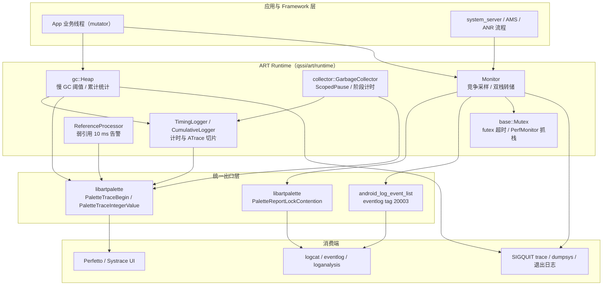
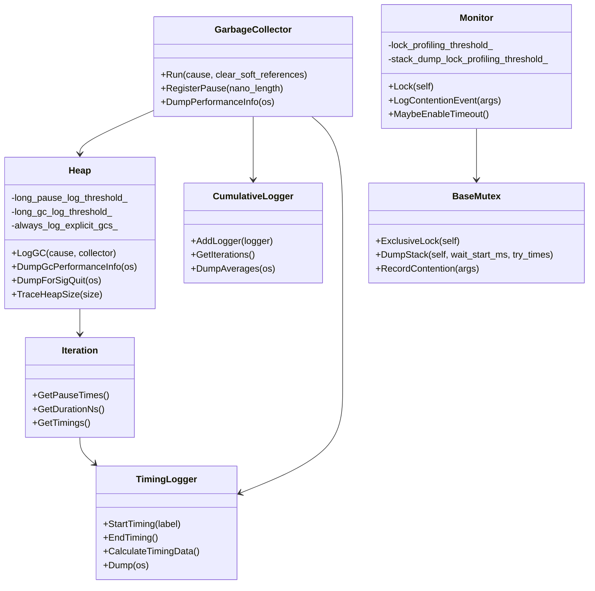
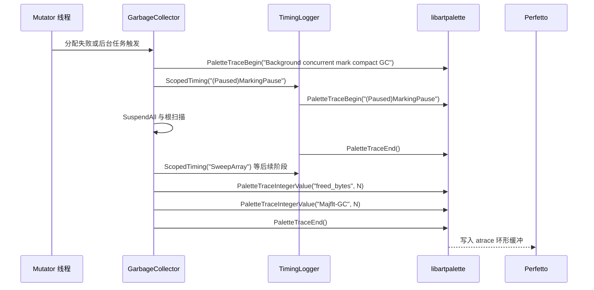
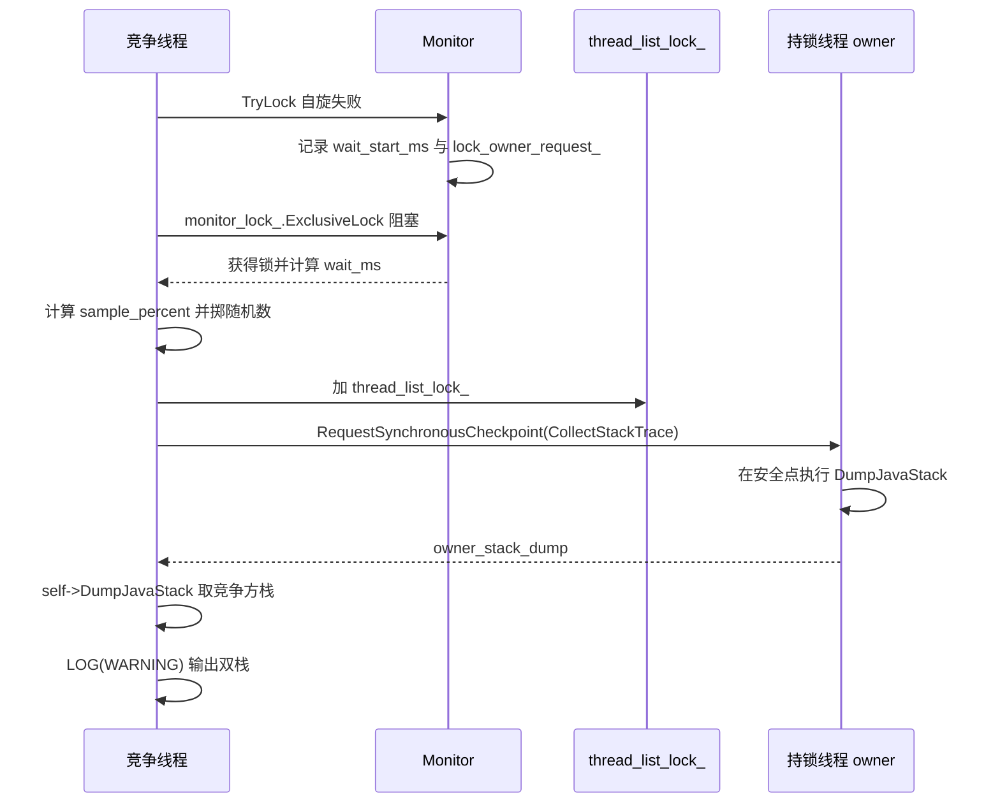
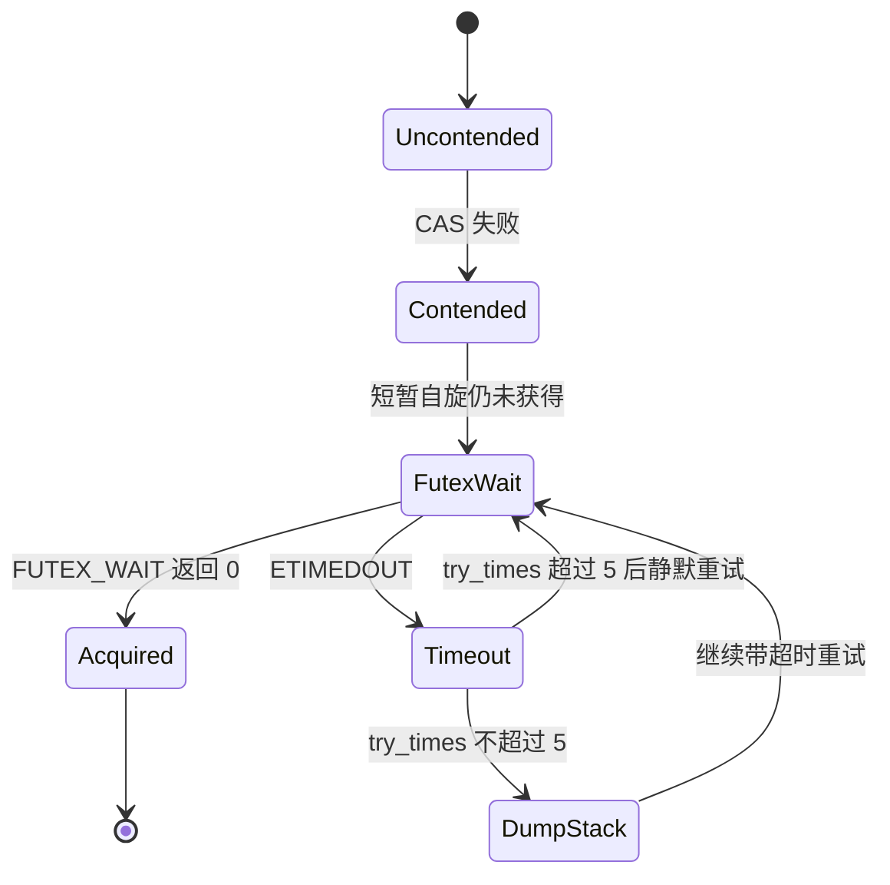
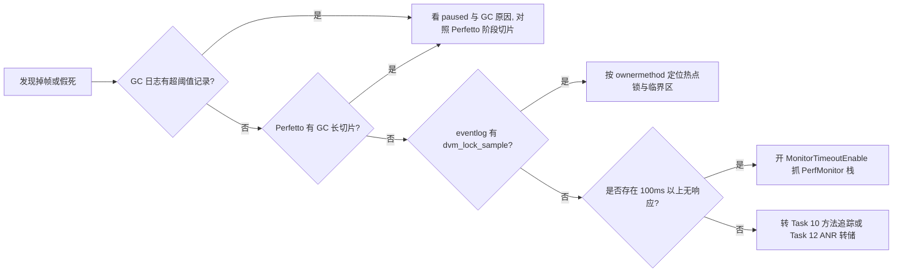

# 09 · GC 与锁竞争卡顿实时监测体系

> **一句话结论**：ART 并不依赖「重型 profiler」来发现卡顿，而是把三类低成本观测点常驻在运行路径上——GC 的**阈值触发日志**（5 ms 单次停顿 / 100 ms 整轮）、贯穿 GC 各阶段的 **ATrace 切片与计数器**、以及 Java Monitor 的**概率采样 + 同步 Checkpoint 双栈转储**；三者共用同一套 `TimingLogger` 与 `libartpalette` 出口，因此日志、eventlog、Perfetto 三条消费链路可以互相印证。

| 项目 | 内容 |
| :--- | :--- |
| 机制定位 | 运行时可观测性（Observability），服务于掉帧归因与假死定位；不改变 GC/锁的算法行为 |
| 源码模块 | `runtime/gc/heap.cc`、`runtime/base/timing_logger.cc`、`runtime/monitor.cc`、`runtime/monitor_android.cc`、`runtime/base/mutex.cc` |
| 核心类 / 入口 | `gc::Heap::LogGC`、`collector::GarbageCollector::Run`、`TimingLogger` / `CumulativeLogger`、`Monitor::Lock`、`Monitor::LogContentionEvent`、`Mutex::DumpStack` |
| 关键启动参数 | `-XX:LongPauseLogThreshold=<ms>`、`-XX:LongGCLogThreshold=<ms>`、`-Xlockprofthreshold:<ms>`、`-Xstackdumplockprofthreshold:<ms>`、`-XX:MonitorTimeoutEnable=true`、`-XX:MonitorTimeout=<ms>`、`-XX:DumpGCPerformanceOnShutdown` |
| 关键系统属性 | `dalvik.vm.lockprof.threshold`（本树 build.prop 默认 500）、`debug.art.monitor.app`、`dalvik.vm.extra-opts` |
| 观测出口 | logcat（`INFO`/`WARNING`）、eventlog tag `20003`（`dvm_lock_sample`）、ATrace/Perfetto 切片与整数计数器、SIGQUIT 文本转储 |

> [!IMPORTANT]
> 本文只讨论「怎么看见」：阈值、采样公式、切片命名、日志字段与转储路径。GC 算法本身（CMC 页状态机、读屏障）见 Task 05，引用处理算法见 Task 06，锁膨胀状态机见 Task 07；本文对它们的内部实现只做最小必要的背景交代。

---

## 1. What：机制是什么？

### 1.1 职责边界

这套体系由**三个互相独立的观测面**组成，三者的触发条件、开销模型和消费方式都不同：

| 观测面 | 触发方式 | 默认开销 | 主要产物 | 典型用途 |
| :--- | :--- | :--- | :--- | :--- |
| GC 时延告警面 | 超过阈值才打印 | 每轮 GC 一次比较，纳秒级 | logcat 一行 `... GC freed ... paused ...` | 快速判断「这次掉帧是不是 GC 干的」 |
| 时间线切片面 | 仅在 atrace 开启时写入 | 未开 trace 时为空调用 | Perfetto 切片 + 整数计数器 | 阶段级归因：暂停到底花在哪个 phase |
| 锁竞争面 | 概率采样 / 超时看门狗 | 关闭时可整段编译掉 | `dvm_lock_sample` 事件、双栈 WARNING、PerfMonitor 栈 | 定位热点锁、死锁、长临界区 |

它的输入是运行时已经产生的时间戳与调用栈（`NanoTime`、`MilliTime`、`ArtMethod`、`getrusage`），输出则统一收敛到 `libartpalette` 与 `android_log_event_list`，因此 ART 本身不依赖任何具体 trace 工具。

### 1.2 核心术语表

| 术语 | 含义 |
| :--- | :--- |
| STW / pause | Mutator 线程被停住的时长，ART 记录在 `Iteration::pause_times_`；与整轮 GC 时长 `duration_ns_` 严格区分 |
| `ScopedPause` | 所有收集器暂停的唯一 RAII 封装，析构时 `RegisterPause` 并 `ResumeAll` |
| Timing split | `TimingLogger` 的一次 `StartTiming`/`EndTiming`，同时产生一条 ATrace 切片 |
| `(Paused)` 前缀 | GC 阶段标签约定：带此前缀的切片发生在 STW 窗口内 |
| ATrace 计数器 | 用 `ATraceIntegerValue` 上报的瞬时整数，Perfetto 中显示为 counter track |
| `dvm_lock_sample` | ART 向 eventlog 写入的 Java Monitor 竞争采样事件，tag `20003` |
| 概率采样 | 等待时间越短，被记录的百分比越低，用随机数决定是否真正上报 |
| Checkpoint | 请求目标线程在自身安全点执行闭包；双栈转储靠它在 owner 线程上取栈 |
| PerfMonitor | `MonitorTimeoutEnable` 打开后，`Mutex` 以超时轮询方式抓取持锁线程栈的机制（"PerfMonitor" 是日志里的标签，不是类名） |
| `Majflt-GC` | GC 线程自身的 major page fault 累计数，用于识别换页/zram 压缩拖慢 GC |
| jank-perceptible | 进程处于前台可感知状态，是 5 ms/100 ms 阈值日志的开关条件 |

### 1.3 架构定位



### 1.4 三条通道的边界

- **日志通道**回答「有没有超标」，粒度是「一轮 GC」或「一次 Monitor 获取」；
- **trace 通道**回答「时间花在哪」，粒度是「一个 phase」或「一次锁等待」；
- **eventlog 通道**回答「谁在等谁」，粒度是「一次采样到的竞争」，且**天然不完整**。

三者不能互相替代：阈值日志没有阶段信息，trace 在未开启时完全静默，eventlog 因概率采样必然漏报。生产排障的正确姿势是先看日志确认异常，再用 trace/eventlog 做归因。

---

## 2. Why：为什么需要它？

### 2.1 没有实时监测时的盲区

GC 与锁竞争有一个共同特征：**它们对 CPU profiler 几乎不可见**。并发 GC 的大量工作发生在 GC 线程上，采样型 profiler 只会看到「业务线程在等」；Monitor 阻塞期间业务线程处于 `kBlocked`，栈停在 `MonitorEnter`，看不出是谁持锁、持了多久。于是出现典型的三类误判：

1. 把「GC 暂停」误判为「业务代码慢」——实际上业务线程根本没跑；
2. 把「等锁」误判为「IO 慢」——栈上只有一个阻塞点，没有 owner 信息；
3. 把「后台 GC 的并发时间」当成「卡顿时长」——`total` 很长但 `paused` 很短。

### 2.2 朴素方案的代价

| 朴素方案 | 直接代价 | 在车机长稳场景下的后果 |
| :--- | :--- | :--- |
| 每轮 GC 都打印完整阶段日志 | 日志量随 GC 频率线性增长 | 高频 Alloc GC 时刷爆 logd，反而干扰时序 |
| 每次锁等待都记 eventlog | 每次同步都触发一次 eventlog 写入 | 高并发下 eventlog 反压，放大卡顿 |
| 常开方法级 trace | 插桩/采样开销与调用频度成正比 | 影响帧率，测不准 |
| 只记录总时长 | 无法区分 STW 与并发 | 把并发 GC 误判为掉帧原因 |
| 只采样不抓栈 | 知道「有竞争」，不知道「锁在哪」 | 无法定位到具体临界区 |

### 2.3 设计取舍

ART 的选择可以概括为「**默认零成本，异常时高信息量**」：

| 维度 | 选择 | 源码依据 |
| :--- | :--- | :--- |
| 触发方式 | 阈值触发而非全量 | `long_pause_log_threshold_` / `long_gc_log_threshold_` |
| 阈值作用域 | 仅前台可感知进程做慢 GC 判定 | `CareAboutPauseTimes()` 返回 `InJankPerceptibleProcessState()` |
| 采样方式 | 等待时长线性映射为采样百分比 | `sample_percent = 100 * wait_ms / threshold` |
| 深栈时机 | 只有「极长竞争」才抓双栈 | `stack_dump_lock_profiling_threshold_` |
| 内部锁统计 | 编译期常量关闭 | `constexpr bool kLogLockContentions = false` |
| trace 开销 | 未开 trace 时底层 `ATRACE_BEGIN` 只做一次使能判断即返回 | `ATraceEnabled()` 先查询再干活；宿主 fake 实现直接返回 |

### 2.4 开销预算示意

```text
常态（无 trace、无竞争）
  GC 每轮：  ── 1 次时间比较 + 1 次 vector 长度检查        ~ 数十 ns
  Monitor：  ── log_contention == false，不取时间戳         ~ 0
  Mutex：    ── ScopedContentionRecorder 只做 ATraceEnabled 检查
异常（命中阈值）
  GC 慢日志：── 1 次 ostringstream + 1 次 LOG(INFO)          ~ 数 µs（仅异常轮）
  eventlog： ── 1 次 /proc/self/cmdline 读 + 事件序列化      ~ 数十 µs（概率触发）
  双栈转储： ── 2 次 Java 栈遍历 + 同步 checkpoint          ~ 数百 µs ~ 数 ms（极少数）
```

关键点：**昂贵的路径全部挂在「已经确认异常」之后**，因此不会把观测本身变成新的卡顿源。

---

## 3. How：源码级实现原理深度剖析

### 3.1 核心数据结构

```text
Heap
├── long_pause_log_threshold_ : size_t = 5 ms      ← -XX:LongPauseLogThreshold
├── long_gc_log_threshold_    : size_t = 100 ms    ← -XX:LongGCLogThreshold
├── always_log_explicit_gcs_  : bool   = true      ← -XX:AlwaysLogExplicitGcs
├── total_wait_time_          : uint64             ← 等待 GC 完成的累计时间
└── current_gc_iteration_ : collector::Iteration
    ├── pause_times_  [ 1.8ms | 0.4ms | 2.9ms ]    ← mutator 实际被停住的每一段
    ├── duration_ns_                               ← 整轮时长（含并发阶段）
    ├── thread_cpu_time_ns_
    └── timings_ : TimingLogger("GC iteration timing logger")
        ├── (Paused)MarkingPause        [start … end]
        ├── SweepArray                  [start … end]
        └── …                           ← 每个 split 同时是一条 ATrace 切片

Monitor
├── monitor_lock_ : Mutex(kMonitorLock)
│   ├── enable_monitor_timeout_ : bool            ← PerfMonitor 开关
│   └── monitor_id_             : uint32          ← 池内偏移 >> 3，日志可对上号
├── owner_ / num_waiters_
└── lock_owner_request_ : atomic<Thread*>         ← 竞争方请求 owner 回填持锁点

BaseMutex（PerfMonitor 抓栈侧）
├── enable_monitor_timeout_
├── monitor_id_
└── DumpStackLastTimeTLSData("LastDumpStackTime") ← 每线程上一次抓栈时间，用于限频
```

`TimingLogger` 的计时点只存两种值：`TimingKind::kMonotonic`（默认，`NanoTime`）与 `TimingKind::kThreadCpu`（线程 CPU 时间），见 [timing_logger.h](file:///home/voyah/workspace/8397/qssi/art/runtime/base/timing_logger.h#L96-L99)。GC 的 iteration logger 使用单调时钟并开启精确模式（`precise = true`），构造点在 [garbage_collector.cc](file:///home/voyah/workspace/8397/qssi/art/runtime/gc/collector/garbage_collector.cc#L88-L93)。



### 3.2 GC 慢日志：5 ms 与 100 ms 两级阈值

阈值常量定义在 [heap.h](file:///home/voyah/workspace/8397/qssi/art/runtime/gc/heap.h#L146-L149)：

| 常量 | 默认值 | GC stress 模式 | 含义 |
| :--- | :--- | :--- | :--- |
| `kDefaultLongPauseLogThreshold` | `MsToNs(5)` | `MsToNs(50)` | 单次 STW 达到 5 ms（`>=`）即记录 |
| `kDefaultLongGCLogThreshold` | `MsToNs(100)` | `MsToNs(1000)` | 整轮 GC 超过 100 ms 视为慢 GC |

两者可通过 `-XX:LongPauseLogThreshold=<ms>`、`-XX:LongGCLogThreshold=<ms>` 覆盖（[parsed_options.cc](file:///home/voyah/workspace/8397/qssi/art/runtime/parsed_options.cc#L222-L227)），再经 [runtime.cc](file:///home/voyah/workspace/8397/qssi/art/runtime/runtime.cc#L1851-L1852) 传进 `Heap` 构造函数。GC stress 模式下默认阈值会被放宽到 50 ms / 1000 ms，以免压测时日志刷屏（[parsed_options.cc](file:///home/voyah/workspace/8397/qssi/art/runtime/parsed_options.cc#L799-L804)）。

判定逻辑集中在 `Heap::LogGC`（[heap.cc](file:///home/voyah/workspace/8397/qssi/art/runtime/gc/heap.cc#L2968-L3012)）：

```cpp
void Heap::LogGC(GcCause gc_cause, collector::GarbageCollector* collector) {
  const size_t duration = GetCurrentGcIteration()->GetDurationNs();
  const std::vector<uint64_t>& pause_times = GetCurrentGcIteration()->GetPauseTimes();
  bool log_gc = kLogAllGCs || (gc_cause == kGcCauseExplicit && always_log_explicit_gcs_);
  if (!log_gc && CareAboutPauseTimes()) {
    log_gc = duration > long_gc_log_threshold_ ||
        (gc_cause == kGcCauseForAlloc && duration > long_pause_log_threshold_);
    for (uint64_t pause : pause_times) {
      log_gc = log_gc || pause >= long_pause_log_threshold_;
    }
  }
  ...
  LOG(INFO) << gc_cause << " " << collector->GetName()
            << " GC freed " << PrettySize(...) << " AllocSpace bytes, "
            << ... << "% free, " << ... << ", paused " << pause_string.str()
            << " total " << PrettyDuration(duration);
}
```

有四条容易踩空的语义：

1. `kLogAllGCs` 是编译期常量 `false`（[heap.cc](file:///home/voyah/workspace/8397/qssi/art/runtime/gc/heap.cc#L199)），所以「全量 GC 日志」只能在改源码重编时打开；
2. **显式 GC 永远打印**：`AlwaysLogExplicitGcs` 默认 `true`（[runtime_options.def](file:///home/voyah/workspace/8397/qssi/art/runtime/runtime_options.def#L83)），`System.gc()` 或调试命令触发的 GC 不受阈值约束；
3. **阈值判定只在 jank-perceptible 进程生效**：`CareAboutPauseTimes()` 直接返回 `Runtime::InJankPerceptibleProcessState()`（[heap.cc](file:///home/voyah/workspace/8397/qssi/art/runtime/gc/heap.cc#L231-L233)、[runtime.h](file:///home/voyah/workspace/8397/qssi/art/runtime/runtime.h#L905-L907)），后台进程的慢 GC 不会打印；
4. `kGcCauseForAlloc` 分支的判定用的是 `long_pause_log_threshold_` 而非 `long_gc_log_threshold_`：分配失败触发的 GC 只要整轮超过 5 ms 就记录，因为这条路径会直接阻塞分配线程。

日志行里的 GC 原因由 `PrettyCause` 翻译成短名（`Alloc` / `Background` / `Explicit` / `NativeAlloc` / `HeapTrim` …，见 [gc_cause.cc](file:///home/voyah/workspace/8397/qssi/art/runtime/gc/gc_cause.cc#L29-L53)），收集器名来自构造参数（如 `concurrent mark compact`，见 [mark_compact.cc](file:///home/voyah/workspace/8397/qssi/art/runtime/gc/collector/mark_compact.cc#L490)），拼出的典型形式是：

```text
Background concurrent mark compact GC freed 12MB AllocSpace bytes, 3(196KB) LOS objects, 42% free, 30MB/52MB, paused 1.203ms,0.412ms total 48.771ms
```

注意 `paused` 可能有多个值：**每一个值都是一次独立 STW**，不是累加；`total` 才是整轮时长。并发收集器的 `total` 长而 `paused` 短是正常的，判断掉帧应盯 `paused`。

另外两个与 GC 相关、但走同一阈值的日志点常被忽略：

- `ThreadFlipBegin` / `IncrementDisableThreadFlip` 等待超过 5 ms 会打印 `... blocked for <duration>`（[heap.cc](file:///home/voyah/workspace/8397/qssi/art/runtime/gc/heap.cc#L1042-L1048)、[heap.cc](file:///home/voyah/workspace/8397/qssi/art/runtime/gc/heap.cc#L1100-L1106)）——这是 JNI critical 区把 GC 拖住的信号；
- `WaitForGcToCompleteLocked` 等待超过 5 ms 会打印 `WaitForGcToComplete blocked <cause> on <last_cause> for <duration>`（[heap.cc](file:///home/voyah/workspace/8397/qssi/art/runtime/gc/heap.cc#L3736-L3741)），累计进 `total_wait_time_`。

### 3.3 从 TimingLogger 到 Systrace：阶段切片怎么长出来

`TimingLogger` 的每一次 `StartTiming` 都会无条件调用 `ATraceBegin(label)`，`EndTiming` 调用 `ATraceEnd()`（[timing_logger.cc](file:///home/voyah/workspace/8397/qssi/art/runtime/base/timing_logger.cc#L139-L148)）：

```cpp
void TimingLogger::StartTiming(const char* label) {
  DCHECK(label != nullptr);
  timings_.push_back(Timing(kind_, label));
  ATraceBegin(label);
}
void TimingLogger::EndTiming() {
  timings_.push_back(Timing(kind_, nullptr));
  ATraceEnd();
}
```

这就是「GC 阶段自动变成 Perfetto 切片」的全部秘密——不需要在每个阶段手工埋点，只要用了 `TimingLogger::ScopedTiming`（[timing_logger.h](file:///home/voyah/workspace/8397/qssi/art/runtime/base/timing_logger.h#L182-L198)），切片就自动出现。外层再套一个由原因+收集器名组成的总切片（[garbage_collector.cc](file:///home/voyah/workspace/8397/qssi/art/runtime/gc/collector/garbage_collector.cc#L197-L200)）：

```cpp
ScopedTrace trace(android::base::StringPrintf("%s %s GC", PrettyCause(gc_cause), GetName()));
```

阶段标签遵守两个约定：`__FUNCTION__` 直接作为名字（如 `SweepArray`、`SwapStacks`），而 STW 阶段手工加 `(Paused)` 前缀（`(Paused)MarkingPause`、`(Paused)KernelPreparation`、`(Paused)UpdateImmuneSpaces` 分别见 [mark_compact.cc](file:///home/voyah/workspace/8397/qssi/art/runtime/gc/collector/mark_compact.cc#L1523-L1530)、[mark_compact.cc](file:///home/voyah/workspace/8397/qssi/art/runtime/gc/collector/mark_compact.cc#L4392)、[mark_compact.cc](file:///home/voyah/workspace/8397/qssi/art/runtime/gc/collector/mark_compact.cc#L4234)）。判读时因此可以「只看 `(Paused)` 前缀的切片宽度」来估算真实掉帧风险。



需要区分两种埋点语义：`ScopedTrace(const char*)` 构造函数**无条件**调用 `PaletteTraceBegin`（未开 trace 时由底层 atrace 快速返回），而接收 lambda 的模板版本会先查 `ATraceEnabled()`（[systrace.h](file:///home/voyah/workspace/8397/qssi/art/libartbase/base/systrace.h#L50-L68)）。`ATraceEnabled()` 本身通过 `PaletteTraceEnabled` 查询（[systrace.h](file:///home/voyah/workspace/8397/qssi/art/libartbase/base/systrace.h#L29-L36)），所以「未开 trace 时零成本」指的是不做字符串构造和栈遍历，而不是完全不分发调用——设备侧 `PaletteTraceBegin` 最终落到 `ATRACE_BEGIN`，宏内部先判断 `atrace_is_tag_enabled` 再决定是否写 body（[trace.h](file:///home/voyah/workspace/8397/qssi/system/core/libcutils/include/cutils/trace.h#L188-L193)）。

### 3.4 ATrace 计数器：Heap size、Majflt-GC 与 freed_bytes

切片回答「多久」，计数器回答「多少」。本专题相关的计数器有三组：

| 计数器 | 上报点 | 采集方式 | 判读价值 |
| :--- | :--- | :--- | :--- |
| `Heap size (KB)` | `Heap::TraceHeapSize`（[heap.cc](file:///home/voyah/workspace/8397/qssi/art/runtime/gc/heap.cc#L2745-L2749)） | GC 结束后的 `GrowForUtilization` 与 TLAB 增量上报 | 与 GC 切片对齐，看「堆涨到哪里开始 GC」 |
| `Minflt-GC` / `Majflt-GC` | `TraceFaults()`（[mark_compact.cc](file:///home/voyah/workspace/8397/qssi/art/runtime/gc/collector/mark_compact.cc#L853-L870)） | `getrusage(RUSAGE_THREAD)` 的 `ru_minflt` / `ru_majflt` | `Majflt-GC` 陡增说明 GC 线程被换页或 zram 解压拖慢 |
| `freed_normal_object_bytes` / `freed_large_object_bytes` / `freed_bytes` | `TraceGCMetric`（[garbage_collector.cc](file:///home/voyah/workspace/8397/qssi/art/runtime/gc/collector/garbage_collector.cc#L47-L84)、[garbage_collector.cc](file:///home/voyah/workspace/8397/qssi/art/runtime/gc/collector/garbage_collector.cc#L282-L284)） | 每轮结束上报 | 看回收效率，判断是否「GC 很勤但没回收多少」 |

三个实现细节决定了怎么读这些数字：

1. `getrusage(RUSAGE_THREAD)` 取的是**当前线程**的累计值，`TraceFaults()` 在 GC 的多个位置被调用（[mark_compact.cc](file:///home/voyah/workspace/8397/qssi/art/runtime/gc/collector/mark_compact.cc#L872-L890)），所以 Perfetto 里看到的是阶梯状累计曲线，**要看斜率/增量而不是绝对值**；
2. 注释明确说明这两个计数器**不包含 userfault**（因为只统计 GC 线程自身），所以它是「IO/换页压力」指标，不是「缺页总数」；
3. `TraceGCMetric` 会把超过 int32 范围的数值**钳制（饱和）**到 `int32_t` 边界，并额外上报 `<name> int32_t overflow/underflow` 计数器（[garbage_collector.cc](file:///home/voyah/workspace/8397/qssi/art/runtime/gc/collector/garbage_collector.cc#L46-L84)）——看到这类溢出计数器，说明该指标已不可信。

`Heap size` 的上报有节流：只有相对上次上报的增量不小于 `kPartialTlabSize`（16 KB）才写一条（[heap.cc](file:///home/voyah/workspace/8397/qssi/art/runtime/gc/heap.cc#L4828-L4884)），因此曲线是阶梯形而非连续曲线；GC 结束后则会在 `GrowForUtilization` 里强制报一次（[heap.cc](file:///home/voyah/workspace/8397/qssi/art/runtime/gc/heap.cc#L3824-L3829)）。

### 3.5 弱引用 10 ms 告警

弱引用慢路径的观测点不在 `heap.cc`，而在 `ReferenceProcessor::GetReferent`。当引用处理进行到「禁止 mutator 访问弱引用」的阶段时，任何解引用都会进入慢路径并等待（[reference_processor.cc](file:///home/voyah/workspace/8397/qssi/art/runtime/gc/reference_processor.cc#L92-L117)）：

```cpp
auto finish_trace = [](uint64_t start_millis) {
  ATraceEnd();
  uint64_t millis = MilliTime() - start_millis;
  static constexpr uint64_t kReportMillis = 10;  // Long enough to risk dropped frames.
  if (millis > kReportMillis) {
    LOG(WARNING) << "Weak pointer dereference blocked for " << millis << " milliseconds.";
  }
};
```

三个可操作结论：

1. 阈值 `10 ms` 写死在源码里，不可通过属性调整；注释直接说明理由是「长到足以冒掉帧风险」；
2. 只有**真正等待过**的线程才会被计时：`ATraceBegin("GetReferent blocked")` 与 `start_millis` 都在确认慢路径需要阻塞之后才设置（[reference_processor.cc](file:///home/voyah/workspace/8397/qssi/art/runtime/gc/reference_processor.cc#L132-L137)）；
3. 这条 WARNING 与 GC 慢日志相互独立：它可能在 `paused` 很短的并发 GC 期间出现，代表的是**引用处理阶段对 mutator 的间接阻塞**，而不是 STW。

### 3.6 锁竞争：`dvm_lock_sample` 的概率采样

Java Monitor 的竞争观测由三部分组成：阈值配置、采样决策、事件写出。

阈值来自 `-Xlockprofthreshold:<ms>`（[parsed_options.cc](file:///home/voyah/workspace/8397/qssi/art/runtime/parsed_options.cc#L348-L353)），在运行期初始化（[runtime.cc](file:///home/voyah/workspace/8397/qssi/art/runtime/runtime.cc#L1637-L1638)），默认值取 0 表示「关闭」。框架侧会把系统属性 `dalvik.vm.lockprof.threshold` 翻译成该参数（[AndroidRuntime.cpp](file:///home/voyah/workspace/8397/qssi/frameworks/base/core/jni/AndroidRuntime.cpp#L991-L993)），本树 `build.prop` 的默认值是 `500`。此外框架还有 feature flag `disable_lock_profiling`，命中时强制改写为 `-Xlockprofthreshold:0`（[AndroidRuntime.cpp](file:///home/voyah/workspace/8397/qssi/frameworks/base/core/jni/AndroidRuntime.cpp#L264-L267)、[AndroidRuntime.cpp](file:///home/voyah/workspace/8397/qssi/frameworks/base/core/jni/AndroidRuntime.cpp#L779-L783)）。

采样发生在 `Monitor::Lock` 真正阻塞之后（[monitor.cc](file:///home/voyah/workspace/8397/qssi/art/runtime/monitor.cc#L526-L535)）：

```cpp
uint64_t wait_ms = MilliTime() - wait_start_ms;
uint32_t sample_percent;
if (wait_ms >= lock_profiling_threshold_) {
  sample_percent = 100;
} else {
  sample_percent = 100 * wait_ms / lock_profiling_threshold_;
}
if (sample_percent != 0 && (static_cast<uint32_t>(rand() % 100) < sample_percent)) {
  ...
}
```

即：等待时长线性映射为概率，阈值以内的短等待按 `wait_ms / threshold` 的比例抽样，达到阈值后 100% 记录。以 500 ms 阈值、5 ms 等待为例，采样率只有 1%。

采样命中后，先取 owner 的持锁方法/dex_pc（`GetLockOwnerInfo`），再取竞争方的当前位置，最后调用 `Monitor::LogContentionEvent`（[monitor.cc](file:///home/voyah/workspace/8397/qssi/art/runtime/monitor.cc#L614-L618)）。事件字段严格按 [monitor_android.cc](file:///home/voyah/workspace/8397/qssi/art/runtime/monitor_android.cc#L35-L120) 的写出顺序排列：

| 序号 | 字段 | 代码来源 | 说明 |
| :--- | :--- | :--- | :--- |
| 1 | process | `/proc/self/cmdline`，最多 32 字节 | 进程名 |
| 2 | main | `Thread::IsSensitiveThread()` | **不是「主线程」**，而是 StrictMode 策略非 0 的敏感线程 |
| 3 | thread | `self->GetThreadName()` | 等待方线程名 |
| 4 | time | `wait_ms` | 等待毫秒数 |
| 5 | file | 竞争方 `TranslateLocation` | 竞争方源文件 |
| 6 | line | 同上 | 竞争方行号 |
| 7 | method | `ArtMethod::PrettyMethod` | 竞争方方法全签名 |
| 8 | ownerfile | owner 的 `TranslateLocation` | 与 5 相同则写 `-` 省空间 |
| 9 | ownerline | 同上 | owner 行号 |
| 10 | ownermethod | `ArtMethod::PrettyMethod` | owner 持锁方法全签名 |
| 11 | sample_percent | 采样百分比 | 100 表示必采 |

```text
dvm_lock_sample（tag 20003）字段线序
┌──────────┬──────┬─────────┬──────┬──────────┬──────┬─────────────┬───────────┬───────────┬──────────────┬────────────────┐
│ process  │ main │ thread  │ time │ file     │ line │ method      │ ownerfile │ ownerline │ ownermethod  │ sample_percent │
│ (3)      │ (1)  │ (3)     │ (1)  │ (3)      │ (1)  │ (3)         │ (3)       │ (1)       │ (3)          │ (1)            │
└──────────┴──────┴─────────┴──────┴──────────┴──────┴─────────────┴───────────┴───────────┴──────────────┴────────────────┘
```

两点实战注意：

- 本树 `system/logging/logcat/event.logtags` 里的声明只列了 9 个字段（[event.logtags](file:///home/voyah/workspace/8397/qssi/system/logging/logcat/event.logtags#L71)），而代码实际写出 11 个（多了两个方法名）；同树的 `tools/loganalysis` 解析器也仍按 9 字段匹配（[DvmLockSampleParser.java](file:///home/voyah/workspace/8397/qssi/tools/loganalysis/src/com/android/loganalysis/parser/DvmLockSampleParser.java#L45-L61)）。**以 monitor_android.cc 的写出顺序为准**，自建解析器不要照抄 logtags。
- 方法全签名里本身可能含逗号（多参数方法），所以 eventlog 行不能简单按逗号切分；真实样本见 `platform_testing/libraries/flicker/utils/test/assets/testdata/eventlog.winscope`，其中 `bindServiceInstance(android.app.IApplicationThread, android.os.IBinder, ...)` 就带逗号。

事件写完后还会调用 `PaletteReportLockContention`（[monitor_android.cc](file:///home/voyah/workspace/8397/qssi/art/runtime/monitor_android.cc#L109-L119)），这是 palette v2 API（[palette_method_list.h](file:///home/voyah/workspace/8397/qssi/art/libartpalette/include/palette/palette_method_list.h#L52-L63)），把同一份竞争信息交给平台侧（例如系统 APM），因此同一笔竞争可能同时出现在 eventlog 和平台自定义通道里。

### 3.7 长竞争的双栈同步 Checkpoint 转储

概率采样只给「位置」，不给「现场」。当等待时间超过更严格的第二阈值时，ART 会抓取双方 Java 栈。阈值由 `-Xstackdumplockprofthreshold:<ms>` 配置，判定在 [monitor.cc](file:///home/voyah/workspace/8397/qssi/art/runtime/monitor.cc#L544-L545)：

```cpp
const bool should_dump_stacks = stack_dump_lock_profiling_threshold_ > 0 &&
    wait_ms > stack_dump_lock_profiling_threshold_;
```

这里有一个容易踩空的耦合：**双栈判定整个嵌在采样分支内部**。`Monitor::Lock` 在自旋获取失败后即计算 `log_contention = (lock_profiling_threshold_ != 0)`，只要 `-Xlockprofthreshold` 为 0（默认），后面计算 `wait_ms`、判断 `should_dump_stacks`、调用 `LogContentionEvent` 的代码全部不会执行。因此 `-Xstackdumplockprofthreshold` 必须与一个非零的 `-Xlockprofthreshold` 搭配才有效。

抓栈的关键是 `RequestSynchronousCheckpoint`（[thread.cc](file:///home/voyah/workspace/8397/qssi/art/runtime/thread.cc#L1742-L1752)）：竞争方并不直接读 owner 的栈（那样会在 owner 运行时得到撕裂的栈），而是把一个「遍历你自己栈」的闭包投递给 owner，由 owner 在下一个安全点执行：

```cpp
struct CollectStackTrace : public Closure {
  void Run(art::Thread* thread) override {
    thread->DumpJavaStack(oss);
  }
  std::ostringstream oss;
};
CollectStackTrace owner_trace;
orig_owner->RequestSynchronousCheckpoint(&owner_trace);   // 内部会释放 thread_list_lock_
owner_stack_dump = owner_trace.oss.str();
```

随后竞争方再 `self->DumpJavaStack(self_trace_oss)` 取自己的栈，输出格式在 [monitor.cc](file:///home/voyah/workspace/8397/qssi/art/runtime/monitor.cc#L581-L612)：

```text
Long monitor contention with owner <name> (<tid>) at <method>(<file>:<line>) waiters=<n> in <contender method> for <duration>
Current owner stack:
  ...
Contender stack:
  ...
```

若未配置 stack dump 阈值但等待超过 `kLongWaitMs`（release 100 ms，debug 因 `kDebugThresholdFudgeFactor = 10` 放大为 1000 ms，见 [monitor.cc](file:///home/voyah/workspace/8397/qssi/art/runtime/monitor.cc#L53-L54)），则只打印一行简化 WARNING，不抓栈。



有一个可靠性边界必须知道：`lock_owner_request_` 是**异步回填**的，`monitor.h` 的注释明确说明持锁点信息「可能不一致、不是 100% 可靠」，极少数情况下 owner 可能在响应请求前就释放了锁，或信息被后续请求覆盖（[monitor.h](file:///home/voyah/workspace/8397/qssi/art/runtime/monitor.h#L396-L425)）。所以双栈里的 owner 栈应以「大概率正确」而非「绝对正确」看待；要精确复现应该用 Perfetto 的锁切片或 `MonitorTimeoutEnable`。

### 3.8 PerfMonitor：`MonitorTimeoutEnable` 阻塞中实时抓栈

前面两条路径都依赖「竞争方最终拿到锁」。如果 owner 永远不释放（死锁、长临界区、被挂起），竞争方会无限期阻塞，什么也抓不到。`MonitorTimeoutEnable` 就是为这个场景设计的看门狗。

开关链路：

1. `-XX:MonitorTimeoutEnable=true` 打开（[parsed_options.cc](file:///home/voyah/workspace/8397/qssi/art/runtime/parsed_options.cc#L415-L421)），`-XX:MonitorTimeout=<ms>` 调整超时（默认 500 ms，允许区间 200~999 ms，越界会被钳制并打印 WARNING，见 [runtime.cc](file:///home/voyah/workspace/8397/qssi/art/runtime/runtime.cc#L1716-L1726)、[monitor.h](file:///home/voyah/workspace/8397/qssi/art/runtime/monitor.h#L65-L69)）；
2. 每个 `Monitor` 构造时若开关打开则调用 `MaybeEnableTimeout()`（[monitor.cc](file:///home/voyah/workspace/8397/qssi/art/runtime/monitor.cc#L121-L124)）；
3. `MaybeEnableTimeout` 有**进程白名单**：只有包名为 `android`（即 system_server）或系统属性 `debug.art.monitor.app` 为 true 的进程才真正启用，同时把 `monitor_id_` 交给底层的 `Mutex`（[monitor.cc](file:///home/voyah/workspace/8397/qssi/art/runtime/monitor.cc#L1774-L1781)）：

```cpp
void Monitor::MaybeEnableTimeout() {
  std::string current_package = Runtime::Current()->GetProcessPackageName();
  bool enabled_for_app = android::base::GetBoolProperty("debug.art.monitor.app", false);
  if (current_package == "android" || enabled_for_app) {
    monitor_lock_.setEnableMonitorTimeout();
    monitor_lock_.setMonitorId(monitor_id_);
  }
}
```

底层实现在 `Mutex::ExclusiveLock`：启用超时后，`futex` 等待不再是无限期，而是带 `timeout_ts`；每次 `ETIMEDOUT` 后 `try_times++`，前 5 次（`kMonitorTimeoutTryMax`）触发 `DumpStack`（[mutex.cc](file:///home/voyah/workspace/8397/qssi/art/runtime/base/mutex.cc#L481-L511)）：

```cpp
uint64_t wait_start_ms = enable_monitor_timeout_ ? MilliTime() : 0;
do {
  timespec timeout_ts;
  timeout_ts.tv_sec = 0;
  timeout_ts.tv_nsec = Runtime::Current() != nullptr
      ? Runtime::Current()->GetMonitorTimeoutNs()
      : Monitor::kDefaultMonitorTimeoutMs;
  if (futex(..., enable_monitor_timeout_ ? &timeout_ts : nullptr, ...) != 0) {
    if (errno == ETIMEDOUT) {
      try_times++;
      if (try_times <= kMonitorTimeoutTryMax) {
        DumpStack(self, wait_start_ms, try_times);
      }
    }
  }
} while ((cur_state & kHeldMask) != 0);
```

`DumpStack` 做的事与 3.7 类似，但方向相反：**由等待方主动去抓 owner 的栈**，并且不要求竞争已经结束（[mutex.cc](file:///home/voyah/workspace/8397/qssi/art/runtime/base/mutex.cc#L534-L575)）：

```text
Monitor contention with tid <owner_tid>, wait time: <n>ms, monitor id: <id>
PerfMonitor owner thread(<owner_tid>) stack is:
  ...
```

为了不刷屏，`IsDumpFrequent` 用每线程 TLS 记录上次抓栈时间，要求间隔不小于 `kIntervalMillis(50) * try_times`（[mutex.cc](file:///home/voyah/workspace/8397/qssi/art/runtime/base/mutex.cc#L42-L43)、[mutex.cc](file:///home/voyah/workspace/8397/qssi/art/runtime/base/mutex.cc#L577-L590)）。所以一次卡死最多产生 5 段栈（每个等待线程各自计算），之后静默等待。`monitor id` 是 MonitorPool 的偏移右移 3 位（8 字节对齐，见 [monitor_pool.h](file:///home/voyah/workspace/8397/qssi/art/runtime/monitor_pool.h#L176-L182)），可与其它日志里的同一个 id 关联。



### 3.9 ART 内部 Mutex 的竞争统计

Java Monitor 之外，ART 自己的 C++ `Mutex` 也有一套竞争统计，但它是**编译期开关**：

```cpp
constexpr bool kLogLockContentions = false;   // mutex.h:62 / 69
constexpr size_t kContentionLogSize = 4;      // 环形槽位
```

见 [mutex.h](file:///home/voyah/workspace/8397/qssi/art/runtime/base/mutex.h#L62-L73)。关闭时 `ContentionLogData` 数组长度为 0，`RecordContention` / `DumpContention` 整段被优化掉；打开后每个锁维护 `contention_count`、累计 `wait_time` 和 4 条「blocked tid ↔ owner tid」环形记录（[mutex.cc](file:///home/voyah/workspace/8397/qssi/art/runtime/base/mutex.cc#L327-L351)），`DumpContention` 会输出「contended N 次、总计等待、平均等待、最常阻塞的 tid / 最常持锁的 tid」（[mutex.cc](file:///home/voyah/workspace/8397/qssi/art/runtime/base/mutex.cc#L353-L410)）。这些内容通过 `BaseMutex::DumpAll`（[mutex.cc](file:///home/voyah/workspace/8397/qssi/art/runtime/base/mutex.cc#L222-L246)）挂到 GC 性能汇总的末尾（[heap.cc](file:///home/voyah/workspace/8397/qssi/art/runtime/gc/heap.cc#L1356)），所以 SIGQUIT 里能否看到 ART 内部锁统计，取决于构建时是否打开该常量。

与编译期开关无关的，是 `ScopedContentionRecorder` 的 ATrace 埋点：只要 trace 开启，每次进入阻塞路径都会产生一条 `Lock contention on <mutex name> (owner tid: <tid>)` 切片（[mutex.cc](file:///home/voyah/workspace/8397/qssi/art/runtime/base/mutex.cc#L169-L197)）。排查 ART 内部锁（如 `mutator_lock_`、`thread_list_lock_`）时，这条切片比统计计数更直接。

### 3.10 GC 性能汇总：SIGQUIT 与退出转储

`Heap::DumpGcPerformanceInfo` 是这套观测体系的「汇总报表」（[heap.cc](file:///home/voyah/workspace/8397/qssi/art/runtime/gc/heap.cc#L1294-L1357)），内容包括：

| 段落 | 内容 | 判读方式 |
| :--- | :--- | :--- |
| 累计阶段耗时 | 每个收集器的 `CumulativeLogger` 平均值，按总耗时降序 | 看哪个 phase 长期最贵 |
| 暂停分布 | 暂停直方图的 99% 置信区间（`DumpPerformanceInfo`，[garbage_collector.cc](file:///home/voyah/workspace/8397/qssi/art/runtime/gc/collector/garbage_collector.cc#L497-L541)） | 看 P99 而非平均 |
| 吞吐与内存 | `Total bytes allocated/freed`、`Free memory until GC/OOME`、`Max memory` | 判断堆增长策略是否合理 |
| 停顿与等待 | `Total mutator paused time`、`Total time waiting for GC to complete`、`Total GC count/time`、`Total blocking GC count/time`、`Total pre-OOME GC count` | 等待时间远大于暂停时间，说明 GC 在别处被拖住 |
| 频率直方图 | 每窗口 GC 次数 / blocking GC 次数 | 识别 GC 抖动 |
| 内部锁 | `BaseMutex::DumpAll`（编译期开关） | 只有把 `kLogLockContentions` 改为 true 重编后有效；debug 构建同样默认关闭 |

两个入口：

- **SIGQUIT**：`Runtime::DumpForSigQuit` 依次转储线程列表、ClassLinker、InternTable、JavaVM、Heap 等（[runtime.cc](file:///home/voyah/workspace/8397/qssi/art/runtime/runtime.cc#L2514-L2531)），其中 `Heap::DumpForSigQuit` 先打印堆概况再调用 `DumpGcPerformanceInfo`（[heap.cc](file:///home/voyah/workspace/8397/qssi/art/runtime/gc/heap.cc#L3753-L3766)）。ANR trace 里那段 `Dumping cumulative Gc timings` 就来自这里。
- **进程退出**：`-XX:DumpGCPerformanceOnShutdown` 会让 `Runtime::Shutdown` 打印同一份报表，并额外给出 `GC CPU time ... out of process CPU time ...` 的占比（[runtime.cc](file:///home/voyah/workspace/8397/qssi/art/runtime/runtime.cc#L380-L395)）。压测结束时用它拿一份「整场测试的 GC 账单」最方便。

### 3.11 阈值与开关总表

| 开关 / 常量 | 默认 | 作用域 | 说明 |
| :--- | :--- | :--- | :--- |
| `-XX:LongPauseLogThreshold` | 5 ms | 全局 | 单次 STW 日志阈值；GC stress 下 50 ms |
| `-XX:LongGCLogThreshold` | 100 ms | 全局 | 整轮慢 GC 阈值；GC stress 下 1000 ms |
| `-XX:AlwaysLogExplicitGcs` | true | 全局 | 显式 GC 无条件打印 |
| `-Xlockprofthreshold` | 0（关闭） | 全局 | Java Monitor 采样阈值；框架默认传 500 |
| `-Xstackdumplockprofthreshold` | 0（关闭） | 全局 | 超此值抓双栈 |
| `kLongWaitMs` | 100 ms（debug ×10） | 编译期 | 未配双栈时的简化长竞争 WARNING |
| `-XX:MonitorTimeoutEnable` | false | 全局 | PerfMonitor 总开关 |
| `-XX:MonitorTimeout` | 500 ms | 全局 | 钳制到 200~999 ms |
| `-verbose:systrace-locks` | 关闭 | 全局（启动期） | 打开 Java Monitor 的 `Locking` / `Waiting on` 切片 |
| `debug.art.monitor.app` | false | 单进程 | 非 system_server 进程的 PerfMonitor 白名单 |
| `kMonitorTimeoutTryMax` | 5 | 编译期 | 单次等待最多抓栈次数 |
| `kIntervalMillis` | 50 ms | 编译期 | 抓栈限频基数 |
| `reference_processor` 的 `kReportMillis` | 10 ms | 编译期 | 弱引用阻塞告警 |
| `kLogLockContentions` | false | 编译期 | ART 内部 Mutex 统计开关 |

---

## 4. 能利用这个机制做什么？

### 4.1 掉帧/假死归因决策树



### 4.2 实战一：逐字段读一条 GC 慢日志

```text
I/art: Background concurrent mark compact GC freed 8MB AllocSpace bytes, 1(32KB) LOS objects, 55% free, 21MB/47MB, paused 5.412ms,0.338ms total 74.552ms
```

| 字段 | 值 | 解读 |
| :--- | :--- | :--- |
| 原因 | `Background` | 后台并发触发，不是分配失败；通常不直接阻塞业务 |
| 收集器 | `concurrent mark compact` | CMC 路线，`total` 含并发阶段 |
| `paused` | `5.412ms,0.338ms` | 两次 STW；第一次 5.412 ms **超过 5 ms 阈值**，正是本行被打印的原因 |
| `total` | `74.552ms` | 整轮 74 ms，未达 100 ms；`total` 只决定「慢 GC」是否打印 |
| `55% free` | 空闲比例 | 偏低说明堆已接近触发线，GC 会变频繁 |

判读要点：**先看 `paused` 的单值，再看 `total`**。上例中真正影响帧率的是 5.412 ms 那一段；`total` 74 ms 的大部分发生在并发线程上。若 `paused` 继续出现 8 ms、12 ms 这类值，需要进一步用 Perfetto 切开看是 `(Paused)MarkingPause` 还是 `(Paused)KernelPreparation` 变宽。反过来，如果一行日志 `paused` 全是亚毫秒而 `total` 超过 100 ms，说明触发的是「慢 GC」而非「长暂停」，对帧率的直接威胁较小。

### 4.3 实战二：Perfetto 采集 GC 与锁切片

```bash
# 采集 10 秒，覆盖 dalvik 与 sched/freq
adb shell perfetto -o /data/misc/perfetto-traces/jank.pftx -t 10s \
  -a com.example.app \
  sched freq idle am wm gfx view binder_driver hal dalvik res memory
adb pull /data/misc/perfetto-traces/jank.pftx
```

在 Perfetto UI 中按以下顺序看：

1. `Background concurrent mark compact GC` 总切片内，各 `(Paused)` 子切片的宽度；
2. `Heap size (KB)` counter 与 GC 起点的关系（堆涨到多少触发、触发后降多少）；
3. `Majflt-GC` 的**增量**（不是绝对值）；陡增说明 GC 线程在换页/zram 上花时间；
4. `Lock contention on <mutex>` 切片（ART 内部锁）与 Java Monitor 相关 trace（`Locking` / `Waiting on`，由 `AtraceMonitorLock` 产生，见 [monitor.cc](file:///home/voyah/workspace/8397/qssi/art/runtime/monitor.cc#L334-L399)）；
5. 帧时间线与上述切片的重叠位置——只有落在帧边界内的部分才是掉帧的直接原因。

Java Monitor 的 `Locking` / `Waiting on` 切片有一个额外开关：`AtraceMonitorLock` 要求 `VLOG_IS_ON(systrace_lock_logging) && ATraceEnabled()`（[monitor.cc](file:///home/voyah/workspace/8397/qssi/art/runtime/monitor.cc#L334-L338)），对应启动参数 `-verbose:systrace-locks`（[cmdline_types.h](file:///home/voyah/workspace/8397/qssi/art/cmdline/cmdline_types.h#L731-L735)）。该 verbose 标志还会影响 quick entrypoint 的初始化（[quick_default_init_entrypoints.h](file:///home/voyah/workspace/8397/qssi/art/runtime/entrypoints/quick/quick_default_init_entrypoints.h#L85)），所以必须在 runtime 启动前设置，运行中打开 `atrace` 不会凭空长出 Java Monitor 切片。GC 切片与 ATrace 计数器则不受此限制，只要 trace 类别包含 `dalvik` 即可。

### 4.4 实战三：打开并读取锁竞争采样

`dalvik.vm.lockprof.threshold` 在 zygote 启动时被读取，运行中修改不会影响已创建的进程；要生效需要让目标进程以新的参数重启。单应用实验可用 `wrap.<package>` 包装脚本注入 `-Xlockprofthreshold:<ms>`（仅 debuggable 应用），整机验证则改 `dalvik.vm.extra-opts` 后重启。

读取与分析：

```bash
# 1. 实时看事件
adb logcat -b events -s dvm_lock_sample

# 2. 落盘
adb logcat -b events -d | grep dvm_lock_sample > /tmp/lock_samples.txt
```

聚合时只应依赖**前 4 个字段**（process / main / thread / time），因为从第 5 个字段开始可能出现含逗号的方法签名。下面用正则从左向右吃到 time 字段，避免被方法名里的逗号干扰：

```python
import re

# 第 4 段是等待毫秒数，前面三段不含逗号
pat = re.compile(r"dvm_lock_sample: \[([^,]*),([^,]*),([^,]*),(\d+),")
rows = []
for line in open("/tmp/lock_samples.txt", encoding="utf-8", errors="ignore"):
    m = pat.search(line)
    if m:
        rows.append((int(m.group(4)), m.group(1), m.group(3)))

rows.sort(reverse=True)
for wait_ms, proc, thread in rows[:20]:
    print(wait_ms, proc, thread)
```

真实事件样例（取自本树的 flicker 测试资产）：

```text
I dvm_lock_sample: [system_server,1,android.display,34,AccessibilityController.java,1528,void com.android.server.wm.AccessibilityController$WindowsForAccessibilityObserver.computeChangedWindows(boolean),,0,null,6]
I dvm_lock_sample: [system_server,1,android.anim,165,WindowAnimator.java,103,void com.android.server.wm.WindowAnimator.lambda$new$1(long),WindowState.java,3138,void com.android.server.wm.WindowState$DeathRecipient.binderDied(),33]
```

第一条表示：`android.display` 线程等了 34 ms，争的是 `AccessibilityController...computeChangedWindows` 所在的锁，owner 未知（`null`），采样率 6%；第二条则给出了 owner 的持锁点 `WindowState$DeathRecipient.binderDied`，采样率 33%。**owner 为 `null` 或 `-` 很常见**，不代表解析失败。

### 4.5 实战四：用 PerfMonitor 抓死锁/长临界区

在 system_server 或白名单进程上：

```bash
# 全局打开（需在 runtime 启动前设置，通常写进 dalvik.vm.extra-opts）
adb shell setprop dalvik.vm.extra-opts "-XX:MonitorTimeoutEnable=true -XX:MonitorTimeout=300"

# 单应用白名单（进程级属性, 需在进程启动前设置）
adb shell setprop debug.art.monitor.app true
```

日志判读：

```text
W/art: Monitor contention with tid 24626, wait time: 302ms, monitor id: 174832
PerfMonitor owner thread(24626) stack is:
  at com.example.Foo.bar(Foo.java:123)
  at com.example.Foo.baz(Foo.java:88)
```

出现这段说明：有一个线程在 `monitor id 174832` 上等待超过 300 ms，且 owner 的 Java 栈停在上面的位置。由于最多抓 5 次、每次间隔递增，**不要指望它长时间连续刷栈**；拿到第一段就够定位了。注意 `debug.art.monitor.app` 在每次构造 `Monitor` 时读取，只影响读取之后新建的 Monitor，因此建议在进程启动前设置；`-XX:MonitorTimeoutEnable` 是启动参数，必须在 runtime 启动前生效。

### 4.6 实战五：从 SIGQUIT/ANR 里读 GC 账单

```bash
adb shell kill -3 <pid>
adb shell dumpsys dropbox --print system_app_anr | less
```

在 trace 文本里搜 `Dumping cumulative Gc timings`，重点看三行：

| 行 | 含义 | 异常信号 |
| :--- | :--- | :--- |
| `Total mutator paused time` | 累计 STW | 与总运行时间之比过高 |
| `Total time waiting for GC to complete` | 业务线程等 GC 的累计时间 | 远大于上一行，说明 GC 被并发/IO 拖住 |
| `Total blocking GC count/time` | 阻塞式 GC 次数与耗时 | 频繁 blocking GC 是前台卡顿的强信号 |

再配合 `Threads` 段里主线程的状态（`kBlocked` / `kWaitingForGcThreadFlip` 等）就能判断「这次 ANR 是不是 GC 造成的」。

### 4.7 车机座舱落地清单（8397 多屏高负载）

| 场景 | 观测手段 | 建议动作 |
| :--- | :--- | :--- |
| 多屏动画期间偶发掉帧 | `paused` 单值 > 5 ms 的 GC 日志 + Perfetto `(Paused)` 切片 | 若集中在 `KernelPreparation`，检查内存压力/uffd；若在 `MarkingPause`，看根扫描量 |
| 长稳运行后越用越卡 | `Total GC count/time`、`Free memory until GC`、GC 频率直方图 | 排查泄漏；必要时调堆增长倍率 |
| 车载应用启动/切屏白屏 | 后台 GC 日志 + 弱引用 10 ms WARNING | 弱引用告警密集说明引用处理在阻塞业务，需优化 finalizer/WeakReference 使用 |
| 系统服务偶发假死 | `MonitorTimeoutEnable` + `monitor id` 关联 | 用 owner 栈定位长临界区；若 owner 栈长期停在同一方法，考虑拆分锁 |
| 压测期间频繁 System.gc | 显式 GC 日志（默认必打） | 定位调用方；车机定制代码里常见误用 |

### 4.8 避坑清单

1. **采样 ≠ 全量**：`dvm_lock_sample` 按概率上报，没有记录不代表没有竞争；低阈值（如 50 ms）会显著提高采样率，但也提高开销。
2. **`main` 字段不是主线程**：它是 `Thread::IsSensitiveThread()`，语义是「当前线程有 StrictMode 策略」，见 [thread.h](file:///home/voyah/workspace/8397/qssi/art/runtime/thread.h#L1740-L1745) 与框架侧 hook（[AndroidRuntime.cpp](file:///home/voyah/workspace/8397/qssi/frameworks/base/core/jni/AndroidRuntime.cpp#L436-L439)）。
3. **`total` 不是卡顿时长**：并发 GC 的 `total` 包含 GC 线程工作时间，只有 `paused` 才是 mutator 被停住的时间。
4. **后台进程的慢 GC 不打印**：`CareAboutPauseTimes()` 只看 jank-perceptible，后台长 GC 只在显式 GC、`WaitForGcToComplete` 超阈值，或 `IncrementDisableThreadFlip` / `ThreadFlipBegin` 阻塞超阈值时可见。
5. **debug 构建阈值放大 10 倍**：`kDebugThresholdFudgeFactor = 10`，同一份配置在 debug 包上「更安静」是正常现象。
6. **eventlog 字段别照抄 logtags**：本树 logtags 只列 9 字段，代码写 11 字段，且方法名内含逗号，朴素 CSV 解析会错位。
7. **`kLogLockContentions` 是编译期常量**：user 版通常看不到 ART 内部锁统计，别把它当成运行时缺失。
8. **PerfMonitor 有进程白名单**：非 `android` 包且未设 `debug.art.monitor.app` 时，`-XX:MonitorTimeoutEnable=true` 也不会生效。
9. **`Majflt-GC` 是累计值**：`getrusage` 返回线程生命周期累计，必须做差分。
10. **`ATraceIntegerValue` 只有 32 位**：超大堆的字节数会被截断并另发 overflow 计数器。
11. **弱引用 10 ms 是独立告警**：它可能在 `paused` 很短的并发 GC 中出现，不能据此判断 STW。
12. **双栈里的 owner 栈是「大概率正确」**：异步回填 + 线程可能退出，极端情况下会错位。
13. **双栈功能依赖采样开关**：`-Xstackdumplockprofthreshold` 必须搭配非零的 `-Xlockprofthreshold`，否则整段采样逻辑不执行。
14. **Java Monitor 的 trace 切片另需 verbose 标志**：`-verbose:systrace-locks` 必须在 runtime 启动前设置，否则只有 GC 切片没有 `Locking` / `Waiting on` 切片。

---

## 5. 核心源码对照索引表

| 源文件 | 核心符号 | 行号区间 | 职责 |
| :--- | :--- | :--- | :--- |
| [gc/heap.cc](file:///home/voyah/workspace/8397/qssi/art/runtime/gc/heap.cc#L2968-L3012) | `Heap::LogGC` | 2968-3012 | 慢 GC / 慢暂停阈值判定与日志输出 |
| [gc/heap.cc](file:///home/voyah/workspace/8397/qssi/art/runtime/gc/heap.cc#L1294-L1357) | `Heap::DumpGcPerformanceInfo` | 1294-1357 | GC 累计性能汇总 |
| [gc/heap.cc](file:///home/voyah/workspace/8397/qssi/art/runtime/gc/heap.cc#L3753-L3766) | `Heap::DumpForSigQuit` | 3753-3766 | SIGQUIT 下的堆与 GC 转储 |
| [gc/heap.cc](file:///home/voyah/workspace/8397/qssi/art/runtime/gc/heap.cc#L3713-L3751) | `Heap::WaitForGcToCompleteLocked` | 3713-3751 | 等待 GC 完成的超阈值日志与累计 |
| [gc/heap.cc](file:///home/voyah/workspace/8397/qssi/art/runtime/gc/heap.cc#L1020-L1107) | `IncrementDisableThreadFlip` / `ThreadFlipBegin` | 1020-1107 | JNI critical 阻塞 GC 的超阈值日志 |
| [gc/heap.cc](file:///home/voyah/workspace/8397/qssi/art/runtime/gc/heap.cc#L2745-L2749) | `Heap::TraceHeapSize` / `TraceEnabled` | 2745-2749 | `Heap size (KB)` ATrace 计数器 |
| [gc/heap.h](file:///home/voyah/workspace/8397/qssi/art/runtime/gc/heap.h#L146-L149) | `kDefaultLongPauseLogThreshold` 等 | 146-149 | 5 ms / 100 ms 阈值常量 |
| [base/timing_logger.cc](file:///home/voyah/workspace/8397/qssi/art/runtime/base/timing_logger.cc#L139-L148) | `TimingLogger::StartTiming` / `EndTiming` | 139-148 | 计时点与 ATrace 切片的绑定 |
| [base/timing_logger.cc](file:///home/voyah/workspace/8397/qssi/art/runtime/base/timing_logger.cc#L104-L126) | `CumulativeLogger::DumpAverages` | 104-126 | 按累计耗时降序输出阶段平均 |
| [base/timing_logger.cc](file:///home/voyah/workspace/8397/qssi/art/runtime/base/timing_logger.cc#L167-L234) | `TimingLogger::CalculateTimingData` / `Dump` | 167-234 | 嵌套 split 的 exclusive/total 计算与格式化 |
| [base/timing_logger.h](file:///home/voyah/workspace/8397/qssi/art/runtime/base/timing_logger.h#L182-L198) | `TimingLogger::ScopedTiming` | 182-198 | RAII 切片，GC 阶段埋点的主要入口 |
| [gc/collector/garbage_collector.cc](file:///home/voyah/workspace/8397/qssi/art/runtime/gc/collector/garbage_collector.cc#L197-L216) | `GarbageCollector::Run` | 197-216 | 外层 GC 切片与累计 logger 合入 |
| [gc/collector/garbage_collector.cc](file:///home/voyah/workspace/8397/qssi/art/runtime/gc/collector/garbage_collector.cc#L225-L286) | `Iteration` 统计与 ArtMetrics | 225-286 | 暂停直方图 / 世界停止时间 / 释放字节 |
| [gc/collector/garbage_collector.cc](file:///home/voyah/workspace/8397/qssi/art/runtime/gc/collector/garbage_collector.cc#L497-L541) | `GarbageCollector::DumpPerformanceInfo` | 497-541 | 99% 置信区间与直方图输出 |
| [gc/collector/mark_compact.cc](file:///home/voyah/workspace/8397/qssi/art/runtime/gc/collector/mark_compact.cc#L853-L890) | `TraceFaults` / `RunPhases` | 853-890 | `Minflt-GC` / `Majflt-GC` 计数器 |
| [gc/reference_processor.cc](file:///home/voyah/workspace/8397/qssi/art/runtime/gc/reference_processor.cc#L92-L117) | `ReferenceProcessor::GetReferent` | 92-117 | 弱引用慢路径与 10 ms 告警 |
| [monitor.cc](file:///home/voyah/workspace/8397/qssi/art/runtime/monitor.cc#L446-L646) | `Monitor::Lock` | 446-646 | 竞争路径：采样、双栈、事件上报 |
| [monitor.cc](file:///home/voyah/workspace/8397/qssi/art/runtime/monitor.cc#L526-L545) | 采样公式与双栈判定 | 526-545 | `sample_percent` 线性映射 |
| [monitor.cc](file:///home/voyah/workspace/8397/qssi/art/runtime/monitor.cc#L559-L618) | Checkpoint 双栈与 WARNING | 559-618 | owner 栈 + 竞争方栈 |
| [monitor.cc](file:///home/voyah/workspace/8397/qssi/art/runtime/monitor.cc#L1774-L1781) | `Monitor::MaybeEnableTimeout` | 1774-1781 | PerfMonitor 进程白名单 |
| [monitor_android.cc](file:///home/voyah/workspace/8397/qssi/art/runtime/monitor_android.cc#L31-L120) | `Monitor::LogContentionEvent` | 31-120 | `dvm_lock_sample` 事件序列化 |
| [base/mutex.cc](file:///home/voyah/workspace/8397/qssi/art/runtime/base/mutex.cc#L481-L511) | `Mutex::ExclusiveLock` 超时循环 | 481-511 | futex 超时与抓栈触发 |
| [base/mutex.cc](file:///home/voyah/workspace/8397/qssi/art/runtime/base/mutex.cc#L534-L590) | `Mutex::DumpStack` / `IsDumpFrequent` | 534-590 | owner 栈抓取与限频 |
| [base/mutex.cc](file:///home/voyah/workspace/8397/qssi/art/runtime/base/mutex.cc#L327-L410) | `RecordContention` / `DumpContention` | 327-410 | ART 内部锁竞争统计 |
| [runtime_options.def](file:///home/voyah/workspace/8397/qssi/art/runtime/runtime_options.def#L71-L83) | 阈值与显式 GC 选项 | 71-83 | 编译期默认值 |
| [runtime_options.def](file:///home/voyah/workspace/8397/qssi/art/runtime/runtime_options.def#L125-L126) | `LockProfThreshold` / `StackDumpLockProfThreshold` | 125-126 | 锁采样阈值 |
| [parsed_options.cc](file:///home/voyah/workspace/8397/qssi/art/runtime/parsed_options.cc#L222-L227) | `-XX:LongPauseLogThreshold` / `-XX:LongGCLogThreshold` | 222-227 | 命令行解析 |
| [parsed_options.cc](file:///home/voyah/workspace/8397/qssi/art/runtime/parsed_options.cc#L348-L353) | `-Xlockprofthreshold` / `-Xstackdumplockprofthreshold` | 348-353 | 命令行解析 |
| [parsed_options.cc](file:///home/voyah/workspace/8397/qssi/art/runtime/parsed_options.cc#L415-L421) | `-XX:MonitorTimeoutEnable` / `-XX:MonitorTimeout` | 415-421 | 命令行解析 |
| [runtime.cc](file:///home/voyah/workspace/8397/qssi/art/runtime/runtime.cc#L380-L395) | 退出时 GC 性能转储 | 380-395 | `DumpGCPerformanceOnShutdown` |
| [runtime.cc](file:///home/voyah/workspace/8397/qssi/art/runtime/runtime.cc#L2514-L2531) | `Runtime::DumpForSigQuit` | 2514-2531 | SIGQUIT 汇总入口 |
| [runtime.cc](file:///home/voyah/workspace/8397/qssi/art/runtime/runtime.cc#L1716-L1726) | MonitorTimeout 钳制 | 1716-1726 | 200~999 ms 边界 |
| [libartbase/base/systrace.h](file:///home/voyah/workspace/8397/qssi/art/libartbase/base/systrace.h#L29-L68) | `ATraceEnabled` / `ScopedTrace` | 29-68 | palette 到 atrace 的薄封装 |
| [cmdline/cmdline_types.h](file:///home/voyah/workspace/8397/qssi/art/cmdline/cmdline_types.h#L731-L735) | `-verbose:systrace-locks` | 731-735 | Java Monitor trace 切片的开关 |
| [entrypoints/quick/quick_default_init_entrypoints.h](file:///home/voyah/workspace/8397/qssi/art/runtime/entrypoints/quick/quick_default_init_entrypoints.h#L84-L87) | 入口点按 verbose 选择 | 84-87 | 说明该标志须在启动期确定 |
| [system/logging/logcat/event.logtags](file:///home/voyah/workspace/8397/qssi/system/logging/logcat/event.logtags#L71) | tag 20003 声明 | 71 | 注意与代码字段数不一致 |