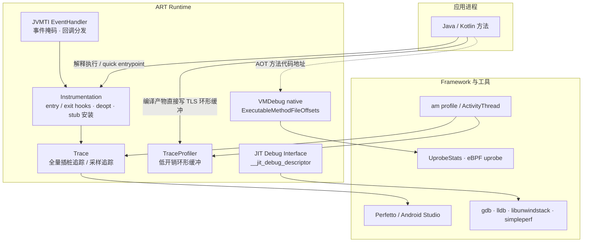
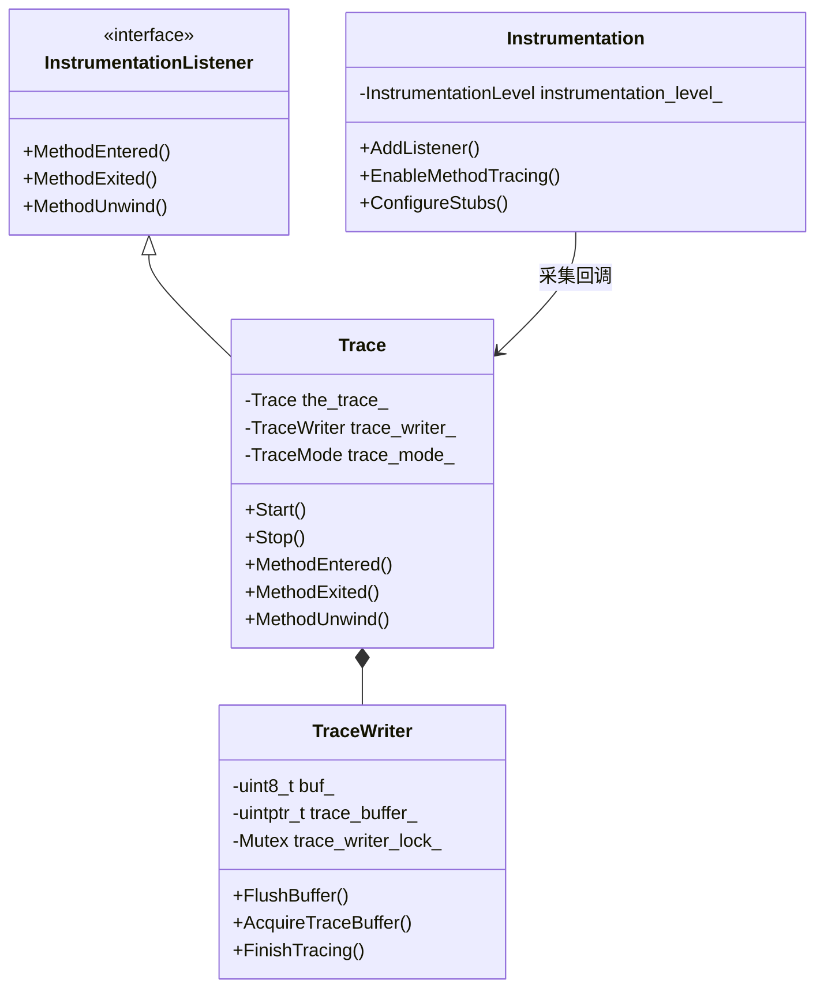
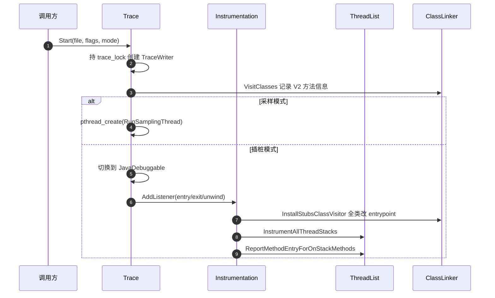
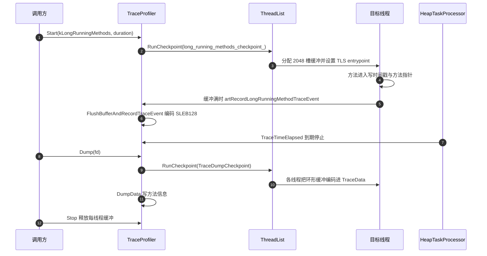
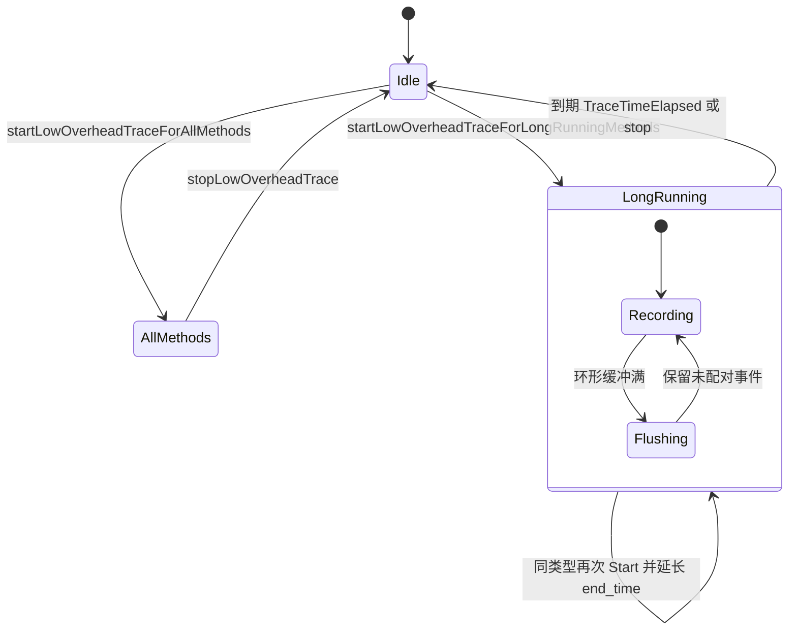
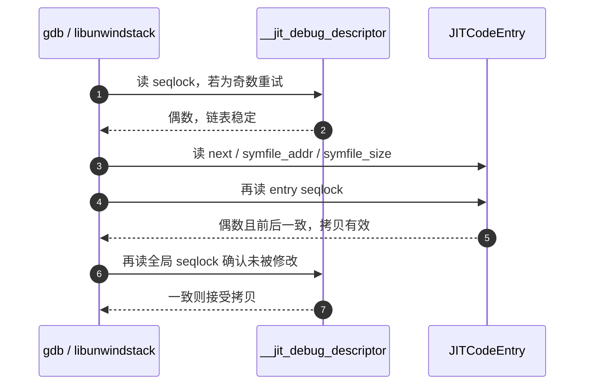
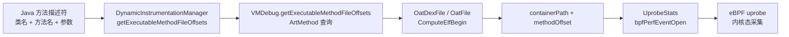
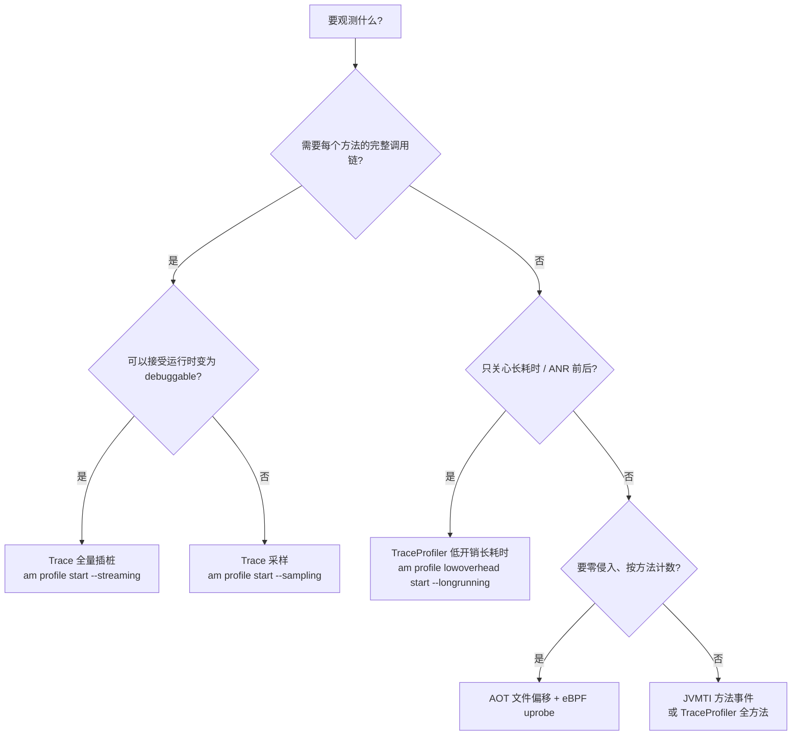

# 10 · 方法追踪、低开销环形缓冲与符号桥接

> [!IMPORTANT]
> **一句话核心结论**：ART 把「方法级可观测性」拆成四条互不干扰的路径——`Trace`（插桩式全量/采样追踪）、`TraceProfiler`（编译期埋点 + 每线程 2048 槽环形缓冲的低开销追踪，长耗时阈值为 2^23 个 24.576 MHz 计数，约 341 ms）、`__jit_debug_descriptor`（Seqlock 保护的内存 ELF 符号桥，供 gdb / lldb / libunwindstack / simpleperf 还原 JIT 栈）、以及 `VMDebug.getExecutableMethodFileOffsets` + eBPF uprobe（把 AOT 方法换算为 oat 容器文件偏移，实现进程内零埋点采样）。选型的本质是选择「开销发生在哪一层」。

| 项目 | 内容 |
| :--- | :--- |
| **机制定位** | Java 方法级的执行追踪、低开销环形缓冲采样、原生符号还原与 eBPF 探针桥接 |
| **源码模块（相对 `qssi/art/`）** | `runtime/trace.cc`、`runtime/trace_profile.cc`、`runtime/instrumentation.cc`、`runtime/jit/debugger_interface.cc`、`openjdkjvmti/events.h` |
| **核心类 / 入口** | `Trace`、`TraceWriter`、`TraceProfiler`、`TraceData`、`instrumentation::Instrumentation`、`JITDescriptor` / `JITCodeEntry`、`openjdkjvmti::EventHandler` |
| **关键构建开关** | aconfig `com.android.art.rw.flags.enable_profile_code_rw`、构建 flag `always_enable_profile_code`、dex2oat `--allow-profile-code`（低开销追踪没有 `-XX` 开关） |
| **关键系统属性** | `dalvik.vm.allow_profile_code`（低开销追踪总闸）、`dalvik.vm.dex2oat-flags`（可为 AOT 追加 `--allow-profile-code`） |
| **关键启动参数** | `-Xmethod-trace`、`-Xmethod-trace-file`、`-Xmethod-trace-file-size`、`-Xmethod-trace-stream`、`-Xmethod-trace-clock:{threadcpuclock,wallclock,dualclock}` |
| **源码基线** | `/home/voyah/workspace/8397/qssi/art`（Android 15/16 主线级 QSSI，只读） |

## 1. What：机制是什么？

### 1.1 四条路径，四种开销模型

ART 里「看到方法执行」并不只有一种实现。它们记录的信息、触发方式和代价完全不同，混用是最常见的误判来源。

| 路径 | 触发接口 | 记录粒度 | 时间源 | 主要边界 | 源码入口 |
| :--- | :--- | :--- | :--- | :--- | :--- |
| 全量插桩追踪 | `Debug.startMethodTracing` / `am profile start` | 每次方法进入、退出、异常展开 | dual / wall / thread-cpu 时钟 | 强制运行时进入 JavaDebuggable，AOT 代码被桥回解释器 | [trace.cc](file:///home/voyah/workspace/8397/qssi/art/runtime/trace.cc#L608-L723) |
| 采样追踪 | `am profile start --sampling <us>` | 每隔固定微秒抓一次调用栈 | 采样时刻的时钟 | 统计意义，短方法可能永远采不到；每次采样暂停所有线程 | [trace.cc](file:///home/voyah/workspace/8397/qssi/art/runtime/trace.cc#L379-L413) |
| 低开销全方法追踪 | `VMDebug.startLowOverheadTraceForAllMethods` / `am profile lowoverhead start` | 编译代码内联写环形缓冲，仅最近 2047 条 | 时间戳计数器（无系统调用） | 只覆盖带 profile-code 的编译代码；ARM64 专属 | [trace_profile.cc](file:///home/voyah/workspace/8397/qssi/art/runtime/trace_profile.cc#L307-L375) |
| 低开销长耗时追踪 | `startLowOverheadTraceForLongRunningMethods(ns)` / `--longrunning` | 只保留执行超过阈值的方法及其调用链 | 时间戳计数器 | 阈值固定为 2^23 tick；深栈会丢弃深层条目 | [trace_profile.cc](file:///home/voyah/workspace/8397/qssi/art/runtime/trace_profile.cc#L570-L708) |
| JVMTI 方法事件 | `SetEvent(JVMTI_EVENT_METHOD_ENTRY/EXIT)` | 每个事件回调到 agent | agent 自行读取 | 走慢速监听器列表，单事件跨 JNI 分发 | [events.h](file:///home/voyah/workspace/8397/qssi/art/openjdkjvmti/events.h#L44-L97) |
| JIT 符号桥 | 无 Java API，读取 `__jit_debug_descriptor` | 每个 JIT 方法的符号与 unwind 信息 | 注册时间戳 | 只解决「地址到名字」，不产生事件 | [debugger_interface.cc](file:///home/voyah/workspace/8397/qssi/art/runtime/jit/debugger_interface.cc#L113-L204) |
| AOT 文件偏移 + uprobe | `VMDebug.getExecutableMethodFileOffsets` / `oatdump` JSON | 内核在方法代码首地址触发 | 内核时钟 | 只对有 oat quick code 的方法有效；偏移随 oat 文件变化 | [dalvik_system_VMDebug.cc](file:///home/voyah/workspace/8397/qssi/art/runtime/native/dalvik_system_VMDebug.cc#L319-L378) |

> [!NOTE]
> `Trace` 与 `TraceProfiler` 互斥：`Trace::Start` 发现低开销 profile 正在进行会拒绝启动，`TraceProfiler::Start` 发现普通 trace 正在进行也会拒绝。两者共享 `Locks::trace_lock_`，但数据通路完全不同。

### 1.2 核心术语表

| 术语 | 含义 | 源码锚点 |
| :--- | :--- | :--- |
| Instrumentation level | 运行时对「是否安装 entry/exit 钩子」的全局档位：`kInstrumentNothing` / `kInstrumentWithEntryExitHooks` / `kInstrumentWithInterpreter` | [instrumentation.h](file:///home/voyah/workspace/8397/qssi/art/runtime/instrumentation.h#L197-L204) |
| Fast trace listener | 只使用 wall clock 的追踪监听器，编译代码可以在快路径直接写缓冲 | [trace.cc](file:///home/voyah/workspace/8397/qssi/art/runtime/trace.cc#L275-L284) |
| Slow listener | JVMTI、thread-cpu clock 等监听器，每个事件必须回到运行时 | [instrumentation.h](file:///home/voyah/workspace/8397/qssi/art/runtime/instrumentation.h#L197-L204) |
| Per-thread trace buffer | 全量追踪的线程私有线性缓冲，默认 512 KB，从 32 个共享槽位借用 | [trace.cc](file:///home/voyah/workspace/8397/qssi/art/runtime/trace.cc#L80-L90) |
| Ring buffer（低开销） | 每线程 2048 个 `uintptr_t` 槽，写满后覆盖最旧条目 | [trace_profile.h](file:///home/voyah/workspace/8397/qssi/art/runtime/trace_profile.h#L32-L38) |
| Long-running threshold | `1 << 23` 个时间戳计数；在典型 24.576 MHz 计数频率下约 341 ms | [trace_profile.h](file:///home/voyah/workspace/8397/qssi/art/runtime/trace_profile.h#L32-L38) |
| SLEB128 / ULEB128 | 变长有符号/无符号整数编码，用于压缩方法指针、时间差与方法差 | [trace.cc](file:///home/voyah/workspace/8397/qssi/art/runtime/trace.cc#L1629-L1705) |
| Mini-debug-info | JIT 方法编译后生成的内存 ELF（含 `.symtab` 与 `.debug_frame`），可被 repack 合并 | [debugger_interface.cc](file:///home/voyah/workspace/8397/qssi/art/runtime/jit/debugger_interface.cc#L502-L583) |
| Seqlock | 单调递增计数器：偶数表示数据有效，奇数表示正在修改；读者前后各读一次判断一致性 | [debugger_interface.cc](file:///home/voyah/workspace/8397/qssi/art/runtime/jit/debugger_interface.cc#L264-L288) |
| JIT descriptor | gdb/lldb 约定的全局结构，`head_` 指向 JIT code entry 链表 | [debugger_interface.cc](file:///home/voyah/workspace/8397/qssi/art/runtime/jit/debugger_interface.cc#L148-L176) |
| ExecutableMethodFileOffsets | 方法在 oat 容器内的路径与文件偏移，供 uprobe 使用 | [dalvik_system_VMDebug.cc](file:///home/voyah/workspace/8397/qssi/art/runtime/native/dalvik_system_VMDebug.cc#L319-L378) |
| EventMask | JVMTI 事件的 `std::bitset` 掩码，按 `ArtJvmtiEvent` 连续编号索引 | [events.h](file:///home/voyah/workspace/8397/qssi/art/openjdkjvmti/events.h#L163-L184) |

### 1.3 架构定位



### 1.4 职责边界

- **ART 负责**：在正确的执行点产生事件或记录地址；在进程内维护可供外部工具读取的符号表；计算 AOT 方法的容器偏移。
- **ART 不负责**：把 `.trace` 渲染成火焰图（Android Studio / Perfetto / `trace_processor` 负责）；决定采样策略与上传（Framework 的 `ActivityThread` / `ActivityManagerService` 负责）；eBPF 程序的加载与权限校验（`UprobeStats` 与其 BPF 程序负责）。
- **低开销追踪不是「无开销追踪」**：它把开销压到「几条指令 + 一次计数器读」，但依然要求代码在编译期带上埋点，并且环形缓冲会静默覆盖旧数据。

## 2. Why：为什么需要它？

### 2.1 全量插桩的代价：一次追踪会把运行时改成「调试运行时」

`Trace::Start` 在非采样模式下做的第一件事不是挂监听器，而是把运行时切成 `kJavaDebuggable`：

- `InvalidateAllCompiledCode()`：作废所有 JIT 代码；
- `TransitionToDebuggable()` 与 `SetDebuggableCompilerOption(true)`：后续 JIT 按可调试模式生成；
- `UpdateEntrypointsForDebuggable()`：遍历所有类，把不满足 entry/exit 钩子条件的 entrypoint 改成解释器桥；
- `DeoptimizeBootImage()`：连 boot image 里的 AOT 代码也不再直接执行。

这一段的源码在 [trace.cc](file:///home/voyah/workspace/8397/qssi/art/runtime/trace.cc#L686-L716)。它意味着：**全量方法追踪的观察对象已经不是生产态代码**。对启动优化、卡顿归因来说，这个偏差必须被显式承认。

`Instrumentation` 一侧还有一层成本：`kDeoptimizeForAccurateMethodEntryExitListeners` 默认把「精确 entry/exit」与「全量去优化」画等号，源码注释直言这会严重伤害应用性能（[instrumentation.h](file:///home/voyah/workspace/8397/qssi/art/runtime/instrumentation.h#L60-L63)）。`Trace::Start` 显式传入 `needs_interpreter=false`，走 entry/exit hook 而不是全解释器，但它仍然无法让 AOT 代码原位执行——`CodeSupportsEntryExitHooks` 只认解释器桥、resolution stub、可调试 JIT 代码与 GenericJni stub，其余一律换回解释器（[instrumentation.cc](file:///home/voyah/workspace/8397/qssi/art/runtime/instrumentation.cc#L208-L249)）。

内存侧同样可观：`TraceWriter` 默认分配 32 个 512 KB 的共享缓冲槽，即 16 MB 的缓冲池；流式模式还要再分配 512 KB × 6 的编码缓冲（[trace.cc](file:///home/voyah/workspace/8397/qssi/art/runtime/trace.cc#L80-L90)、[trace.cc](file:///home/voyah/workspace/8397/qssi/art/runtime/trace.cc#L891-L972)）。每线程记录还会按 dual clock 存三份数据（方法 + 线程 CPU 时间 + wall time），默认 dual clock 下 `UseFastTraceListeners` 返回 false，于是每个事件都要读一次线程 CPU 时钟，而线程 CPU 时钟走 `pthread_getcpuclockid` + `clock_gettime`，不是纯用户态计数器（[trace.cc](file:///home/voyah/workspace/8397/qssi/art/runtime/trace.cc#L275-L284)、[thread.cc](file:///home/voyah/workspace/8397/qssi/art/runtime/thread.cc#L1551-L1558)）。

### 2.2 采样剖析的盲区：统计正确，因果不足

采样模式不挂 entry/exit 监听器，而是起一个 `Sampling Profiler` 线程，每 `interval_us` 微秒：

1. `ScopedTrace("Profile sampling")` 打一条 atrace 切片；
2. 进入 `ScopedGCCriticalSection`，避免与 GC 死锁；
3. `ScopedSuspendAll` 暂停所有线程；
4. 持 `thread_list_lock_` 遍历线程，`WalkStack` 抓取当前栈；
5. 与上一次样本做 diff，生成进入/退出事件。

源码见 [trace.cc](file:///home/voyah/workspace/8397/qssi/art/runtime/trace.cc#L341-L413)。它的优点是开销与「方法调用次数」无关，缺点是：

- **短方法不可见**：执行时间小于采样间隔的方法大概率一次都采不到；
- **每次采样都是一次全线程暂停**：采样频率越高，卡顿越明显；
- **时间戳是采样时刻的近似值**：同一批 diff 出来的进入/退出事件共享同一个时间戳，不能用于精确的方法耗时排序。

### 2.3 低开销追踪要解决什么

车载座舱与长稳测试里最常见的问题是「某个方法偶发执行了几百毫秒，但复现时抓不到」。全量追踪太重、采样太粗，于是 ART 引入 `TraceProfiler`：

- **只在编译产物里埋点**：方法进入/退出直接写线程私有 TLS 缓冲，不经过 `Instrumentation` 回调、不拿锁、不读系统调用；
- **固定大小环形缓冲**：每线程 16 KB，天然有界，适合长期开启；
- **长耗时模式只保留「超过阈值」的方法**：普通方法进入后如果很快退出，就把那条进入记录原地撤销，不占窗口；
- **可被 SIGQUIT 读取**：ANR 转储时把 `LongRunningMethods` 以 Base64 写进 trace 文本，给事后分析留下「谁卡了 341 ms 以上」的线索（[signal_catcher.cc](file:///home/voyah/workspace/8397/qssi/art/runtime/signal_catcher.cc#L145-L152)）。

代价是它**只覆盖编译代码**：解释器、nterp、未带 profile-code 的 AOT 代码都不会写缓冲。这既是它低开销的原因，也是它「看起来没数据」的最常见原因。

### 2.4 符号与 uprobe：没有名字的地址等于没有信息

JIT 代码在 `/proc/<pid>/maps` 里只是一段匿名可执行映射。没有额外信息时，`simpleperf`、`debuggerd`、gdb 只能给出十六进制地址。ART 的解法是：

- 每个 JIT 方法编译完成后，生成一个只含 `.symtab` 与 `.debug_frame` 的迷你 ELF，挂到 `__jit_debug_descriptor` 链表上；
- 用 Seqlock 让外部工具在进程运行、链表变动时也能安全读取；
- 用 64 KB 分组 + LZMA 压缩控制内存膨胀。

而 eBPF uprobe 解决的是另一个问题：**AOT 方法没有「注册」动作**，内核需要一个「文件 + 偏移」才能下探针。ART 通过 `VMDebug.getExecutableMethodFileOffsets` 把 `ArtMethod` 的 quick code 地址换算成 oat 容器内偏移，于是 `UprobeStats` 可以在不修改应用、不开启 debuggable 的情况下统计方法调用（[dalvik_system_VMDebug.cc](file:///home/voyah/workspace/8397/qssi/art/runtime/native/dalvik_system_VMDebug.cc#L319-L378)）。

### 2.5 方案演进对比矩阵

| 维度 | 全量插桩 `Trace` | 采样 `Trace` | 低开销全方法 | 低开销长耗时 | JVMTI 方法事件 | AOT uprobe |
| :--- | :--- | :--- | :--- | :--- | :--- | :--- |
| 是否需要改运行时状态 | 是，切 JavaDebuggable | 否 | 否 | 否 | 是，安装钩子并可能 deopt | 否 |
| 是否逐事件回调 | 是 | 否 | 否（只写缓冲） | 否 | 是 | 否（内核计数） |
| 事件完整性 | 完整 | 统计抽样 | 最近窗口，会覆盖 | 仅超阈值方法 | 完整 | 取决于探针点 |
| 典型时间精度 | 高 | 低 | 计数器级 | 计数器级 | 高 | 内核级 |
| 对生产代码的可代表性 | 低 | 高 | 高 | 高 | 低 | 高 |
| 主要限制 | 开销与内存大 | 短方法丢失 | ARM64 / 编译埋点 | 阈值固定、深栈截断 | 跨 JNI，开销高 | 仅有 oat quick code 的方法、偏移易变 |

## 3. How：源码级实现原理深度剖析

### 3.1 全量方法追踪 `Trace`：从 entrypoint 改写到一个 `.trace` 文件

#### 3.1.1 对象模型



`Trace` 同时实现 `InstrumentationListener` 与 `ClassLoadCallback`。`TraceWriter` 负责所有跨线程的编码与落盘；`Instrumentation` 只负责「把代码执行点改成会回调 `Trace` 的形态」。

#### 3.1.2 每线程缓冲与文件格式

```text
TraceWriter 共享缓冲池（默认 32 个 owner 槽 × 512 KB = 16 MB）
+-----------+-----------+-----------+-----+------------+
| buffer 0  | buffer 1  | buffer 2  | ... | buffer 31  |
| owner=tid | owner=0   | owner=tid |     | owner=0    |
+-----------+-----------+-----------+-----+------------+
      ^ 每线程借用其中一个；池空时允许分配临时缓冲

单个 per-thread 缓冲（512 KB = 65536 个 uintptr_t 槽，向下增长）
高地址                                                          低地址
+------------+------------+------------+------------+------------+
| wall_clock | thread_cpu | method|act | wall_clock | ...        |
+------------+------------+------------+------------+------------+
                                   ^
                                   |
                     method_trace_buffer_curr_entry

每条记录占 2 个槽（wall 或 thread-cpu 单时钟）或 3 个槽（dual clock）；
流式模式下写满后整块交给 TraceWriter 线程池编码，不覆盖旧数据；
非流式模式会同步冲刷所有线程，空间不足时停止记录。
```

`kPerThreadBufSize`、`kNumTracePoolBuffers` 与 `kScalingFactorEncodedEntries` 定义在 [trace.cc](file:///home/voyah/workspace/8397/qssi/art/runtime/trace.cc#L67-L90)。每条记录的第一个槽是 `ArtMethod* | action`，低两位编码 `kTraceMethodEnter` / `kTraceMethodExit` / `kTraceUnroll`（[trace.h](file:///home/voyah/workspace/8397/qssi/art/runtime/trace.h#L94-L100)）。

输出文件分 V1 与 V2 两种格式。V2 是按「包」组织的格式，方法信息可以在追踪过程中增量写入：

```text
V2 trace 文件
+-------------------------------+
| 32 字节文件头                  |
| magic "SLOW" / version 4 或 5  |
| start_time_monotonic           |
+-------------------------------+
| ThreadInfo  type=0  7B + name  | 首次见到线程时写
| MethodInfo  type=1 11B + line  | 启动时全量 + ClassPrepare 增量
| EntryBlock  type=2 12B + LEB   | 每块若干条记录
| ...                            |
| Summary     type=3  3B + text  | 结束时写纯文本摘要
+-------------------------------+
```

包类型常量在 [trace.h](file:///home/voyah/workspace/8397/qssi/art/runtime/trace.h#L127-L143)，MethodInfo 的写入逻辑在 [trace.cc](file:///home/voyah/workspace/8397/qssi/art/runtime/trace.cc#L480-L559)。

#### 3.1.3 `Trace::Start` 端到端



关键源码：

- 互斥检查与运行时切换：[trace.cc](file:///home/voyah/workspace/8397/qssi/art/runtime/trace.cc#L653-L716)
- 记录所有已加载类的方法信息：[trace.cc](file:///home/voyah/workspace/8397/qssi/art/runtime/trace.cc#L417-L456)
- 监听器注册：[trace.cc](file:///home/voyah/workspace/8397/qssi/art/runtime/trace.cc#L703-L716)
- 采样线程：[trace.cc](file:///home/voyah/workspace/8397/qssi/art/runtime/trace.cc#L379-L413)

`Trace::Start` 明确传入 `needs_interpreter=false`，因此 `Instrumentation::EnableMethodTracing` 选择 `kInstrumentWithEntryExitHooks`，而不是 `kInstrumentWithInterpreter`（[instrumentation.cc](file:///home/voyah/workspace/8397/qssi/art/runtime/instrumentation.cc#L1388-L1404)）。`ConfigureStubs` 把 `"Tracer"` 这个 key 写入 `requested_instrumentation_levels_`，再由 `UpdateStubs` 取所有客户端的最大档位，遍历所有类安装 stub（[instrumentation.cc](file:///home/voyah/workspace/8397/qssi/art/runtime/instrumentation.cc#L989-L1002)、[instrumentation.cc](file:///home/voyah/workspace/8397/qssi/art/runtime/instrumentation.cc#L1049-L1083)）。

#### 3.1.4 快路径、慢路径与「哪些代码能直接回调」

`CodeSupportsEntryExitHooks` 是理解全量追踪成本的核心函数（[instrumentation.cc](file:///home/voyah/workspace/8397/qssi/art/runtime/instrumentation.cc#L208-L249)）：

| entrypoint 类型 | 是否支持 entry/exit | 处理方式 |
| :--- | :--- | :--- |
| 解释器桥、resolution stub | 是 | 保留 |
| 可调试 JIT 代码 | 是 | 保留，编译时已带 hook |
| GenericJni stub | 是 | 保留 |
| nterp、AOT 代码、非可调试 JIT | 否 | 替换为 `GetQuickToInterpreterBridge()` |

也就是说，**全量追踪并不是让所有代码都变慢同样的倍数**：JIT 代码可能仍然执行，只是多了 hook；AOT 方法则被迫回到解释器。`InstallStubsForMethod` 的完整分支见 [instrumentation.cc](file:///home/voyah/workspace/8397/qssi/art/runtime/instrumentation.cc#L409-L446)。

对已经在栈上的方法，`Trace::Start` 还会通过 `ReportMethodEntryForOnStackMethods` 补发进入事件，避免「trace 开始时已经在执行的方法」在时间线上凭空出现（[instrumentation.cc](file:///home/voyah/workspace/8397/qssi/art/runtime/instrumentation.cc#L587-L635)）。

事件回调最终落到 `Instrumentation::MethodEnterEventImpl` / `MethodExitEventImpl` / `MethodUnwindEvent`，它们遍历慢速与快速监听器列表（[instrumentation.cc](file:///home/voyah/workspace/8397/qssi/art/runtime/instrumentation.cc#L1446-L1518)）。`Trace` 的 `MethodEntered` / `MethodExited` / `MethodUnwind` 只做两件事：读时钟，把事件写进 per-thread 缓冲（[trace.cc](file:///home/voyah/workspace/8397/qssi/art/runtime/trace.cc#L1177-L1199)、[trace.cc](file:///home/voyah/workspace/8397/qssi/art/runtime/trace.cc#L1224-L1238)）。

#### 3.1.5 写满之后：线程池编码与 LEB128 压缩

`LogMethodTraceEvent` 在缓冲不足时调用 `PrepareBufferForNewEntries`：

- **流式模式**：把当前缓冲交给 `TraceEntriesWriterTask`，线程池异步编码，主线程立刻拿一个新缓冲；
- **非流式模式**：`FlushAllThreadBuffers()` 在 `ScopedSuspendAll` 下把所有线程缓冲同步写进共享 `buf_`；一旦空间不足，置 `overflow_` 并停止记录。

源码见 [trace.cc](file:///home/voyah/workspace/8397/qssi/art/runtime/trace.cc#L1332-L1366) 与 [trace.cc](file:///home/voyah/workspace/8397/qssi/art/runtime/trace.cc#L1494-L1531)。

V2 编码在 `FlushEntriesFormatV2` 中完成（[trace.cc](file:///home/voyah/workspace/8397/qssi/art/runtime/trace.cc#L1629-L1705)）：

```text
每个 EntryBlock:
  header:  type=2 | thread_id(4B) | num_records(3B) | payload_size(4B)
  payload: 对每条记录
            SLEB128(method_action - prev_method_action)
            ULEB128(wall_time - prev_wall_time)        // 仅 wall / dual
            ULEB128(thread_cpu - prev_thread_cpu)      // 仅 thread-cpu / dual
```

编码器在剩余空间小于「最大单条记录」（单时钟 20 B、双时钟 30 B）时结束当前块，保证不会越界。方法指针与时间戳都以差值形式编码：进入与退出记录各自携带方法指针，但相邻记录的方法指针差通常很小，因此 LEB128 的实际字节数远小于指针宽度；V1 则用「方法 id 映射表 + 固定 10/14 字节记录」达到类似效果（[trace.cc](file:///home/voyah/workspace/8397/qssi/art/runtime/trace.cc#L1731-L1794)）。

#### 3.1.6 停止：先冻结，再冲刷，最后恢复运行时

`Trace::StopTracing` 的顺序是刻意设计的（[trace.cc](file:///home/voyah/workspace/8397/qssi/art/runtime/trace.cc#L725-L813)）：

1. 持 `trace_lock_` 置 `stop_tracing_`，让采样线程退出并 `pthread_join`；
2. `trace_writer_->StopTracing()` 置 `finish_tracing_`，并等待所有正在找缓冲的线程离开追踪代码；
3. 进入 `ScopedGCCriticalSection` + `ScopedJitSuspend` + `ScopedSuspendAll`；
4. 移除 ClassLoadCallback 与 Instrumentation 监听器，`DisableMethodTracing("Tracer")`；
5. 遍历所有线程，把残留缓冲同步冲刷；
6. 置空 `the_trace_`，再 `FinishTracing` 写 summary 并关闭文件。

`FinishTracing` 会先等线程池里所有 `TraceWriterTask` 完成，避免 summary 与数据块交错；流式模式下 summary 是独立的 `kSummaryHeaderV2` 包，非流式模式下则是 summary 文本 + 数据缓冲一次性写出（[trace.cc](file:///home/voyah/workspace/8397/qssi/art/runtime/trace.cc#L1045-L1144)）。

### 3.2 低开销追踪 `TraceProfiler`：2048 槽环形缓冲与 341 ms 阈值

#### 3.2.1 设计常量

| 常量 | 值 | 含义 |
| :--- | :--- | :--- |
| `kAlwaysOnTraceBufSize` | 2048 | 每线程槽数，约 16 KB |
| `kLongRunningMethodThreshold` | `1 << 23` | 长耗时阈值，典型 24.576 MHz 下约 341 ms |
| `kDefaultTraceDurationNs` | 2 s | 长耗时追踪未指定时长时的默认值 |
| `kMaxEntriesAfterFlush` | 1024 | 溢出冲刷时最多保留的条目数 |
| `kMinBufSizeForEncodedData` | 16 KB | 编码缓冲下限 |
| `kBufSizeForEncodedData` | 160 KB | 编码缓冲实际大小（下限的 10 倍） |

前三个在 [trace_profile.h](file:///home/voyah/workspace/8397/qssi/art/runtime/trace_profile.h#L32-L38)，后三个在 [trace_profile.cc](file:///home/voyah/workspace/8397/qssi/art/runtime/trace_profile.cc#L44-L62)。

#### 3.2.2 环形槽位与两种记录形态

```text
TraceProfiler 每线程缓冲（2048 × uintptr_t = 16 KB）
低地址                                                             高地址
+----------+----------+----------+----------+----------+-----------+
| slot 0   | slot 1   |   ...    | slot k   |   ...    | slot 2047 |
+----------+----------+----------+----------+----------+-----------+
      ^                                 ^                      ^
      |                                 |                      |
  最新写入端                        curr_entry             首次写入点
  （继续向下覆盖）                 （每写一条减 8/16）     （窗口最旧端）

全方法模式：每条 8 字节
+---------------------------+-----+
| ArtMethod*                | act |
+---------------------------+-----+
 63                         2 1 0

长耗时模式：进入事件 16 字节，退出事件 8 字节
低地址                              高地址
+---------------------+---------------------+
| timestamp (bit0=0)  | ArtMethod*          |
+---------------------+---------------------+
退出：
+---------------------+
| timestamp | bit0=1  |
+---------------------+
占位符 0x1 用于表示「此前的进入事件已经不再需要配对」。
```

`AllocateBuffer` 对全方法模式清零整个缓冲；对长耗时模式在最高槽放一个 `0x1` 占位符，这样退出事件不需要额外判断「上一条是否有效」（[trace_profile.cc](file:///home/voyah/workspace/8397/qssi/art/runtime/trace_profile.cc#L112-L135)）。槽位编号越大地址越高，写入从高往低推进，因此 dump 时从 `kAlwaysOnTraceBufSize - 1` 向下读就是「从旧到新」（[trace_profile.cc](file:///home/voyah/workspace/8397/qssi/art/runtime/trace_profile.cc#L422-L470)）。

长耗时模式启动时还会补历史：`long_running_methods_checkpoint_` 调用 `RecordMethodsOnThreadStack`，自底向上把当前栈上尚未退出的方法写成进入事件，最多写到 `kMaxEntriesAfterFlush`（1024 个槽位）；更深的帧会被放弃，源码注释明确接受「后续可能看到没有对应进入的退出事件」这一简化（[trace_profile.cc](file:///home/voyah/workspace/8397/qssi/art/runtime/trace_profile.cc#L148-L203)、[trace_profile.cc](file:///home/voyah/workspace/8397/qssi/art/runtime/trace_profile.cc#L287-L295)）。

#### 3.2.3 编译内联：AOT/JIT 产物与 ARM64 entrypoint 如何写缓冲

这段机制的关键不在 C++，而在编译产物。编译器在帧入口/出口插入 `MaybeRecordTraceEvent`（[code_generator_arm64.cc](file:///home/voyah/workspace/8397/qssi/art/compiler/optimizing/code_generator_arm64.cc#L1352-L1381)）：

- 若编译选项未开 `EnableProfileCode()`，什么都不插；
- 对「无循环、无 monitor、指令数不超过 32」的小方法直接跳过，避免为不可能长耗时的方法付代价；
- 否则在帧入口/出口读 `Thread::method_trace_buffer`，为空则跳过；非空则调用 TLS 里的 `RecordEntryTraceEvent` / `RecordExitTraceEvent` quick entrypoint。

entrypoint 由 `UpdateLowOverheadTraceEntrypoints` 按当前追踪类型切换：全方法、长耗时、或 nop（[entrypoints_init_arm64.cc](file:///home/voyah/workspace/8397/qssi/art/runtime/arch/arm64/entrypoints_init_arm64.cc#L217-L243)）。ARM64 上的全方法快路径只有约十条指令：

```asm
// art_quick_record_entry_trace_event（节选）
ldr xIP1, [xSELF, #TRACE_BUFFER_CURRENT_OFFSET]
cmp xIP1, xIP0                 // xIP0 = method_trace_buffer
bhs .Lupdate_entry
mov xIP1, #TRACE_BUFFER_SIZE
add xIP1, xIP0, xIP1           // 回绕
.Lupdate_entry:
sub xIP1, xIP1, 8
str x0, [xIP1]                 // 写入 ArtMethod*
str xIP1, [xSELF, #TRACE_BUFFER_CURRENT_OFFSET]
ret
```

来源：[quick_entrypoints_arm64.S](file:///home/voyah/workspace/8397/qssi/art/runtime/arch/arm64/quick_entrypoints_arm64.S#L2566-L2595)。长耗时版本在进入时额外读 `cntvct_el0` 并把最低位清零，退出时读时间戳、与上一条进入记录比较，小于阈值就把两条记录一起撤销（[quick_entrypoints_arm64.S](file:///home/voyah/workspace/8397/qssi/art/runtime/arch/arm64/quick_entrypoints_arm64.S#L2597-L2675)）。TLS 偏移与 `TRACE_BUFFER_SIZE` 由构建期生成的宏提供（[thread.def](file:///home/voyah/workspace/8397/qssi/art/tools/cpp-define-generator/thread.def#L75-L80)），`Thread` 侧的 getter/setter 在 [thread.h](file:///home/voyah/workspace/8397/qssi/art/runtime/thread.h#L1519-L1540)。

> [!TIP]
> 只有 ARM64 的 `UpdateLowOverheadTraceEntrypoints` 会真正替换 quick entrypoint；ARM、x86、riscv64 在源码里是空实现。因此低开销追踪在其它架构上「能启动但采不到数据」，不是配置问题。

#### 3.2.4 溢出慢路径：先把成对的记录搬走，再决定新事件

环形缓冲满时，汇编跳进 `artRecordLongRunningMethodTraceEvent`，最终落到 `TraceProfiler::FlushBufferAndRecordTraceEvent`（[quick_trampoline_entrypoints.cc](file:///home/voyah/workspace/8397/qssi/art/runtime/entrypoints/quick/quick_trampoline_entrypoints.cc#L2814-L2817)、[trace_profile.cc](file:///home/voyah/workspace/8397/qssi/art/runtime/trace_profile.cc#L632-L708)）。算法可以概括为：

```text
FlushBufferAndRecordTraceEvent(method, thread, is_entry):
  1. 从 curr（窗口最新端）向高地址（更旧一侧）扫描，找到最近一个方法退出事件
     —— 该退出事件及其更旧的条目已经成对，可以安全编码；
        更年轻的条目仍可能是未退出的调用，必须保留
  2. 若待搬条目数 > 1024（极深栈）：
       把当前窗口全部编码进 TraceData，并写一个占位符退出
     否则：
       编码到该退出事件为止的条目，把剩余条目按原顺序搬到缓冲顶部
  3. 记录本次新事件：
       is_entry  -> 写 [timestamp & ~1, method]
       !is_entry -> 若上一条已是退出，直接写 timestamp | 1
                    若上一条是进入且时间差 < 阈值，撤销这对进入记录
                    否则写 timestamp | 1
  4. 更新 curr_entry，持 trace_lock 把编码块追加到 TraceData
```

编码格式由 `DumpLongRunningMethodBuffer` 完成：时间戳左移一位、最低位标记进入/退出，时间差与方法指针差各自 SLEB128 编码；块头是 `type=2 + tid(4B) + num_records(3B) + size(4B)`（[trace_profile.cc](file:///home/voyah/workspace/8397/qssi/art/runtime/trace_profile.cc#L570-L630)）。

#### 3.2.5 Start / Stop / Dump 的控制流





关键约束：

- 全方法模式可以重复 `Start`，但第二次会被忽略；长耗时模式允许「同类型重叠启动」，只把 `trace_end_time` 往后延（[trace_profile.cc](file:///home/voyah/workspace/8397/qssi/art/runtime/trace_profile.cc#L325-L369)）。
- `Stop` 通过 checkpoint 删除每线程缓冲并清空 TLS entrypoint；如果有 dump 正在进行，会先等 dump 完成（[trace_profile.cc](file:///home/voyah/workspace/8397/qssi/art/runtime/trace_profile.cc#L381-L420)）。
- `Dump` 本身不停止追踪。它先置 `trace_dump_in_progress_`，再 checkpoint 所有线程把当前窗口编码到 `TraceData`，最后 `FinishTraceDump` 写方法信息并广播完成（[trace_profile.cc](file:///home/voyah/workspace/8397/qssi/art/runtime/trace_profile.cc#L501-L539)、[trace_profile.cc](file:///home/voyah/workspace/8397/qssi/art/runtime/trace_profile.cc#L720-L769)）。
- 线程 attach 时也会调用 `TraceProfiler::AllocateBuffer`，保证追踪期间新建线程同样有缓冲（[thread.cc](file:///home/voyah/workspace/8397/qssi/art/runtime/thread.cc#L1170-L1174)）。

#### 3.2.6 输出、Base64 与 SIGQUIT

`TraceData` 把每个线程的编码块按到达顺序追加到 160 KB 缓冲，溢出后放入 `overflow_buffers_`；最终 `DumpData` 先写数据块，再写方法信息（[trace_profile.cc](file:///home/voyah/workspace/8397/qssi/art/runtime/trace_profile.cc#L92-L110)、[trace_profile.cc](file:///home/voyah/workspace/8397/qssi/art/runtime/trace_profile.cc#L771-L797)）。长耗时模式不会输出线程名映射，线程 id 已编码在块头；全方法模式则同时输出线程名。

`GetLongRunningMethodsString` 走的是「无文件 Dump + 自实现 Base64」：把编码后的二进制 trace 转成 Base64 字符串，供 SIGQUIT 文本安全携带（[trace_profile.cc](file:///home/voyah/workspace/8397/qssi/art/runtime/trace_profile.cc#L710-L718)）。SIGQUIT 处理路径把它写成一行 `LongRunningMethods: <base64>`（[signal_catcher.cc](file:///home/voyah/workspace/8397/qssi/art/runtime/signal_catcher.cc#L145-L152)）。

### 3.3 符号桥接：`__jit_debug_descriptor`、Seqlock 与内存 ELF

#### 3.3.1 对外 ABI 与内存布局

`debugger_interface.cc` 文件头用大段注释描述了三种读取方式：在 `__jit_debug_register_code` 上下断点（gdb 路线，会停进程）、按 entry seqlock 异步读、按全局 seqlock 异步读（[debugger_interface.cc](file:///home/voyah/workspace/8397/qssi/art/runtime/jit/debugger_interface.cc#L39-L94)）。

```text
__jit_debug_descriptor（JITDescriptorPublic，典型 LP64 布局）
偏移    字段                        说明
0x00    version_ = 1                gdb 只支持 1
0x04    action_flag_                JIT_REGISTER_FN / JIT_UNREGISTER_FN
0x08    relevant_entry_             本次变更的 entry
0x10    head_ (atomic)              链表头，始终指向 seqlock 为偶数的 entry
0x18    magic_[8] = "Android2"
0x20    flags_ / sizeof_descriptor / sizeof_entry
0x2C    seqlock_ (atomic)           全局修改锁：奇数表示链表正在变
0x30    timestamp_                  单调递增，保证唯一

JITCodeEntryPublic（典型 LP64 布局）
0x00 next_ (atomic)   0x08 prev_
0x10 symfile_addr_    0x18 symfile_size_
0x20 timestamp_       0x28 seqlock_（偶数有效，奇数无效）
0x30 结束
```

公开结构只暴露前 6 个字段，实现结构 `JITCodeEntry` 在尾部追加 `addr_`、`allow_packing_`、`is_compressed_`；`__jit_debug_descriptor` 的版本、magic、`sizeof_entry` 让外部工具可以校验 ABI（[debugger_interface.cc](file:///home/voyah/workspace/8397/qssi/art/runtime/jit/debugger_interface.cc#L113-L204)）。

#### 3.3.2 Seqlock 协议与链表顺序



写入侧的规则同样严格：

- `Seqlock()` 先对全局计数器 `fetch_add(1)`，随后放 `release` fence（源码注释意图是阻止锁内写重排到加锁之前）；`Sequnlock()` 先放 `release` fence 再 `fetch_add(1)`（[debugger_interface.cc](file:///home/voyah/workspace/8397/qssi/art/runtime/jit/debugger_interface.cc#L264-L288)）。
- 新 entry 先填字段、再把自身 seqlock 置偶数，然后才挂进链表；删除时先从链表摘除，再把 entry seqlock 置奇数，最后才释放 `symfile_addr_`（[debugger_interface.cc](file:///home/voyah/workspace/8397/qssi/art/runtime/jit/debugger_interface.cc#L290-L314)、[debugger_interface.cc](file:///home/voyah/workspace/8397/qssi/art/runtime/jit/debugger_interface.cc#L381-L424)）。
- entry 只回收不释放，因此 seqlock 不会被「随机的新对象」覆盖；`next_` 必须始终指向偶数 seqlock 的 entry，这让崩溃进程的链表依然可读。
- 时间戳由 `max(descriptor.timestamp_ + 1, NanoTime())` 生成，即使系统时间精度不足也保证唯一（[debugger_interface.cc](file:///home/voyah/workspace/8397/qssi/art/runtime/jit/debugger_interface.cc#L268-L272)）。

#### 3.3.3 Repack 与压缩：控制 JIT 符号的内存膨胀

每个 JIT 方法一个迷你 ELF，数量一多就会膨胀。ART 用「按地址分组 + 合并」解决：

| 参数 | 值 | 作用 |
| :--- | :--- | :--- |
| `kJitRepackGroupSize` | 64 KB | 每个 packed entry 覆盖的代码地址范围 |
| `kJitRepackFrequency` | 64 | 每新增 64 个 entry 触发一次 repack |
| `allow_packing_` | 每 entry | 是否允许合并；完整 DWARF 不允许 |
| `is_compressed_` | 每 entry | 是否已经 LZMA 压缩 |

`RepackEntries` 按 `AlignDown(addr_, 64 KB)` 分组，用 `PackElfFileForJIT` 把组内 ELF 的 `.symtab` / `.debug_frame` 合并，再删除旧 entry（[debugger_interface.cc](file:///home/voyah/workspace/8397/qssi/art/runtime/jit/debugger_interface.cc#L502-L583)）。源码注释给出量级：先 repack 约省 4 倍，再 LZMA 再省约 4 倍；zygote 因为不 GC，始终压缩；应用进程等 GC 时再压缩（[debugger_interface.cc](file:///home/voyah/workspace/8397/qssi/art/runtime/jit/debugger_interface.cc#L616-L623)）。JIT code cache 在释放方法头时会调用 `RepackNativeDebugInfoForJit()` 做同样的整理（[jit_code_cache.cc](file:///home/voyah/workspace/8397/qssi/art/runtime/jit/jit_code_cache.cc#L520-L530)）。

zygote fork 是另一个难点：子进程不能修改 zygote 的内存，zygote 也可能继续追加 entry。ART 在 fork 前插入两个「永不删除」的边界 entry：

```text
<---- 应用进程可写 ----> <---- zygote 只读 ---->
head -> app entries ... application_tail | zygote_head | zygote entries ...
```

应用进程插入到 head，zygote 插入到 tail；子进程 `NativeDebugInfoPostFork` 把 `free_entries_` 置空，避免复用 zygote 的 entry（[debugger_interface.cc](file:///home/voyah/workspace/8397/qssi/art/runtime/jit/debugger_interface.cc#L450-L500)）。

#### 3.3.4 读取方：从地址到 Java 方法名

`ForEachNativeDebugSymbol` 从 `head_` 遍历到 `zygote_head_entry_`，对每个非空 `symfile` 用 `ElfDebugReader` 解析函数符号并回调 `(address, size, name)`（[debugger_interface.cc](file:///home/voyah/workspace/8397/qssi/art/runtime/jit/debugger_interface.cc#L674-L687)）。`compiler/debug/elf_debug_writer.cc` 正是这个接口的消费者之一：它把多个 entry 的 ELF 再合并成更大的调试文件（[elf_debug_writer.cc](file:///home/voyah/workspace/8397/qssi/art/compiler/debug/elf_debug_writer.cc#L264-L268)）。文件头注释明确指出这套 ABI 服务于 gdb、lldb、libunwind、simpleperf，因此它不只是「调试器专用」（[debugger_interface.cc](file:///home/voyah/workspace/8397/qssi/art/runtime/jit/debugger_interface.cc#L39-L50)）。

### 3.4 可执行方法文件偏移与 eBPF uprobe

#### 3.4.1 ART 侧：从 `ArtMethod` 到 `(containerPath, methodOffset)`

`VMDebug_getExecutableMethodFileOffsetsNative` 的计算链条非常短（[dalvik_system_VMDebug.cc](file:///home/voyah/workspace/8397/qssi/art/runtime/native/dalvik_system_VMDebug.cc#L319-L378)）：

```text
ArtMethod* m
  -> m->GetOatMethodQuickCode(kRuntimePointerSize)      // AOT quick code 地址
  -> declaring_class->GetDexFile().GetOatDexFile()
  -> oat_dex_file->GetOatFile()
  -> oat_file->ComputeElfBegin(&error_msg)              // ELF 在进程内的基址
  -> method_offset = oat_method_quick_code - elf_begin
  -> 返回 ExecutableMethodFileOffsets(oat_file->GetLocation(),
                                      elf_begin,
                                      method_offset)
```

注意两个细节：

1. **`containerOffset` 是「文件在进程内存中的偏移」**，不是文件内偏移；真正给 uprobe 用的是 `methodOffset`。Java 侧字段含义见 [VMDebug.java](file:///home/voyah/workspace/8397/qssi/libcore/dalvik/src/main/java/dalvik/system/VMDebug.java#L426-L454)。
2. **只有 oat 文件里存在该方法 quick code 时才有值**。`GetOatMethodQuickCode` 返回空（例如纯 JIT 方法、解释器方法）时，native 侧直接返回 `null` 并打日志。

#### 3.4.2 Framework 与 UprobeStats 侧



Framework 侧 `ActivityThread` 把请求转到 `VMDebug`（[ActivityThread.java](file:///home/voyah/workspace/8397/qssi/frameworks/base/core/java/android/app/ActivityThread.java#L2417-L2440)）；`UprobeStats` 在拿不到新 API 时还保留 `oatdump --dump-method-and-offset-as-json` 的兜底路径（[Art.cpp](file:///home/voyah/workspace/8397/qssi/packages/modules/UprobeStats/src/Art.cpp#L24-L61)），最终统一调用 `bpfPerfEventOpen(filename, offset, pid, program)`（[Bpf.h](file:///home/voyah/workspace/8397/qssi/packages/modules/UprobeStats/src/Bpf.h#L23-L24)）。

`oatdump` 侧的 JSON 每行形如：

```json
{"method":"Lcom/example/Foo;bar(I)V","offset":"1234"}
```

`offset` 是十六进制字符串，`0` 表示该方法没有 AOT 代码（[oatdump.cc](file:///home/voyah/workspace/8397/qssi/art/oatdump/oatdump.cc#L670-L700)）。

#### 3.4.3 边界与限制

- **只对 oat 文件里存在 quick code 的方法有效**：纯 JIT / 解释器方法没有文件偏移；即使方法同时存在 AOT 与 JIT 版本，返回的也是 oat 中那份代码的偏移，当前实际执行的 JIT 副本未必会触发该探针。
- **偏移是「当前 oat 文件」的属性**：应用更新、dex2oat 重编、OTA 之后偏移会变，缓存偏移必须带 oat 文件路径与版本校验。
- **需要权限与门禁**：`UprobeStats` 有独立的 Guardrail，只允许白名单包与方法前缀，并且受 feature flag `executable_method_file_offsets` 控制（[ConfigResolver.cpp](file:///home/voyah/workspace/8397/qssi/packages/modules/UprobeStats/src/ConfigResolver.cpp#L123-L146)）。
- **不要混淆三层偏移**：`methodOffset` 是文件内偏移；`containerOffset` 是进程内文件基址；`oat_method_quick_code` 是运行时虚拟地址。

### 3.5 JVMTI 事件扩展：`EventMask`、慢监听器与 deopt 策略

#### 3.5.1 事件编号与掩码

`ArtJvmtiEvent` 前段直接复用 JVMTI 的标准事件编号，后段追加 Android 内部事件（`kClassFileLoadHookRetransformable`、`kDdmPublishChunk`、`kObsoleteObjectCreated`、`kStructuralDexFileLoadHook`），内部事件从 `kMaxNormalEventTypeVal + 1` 开始（[events.h](file:///home/voyah/workspace/8397/qssi/art/openjdkjvmti/events.h#L44-L97)）。

```text
EventMask = std::bitset<kEventsSize>
index = event - kMinEventTypeVal
+----+----+----+----+-----+----+----+----+
| 0  | 1  | 2  | 3  | ... | n  |n+1 | ...|
+----+----+----+----+-----+----+----+----+
  ^                             ^
  VM_INIT                      内部事件

EventMasks = global_event_mask
           + vector<UniqueThread, EventMask>
           + unioned_thread_event_mask（快速判断「任意线程是否启用」）
```

`EventMasks` 的三层结构在 [events.h](file:///home/voyah/workspace/8397/qssi/art/openjdkjvmti/events.h#L186-L216)。`UniqueThread` 用 `(Thread*, tid)` 而不是裸指针，避免线程对象地址复用导致的误判。

#### 3.5.2 `JvmtiMethodTraceListener` 与 deopt

JVMTI 的方法事件最终也落到 `Instrumentation`，但它走的是 `is_trace_listener=false` 的慢速列表（[events.cc](file:///home/voyah/workspace/8397/qssi/art/openjdkjvmti/events.cc#L1212-L1229)）。回调链：

```text
Instrumentation::MethodEnterEventImpl
  -> method_entry_slow_listeners_（JVMTI）
     -> JvmtiMethodTraceListener::MethodEntered
        -> IsEventEnabledAnywhere(kMethodEntry)
        -> RunEventCallback(kMethodEntry, agent_callbacks...)
```

`MethodEntered` 的实现见 [events.cc](file:///home/voyah/workspace/8397/qssi/art/openjdkjvmti/events.cc#L591-L633)；`MethodExited` 分「引用返回值」与「基本类型返回值」两个重载，分别处理局部引用与 `jvalue`（[events.cc](file:///home/voyah/workspace/8397/qssi/art/openjdkjvmti/events.cc#L635-L735)）；`MethodUnwind` 用 `was_popped_by_exception=JNI_TRUE` 与原异常恢复逻辑模拟 RI 行为（[events.cc](file:///home/voyah/workspace/8397/qssi/art/openjdkjvmti/events.cc#L737-L763)）。

事件与底层监听器的映射在 `GetInstrumentationEventsFor`：`kMethodEntry -> kMethodEntered`，`kMethodExit -> kMethodExited | kMethodUnwind`（[events.cc](file:///home/voyah/workspace/8397/qssi/art/openjdkjvmti/events.cc#L1060-L1075)）。deopt 需求分类里，`kMethodEntry` / `kMethodExit` 属于 `kLimited`，不会触发全量去优化；真正可能要求全量解释执行的是 `kExceptionCatch`，以及未指定目标线程时的 `kSingleStep` / `kFramePop`（指定线程时只做线程级去优化）（[events.cc](file:///home/voyah/workspace/8397/qssi/art/openjdkjvmti/events.cc#L1126-L1150)）。

能力门禁同样严格：启用 `kMethodEntry` 需要 `can_generate_method_entry_events`，启用 `kMethodExit` 需要 `can_generate_method_exit_events`（[events.cc](file:///home/voyah/workspace/8397/qssi/art/openjdkjvmti/events.cc#L1374-L1390)）。这解释了为什么「agent 注册了回调但收不到事件」绝大多数是 capability 没开，而不是代码路径问题。

#### 3.5.3 扩展事件回调

标准 `jvmtiEventCallbacks` 结构没有 Android 扩展事件的槽位，所以 `ArtJvmtiEventCallbacks` 在继承后追加了 `DdmPublishChunk`、`ObsoleteObjectCreated`、`StructuralDexFileLoadHook`，并在 `CopyExtensionsFrom` 中处理拷贝（[events.h](file:///home/voyah/workspace/8397/qssi/art/openjdkjvmti/events.h#L130-L147)）。这些事件不通过标准 `SetEventNotificationMode` 暴露，而是走内部 refcount 与扩展注册路径。

### 3.6 关键常量与阈值总表

| 常量 / 阈值 | 值 | 所属机制 | 说明 |
| :--- | :--- | :--- | :--- |
| `kAlwaysOnTraceBufSize` | 2048 | 低开销环形缓冲 | 每线程槽数 |
| `kLongRunningMethodThreshold` | `1 << 23` | 低开销长耗时 | 24.576 MHz 下约 341 ms |
| `kDefaultTraceDurationNs` | 2 s | 低开销长耗时 | 默认持续时长 |
| `kMaxEntriesAfterFlush` | 1024 | 低开销长耗时 | 深栈判定上限：超过则整体冲刷并写占位符 |
| `kBufSizeForEncodedData` | 160 KB | 低开销编码 | 16 KB × 10 |
| `kPerThreadBufSize` | 512 KB | 全量追踪 | 每线程线性缓冲 |
| `kNumTracePoolBuffers` | 32 | 全量追踪 | 共享缓冲槽位数 |
| `kScalingFactorEncodedEntries` | 6 | 全量追踪 | 流式编码缓冲倍率 |
| `kJitRepackGroupSize` | 64 KB | JIT 符号桥 | repack 分组粒度 |
| `kJitRepackFrequency` | 64 | JIT 符号桥 | 每 64 个 entry 触发 repack |
| `kMinBufSize` | 18 B | 全量追踪 | V1 头最大长度 |
| `kTraceHeaderLengthV2` | 32 B | 全量追踪 | V2 文件头长度 |

## 4. 能利用这个机制做什么？工程实战指南与排障手册

### 4.1 先选路径，再谈工具



### 4.2 实战一：低开销抓「谁执行了 341 ms 以上」

前置条件（缺一不可）：

1. 设备上 aconfig 标志 `com.android.art.rw.flags.enable_profile_code_rw` 为真；
2. `dalvik.vm.allow_profile_code=true`（需在 zygote 启动前生效）；
3. 目标方法的 oat 代码由带 `--allow-profile-code` 的 dex2oat 生成，或者由 JIT 以 profile-code 模式编译；
4. 设备为 ARM64。

```bash
# 打开 profile-code 总闸（userdebug/eng 或具备 root 的场景）
adb shell setprop dalvik.vm.allow_profile_code true

# 抓 10 秒长耗时方法；duration 单位是毫秒
adb shell am profile lowoverhead start --longrunning --duration 10000 com.example.app

# 停止并把结果写到文件（文件参数在 stop 时给）
adb shell am profile lowoverhead stop com.example.app /data/local/tmp/long.trace

adb pull /data/local/tmp/long.trace
```

命令语义来自 `ActivityManagerShellCommand` 的 `lowoverhead` 分支（[ActivityManagerShellCommand.java](file:///home/voyah/workspace/8397/qssi/frameworks/base/services/core/java/com/android/server/am/ActivityManagerShellCommand.java#L1209-L1230)），Java API 语义来自 `VMDebug`（[VMDebug.java](file:///home/voyah/workspace/8397/qssi/libcore/dalvik/src/main/java/dalvik/system/VMDebug.java#L878-L946)）。Framework 侧只有在 `alwaysEnableProfileCode` 为真时才放行（[ActivityThread.java](file:///home/voyah/workspace/8397/qssi/frameworks/base/core/java/android/app/ActivityThread.java#L7480-L7500)）。

判读要点：

- 文件里**没有**「所有方法」的时间线，只有超过阈值的长耗时方法及其调用链；
- 进入/退出是成对的，退出事件只带时间戳，方法由最近的进入事件推导；
- 如果结果为空，先查 `adb logcat -d | grep -Ei "profile.?code|low.?overhead"`，再看 `dalvik.vm.allow_profile_code` 与 aconfig flag，最后确认方法是否真的走编译代码。

### 4.3 实战二：全量方法追踪定位完整调用链

```bash
# 采样剖析：每 1 ms 抓一次栈，开销与调用次数无关
adb shell am profile start --sampling 1000 com.example.app /data/local/tmp/sample.trace
adb shell am profile stop com.example.app

# 流式全量追踪：V2 输出格式，适合较大的 trace
adb shell am profile start --streaming --clock-type wall --profiler-output-version 1 \
    com.example.app /data/local/tmp/all.trace
adb shell am profile stop com.example.app
```

- `--clock-type wall` 让 `UseFastTraceListeners` 返回 true，编译代码可以走快速监听器；默认 `dual` 会强制慢速路径并逐事件读线程 CPU 时钟（[trace.cc](file:///home/voyah/workspace/8397/qssi/art/runtime/trace.cc#L266-L284)）。
- `--profiler-output-version 1` 选择 V2 格式；不传则走 V1（`kFormatV1 = 0`、`kFormatV2 = 1` 见 [trace.h](file:///home/voyah/workspace/8397/qssi/art/runtime/trace.h#L449-L452)）。
- `-Xmethod-trace-clock:wallclock` 可以在 zygote 启动参数里设置默认时钟（[parsed_options.cc](file:///home/voyah/workspace/8397/qssi/art/runtime/parsed_options.cc#L364-L370)）。

> [!WARNING]
> 全量追踪会把运行时切到 JavaDebuggable，并作废 JIT、去优化 boot image。**不要在性能验收或线上长稳场景直接开全量追踪**；如果只是想知道「哪里慢」，优先采样或低开销长耗时。

### 4.4 实战三：用 Perfetto / Studio 看追踪窗口与采样切片

```bash
# 抓 10 秒，包含 dalvik atrace 分类
adb shell perfetto -o /data/misc/perfetto-traces/art.pftrace -t 10s \
    sched freq idle am wm gfx view binder_driver hal dalvik res
adb pull /data/misc/perfetto-traces/art.pftrace
```

在 Perfetto 里搜索这些切片可以确认「追踪到底有没有真正开始/结束」：

| 切片 | 来源 | 含义 |
| :--- | :--- | :--- |
| `LowOverheadTraceAll::Start` | `TraceProfiler::Start` | 全方法低开销追踪开始 |
| `LowOverheadTraceLongRunning::Start` | `TraceProfiler::Start` | 长耗时追踪开始 |
| `LowOverheadTrace::Stop` | `TraceProfiler::StopLocked` | 低开销追踪停止 |
| `Profile sampling` | `RunSamplingThread` | 每次采样暂停所有线程的窗口 |

对应源码：[trace_profile.cc](file:///home/voyah/workspace/8397/qssi/art/runtime/trace_profile.cc#L351-L366)、[trace_profile.cc](file:///home/voyah/workspace/8397/qssi/art/runtime/trace_profile.cc#L393-L405)、[trace.cc](file:///home/voyah/workspace/8397/qssi/art/runtime/trace.cc#L386-L408)。

如果只看得到 `Profile sampling` 却看不到你的方法，说明采样没命中；如果连 `LowOverheadTrace*` 都没有，说明低开销追踪根本没启动（通常是 flag 或属性没开）。

### 4.5 实战四：把 JIT 地址还原成 Java 方法

```bash
# 1. 让 debuggerd 打印目标进程的 native 栈（内部走 libunwindstack）
adb shell 'debuggerd -b $(pidof com.example.app)'

# 2. 触发 SIGQUIT 转储，在转储文本中确认 JIT mini-debug-info 规模
adb shell 'kill -3 $(pidof com.example.app)'
adb logcat -d | grep -A 5 "Current JIT mini-debug-info"
```

`kill -3` 走 `Jit::DumpForSigQuit`，其中包含 `Current JIT mini-debug-info size`（[jit_code_cache.cc](file:///home/voyah/workspace/8397/qssi/art/runtime/jit/jit_code_cache.cc#L1875-L1882)）。如果这个值持续增长，说明 JIT 方法数量多且 repack 不够及时，可以关注 `kJitRepackFrequency` 与 GC 频率。

对 gdb / lldb 路线，可直接在 `__jit_debug_register_code` 下断点；但要注意这个函数是 `noinline` 且用空 `asm` 防止被优化掉，断点会让进程停下（[debugger_interface.cc](file:///home/voyah/workspace/8397/qssi/art/runtime/jit/debugger_interface.cc#L186-L195)）。对生产环境，优先让工具走 seqlock 异步读取。

### 4.6 实战五：用 oatdump / eBPF uprobe 做零侵入方法计数

```bash
# 先找到目标 APK，再由它推导同目录下的 oat 文件
APK=$(adb shell pm path com.example.app | sed 's/package://' | tr -d '\r')
APK_DIR=$(dirname "$APK")
adb shell ls "$APK_DIR/oat/arm64/"

# userdebug/eng 上可用 oatdump 导出方法名与文件偏移
adb shell /apex/com.android.art/bin/oatdump \
    --oat-file="$APK_DIR/oat/arm64/base.oat" \
    --dump-method-and-offset-as-json | head
```

`oatdump` 的 JSON 字段与偏移语义见 [oatdump.cc](file:///home/voyah/workspace/8397/qssi/art/oatdump/oatdump.cc#L670-L700)。若要程序化获取，优先用 `VMDebug.getExecutableMethodFileOffsets`（需要 `@SystemApi(client = MODULE_LIBRARIES)` 权限），它比解析 oatdump 输出更稳（[VMDebug.java](file:///home/voyah/workspace/8397/qssi/libcore/dalvik/src/main/java/dalvik/system/VMDebug.java#L414-L454)）。

实践注意事项：

- **只在有 AOT quick code 的方法上有效**：目标方法如果只有 JIT 代码，`GetOatMethodQuickCode` 为空，API 返回 null；如果 AOT 与 JIT 版本并存，探针命中的是 oat 里的那份代码，不一定是运行时正在执行的 JIT 副本。
- **偏移必须与容器版本绑定**：应用更新后重新取，不要持久化后跨版本复用；
- **遵守 Guardrail**：`UprobeStats` 只对白名单包/方法前缀放行，并且需要 BPF 权限；这不是一个「任意进程随便探」的接口（[ConfigResolver.cpp](file:///home/voyah/workspace/8397/qssi/packages/modules/UprobeStats/src/ConfigResolver.cpp#L123-L146)）。

### 4.7 产物解读：trace summary、LongRunningMethods 与日志

**V2 trace summary**（文件末尾的 `type=3` 包）是纯文本，关键字段：

```text
*version
5
data-file-overflow=false
clock=dual
elapsed-time-nsec=...
clock-call-overhead-nsec=...
vm=art
pid=12345
```

- `version=5` 表示 V2 + dual clock；`4` 表示 V2 + 单时钟（[trace.h](file:///home/voyah/workspace/8397/qssi/art/runtime/trace.h#L142-L143)）。
- `data-file-overflow=true` 表示非流式缓冲已满，后续事件被丢弃；流式模式不会出现该值，但文件可能很大。
- `clock-call-overhead-nsec` 是启动时实测的「读一次时钟」平均开销，用来解释 trace 的时间精度（[trace.cc](file:///home/voyah/workspace/8397/qssi/art/runtime/trace.cc#L286-L314)）。

**SIGQUIT 中的 LongRunningMethods**：

```text
LongRunningMethods: AAAB...
```

这是 Base64 编码的二进制块，解码后按 `type=2` entry block 解析即可；不要把它当成文本日志直接阅读（[trace_profile.cc](file:///home/voyah/workspace/8397/qssi/art/runtime/trace_profile.cc#L710-L718)）。

**常见日志**：

| 日志 | 含义 | 处理 |
| :--- | :--- | :--- |
| `Feature not supported. Please build with ALLOW_PROFILE_CODE...` | 低开销追踪的构建/flag 未开启 | 检查 aconfig 与 `dalvik.vm.allow_profile_code` |
| `Cannot start a low-overehad trace when regular tracing is in progress` | 普通 trace 正在跑 | 先 `am profile stop` |
| `Profile already in progress. Ignoring this request` | 已有不同类型低开销追踪 | 先 stop，或改用同类型延长 |
| `No Profile in progress but a stop was requested` | 重复 stop | 正常噪声 |
| `No OatMethodQuickCode for method ...` | 目标是 JIT/解释器方法 | 改用符号桥或全量追踪 |

### 4.8 避坑清单

- **把低开销追踪当全量追踪**：它只保留最近 2047 条（长耗时模式只保留超阈值方法），不是完整历史。
- **把 341 ms 当绝对阈值**：阈值是 `1 << 23` 个计数器 tick；计数器频率不是 24.576 MHz 时，实际墙钟阈值会变。源码注释也只说「typical frequency」。
- **在非 ARM64 设备上期待低开销数据**：`UpdateLowOverheadTraceEntrypoints` 在 ARM/x86/riscv 上是空实现。
- **忘记 AOT 也要带 profile-code**：只开属性不够，oat 代码必须由 `--allow-profile-code` 编译；否则 entrypoint 是 nop，采不到。
- **深栈场景**：长耗时模式在嵌套超过约 1024 层时会丢弃深层条目，并用占位符退出事件保持一致性；不要用它的调用链证明「A 一定调用了 B」。
- **全量追踪后忘了恢复**：`DisableMethodTracing` 只有在没有其它 instrumentation 客户端、且运行时不是启动即 debuggable 时才会切回非 debuggable；否则进程会一直保持调试态。
- **在读取 JIT 符号时忽略 seqlock**：entry 会被回收复用，直接读字段可能拿到不一致的 `symfile_addr_` / `size` 组合。
- **把 `containerOffset` 当文件偏移**：真正给 uprobe 的是 `methodOffset`；`containerOffset` 是进程内文件起始地址。

## 5. 核心源码对照索引表

| 源码文件 | 核心符号 / 函数 | 职责 |
| :--- | :--- | :--- |
| [trace.cc](file:///home/voyah/workspace/8397/qssi/art/runtime/trace.cc#L608-L723) | `Trace::Start` | 启动全量/采样追踪，切换 debuggable，注册监听器 |
| [trace.cc](file:///home/voyah/workspace/8397/qssi/art/runtime/trace.cc#L725-L813) | `Trace::StopTracing` | 冻结采样线程、SuspendAll、冲刷缓冲、恢复运行时 |
| [trace.cc](file:///home/voyah/workspace/8397/qssi/art/runtime/trace.cc#L1731-L1794) | `Trace::LogMethodTraceEvent` | 把方法指针与时钟写进 per-thread 缓冲 |
| [trace.cc](file:///home/voyah/workspace/8397/qssi/art/runtime/trace.cc#L1629-L1705) | `TraceWriter::FlushEntriesFormatV2` | LEB128 编码与 EntryBlock 写出 |
| [trace.cc](file:///home/voyah/workspace/8397/qssi/art/runtime/trace.cc#L891-L972) | `TraceWriter::TraceWriter` | 文件头、缓冲池、线程池初始化 |
| [trace.h](file:///home/voyah/workspace/8397/qssi/art/runtime/trace.h#L108-L143) | `TraceAction` / `kEntryHeaderV2` | 记录布局与 V2 包类型 |
| [trace_profile.h](file:///home/voyah/workspace/8397/qssi/art/runtime/trace_profile.h#L32-L38) | `kAlwaysOnTraceBufSize` / `kLongRunningMethodThreshold` | 2048 槽与 341 ms 阈值 |
| [trace_profile.cc](file:///home/voyah/workspace/8397/qssi/art/runtime/trace_profile.cc#L112-L135) | `TraceProfiler::AllocateBuffer` | 为线程分配环形缓冲并设置初始指针 |
| [trace_profile.cc](file:///home/voyah/workspace/8397/qssi/art/runtime/trace_profile.cc#L307-L375) | `TraceProfiler::Start` | 全方法/长耗时启动与 checkpoint |
| [trace_profile.cc](file:///home/voyah/workspace/8397/qssi/art/runtime/trace_profile.cc#L632-L708) | `FlushBufferAndRecordTraceEvent` | 环形缓冲溢出时的保留/编码/撤销逻辑 |
| [trace_profile.cc](file:///home/voyah/workspace/8397/qssi/art/runtime/trace_profile.cc#L570-L630) | `DumpLongRunningMethodBuffer` | 长耗时块的时间差与方法差编码 |
| [trace_profile.cc](file:///home/voyah/workspace/8397/qssi/art/runtime/trace_profile.cc#L720-L769) | `TraceDumpCheckpoint` | 各线程 dump 与 barrier 同步 |
| [instrumentation.cc](file:///home/voyah/workspace/8397/qssi/art/runtime/instrumentation.cc#L208-L249) | `CodeSupportsEntryExitHooks` | 判断 entrypoint 是否能直接回调 |
| [instrumentation.cc](file:///home/voyah/workspace/8397/qssi/art/runtime/instrumentation.cc#L409-L446) | `InstallStubsForMethod` | 按 instrumentation level 改写 entrypoint |
| [instrumentation.cc](file:///home/voyah/workspace/8397/qssi/art/runtime/instrumentation.cc#L989-L1083) | `ConfigureStubs` / `UpdateStubs` | 多客户端 instrumentation 档位合成 |
| [instrumentation.cc](file:///home/voyah/workspace/8397/qssi/art/runtime/instrumentation.cc#L1388-L1412) | `EnableMethodTracing` / `DisableMethodTracing` | 追踪专用的 instrumentation key 管理 |
| [instrumentation.h](file:///home/voyah/workspace/8397/qssi/art/runtime/instrumentation.h#L197-L204) | `InstrumentationLevel` / `kFastTraceListeners` | 档位与快慢监听器位掩码 |
| [events.h](file:///home/voyah/workspace/8397/qssi/art/openjdkjvmti/events.h#L44-L97) | `ArtJvmtiEvent` | JVMTI 标准事件与 Android 内部事件编号 |
| [events.h](file:///home/voyah/workspace/8397/qssi/art/openjdkjvmti/events.h#L163-L216) | `EventMask` / `EventMasks` | 全局、线程、并集掩码 |
| [events.cc](file:///home/voyah/workspace/8397/qssi/art/openjdkjvmti/events.cc#L591-L633) | `JvmtiMethodTraceListener::MethodEntered` | 方法进入事件分发到 agent |
| [events.cc](file:///home/voyah/workspace/8397/qssi/art/openjdkjvmti/events.cc#L1212-L1229) | `SetupTraceListener` | 在 SuspendAll 下增删 Instrumentation 监听器 |
| [debugger_interface.cc](file:///home/voyah/workspace/8397/qssi/art/runtime/jit/debugger_interface.cc#L113-L204) | `JITDescriptor` / `JITCodeEntry` | gdb/lldb 兼容的公开 ABI |
| [debugger_interface.cc](file:///home/voyah/workspace/8397/qssi/art/runtime/jit/debugger_interface.cc#L264-L314) | `Seqlock` / `InsertNewEntry` | 无锁读者协议与链表插入顺序 |
| [debugger_interface.cc](file:///home/voyah/workspace/8397/qssi/art/runtime/jit/debugger_interface.cc#L381-L424) | `DeleteJITCodeEntryInternal` | 摘链、置无效、延迟释放 symfile |
| [debugger_interface.cc](file:///home/voyah/workspace/8397/qssi/art/runtime/jit/debugger_interface.cc#L502-L583) | `RepackEntries` | 64 KB 分组、合并、LZMA 压缩 |
| [debugger_interface.cc](file:///home/voyah/workspace/8397/qssi/art/runtime/jit/debugger_interface.cc#L450-L500) | `NativeDebugInfoPreFork` / `PostFork` | zygote 与应用进程的链表切分 |
| [dalvik_system_VMDebug.cc](file:///home/voyah/workspace/8397/qssi/art/runtime/native/dalvik_system_VMDebug.cc#L319-L378) | `getExecutableMethodFileOffsetsNative` | AOT 方法容器路径与文件偏移 |
| [quick_entrypoints_arm64.S](file:///home/voyah/workspace/8397/qssi/art/runtime/arch/arm64/quick_entrypoints_arm64.S#L2566-L2675) | `art_quick_record_*_trace_event` | 编译代码写环形缓冲的汇编快路径 |
| [code_generator_arm64.cc](file:///home/voyah/workspace/8397/qssi/art/compiler/optimizing/code_generator_arm64.cc#L1352-L1381) | `MaybeRecordTraceEvent` | 编译产物帧入口/出口的埋点插入 |
| [entrypoints_init_arm64.cc](file:///home/voyah/workspace/8397/qssi/art/runtime/arch/arm64/entrypoints_init_arm64.cc#L217-L243) | `UpdateLowOverheadTraceEntrypoints` | 按追踪类型切换 quick entrypoint |
| [trace_common.h](file:///home/voyah/workspace/8397/qssi/art/runtime/trace_common.h#L33-L40) | `ShouldEnableProfileCode` | 构建 flag + 系统属性的总开关 |
| [thread.def](file:///home/voyah/workspace/8397/qssi/art/tools/cpp-define-generator/thread.def#L75-L80) | `TRACE_BUFFER_*` | 汇编可见的 TLS 偏移与阈值常量 |