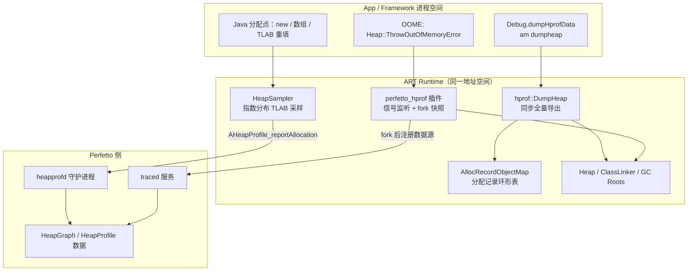
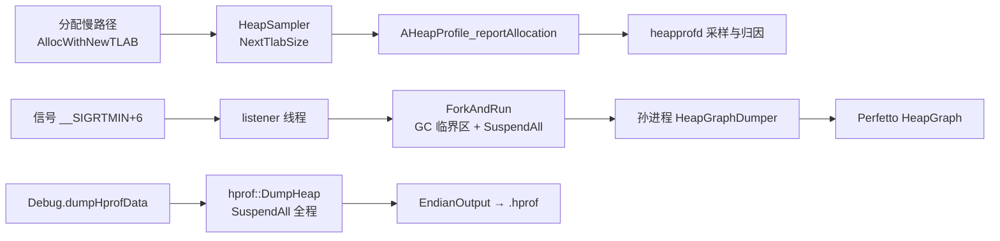
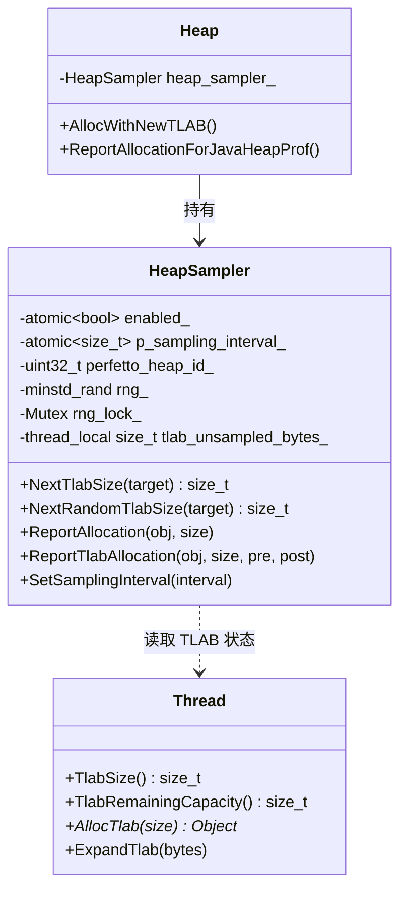
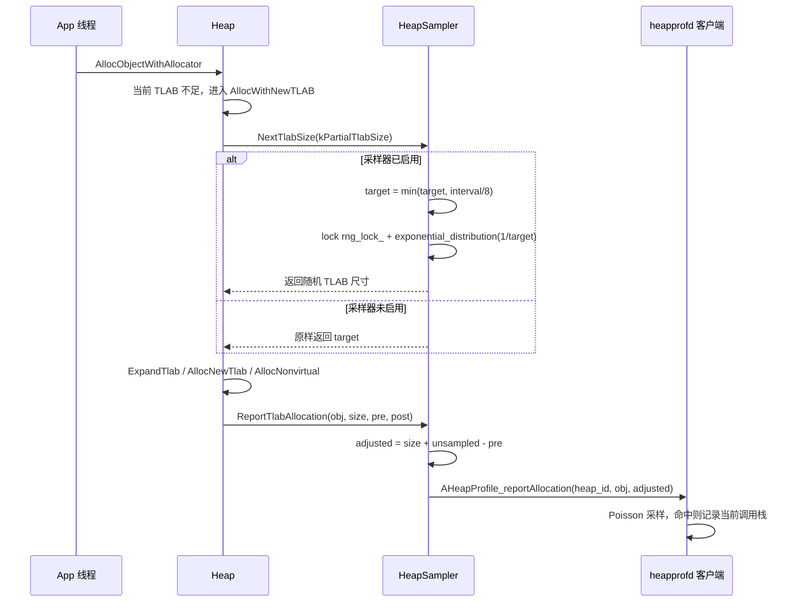
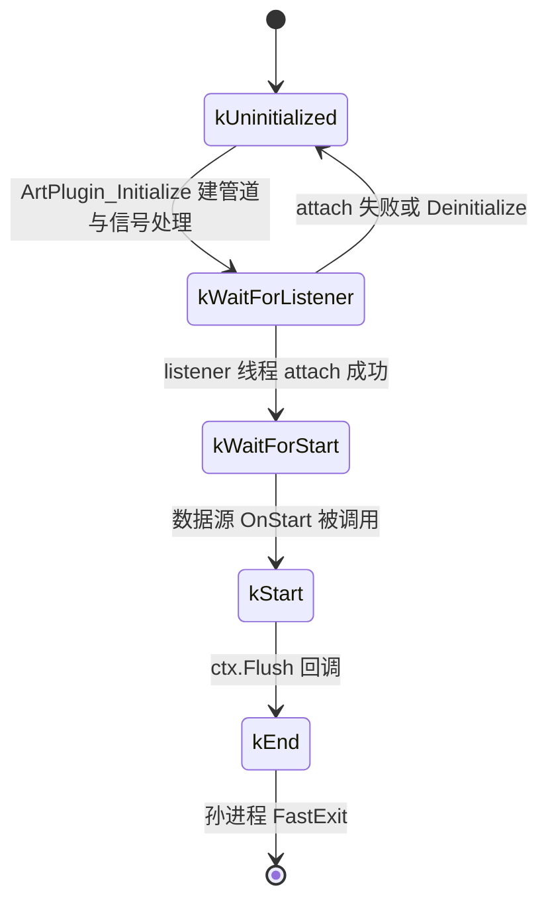
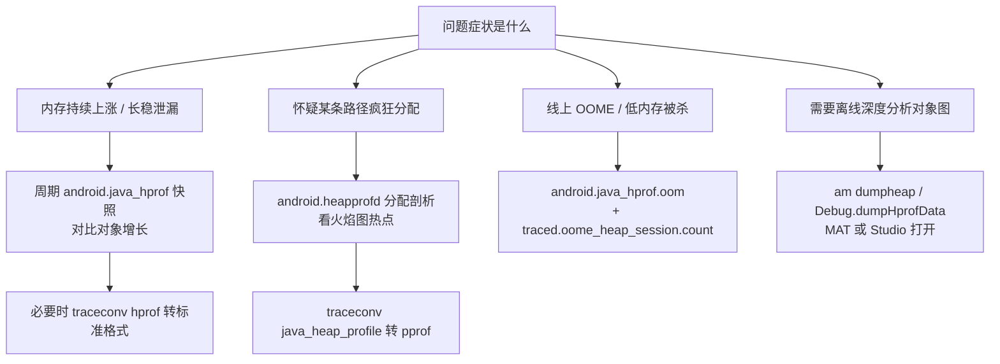

# ART Wiki 11 · Java 堆采样剖析与双 Fork 快照机制

> **本篇主题**：ART 如何在不冻结应用的前提下观测 Java 堆——一条链路用「泊松采样 + TLAB 尺寸收缩」把分配行为低开销地喂给 Perfetto `heapprofd`；另一条链路用「信号触发 + 双 fork + 写时复制」在毫秒级暂停内拿到完整堆图快照；同时保留传统同步 `hprof::DumpHeap` 作为离线深挖通道。
>
> **源码基线**：`/home/voyah/workspace/8397/qssi/art`（Android 15/16 主线级 QSSI 仓库）。本篇所有类名、函数签名、常量与行号均从该仓库逐行核对，未使用记忆补全。

## 元信息卡片

| 项目 | 内容 |
| :--- | :--- |
| 机制定位 | ART Runtime 堆观测层（分配采样剖析 + 堆图快照 + 同步 HPROF 导出） |
| 源码模块 | `runtime/javaheapprof/`、`perfetto_hprof/`、`runtime/gc/allocation_record.cc`、`runtime/hprof/` |
| 核心类/入口 | `HeapSampler`、`perfetto_hprof::JavaHprofDataSource`、`HeapGraphDumper`、`hprof::Hprof`、`gc::AllocRecordObjectMap` |
| 关键常量 | `kJavaHeapprofdSignal = __SIGRTMIN + 6`、`kWatchdogTimeoutSec = 120`、`kPacketSizeThreshold = 400000`、`kPartialTlabSize = 16 * KB`、默认采样间隔 `4 * 1024` 字节 |
| 关键开关 | `-XX:PerfettoHprof=true`（加载 fork 快照插件）、`-XX:PerfettoJavaHeapStackProf=true`（注册 `com.android.art` 堆并启用采样器）、`traced.oome_heap_session.count`（OOME 会话计数） |
| 一句话结论 | 采样侧用「指数分布随机化 TLAB 重填尺寸」把逐次分配的观测成本摊薄到近似零；快照侧用「先停世界再 fork，父进程立刻恢复、孙进程读 COW 副本」把全堆遍历移出关键路径；两者共用同一份 ART 堆结构体，但服务不同的排查场景。 |

> [!IMPORTANT]
> 本篇严格区分「ART 源码已实现」与「Perfetto 侧配套实现」。`__SIGRTMIN + 6` 的发送方在 `external/perfetto`，ART 只负责接收与导出；`smaps` 数据来自孙进程对 `/proc/self/smaps` 的读取，不是 ART 自己采集的内存统计。

## 术语表

| 术语 | 含义 | 本篇落点 |
| :--- | :--- | :--- |
| `heapprofd` | Perfetto 的原生/heap 分配剖析守护进程，通过共享内存接收客户端上报并按配置采样 | 采样链路的下游 |
| `com.android.art` | ART 向 Perfetto 注册的 Java 堆名，采样器上报时使用的 `heap_id` 即来自该注册 | `Heap::InitPerfettoJavaHeapProf` |
| `android.java_hprof` | Perfetto 数据源名，用于请求一次 Java 堆图快照 | 快照链路的下游 |
| `android.java_hprof.oom` | OOME 专用数据源，进程抛 OOME 时由 ART 主动激活 | OOME 抓取 |
| TLAB | Thread Local Allocation Buffer，线程私有的分配缓冲；ART 用「重填多大」来承载采样决策 | 采样核心 |
| 泊松采样 | 以「每字节等概率被选中」为目标的抽样模型；实现上用指数分布生成相邻样本间隔 | `NextRandomTlabSize` |
| HPROF | JVM 传统堆转储格式，本篇对应 `JAVA PROFILE 1.0.3` | 同步导出链路 |
| 写时复制（COW） | `fork()` 后父子共享物理页，任一方写入才复制；只读遍历不会放大内存 | 双 fork 快照的物理基础 |
| 看门狗 | 孙进程内的 120 秒定时器，超时以 `SIGKILL` 自杀，避免拖死父进程 | `ArmWatchdogOrDie` |

---

## 1. What：机制是什么？（概念界定与架构全景）

### 1.1 两条观测链路，一个堆

ART 的 Java 堆观测不是一个开关，而是三条并存、互补的链路：

| 链路 | 触发方式 | 观测对象 | 是否暂停应用 | 典型产物 |
| :--- | :--- | :--- | :--- | :--- |
| 采样分配剖析 | Perfetto `android.heapprofd` 会话启用 `com.android.art` 堆 | 分配字节流（谁在分配、分配多少） | 不暂停 | `profile.proto` / pprof 火焰图 |
| Fork 堆图快照 | Perfetto `android.java_hprof` 会话向目标进程发信号 | 存活对象图（谁引用了谁、谁在泄漏） | 仅 `fork()` 期间 | Perfetto `HeapGraph`，可转回 `.hprof` |
| 同步 HPROF 导出 | `Debug.dumpHprofData()` / `am dumpheap` | 完整堆转储文件 | 整个转储期间 | `JAVA PROFILE 1.0.3` 文件 |

这三条链路共享同一套堆结构：`mirror::Object`、`mirror::Class`、`ArtField`、GC Root 表、以及可选的分配记录表 `AllocRecordObjectMap`。差异只在「什么时候读、在哪个进程读、读出来写成什么格式」。

### 1.2 职责边界

ART 负责的部分：

1. 在每个分配慢路径上决定是否上报、上报多少字节（`HeapSampler`）；
2. 接收 `__SIGRTMIN + 6` 信号并转交给监听线程（`perfetto_hprof` 插件）；
3. 在一致状态下 fork，由子进程把堆遍历成 Perfetto proto（`HeapGraphDumper`）；
4. 维护分配记录表并在 GC 中正确保活/清扫（`AllocRecordObjectMap`）；
5. 提供传统同步 HPROF 写出（`hprof::Hprof`）。

ART 不负责的部分：

1. 信号发送、进程筛选、UID/可剖析性校验的**发起侧**策略（在 `external/perfetto`）；ART 侧只做二次校验；
2. trace 的落盘、缓冲与 UI 展示；
3. Java 分配点的符号化（由 Perfetto 的调用栈采集与后续符号化流程完成）。

### 1.3 架构全景



### 1.4 一个必须先建立的直觉

「采样」与「快照」解决的不是同一个问题：

- 采样回答「**谁在持续制造垃圾**」。它看到的是时间维度上的字节流，天然适合发现「某条路径每秒分配几十 MB」这类问题，但看不到对象之间的引用关系。
- 快照回答「**谁把对象拽住不放**」。它看到的是某一瞬间的对象图，天然适合发现「Activity 被静态集合持有」这类泄漏，但两次快照之间的分配行为是盲区。
- 同步 HPROF 是快照的「重版本」：格式通用、工具链成熟，但代价是把应用冻结到遍历结束。

因此生产排查的顺序通常是：先用采样定位可疑分配路径，再用周期快照对比对象增长，最后在必要时用同步 HPROF 做一次可交给 MAT/Studio 的深度分析。

---

## 2. Why：为什么需要它？（痛点模型与演进动机）

### 2.1 朴素全量转储的代价

同步 `hprof::DumpHeap` 的实现只有 12 行，但每一行都很重：

```cpp
void DumpHeap(const char* filename, int fd, bool direct_to_ddms) {
  Thread* self = Thread::Current();
  gc::ScopedGCCriticalSection gcs(self, gc::kGcCauseHprof, gc::kCollectorTypeHprof);
  ScopedSuspendAll ssa(__FUNCTION__, true /* long suspend */);
  Hprof hprof(filename, fd, direct_to_ddms);
  hprof.Dump();
}
```

见 [`hprof::DumpHeap`](file:///home/voyah/workspace/8397/qssi/art/runtime/hprof/hprof.cc#L1616-L1627)。`ScopedSuspendAll` 的 `long_suspend=true` 意味着**整个转储期间所有 Java 线程都被挂起**。`Hprof::Dump()` 还要做两遍堆遍历（先测量、再写出），见 [`Hprof::Dump`](file:///home/voyah/workspace/8397/qssi/art/runtime/hprof/hprof.cc#L439-L480)。对象越多、类越多、字符串越多，冻结时间越长。

在车机座舱这类「多屏 + 常驻 + 长时间运行」的场景里，这会直接带来三个问题：

1. **ANR/看门狗风险**：主线程被冻结数百毫秒到数秒，SurfaceFlinger 与输入分发都会感知到；
2. **观测失真**：冻结期间的时间线被拉长，原本的卡顿因果被掩盖；
3. **产物过大**：HPROF 用 4 字节 ID 表达每个对象与每个引用（[`WriteFixedHeader`](file:///home/voyah/workspace/8397/qssi/art/runtime/hprof/hprof.cc#L655-L677) 中明确 `sizeof(uint32_t)`，并注明 `hprof-conv` 硬编码 4 字节），文件体积与存活对象数成正比，传输和分析都昂贵。

### 2.2 只做「分配计数」也不够

`AllocRecordObjectMap` 能在每次分配时抓取调用栈，但它的成本模型完全不同：`RecordAllocation` 要**在分配路径上走栈**，还要拿 `alloc_tracker_lock_`，见 [`AllocRecordObjectMap::RecordAllocation`](file:///home/voyah/workspace/8397/qssi/art/runtime/gc/allocation_record.cc#L202-L264)。即使只保留最近 64K 条记录，走栈本身的开销也足以让高频分配的应用明显变慢。它适合「短时间、精确定位」，不适合「长时间、常开」。

所以需要一个**统计上无偏、单位成本极低**的替代品——这就是 `HeapSampler` 的动机。

### 2.3 Fork 快照要跨过的五道坎

「fork 一个子进程去遍历堆」听起来简单，源码里每一道注释都对应一个真实的坑：

| 坎 | 现象 | ART 的应对 | 源码依据 |
| :--- | :--- | :--- | :--- |
| GC 并发 | 遍历时 GC 移动对象，读到半成品 | fork 前进入 `ScopedGCCriticalSection`，禁止 GC 启动 | [`ForkAndRun`](file:///home/voyah/workspace/8397/qssi/art/perfetto_hprof/perfetto_hprof.cc#L1059-L1119) |
| 对象重复/漏读 | 多线程同时分配，`VisitObjects` 语义被破坏 | `ScopedSuspendAll` 挂起所有 mutator | 同上 |
| 子进程死锁 | 其它线程在 fork 瞬间持锁，子进程里没人解锁 | 先挂起全部线程；再持 `thread_list_lock_` 执行 `fork()` | [`ForkUnderThreadListLock`](file:///home/voyah/workspace/8397/qssi/art/perfetto_hprof/perfetto_hprof.cc#L1054-L1057) |
| logd 日志锁 | 子进程打日志会撞上父进程的日志互斥量 | 源码注释要求子进程避免 logd 日志 | [`ForkAndRun` 注释](file:///home/voyah/workspace/8397/qssi/art/perfetto_hprof/perfetto_hprof.cc#L1065-L1077) |
| 子进程挂死 | fork 后遇到 malloc 锁等非 fork 友好状态 | 孙进程 120 秒看门狗 `SIGKILL`；父进程 `BusyWaitpid` 兜底 | [`ArmWatchdogOrDie`](file:///home/voyah/workspace/8397/qssi/art/perfetto_hprof/perfetto_hprof.cc#L111-L131)、[`BusyWaitpid`](file:///home/voyah/workspace/8397/qssi/art/perfetto_hprof/perfetto_hprof.cc#L1023-L1047) |

另外还有一个容易忽略的点：子进程不能执行父进程注册的 `atexit` 清理函数，否则会重复释放父进程的资源。因此 `ForkAndRun` 在子进程逻辑结束后调用 `art::FastExit(0)`，该函数的设计目标就是「不完整清理资源地终止程序」。

### 2.4 三条路线对比矩阵

| 维度 | 同步 HPROF（`hprof.cc`） | 采样分配剖析（`HeapSampler`） | Fork 堆图快照（`perfetto_hprof`） |
| :--- | :--- | :--- | :--- |
| 应用暂停 | 整个转储期间（长暂停） | 无 | 仅 `fork()` 复制页表期间（毫秒级） |
| 开销来源 | 全堆遍历 + 写文件 | 每次 TLAB 重填一次随机数 + 一次上报 | 父进程几乎无感；成本转移到孙进程 |
| 观测内容 | 完整对象图 + 可选分配栈 | 分配字节流 + 调用栈 | 完整对象图 + 可选 `smaps` |
| 分配点归因 | 需先开启 `AllocRecordObjectMap` | 天然带调用栈归因 | 无分配点（只有对象图） |
| 产物格式 | `JAVA PROFILE 1.0.3` | Perfetto `HeapProfile` / pprof | Perfetto `HeapGraph`，可转 `.hprof` |
| 适合场景 | 一次性深度分析 | 长稳、常开、定位分配热点 | 周期快照、泄漏增长对比、OOME 现场 |
| 失败兜底 | 无 | 无 | 120 秒看门狗 + 父进程超时 `SIGKILL` |

---

## 3. How：源码级实现原理深度剖析

### 3.0 源码地图

| 层 | 文件 | 关键角色 |
| :--- | :--- | :--- |
| 采样决策 | `runtime/javaheapprof/javaheapsampler.cc/.h` | `HeapSampler` |
| 采样挂载点 | `runtime/gc/heap.cc`、`heap.h`、`heap-inl.h` | `AllocWithNewTLAB`、`ReportAllocationForJavaHeapProf` |
| 信号与快照 | `perfetto_hprof/perfetto_hprof.cc` | `ArtPlugin_Initialize`、`ForkAndRun`、`HeapGraphDumper` |
| 分配记录 | `runtime/gc/allocation_record.cc/.h` | `AllocRecordObjectMap`、`AllocRecord` |
| 同步导出 | `runtime/hprof/hprof.cc` | `Hprof`、`EndianOutput`、`DumpHeap` |



---

### 3.1 采样侧：`HeapSampler` 的数据结构与内存布局

`HeapSampler` 是 `Heap` 的成员（`heap.h` 中 `HeapSampler heap_sampler_;`），因此**每个进程一份**，被所有线程共享。它的字段极少，但每个字段都对应一个并发约束：

```text
HeapSampler（进程级单例，随 Heap 生命周期存在）
┌──────────────────────────────────────────────────────────────┐
│ enabled_ : atomic<bool>                 默认 false            │
│   release 写 / acquire 读；Perfetto 回调打开或关闭            │
├──────────────────────────────────────────────────────────────┤
│ p_sampling_interval_ : atomic<size_t>   默认 4 * 1024 字节    │
│   release 写 / acquire 读；由 heapprofd 启用回调设置          │
├──────────────────────────────────────────────────────────────┤
│ perfetto_heap_id_ : uint32_t            注册返回的堆 ID       │
├──────────────────────────────────────────────────────────────┤
│ rng_ : std::minstd_rand                 线性同余发生器        │
│ rng_lock_ : art::Mutex                  保护 rng_ 的互斥量    │
├──────────────────────────────────────────────────────────────┤
│ tlab_unsampled_bytes_ : thread_local size_t                   │
│   每个线程独立：当前 TLAB 中「尚未上报」的字节数              │
└──────────────────────────────────────────────────────────────┘
```

对应实现见 [`HeapSampler` 字段定义](file:///home/voyah/workspace/8397/qssi/art/runtime/javaheapprof/javaheapsampler.h#L84-L91) 与 [`thread_local` 定义](file:///home/voyah/workspace/8397/qssi/art/runtime/javaheapprof/javaheapsampler.cc#L82)。



### 3.2 为什么是「指数分布 + TLAB 收缩」

先看完整实现：

```cpp
size_t HeapSampler::NextRandomTlabSize(size_t target) {
  target = std::min(target, GetSamplingInterval() / 8);
  if (target == 0) {
    target = 1;
  }
  double rate = 1.0 / static_cast<double>(target);
  std::exponential_distribution<double> dist(rate);
  art::MutexLock mu(art::Thread::Current(), rng_lock_);
  int64_t next = static_cast<int64_t>(dist(rng_));
  return next + 1;
}
```

见 [`HeapSampler::NextRandomTlabSize`](file:///home/voyah/workspace/8397/qssi/art/runtime/javaheapprof/javaheapsampler.cc#L28-L47)。

三个设计点：

**（1）用 TLAB 重填尺寸承载采样决策。**
如果每次 `new` 都调用一次随机数并上报，成本不可接受。ART 把「是否采样」推迟到 TLAB 重填的慢路径：`NextTlabSize(target)` 在采样器关闭时直接返回 `target`，开启时才随机化，见 [`NextTlabSize`](file:///home/voyah/workspace/8397/qssi/art/runtime/javaheapprof/javaheapsampler.h#L58-L65)。这意味着**关闭时零开销**（只剩一个 acquire load），开启时也只在 TLAB 重填时付出一次锁 + 一次分布抽样。

**（2）指数分布保证「每字节等概率」。**
设 `target` 为期望的 TLAB 字节数，取 `rate = 1/target`，则 `exponential_distribution(rate)` 的均值为 `target`。返回 `next + 1` 是为了把「连续失败次数」的几何分布近似成「包含下一次成功」的区间长度——Perfetto 侧 `Sampler::NextSampleInterval()` 的注释给了同样的解释（`sampler.h` 中「add 1 because that gives us the number of failures before the next success」）。这样，一个 TLAB 的起始位置在字节流中近似均匀分布，任何一个字节落在某个 TLAB 起始点附近的概率相同，统计上不会系统性偏向大对象或小对象。

**（3）`interval / 8` 的上限是「二阶采样」的接口约束。**
源码注释写得很清楚：这个 1/8 因子是为了「avoid interfering with Perfetto's subsequent sampling of the allocations when we call `AHeapProfile_reportAllocation`」。也就是说，ART 的 TLAB 随机化只是**第一层**，真正的统计采样在 Perfetto 的 `AHeapProfile_reportAllocation` 里：

- ART 决定「一次上报多少字节、从哪个分配点开始上报」；
- Perfetto 的 `Sampler::SampleSize()` 决定「这堆字节里有几个样本」，并按 `sampling_interval * 样本数` 记账，见 Perfetto 侧 [`Sampler::SampleSize`](file:///home/voyah/workspace/8397/qssi/external/perfetto/src/profiling/memory/sampler.h#L56-L60)。

把 ART 的 TLAB 尺寸压到 `interval/8` 以下，等于把「上报粒度」压到采样间隔的 1/8，避免一个巨大 TLAB 被整体归因到某一个分配点而造成严重偏差。

### 3.3 字节守恒：`ReportTlabAllocation` 的账本

TLAB 切换时，上一块 TLAB 里还有没上报的字节。`ReportTlabAllocation` 用一个 `thread_local` 账本把它们补上：

```cpp
void HeapSampler::ReportTlabAllocation(art::mirror::Object* obj,
                                       size_t allocation_size,
                                       size_t pre_tlab_size,
                                       size_t post_tlab_size) {
  if (pre_tlab_size > tlab_unsampled_bytes_) {
    pre_tlab_size = 0;
    tlab_unsampled_bytes_ = 0;
  }
  size_t adjusted_size = allocation_size + tlab_unsampled_bytes_ - pre_tlab_size;
  tlab_unsampled_bytes_ = post_tlab_size;
  ReportAllocation(obj, adjusted_size);
}
```

见 [`HeapSampler::ReportTlabAllocation`](file:///home/voyah/workspace/8397/qssi/art/runtime/javaheapprof/javaheapsampler.cc#L57-L72)。

用一张账本图理解：

```text
时刻 T0：上一次 TLAB 重填后
  tlab_unsampled_bytes_ = 旧 TLAB 容量 C0
  ┌────────────────────────────────────────────┐
  │ 旧 TLAB（容量 C0），其中已分配 A0 字节      │
  │ 未上报字节 = C0 - pre_tlab_size             │
  └────────────────────────────────────────────┘

时刻 T1：本次分配触发重填
  pre_tlab_size  = self->TlabSize()      // 旧 TLAB 剩余 C0 - A0
  上报字节 = allocation_size + (C0 - pre_tlab_size)
           = 本次对象大小 + 旧 TLAB 已消耗但未上报的字节
  tlab_unsampled_bytes_ = post_tlab_size // 新 TLAB 容量 C1

结果：每个字节恰好被上报一次；跨 TLAB 不重不漏。
```

源码还处理了一个边界：如果采样器在两次重填之间被关闭又打开，`tlab_unsampled_bytes_` 可能已经过期（大于当前剩余量），此时直接清零重来，宁可少报也不重复报。这正是 `pre_tlab_size > tlab_unsampled_bytes_` 分支的含义。

### 3.4 挂载点：三条分配路径

`Heap::AllocWithNewTLAB` 是唯一的重填入口，它有三条分支，每条都调用 `NextTlabSize`：

```cpp
size_t pre_tlab_size = self->TlabSize();

if (kUsePartialTlabs && alloc_size <= self->TlabRemainingCapacity()) {
  const size_t min_expand_size = alloc_size - self->TlabSize();
  size_t next_tlab_size = heap_sampler_.NextTlabSize(kPartialTlabSize);
  const size_t expand_bytes = std::max(
      min_expand_size,
      std::min(self->TlabRemainingCapacity() - self->TlabSize(), next_tlab_size));
  ...
  self->ExpandTlab(expand_bytes);
} else if (allocator_type == kAllocatorTypeTLAB) {
  size_t next_tlab_size = heap_sampler_.NextTlabSize(
      RoundDown(alloc_size + kDefaultTLABSize, gPageSize) - alloc_size);
  ...
  bump_pointer_space_->AllocNewTlab(self, alloc_size + next_tlab_size, bytes_tl_bulk_allocated);
} else {
  size_t next_pr_tlab_size = heap_sampler_.NextTlabSize(
      kUsePartialTlabs ? kPartialTlabSize : space::RegionSpace::kRegionSize);
  ...
}
```

见 [`Heap::AllocWithNewTLAB`](file:///home/voyah/workspace/8397/qssi/art/runtime/gc/heap.cc#L4719-L4825)。

关键常量 `kPartialTlabSize = 16 * KB`、`kUsePartialTlabs = true` 见 [`heap.h`](file:///home/voyah/workspace/8397/qssi/art/runtime/gc/heap.h#L138-L139)。注意：**采样器开启时 `NextTlabSize` 会把 16KB 的期望值再钳制到 `interval/8`**（默认 4KB 间隔 → 512 字节），所以 TLAB 会明显变小。这是有意的：用更频繁的小 TLAB 换取更细的归因粒度。

三条路径最终都会落到统一的收尾：

```cpp
ret = self->AllocTlab(alloc_size);
...
if (heap_sampler_.IsEnabled()) {
  size_t post_tlab_size = self->TlabSize();
  heap_sampler_.ReportTlabAllocation(ret, alloc_size, pre_tlab_size, post_tlab_size);
}
```

非 TLAB 路径（大对象、TLAB 分配失败回退到 `AllocNonvirtual`）则逐次上报；此外 `Heap::RegisterNativeAllocation` 会把「无法被 GC 感知的原生内存」也当作一次 Java 分配上报，对象指针传 `nullptr`，见 [`heap.cc`](file:///home/voyah/workspace/8397/qssi/art/runtime/gc/heap.cc#L4480-L4488)。这解释了为什么 `com.android.art` 堆的统计里会混入一部分 native 分配。

### 3.5 一次分配的端到端时序



### 3.6 启用与关闭：Perfetto 回调驱动

采样器不是由 ART 自己打开的，而是由 Perfetto 在会话建立/结束时回调：

```cpp
void EnableHeapSamplerCallback(void* enable_ptr, const AHeapProfileEnableCallbackInfo* info) {
  HeapSampler* sampler_self = reinterpret_cast<HeapSampler*>(enable_ptr);
  uint64_t interval = AHeapProfileEnableCallbackInfo_getSamplingInterval(info);
  if (interval > 0) {
    sampler_self->SetSamplingInterval(interval);
  }
  sampler_self->EnableHeapSampler();
}
```

见 [`EnableHeapSamplerCallback`](file:///home/voyah/workspace/8397/qssi/art/runtime/gc/heap.cc#L119-L143)。注册发生在 `Heap::InitPerfettoJavaHeapProf`：

```cpp
AHeapInfo* info = AHeapInfo_create("com.android.art");
AHeapInfo_setEnabledCallback(info, &EnableHeapSamplerCallback, &heap_sampler_);
AHeapInfo_setDisabledCallback(info, &DisableHeapSamplerCallback, &heap_sampler_);
heap_id = AHeapProfile_registerHeap(info);
```

见 [`Heap::InitPerfettoJavaHeapProf`](file:///home/voyah/workspace/8397/qssi/art/runtime/gc/heap.cc#L4614-L4638)。注意：**Perfetto 配置里的 `sampling_interval_bytes` 就是通过这个回调进入 ART 的 `p_sampling_interval_`**，所以调大采样间隔会同时让 ART 的 TLAB 变大、Perfetto 的采样变稀，两层开销一起下降。

而是否执行这套注册，取决于运行时选项 `PerfettoJavaHeapStackProf`：

```cpp
if (runtime->IsPerfettoJavaHeapStackProfEnabled()) {
  InitPerfettoJavaHeapProf();
} else {
  heap_sampler_.DisableHeapSampler();
}
```

见 [`heap.cc` 初始化分支](file:///home/voyah/workspace/8397/qssi/art/runtime/gc/heap.cc#L808-L815)。选项定义在 [`runtime_options.def`](file:///home/voyah/workspace/8397/qssi/art/runtime/runtime_options.def#L194-L204)，默认 `false`；`PerfettoHprof` 与 `PerfettoJavaHeapStackProf` 是两个独立开关，前者管 fork 快照插件，后者管分配采样器。

> [!NOTE]
> 在本仓库中，`IsPerfettoJavaHeapStackProfEnabled()` 在 `runtime.cc` 里只额外打了一条名为 `perfetto_javaheapprof init.` 的 trace marker（见 [`runtime.cc`](file:///home/voyah/workspace/8397/qssi/art/runtime/runtime.cc#L1319-L1323)），真正让采样器工作的是 `heap.cc` 里的 `InitPerfettoJavaHeapProf()`。不要因为选项名字里有「JavaHeapStack」就以为它负责 Java 调用栈采集。

### 3.7 快照侧总览：一次信号触发的完整生命周期

常量先行：

| 常量 | 值 | 含义 |
| :--- | :--- | :--- |
| `kJavaHeapprofdSignal` | `__SIGRTMIN + 6` | ART 与 Perfetto 约定的快照信号 |
| `kWatchdogTimeoutSec` | `120` | 孙进程看门狗超时（秒） |
| `kPacketSizeThreshold` | `400000` | 单个 TracePacket 的字节阈值（DropBox 分块上限 500K） |
| `kByte[1]` | `{'x'}` | 信号处理器写入管道的 1 字节通知 |

见 [`perfetto_hprof.cc` 常量区](file:///home/voyah/workspace/8397/qssi/art/perfetto_hprof/perfetto_hprof.cc#L74-L81)。

源码开头用三行注释定义了线程模型：**listener 线程**（常驻阻塞在管道读端）、**signal 线程**（任意收到信号的线程，只负责写管道）、**perfetto producer 线程**（fork 后由 Perfetto Client API 在孙进程中创建，与 `traced` 通信）。见 [`perfetto_hprof.cc` 头注释](file:///home/voyah/workspace/8397/qssi/art/perfetto_hprof/perfetto_hprof.cc#L64-L70)。

#### 3.7.1 进程树与内存关系

```text
原始应用进程 P（App）
  ├─ listener 线程 "perfetto_hprof_listener"：read(pipe) 阻塞
  ├─ signal 线程：收到 __SIGRTMIN+6 → 写 1 字节到 pipe
  │
  └─ fork() ──► 子进程 C（继承 P 的地址空间副本）
                 │   restore 原信号处理器
                 │   daemon(0, 0) ──► 孙进程 G
                 │   中间子进程 C 退出（父进程只等它）
                 │
                 └─ 孙进程 G（源码注释称为 grand-child）
                      ├─ ArmWatchdogOrDie()：120s 后 SIGKILL 自己
                      ├─ SetupDataSource("android.java_hprof")
                      ├─ WaitForDataSource()
                      ├─ HeapGraphDumper 遍历 COW 副本
                      └─ FastExit(0)

物理内存：
  P 的堆页 ── fork 后与 C 共享（只读）
           └─ G 只读遍历，不触发大量 COW
           └─ G 自己的 proto 缓冲/临时分配只复制少量页
```

#### 3.7.2 状态机



状态枚举定义见 [`perfetto_hprof.h`](file:///home/voyah/workspace/8397/qssi/art/perfetto_hprof/perfetto_hprof.h#L23-L38)。注意状态机在 fork 后是**跨进程继承**的：孙进程看到的是 `kWaitForStart`，随后由 Perfetto 的数据源回调推进到 `kStart`。

#### 3.7.3 插件初始化与信号注册

```cpp
extern "C" bool ArtPlugin_Initialize() {
  ...
  g_state = State::kWaitForListener;
  if (pipe2(g_signal_pipe_fds, O_CLOEXEC) == -1) { ... }
  struct sigaction act = {};
  act.sa_flags = SA_SIGINFO | SA_RESTART;
  act.sa_sigaction = [](int, siginfo_t* si, void*) {
    requested_tracing_session_id = si->si_value.sival_int;
    if (write(g_signal_pipe_fds[1], kByte, sizeof(kByte)) == -1) { ... }
  };
  sigaction(kJavaHeapprofdSignal, &act, &g_orig_act);
  std::thread th([] { ... AttachCurrentThread("perfetto_hprof_listener", true, ...) ... });
  th.detach();
  Runtime::Current()->SetOutOfMemoryErrorHook(perfetto_hprof::DumpPerfettoOutOfMemory);
  return true;
}
```

见 [`ArtPlugin_Initialize`](file:///home/voyah/workspace/8397/qssi/art/perfetto_hprof/perfetto_hprof.cc#L1271-L1361)。

这里有三个值得记住的细节：

1. **信号处理器只做两件事**：记录 `si_value.sival_int`（即 Perfetto 的 tracing session id）和写 1 字节。真正的堆遍历在 listener 线程里做，避免在信号上下文里做复杂工作。
2. **`requested_tracing_session_id` 是会话匹配的钥匙**。`OnSetup` 会把它与 `args.config->tracing_session_id() % INT32_MAX` 比较，不匹配就静默返回。这意味着**手工 `kill -RTMIN+6` 不会触发转储**——`kill` 不会携带匹配的 `sival_int`，数据源不会被启用。
3. **OOME 钩子在同一处注册**，把 `DumpPerfettoOutOfMemory` 挂到 `Runtime::OutOfMemoryErrorHook()` 上，见 [`runtime.h`](file:///home/voyah/workspace/8397/qssi/art/runtime/runtime.h#L1141-L1148) 与 [`Heap::ThrowOutOfMemoryError`](file:///home/voyah/workspace/8397/qssi/art/runtime/gc/heap.cc#L1522-L1535)。

插件何时被加载？在 `Runtime` 启动阶段：

```cpp
if (IsPerfettoHprofEnabled() &&
    (Dbg::IsJdwpAllowed() || IsProfileable() || IsProfileableFromShell() ||
     IsJavaDebuggable() || Runtime::Current()->IsSystemServer())) {
  ...
  EnsurePerfettoPlugin(&err);
}
```

见 [`runtime.cc`](file:///home/voyah/workspace/8397/qssi/art/runtime/runtime.cc#L1309-L1318)。库名在 debug 构建是 `libperfetto_hprofd.so`，release 是 `libperfetto_hprof.so`，见 [`EnsurePerfettoPlugin`](file:///home/voyah/workspace/8397/qssi/art/runtime/runtime.cc#L2301-L2306)；zygote 还会提前 `dlopen` 一次以降低后续应用启动开销，见 [`runtime.cc`](file:///home/voyah/workspace/8397/qssi/art/runtime/runtime.cc#L2248-L2253)。

#### 3.7.4 `ForkAndRun`：把「一致性」压缩到 fork 之前

```cpp
void ForkAndRun(art::Thread* self,
                ResumeParentPolicy resume_parent_policy,
                const std::function<void(pid_t child)>& parent_runnable,
                const std::function<void(pid_t parent, uint64_t timestamp)>& child_runnable) {
  pid_t parent_pid = getpid();
  std::optional<art::gc::ScopedGCCriticalSection> gcs(
      std::in_place, self, art::gc::kGcCauseHprof, art::gc::kCollectorTypeHprof);
  std::optional<art::ScopedSuspendAll> ssa(
      std::in_place, __FUNCTION__, /* long_suspend=*/ true);
  pid_t pid = ForkUnderThreadListLock(self);
  if (pid == -1) { ... return; }
  if (pid != 0) {
    if (resume_parent_policy == ResumeParentPolicy::IMMEDIATELY) {
      ssa.reset();
      gcs.reset();
    }
    parent_runnable(pid);
    if (resume_parent_policy != ResumeParentPolicy::IMMEDIATELY) {
      ssa.reset();
      gcs.reset();
    }
    return;
  }
  // 子进程
  if (sigaction(kJavaHeapprofdSignal, &g_orig_act, nullptr) != 0) { ... }
  uint64_t ts = GetCurrentBootClockNs();
  child_runnable(parent_pid, ts);
  art::FastExit(0);
}
```

见 [`ForkAndRun`](file:///home/voyah/workspace/8397/qssi/art/perfetto_hprof/perfetto_hprof.cc#L1059-L1119)。

顺序至关重要，且不可交换：

1. `ScopedGCCriticalSection` 先进入，保证从此刻到 fork 完成 GC 不会启动；它通过 `Roles::uninterruptible_` 阻止线程被挂起在 GC 关键区内。
2. `ScopedSuspendAll` 再挂起所有 mutator，保证堆处于静止、可安全遍历的状态，见 [`ScopedSuspendAll`](file:///home/voyah/workspace/8397/qssi/art/runtime/thread_list.cc#L1740-L1746)。
3. `ForkUnderThreadListLock` 在持有 `thread_list_lock_` 的情况下 `fork()`。注释解释了原因：如果 fork 时别的线程正持有该锁，子进程里没人能解锁，会永久死锁。
4. 父进程按策略恢复：常规快照 `IMMEDIATELY`，fork 一返回就 `ssa.reset()` + `gcs.reset()`，把暂停窗口压到最短；OOME 快照 `DEFERRED`，要等 `parent_runnable` 返回后才恢复（见 3.8）。
5. 子进程先恢复原信号处理器，避免后续误触发；然后记录 boot clock 时间戳（父进程和子进程用同一时间基准，便于对齐），执行 `child_runnable`，最后 `FastExit(0)` 跳过 `atexit`。

#### 3.7.5 常规快照：`DumpPerfetto`

```cpp
void DumpPerfetto(art::Thread* self) {
  ForkAndRun(
    self,
    ResumeParentPolicy::IMMEDIATELY,
    [](pid_t child) {
      BusyWaitpid(child, 1000);
    },
    [self](pid_t dumped_pid, uint64_t timestamp) {
      if (daemon(0, 0) == -1) { PLOG(FATAL) << "daemon"; }
      ArmWatchdogOrDie();
      SetupDataSource("android.java_hprof", /* oome_sessions_pending= */ 0);
      WaitForDataSource(self);
      WriteHeapPackets(dumped_pid, timestamp);
    });
}
```

见 [`DumpPerfetto`](file:///home/voyah/workspace/8397/qssi/art/perfetto_hprof/perfetto_hprof.cc#L1171-L1200)。

拆解：

- **父进程只等 1 秒**。`BusyWaitpid(child, 1000)` 等的是中间子进程 C，而不是孙进程 G。C 的唯一工作是 `daemon()` 并退出，所以通常瞬间完成。真正的遍历在 G 里异步进行，父进程应用早已恢复运行。
- **`daemon(0, 0)` 产生孙进程**。源码注释明确说这会让 G 成为原进程的 grand-child，C 随即退出。父进程只等 C，因此等待时间与真正的堆遍历规模无关。
- **看门狗在数据源注册之前就武装**。`ArmWatchdogOrDie()` 里的注释说得很直白：「Make sure that this is the first thing we do after forking, so if anything below hangs, the fork will go away from the watchdog.」即使 `SetupDataSource` 或 `WaitForDataSource` 永久阻塞，120 秒后 `SIGKILL` 也会带走 G。

#### 3.7.6 看门狗与 `BusyWaitpid`

```cpp
void ArmWatchdogOrDie() {
  timer_t timerid{};
  struct sigevent sev {};
  sev.sigev_notify = SIGEV_SIGNAL;
  sev.sigev_signo = SIGKILL;
  timer_create(CLOCK_MONOTONIC, &sev, &timerid);
  struct itimerspec its {};
  its.it_value.tv_sec = kWatchdogTimeoutSec;
  timer_settime(timerid, 0, &its, nullptr);
}
```

见 [`ArmWatchdogOrDie`](file:///home/voyah/workspace/8397/qssi/art/perfetto_hprof/perfetto_hprof.cc#L111-L131)。注意是**一次性定时器**（只设 `it_value`，不设 `it_interval`），且信号是 `SIGKILL`——不可捕获、不可忽略，适合做「无论如何都要死」的兜底。源码注释强调这里可以 `FATAL`，因为它只在 fork 出的子进程里执行，不会影响应用。

`BusyWaitpid` 则是父进程侧的兜底：

```cpp
void BusyWaitpid(pid_t pid, uint32_t timeout_ms) {
  for (size_t i = 0;; ++i) {
    if (i == timeout_ms) {
      LOG(ERROR) << "perfetto_hprof child timed out. Sending SIGKILL.";
      kill(pid, SIGKILL);
    }
    int stat_loc;
    pid_t wait_result = waitpid(pid, &stat_loc, WNOHANG);
    ...
    usleep(1000);
  }
}
```

见 [`BusyWaitpid`](file:///home/voyah/workspace/8397/qssi/art/perfetto_hprof/perfetto_hprof.cc#L1023-L1047)。它以 1ms 为粒度轮询 `waitpid(WNOHANG)`，超时后先 `SIGKILL` 再继续等回收。注释引用 b/181031512 说明为何采用忙等而非阻塞等待；对 `ECHILD` 的处理也很务实——如果父进程里有别的 `SIGCHLD` 处理器或通配 `wait` 已经把子进程收走，直接当作成功返回。

#### 3.7.7 数据源注册与配置解析

孙进程的第一步是连接到 `traced`：

```cpp
void SetupDataSource(const std::string& ds_name, uint32_t oome_sessions_pending) {
  perfetto::TracingInitArgs args;
  args.backends = perfetto::BackendType::kSystemBackend;
  perfetto::Tracing::Initialize(args);
  perfetto::DataSourceDescriptor dsd;
  dsd.set_name(ds_name);
  dsd.set_will_notify_on_stop(true);
  JavaHprofDataSource::Register(dsd, oome_sessions_pending);
}
```

见 [`SetupDataSource`](file:///home/voyah/workspace/8397/qssi/art/perfetto_hprof/perfetto_hprof.cc#L312-L321)。`will_notify_on_stop(true)` 与后面的 `OnStop` 异步停止处理配套。

`OnSetup` 负责把 Perfetto 配置翻译成 ART 侧的开关：

```cpp
void OnSetup(const SetupArgs& args) override {
  if (!IsOome()) {
    uint64_t normalized_tracing_session_id =
      args.config->tracing_session_id() % std::numeric_limits<int32_t>::max();
    if (static_cast<uint64_t>(requested_tracing_session_id) != normalized_tracing_session_id) {
      return;
    }
  }
  std::unique_ptr<...JavaHprofConfig::Decoder> cfg(
      new ...JavaHprofConfig::Decoder(args.config->java_hprof_config_raw()));
  dump_smaps_ = cfg->dump_smaps();
  for (auto it = cfg->ignored_types(); it; ++it) {
    std::string name = (*it).ToStdString();
    ignored_types_.emplace_back(art::InversePrettyDescriptor(name));
  }
  enabled_ = !IsOome() || (IsOomeHeapDumpAllowed(*args.config) && IsOomeDumpEnabled(*cfg.get()));
}
```

见 [`JavaHprofDataSource::OnSetup`](file:///home/voyah/workspace/8397/qssi/art/perfetto_hprof/perfetto_hprof.cc#L186-L220)。

配置项与 ART 行为的映射：

| Perfetto `JavaHprofConfig` 字段 | ART 行为 |
| :--- | :--- |
| `process_cmdline` | 仅在 OOME 路径用于 `fnmatch` 匹配 `/proc/self/cmdline` 的 argv0，见 [`IsOomeDumpEnabled`](file:///home/voyah/workspace/8397/qssi/art/perfetto_hprof/perfetto_hprof.cc#L285-L299) |
| `dump_smaps` | 置位 `dump_smaps_`，转储时附带 `/proc/self/smaps` 采样 |
| `ignored_types` | 经 `InversePrettyDescriptor` 转成描述符，匹配到的对象不写入堆图 |
| `continuous_dump_config.dump_interval_ms` | 由 Perfetto 侧定时重复发信号，ART 每次当作一次独立快照 |
| `min_anonymous_memory_kb` | 由 Perfetto 侧筛选目标进程，ART 不感知 |

字段定义见 Perfetto 侧 [`java_hprof_config.proto`](file:///home/voyah/workspace/8397/qssi/external/perfetto/protos/perfetto/config/profiling/java_hprof_config.proto#L22-L89)。

安全边界在 `IsOomeHeapDumpAllowed`：非 debuggable、非 debug build 的进程，只有在「trusted system initiator + profileable/system_server」或「shell 可 profile」时才允许 OOME 抓取，见 [`IsOomeHeapDumpAllowed`](file:///home/voyah/workspace/8397/qssi/art/perfetto_hprof/perfetto_hprof.cc#L173-L184)。常规 `android.java_hprof` 路径则是 `enabled_ = true`，因为 heapprofd 在发信号前已经做过 UID 与可剖析性校验。

#### 3.7.8 `WriteHeapPackets`：把堆写进 trace

```cpp
void WriteHeapPackets(pid_t parent_pid, uint64_t timestamp) {
  JavaHprofDataSource::Trace(
      [parent_pid, timestamp](JavaHprofDataSource::TraceContext ctx) {
        ...
        art::ScopedTrace trace("ART heap dump for " + std::to_string(parent_pid));
        if (dump_smaps) {
          DumpSmaps(&ctx);
        }
        Writer writer(parent_pid, &ctx, timestamp);
        HeapGraphDumper dumper(ignored_types);
        dumper.Dump(art::Runtime::Current(), writer);
        writer.Finalize();
        ctx.Flush([...] { g_state = State::kEnd; ... });
        ...
        ds->Finish();
      });
}
```

见 [`WriteHeapPackets`](file:///home/voyah/workspace/8397/qssi/art/perfetto_hprof/perfetto_hprof.cc#L1121-L1169)。

几个关键点：

- **`pid` 记的是父进程 pid**（`parent_pid`），不是孙进程自己的 pid。这样 Perfetto UI 会把堆图归属到应用进程。
- **`ScopedTrace` 包住整个转储**，在 trace 里留下一个便于定位的长 slice。
- **`ctx.Flush()` 的回调把状态推到 `kEnd`**，然后当前线程等待 `kEnd`，确保数据真正落到共享内存后才调用 `ds->Finish()`。
- `OnStop` 支持异步：如果 trace 的 `duration_ms` 很短但 `datasource_stop_timeout_ms` 很长，`OnStop` 可能在转储完成前到达，此时用 `HandleStopAsynchronously()` 延迟确认，见 [`OnStop`](file:///home/voyah/workspace/8397/qssi/art/perfetto_hprof/perfetto_hprof.cc#L252-L259) 与 [`Finish`](file:///home/voyah/workspace/8397/qssi/art/perfetto_hprof/perfetto_hprof.cc#L273-L280)。

#### 3.7.9 `Writer`：为什么是 400000 字节

```cpp
bool will_create_new_packet() const {
  return !heap_graph_ || ctx_->written() - last_written_ > kPacketSizeThreshold;
}
```

见 [`Writer`](file:///home/voyah/workspace/8397/qssi/art/perfetto_hprof/perfetto_hprof.cc#L348-L409)。注释解释了 400000 的来历：DropBox 的单个 chunk 上限是 500K，且每个 chunk 必须能独立解析成 proto；保守假设单个 submessage 最大 100K，所以阈值取 400000。超阈值时：

1. 当前 `HeapGraph` 置 `continued = true`；
2. `Finalize()` 结束当前 packet；
3. 新建 `TracePacket`，设置同一个 `timestamp`、新的 `index`，`pid` 不变。

这样同一次快照会被切成多个 `HeapGraph` 分片，trace 读取方按 `pid + index` 重组。

#### 3.7.10 `HeapGraphDumper`：对象图是怎么写出来的

主体只有三步：

```cpp
void Dump(art::Runtime* runtime, Writer& writer) {
  DumpRootObjects(runtime, writer);
  DumpObjects(runtime, writer);
  WriteInternedData(writer);
}
```

见 [`HeapGraphDumper::Dump`](file:///home/voyah/workspace/8397/qssi/art/perfetto_hprof/perfetto_hprof.cc#L651-L666)。

**（1）根集合。** `RootFinder` 实现 `SingleRootVisitor`，把 `runtime->VisitRoots()` 回调来的根按 `RootType` 分桶：

```cpp
void VisitRoot(art::mirror::Object* root, const art::RootInfo& info) override {
  (*root_objects_)[info.GetType()].emplace_back(root);
}
```

见 [`RootFinder`](file:///home/voyah/workspace/8397/qssi/art/perfetto_hprof/perfetto_hprof.cc#L453-L467)。随后每个根类型写一个 `HeapGraphRoot`，根对象 ID 用 `PackedVarInt` 打包；如果写入过程中跨过 packet 阈值，就先把当前 `HeapGraphRoot` 收尾、再开一个新的同类型 root 记录，见 [`DumpRootObjects`](file:///home/voyah/workspace/8397/qssi/art/perfetto_hprof/perfetto_hprof.cc#L670-L693)。

**（2）对象遍历。** `DumpObjects` 调用 `runtime->GetHeap()->VisitObjectsPaused(...)`，见 [`DumpObjects`](file:///home/voyah/workspace/8397/qssi/art/perfetto_hprof/perfetto_hprof.cc#L696-L700)。`VisitObjectsPaused` 要求 mutator lock 处于独占状态（`AssertExclusiveHeld`），这正是 `ForkAndRun` 里 `ScopedSuspendAll` 的语义；在 fork 后的孙进程里，除当前线程外的所有线程都不存在了，因此这个前提天然成立，见 [`VisitObjectsPaused`](file:///home/voyah/workspace/8397/qssi/art/runtime/gc/heap-visit-objects-inl.h#L72-L77)。

**（3）单个对象。** `WriteOneObject` 的流程是：

```text
obj
 ├─ 若 obj->IsClass()            → WriteClass()，同时按实例写出
 ├─ 若 obj 是 java.lang.Class    → 合成一个 Class<Foo> 类型（指针 | 1）
 ├─ 若类型在 ignored_types 中    → 直接跳过
 ├─ 分配/查找 interned class_id
 ├─ 写 object_id（与上一个对象的差值，id_delta）
 ├─ 若 SizeOf() != class->GetObjectSize() → 写 self_size（数组/字符串）
 ├─ 判定 heap_type：APP / ZYGOTE / BOOT_IMAGE（与上一个对象不同时写 heap_type_delta）
 ├─ FillReferences()            → reference_field_id / reference_object_id
 ├─ FillRuntimeInternalObjects()→ DexCache/ClassLoader 的 native 根
 └─ FillFieldValues()           → NativeAllocationRegistry.size
```

见 [`WriteOneObject`](file:///home/voyah/workspace/8397/qssi/art/perfetto_hprof/perfetto_hprof.cc#L726-L787)。

**对象 ID 压缩。** `GetObjectId` 把对象地址除以编译期对齐粒度，见 [`GetObjectId`](file:///home/voyah/workspace/8397/qssi/art/perfetto_hprof/perfetto_hprof.cc#L569-L571)。`EncodeBaseObjId` 进一步尝试「差值编码」：以本次引用集合中最小非空对象 ID 为基准，只有节省的字节数大于存储基准本身的开销时才启用：

```cpp
if (bytes_saved <= EncodedSize(base_obj_id) + 1) {
  return 0;
}
return base_obj_id;
```

见 [`EncodeBaseObjId`](file:///home/voyah/workspace/8397/qssi/art/perfetto_hprof/perfetto_hprof.cc#L620-L647)。基准 ID 会先减 1，这样 0 仍然可以表示 null 引用。proto 字段名是 `reference_field_id_base`，但注释明确承认它「一直用作 `reference_object_id` 的基准」，见 [`FillReferences`](file:///home/voyah/workspace/8397/qssi/art/perfetto_hprof/perfetto_hprof.cc#L829-L870)。

**（4）运行时内部对象。** 只对 `DexCache` 和直接继承 `Object` 的 `ClassLoader` 生效，见 [`ShouldDumpRuntimeInternalObjects`](file:///home/voyah/workspace/8397/qssi/art/perfetto_hprof/perfetto_hprof.cc#L872-L884)。原因很直接：这些对象的 native 表（如 dex cache 数组、class loader 的表）持有 Java 对象，但不出现在普通字段里，不补上就会在堆图中表现为「无主对象」。

**（5）字段值。** 只填一个特殊字段：`Llibcore/util/NativeAllocationRegistry;` 的 `size`，见 [`FillFieldValues`](file:///home/voyah/workspace/8397/qssi/art/perfetto_hprof/perfetto_hprof.cc#L963-L984)。这让 Perfetto UI 能把 native 分配的大小算到注册器对象上。

#### 3.7.11 `smaps`：为什么只采三类映射

```cpp
bool ShouldSampleSmapsEntry(const perfetto::profiling::SmapsEntry& e) {
  if (e.pathname.starts_with("/system/") ||
      e.pathname.starts_with("/vendor/") ||
      e.pathname.starts_with("/data/app/")) {
    return true;
  }
  if (e.pathname.starts_with("[anon:")) {
    if (e.pathname.find("extracted in memory from /system/") != std::string::npos) { return true; }
    if (e.pathname.find("extracted in memory from /vendor/") != std::string::npos) { return true; }
    if (e.pathname.find("extracted in memory from /data/app/") != std::string::npos) { return true; }
  }
  return false;
}
```

见 [`ShouldSampleSmapsEntry`](file:///home/voyah/workspace/8397/qssi/art/perfetto_hprof/perfetto_hprof.cc#L138-L156)。过滤逻辑刻意排除 `[heap]`、`[stack]`、`[anon:...]` 等大部分匿名映射，只保留系统库、厂商库、应用 dex/oat 以及从这些文件「解压到内存」的匿名页。这样 `smaps` 的体积可控，且信息集中在「代码与资源映射」上。具体写出见 [`DumpSmaps`](file:///home/voyah/workspace/8397/qssi/art/perfetto_hprof/perfetto_hprof.cc#L547-L567)，每条记录包含 `path`、`size_kb`、`private_dirty_kb`、`swap_kb`。

### 3.8 OOME 快照：把父进程「按住」直到子进程写完

OOME 路径与常规路径有三处本质差异：

| 差异 | 常规快照 | OOME 快照 |
| :--- | :--- | :--- |
| 父进程恢复策略 | `IMMEDIATELY` | `DEFERRED` |
| 是否 `daemon()` | 是（孙进程） | 否（直接子是父进程的 child） |
| 数据源 | `android.java_hprof` | `android.java_hprof.oom` |
| 等待数据源 | `WaitForDataSource`（无超时） | `TimedWaitForDataSource(1000ms)` |
| 父进程等待时长 | `BusyWaitpid(child, 1000)` | `BusyWaitpid(child, 120000)` |
| 触发条件 | 外部信号 | `Runtime::OutOfMemoryErrorHook()` |

代码见 [`DumpPerfettoOutOfMemory`](file:///home/voyah/workspace/8397/qssi/art/perfetto_hprof/perfetto_hprof.cc#L1202-L1268)。

为什么必须 `DEFERRED`？源码注释给出了完整推理：OOME 抛出后，原始进程很可能立刻退出；系统检测到后会清理整个 cgroup（包括刚 fork 出来的子进程）。如果父进程在 fork 后立即恢复，就会与 cgroup 清理赛跑，堆图大概率写不完。既然进程本来就要死了，多冻结一会儿换取完整的诊断数据是划算的。

流程拆解：

```text
Heap::ThrowOutOfMemoryError
  └─ Runtime::OutOfMemoryErrorHook()
       └─ DumpPerfettoOutOfMemory()
            ├─ 读 traced.oome_heap_session.count，为 0 直接返回
            ├─ g_oome_triggered 去重（OOME 可重入）
            ├─ ScopedThreadSuspension(self, kSuspended)
            └─ ForkAndRun(DEFERRED, ...)
                 ├─ 父：BusyWaitpid(child, 120000)
                 └─ 子：ArmWatchdogOrDie()
                        SetThreadName("perfetto_oome_hprof")
                        SetupDataSource("android.java_hprof.oom", session_cnt)
                        Tracing::ActivateTriggers({"com.android.telemetry.art-outofmemory"}, 1000)
                        TimedWaitForDataSource(1000)
                        if (g_oome_sessions_started > 0) WriteHeapPackets(...)
```

`traced.oome_heap_session.count` 由 Perfetto 的 `BuiltinProducer` 在 `android.java_hprof.oom` 数据源实例增加/移除时写入系统属性，见 [`builtin_producer.cc`](file:///home/voyah/workspace/8397/qssi/external/perfetto/src/traced/service/builtin_producer.cc#L157-L162) 与属性名定义 [`builtin_producer.cc`](file:///home/voyah/workspace/8397/qssi/external/perfetto/src/traced/service/builtin_producer.cc#L51-L58)。ART 读到的值就是「当前有多少个会话在等 OOME 数据」，`g_oome_sessions_started` 必须追上这个数才会进入 `kStart`，见 [`OnStart`](file:///home/voyah/workspace/8397/qssi/art/perfetto_hprof/perfetto_hprof.cc#L227-L244)。这解决了「多个 tracing session 同时等待 OOME」时的同步问题。

`ScopedThreadSuspension(self, kSuspended)` 的作用是让当前线程以「已挂起」的 ART 状态进入 fork；它仍然在 native 侧执行，但不再被 ART 的线程挂起逻辑重复处理。这一步与 `ForkAndRun` 内部的 `ScopedSuspendAll` 配合，保证 fork 时其他线程全部静止。

另外，`ActivateTriggers` 后只等 1000ms：如果会话配置了 producer 正则等过滤条件，可能根本匹配不到本进程；此时 `g_oome_sessions_started == 0`，只记录一条日志就退出，不会无谓地拖住即将崩溃的进程。

### 3.9 同步 `hprof::DumpHeap`：通用格式的代价

#### 3.9.1 调用链

```text
Debug.dumpHprofData(fileName)
  └─ VMDebug.dumpHprofData(String, int)          [Java native]
       └─ VMDebug_dumpHprofData()                [dalvik_system_VMDebug.cc]
            └─ hprof::DumpHeap(filename, fd, false)
                 ├─ ScopedGCCriticalSection
                 ├─ ScopedSuspendAll(long_suspend = true)
                 └─ Hprof::Dump()
```

见 [`VMDebug_dumpHprofData`](file:///home/voyah/workspace/8397/qssi/art/runtime/native/dalvik_system_VMDebug.cc#L263-L284) 与 [`hprof::DumpHeap`](file:///home/voyah/workspace/8397/qssi/art/runtime/hprof/hprof.cc#L1616-L1627)。命令行入口 `am dumpheap` 最终也会走到同一个 native 方法。

#### 3.9.2 两遍遍历：先量后写

```cpp
void Dump() {
  {
    MutexLock mu(Thread::Current(), *Locks::alloc_tracker_lock_);
    if (Runtime::Current()->GetHeap()->IsAllocTrackingEnabled()) {
      PopulateAllocationTrackingTraces();
    }
  }
  size_t overall_size;
  size_t max_length;
  {
    EndianOutput count_output;
    output_ = &count_output;
    ProcessHeap(false);
    overall_size = count_output.SumLength();
    max_length = count_output.MaxLength();
    output_ = nullptr;
  }
  ...
  okay = DumpToFile(overall_size, max_length);
}
```

见 [`Hprof::Dump`](file:///home/voyah/workspace/8397/qssi/art/runtime/hprof/hprof.cc#L439-L480)。

第一遍用基类 `EndianOutput`（所有 `HandleU*List` 都是空实现）只累计长度，`ProcessHeap(false)` 先写 body 再写 header，目的是把所有字符串、类、栈帧都登记进 intern 表；第二遍 `ProcessHeap(true)` 先写 header 再写 body，此时表已完整。源码注释解释了为什么第二遍的输出长度可能小于第一遍（`DCHECK_LE(file_output.SumLength(), overall_size)`，见 b/23521263）。

#### 3.9.3 `EndianOutput`：HPROF 记录帧格式

```text
每条记录（record）的字节布局：
┌──────────┬──────────────┬──────────────┬─────────────────────┐
│ U1 tag   │ U4 time      │ U4 length    │ payload             │
│ 1 字节   │ 大端 4 字节  │ 大端 4 字节  │ 依 tag 而定         │
└──────────┴──────────────┴──────────────┴─────────────────────┘
                           ▲
                           └─ StartNewRecord 先填 0xdeaddead 占位，
                              EndRecord 时回填真实长度

文件头：
┌──────────────────────────────┬──────────────┬──────────────────────┐
│ "JAVA PROFILE 1.0.3\0"       │ U4 id_size=4 │ U4 时间戳高/低 32 位 │
└──────────────────────────────┴──────────────┴──────────────────────┘
```

实现见 [`EndianOutput`](file:///home/voyah/workspace/8397/qssi/art/runtime/hprof/hprof.cc#L158-L291) 与 [`WriteFixedHeader`](file:///home/voyah/workspace/8397/qssi/art/runtime/hprof/hprof.cc#L655-L677)。`StartNewRecord` 先写 tag + time + `0xdeaddead`，`EndRecord` 用 `UpdateU4` 回填长度；`EndianOutputBuffered` 把数据攒在 `std::vector` 里，`FileEndianOutput` 在 `HandleFlush` 时整块写文件，见 [`EndianOutputBuffered`](file:///home/voyah/workspace/8397/qssi/art/runtime/hprof/hprof.cc#L293-L384) 与 [`FileEndianOutput`](file:///home/voyah/workspace/8397/qssi/art/runtime/hprof/hprof.cc#L386-L409)。

#### 3.9.4 分段：128 个对象或 4KB 就切

```cpp
static constexpr size_t kMaxObjectsPerSegment = 128;
static constexpr size_t kMaxBytesPerSegment = 4096;
...
void CheckHeapSegmentConstraints() {
  if (objects_in_segment_ >= kMaxObjectsPerSegment || output_->Length() >= kMaxBytesPerSegment) {
    StartNewHeapDumpSegment();
  }
}
```

见 [`hprof.cc` 常量](file:///home/voyah/workspace/8397/qssi/art/runtime/hprof/hprof.cc#L75-L81) 与 [`CheckHeapSegmentConstraints`](file:///home/voyah/workspace/8397/qssi/art/runtime/hprof/hprof.cc#L595-L599)。切段时会新起 `HPROF_TAG_HEAP_DUMP_SEGMENT`，并把 `current_heap_` 重置为 `HPROF_HEAP_DEFAULT`，因此每个分段都会重新发一次 `HEAP_DUMP_INFO` 来声明堆类型。

#### 3.9.5 body：根、类、实例、数组

`ProcessBody` 的顺序是：写 `HEAP_DUMP_SEGMENT` → 清空 `simple_roots_` 去重表 → `VisitRoots` + `VisitImageRoots` → `VisitObjectsPaused` 逐对象写 → 写 `HEAP_DUMP_END`，见 [`ProcessBody`](file:///home/voyah/workspace/8397/qssi/art/runtime/hprof/hprof.cc#L517-L532)。

根记录在 [`MarkRootObject`](file:///home/voyah/workspace/8397/qssi/art/runtime/hprof/hprof.cc#L972-L1052) 中按 tag 分支：

- 「简单根」（`ROOT_UNKNOWN`、`ROOT_STICKY_CLASS`、`ROOT_MONITOR_USED`、`ROOT_INTERNED_STRING`、`ROOT_DEBUGGER`、`ROOT_VM_INTERNAL`）用 `(tag << 32) | low32(obj)` 作为键去重，避免同一对象被重复记为根；
- `ROOT_JNI_GLOBAL` 额外写 JNI 全局引用 ID；
- `ROOT_JNI_LOCAL` / `ROOT_JAVA_FRAME` / `ROOT_JNI_MONITOR` 额外写线程序号和帧号（固定 `-1`）；
- `ROOT_NATIVE_STACK` / `ROOT_THREAD_BLOCK` 额外写线程序号；
- `ROOT_THREAD_OBJECT` 额外写线程序号和栈回溯序号。

`RootType` 到 HPROF tag 的映射表在 [`Hprof::VisitRoot`](file:///home/voyah/workspace/8397/qssi/art/runtime/hprof/hprof.cc#L1587-L1610)。

类转储 [`DumpHeapClass`](file:///home/voyah/workspace/8397/qssi/art/runtime/hprof/hprof.cc#L1180-L1428) 是全文最长的一段，处理了多个历史包袱：

- `java.lang.Class` 的实例字段以 `$class$` 前缀写成静态字段，同时把其实例大小报为 0，避免分析工具重复计算；
- 类对象尾部若有 vtable 等「非静态字段开销」，大于 4 字节时合成一个 `$classOverhead` 字节数组，小于等于 4 字节时合成对应宽度的标量字段；
- `String` 额外报一个 `value` 字段，指向字符/字节数组；
- `DexCache` 与 `ClassLoader` 额外报一个 `runtimeInternalObjects` 字段。

实例转储 [`DumpHeapInstanceObject`](file:///home/voyah/workspace/8397/qssi/art/runtime/hprof/hprof.cc#L1481-L1585) 先按「本类字段 → 父类字段」顺序写值，再补齐 `String` 的 `value` 数组或 `runtimeInternalObjects` 的假对象数组，最后回填实例数据长度。数组转储 [`DumpHeapArray`](file:///home/voyah/workspace/8397/qssi/art/runtime/hprof/hprof.cc#L1441-L1479) 区分对象数组与原始类型数组，后者按元素宽度批量写原始数据。

#### 3.9.6 分配记录如何进入 HPROF

如果分配追踪处于开启状态，`PopulateAllocationTrackingTraces` 会把 `AllocRecordObjectMap` 里的「对象 → 分配栈」复制成三张哈希表：

```cpp
allocation_records_.emplace(obj, trace);       // 对象 → 栈
traces_.emplace(trace, next_trace_sn++);       // 栈 → 序列号
frames_.emplace(frame, next_frame_id++);       // 帧 → ID
```

见 [`PopulateAllocationTrackingTraces`](file:///home/voyah/workspace/8397/qssi/art/runtime/hprof/hprof.cc#L828-L866)。随后每个对象的 `INSTANCE_DUMP` 记录里带着 `LookupStackTraceSerialNumber(obj)`，`WriteStackTraces` 再把所有 `STACK_FRAME` 与 `STACK_TRACE` 记录写进 header，见 [`WriteStackTraces`](file:///home/voyah/workspace/8397/qssi/art/runtime/hprof/hprof.cc#L679-L739)。这就是 MAT 里「分配点」视图的数据来源。

注意：这一步只在 `IsAllocTrackingEnabled()` 为真时发生，而开启分配追踪本身很贵（见第 3.10 节），所以生产环境通常不会常开。

### 3.10 `AllocRecordObjectMap`：一个有界的分配账本

#### 3.10.1 容量与结构

```cpp
static constexpr size_t kDefaultNumAllocRecords = 512 * 1024;
static constexpr size_t kDefaultNumRecentRecords = 64 * 1024 - 1;
static constexpr size_t kDefaultAllocStackDepth = 16;
static constexpr size_t kMaxSupportedStackDepth = 128;
```

见 [`allocation_record.h`](file:///home/voyah/workspace/8397/qssi/art/runtime/gc/allocation_record.h#L204-L207)。

```text
AllocRecordObjectMap
┌────────────────────────────────────────────────────────────────┐
│ entries_ : std::list<std::pair<GcRoot<Object>, AllocRecord>>   │
│                                                                │
│  最老 ───────────────────────────────────────────────► 最新    │
│  ┌────┬────┬────┬────┬────┬────┬────┬────┬────┬────┐          │
│  │ R0 │ R1 │ R2 │ .. │ .. │ .. │ .. │ Rn │ Rn+1│... │          │
│  └────┴────┴────┴────┴────┴────┴────┴────┴────┴────┘          │
│    ▲                                   ▲                       │
│    │ 超出 alloc_record_max_ 时 pop_front │ 最后 recent_record_max_│
│    │                                   │ 条的 klass_ 是强根      │
│    └─ 老记录：对象为空则 erase          └─ 新记录：对象为空则     │
│                                          只清 GcRoot，保留条目    │
└────────────────────────────────────────────────────────────────┘
```

强/弱根语义在头文件注释里写得很清楚：`GcRoot<Object>` 都是弱根，只有最后 `recent_record_max_` 条的 `klass_` 是强根；这样既保证「最近分配」视图不会因为 GC 而瞬间变空，又不会让 52 万条历史记录把类全部钉在内存里。见 [`allocation_record.h` 类型注释](file:///home/voyah/workspace/8397/qssi/art/runtime/gc/allocation_record.h#L209-L215) 与 [`Put`](file:///home/voyah/workspace/8397/qssi/art/runtime/gc/allocation_record.h#L227-L234)。

#### 3.10.2 记录一次分配

`RecordAllocation` 的注释点出了一个关键顺序：**先走栈，再拿锁**。原因是走栈过程中可能触发新的分配，如果此时持有 `alloc_tracker_lock_` 会死锁（b/27858645）：

```cpp
AllocRecordStackTrace trace;
{
  StackHandleScope<1> hs(self);
  auto obj_wrapper = hs.NewHandleWrapper(obj);
  StackVisitor::WalkStack([&](const art::StackVisitor* stack_visitor) {
    if (trace.GetDepth() >= max_stack_depth_) return false;
    ArtMethod* m = stack_visitor->GetMethod();
    if (m != nullptr && !m->IsRuntimeMethod()) {
      m = m->GetInterfaceMethodIfProxy(kRuntimePointerSize);
      trace.AddStackElement(AllocRecordStackTraceElement(m, stack_visitor->GetDexPc()));
    }
    return true;
  }, self, nullptr, art::StackVisitor::StackWalkKind::kIncludeInlinedFrames);
}

MutexLock mu(self, *Locks::alloc_tracker_lock_);
if (!heap->IsAllocTrackingEnabled()) return;
while (UNLIKELY((!gUseReadBarrier && !allow_new_record_) ||
                (gUseReadBarrier && !self->GetWeakRefAccessEnabled()))) {
  self->CheckEmptyCheckpointFromWeakRefAccess(Locks::alloc_tracker_lock_);
  new_record_condition_.WaitHoldingLocks(self);
}
trace.SetTid(self->GetTid());
Put(obj->Ptr(), AllocRecord(byte_count, (*obj)->GetClass(), std::move(trace)));
```

见 [`RecordAllocation`](file:///home/voyah/workspace/8397/qssi/art/runtime/gc/allocation_record.cc#L202-L264)。等锁循环是在等 GC 的清扫阶段结束——清扫期间 `allow_new_record_` 为 false，新记录可能引用正在被处理的对象。

#### 3.10.3 GC 如何维护这张表

- [`VisitRoots`](file:///home/voyah/workspace/8397/qssi/art/runtime/gc/allocation_record.cc#L62-L87)：把最近 `recent_record_max_` 条记录的 `klass_` 作为强根访问，同时访问所有栈帧里的 `ArtMethod`，防止类卸载把方法卸掉；UFFD 压缩 GC 下类根已在 `SweepAllocationRecords` 中更新，直接返回。
- [`SweepAllocationRecords`](file:///home/voyah/workspace/8397/qssi/art/runtime/gc/allocation_record.cc#L109-L140)：对每条记录看对象是否被标记。未标记且属于「最近区间」→ 只把 `GcRoot` 清空（保留条目供 DDMS 看「曾经分配过」）；未标记且属于老区间 → 直接 `erase`；标记且地址变化 → 更新为新地址。

#### 3.10.4 开启与关闭

`SetAllocTrackingEnabled` 的顺序也值得注意，见 [`SetAllocTrackingEnabled`](file:///home/voyah/workspace/8397/qssi/art/runtime/gc/allocation_record.cc#L157-L200)：

1. 拿 `alloc_tracker_lock_`，若未启用则创建 `AllocRecordObjectMap`、设置最大栈深、打印预估内存占用（`alloc_record_max_ × 每记录大小`）；
2. **释放锁**后调用 `InstrumentQuickAllocEntryPoints()`，给快速分配入口插桩；
3. 再拿锁，置 `SetAllocTrackingEnabled(true)`。

关闭时反过来：先置 false、清空表，**在锁外** `UninstrumentQuickAllocEntryPoints()`。注释说明这是为了避免运行期关闭时的锁顺序违规。

调用方除了 DDMS 的 `DdmVmInternal.setRecentAllocationsTrackingEnabled`，还有一处生产环境兜底：JVMTI 全局引用表接近耗尽时，`JavaVMExt` 会自动开启分配追踪以改善 abort 诊断，见 [`java_vm_ext.cc`](file:///home/voyah/workspace/8397/qssi/art/runtime/jni/java_vm_ext.cc#L672-L702)。这解释了为什么某些崩溃日志里会突然出现「Enabling alloc tracker」和随之而来的性能下降。

---

## 4. 能利用这个机制做什么？（工程实战指南与排障手册）

### 4.1 先选链路：症状到机制的决策树



### 4.2 采集分配热点（`android.heapprofd`）

准备一个文本配置（`.pbtx`），推送到设备：

```proto
buffers {
  size_kb: 131072
  fill_policy: RING_BUFFER
}
data_sources {
  config {
    name: "android.heapprofd"
    target_buffer: 0
    heapprofd_config {
      sampling_interval_bytes: 4096
      process_cmdline: "com.voyah.cluster"
      continuous_dump_config {
        dump_phase_ms: 0
        dump_interval_ms: 60000
      }
    }
  }
}
duration_ms: 600000
```

执行：

```bash
adb push java-alloc.pbtx /data/local/tmp/java-alloc.pbtx
adb shell perfetto --txt -c /data/local/tmp/java-alloc.pbtx \
  -o /data/misc/perfetto-traces/java-alloc.pftrace
adb pull /data/misc/perfetto-traces/java-alloc.pftrace
```

产物处理：

```bash
# 分配剖析 → pprof（可用 pprof / Speedscope 打开）
traceconv java_heap_profile java-alloc.pftrace java-alloc.pb
# 或直接用 Perfetto UI 打开 .pftrace
```

配置字段语义见 Perfetto 侧 [`heapprofd_config.proto`](file:///home/voyah/workspace/8397/qssi/external/perfetto/protos/perfetto/config/profiling/heapprofd_config.proto#L52-L60)。`sampling_interval_bytes` 会通过 `EnableHeapSamplerCallback` 进入 ART 的 `p_sampling_interval_`，所以：

- 调小 → 样本更多、归因更细、开销更大；
- 调大 → 开销下降、样本更稀；
- 极端的 `1` 表示「每个分配都采样」，只建议在短时复现时使用。

### 4.3 周期堆图快照（`android.java_hprof`）

```proto
buffers {
  size_kb: 262144
}
data_sources {
  config {
    name: "android.java_hprof"
    target_buffer: 0
    java_hprof_config {
      process_cmdline: "com.voyah.cluster"
      dump_smaps: true
      ignored_types: "sun.misc.Cleaner"
      continuous_dump_config {
        dump_phase_ms: 0
        dump_interval_ms: 120000
      }
    }
  }
}
duration_ms: 1800000
```

每 120 秒一次快照，适合观察「哪个类的实例数在单调上升」。注意每次快照都会 fork 一次并产生一份完整堆图，trace 体积会随快照次数线性增长，缓冲区要留够。

产物处理：

```bash
# 堆图 → 标准 hprof，交给 MAT / Android Studio Memory Profiler
traceconv hprof snapshots.pftrace snapshots.hprof

# 或用 trace_processor 直接查表
trace_processor --query-string "
  SELECT o.graph_sample_ts, c.name, COUNT(*) AS n, SUM(o.self_size) AS bytes
  FROM heap_graph_object o
  JOIN heap_graph_class c ON o.type_id = c.id
  GROUP BY o.graph_sample_ts, c.name
  ORDER BY o.graph_sample_ts, bytes DESC"
```

`heap_graph_object` / `heap_graph_class` / `heap_graph_reference` 三张表由 trace_processor 的 HeapGraph 导入模块生成（`src/trace_processor/importers/proto/heap_graph_module.cc`）。按 `graph_sample_ts` 分组后可以对比不同快照，找出「只增不减」的类。

### 4.4 OOME 现场抓取

ART 侧的触发条件是 `traced.oome_heap_session.count > 0`，见 [`DumpPerfettoOutOfMemory`](file:///home/voyah/workspace/8397/qssi/art/perfetto_hprof/perfetto_hprof.cc#L1209-L1223)。这个属性由 Perfetto 在有 `android.java_hprof.oom` 会话时自动写入，不需要也不应该手工长期设置。

配置要点（会话需要「已武装、未开始」，靠 `traced.oome_heap_session.count` 让 ART 知道有人在等）：

```proto
trigger_config {
  trigger_mode: START_TRACING
  trigger_timeout_ms: 86400000
  triggers {
    name: "com.android.telemetry.art-outofmemory"
    stop_delay_ms: 5000
  }
}
data_sources {
  config {
    name: "android.java_hprof.oom"
    target_buffer: 0
    java_hprof_config {
      process_cmdline: "com.voyah.cluster"
      dump_smaps: true
    }
  }
}
```

`trigger_config` 的字段语义见 Perfetto 侧 [`trace_config.proto`](file:///home/voyah/workspace/8397/qssi/external/perfetto/protos/perfetto/config/trace_config.proto#L317-L424)：`START_TRACING` 表示数据源在收到 trigger 前不开始，`trigger_timeout_ms` 必须为正。

会话本身要配置成「由 `com.android.telemetry.art-outofmemory` 触发启动」，因为在 OOME 路径里 ART 会调用 `perfetto::Tracing::ActivateTriggers({"com.android.telemetry.art-outofmemory"}, 1000)`，见 [`DumpPerfettoOutOfMemory`](file:///home/voyah/workspace/8397/qssi/art/perfetto_hprof/perfetto_hprof.cc#L1248-L1267)。

两个现实约束：

1. **user 构建默认不允许**。`IsOomeHeapDumpAllowed` 要求进程是 Java debuggable、debug build、profileable 或 system_server，见 [`IsOomeHeapDumpAllowed`](file:///home/voyah/workspace/8397/qssi/art/perfetto_hprof/perfetto_hprof.cc#L173-L184)。
2. **120 秒是硬上限**。子进程看门狗到点 `SIGKILL`；父进程也会在 120 秒后杀掉子进程，见 [`DumpPerfettoOutOfMemory`](file:///home/voyah/workspace/8397/qssi/art/perfetto_hprof/perfetto_hprof.cc#L1235-L1246)。超大堆可能来不及写完，此时只能看到部分 packet。

### 4.5 同步 HPROF 与 MAT

最常用的两条命令：

```bash
# 转储前强制一次 GC，减少不可达对象干扰
adb shell am dumpheap -g <pid> /data/local/tmp/app.hprof
adb pull /data/local/tmp/app.hprof
```

Java 侧等价调用：

```java
android.os.Debug.dumpHprofData("/sdcard/app.hprof");
```

适用场景与注意事项：

- 需要精确的支配树（dominator tree）、保留大小（retained size）时，HPROF 仍是最通用格式；
- 转储期间应用冻结，**不要在主线程或交互高峰期执行**；
- 文件可能很大，车机 eMMC 写入速度有限，转储时间会进一步拉长；
- 车机多用户/多屏场景下，确认目标 pid 是真正的业务进程，而不是某个 display 子进程。

### 4.6 座舱 8397 长稳排查 playbook

建议按下面的顺序做，避免一上来就全量 dump：

| 步骤 | 动作 | 判读要点 |
| :--- | :--- | :--- |
| 1 | 开 `android.heapprofd`，`sampling_interval_bytes` 取 4096 或 8192，连续采集 10~30 分钟 | 看火焰图里是否有单条路径占比异常；调大间隔可进一步降开销 |
| 2 | 同时开 `android.java_hprof`，`dump_interval_ms` 取 60000~300000，`dump_smaps: true` | 对比多次快照的类实例数/字节数，找单调增长项 |
| 3 | 对可疑类用 `ignored_types` 排除噪音（如 `sun.misc.Cleaner`） | 排除后仍增长才是真嫌疑 |
| 4 | 需要引用链时，`traceconv hprof` 转标准格式，用 MAT 看 GC Root 路径 | 重点看静态集合、ThreadLocal、单例、Binder 回调 |
| 5 | 复现 OOME 时启用 `android.java_hprof.oom` 会话 | 先确认构建类型与 profileable 状态 |
| 6 | 需要精确分配点且能接受卡顿时，短时开启分配追踪并做同步 HPROF | 看 HPROF 里的 stack trace 关联 |

采样间隔的经验取舍：

- 默认 4KB：适合「找热点」，开销最低；
- 1KB：适合「短时定位」，样本密度高；
- 512B 或更小：只在复现明确、时间窗口短的场景使用，注意 CPU 与 trace 体积。

### 4.7 避坑清单

| 坑 | 现象 | 原因 | 规避 |
| :--- | :--- | :--- | :--- |
| 手工 `kill -RTMIN+6` | 没反应，也没有日志 | 信号未携带匹配的 tracing session id，`OnSetup` 直接返回 | 用 Perfetto 配置触发，不要手工发信号 |
| 以为 `-XX:PerfettoHprof` 能开分配采样 | 只有快照，没有火焰图 | 该开关只加载 fork 快照插件；分配采样由 `PerfettoJavaHeapStackProf` 控制 | 两个开关分别确认 |
| `sampling_interval_bytes` 设得极大 | 火焰图几乎空白 | ART TLAB 变大 + Perfetto 采样变稀，两层同时变粗 | 按 4KB 起步逐步调整 |
| `dump_smaps: false` | 看不到映射内存的分布 | 默认不采 `smaps` | 需要分析映射时显式打开 |
| trace 缓冲区太小 | 快照 packet 被截断或丢弃 | `kBufferExhaustedPolicy = kStall` 会阻塞生产者，但 buffer 耗尽仍可能丢数据 | 给 128MB 以上缓冲区；减少快照频率 |
| 快照频率太高 | 应用周期性卡顿、trace 巨大 | 每次快照都要 fork + 全堆遍历 | 常规 60~300 秒一次；只在复现窗口加密 |
| 在 user 构建上期待 OOME 抓取 | 只有一条 skip 日志 | 权限/可剖析性校验不通过 | 用 userdebug 或 profileable 应用 |
| 分配追踪常开 | 应用整体变慢、日志刷屏 | 每次分配都走栈 + 拿锁 | 只在短时窗口开启；用采样替代 |
| 把 `traceconv hprof` 产物当原始快照 | 只能看到部分对象 | Perfetto 堆图默认不含不可达对象，且受 `ignored_types` 影响 | 明确过滤条件后再对比 |
| 误读 `reference_field_id_base` | 以为是字段 ID 基准 | 该字段实际用作对象 ID 差值基准 | 以 `FillReferences` 注释为准 |

---

## 5. 核心源码对照索引表

| 文件 | 核心符号 | 行号 | 职责 |
| :--- | :--- | :--- | :--- |
| `runtime/javaheapprof/javaheapsampler.h` | `HeapSampler` 字段与开关 | [L84-L91](file:///home/voyah/workspace/8397/qssi/art/runtime/javaheapprof/javaheapsampler.h#L84-L91) | 采样器状态、默认 4KB 间隔、RNG 锁 |
| `runtime/javaheapprof/javaheapsampler.h` | `NextTlabSize` | [L58-L65](file:///home/voyah/workspace/8397/qssi/art/runtime/javaheapprof/javaheapsampler.h#L58-L65) | 关闭时零开销直通，开启时随机化 |
| `runtime/javaheapprof/javaheapsampler.cc` | `NextRandomTlabSize` | [L28-L47](file:///home/voyah/workspace/8397/qssi/art/runtime/javaheapprof/javaheapsampler.cc#L28-L47) | 指数分布抽样 + `interval/8` 钳制 |
| `runtime/javaheapprof/javaheapsampler.cc` | `ReportTlabAllocation` | [L57-L72](file:///home/voyah/workspace/8397/qssi/art/runtime/javaheapprof/javaheapsampler.cc#L57-L72) | 跨 TLAB 的字节守恒账本 |
| `runtime/javaheapprof/javaheapsampler.cc` | `ReportAllocation` | [L49-L55](file:///home/voyah/workspace/8397/qssi/art/runtime/javaheapprof/javaheapsampler.cc#L49-L55) | 调用 Perfetto `AHeapProfile_reportAllocation` |
| `runtime/gc/heap.cc` | `EnableHeapSamplerCallback` | [L119-L143](file:///home/voyah/workspace/8397/qssi/art/runtime/gc/heap.cc#L119-L143) | Perfetto 启用/关闭回调，注入采样间隔 |
| `runtime/gc/heap.cc` | `InitPerfettoJavaHeapProf` | [L4614-L4638](file:///home/voyah/workspace/8397/qssi/art/runtime/gc/heap.cc#L4614-L4638) | 注册 `com.android.art` 堆 |
| `runtime/gc/heap.cc` | `AllocWithNewTLAB` | [L4719-L4825](file:///home/voyah/workspace/8397/qssi/art/runtime/gc/heap.cc#L4719-L4825) | 三条 TLAB 重填路径与采样挂载点 |
| `runtime/gc/heap-inl.h` | `ReportAllocationForJavaHeapProf` | [L505-L509](file:///home/voyah/workspace/8397/qssi/art/runtime/gc/heap-inl.h#L505-L509) | 采样器启用判断的内联包装 |
| `runtime/gc/heap-visit-objects-inl.h` | `VisitObjectsPaused` | [L72-L77](file:///home/voyah/workspace/8397/qssi/art/runtime/gc/heap-visit-objects-inl.h#L72-L77) | 独占 mutator lock 下的对象遍历 |
| `runtime/gc/allocation_record.h` | 容量常量 | [L204-L207](file:///home/voyah/workspace/8397/qssi/art/runtime/gc/allocation_record.h#L204-L207) | 512K 总记录、64K-1 最近记录、默认 16 层栈 |
| `runtime/gc/allocation_record.h` | `EntryPair` 与 `Put` | [L209-L234](file:///home/voyah/workspace/8397/qssi/art/runtime/gc/allocation_record.h#L209-L234) | 环形链表与强/弱根语义 |
| `runtime/gc/allocation_record.cc` | `RecordAllocation` | [L202-L264](file:///home/voyah/workspace/8397/qssi/art/runtime/gc/allocation_record.cc#L202-L264) | 锁外走栈、锁内等待 GC 清扫后入表 |
| `runtime/gc/allocation_record.cc` | `SetAllocTrackingEnabled` | [L157-L200](file:///home/voyah/workspace/8397/qssi/art/runtime/gc/allocation_record.cc#L157-L200) | 插桩快速分配入口、创建/清空记录表 |
| `runtime/gc/allocation_record.cc` | `VisitRoots` / `SweepAllocationRecords` | [L62-L140](file:///home/voyah/workspace/8397/qssi/art/runtime/gc/allocation_record.cc#L62-L140) | GC 期间保活类与方法、清扫失效记录 |
| `perfetto_hprof/perfetto_hprof.cc` | 线程模型与常量 | [L64-L81](file:///home/voyah/workspace/8397/qssi/art/perfetto_hprof/perfetto_hprof.cc#L64-L81) | 三线程模型、信号/看门狗/包大小常量 |
| `perfetto_hprof/perfetto_hprof.cc` | `ArmWatchdogOrDie` | [L111-L131](file:///home/voyah/workspace/8397/qssi/art/perfetto_hprof/perfetto_hprof.cc#L111-L131) | 120 秒 `SIGKILL` 自杀定时器 |
| `perfetto_hprof/perfetto_hprof.cc` | `JavaHprofDataSource::OnSetup` | [L186-L220](file:///home/voyah/workspace/8397/qssi/art/perfetto_hprof/perfetto_hprof.cc#L186-L220) | 会话匹配、解析配置、权限判定 |
| `perfetto_hprof/perfetto_hprof.cc` | `ForkUnderThreadListLock` / `ForkAndRun` | [L1054-L1119](file:///home/voyah/workspace/8397/qssi/art/perfetto_hprof/perfetto_hprof.cc#L1054-L1119) | GC 临界区 + 停世界 + fork + 父进程恢复策略 |
| `perfetto_hprof/perfetto_hprof.cc` | `DumpPerfetto` | [L1171-L1200](file:///home/voyah/workspace/8397/qssi/art/perfetto_hprof/perfetto_hprof.cc#L1171-L1200) | 常规快照：daemon + 看门狗 + 数据源 |
| `perfetto_hprof/perfetto_hprof.cc` | `DumpPerfettoOutOfMemory` | [L1202-L1268](file:///home/voyah/workspace/8397/qssi/art/perfetto_hprof/perfetto_hprof.cc#L1202-L1268) | OOME 快照：延迟恢复父进程 |
| `perfetto_hprof/perfetto_hprof.cc` | `WriteHeapPackets` | [L1121-L1169](file:///home/voyah/workspace/8397/qssi/art/perfetto_hprof/perfetto_hprof.cc#L1121-L1169) | 组装 HeapGraph、flush 与完成通知 |
| `perfetto_hprof/perfetto_hprof.cc` | `Writer` | [L348-L409](file:///home/voyah/workspace/8397/qssi/art/perfetto_hprof/perfetto_hprof.cc#L348-L409) | 400000 字节分片与 `continued` 标记 |
| `perfetto_hprof/perfetto_hprof.cc` | `HeapGraphDumper` | [L651-L1019](file:///home/voyah/workspace/8397/qssi/art/perfetto_hprof/perfetto_hprof.cc#L651-L1019) | 根、对象、引用、类型、intern 表写出 |
| `perfetto_hprof/perfetto_hprof.cc` | `EncodeBaseObjId` | [L620-L647](file:///home/voyah/workspace/8397/qssi/art/perfetto_hprof/perfetto_hprof.cc#L620-L647) | 引用 ID 差值编码的收益判定 |
| `perfetto_hprof/perfetto_hprof.cc` | `DumpSmaps` | [L547-L567](file:///home/voyah/workspace/8397/qssi/art/perfetto_hprof/perfetto_hprof.cc#L547-L567) | `/proc/self/smaps` 采样（过滤规则见 3.7.11） |
| `perfetto_hprof/perfetto_hprof.cc` | `ArtPlugin_Initialize` | [L1271-L1361](file:///home/voyah/workspace/8397/qssi/art/perfetto_hprof/perfetto_hprof.cc#L1271-L1361) | 管道、信号处理器、listener、OOME 钩子 |
| `runtime/hprof/hprof.cc` | `EndianOutput` | [L158-L291](file:///home/voyah/workspace/8397/qssi/art/runtime/hprof/hprof.cc#L158-L291) | HPROF 记录帧与长度回填 |
| `runtime/hprof/hprof.cc` | `Hprof::Dump` | [L439-L480](file:///home/voyah/workspace/8397/qssi/art/runtime/hprof/hprof.cc#L439-L480) | 两遍遍历、分配栈预加载 |
| `runtime/hprof/hprof.cc` | `ProcessBody` / `ProcessHeader` | [L517-L551](file:///home/voyah/workspace/8397/qssi/art/runtime/hprof/hprof.cc#L517-L551) | body 与 header 的写出顺序 |
| `runtime/hprof/hprof.cc` | `PopulateAllocationTrackingTraces` | [L828-L866](file:///home/voyah/workspace/8397/qssi/art/runtime/hprof/hprof.cc#L828-L866) | 对象→栈→帧的三级映射 |
| `runtime/hprof/hprof.cc` | `DumpHeapClass` | [L1180-L1428](file:///home/voyah/workspace/8397/qssi/art/runtime/hprof/hprof.cc#L1180-L1428) | 类元数据、静态字段、合成开销对象 |
| `runtime/hprof/hprof.cc` | `DumpHeapInstanceObject` | [L1481-L1585](file:///home/voyah/workspace/8397/qssi/art/runtime/hprof/hprof.cc#L1481-L1585) | 实例字段、String value、内部对象数组 |
| `runtime/hprof/hprof.cc` | `DumpHeap` | [L1616-L1627](file:///home/voyah/workspace/8397/qssi/art/runtime/hprof/hprof.cc#L1616-L1627) | 同步入口：GC 临界区 + 全程停世界 |
| `runtime/native/dalvik_system_VMDebug.cc` | `VMDebug_dumpHprofData` | [L263-L284](file:///home/voyah/workspace/8397/qssi/art/runtime/native/dalvik_system_VMDebug.cc#L263-L284) | Java `Debug.dumpHprofData` 的 native 落点 |
| `runtime/runtime.cc` | 插件加载门 | [L1309-L1318](file:///home/voyah/workspace/8397/qssi/art/runtime/runtime.cc#L1309-L1318) | 可调试/可剖析进程才加载 `perfetto_hprof` |
| `runtime/runtime_options.def` | `PerfettoHprof` / `PerfettoJavaHeapStackProf` | [L194-L204](file:///home/voyah/workspace/8397/qssi/art/runtime/runtime_options.def#L194-L204) | 两个独立开关，默认关闭 |

### 配套的 Perfetto 侧实现（非本篇精读范围，仅作边界核对）

| 文件 | 内容 | 与本篇的关系 |
| :--- | :--- | :--- |
| [`java_hprof_producer.cc`](file:///home/voyah/workspace/8397/qssi/external/perfetto/src/profiling/memory/java_hprof_producer.cc#L32) | `kJavaHeapprofdSignal = __SIGRTMIN + 6` | 信号发送方与 ART 接收方必须是同一常量 |
| [`java_hprof_producer.cc`](file:///home/voyah/workspace/8397/qssi/external/perfetto/src/profiling/memory/java_hprof_producer.cc#L62-L99) | `SendSignal` | 进程筛选、可剖析性校验、`sigqueue` 携带 session id |
| [`sampler.h`](file:///home/voyah/workspace/8397/qssi/external/perfetto/src/profiling/memory/sampler.h#L43-L90) | `Sampler` | 二阶 Poisson 采样与指数分布间隔 |
| [`heap_profile.h`](file:///home/voyah/workspace/8397/qssi/external/perfetto/src/profiling/memory/include/perfetto/heap_profile.h#L145-L160) | `AHeapProfile_reportAllocation` | ART 上报接口，命中时关联当前调用栈 |
| [`java_hprof_config.proto`](file:///home/voyah/workspace/8397/qssi/external/perfetto/protos/perfetto/config/profiling/java_hprof_config.proto#L22-L89) | `JavaHprofConfig` | `dump_smaps`、`ignored_types`、`continuous_dump_config` |
| [`builtin_producer.cc`](file:///home/voyah/workspace/8397/qssi/external/perfetto/src/traced/service/builtin_producer.cc#L157-L162) | `traced.oome_heap_session.count` | OOME 会话计数属性的写入方 |

---

## 附：本篇核对清单

- [x] 四个指定源码文件全部逐行阅读：`perfetto_hprof.cc`、`allocation_record.cc`、`hprof.cc`、`javaheapsampler.cc`
- [x] 关键常量均来自源码：`__SIGRTMIN + 6`、`120`、`400000`、`16 * KB`、`4 * 1024`、`128`、`4096`、`512 * 1024`、`64 * 1024 - 1`
- [x] 所有 `file://` 链接均在磁盘上实存，行号区间与文件长度匹配
- [x] 区分了「ART 实现」与「Perfetto 配套实现」，未把外部行为写成 ART 行为
- [x] 未修改 `qssi/art` 下任何源码