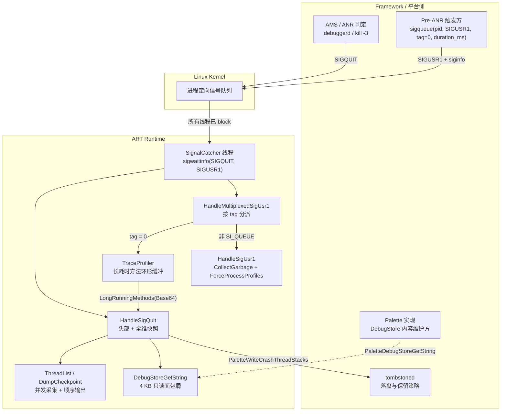
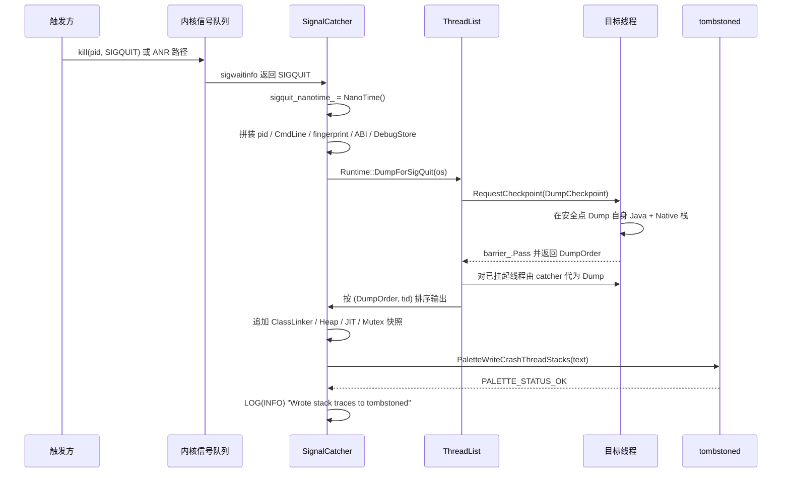
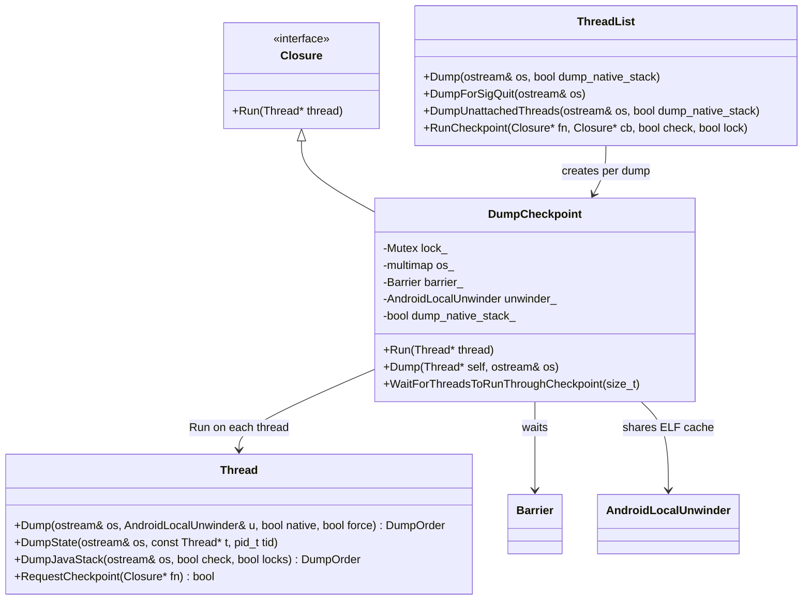
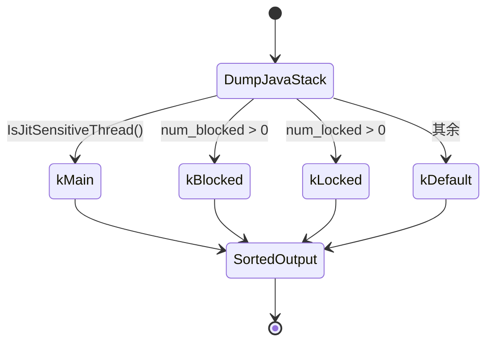
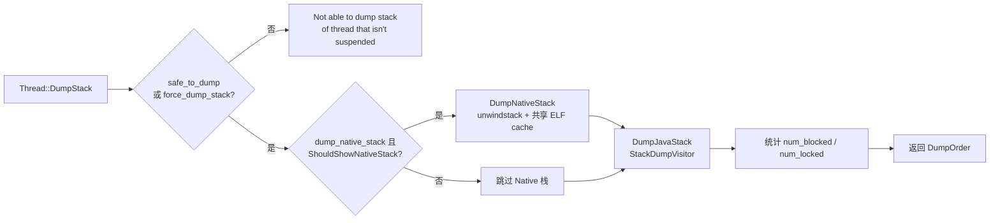
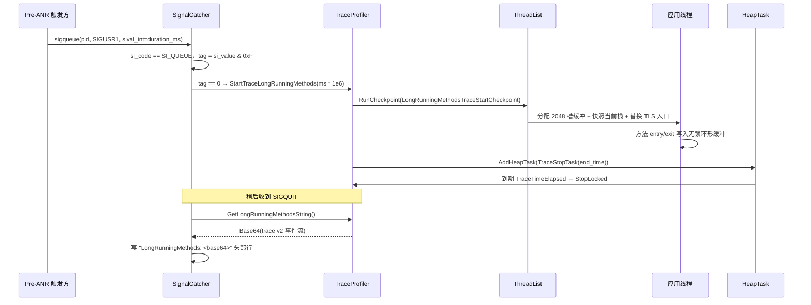

# 12 · ANR 全景诊断转储与 Pre-ANR 录制机制

> [!IMPORTANT]
> **一句话核心结论**：ART 把「事故现场取证」做成了一条常驻的 `SignalCatcher` 守护线程——`SIGQUIT` 到达时，它不靠危险脆弱的异步信号处理函数，而是用 `sigwaitinfo()` 在普通线程上下文里发起一次**全线程、全维度快照**：每个可运行线程在安全点通过 `DumpCheckpoint` 自证 Java 栈与 Native 栈，已挂起线程由 catcher 代为转储，最后按 `kMain -> kBlocked -> kLocked -> kDefault` 排序输出，确保即使 ANR Trace 被截断，最关键的线程也一定在最前面；`SIGUSR1` 则被 `siginfo` 多路复用：普通 `kill` 语义下触发 GC 与 profile 保存，带 `tag=0` 的 `sigqueue` 语义下启动 `TraceProfiler` 的长耗时方法录制，把「ANR 发生前谁慢」从猜测变成可回放的证据。

| 项目 | 内容 |
| :--- | :--- |
| **机制定位** | ANR / SIGQUIT 全线程诊断转储、SIGUSR1 多路复用、Pre-ANR 长耗时方法录制、DebugStore 调试面包屑 |
| **源码模块（相对 `qssi/art/`）** | `runtime/signal_catcher.cc`、`runtime/thread_list.cc`、`runtime/thread.cc`、`runtime/thread.h`、`runtime/native_stack_dump.cc`、`runtime/runtime.cc`、`libartbase/base/debugstore.h`、`runtime/trace_profile.cc/.h` |
| **核心类 / 入口** | `art::SignalCatcher`、`art::ThreadList`、`DumpCheckpoint`、`art::Thread::Dump*`、`StackDumpVisitor`、`art::TraceProfiler`、`TraceData`、`TraceDumpCheckpoint` |
| **关键系统属性** | `dalvik.vm.allow_profile_code`（默认 `false`，Pre-ANR 录制的运行时开关） |
| **关键 Feature Flag** | `com.android.art.rw.flags.enable_profile_code_rw`（aconfig，编译期 `ALLOW_PROFILE_CODE` 之外的第二道门） |
| **关键启动参数** | `-XX:DumpNativeStackOnSigQuit:<bool>`（默认 `true`） |
| **源码基线** | `/home/voyah/workspace/8397/qssi/art`（Android 15/16 主线级 QSSI，RC6.2，commit `9a380e425f1270a51e0d7bf14363aa66b49509c2`，只读） |

## 1. What：机制是什么？

### 1.1 职责边界

`SignalCatcher` 是 ART 里唯一一条「只负责收信号」的守护线程。它把三种原本互相冲突的需求拆开处理：

1. **`SIGQUIT` 全线程快照**：收到 `SIGQUIT` 后，ART 输出一份包含进程元信息、全部 Java 线程状态与栈、未 attach 线程、运行时子系统状态的文本。这份文本在 Android 上经 `libartpalette` 交给 `tombstoned` 落盘，成为 framework 侧 ANR 报告的主体内容。它**不决定**是否发生 ANR——ANR 的判定、信号发送、报告保留策略都在 framework / `debuggerd` / `tombstoned` 一侧，不在本篇源码范围。
2. **`SIGUSR1` 的两种人格**：普通 `kill`（`si_code != SI_QUEUE`）走「强制 GC + 强制保存 profile」；`sigqueue` 且 `si_code == SI_QUEUE` 时走多路复用，按 `si_value` 低 4 位 tag 分派，`tag == 0` 表示「录制长耗时方法」，持续时长从 `sival_int` 读取。后一种就是 Pre-ANR 录制的接收端。
3. **运行时状态的可读化**：`DebugStore` 把平台侧维护的一小段调试面包屑（≤4096 字节）挂进 `SIGQUIT` 头部；`Thread::DumpState` 则把每个线程的 Java 状态、内核调度状态、持有的 ART 互斥量一次性展开。两者共同构成「全维状态快照」的入口。

它**不负责**：ANR 判定与上报（framework `ActivityManagerService` / `AnrHelper`）、信号的实际发送方、`tombstoned` 的文件轮转与脱敏、设备侧 Native 帧的最终符号化（由 `debuggerd` / symbolizer 完成），以及普通 Java 方法级 Trace（那是 `Trace` / Perfetto 的职责，不是本篇的 `TraceProfiler`）。

### 1.2 核心术语表

| 术语 | 含义 | 源码锚点 |
| :--- | :--- | :--- |
| `SignalCatcher` | ART 内部的信号守护线程；raw pthread，attach 为 daemon，无 Java peer | [signal_catcher.cc](file:///home/voyah/workspace/8397/qssi/art/runtime/signal_catcher.cc#L79-L105) |
| `sigwaitinfo` | 在普通线程中同步等待进程定向信号，避免异步信号处理函数 | [signal_set.h](file:///home/voyah/workspace/8397/qssi/art/runtime/signal_set.h#L52-L63) |
| `SIGQUIT` | 「打印所有线程栈」的约定信号；`kill -3` / `Ctrl-\` / ANR 路径都会用到 | [runtime.cc](file:///home/voyah/workspace/8397/qssi/art/runtime/runtime.cc#L2611-L2620) |
| `SI_QUEUE` | `sigqueue()` 产生的 `si_code`；用于区分「带载荷的信号」与普通 `kill` | [signal_catcher.cc](file:///home/voyah/workspace/8397/qssi/art/runtime/signal_catcher.cc#L167-L183) |
| `DumpCheckpoint` | 一个 `Closure`，被投递到每个线程执行；负责生成该线程的转储并参与 barrier | [thread_list.cc](file:///home/voyah/workspace/8397/qssi/art/runtime/thread_list.cc#L190-L250) |
| `DumpOrder` | 线程转储的优先级：`kMain`、`kBlocked`、`kLocked`、`kDefault` | [thread.h](file:///home/voyah/workspace/8397/qssi/art/runtime/thread.h#L390-L395) |
| JIT sensitive thread | 通过 `VMRuntime.registerSensitiveThread()` 注册的敏感线程，转储时强制排第一（通常是主线程） | [thread.h](file:///home/voyah/workspace/8397/qssi/art/runtime/thread.h#L1726-L1729) |
| 未 attach 线程 | 存在于 `/proc/self/task` 但没有对应 `art::Thread` 的原生线程 | [thread_list.cc](file:///home/voyah/workspace/8397/qssi/art/runtime/thread_list.cc#L160-L183) |
| `DumpLatencyMs` | 单个线程转储耗时，相对本次 `SIGQUIT` 开始时刻 | [thread.cc](file:///home/voyah/workspace/8397/qssi/art/runtime/thread.cc#L2533-L2537) |
| `TraceProfiler` | ART 的低开销常开采样器；Pre-ANR 录制时收集「执行超过阈值」的方法 | [trace_profile.h](file:///home/voyah/workspace/8397/qssi/art/runtime/trace_profile.h#L166-L247) |
| always-on trace | 由 TLS 入口替换驱动的每线程环形事件缓冲 | [trace_profile.cc](file:///home/voyah/workspace/8397/qssi/art/runtime/trace_profile.cc#L112-L135) |
| `LongRunningMethods` | `SIGQUIT` 头部里的一段 Base64，编码 trace v2 事件流 | [signal_catcher.cc](file:///home/voyah/workspace/8397/qssi/art/runtime/signal_catcher.cc#L147-L152) |
| `DebugStore` | 平台侧维护的 ≤4 KB 调试字符串，ART 只读 | [debugstore.h](file:///home/voyah/workspace/8397/qssi/art/libartbase/base/debugstore.h#L26-L35) |
| suspend histogram | `SuspendAll` 暂停耗时直方图，随 ANR 报告输出 99% 置信区间 | [thread_list.cc](file:///home/voyah/workspace/8397/qssi/art/runtime/thread_list.cc#L134-L143) |

### 1.3 架构定位



图中需要特别记住三条边：

- **`SIGQ -> SC`**：`SIGQUIT` / `SIGUSR1` 在 `Runtime::BlockSignals()` 里被**所有线程**屏蔽，只有 `SignalCatcher` 用 `sigwaitinfo()` 主动取走。这保证了信号归属确定，且处理逻辑跑在普通线程上下文。
- **`US -> TP`**：同一个 `SIGUSR1` 既可能是「GC」也可能是「Pre-ANR 录制」，区分依据只有 `siginfo` 的 `si_code` 与低 4 位 tag。
- **`SQ -> TOMB`**：ART 只负责生成文本并调用 `PaletteWriteCrashThreadStacks()`；文件路径、轮转、上传裁剪都在平台侧，这解释了为什么 ANR Trace 可能被截断，也解释了排序为什么重要。

### 1.4 两条信号主线

| 维度 | `SIGQUIT` | `SIGUSR1` |
| :--- | :--- | :--- |
| 典型发送方 | framework ANR 流程、`debuggerd`、`kill -3`、`Ctrl-\` | `sigqueue`（Pre-ANR）、`kill -10`（强制 GC） |
| 分派入口 | `SignalCatcher::Run` 的 `case SIGQUIT` | `HandleMultiplexedSigUsr1` 或 `HandleSigUsr1` |
| 核心动作 | 全线程 Java/Native 栈 + 运行时子系统快照 | `tag=0` 启动长耗时方法录制；否则 GC + profile 保存 |
| 产物 | `tombstoned` 中的 ANR Trace 文本 | 后续 `SIGQUIT` 头部中的 `LongRunningMethods:` Base64 |
| 主要成本 | 全线程安全点/挂起、Native unwind、文本生成 | 每方法 entry/exit 的少量 TLS 写入；阈值过滤后留存很少 |
| 主要风险 | 负载高时转储超时（目标机 barrier 等待上限 100 s） | 长时间开启带来的持续采样开销；发送端契约错误导致降级为 GC |

## 2. Why：为什么需要它？

### 2.1 事故现场的两个时间尺度

ANR 的判定是**事后**的：输入事件分发超时、BroadcastReceiver 超时、Service 超时等条件满足后，framework 才决定「这是 ANR」。等到取证时，肇事代码往往已经返回，主线程可能正安静地躺在 `nativePollOnce()` 里。只抓一份「当前栈」，看到的常常是「主线程很闲」——这是 ANR 分析里最典型的假象。

ART 的对策是把取证拆成两个时间尺度：

- **`SIGQUIT` 提供「此刻的全景」**：所有线程此刻在做什么、谁持有什么锁、谁在等谁、Native 栈落在哪个 so。它回答「为什么现在没人处理输入」。
- **Pre-ANR 录制提供「刚才的慢方法」**：在没有 ANR 的时候就开始记录「执行时间超过阈值的方法」，ANR 发生后把这段历史随 `SIGQUIT` 一起带走。它回答「刚才到底哪段代码慢」。

两者缺一不可：只有全景，慢方法可能已经消失；只有历史，无法判断当时的锁与线程关系。

### 2.2 为什么不用信号处理函数，也不靠 ptrace

一个直觉方案是 `signal(SIGQUIT, handler)`，在 handler 里打印栈。这条路在 ART 里走不通：异步信号处理函数只能调用 async-signal-safe 的少量函数，不能分配内存、不能拿 ART 互斥量、不能遍历 Java 堆，而转储恰恰需要这些能力。ART 的选择是：

1. `Runtime::BlockSignals()` 在运行时初始化早期把 `SIGPIPE`、`SIGQUIT`、`SIGUSR1` 全部屏蔽（[runtime.cc](file:///home/voyah/workspace/8397/qssi/art/runtime/runtime.cc#L2611-L2620)），调用点位于 `BlockSignals(); InitPlatformSignalHandlers();`（[runtime.cc](file:///home/voyah/workspace/8397/qssi/art/runtime/runtime.cc#L1938-L1941)）。
2. 创建一条专用线程，用 `sigwaitinfo()` 同步等待（[signal_set.h](file:///home/voyah/workspace/8397/qssi/art/runtime/signal_set.h#L52-L63)）。信号被「取走」而不是「打断」某个线程，处理逻辑因此可以像普通代码一样加锁、分配、遍历。
3. `sigwaitinfo` 同时带回 `siginfo_t`，这让 `SIGUSR1` 的载荷（`si_code` / `si_value`）可以被读取，成为多路复用的基础。

另一条直觉方案是外部 `ptrace` attach。它的问题同样明显：需要 ptrace 权限、会暂停目标进程、拿不到 ART 的 Java 栈语义（只能看到 native 栈）、在线上环境几乎不可用。进程内自举的 `SIGQUIT` 转储因此成为 Android 的标准路径。

### 2.3 方案演进对比矩阵

| 方案 | 能拿到 Java 栈 | 对目标进程的侵入 | 触发时机 | 典型用途 |
| :--- | :--- | :--- | :--- | :--- |
| `/proc/<pid>/stack`、`/proc/<pid>/task/*/stack` | 否 | 无 | 随时 | 内核态卡死、D 状态线程 |
| `debuggerd -b` / `ptrace` | 仅 Native | 暂停进程、需权限 | 随时 | Native Crash、死锁 |
| 进程内 `SIGQUIT` 转储 | 是（Java + Native） | 进程内自举；需 `tombstoned` 落盘 | ANR、手动 | ANR 主路径 |
| Pre-ANR `SIGUSR1` 录制 | 是（长耗时方法事件流） | 每线程环形缓冲，按开关启用 | ANR 之前 | 慢方法归因 |
| 普通方法 Trace / Perfetto | 是（逐次调用） | 开销较高，通常需抓取窗口 | 任意（需开启） | 性能剖析 |

### 2.4 为什么必须排序：ANR Trace 会被截断

排序不是「好看」，而是**功能正确性**的一部分。源码注释直接写明了动机：

- `DumpOrder` 的注释：`kMain, // Always print the main thread first (there might not be one).`、`kBlocked, // Then print all threads that are blocked due to waiting on lock.`（[thread.h](file:///home/voyah/workspace/8397/qssi/art/runtime/thread.h#L390-L395)）。
- `DumpCheckpoint::Run` 的注释：`Sort, so that the most interesting threads for ANR are printed first (ANRs can be trimmed).`（[thread_list.cc](file:///home/voyah/workspace/8397/qssi/art/runtime/thread_list.cc#L211-L216)）。
- `Runtime::DumpForSigQuit` 的注释：`Print backtraces first since they are important do diagnose ANRs, and ANRs can often be trimmed to limit upload size.`（[runtime.cc](file:///home/voyah/workspace/8397/qssi/art/runtime/runtime.cc#L2514-L2517)）。
- Native 栈里 `StripParameters` 的注释：`ANRs are often trimmed, so printing less means we get more useful data out.`（[native_stack_dump.cc](file:///home/voyah/workspace/8397/qssi/art/runtime/native_stack_dump.cc#L388-L396)）。

这四处注释指向同一个事实：生产环境的 ANR 报告有大小上限。排序把「主线程、等锁线程、持锁线程」放在最前面，即使尾部被截断，破案所需的主体信息仍然完整。

### 2.5 Pre-ANR 的根因模型

Pre-ANR 录制针对的是一种特定的 ANR 形态：**主线程被一段长耗时逻辑占住，等它返回时，输入超时已经发生**。传统 `SIGQUIT` 只能看到它「现在在干什么」，而 Pre-ANR 录制记录的是「过去一段时间内哪些方法执行超过了阈值」。

它的设计约束也很明确：

- **只在开启时付费**：编译期需要 `ALLOW_PROFILE_CODE`，运行期还需要 aconfig flag 与 `dalvik.vm.allow_profile_code` 同时为真（[trace_common.h](file:///home/voyah/workspace/8397/qssi/art/runtime/trace_common.h#L33-L39)）。
- **只留长方法**：方法退出时若执行时长低于阈值，对应的 entry/exit 会一起被丢弃（[trace_profile.cc](file:///home/voyah/workspace/8397/qssi/art/runtime/trace_profile.cc#L685-L701)）。这避免了「每个方法都留一条」带来的数据爆炸。
- **按线程无锁写入**：每个线程持有自己的环形缓冲，方法 entry/exit 只写 TLS 指针与缓冲槽位，不抢全局锁（[trace_profile.cc](file:///home/voyah/workspace/8397/qssi/art/runtime/trace_profile.cc#L632-L708)）。

## 3. How：源码级实现原理深度剖析

### 3.1 SignalCatcher：一条只做信号等待的守护线程

**创建时机**：`Runtime::InitNonZygoteOrPostFork()` 在完成非 zygote / fork 后初始化时调用 `StartSignalCatcher()`（[runtime.cc](file:///home/voyah/workspace/8397/qssi/art/runtime/runtime.cc#L1207-L1211)、[runtime.cc](file:///home/voyah/workspace/8397/qssi/art/runtime/runtime.cc#L1306-L1306)）。`StartSignalCatcher()` 只在 `!is_zygote_` 时创建实例（[runtime.cc](file:///home/voyah/workspace/8397/qssi/art/runtime/runtime.cc#L1352-L1356)）——zygote 本身不需要这条线程，避免 fork 前多出一条带运行时状态的线程。

**构造**：`SignalCatcher` 的构造函数不直接 attach，而是先 `pthread_create(raw pthread, &Run, this)`，然后在条件变量上等待 `thread_` 被 `Run` 填好（[signal_catcher.cc](file:///home/voyah/workspace/8397/qssi/art/runtime/signal_catcher.cc#L79-L93)）。这保证构造返回时线程已经进入运行时。

**线程主体**：`Run()` attach 为名为 `"Signal Catcher"` 的 daemon 系统线程，建立 `SignalSet{SIGQUIT, SIGUSR1}`，然后进入无限循环：`WaitForSignal()` → 按信号分派（[signal_catcher.cc](file:///home/voyah/workspace/8397/qssi/art/runtime/signal_catcher.cc#L229-L274)）。

```cpp
// runtime/signal_catcher.cc:246-L248 / L250-L273（精简）
SignalSet signals;
signals.Add(SIGQUIT);
signals.Add(SIGUSR1);
while (true) {
  siginfo_t info;
  int signal_number = signal_catcher->WaitForSignal(self, signals, &info);
  if (signal_catcher->ShouldHalt()) { runtime->DetachCurrentThread(); return nullptr; }
  switch (signal_number) {
    case SIGQUIT:
      signal_catcher->HandleSigQuit();
      break;
    case SIGUSR1:
      if (kIsTargetAndroid && ShouldEnableProfileCode()) {
        signal_catcher->HandleMultiplexedSigUsr1(&info);
      } else {
        signal_catcher->HandleSigUsr1();
      }
      break;
  }
}
```

**等待与自诊断**：`WaitForSignal()` 先把自身状态切到 `kWaitingInMainSignalCatcherLoop`，收到信号后打印 `"<thread>: reacting to signal N"`，并调用 `Runtime::DumpLockHolders()` 输出 mutator lock / thread_list lock / class linker 锁的持有者（[signal_catcher.cc](file:///home/voyah/workspace/8397/qssi/art/runtime/signal_catcher.cc#L209-L227)、[runtime.cc](file:///home/voyah/workspace/8397/qssi/art/runtime/runtime.cc#L2542-L2553)）。这一步是为「catcher 自己也卡住」准备的：先把锁的持有者写进日志，再尝试转储。

**输出**：`Output()` 把当前线程切到 `kWaitingForSignalCatcherOutput`，调用 `PaletteWriteCrashThreadStacks()`；成功时打印 `"Wrote stack traces to tombstoned"`，失败时打印错误（[signal_catcher.cc](file:///home/voyah/workspace/8397/qssi/art/runtime/signal_catcher.cc#L117-L126)）。

**销毁**：析构时置 `halt_`，向 catcher 线程 `pthread_kill(SIGQUIT)` 唤醒 `sigwaitinfo`，再 `pthread_join`（[signal_catcher.cc](file:///home/voyah/workspace/8397/qssi/art/runtime/signal_catcher.cc#L95-L105)）。

```text
  Runtime::InitNonZygoteOrPostFork()
      |
      +--> StartSignalCatcher()                  is_zygote_ == false 才创建
                |
                +--> pthread_create(Run)
                          |
                          +--> AttachCurrentThread("Signal Catcher", daemon)
                          +--> SignalSet{SIGQUIT, SIGUSR1}
                          +--> loop: sigwaitinfo(&signals, &info)
                                     |
               +---------------------+----------------------+
               |                                            |
           SIGQUIT                                      SIGUSR1
               |                                            |
       HandleSigQuit()                       si_code == SI_QUEUE ?
               |                              /                     \
       Runtime::DumpForSigQuit()          是 /                       \ 否
               |                          tag == 0 ?          HandleSigUsr1()
       Output() -> Palette -> tombstoned    |                  CollectGarbage +
                                          TraceProfiler        ForceProcessProfiles
```

### 3.2 SIGQUIT 端到端：从 `sigwait` 到 `tombstoned`

`HandleSigQuit()` 是整篇文档的主干。它按固定顺序拼装文本（[signal_catcher.cc](file:///home/voyah/workspace/8397/qssi/art/runtime/signal_catcher.cc#L128-L165)）：

```cpp
// runtime/signal_catcher.cc:128-L154（精简）
void SignalCatcher::HandleSigQuit() {
  sigquit_nanotime_ = NanoTime();
  Runtime* runtime = Runtime::Current();
  std::ostringstream os;
  os << "\n" << "----- pid " << getpid() << " at " << GetIsoDate() << " -----\n";
  DumpCmdLine(os);                        // Cmd line / Original command line
  os << "Build fingerprint: '" << ... << "'\n";
  os << "ABI: '" << GetInstructionSetString(runtime->GetInstructionSet()) << "'\n";
  os << "Build type: " << (kIsDebugBuild ? "debug" : "optimized") << "\n";
  os << "Debug Store: " << DebugStoreGetString() << "\n";
  if (ShouldEnableProfileCode()) {
    std::string str = TraceProfiler::GetLongRunningMethodsString();
    if (!str.empty()) { os << "LongRunningMethods: " << str << "\n"; }
  }
  runtime->DumpForSigQuit(os);
  ...
  os << "----- end " << getpid() << " -----\n";
  Output(os.str());
  sigquit_nanotime_ = std::nullopt;
}
```

几个容易被忽略的细节：

- `sigquit_nanotime_` 在这里被置位，随后每个线程的 `DumpStack` 会用它计算 `DumpLatencyMs`（[thread.cc](file:///home/voyah/workspace/8397/qssi/art/runtime/thread.cc#L2533-L2537)）。因此 `DumpLatencyMs` 是「本次转储已经跑了多久」，不是线程自身的运行时长。
- `DumpCmdLine()` 会读 `/proc/self/cmdline`，并在原命令行被改写（Android 上通常被改成进程名）时额外打印 `Original command line:`（[signal_catcher.cc](file:///home/voyah/workspace/8397/qssi/art/runtime/signal_catcher.cc#L57-L77)）。
- `/proc/self/maps` 的转储被 `if ((false))` 显式关闭（[signal_catcher.cc](file:///home/voyah/workspace/8397/qssi/art/runtime/signal_catcher.cc#L156-L161)）。这是一段刻意的死代码：maps 体积大、可替代来源多，放进 ANR 报告不划算。
- `Debug Store:` 与 `LongRunningMethods:` 都在线程列表**之前**，所以即使后面的线程部分被截断，这两段仍然保留。

`Runtime::DumpForSigQuit()` 决定「全维快照」的内容与顺序（[runtime.cc](file:///home/voyah/workspace/8397/qssi/art/runtime/runtime.cc#L2514-L2540)）：

| 顺序 | 子系统 | 作用 |
| :--- | :--- | :--- |
| 1 | `thread_list_->DumpForSigQuit` | 线程栈与状态（最重要，放最前） |
| 2 | `ClassLinker::DumpForSigQuit` | 类链接器状态 |
| 3 | `InternTable::DumpForSigQuit` | 字符串 intern 表 |
| 4 | `JavaVM::DumpForSigQuit` | JNI / VM 全局状态 |
| 5 | `Heap::DumpForSigQuit` | 堆与 GC 状态 |
| 6 | `OatFileManager::DumpForSigQuit` | OAT 映射 |
| 7 | `Jit::DumpForSigQuit` | JIT 状态（无 JIT 时打印 `Running non JIT`） |
| 8 | `DumpDeoptimizations` | 各类反优化计数 |
| 9 | `TrackedAllocators::Dump` | 受跟踪分配器 |
| 10 | `Metrics::DumpForSigQuit` | 运行时指标 |
| 11 | `BaseMutex::DumpAll` | 所有 ART 互斥量 |
| 12 | `callbacks_->SigQuit()` | 通知外部回调 |

`ThreadList::DumpForSigQuit()` 在线程列表之前还会输出 suspend histogram（若有样本），然后根据 `GetDumpNativeStackOnSigQuit()` 决定是否转储 Native 栈，最后补上未 attach 线程（[thread_list.cc](file:///home/voyah/workspace/8397/qssi/art/runtime/thread_list.cc#L134-L147)）。`dump_native_stack_on_sig_quit_` 默认 `true`（[runtime.cc](file:///home/voyah/workspace/8397/qssi/art/runtime/runtime.cc#L323-L323)），可由 `-XX:DumpNativeStackOnSigQuit:false` 关闭（[parsed_options.cc](file:///home/voyah/workspace/8397/qssi/art/runtime/parsed_options.cc#L249-L252)）。

完整的端到端时序如下：



### 3.3 DumpCheckpoint：并发采集、串行排序

`ThreadList::Dump()` 的骨架很短，但每一行都承担并发语义（[thread_list.cc](file:///home/voyah/workspace/8397/qssi/art/runtime/thread_list.cc#L252-L276)）：

```cpp
// runtime/thread_list.cc:252-L275（精简）
void ThreadList::Dump(std::ostream& os, bool dump_native_stack) {
  Thread* self = Thread::Current();
  { MutexLock mu(self, *Locks::thread_list_lock_);
    os << "DALVIK THREADS (" << list_.size() << "):\n"; }
  if (self != nullptr) {
    bool mutator_lock_held = Locks::mutator_lock_->IsSharedHeld(self);
    DumpCheckpoint checkpoint(dump_native_stack);
    size_t threads_running_checkpoint =
        RunCheckpoint(&checkpoint, nullptr, true, /* acquire_mutator_lock= */ !mutator_lock_held);
    if (threads_running_checkpoint != 0) {
      checkpoint.WaitForThreadsToRunThroughCheckpoint(threads_running_checkpoint);
    }
    checkpoint.Dump(self, os);
  } else {
    DumpUnattachedThreads(os, dump_native_stack);
  }
}
```

`DumpCheckpoint::Run()` 在**每个目标线程自己的上下文**里执行（[thread_list.cc](file:///home/voyah/workspace/8397/qssi/art/runtime/thread_list.cc#L203-L218)）：

```cpp
// runtime/thread_list.cc:203-L218（精简）
void Run(Thread* thread) override {
  Thread* self = Thread::Current();
  std::ostringstream local_os;
  Locks::mutator_lock_->AssertSharedHeld(self);
  Thread::DumpOrder dump_order = thread->Dump(local_os, unwinder_, dump_native_stack_);
  {
    MutexLock mu(self, lock_);
    std::pair<Thread::DumpOrder, uint32_t> sort_key(dump_order, thread->GetThreadId());
    os_.emplace(sort_key, std::move(local_os));
  }
  barrier_.Pass(self);
}
```

这里有两个关键设计：

1. **每个线程先写自己的 `local_os`**，避免不同线程的文本互相穿插；只有 `emplace` 进 `multimap` 时短暂持锁。
2. **排序键是 `(DumpOrder, thread_id)`**。`multimap` 天然按 key 升序输出，于是 `kMain (0) -> kBlocked (1) -> kLocked (2) -> kDefault (3)`，同级别内按 Java thread id 稳定排列（[thread_list.cc](file:///home/voyah/workspace/8397/qssi/art/runtime/thread_list.cc#L220-L226)、[thread_list.cc](file:///home/voyah/workspace/8397/qssi/art/runtime/thread_list.cc#L240-L243)）。

```text
  DumpCheckpoint 的排序存储
  multimap<pair<DumpOrder, uint32_t>, ostringstream>
                  ^^^^^^^^^  ^^^^^^^^
                  排序级别    thread_id（同级别内的稳定次序）

  ┌────────────┬──────────────────────────────────────────────┐
  │ DumpOrder  │ 判定来源                                     │
  ├────────────┼──────────────────────────────────────────────┤
  │ kMain      │ Thread::IsJitSensitiveThread() == true       │
  │ kBlocked   │ StackDumpVisitor::num_blocked > 0            │
  │ kLocked    │ StackDumpVisitor::num_locked  > 0            │
  │ kDefault   │ 其余线程                                     │
  └────────────┴──────────────────────────────────────────────┘
  最终输出顺序：kMain -> kBlocked -> kLocked -> kDefault
```

**`RunCheckpoint` 如何把 checkpoint 投递到所有线程**（[thread_list.cc](file:///home/voyah/workspace/8397/qssi/art/runtime/thread_list.cc#L309-L478)）：

1. 先持有 `thread_list_lock_` 与 `thread_suspend_count_lock_`，对除自己外的每个线程调用 `RequestCheckpoint()`。
2. `RequestCheckpoint()` 只在目标线程状态为 `kRunnable` 时成功：它用 CAS 在 `state_and_flags` 上置 `kCheckpointRequest` 标志，把 `Closure*` 挂到 TLS，并 `TriggerSuspend()` 让线程在最近的安全点进入运行时（[thread.cc](file:///home/voyah/workspace/8397/qssi/art/runtime/thread.cc#L1677-L1699)）。
3. 请求失败的线程（非 `kRunnable`，通常已挂起或在 native 等待）进入 `remaining_threads`；对它们注册 `ThreadExitFlag`，然后逐个 `IncrementSuspendCount()`。若仍处于挂起态，就**由请求者线程代为执行** `checkpoint_function->Run(thread)`；执行期间会临时释放锁，并确保 flip function 已完成（[thread_list.cc](file:///home/voyah/workspace/8397/qssi/art/runtime/thread_list.cc#L371-L455)）。
4. 最后在请求者自己身上也执行一次 checkpoint，因此 barrier 的计数包含自己。
5. `DumpCheckpoint::WaitForThreadsToRunThroughCheckpoint()` 用 `barrier_.Increment(self, threads_running_checkpoint, kDumpWaitTimeout)` 等待所有线程通过；超时时间在目标机上是 **100000 ms**，宿主上是 **20000 ms**（[thread_list.cc](file:///home/voyah/workspace/8397/qssi/art/runtime/thread_list.cc#L185-L187)、[thread_list.cc](file:///home/voyah/workspace/8397/qssi/art/runtime/thread_list.cc#L228-L237)）。超时在 debug 且非 abort 路径下会 `FATAL`，在 release 下只记 `ERROR`；barrier 构造时关闭了退出计数校验，避免某个线程永远没到达时析构再次触发 `SIGABRT`（[thread_list.cc](file:///home/voyah/workspace/8397/qssi/art/runtime/thread_list.cc#L192-L199)）。

**已挂起 / 未 attach 线程**：

- 对于 `ThreadList` 中已挂起的线程，checkpoint 由 catcher 代跑，`Thread::DumpStack` 里的 `safe_to_dump = (this == Thread::Current() || IsSuspended())` 保证只有在「自己或已挂起」时才走真正的栈遍历（[thread.cc](file:///home/voyah/workspace/8397/qssi/art/runtime/thread.cc#L2509-L2520)）。
- 对于 `/proc/self/task` 里存在但没有 `art::Thread` 的线程，`DumpUnattachedThreads()` 遍历目录，用 `Thread::DumpState(os, nullptr, tid)` 输出 `(not attached)` 信息，再按开关补 Native 栈（[thread_list.cc](file:///home/voyah/workspace/8397/qssi/art/runtime/thread_list.cc#L149-L183)）。`kDumpUnattachedThreadNativeStackForSigQuit` 固定为 `true`（[thread_list.cc](file:///home/voyah/workspace/8397/qssi/art/runtime/thread_list.cc#L69-L71)）。



### 3.4 Thread::Dump：状态头、Java 栈与 DumpOrder

`Thread::Dump()` 只做两件事：先 `DumpState`，再 `DumpStack` 并返回后者算出的 `DumpOrder`（[thread.cc](file:///home/voyah/workspace/8397/qssi/art/runtime/thread.cc#L1511-L1524)）。

**`DumpState` 的字段布局**（[thread.cc](file:///home/voyah/workspace/8397/qssi/art/runtime/thread.cc#L2095-L2283)）：

| 行 | 字段 | 含义 |
| :--- | :--- | :--- |
| 1 | `"name" daemon prio=N tid=N state` | Java 线程名、是否 daemon、Java 优先级、Java thread id、ART 线程状态 |
| 2 | `group="..." sCount=N ucsCount=N flags=N obj=0x... self=0x...` | 线程组、挂起计数、用户代码挂起计数、状态字、Java peer、native `Thread*` |
| 3 | `sysTid=N nice=N cgrp=... sched=policy/priority handle=0x...` | OS tid、nice、调度组、调度策略/优先级、`pthread_t` |
| 4 | `state=S schedstat=( ... ) utm=N stm=N core=N HZ=N` | 内核任务状态、调度统计、用户/系统时间、最后 CPU、时钟频率 |
| 5 | `stack=0x...-0x... stackSize=...` | Native 栈边界与大小 |
| 6 | `held mutexes=...` | 当前持有的 ART 互斥量（不是 Java monitor） |

未 attach 线程没有 `group` / `held mutexes` / `stack` 行，只输出名字、优先级、`sysTid`、`nice`、`cgrp`、内核状态与调度统计，并在首行标注 `(not attached)`（[thread.cc](file:///home/voyah/workspace/8397/qssi/art/runtime/thread.cc#L2182-L2186)）。

```text
  单个已 attach 线程的文本骨架（字段来自 Thread::DumpState）
  "main" prio=5 tid=1 Native
    | group="main" sCount=1 ucsCount=0 flags=1 obj=0x... self=0x...
    | sysTid=12345 nice=-10 cgrp=default sched=0/0 handle=0x...
    | state=S schedstat=( 123456789 456789 1234 ) utm=120 stm=30 core=3 HZ=100
    | stack=0x7ffd... stackSize=8MB
    | held mutexes=
    native: #00 pc 00000000000a1b2c  /apex/com.android.runtime/lib64/bionic/libc.so (syscall+28)
    at android.os.MessageQueue.nativePollOnce(Native method)
    at android.os.MessageQueue.next(MessageQueue.java:...)
    DumpLatencyMs: 1.234

  说明：数值为示意，行结构与字段来源见 thread.cc:2095-2282、2340-2355、2533-2537。
```

**`DumpStack` 的 Native 栈判定**（[thread.cc](file:///home/voyah/workspace/8397/qssi/art/runtime/thread.cc#L2444-L2471)、[thread.cc](file:///home/voyah/workspace/8397/qssi/art/runtime/thread.cc#L2505-L2540)）：

- 若 `dump_native_stack` 打开，且处于 abort / force 路径，或 `ShouldShowNativeStack(this)` 返回真，就先打印 Native 栈。
- `ShouldShowNativeStack` 的规则：处于 `kWaiting` 与 `kStarting` 之间的 `kWaitingFor*` 状态 → 打印；`kTimedWaiting` / `kSleeping` / `kWaiting` → 不打印（这些是正常的等待，Native 栈噪声大）；没有 managed 栈 → 打印；当前方法是 native 方法 → 打印。
- 之后再走 `DumpJavaStack`，由 `StackDumpVisitor` 逐帧输出 `  at <PrettyMethod>(<file>:<line>)`，native 方法输出 `(Native method)`（[thread.cc](file:///home/voyah/workspace/8397/qssi/art/runtime/thread.cc#L2338-L2355)）。连续重复的同一方法/行号超过 3 次会压缩成 `... repeated N times`（[thread.cc](file:///home/voyah/workspace/8397/qssi/art/runtime/thread.cc#L2306-L2330)）。

**`DumpOrder` 的判定**（[thread.cc](file:///home/voyah/workspace/8397/qssi/art/runtime/thread.cc#L2473-L2495)）：

```cpp
// runtime/thread.cc:2485-L2494（精简）
dumper.WalkStack();
if (IsJitSensitiveThread()) {
  return DumpOrder::kMain;
} else if (dumper.num_blocked > 0) {
  return DumpOrder::kBlocked;
} else if (dumper.num_locked > 0) {
  return DumpOrder::kLocked;
} else {
  return DumpOrder::kDefault;
}
```

计数来自栈遍历时的锁访问回调：`VisitBlockedOnObject` 遇到 `kBlocked` / `kWaitingForLockInflation` 时 `num_blocked++`，`VisitLockedObject` 每遇到一个已持有锁 `num_locked++`（[thread.cc](file:///home/voyah/workspace/8397/qssi/art/runtime/thread.cc#L2372-L2399)）。`IsJitSensitiveThread()` 比较的是 `jit_sensitive_thread_`，该指针由 `Runtime::RegisterSensitiveThread()` 通过 `VMRuntime.registerSensitiveThread()` 设置（[thread.h](file:///home/voyah/workspace/8397/qssi/art/runtime/thread.h#L1977-L1985)、[runtime.cc](file:///home/voyah/workspace/8397/qssi/art/runtime/runtime.cc#L3211-L3213)、[dalvik_system_VMRuntime.cc](file:///home/voyah/workspace/8397/qssi/art/runtime/native/dalvik_system_VMRuntime.cc#L330-L332)）。注册调用由框架侧发起（不在本篇源码范围）；结合 `DumpOrder` 中 `kMain` 的注释「Always print the main thread first」，这个被注册的线程就是转储时排第一的主线程。



### 3.5 Native 栈：unwindstack、帧格式与 addr2line 边界

`native_stack_dump.cc` 提供两个 `DumpNativeStack` 重载：一个内部创建 `AndroidLocalUnwinder`，另一个接收外部传入的 unwinder（[native_stack_dump.cc](file:///home/voyah/workspace/8397/qssi/art/runtime/native_stack_dump.cc#L318-L327)）。`DumpCheckpoint` 用的是后者：**所有线程共享同一个 unwinder**，并开启 `set_check_global_elf_cache(true)`，避免每个线程重复解析 ELF（[thread_list.cc](file:///home/voyah/workspace/8397/qssi/art/runtime/thread_list.cc#L196-L201)）。

转储时优先使用 `ucontext_ptr`（崩溃现场寄存器），否则按 `tid` unwind（[native_stack_dump.cc](file:///home/voyah/workspace/8397/qssi/art/runtime/native_stack_dump.cc#L338-L349)）。帧文本必须满足外部解析器的格式契约：

```cpp
// runtime/native_stack_dump.cc:364-L373（注释原文）
// We produce output like this:
// ]    #00 pc 000075bb8  /system/lib/libc.so (unwind_backtrace_thread+536)
// In order for parsing tools to continue to function, the stack dump
// format must at least adhere to this format:
//  #XX pc <RELATIVE_ADDR>  <FULL_PATH_TO_SHARED_LIBRARY> ...
// The parsers require a single space before and after pc, and two spaces
// after the <RELATIVE_ADDR>. There can be any prefix data before the
// #XX. <RELATIVE_ADDR> has to be a hex number but with no 0x prefix.
```

几个实现细节：

- `data.DemangleFunctionNames()` 先做符号反修饰；输出时 `StripParameters()` 去掉函数参数，只保留函数名与 `+offset`（[native_stack_dump.cc](file:///home/voyah/workspace/8397/qssi/art/runtime/native_stack_dump.cc#L302-L316)、[native_stack_dump.cc](file:///home/voyah/workspace/8397/qssi/art/runtime/native_stack_dump.cc#L389-L401)）。这既减少体积，也避免参数里的特殊字符干扰解析。
- 有 build id 时追加 `(BuildId: ...)`（[native_stack_dump.cc](file:///home/voyah/workspace/8397/qssi/art/runtime/native_stack_dump.cc#L415-L418)）。
- 设备侧 `kUseAddr2line = !kIsTargetBuild` 为 `false`，不会调用 `addr2line`；宿主侧只有在 `gAborting > 0` 时才启用，并维持一个常驻 `llvm-addr2line` 子进程，用 `poll()` 控制等待（预期 2 行时 500 ms，非预期时 50 ms），缓冲区只有 128 字节，因为此时可能运行在 alt stack 上（[native_stack_dump.cc](file:///home/voyah/workspace/8397/qssi/art/runtime/native_stack_dump.cc#L67-L67)、[native_stack_dump.cc](file:///home/voyah/workspace/8397/qssi/art/runtime/native_stack_dump.cc#L155-L229)、[native_stack_dump.cc](file:///home/voyah/workspace/8397/qssi/art/runtime/native_stack_dump.cc#L351-L359)）。
- `.dex` / `.jar` / `.vdex` 与 `[vdso]` 会被跳过，因为 `addr2line` 无法从这些映射里取到行号（[native_stack_dump.cc](file:///home/voyah/workspace/8397/qssi/art/runtime/native_stack_dump.cc#L231-L248)）。
- 若 `current_method` 非空且当前线程持有 mutator lock，则在无法符号化时回退到 `OatQuickMethodHeader` 计算 `JniLongName+offset`（[native_stack_dump.cc](file:///home/voyah/workspace/8397/qssi/art/runtime/native_stack_dump.cc#L402-L413)）。



### 3.6 SIGUSR1 多路复用与 Pre-ANR 长耗时方法录制

**接收端**：`Run()` 里只有满足 `kIsTargetAndroid && ShouldEnableProfileCode()` 才会走多路复用，否则一律走 GC 路径（[signal_catcher.cc](file:///home/voyah/workspace/8397/qssi/art/runtime/signal_catcher.cc#L258-L268)）。多路复用的核心是 `siginfo`：

```cpp
// runtime/signal_catcher.cc:167-L183（精简）
void SignalCatcher::HandleMultiplexedSigUsr1(siginfo_t* info) {
  if (info->si_code != SI_QUEUE) {
    HandleSigUsr1();                          // 普通 kill：降级为 GC + profile 保存
    return;
  }
  uint8_t tag = std::bit_cast<uintptr_t>(info->si_value) & 0xFu;
  switch (tag) {
    case 0:
      HandleLongMethodTracing(info);
      break;
    default:
      LOG(WARNING) << "SIGUSR1 received via sigqueue with unknown tag: " << ...;
      break;
  }
}
```

`HandleLongMethodTracing()` 从 `sival_int` 读取毫秒数，再换算成纳秒调用 `TraceProfiler::StartTraceLongRunningMethods()`（[signal_catcher.cc](file:///home/voyah/workspace/8397/qssi/art/runtime/signal_catcher.cc#L191-L207)）：

```cpp
// runtime/signal_catcher.cc:191-L206（精简）
void SignalCatcher::HandleLongMethodTracing(siginfo_t* info) {
  if (info == nullptr) return;
  uint64_t duration_ms = static_cast<uint64_t>(info->si_value.sival_int);
  LOG(INFO) << "Received SIGUSR1 signal with long method tracing tag, enabling long method tracing"
            << " for duration :" << duration_ms << " millis";
  TraceProfiler::StartTraceLongRunningMethods(duration_ms * 1000000ULL);
}
```

源码注释明确指出：发送端传入的时长是 16 的整数倍，因此 `si_value` 的低 4 位为 0，tag 与时长可以共存在同一个 `sigval` 里（[signal_catcher.cc](file:///home/voyah/workspace/8397/qssi/art/runtime/signal_catcher.cc#L197-L201)）。**发送端在 ART 之外**：framework 在判定「即将 ANR」或「主线程已明显卡住」时，用 `sigqueue(pid, SIGUSR1, tag=0, duration_ms)` 提前打开录制。ART 只定义接收契约，不包含发送代码，因此本篇不引用 framework 行号。

**`TraceProfiler` 的启动流程**（[trace_profile.cc](file:///home/voyah/workspace/8397/qssi/art/runtime/trace_profile.cc#L307-L375)）：

1. 检查 `ShouldEnableProfileCode()`：Android 构建下要求 aconfig `enable_profile_code_rw` 为真且 `dalvik.vm.allow_profile_code` 为真（[trace_common.h](file:///home/voyah/workspace/8397/qssi/art/runtime/trace_common.h#L33-L39)）。
2. `TimestampCounter::InitializeTimestampCounters()` 初始化时间戳计数器。
3. 若 duration 为 0 且类型是长耗时方法，使用默认 2 秒（[trace_profile.cc](file:///home/voyah/workspace/8397/qssi/art/runtime/trace_profile.cc#L61-L62)、[trace_profile.cc](file:///home/voyah/workspace/8397/qssi/art/runtime/trace_profile.cc#L321-L323)）。
4. 持 `trace_lock_` 检查是否已有普通 Trace 在跑；允许同类型长耗时录制重叠，只延长结束时间（[trace_profile.cc](file:///home/voyah/workspace/8397/qssi/art/runtime/trace_profile.cc#L325-L346)）。
5. 首次启动时 `RunCheckpoint(&long_running_methods_checkpoint_)`：每个线程分配 2048 个 `uintptr_t` 槽位，把**当前已在栈上的方法**伪造成 entry 事件，预置一个 `0x1` 占位 exit，然后替换 TLS 入口点（[trace_profile.cc](file:///home/voyah/workspace/8397/qssi/art/runtime/trace_profile.cc#L287-L295)、[trace_profile.cc](file:///home/voyah/workspace/8397/qssi/art/runtime/trace_profile.cc#L149-L203)）。
6. 通过 `Heap::AddHeapTask(new TraceStopTask(end_time))` 在到期时停止（[trace_profile.cc](file:///home/voyah/workspace/8397/qssi/art/runtime/trace_profile.cc#L280-L285)、[trace_profile.cc](file:///home/voyah/workspace/8397/qssi/art/runtime/trace_profile.cc#L371-L374)）。

**事件写入与阈值过滤**：AOT / JIT 代码在方法 entry/exit 时调用 `artRecordLongRunningMethodTraceEvent()`（[quick_trampoline_entrypoints.cc](file:///home/voyah/workspace/8397/qssi/art/runtime/entrypoints/quick/quick_trampoline_entrypoints.cc#L2814-L2818)），最终进入 `FlushBufferAndRecordTraceEvent()`（[trace_profile.cc](file:///home/voyah/workspace/8397/qssi/art/runtime/trace_profile.cc#L632-L708)）：

- entry 事件压入 `(timestamp & ~1, method*)` 两个槽位；exit 事件压入 `(timestamp | 1)` 一个槽位。
- exit 时若发现该方法运行时长小于 `kLongRunningMethodThreshold`，就把 entry/exit 一起丢弃（`index += 2`），只保留真正「长耗时」的方法。
- `kLongRunningMethodThreshold = 1 << 23`，按注释中的典型时间戳频率 24576000 Hz 计算约 **341 ms**（[trace_profile.h](file:///home/voyah/workspace/8397/qssi/art/runtime/trace_profile.h#L36-L38)）。
- 缓冲区写满时，`FlushBufferAndRecordTraceEvent` 先找到最后一个 method exit，把已确定的事件编码后搬走；若剩余超过 `kMaxEntriesAfterFlush`（1024），则整体编码并写入占位 exit（[trace_profile.cc](file:///home/voyah/workspace/8397/qssi/art/runtime/trace_profile.cc#L641-L683)）。

```text
  每线程 always-on 环形缓冲（向下增长，单位 uintptr_t）
  method_trace_entries + 2048（高地址）
      ┌────────────────────────────────────┐
      │ 0x1（placeholder exit，AllocateBuffer 预置）│
      ├────────────────────────────────────┤
      │ method*          （entry N）        │  index + 1
      │ timestamp & ~1   （entry N）        │  index
      ├────────────────────────────────────┤
      │ ...                                │
      └────────────────────────────────────┘
      ^ tlsPtr_.method_trace_buffer_curr_entry
        每次 entry 写入两个槽位，exit 写入一个槽位，向低地址推进
```

**停止与收集**：

- `TraceTimeElapsed()` 在到期时持 `trace_lock_` 检查结束时间是否被后续请求延长；未延长才调用 `StopLocked()`（[trace_profile.cc](file:///home/voyah/workspace/8397/qssi/art/runtime/trace_profile.cc#L560-L568)）。
- `StopLocked()` 会等待正在进行的 dump 结束，然后通过 checkpoint 清空每个线程的缓冲与 TLS 入口（[trace_profile.cc](file:///home/voyah/workspace/8397/qssi/art/runtime/trace_profile.cc#L393-L419)）。
- 收到 `SIGQUIT` 时，`GetLongRunningMethodsString()` 对所有线程跑一次 `TraceDumpCheckpoint`，把编码后的二进制流 Base64 化（[trace_profile.cc](file:///home/voyah/workspace/8397/qssi/art/runtime/trace_profile.cc#L501-L539)、[trace_profile.cc](file:///home/voyah/workspace/8397/qssi/art/runtime/trace_profile.cc#L710-L718)）。



开销模型：开启期间，每次方法 entry/exit 是若干次 TLS 读写与槽位写入，不拿全局锁；未超过阈值的方法在 exit 时被丢弃，因此**留存数据量主要由长方法数量决定**。但 entry/exit 的写入本身仍然发生，所以不应在量产版本长期常开。

### 3.7 LongRunningMethods 的编码、Base64 与离线解析

`TraceProfiler::DumpLongRunningMethodBuffer()` 生成 trace v2 包（[trace_profile.cc](file:///home/voyah/workspace/8397/qssi/art/runtime/trace_profile.cc#L570-L630)）。事件包结构如下（小端）：

```text
  Entry 包（12 字节头）
  +--------+----------------+------------------+------------------+
  | 0x02   | thread_id (4B) | num_records (3B) | data_size (4B)   |
  +--------+----------------+------------------+------------------+
  data 区：SLEB128(time/action delta)
           [ SLEB128(method_ptr delta) ]   ← 仅 entry 事件有
           ...

  Method Info 包                      Thread Info 包
  +--------+------------------+----+  +--------+-------------+----+
  | 0x01   | method_id (8B)   |len |  | 0x00   | tid (4B)    |len |
  +--------+------------------+----+  +--------+-------------+----+
  | name bytes ...                |    | name bytes ...           |
  +-------------------------------+    +--------------------------+
```

关键编码选择：

- **时间戳与动作合并**：`time_action_encoding = event_time << 1 | is_exit`，再对前一条做差后用 SLEB128 编码。这样 entry/exit 只用一个差分值，且时间戳的低位始终为 0 或 1 的 action 位。
- **方法指针差分**：entry 事件额外编码 `method_ptr - prev_method_ptr`，同样用 SLEB128（[trace_profile.cc](file:///home/voyah/workspace/8397/qssi/art/runtime/trace_profile.cc#L589-L616)）。
- **方法/线程信息可后置**：头注释说明不保证 method info 一定出现在对应 entry 之前，解析器需要先扫元数据、再扫事件；这使 TRACE 被截断时仍能保留部分方法名（[long_running_method_trace_parser.cc](file:///home/voyah/workspace/8397/qssi/art/tools/trace_parser/long_running_method_trace_parser.cc#L199-L220)）。
- **Base64 是为了塞进文本 ANR 报告**：`GetLongRunningMethodsString()` 先 `Dump()` 到 `ostringstream`，再 `Base64Encode`（[trace_profile.cc](file:///home/voyah/workspace/8397/qssi/art/runtime/trace_profile.cc#L710-L718)）。

仓库内自带宿主解析工具 `long_running_method_trace_parser`（host only），它识别 `0x00/0x01/0x02` 三种包并按线程、方法名、缩进打印事件（[Android.bp](file:///home/voyah/workspace/8397/qssi/art/tools/trace_parser/Android.bp#L19-L38)、[long_running_method_trace_parser.cc](file:///home/voyah/workspace/8397/qssi/art/tools/trace_parser/long_running_method_trace_parser.cc#L243-L250)）。

### 3.8 DebugStore：4 KB 调试面包屑

`DebugStore` 的实现非常克制：`kDebugStoreMaxSize = 4096`，`DebugStoreGetString()` 分配 4096 字节、先把首字节置 `\0`，再调用 `PaletteDebugStoreGetString()`，返回结果字符串（[debugstore.h](file:///home/voyah/workspace/8397/qssi/art/libartbase/base/debugstore.h#L26-L35)）。`PaletteDebugStoreGetString` 是 palette v4 API（对应 SDK 36），ART 侧通过函数指针转发给平台实现（[palette.cc](file:///home/voyah/workspace/8397/qssi/art/libartpalette/apex/palette.cc#L258-L263)、[palette_method_list.h](file:///home/voyah/workspace/8397/qssi/art/libartpalette/include/palette/palette_method_list.h#L80-L94)）；在 fake palette 上直接返回空串（[palette_fake.cc](file:///home/voyah/workspace/8397/qssi/art/libartpalette/system/palette_fake.cc#L170-L174)）。

**边界必须说清楚**：`qssi/art` 里只有读取端，没有写入端。DebugStore 的内容由平台侧维护，ART 只保证「如果有内容，就原样放进 `SIGQUIT` 的 `Debug Store:` 行」。它不是「全维状态」的存储介质——全维状态是 `Runtime::DumpForSigQuit()` 展开的那一整份文本；DebugStore 只是平台往 ANR 报告里塞的一段轻量上下文（例如当前业务场景、最近一次关键状态变更），大小上限 4 KB。

### 3.9 关键常量与开关速查

| 常量 / 开关 | 值 / 默认 | 位置 | 作用 |
| :--- | :--- | :--- | :--- |
| `kDumpWaitTimeout` | target `100000` ms；host `20000` ms | [thread_list.cc](file:///home/voyah/workspace/8397/qssi/art/runtime/thread_list.cc#L185-L187) | DumpCheckpoint barrier 等待上限 |
| `kDumpUnattachedThreadNativeStackForSigQuit` | `true` | [thread_list.cc](file:///home/voyah/workspace/8397/qssi/art/runtime/thread_list.cc#L69-L71) | 是否为未 attach 线程抓 Native 栈 |
| `dump_native_stack_on_sig_quit_` | `true` | [runtime.cc](file:///home/voyah/workspace/8397/qssi/art/runtime/runtime.cc#L323-L323) | 是否在 SIGQUIT 中转储 Native 栈 |
| `-XX:DumpNativeStackOnSigQuit:` | `true` / `false` | [parsed_options.cc](file:///home/voyah/workspace/8397/qssi/art/runtime/parsed_options.cc#L249-L252) | 上述开关的命令行入口 |
| `kAlwaysOnTraceBufSize` | `2048` 个 `uintptr_t` | [trace_profile.h](file:///home/voyah/workspace/8397/qssi/art/runtime/trace_profile.h#L32-L34) | 每线程 always-on 缓冲槽位数 |
| `kLongRunningMethodThreshold` | `1 << 23`（约 341 ms @ 24.576 MHz） | [trace_profile.h](file:///home/voyah/workspace/8397/qssi/art/runtime/trace_profile.h#L36-L38) | 长方法判定阈值 |
| `kDefaultTraceDurationNs` | `2 * 1000 * 1000 * 1000`（2 s） | [trace_profile.cc](file:///home/voyah/workspace/8397/qssi/art/runtime/trace_profile.cc#L61-L62) | duration 为 0 时的默认录制时长 |
| `kBufSizeForEncodedData` | `2048 * 8 * 10` = 163840 B（64 位） | [trace_profile.cc](file:///home/voyah/workspace/8397/qssi/art/runtime/trace_profile.cc#L49-L55) | 编码后缓冲大小 |
| `kAlwaysOnTraceHeaderSize` | `12` B | [trace_profile.cc](file:///home/voyah/workspace/8397/qssi/art/runtime/trace_profile.cc#L57-L57) | Entry 包头长度 |
| `kDebugStoreMaxSize` | `4096` B | [debugstore.h](file:///home/voyah/workspace/8397/qssi/art/libartbase/base/debugstore.h#L26-L26) | DebugStore 上限 |
| `dalvik.vm.allow_profile_code` | 默认 `false` | [trace_common.h](file:///home/voyah/workspace/8397/qssi/art/runtime/trace_common.h#L33-L39) | Pre-ANR 录制的运行时属性开关 |
| `com.android.art.rw.flags.enable_profile_code_rw` | aconfig flag | [trace_common.h](file:///home/voyah/workspace/8397/qssi/art/runtime/trace_common.h#L37-L38) | Pre-ANR 录制的特性门 |
| SIGUSR1 tag 掩码 | `0xF`；`tag == 0` 为长耗时方法 | [signal_catcher.cc](file:///home/voyah/workspace/8397/qssi/art/runtime/signal_catcher.cc#L173-L178) | `sigqueue` 载荷分派 |

## 4. 能利用这个机制做什么？工程实战指南与排障手册

### 4.1 抓一份可控的 SIGQUIT / ANR 现场

```bash
# 1) 手动触发一次 ART 全线程转储（等价于 Ctrl-\）
adb shell kill -3 $(adb shell pidof com.example.app)

# 2) 触发一次普通 SIGUSR1（GC + profile 保存；si_code 为 SI_USER，会走降级路径）
adb shell kill -10 $(adb shell pidof com.example.app)

# 3) 从一个 userdebug 设备收集最近的 ANR 报告
adb shell dumpsys dropbox --print data_app_anr > anr.txt

# 4) 或直接抓 bugreport，内部包含 ANR / tombstone 原始文本
adb bugreport bugreport-$(date +%Y%m%d-%H%M%S).zip
```

补充说明：

- `kill -3` 在 Android 上会把文本交给 `tombstoned`，ART 侧日志可见 `Wrote stack traces to tombstoned`；具体落盘目录、保留策略、脱敏与上传裁剪属于 framework / `tombstoned`，不在 ART 源码范围。
- `adb shell debuggerd -b <pid>` 抓的是 **Native** 反向栈，不能替代 ART 的 Java 栈；两者可以互补。
- 生产 `user` 版本可能限制 `kill`、dropbox 访问与 `tombstoned` 读取；以项目实际的调试策略为准。

### 4.2 ANR Trace 逐字段解读

下面是一份**结构真实、数值示意**的 ANR Trace 骨架。字段的生成逻辑全部来自 `Thread::DumpState` 与 `HandleSigQuit`，行序来自实际的输出顺序。

```text
----- pid 12345 at 2026-10-26 10:00:00.123 -----
Cmd line: com.example.app
Build fingerprint: 'Vendor/Device/...:16/...'
ABI: 'arm64'
Build type: optimized
Debug Store: <平台侧写入的 ≤4 KB 面包屑>
LongRunningMethods: <Base64(trace v2 事件流)>
DALVIK THREADS (42):
"main" prio=5 tid=1 Native
  | group="main" sCount=1 ucsCount=0 flags=1 obj=0x12c00080 self=0x7a11223344
  | sysTid=12345 nice=-10 cgrp=default sched=0/0 handle=0x7a22334455
  | state=S schedstat=( 123456789 456789 1234 ) utm=120 stm=30 core=3 HZ=100
  | stack=0x7ffd100000-0x7ffd108000 stackSize=8MB
  | held mutexes=
  native: #00 pc 00000000000a1b2c  /apex/com.android.runtime/lib64/bionic/libc.so (syscall+28)
  native: #01 pc 00000000000a1c30  /apex/com.android.runtime/lib64/bionic/libc.so (__epoll_pwait+32)
  at android.os.MessageQueue.nativePollOnce(Native method)
  at android.os.MessageQueue.next(MessageQueue.java:346)
  at android.os.Looper.loopOnce(Looper.java:201)
  at android.os.Looper.loop(Looper.java:288)
  at android.app.ActivityThread.main(ActivityThread.java:8100)
  DumpLatencyMs: 1.234
"Binder:12345_2" prio=5 tid=42 Blocked
  | group="main" sCount=1 ucsCount=0 flags=1 obj=0x12c00100 self=0x7a11229999
  | sysTid=12400 nice=-10 cgrp=default sched=0/0 handle=0x7a22339999
  | state=S schedstat=( 987654 12345 678 ) utm=12 stm=4 core=2 HZ=100
  | stack=0x7ffd200000-0x7ffd208000 stackSize=8MB
  | held mutexes=
  at com.example.Worker.run(Worker.java:88)
  - waiting to lock <0x0abcdef0> (a java.lang.Object) held by thread 1
----- end 12345 -----
```

| 字段 | 解读 | 排障价值 |
| :--- | :--- | :--- |
| `----- pid ... at ... -----` | 进程号与转储时刻 | 对齐日志、Perfetto、EventLog 时间线 |
| `Cmd line` / `Original command line` | 当前与原始命令行 | 确认进程身份，识别被改写的进程名 |
| `Build fingerprint` / `ABI` / `Build type` | 版本、架构、debug/optimized | 判断符号化与行为差异 |
| `Debug Store` | 平台埋点 | 快速获得业务上下文 |
| `LongRunningMethods` | Pre-ANR 长方法 Base64 | 定位「刚才哪段代码慢」 |
| `DALVIK THREADS (N)` | 转储时线程总数 | 判断线程泄漏或线程爆炸 |
| 线程首行 `prio/tid/state` | Java 优先级、Java tid、ART 状态 | 快速定位主线程与关键等待线程 |
| `group/sCount/ucsCount/flags/obj/self` | 线程组、挂起计数、状态字、Java/native 对象 | 判断是否被 GC/Debugger 挂起 |
| `sysTid/nice/cgrp/sched/handle` | OS tid、nice、调度组、策略、pthread | 关联内核调度与 cgroup |
| `state/schedstat/utm/stm/core/HZ` | 内核任务状态、调度统计、用户/系统时间、CPU | 区分「等锁」与「没 CPU」 |
| `stack/stackSize` | Native 栈边界 | 判断栈溢出风险 |
| `held mutexes` | ART 互斥量 | 定位 ART 内部锁竞争与死锁 |
| `native:` 帧 | Native 反向栈 | 定位 syscall / binder / 驱动等待 |
| `at ...` 帧 | Java 栈 | 定位业务代码与框架调用链 |
| `- waiting to lock <...> held by thread N` | 等锁关系 | 沿 `held by` 找到锁持有者，重建等待链 |
| `- locked <...>` | 当前持有 Java monitor | 与等锁线程配对 |
| `DumpLatencyMs` | 该线程转储耗时（相对 SIGQUIT 起点） | 判断转储期间系统是否过载、锁是否长期被占 |

**推荐的三步读法**：

1. 先看 `"main"` 线程的 `state` 与栈：若停在 `nativePollOnce`，不要立刻下「主线程空闲」的结论，继续看它是否曾被长方法占用（结合 `LongRunningMethods`）。
2. 再看所有 `Blocked` 线程的 `- waiting to lock ... held by thread N`，沿 `held by` 追溯持锁者；持锁者往往就是根因。
3. 最后看 `held mutexes`、`DumpLatencyMs` 与 `schedstat`：区分「等 Java 锁」「等 ART 内部锁」「根本没拿到 CPU」三类问题。

### 4.3 用 LongRunningMethods 定位 ANR 前的慢方法

`LongRunningMethods:` 的值是纯 Base64，尾部可能因为 ANR 报告裁剪而不完整。解析步骤如下：

```bash
# 1) 从 ANR 文本中抽出 Base64 值（假设已保存为 anr.txt）
awk '/^LongRunningMethods: /{ sub(/^LongRunningMethods: /, ""); print }' anr.txt > lrm.b64

# 2) Base64 解码为 trace v2 二进制流
base64 -d lrm.b64 > lrm.bin

# 3) 使用 ART 自带宿主解析器（在 AOSP 树中构建 long_running_method_trace_parser）
long_running_method_trace_parser lrm.bin
```

解析器会用缩进表示调用深度，并逐条打印方法 entry/exit 与相对时间（[long_running_method_trace_parser.cc](file:///home/voyah/workspace/8397/qssi/art/tools/trace_parser/long_running_method_trace_parser.cc#L58-L120)）。即使方法信息包（`0x01`）在裁剪中丢失，只要 entry 事件还在，仍能看到「某线程在某个时间窗口内持续执行了多久」，再与 `SIGQUIT` 的当前栈交叉验证。

判读要点：

- **时间窗口**：录制默认 2 秒（duration 为 0 时）。`LongRunningMethods` 反映的是窗口内超过约 341 ms 的方法，不是进程生命周期。
- **线程对齐**：事件流带 `thread_id`（OS tid），与 `DALVIK THREADS` 里的 `sysTid` 对齐。
- **嵌套关系**：缩进深度表示调用栈；一个长方法内部可能套着另一个长方法，优先看最内层且耗时最长的那个。
- **截断容错**：解析器先扫元数据再扫事件，因此「方法名缺失但事件还在」是预期情况（[long_running_method_trace_parser.cc](file:///home/voyah/workspace/8397/qssi/art/tools/trace_parser/long_running_method_trace_parser.cc#L199-L220)）。

### 4.4 Pre-ANR 录制接入与验证

**前置条件**（缺一不可）：

1. 构建开启 `ALLOW_PROFILE_CODE`（源码注释要求的编译期前提，[trace_profile.cc](file:///home/voyah/workspace/8397/qssi/art/runtime/trace_profile.cc#L308-L312)）。
2. aconfig flag `com.android.art.rw.flags.enable_profile_code_rw` 为真。
3. `dalvik.vm.allow_profile_code` 为 `true`。

```bash
# 调试设备上打开运行时开关（生产 user 版本通常不允许）
adb shell setprop dalvik.vm.allow_profile_code true
adb shell getprop dalvik.vm.allow_profile_code

# 观察是否走了长耗时方法分支
adb logcat -v threadtime | grep -E "long method tracing tag|reacting to signal 10|Wrote stack traces"
```

**发送端契约**：必须用 `sigqueue()`，不能只靠 `kill`；`duration_ms` 取 16 的整数倍，低 4 位作为 tag，tag 0 表示长耗时方法录制。下面是一个最小 C 触发程序：

```c
// preanr_trigger.c —— 仅用于调试设备，勿在生产环境常驻
#include <signal.h>
#include <stdlib.h>
#include <unistd.h>

int main(int argc, char** argv) {
  if (argc < 2) return 1;
  pid_t pid = (pid_t)atoi(argv[1]);
  int duration_ms = 2000;           // 必须是 16 的整数倍，保证低 4 位 tag 为 0
  union sigval v;
  v.sival_int = duration_ms;
  return sigqueue(pid, SIGUSR1, v);
}
```

```bash
# 在设备上编译并触发（示例；需与目标 ABI 匹配）
adb push preanr_trigger /data/local/tmp/
adb shell chmod +x /data/local/tmp/preanr_trigger
adb shell /data/local/tmp/preanr_trigger $(adb shell pidof com.example.app)
```

**验证清单**：

- logcat 出现 `Received SIGUSR1 signal with long method tracing tag, enabling long method tracing for duration :2000 millis`。
- 若未出现而是 `SIGUSR1 forcing GC (no HPROF) and profile save`，说明 `si_code != SI_QUEUE`（用了 `kill`）、或 `enable_profile_code` 未开、或不是 Android target。
- 到期后录制自动停止（`TraceStopTask`）；若在到期前收到 `SIGQUIT`，`LongRunningMethods` 头部行仍会输出当前已收集的数据。
- `duration_ms = 0` 会走默认 2 秒（[trace_profile.cc](file:///home/voyah/workspace/8397/qssi/art/runtime/trace_profile.cc#L321-L323)）。

### 4.5 车机座舱长稳场景 Playbook

高通 8397 座舱平台的特点是「多屏、多进程、长稳运行、线程数多」。把上述机制落成日常方法时，建议遵循下面的顺序：

| 场景 | 动作 | 判读重点 |
| :--- | :--- | :--- |
| 偶发 ANR，复现困难 | 开启 Pre-ANR 录制，ANR 后取 `LongRunningMethods` | 主线程窗口内是否有超过 341 ms 的方法；与 `SIGQUIT` 当前栈交叉验证 |
| ANR 时主线程「看起来空闲」 | 结合 `LongRunningMethods` 与 `DumpLatencyMs` | 长方法可能已返回；转储本身可能因负载而延迟 |
| 怀疑等锁 | 看 `Blocked` 线程与 `held by thread N` | 沿等待链找持锁者；再看 `held mutexes` 是否 ART 内部锁 |
| 怀疑没 CPU | 看 `schedstat`、`utm/stm`、`nice/cgrp` | 等锁（runqueue 等待高但有 CPU 时间）vs 根本没被调度 |
| Native 卡死 | `debuggerd -b` + `SIGQUIT` 的 `native:` 帧 | 设备侧不解 addr2line，必要时用 build-id 离线符号化 |
| 定期巡检 | **不要**周期性 `kill -3` | 全线程转储在重载下可能逼近 100 s barrier 上限，影响业务 |

工程建议：

- **把 `SIGQUIT` 当手术刀，不当体温计**：它适合事故现场，不适合高频采样。高频需求用 Perfetto / `TraceProfiler`。
- **Pre-ANR 只在需要的进程/场景开启**：`dalvik.vm.allow_profile_code` 是进程级属性；量产版本保持关闭，调试版本按需打开。
- **关注转储自身的成本**：`DumpLatencyMs` 在多个线程上持续增大，说明转储期间系统过载或锁长期被占；此时 ANR 报告可能不完整，不要只凭一份报告下结论。
- **保留 `Debug Store` 的业务上下文**：平台侧可以在关键状态切换时写入场景标识，ANR 报告会原样带出，减少「这是哪个场景」的沟通成本。
- **离线符号化**：设备侧 Native 帧只有相对地址与 build-id；保留对应版本的符号表，才能在事后还原函数与行号。

### 4.6 避坑清单

> [!CAUTION]
> 以下每一条都对应源码中的真实约束，违反后常见表现是「ANR 报告缺关键信息」「Pre-ANR 没生效但以为开了」「转储把系统拖得更慢」。

- `kill -10` 只能触发 GC 降级路径；要触发 Pre-ANR 录制必须用 `sigqueue()` 且 `si_code == SI_QUEUE`。
- `duration_ms` 必须是 16 的整数倍，否则低 4 位会被当成 tag，可能落入 `default` 分支并打印 `unknown tag` 警告。
- `enable_profile_code` 需要「编译期 `ALLOW_PROFILE_CODE` + aconfig flag + `dalvik.vm.allow_profile_code`」三者同时成立；只改一个属性不会生效。
- `LongRunningMethods` 的 Base64 可能因报告裁剪而不完整；解析器支持「方法信息缺失但事件仍在」，不要因为看起来是乱码就放弃。
- `-XX:DumpNativeStackOnSigQuit:false` 能显著缩小报告，但会丢失 Native 帧；排查 binder / 驱动 / syscall 类问题时不要关。
- `DumpLatencyMs` 是相对本次 `SIGQUIT` 起点的耗时，不是线程运行时长；它变大说明转储变慢，而不是线程变慢。
- `held mutexes` 列的是 ART 内部互斥量，不是 Java monitor；Java 锁关系要看 `- waiting to lock` / `- locked`。
- 未 attach 线程的 `ThreadState` 信息有限，只有 `sysTid` 与内核状态；不要把它当成 Java 线程分析。
- 不要在量产版本周期性触发 `SIGQUIT`：目标机 barrier 等待上限是 100 秒，重载时可能长时间占用线程与锁。
- `tombstoned` 的落盘、轮转与读取权限属于平台侧；ART 只负责生成文本并记录写入状态。

## 5. 核心源码对照索引表

| 源码文件 | 关键行区间 | 核心符号 | 职责 |
| :--- | :--- | :--- | :--- |
| [signal_catcher.cc](file:///home/voyah/workspace/8397/qssi/art/runtime/signal_catcher.cc#L79-L105) | L79-L105 | `SignalCatcher::SignalCatcher`、`~SignalCatcher` | 创建 raw pthread；析构时用 `pthread_kill(SIGQUIT)` 唤醒并 join |
| [signal_catcher.cc](file:///home/voyah/workspace/8397/qssi/art/runtime/signal_catcher.cc#L117-L126) | L117-L126 | `Output` | 切到 `kWaitingForSignalCatcherOutput`，调用 `PaletteWriteCrashThreadStacks` |
| [signal_catcher.cc](file:///home/voyah/workspace/8397/qssi/art/runtime/signal_catcher.cc#L128-L165) | L128-L165 | `HandleSigQuit` | 拼装 ANR Trace 头并调用 `Runtime::DumpForSigQuit` |
| [signal_catcher.cc](file:///home/voyah/workspace/8397/qssi/art/runtime/signal_catcher.cc#L167-L183) | L167-L183 | `HandleMultiplexedSigUsr1` | 按 `si_code` / tag 分派 SIGUSR1 |
| [signal_catcher.cc](file:///home/voyah/workspace/8397/qssi/art/runtime/signal_catcher.cc#L185-L207) | L185-L207 | `HandleSigUsr1`、`HandleLongMethodTracing` | GC 降级路径；长耗时方法录制入口 |
| [signal_catcher.cc](file:///home/voyah/workspace/8397/qssi/art/runtime/signal_catcher.cc#L209-L274) | L209-L274 | `WaitForSignal`、`Run` | 信号等待、锁持有者自诊断、主循环分派 |
| [signal_catcher.cc](file:///home/voyah/workspace/8397/qssi/art/runtime/signal_catcher.cc#L57-L77) | L57-L77 | `DumpCmdLine` | 当前/原始命令行输出 |
| [signal_set.h](file:///home/voyah/workspace/8397/qssi/art/runtime/signal_set.h#L30-L63) | L30-L63 | `SignalSet::Add/Block/Wait` | `pthread_sigmask` + `sigwaitinfo` 封装 |
| [thread_list.cc](file:///home/voyah/workspace/8397/qssi/art/runtime/thread_list.cc#L123-L132) | L123-L132 | `DumpNativeStacks` | 全线程 Native 栈批量转储（供 GC 等路径使用） |
| [thread_list.cc](file:///home/voyah/workspace/8397/qssi/art/runtime/thread_list.cc#L134-L147) | L134-L147 | `DumpForSigQuit` | suspend histogram + `Dump` + 未 attach 线程 |
| [thread_list.cc](file:///home/voyah/workspace/8397/qssi/art/runtime/thread_list.cc#L149-L183) | L149-L183 | `DumpUnattachedThread`、`DumpUnattachedThreads` | 遍历 `/proc/self/task` 补未 attach 线程 |
| [thread_list.cc](file:///home/voyah/workspace/8397/qssi/art/runtime/thread_list.cc#L185-L250) | L185-L250 | `DumpCheckpoint`、`kDumpWaitTimeout` | 每线程转储、排序键、barrier 与超时 |
| [thread_list.cc](file:///home/voyah/workspace/8397/qssi/art/runtime/thread_list.cc#L252-L276) | L252-L276 | `ThreadList::Dump` | `DALVIK THREADS` 头、checkpoint 编排、排序输出 |
| [thread_list.cc](file:///home/voyah/workspace/8397/qssi/art/runtime/thread_list.cc#L309-L478) | L309-L478 | `RunCheckpoint` | 可运行线程自跑、挂起线程代跑、barrier 计数 |
| [thread.h](file:///home/voyah/workspace/8397/qssi/art/runtime/thread.h#L390-L395) | L390-L395 | `DumpOrder` | `kMain/kBlocked/kLocked/kDefault` 定义与注释 |
| [thread.h](file:///home/voyah/workspace/8397/qssi/art/runtime/thread.h#L139-L145) | L139-L145 | `ThreadFlag::kCheckpointRequest` | checkpoint 请求标志 |
| [thread.h](file:///home/voyah/workspace/8397/qssi/art/runtime/thread.h#L1726-L1729) | L1726-L1729 | `IsJitSensitiveThread` | 判定当前线程是否为注册的敏感线程 |
| [thread.h](file:///home/voyah/workspace/8397/qssi/art/runtime/thread.h#L1977-L1985) | L1977-L1985 | `SetJitSensitiveThread` | 注册敏感线程（仅首次生效） |
| [thread.h](file:///home/voyah/workspace/8397/qssi/art/runtime/thread.h#L1520-L1539) | L1520-L1539 | `GetMethodTraceBuffer`、`UpdateTlsLowOverheadTraceEntrypoints` | always-on trace 的 TLS 访问器 |
| [thread.cc](file:///home/voyah/workspace/8397/qssi/art/runtime/thread.cc#L1511-L1524) | L1511-L1524 | `Thread::Dump` | `DumpState` + `DumpStack`，返回 `DumpOrder` |
| [thread.cc](file:///home/voyah/workspace/8397/qssi/art/runtime/thread.cc#L1643-L1699) | L1643-L1699 | `RunCheckpointFunction`、`RequestCheckpoint` | checkpoint 消费与 CAS 安装 |
| [thread.cc](file:///home/voyah/workspace/8397/qssi/art/runtime/thread.cc#L2095-L2283) | L2095-L2283 | `Thread::DumpState` | 线程头、组/挂起计数、调度状态、栈边界、held mutexes |
| [thread.cc](file:///home/voyah/workspace/8397/qssi/art/runtime/thread.cc#L2289-L2442) | L2289-L2442 | `StackDumpVisitor` | Java 帧打印、重复压缩、`num_blocked` / `num_locked` |
| [thread.cc](file:///home/voyah/workspace/8397/qssi/art/runtime/thread.cc#L2444-L2495) | L2444-L2495 | `ShouldShowNativeStack`、`DumpJavaStack` | Native 栈判定与 `DumpOrder` 计算 |
| [thread.cc](file:///home/voyah/workspace/8397/qssi/art/runtime/thread.cc#L2505-L2540) | L2505-L2540 | `DumpStack`、`DumpLatencyMs` | 安全判定、Native 先于 Java、转储延迟 |
| [thread_state.h](file:///home/voyah/workspace/8397/qssi/art/runtime/thread_state.h#L30-L68) | L30-L68 | `enum class ThreadState` | ART 线程状态全集与 Java/JDWP 对照 |
| [native_stack_dump.cc](file:///home/voyah/workspace/8397/qssi/art/runtime/native_stack_dump.cc#L318-L349) | L318-L349 | `DumpNativeStack` | unwinder 选择、ucontext/tid 分支、失败输出 |
| [native_stack_dump.cc](file:///home/voyah/workspace/8397/qssi/art/runtime/native_stack_dump.cc#L351-L430) | L351-L430 | 帧格式、`StripParameters`、BuildId | 解析器格式契约、函数名裁剪、符号标记 |
| [native_stack_dump.cc](file:///home/voyah/workspace/8397/qssi/art/runtime/native_stack_dump.cc#L155-L286) | L155-L286 | `Drain`、`Addr2line`、`Connect` | addr2line 子进程、poll 超时、后缀跳过 |
| [runtime.cc](file:///home/voyah/workspace/8397/qssi/art/runtime/runtime.cc#L1207-L1306) | L1207-L1306 | `InitNonZygoteOrPostFork` | 非 zygote / post-fork 初始化并启动 catcher |
| [runtime.cc](file:///home/voyah/workspace/8397/qssi/art/runtime/runtime.cc#L1352-L1356) | L1352-L1356 | `StartSignalCatcher` | `!is_zygote_` 时创建 `SignalCatcher` |
| [runtime.cc](file:///home/voyah/workspace/8397/qssi/art/runtime/runtime.cc#L1938-L1941) | L1938-L1941 | `BlockSignals` 调用点 | 先屏蔽信号，再装平台 handler |
| [runtime.cc](file:///home/voyah/workspace/8397/qssi/art/runtime/runtime.cc#L2514-L2540) | L2514-L2540 | `DumpForSigQuit` | 全维快照顺序：线程优先，随后各子系统 |
| [runtime.cc](file:///home/voyah/workspace/8397/qssi/art/runtime/runtime.cc#L2542-L2553) | L2542-L2553 | `DumpLockHolders` | 输出 mutator/thread_list/class/dex 锁持有者 |
| [runtime.cc](file:///home/voyah/workspace/8397/qssi/art/runtime/runtime.cc#L2611-L2620) | L2611-L2620 | `BlockSignals` | `SIGPIPE` / `SIGQUIT` / `SIGUSR1` 全线程屏蔽 |
| [runtime.cc](file:///home/voyah/workspace/8397/qssi/art/runtime/runtime.cc#L3211-L3213) | L3211-L3213 | `RegisterSensitiveThread` | 注册 JIT sensitive thread |
| [runtime.h](file:///home/voyah/workspace/8397/qssi/art/runtime/runtime.h#L898-L900) | L898-L900 | `GetDumpNativeStackOnSigQuit` | Native 栈转储开关读取 |
| [debugstore.h](file:///home/voyah/workspace/8397/qssi/art/libartbase/base/debugstore.h#L26-L35) | L26-L35 | `kDebugStoreMaxSize`、`DebugStoreGetString` | 4 KB 调试面包屑读取 |
| [palette.cc](file:///home/voyah/workspace/8397/qssi/art/libartpalette/apex/palette.cc#L126-L130) | L126-L130 | `PaletteWriteCrashThreadStacks` | 把 ANR 文本交给平台侧 |
| [palette.cc](file:///home/voyah/workspace/8397/qssi/art/libartpalette/apex/palette.cc#L258-L263) | L258-L263 | `PaletteDebugStoreGetString` | DebugStore 的平台转发 |
| [trace_common.h](file:///home/voyah/workspace/8397/qssi/art/runtime/trace_common.h#L33-L39) | L33-L39 | `ShouldEnableProfileCode` | 编译期 flag + 运行时属性双重门 |
| [trace_profile.h](file:///home/voyah/workspace/8397/qssi/art/runtime/trace_profile.h#L32-L44) | L32-L44 | `kAlwaysOnTraceBufSize`、`kLongRunningMethodThreshold`、`LowOverheadTraceType` | 缓冲规模、长方法阈值、录制类型 |
| [trace_profile.h](file:///home/voyah/workspace/8397/qssi/art/runtime/trace_profile.h#L138-L247) | L138-L247 | `TraceDumpCheckpoint`、`TraceProfiler` | 转储 checkpoint 与录制器 API |
| [trace_profile.cc](file:///home/voyah/workspace/8397/qssi/art/runtime/trace_profile.cc#L112-L135) | L112-L135 | `AllocateBuffer` | 每线程缓冲分配与占位 exit |
| [trace_profile.cc](file:///home/voyah/workspace/8397/qssi/art/runtime/trace_profile.cc#L149-L203) | L149-L203 | `RecordMethodsOnThreadStack` | 把当前栈上的方法伪造成 entry 事件 |
| [trace_profile.cc](file:///home/voyah/workspace/8397/qssi/art/runtime/trace_profile.cc#L287-L375) | L287-L375 | 启动 checkpoint、`Start` | 首次启动、重叠延长、HeapTask 定时停止 |
| [trace_profile.cc](file:///home/voyah/workspace/8397/qssi/art/runtime/trace_profile.cc#L393-L419) | L393-L419 | `StopLocked` | 等待 dump 完成、清空 TLS 与缓冲 |
| [trace_profile.cc](file:///home/voyah/workspace/8397/qssi/art/runtime/trace_profile.cc#L501-L568) | L501-L568 | `Dump`、`StartTraceLongRunningMethods`、`TraceTimeElapsed` | 全线程 checkpoint 收集、入口与到期停止 |
| [trace_profile.cc](file:///home/voyah/workspace/8397/qssi/art/runtime/trace_profile.cc#L570-L718) | L570-L718 | `DumpLongRunningMethodBuffer`、`FlushBufferAndRecordTraceEvent`、`GetLongRunningMethodsString` | SLEB128 编码、阈值过滤、Base64 输出 |
| [quick_trampoline_entrypoints.cc](file:///home/voyah/workspace/8397/qssi/art/runtime/entrypoints/quick/quick_trampoline_entrypoints.cc#L2814-L2818) | L2814-L2818 | `artRecordLongRunningMethodTraceEvent` | AOT/JIT 方法 entry/exit 的 C 入口 |
| [parsed_options.cc](file:///home/voyah/workspace/8397/qssi/art/runtime/parsed_options.cc#L249-L252) | L249-L252 | `-XX:DumpNativeStackOnSigQuit:` | Native 栈转储开关定义 |
| [dalvik_system_VMRuntime.cc](file:///home/voyah/workspace/8397/qssi/art/runtime/native/dalvik_system_VMRuntime.cc#L330-L332) | L330-L332 | `VMRuntime_registerSensitiveThread` | 框架注册敏感线程的 JNI 入口 |
| [long_running_method_trace_parser.cc](file:///home/voyah/workspace/8397/qssi/art/tools/trace_parser/long_running_method_trace_parser.cc#L188-L250) | L188-L250 | `ParseLongRunningMethodTrace`、`main` | 宿主侧 trace v2 离线解析 |
| [Android.bp](file:///home/voyah/workspace/8397/qssi/art/tools/trace_parser/Android.bp#L19-L38) | L19-L38 | `long_running_method_trace_parser` | host-only 解析器构建定义 |

---

**边界说明**：本篇聚焦 ART 侧的信号接收、线程转储与 Pre-ANR 录制。ANR 的判定与上报（`ActivityManagerService` / `AnrHelper`）、`sigqueue` 的实际发送方、`tombstoned` 的文件生命周期与脱敏、`debuggerd` 的 Native 符号化、以及 Perfetto 的通用方法 Trace，均属于 framework / 平台/工具链范畴；它们与本篇的交互点只有三个：进程定向信号、`PaletteWriteCrashThreadStacks`、`PaletteDebugStoreGetString`。