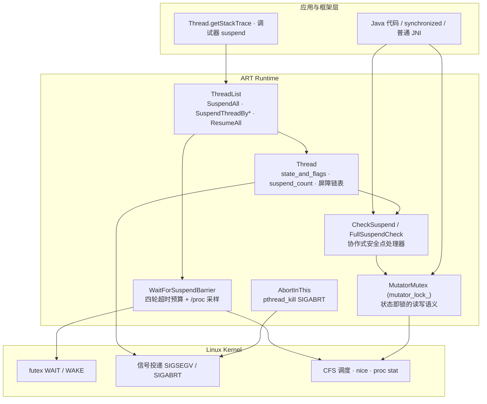
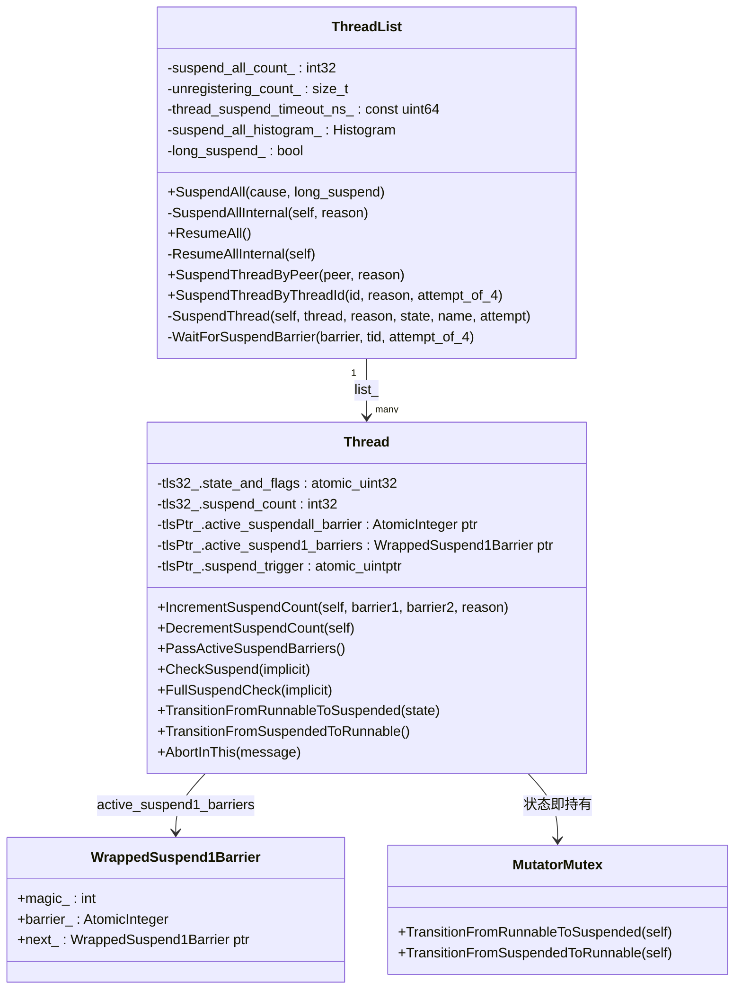
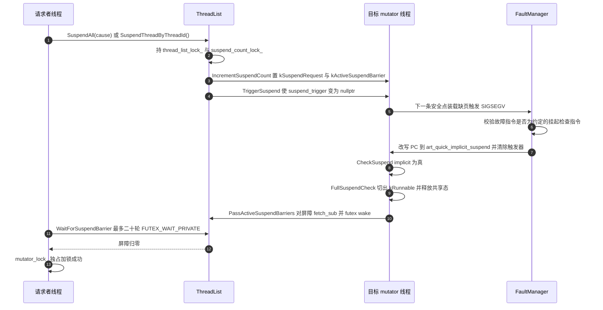
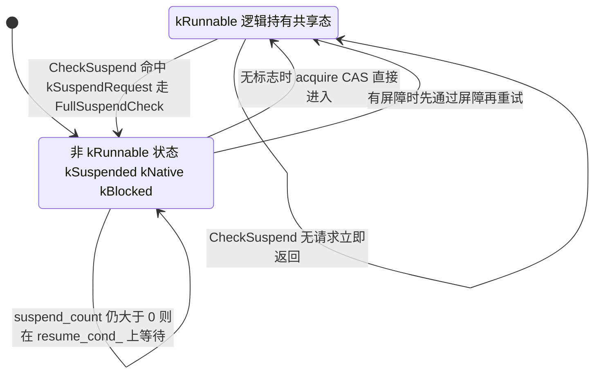

# 13 · 线程安全点挂起机制与超时精准看门狗

> [!IMPORTANT]
> **一句话核心结论**：ART 的「挂起」不是把线程真正按停，而是一份**协作契约**——`Thread::state_and_flags` 里的 `kRunnable` 位就是 `mutator_lock_` 的共享态，只要线程离开 `kRunnable` 就自动「看起来已停」，GC 才能拿独占；当线程赖在 `kRunnable` 不走时，`WaitForSuspendBarrier` 用「4 轮 × 20 次 futex 等待 + 按请求者优先级/构建类型动态放大」的超时预算兜底，最后不再含糊地 `LOG(FATAL)` 自己，而是用 `AbortInThis()` 把 `SIGABRT` 精确投递给那个拒不挂起的线程，并把 `/proc/<pid>/task/<tid>/stat` 的前后两次采样、优先级、`/proc/pressure/io`、`/proc/diskstats` 差异一起写进 abort message。

| 项目 | 内容 |
| :--- | :--- |
| **机制定位** | 协作式线程安全点（safe point）、mutator 读写锁的「状态即锁」实现、挂起屏障、超时看门狗与肇事线程定点击杀 |
| **源码模块（相对 `qssi/art/`）** | `runtime/thread_list.cc`、`runtime/thread.cc`、`runtime/thread-inl.h`、`runtime/thread.h`、`runtime/base/mutex.h`、`runtime/arch/arm64/fault_handler_arm64.cc`、`runtime/entrypoints/quick/quick_thread_entrypoints.cc`、`libartbase/base/utils.cc` |
| **核心类 / 入口** | `art::ThreadList`、`art::Thread`、`StateAndFlags`、`WrappedSuspend1Barrier`、`art::MutatorMutex`、`SuspensionHandler` |
| **关键函数** | `ThreadList::SuspendAll` / `SuspendAllInternal` / `ResumeAll` / `ResumeAllInternal` / `SuspendThread` / `SuspendThreadByPeer` / `SuspendThreadByThreadId` / `WaitForSuspendBarrier`；`Thread::IncrementSuspendCount` / `DecrementSuspendCount` / `PassActiveSuspendBarriers` / `TransitionFromRunnableToSuspended` / `TransitionFromSuspendedToRunnable` / `CheckSuspend` / `AbortInThis` |
| **关键系统属性** | `ro.hw_timeout_multiplier`、`ro.build.type`（影响超时是否翻倍） |
| **关键启动参数** | `-XX:ThreadSuspendTimeout=<ms>`、`-verbose:threads`（`VLOG(threads)` 总开关） |
| **源码基线** | `/home/voyah/workspace/8397/qssi/art`（Android 15/16 主线级 QSSI，只读） |

## 1. What：机制是什么？

### 1.1 职责边界

ART 需要「所有 mutator 线程在某一瞬间都不再触碰 Java 堆」的时刻，典型场景有三类：GC 的标记/根遍历、`Thread.getStackTrace` 一类需要遍历他人栈的调试操作、以及 thin lock 竞争时的锁膨胀（需要冻结锁持有者以安全改写 `LockWord`）。这套机制负责在这一刻到来之前，把每个处于 `kRunnable` 的线程**请**出堆访问区，并在它们不配合时给出可归因的崩溃现场。

它要解决四个问题：

1. **让「不挂起」这条快路径足够便宜**：绝大多数时间没有任何人需要独占堆，因此不能在每个 Java 内存访问前加真实锁。
2. **让「请求挂起」能穿透到任意执行点**：线程可能正在编译后的机器码里跑循环，没有函数调用，也就没有天然的检查点，必须由编译器插入**安全点（suspend point）**。
3. **让「已阻塞的线程」不产生额外等待**：正在等 monitor、等 IO、跑普通 JNI 的线程，逻辑上已经不持有堆的共享态，可以直接当作已挂起。
4. **让「不配合的线程」有界且可定位**：等待必须有超时，且超时后要能指认并击杀真正的肇事者，而不是让无辜的请求者背锅。

它**不负责**：Java 语言层 `Thread.suspend()` 的语义（那是 `SuspendReason::kForUserCode` 的调用方，同样走这套机制）、Linux 调度器行为、以及 `@FastNative` / `@CriticalNative` 的注解判定（注解只决定线程是否要跳过状态切换，见 §2.3）。

### 1.2 核心术语表

| 术语 | 含义 | 源码锚点 |
| :--- | :--- | :--- |
| `kRunnable` | 线程逻辑上持有 `mutator_lock_` 共享态、可以访问 Java 堆的状态；是「未挂起」的唯一含义 | [thread_state.h](file:///home/voyah/workspace/8397/qssi/art/runtime/thread_state.h#L30-L40) |
| `mutator_lock_` / `MutatorMutex` | 逻辑上的堆读写锁；`kRunnable` 状态本身等价于持有共享态，物理 rwlock 只在独占者需要时才真正参与 | [mutex.h](file:///home/voyah/workspace/8397/qssi/art/runtime/base/mutex.h#L428-L459) |
| 安全点（suspend point / safe point） | 编译器在循环回边、方法返回等处插入的检查点；ARM64 上实现为对 `suspend_trigger` 的一次装载 | [mutator_gc_coord.md](file:///home/voyah/workspace/8397/qssi/art/runtime/mutator_gc_coord.md#L21-L29) |
| 隐式挂起检查（implicit suspend check） | 把 `tlsPtr_.suspend_trigger` 置空，让下一条安全点指令缺页触发 `SIGSEGV`，由信号处理器接住并转进 runtime | [thread.h](file:///home/voyah/workspace/8397/qssi/art/runtime/thread.h#L1633-L1639) |
| 挂起屏障（suspend barrier） | 一个 `AtomicInteger` 倒数计数器；目标线程离开 `kRunnable` 时把它减到 0，请求者在此 futex 上等待 | [thread.h](file:///home/voyah/workspace/8397/qssi/art/runtime/thread.h#L270-L277) |
| `kSuspendRequest` | 标志位 `1u << 0`，告诉目标线程「该进安全点处理器了」 | [thread.h](file:///home/voyah/workspace/8397/qssi/art/runtime/thread.h#L136-L149) |
| `kActiveSuspendBarrier` | 标志位 `1u << 3`，表示有屏障挂在 `tlsPtr_` 链表上等待被通过 | [thread.h](file:///home/voyah/workspace/8397/qssi/art/runtime/thread.h#L147-L149) |
| `kSuspensionImmune` | 标志位 `1u << 6`；`SuspendAll` 的发起者在 `ResumeAll` 之前对他人挂起请求免疫 | [thread.h](file:///home/voyah/workspace/8397/qssi/art/runtime/thread.h#L168-L177) |
| `attempt_of_4` | 等待轮次编号：`0` 表示单轮（用满整个超时），`1..4` 表示四轮分档等待 | [thread_list.h](file:///home/voyah/workspace/8397/qssi/art/runtime/thread_list.h#L99-L108) |
| `AbortInThis` | 把 `SIGABRT` 定向 `pthread_kill` 到肇事线程，并设置 abort message | [thread.cc](file:///home/voyah/workspace/8397/qssi/art/runtime/thread.cc#L5198-L5216) |

### 1.3 架构定位



三层的关系可以一句话概括：**应用层的每一次 Java 内存访问都在「隐式持有」`mutator_lock_` 共享态；ART 只在需要独占时才通过 `ThreadList` 把这份隐式持有显式收回；收回的手段是内核的 futex 与信号，而不是内核的线程停止原语。**

## 2. Why：为什么需要它？

### 2.1 朴素方案的四个坑

**坑一：每个堆访问都过一把真锁。** 若 `mutator_lock_` 是物理 rwlock，每次 Java 层读写都要做一次原子加解锁，直接摧毁解释执行与 JIT 代码的性能。ART 的取舍是把「锁」编码进线程状态位：`state_and_flags` 的低 8 位存标志、高 8 位存状态，而 `kRunnable == 0`（见 [thread_state.h](file:///home/voyah/workspace/8397/qssi/art/runtime/thread_state.h#L38-L40)），于是「是否可能有标志位待处理」只需一次非零判断。`MutatorMutex::TransitionFromSuspendedToRunnable()` 只在**逻辑上**登记持锁，不做任何原子 RMW，见 [mutex-inl.h](file:///home/voyah/workspace/8397/qssi/art/runtime/base/mutex-inl.h#L303-L311)。

**坑二：用 `SIGSTOP` / `ptrace` 强行停线程。** 内核可以在任意指令边界停住线程，但 ART 无法保证那一刻线程没有握着裸的堆指针（例如已经算好对象地址、尚未完成写入）。真正的堆一致性只能靠编译器插桩出来的安全点来保证，因此挂起必须**协作**。

**坑三：无限期等待。** 一旦某个线程因为死锁、CPU 严重超售或长时间不检查安全点而赖在 `kRunnable`，无条件等待会把整个进程拖成无日志的假死，最终表现为难以分析的 ANR，而不是可定位的崩溃。因此等待必须有界。

**坑四：超时了就自己崩。** 早期实现里超时直接让**请求者** `LOG(FATAL)`，现场看到的是「无辜者」的调用栈——它只是在做一次 `SuspendAll`，栈上完全没有肇事线索。Android 15 的改造把这一步反转：先尽力在**肇事线程**上 abort，只有在没找到或太慢时才由请求者兜底，见 [thread_suspension_timeouts.md](file:///home/voyah/workspace/8397/qssi/art/runtime/thread_suspension_timeouts.md#L23-L39)。

### 2.2 方案演进对比

| 方案 | 快路径成本 | 堆一致性 | 超时行为 | 现场可归因性 |
| :--- | :--- | :--- | :--- | :--- |
| 物理 rwlock 护堆 | 每次访问一次原子操作 | 强 | 取决于锁实现 | 低（只能看到锁等待） |
| 外部信号/`SIGSTOP` 停线程 | 无 | 弱（任意指令点不可安全冻结） | 无 | 低 |
| 协作式安全点 + 无界等待 | 无（安全点是一次装载） | 强 | 无（进程假死） | 极低 |
| 协作式安全点 + 请求者自杀（旧） | 无 | 强 | 4~12 s 后 `LOG(FATAL)` | 低（栈是请求者的） |
| 协作式安全点 + 定点击杀（现行） | 无 | 强 | 4~12 s，可被动态放大 | 高（肇事线程栈 + `/proc` 双采样） |

### 2.3 三个必须区分的边界

第一，**「挂起」不等于「线程停住」**。被挂起的线程可以继续在内核里跑、继续执行 native 代码，只要它不碰 Java 数据结构。线程卡在 monitor 上时，它其实睡在 `Monitor` 内部的 mutex 上，ART 认为它已挂起。

第二，**普通 JNI 与 `@FastNative` / `@CriticalNative` 的成本是反向的**。普通 JNI 进出各做一次状态切换（贵），换来的是 native 期间线程已挂起、GC 不必等它；`@FastNative` / `@CriticalNative` 省掉切换，代价是**整个调用期间线程保持 `kRunnable`**，GC 必须干等，安全点检查也进不来。这正是「挂起超时」最高频的诱因之一，原文见 [mutator_gc_coord.md](file:///home/voyah/workspace/8397/qssi/art/runtime/mutator_gc_coord.md#L38-L45)。

第三，**GC 自己永远不会被挂起**。GC 可能在任意线程上运行，因此 ART 让它始终表现为「已挂起状态」，挂起请求要等 GC 做完才会被看到。这条不变量是死锁自由的关键，见 [mutator_gc_coord.md](file:///home/voyah/workspace/8397/qssi/art/runtime/mutator_gc_coord.md#L224-L237)。

## 3. How：源码级实现原理深度剖析

### 3.1 核心数据结构与内存布局

#### 3.1.1 `StateAndFlags`：32 位里塞下状态与标志

`StateAndFlags` 是 `tls32_.state_and_flags`（一个 `std::atomic<uint32_t>`）的解码视图，位域由 [thread.h](file:///home/voyah/workspace/8397/qssi/art/runtime/thread.h#L2103-L2111) 定义：状态占最高 8 位（`ThreadState : uint8_t`），标志占最低 8 位（`kLastFlag = 1u << 7`，故 `AllThreadFlags() == 0xFF`）。

```text
 31              24 23                            8 7              0
+-----------------+-------------------------------+----------------+
|  ThreadState    |        保留（恒 0）            |  ThreadFlag    |
|  uint8_t        |                               |  uint8_t       |
+-----------------+-------------------------------+----------------+
     |                        |                          |
     |                        |                          +-- bit0 kSuspendRequest
     |                        |                              bit1 kCheckpointRequest
     |                        |                              bit2 kEmptyCheckpointRequest
     |                        |                              bit3 kActiveSuspendBarrier
     |                        |                              bit4 kPendingFlipFunction
     |                        |                              bit5 kRunningFlipFunction
     |                        |                              bit6 kSuspensionImmune
     |                        |                              bit7 kMonitorJniEntryExit
     |                        +-- 8..23 位没有使用者：留给未来的标志与状态扩展
     +-- kRunnable = 0x00 / kTerminated = 0x42 / kBlocked = 0x46 / kNative = 0x5C / kSuspended = 0x5D
```

这样设计带来两个直接收益：

- **「非 Runnable 且有挂起请求」= 一次读 + 两次位测试**，即 `IsSuspended()`，见 [thread.h](file:///home/voyah/workspace/8397/qssi/art/runtime/thread.h#L433-L440)。
- 状态与标志在**同一个原子字**里，因此「先置 `kSuspendRequest`，再读状态」与「先改状态，再读标志」之间的 store-load 顺序天然由同一原子对象保证，不必额外 fence（这点在 [mutator_gc_coord.md](file:///home/voyah/workspace/8397/qssi/art/runtime/mutator_gc_coord.md#L276-L280) 有完整论证）。

#### 3.1.2 `WrappedSuspend1Barrier`：请求者栈帧上的链表节点

`SuspendAll` 的屏障是一个局部的 `AtomicInteger pending_threads`，全进程同时只允许一个 `SuspendAll`，所以它可以独占 `tlsPtr_.active_suspendall_barrier` 这一个槽位。而 `SuspendThreadByPeer` / `SuspendThreadByThreadId` 允许多个请求者同时指向同一目标，于是每个请求者在**自己的栈帧**上放一个节点，串成 LIFO 链表：

```text
 WrappedSuspend1Barrier（由请求者在自己的栈帧上构造，LIFO 串入目标线程）
 偏移  大小   字段        初值      作用
 ----  ----   ----------  --------  --------------------------------------------
   0     4    magic_      0xba8     节点有效性校验，被踩坏时 CHECK 立即失败
   4     4    barrier_    1         原子倒数计数，目标线程离开 kRunnable 时减 1
   8     8    next_       nullptr   指向同一目标线程上的下一个请求者节点
 ----  ----
  16    16    合计        16 B      4 + 4 + 8，LP64 下无需额外填充

 目标线程 tlsPtr_ 里的两个槽位：
   active_suspendall_barrier : AtomicInteger*          仅 SuspendAll 使用，全局唯一
   active_suspend1_barriers  : WrappedSuspend1Barrier* 单线程挂起用，可多个，LIFO
```

`magic_` 是为了在后置校验时识别节点是否被踩坏（源码里保留了 `TODO(b/323668816)`，说明历史上出过问题），见 [thread.h](file:///home/voyah/workspace/8397/qssi/art/runtime/thread.h#L269-L277)。节点放在栈上、由持有 `thread_suspend_count_lock_` 的请求者在返程中摘除，因此**链表生命周期严格被锁保护**，不能出现在锁外被目标线程访问到的窗口。

#### 3.1.3 类关系



### 3.2 请求侧：一次 `fetch_or` 完成「置标志 + 计数 + 触发」

所有挂起请求最终收敛到 `IncrementSuspendCount()`。它要求在 `thread_suspend_count_lock_` 下执行，并且在 `this != self` 时还要求 `thread_list_lock_`——这把锁的作用不是保护计数，而是**防止目标线程在请求过程中消失**。

```cpp
// runtime/thread-inl.h:530-548（节选）
uint32_t flags = enum_cast<uint32_t>(ThreadFlag::kSuspendRequest);
if (suspendall_barrier != nullptr) {
  tlsPtr_.active_suspendall_barrier = suspendall_barrier;
  flags |= enum_cast<uint32_t>(ThreadFlag::kActiveSuspendBarrier);
} else if (suspend1_barrier != nullptr) {
  AddSuspend1Barrier(suspend1_barrier);
  flags |= enum_cast<uint32_t>(ThreadFlag::kActiveSuspendBarrier);
}
++tls32_.suspend_count;
if (reason == SuspendReason::kForUserCode) { ++tls32_.user_code_suspend_count; }
// Two bits might be set simultaneously.
tls32_.state_and_flags.fetch_or(flags, std::memory_order_release);
TriggerSuspend();
```

注意三个细节：

1. **引用计数语义**：`suspend_count` 是累加的，因此嵌套请求（GC 的 `SuspendAll` 与调试器的单线程挂起撞在一起）不会互相覆盖；只有减到 0 时才清 `kSuspendRequest`，见 [thread-inl.h](file:///home/voyah/workspace/8397/qssi/art/runtime/thread-inl.h#L555-L577)。
2. **`release` 序**：`fetch_or` 用 release，配合目标线程侧的 acquire CAS，保证「屏障链表的写入」happen-before「目标线程看到 `kSuspendRequest`」。
3. **`TriggerSuspend()` 是加速器，不是必需路径**：解释器可以直接看标志位；编译代码才依赖 `suspend_trigger` 缺页。原文注释明确写了这一点，见 [thread.h](file:///home/voyah/workspace/8397/qssi/art/runtime/thread.h#L1633-L1639)。

### 3.3 目标侧：从一次缺页到「我挂起了」

#### 3.3.1 隐式挂起检查的机器码约定

ARM64 的编译代码在每个安全点只做一件事：通过 `x21` 装载一次。ART 保留 `x21` 作为 **suspend check register**（`kSuspendCheckRegister = 21`），期望指令字恰好是 `0xf9400000 | (21 << 5) | 21`，即 `ldr x21, [x21, #0]`。请求者把 `suspend_trigger` 写成 `nullptr` 后，这条装载必然缺页，`SuspensionHandler::Action()` 校验指令字，命中则把返回地址改成 `art_quick_implicit_suspend`，并立刻清掉触发器，见 [fault_handler_arm64.cc](file:///home/voyah/workspace/8397/qssi/art/runtime/arch/arm64/fault_handler_arm64.cc#L96-L131)。汇编入口保存完整寄存器帧后调用 `artImplicitSuspendFromCode`，见 [quick_thread_entrypoints.cc](file:///home/voyah/workspace/8397/qssi/art/runtime/entrypoints/quick/quick_thread_entrypoints.cc#L57-L70)。

这条路径的妙处在于：**成本只在被请求时发生**。没有人请求挂起时，安全点就是一次普通的寄存器间接装载，不产生任何系统调用；一旦请求，就把「检查」升级成一次异常，顺带得到完整的寄存器现场用于栈回溯。

#### 3.3.2 `CheckSuspend` 的分派顺序

```cpp
// runtime/thread-inl.h:84-106（节选）
StateAndFlags state_and_flags = GetStateAndFlags(std::memory_order_acquire);
if (LIKELY(!state_and_flags.IsAnyOfFlagsSet(SuspendOrCheckpointRequestFlags()))) {
  break;
} else if (state_and_flags.IsFlagSet(ThreadFlag::kCheckpointRequest)) {
  RunCheckpointFunction();
} else if (state_and_flags.IsFlagSet(ThreadFlag::kSuspendRequest) &&
           !state_and_flags.IsFlagSet(ThreadFlag::kSuspensionImmune)) {
  FullSuspendCheck(implicit);
  implicit = false;
} else if (state_and_flags.IsFlagSet(ThreadFlag::kEmptyCheckpointRequest)) {
  RunEmptyCheckpoint();
}
```

分派顺序是固定的：**checkpoint → suspend → empty checkpoint**。前两者都可能让线程真正离开 `kRunnable`，而空 checkpoint 只需要线程「经过一次安全点」，不切状态也不碰 `mutator_lock_`，因此排在最后；`kSuspensionImmune` 的排除则保证 `SuspendAll` 的发起者不会在半路把自己挂掉——`SuspendAllInternal` 在完成请求后立刻给自己置上这个标志，见 [thread_list.cc](file:///home/voyah/workspace/8397/qssi/art/runtime/thread_list.cc#L1016-L1017)。

#### 3.3.3 离开 `kRunnable` 时必然过屏障

`FullSuspendCheck()` 的实现非常短：构造一个 `ScopedThreadSuspension`，进来一次出去一次，见 [thread.cc](file:///home/voyah/workspace/8397/qssi/art/runtime/thread.cc#L2053-L2067)。真正的屏障通过发生在状态切换里：

```cpp
// runtime/thread-inl.h:333-349
inline void Thread::TransitionFromRunnableToSuspended(ThreadState new_state) {
  AssertThreadSuspensionIsAllowable();
  PoisonObjectPointersIfDebug();
  DCHECK_EQ(this, Thread::Current());
  TransitionToSuspendedAndRunCheckpoints(new_state);
  GetMutatorLock()->TransitionFromRunnableToSuspended(this);
  CheckActiveSuspendBarriers();   // <- 这里是唯一的屏障通过点
}
```

`CheckActiveSuspendBarriers()` → `PassActiveSuspendBarriers()` 在 `thread_suspend_count_lock_` 下把链表整体摘下、清 `kActiveSuspendBarrier`，再对每个屏障 `fetch_sub`，最后在锁外 futex wake：

```cpp
// runtime/thread.cc:1623-1630
for (AtomicInteger*& barrier : pass_barriers) {
  int32_t old_val = barrier->fetch_sub(1, std::memory_order_release);
  CHECK_GT(old_val, 0) << "Unexpected value for PassActiveSuspendBarriers(): " << old_val;
  if (old_val != 1) { barrier = nullptr; }
}
```

「锁内摘链 + 锁外 wake」的组合解决了两个问题：`SuspendThread` 可以在持锁状态下安全地摘除并释放栈上的节点；而 futex wake 放到锁外执行，避免在临界区里做可能被抢占或阻塞的唤醒操作。

#### 3.3.4 端到端时序



若目标线程**已经**处于非 `kRunnable`（例如正卡在 monitor 上），则不会有缺页：请求者在持锁期间就发现 `thread->IsSuspended()` 为真，于是代表目标线程把屏障减掉，整条路径缩短为几次原子操作，见 [thread_list.cc](file:///home/voyah/workspace/8397/qssi/art/runtime/thread_list.cc#L993-L1005) 与 [thread.cc](file:///home/voyah/workspace/8397/qssi/art/runtime/thread.cc#L1826-L1835)。

#### 3.3.5 恢复方向的状态机



恢复路径的核心是 `TransitionFromSuspendedToRunnable()` 里那次 **acquire CAS**：只有确认 `SuspendOrCheckpointRequestFlags() | kActiveSuspendBarrier | FlipFunctionFlags()` 全为 0 才允许切回 `kRunnable`，见 [thread-inl.h](file:///home/voyah/workspace/8397/qssi/art/runtime/thread-inl.h#L362-L380)。这一步同时充当「屏障已全部通过」与「没有新请求插队」的合流点，是整个机制的正确性支点。

### 3.4 `SuspendAll`：两段式合流

```cpp
// runtime/thread_list.cc:975-1019（节选，注释已精简）
MutexLock mu(self, *Locks::thread_list_lock_);
MutexLock mu2(self, *Locks::thread_suspend_count_lock_);
if (suspend_all_count_ == 0) {
  ++suspend_all_count_;
  pending_threads.store(list_.size() - (self == nullptr ? 0 : 1), std::memory_order_relaxed);
  for (const auto& thread : list_) {
    if (thread == self) { found_myself = true; }
    else {
      thread->IncrementSuspendCount(self, &pending_threads, nullptr, reason);
      if (thread->IsSuspended()) {
        pending_threads.fetch_sub(1, std::memory_order_seq_cst);
        thread->tlsPtr_.active_suspendall_barrier = nullptr;
        if (!thread->HasActiveSuspendBarrier()) {
          thread->AtomicClearFlag(ThreadFlag::kActiveSuspendBarrier);
        }
      }
    }
  }
  self->AtomicSetFlag(ThreadFlag::kSuspensionImmune, std::memory_order_relaxed);
}
```

设计要点：

- **`suspend_all_count_` 是全局互斥**，保证同一时刻只有一个 `SuspendAll`，于是 `pending_threads` 可以是单实例、可以放在栈上。
- **先置标志、后检查状态**是刻意顺序。若反过来，目标线程可能在两次操作之间完成挂起，于是永远看不到标志；按现有顺序，它要么在检查前已挂起（由请求者代减屏障），要么在检查后看到标志并自己减屏障。这条论证在 [mutator_gc_coord.md](file:///home/voyah/workspace/8397/qssi/art/runtime/mutator_gc_coord.md#L239-L280) 有完整版本。
- **`kSuspensionImmune`** 封住了「刚发起 `SuspendAll` 就被别人请求挂起」这条死锁路径：否则 A 在等所有人，B 却在等 A。

随后 `SuspendAll()` 还要拿 `mutator_lock_` 独占。这一步也可能慢——源码注释的原话是「所有线程都已挂起，但某个线程可能仍持有 mutator 锁」，因此这里是第二层看门狗：

```cpp
// runtime/thread_list.cc:908-920（节选）
#if HAVE_TIMED_RWLOCK
  while (true) {
    if (Locks::mutator_lock_->ExclusiveLockWithTimeout(self, NsToMs(thread_suspend_timeout_ns_), 0)) {
      break;
    } else if (!long_suspend_) {
      UnsafeLogFatalForThreadSuspendAllTimeout();
    }
  }
#endif
```

`long_suspend`（堆转储 hprof 用）会关掉这层保护，因为大堆导出本来就要几秒到几十秒。`UnsafeLogFatalForThreadSuspendAllTimeout()` 会先 dump 锁状态再 dump 全部线程栈，见 [thread_list.cc](file:///home/voyah/workspace/8397/qssi/art/runtime/thread_list.cc#L292-L306)。

### 3.5 超时预算：四轮、动态放大、五档豁免

`WaitForSuspendBarrier()` 是整个看门狗的算术核心。它把一次等待拆成最多 4 次调用（`attempt_of_4 = 1..4`），每次内部再切成 `kSuspendBarrierIters = 20` 个 futex 等待片段，见 [thread_list.cc](file:///home/voyah/workspace/8397/qssi/art/runtime/thread_list.cc#L718-L746)。

```cpp
// runtime/thread_list.cc:774-802（节选）
uint64_t timeout_ns =
    attempt_of_4 == 0 ? thread_suspend_timeout_ns_ : thread_suspend_timeout_ns_ / 4;
static bool is_user_build = (android::base::GetProperty("ro.build.type", "") == "user");
if (is_user_build) { timeout_ns *= USER_MULTIPLIER; }   // USER_MULTIPLIER = 2
uint64_t avg_wait_multiplier = 1;
uint64_t wait_multiplier = 1;
if (attempt_of_4 != 1) {
  if (getpriority(PRIO_PROCESS, 0) > Thread::PriorityToNiceness(kNormThreadPriority)) {
    avg_wait_multiplier = 3;
  }
  wait_multiplier = attempt_of_4 == 4 ? 2 * avg_wait_multiplier - 1 : avg_wait_multiplier;
  timeout_ns *= wait_multiplier;
}
```

设基准 `T = thread_suspend_timeout_ns_`，则每轮的账面预算为：

| `attempt_of_4` | 单轮预算 | 优先级放大 | 作用 |
| :--- | :--- | :--- | :--- |
| `0` | `T` | 不放大 | `SuspendThreadByPeer` 与同步 checkpoint 的单次模式，不重试 |
| `1` | `T/4` | 跳过 `getpriority()`（省一次系统调用） | 第一次试探，绝大多数情况在此成功 |
| `2` | `T/4` | `× avg` | 继续等，给慢线程一点余量 |
| `3` | `T/4` | `× avg` | 收尾前枚举仍处 `kRunnable` 的线程，记下 `culprit` 与 `tid` |
| `4` | `T/4` | `× (2·avg − 1)` | 最终轮；采样 `/proc` 并准备 `AbortInThis` |

`T` 的来源有三层叠加，见 [thread_list.h](file:///home/voyah/workspace/8397/qssi/art/runtime/thread_list.h#L53-L58) 与 [runtime.cc](file:///home/voyah/workspace/8397/qssi/art/runtime/runtime.cc#L1560-L1568)：默认值 release 为 4 s、debug 为 2 s；若未指定 `-XX:ThreadSuspendTimeout=<ms>`，再乘上 `ro.hw_timeout_multiplier`。把上面两段乘开后得到四档总量：

| 场景 | 四轮预算（`T` = 4 s，`ro.hw_timeout_multiplier` = 1） | 总计 |
| :--- | :--- | :--- |
| 请求者非低优先级（`avg = 1`） | 1 s + 1 s + 1 s + 1 s | **4 s** |
| 请求者是低优先级（`avg = 3`） | 1 s + 3 s + 3 s + 5 s | **12 s** |
| user 版本且非低优先级 | 2 s + 2 s + 2 s + 2 s | **8 s** |
| user 版本且低优先级 | 2 s + 6 s + 6 s + 10 s | **24 s** |

[thread_suspension_timeouts.md](file:///home/voyah/workspace/8397/qssi/art/runtime/thread_suspension_timeouts.md#L14-L17) 把这几档概括为「请求者高优先级时 4 秒，否则 8 或 12 秒」，与上表同源：12 s 对应低优先级放大，8 s 对应 user 版本整体翻倍，24 s 则是两者叠加。

除账面预算外，还有五处**动态豁免**，它们都写在 `WaitForSuspendBarrier` 的后半段：

| 豁免 | 触发条件 | 效果 | 源码 |
| :--- | :--- | :--- | :--- |
| 调试器停住 | `/proc` 采样状态字符为 `t`（traced-stop） | 预算直接改成 `kTracingWaitNSecs` = 7200 s，并打 WARNING | [thread_list.cc](file:///home/voyah/workspace/8397/qssi/art/runtime/thread_list.cc#L826-L836) |
| 并发线程转储 | `Runtime::SigQuitNanoTime()` 有值（signal catcher 正在 dump） | 每轮追加约 30 s 量级的 `dump_adjustment_ns`，避免 ANR 抓栈期间误判 | [thread_list.cc](file:///home/voyah/workspace/8397/qssi/art/runtime/thread_list.cc#L820-L861) |
| user 版本宽容 | `ro.build.type == "user"` | 全部预算 ×2，把崩溃更多转成 ANR（对用户更友好） | [thread_list.cc](file:///home/voyah/workspace/8397/qssi/art/runtime/thread_list.cc#L776-L785) |
| 低优先级请求者 | `getpriority()` 高于 `kNormThreadPriority` 对应 niceness | `avg_wait_multiplier` 提为 3 | [thread_list.cc](file:///home/voyah/workspace/8397/qssi/art/runtime/thread_list.cc#L786-L802) |
| 已挂起即代减 | `IncrementSuspendCount` 后 `IsSuspended()` 为真 | 根本不进入等待 | [thread_list.cc](file:///home/voyah/workspace/8397/qssi/art/runtime/thread_list.cc#L994-L1005) |

值得一提的是源码里的一处细节：`dump_adjustment_ns = new_unscaled_adj * kSuspendBarrierIters / kSuspendBarrierIters - i;`（[thread_list.cc:858](file:///home/voyah/workspace/8397/qssi/art/runtime/thread_list.cc#L858)）中乘除同一常量相互抵消，实际落地的调整量约为 `new_unscaled_adj - i` 纳秒。读代码时按注释「按剩余轮次比例缩放」去理解会与实现不符，排查 ANR 期间的超时窗口时需要以实际代码为准。

### 3.6 定点击杀：把现场留在肇事线程上

超时后的收尾分两种情况。`SuspendAllInternal` 在第 3 轮枚举出 `culprit`（枚举结果里的最后一个未挂起线程），第 4 轮仍失败就把它交出去：

```cpp
// runtime/thread_list.cc:1058-1073（节选）
} else if (attempt_of_4 == 4) {
  if (culprit == nullptr) {
    LOG(FATAL) << "SuspendAll timeout. Couldn't find holdouts.";
  } else {
    std::string name;
    culprit->GetThreadName(name);
    oss << "Info for " << name << ": ";
    std::string thr_descr = StringPrintf(
        "state&flags: 0x%x, Java/native priority: %d/%d, ",
        culprit->GetStateAndFlags(std::memory_order_relaxed).GetValue(),
        culprit->GetNativePriority(),
        getpriority(PRIO_PROCESS /* really thread */, culprit->GetTid()));
    oss << thr_descr << result.value();
    culprit->AbortInThis("SuspendAll timeout; " + oss.str());
  }
}
```

`AbortInThis()` 做四件事：把消息打到 log、设置进程 abort message、向**肇事线程**的 `pthread_self` 发 `SIGABRT`、然后 `sleep(10)` 等进程死：

```cpp
// runtime/thread.cc:5198-5216（节选）
void Thread::AbortInThis(const std::string& message) {
  std::string thread_name;
  Thread::Current()->GetThreadName(thread_name);
  LOG(ERROR) << message;
  LOG(ERROR) << "Aborting culprit thread";
  Runtime::Current()->SetAbortMessage(("Caused " + thread_name + " failure : " + message).c_str());
  int res = pthread_kill(tlsPtr_.pthread_self, SIGABRT);
  if (res != 0) { LOG(ERROR) << "pthread_kill failed with " << res << " " << strerror(res); }
  else { sleep(10 /* seconds */); }
  LOG(FATAL) << "Failed to abort in culprit thread: " << message;
}
```

这里有个容易误读的地方：abort message 里的 `Caused <name> failure` 用的是 `Thread::Current()` 的名字，也就是**发起挂起请求的那个线程**，而不是肇事线程——因为这段代码仍在请求者栈上执行。真正的肇事者信息在 message 正文里（名字 + `state&flags` + `Java/native priority` + `/proc` 双采样）。单线程挂起的路径还会额外带上 `nsusps` / `ncheckpts`（本轮新增的挂起与 checkpoint 次数），见 [thread_list.cc](file:///home/voyah/workspace/8397/qssi/art/runtime/thread_list.cc#L1268-L1290)。

### 3.7 超时报告里到底有什么：`/proc` 双采样

`WaitForSuspendBarrier` 在最后一轮会采集三类数据，拼进返回值：

1. **`/proc/<pid>/task/<tid>/stat` 的两次前缀**（间隔至少一轮迭代）。采样函数刻意使用 `/proc/<pid>/task/<tid>/stat` 而非 `/proc/<tid>/stat`，因为后者给出的是整个进程的 `utime`/`stime`，见 [utils.cc](file:///home/voyah/workspace/8397/qssi/art/libartbase/base/utils.cc#L387-L409)。这一点在 [thread_suspension_timeouts.md](file:///home/voyah/workspace/8397/qssi/art/runtime/thread_suspension_timeouts.md#L33-L39) 里被专门点出（Android 15 早期版本用错了路径）。
2. **状态字符**：`R` 运行、`S` 可中断睡眠、`D` 不可中断睡眠、`Z` 僵尸、`t` 被调试器停住。字符由 `GetStateFromStatString()` 从右括号后第一个非空格位置取出，见 [utils.cc](file:///home/voyah/workspace/8397/qssi/art/libartbase/base/utils.cc#L425-L435)。
3. **仅当两次采样都是 `D` 时的 IO 现场**：`/proc/pressure/io` 的前三列与 `/proc/diskstats` 中 `sda` 的增量（`ioms` 毫秒、`wrms` 毫秒、`flms` 毫秒、`in progress` 变化），见 [utils.cc](file:///home/voyah/workspace/8397/qssi/art/libartbase/base/utils.cc#L529-L566) 与 [thread_list.cc](file:///home/voyah/workspace/8397/qssi/art/runtime/thread_list.cc#L866-L890)。

拼装出来的字符串形如（按源码格式还原，尖括号为占位）：

```text
/proc/.../stat: <前一次采样>-><后一次采样>; [pressure/io: <some 三列>, <full 三列>; ]
[diskstats(sda): ioms: <n>, wrms: <n>, [flms: <n>, ]in progress: <n>-><n>; ]
Final wait time: <duration>; appr. total wait time: <duration>
```

`appr. total wait time` 的折算逻辑是：非 `attempt 0` 时按 `4 * final_wait_time * avg_wait_multiplier / wait_multiplier` 反推，让归一到「四轮全跑满」的口径，方便与其他档位比较，见 [thread_list.cc](file:///home/voyah/workspace/8397/qssi/art/runtime/thread_list.cc#L862-L865)。

### 3.8 死锁自由的四条不变量

这套机制的正确性依赖四条在 [mutator_gc_coord.md](file:///home/voyah/workspace/8397/qssi/art/runtime/mutator_gc_coord.md#L142-L238) 中系统论证过的不变量：

1. **锁序**：`mutator_lock_` 在 ART 的锁层级里占据固定位置，只有 `kPostMutatorTopLockLevel` 及其以下的锁可以在它之后获取。发起 checkpoint / 挂起被视作一次 `mutator_lock_` 获取，因此「等待挂起的人」自身只可能阻塞在更低的锁上，而更低锁的持有者不依赖 `mutator_lock_`。
2. **禁止挂起成环**：若请求者自身 `suspend_count != 0`，`SuspendThread()` 不会发起新请求，而是放锁、睡 100 µs、重试（上限 `kMaxSuspendRetries` = 5000/500），见 [thread_list.cc](file:///home/voyah/workspace/8397/qssi/art/runtime/thread_list.cc#L1184-L1233)。
3. **`SuspendAll` 单一化 + 免疫**：全局只允许一个 `SuspendAll`，且发起者在完成前免疫单线程挂起请求。
4. **GC 永不被挂起**：GC 所在的线程始终表现为非 `kRunnable`，因此针对它的挂起请求会「排队」到 GC 做完，不会把 GC 卡在自己要等的锁上。

## 4. 能利用这个机制做什么？

### 4.1 场景一：把 `SuspendAll timeout` 从「玄学崩溃」变成「可归因事故」

拿到一条 abort message 后按固定顺序读五件事，基本能在十分钟内定性：

| 读什么 | 位置 | 说明 |
| :--- | :--- | :--- |
| `Caused <name> failure` 里的 `<name>` | abort message 前缀 | 是**请求者**，不是肇事者；据此判断是 GC、调试器还是锁膨胀发起的 |
| `SuspendAll timeout` 还是 `SuspendThreadByThreadId timed out` | message 前缀 | 前者一般是 GC/显式 `ScopedSuspendAll`；后者多半是 thin lock 膨胀或 `Thread.getStackTrace` |
| `Info for <name>` | message 正文 | **真正的肇事线程名**，这是最关键的字段 |
| `state&flags: 0x...` | 同上 | 高 8 位是 `ThreadState`（如 `0x46` = `kBlocked`），低 8 位是标志（`0x3` = suspend + checkpoint） |
| `/proc/.../stat` 的 `A->B` 两段 | 同上 | 两次状态不一致（如 `R->D`）说明线程在跑但滑进了 IO 等待；两次都 `R` 且 `utime/stime` 不涨说明它压根没拿到 CPU |

最后一条是区分「代码不检查安全点」与「CPU 被超售」的分水岭：`utime`/`stime` 增量接近 0 而状态是 `R`，是典型的**饥饿**而非死锁；`utime` 增量很大而状态一直是 `R`，则是**长时间不检查安全点的热循环**。

### 4.2 场景二：用挂起直方图给 GC 停顿做基线

`SuspendAll` 每次都会把耗时喂进 `suspend_all_histogram_`，并在 SIGQUIT 转储里打印（仅当有样本时）：

```text
suspend all histogram:	Sum: 1.234s 99% C.I. 0.123ms-12.456ms Avg: 1.234ms Max: 45.678ms
```

（上例为格式示意，数值为占位。）格式由 `PrintConfidenceIntervals()` 生成，见 [histogram-inl.h](file:///home/voyah/workspace/8397/qssi/art/libartbase/base/histogram-inl.h#L193-L207)。判读要点：

- **`Avg` 是主指标**：它直接等价于每次 STW 的平均世界停顿，长稳车机场景应稳定在亚毫秒到毫秒级。
- **`Max` 决定尾巴**：单次挂起耗时超过 5 ms 会在 logcat 里额外打一条 `Suspending all threads took: <dur>` 警告（阈值 `kLongThreadSuspendThreshold = MsToNs(5)`，见 [thread_list.cc](file:///home/voyah/workspace/8397/qssi/art/runtime/thread_list.cc#L67)）。
- **`Sum` 是累计时间**，可用于估算 GC 挂起在整机 CPU 时间里的占比。

抓取方式：

```bash
adb shell pidof com.example.app                          # 取到 <pid>
adb shell kill -3 <pid>                                  # 触发 SIGQUIT，输出含挂起直方图
adb logcat -b main -s art:* | grep -E "suspend all histogram|Suspending all threads took"
```

### 4.3 场景三：定位自己代码里的「安全点荒漠」

如果崩溃指向自家线程，按 [thread_suspension_timeouts.md](file:///home/voyah/workspace/8397/qssi/art/runtime/thread_suspension_timeouts.md#L41-L85) 给的分类逐条排除：

1. **`@FastNative` / `@CriticalNative` 里做了长耗时的活**。这类调用全程保持 `kRunnable`，期间不会响应挂起。修法是把长耗时部分挪到普通 native（进出会切状态），或者直接去掉注解。
2. **持有 native 锁的同时调用 Java**，形成 `mutator_lock_` ↔ native 锁的交叉等待。这是典型的「挂起死锁」，一旦定位到，修法通常很干净。
3. **`ScopedObjectAccess` 段太长**。它在语义上等价于「我还在 `kRunnable`」，把它拆短即可；注意拆的时候不能跨段持有裸的 Java 对象指针。
4. **高频生成 Java 栈回溯**。`Thread.getStackTrace()` 需要挂起目标线程，低优先级线程高频调用会显著推高超时率。

### 4.4 场景四：给挂起超时做可控的复现实验

`-XX:ThreadSuspendTimeout=<ms>` 直接改写 `T`，是唯一能安全调整超时基准的开关（`ro.hw_timeout_multiplier` 是 `ro.*` 属性，只能在 product property 里静态配置，运行期 `setprop` 不生效）。做压力复现时建议配合 `-verbose:threads`：

```bash
# 仅对随后新启动的应用进程生效；属性在 Runtime::Init 时读取
adb shell setprop dalvik.vm.extra-opts "-XX:ThreadSuspendTimeout=500 -verbose:threads"
adb shell am force-stop com.example.app
adb shell am start -n com.example.app/.MainActivity
adb logcat -b main -s art:V | grep -E "SuspendAll|suspend|Thread\[\]"
```

把阈值压到 500 ms 后，任何「偶发几秒才挂起」的线程都会稳定地暴露出来，从而把线上万分之一的偶发超时变成实验室里的必然复现。生产环境务必恢复默认值——压短阈值会把正常的调度抖动也变成崩溃。

### 4.5 场景五：车机座舱的优先级梯度治理

[thread_suspension_timeouts.md](file:///home/voyah/workspace/8397/qssi/art/runtime/thread_suspension_timeouts.md#L54-L59) 给出了一个常被忽略的量化事实：Java priority 10 对应 niceness −8，priority 1 对应 niceness 20，在核心超售时两者 CPU 份额差距可达 **500 倍以上**；即使是「正常」的 priority 4（niceness 10）与 priority 5（niceness 0）之间，也已经是近 10 倍差距。

对多屏高负载的座舱场景，这意味着：

- 渲染线程做 `SuspendAll`（或触发锁膨胀）时，若目标线程是某个 priority 1 的后台数据线程，它可能**几秒内一次都没被调度**，在 4 s 的默认预算内直接超时。
- 需要特别注意：`avg = 3` 那档放大看的是**请求者**的优先级（`getpriority(PRIO_PROCESS, 0 /* this thread */)`），不是被挂起者的。所以「低优先级监视线程去挂起高优先级线程」同样会把预算从 4 s 拉到 12 s，两头都会放大小概率事件。
- 治理方向是**压缩优先级梯度**，而不是简单地把所有线程提成高优先级：把长期低优先级的后台线程数量降下来，或改用 cgroup 权重而非极端 niceness 表达优先级。
- 排查时可先用 `getpriority` 的原始值核对：abort message 里的 `Java/native priority: a/b` 中 `b` 就是内核 niceness，`b` 接近 19~20 的线程是重点关注对象。

### 4.6 实操命令与配置模板

```bash
# 1) 观察某个线程的内核状态与累计 CPU 时间（两秒间隔抓两次做差）
#    取 <pid> 用 pidof，取 <tid> 用 ls /proc/<pid>/task/
adb shell cat /proc/<pid>/task/<tid>/stat

# 2) 观察全局 IO 压力与整盘 IO 增量（判定 D 状态是否由 IO 造成）
adb shell cat /proc/pressure/io
adb shell cat /proc/diskstats | grep " sda "

# 3) 打开线程相关 VLOG（会显著增加日志量，仅调试期使用）
adb shell setprop dalvik.vm.extra-opts "-verbose:threads"

# 4) 缩短挂起超时做压测复现（同上，需重启应用进程）
adb shell setprop dalvik.vm.extra-opts "-XX:ThreadSuspendTimeout=500"

# 5) 核对是否被全局超时倍数放大
adb shell getprop ro.hw_timeout_multiplier
adb shell getprop ro.build.type
```

### 4.7 产物解读与避坑

**日志样例一：慢挂起警告（消息文本取自源码中的 `LOG(WARNING)`）**

```text
W art     : Suspending all threads took: 12.345ms
```

阈值固定为 5 ms，超过就打。它**不是错误**，但连续出现说明有线程在 `kRunnable` 里待得过久，是超时崩溃的先行指标。

**日志样例二：调试器停住导致的「即将超时」提示**

```text
W art     : Thread suspension nearly timed out due to Tracing stop (debugger attached?)
```

出现这行说明 `/proc` 采样拿到了 `t` 状态，超时预算已被改成 7200 s。此时进程不会崩，但也意味着**调试会话本身在污染现场**，别把这段时间的性能数据当真。

**日志样例三：定点击杀（消息文本取自源码，数值为占位）**

```text
E art     : SuspendAll timeout; Info for <culprit>: state&flags: 0x<hex>, Java/native priority: <java>/<nice>, /proc/.../stat: <A>-><B>; Final wait time: <dur>; appr. total wait time: <dur>
E art     : Aborting culprit thread
F libc    : Fatal signal 6 (SIGABRT) ...
```

同一段内容还会以 tombstone 的形式出现在 `Abort message:` 字段里，格式为 `Caused <requestor> failure : SuspendAll timeout; ...`，此时 `<requestor>` 是发起挂起的一方。

避坑清单：

- **不要用 `ro.hw_timeout_multiplier` 掩盖问题**。在本仓库里它是挂起超时基准的唯一使用点（见 [runtime.cc](file:///home/voyah/workspace/8397/qssi/art/runtime/runtime.cc#L1560-L1568)），把它调大只会把「必现崩溃」稀释成「偶发 ANR」，让 bug 更难归因。
- **不要在持有任意 ART 锁时调用 `SuspendAll`**。`SuspendAll` 的发起者在返回前免疫挂起，一旦它握着目标线程通过安全点所需的锁，对方就会卡在等锁上而永远通过不了屏障。
- **不要把 `long_suspend` 用在常规 GC 上**。它存在的唯一理由是 hprof 这类本来就要几秒的操作，误用会让挂起彻底失去超时保护。
- **`nsusps` / `ncheckpts` 要按增量读**。它们是「本轮新增的挂起 / checkpoint 请求数」，大于 1 说明有并发请求叠加，往往意味着多个 `SuspendAll` 或 checkpoint 在排队，本身就是排查线索。
- **别指望 abort message 一定完整**。`/proc` 采样在进程濒死时可能读到空串或 `Unknown state`，此时以 `state&flags`、线程名与优先级为准。

## 5. 核心源码对照索引表

| 源码文件 | 核心符号 | 行号区间 | 职责 |
| :--- | :--- | :--- | :--- |
| [thread_list.cc](file:///home/voyah/workspace/8397/qssi/art/runtime/thread_list.cc#L67-L67) | `kLongThreadSuspendThreshold` | 67 | 慢挂起警告阈值 5 ms |
| [thread_list.cc](file:///home/voyah/workspace/8397/qssi/art/runtime/thread_list.cc#L134-L147) | `ThreadList::DumpForSigQuit` | 134–147 | SIGQUIT 时输出挂起直方图与全部线程 |
| [thread_list.cc](file:///home/voyah/workspace/8397/qssi/art/runtime/thread_list.cc#L292-L306) | `UnsafeLogFatalForThreadSuspendAllTimeout` | 292–306 | `mutator_lock_` 独占超时的兜底 dump |
| [thread_list.cc](file:///home/voyah/workspace/8397/qssi/art/runtime/thread_list.cc#L718-L746) | `kSuspendBarrierIters`、`WaitOnceForSuspendBarrier` | 718–746 | 20 轮 futex 分段等待 |
| [thread_list.cc](file:///home/voyah/workspace/8397/qssi/art/runtime/thread_list.cc#L768-L891) | `ThreadList::WaitForSuspendBarrier` | 768–891 | 四轮预算、动态放大、`/proc` 采样与报告拼装 |
| [thread_list.cc](file:///home/voyah/workspace/8397/qssi/art/runtime/thread_list.cc#L893-L951) | `ThreadList::SuspendAll` | 893–951 | 挂起全部 + 独占 `mutator_lock_` + 直方图 |
| [thread_list.cc](file:///home/voyah/workspace/8397/qssi/art/runtime/thread_list.cc#L954-L1076) | `ThreadList::SuspendAllInternal` | 954–1076 | 置标志、代减屏障、四轮等待与 `AbortInThis` |
| [thread_list.cc](file:///home/voyah/workspace/8397/qssi/art/runtime/thread_list.cc#L1078-L1132) | `ResumeAll` / `ResumeAllInternal` | 1078–1132 | 递减计数、清免疫、广播 `resume_cond_` |
| [thread_list.cc](file:///home/voyah/workspace/8397/qssi/art/runtime/thread_list.cc#L1167-L1308) | `ThreadList::SuspendThread` | 1167–1308 | 单线程挂起主流程、防成环重试、超时击杀 |
| [thread_list.cc](file:///home/voyah/workspace/8397/qssi/art/runtime/thread_list.cc#L1310-L1361) | `SuspendThreadByPeer` / `SuspendThreadByThreadId` | 1310–1361 | 调试器与锁膨胀两个入口 |
| [thread_list.h](file:///home/voyah/workspace/8397/qssi/art/runtime/thread_list.h#L53-L58) | `kDefaultThreadSuspendTimeout`、`kMaxSuspendRetries` | 53–58 | 4 s / 2 s 基准与重试上限 |
| [thread.h](file:///home/voyah/workspace/8397/qssi/art/runtime/thread.h#L136-L185) | `enum class ThreadFlag` | 136–185 | 8 个线程标志位的定义 |
| [thread.h](file:///home/voyah/workspace/8397/qssi/art/runtime/thread.h#L269-L277) | `WrappedSuspend1Barrier` | 269–277 | 栈上屏障节点（含 magic 校验） |
| [thread.h](file:///home/voyah/workspace/8397/qssi/art/runtime/thread.h#L433-L440) | `Thread::IsSuspended` | 433–440 | 非 `kRunnable` 且带挂起请求 |
| [thread.h](file:///home/voyah/workspace/8397/qssi/art/runtime/thread.h#L1621-L1639) | `RemoveSuspendTrigger` / `TriggerSuspend` | 1621–1639 | 隐式挂起触发器的清除与置空 |
| [thread.h](file:///home/voyah/workspace/8397/qssi/art/runtime/thread.h#L2032-L2112) | `Thread::StateAndFlags` | 2032–2112 | 32 位状态+标志位域布局 |
| [thread-inl.h](file:///home/voyah/workspace/8397/qssi/art/runtime/thread-inl.h#L84-L112) | `Thread::CheckSuspend` | 84–112 | 安全点分派：checkpoint / suspend / empty |
| [thread-inl.h](file:///home/voyah/workspace/8397/qssi/art/runtime/thread-inl.h#L333-L349) | `TransitionFromRunnableToSuspended` | 333–349 | 离开 runnable 并触发屏障通过 |
| [thread-inl.h](file:///home/voyah/workspace/8397/qssi/art/runtime/thread-inl.h#L351-L437) | `TransitionFromSuspendedToRunnable` | 351–437 | acquire CAS 合流、等待 `resume_cond_` |
| [thread-inl.h](file:///home/voyah/workspace/8397/qssi/art/runtime/thread-inl.h#L516-L577) | `IncrementSuspendCount` / `DecrementSuspendCount` | 516–577 | 计数 + 标志 + 屏障的原子安装与撤销 |
| [thread.cc](file:///home/voyah/workspace/8397/qssi/art/runtime/thread.cc#L1587-L1641) | `Thread::PassActiveSuspendBarriers` | 1587–1641 | 锁内摘链、`fetch_sub`、锁外 futex wake |
| [thread.cc](file:///home/voyah/workspace/8397/qssi/art/runtime/thread.cc#L2053-L2067) | `Thread::FullSuspendCheck` | 2053–2067 | 一次进出 `ScopedThreadSuspension` |
| [thread.cc](file:///home/voyah/workspace/8397/qssi/art/runtime/thread.cc#L5198-L5216) | `Thread::AbortInThis` | 5198–5216 | 定向 `SIGABRT` + abort message |
| [mutex.h](file:///home/voyah/workspace/8397/qssi/art/runtime/base/mutex.h#L428-L459) | `class MutatorMutex` | 428–459 | 「状态即锁」的 mutator 读写锁 |
| [mutex-inl.h](file:///home/voyah/workspace/8397/qssi/art/runtime/base/mutex-inl.h#L303-L311) | `MutatorMutex::Transition*` | 303–311 | 只登记不解锁的共享态切换 |
| [fault_handler_arm64.cc](file:///home/voyah/workspace/8397/qssi/art/runtime/arch/arm64/fault_handler_arm64.cc#L96-L147) | `SuspensionHandler::Action`、`SuspendFaster` | 96–147 | 缺页识别、PC 改写、加速下一次检查 |
| [quick_thread_entrypoints.cc](file:///home/voyah/workspace/8397/qssi/art/runtime/entrypoints/quick/quick_thread_entrypoints.cc#L57-L70) | `artImplicitSuspendFromCode` | 57–70 | 隐式安全点的 C++ 落地 |
| [utils.cc](file:///home/voyah/workspace/8397/qssi/art/libartbase/base/utils.cc#L387-L435) | `GetOsThreadStat`、`GetStateFromStatString` | 387–435 | `/proc/<pid>/task/<tid>/stat` 采样与状态解码 |
| [utils.cc](file:///home/voyah/workspace/8397/qssi/art/libartbase/base/utils.cc#L529-L568) | `GetOSPressureIOSummary` | 529–568 | `/proc/pressure/io` 前三列摘要 |
| [utils.cc](file:///home/voyah/workspace/8397/qssi/art/libartbase/base/utils.cc#L617-L684) | `ConciseDiskStats` | 617–684 | `/proc/diskstats` 增量（ioms / wrms / flms / in progress） |
| [runtime.cc](file:///home/voyah/workspace/8397/qssi/art/runtime/runtime.cc#L1560-L1568) | `GetThreadSuspendTimeout` | 1560–1568 | `-XX:ThreadSuspendTimeout` 与 `ro.hw_timeout_multiplier` 合流 |
| [runtime.cc](file:///home/voyah/workspace/8397/qssi/art/runtime/runtime.cc#L1944-L1953) | `implicit_suspend_checks_` | 1944–1953 | ARM64 上启用隐式挂起检查 |
| [parsed_options.cc](file:///home/voyah/workspace/8397/qssi/art/runtime/parsed_options.cc#L412-L414) | `-XX:ThreadSuspendTimeout=` | 412–414 | 毫秒 → 纳秒的参数解析 |
| [monitor.cc](file:///home/voyah/workspace/8397/qssi/art/runtime/monitor.cc#L1059-L1095) | `Monitor::InflateThinLocked` | 1059–1095 | 锁膨胀时挂起锁持有者的调用方 |
| [mutator_gc_coord.md](file:///home/voyah/workspace/8397/qssi/art/runtime/mutator_gc_coord.md#L239-L309) | Thread Suspension Mechanics | 239–309 | 屏障、免疫与防成环的设计论证 |
| [thread_suspension_timeouts.md](file:///home/voyah/workspace/8397/qssi/art/runtime/thread_suspension_timeouts.md#L1-L87) | 超时分类与治理建议 | 1–87 | 超时成因、Android 15 改造与修复清单 |