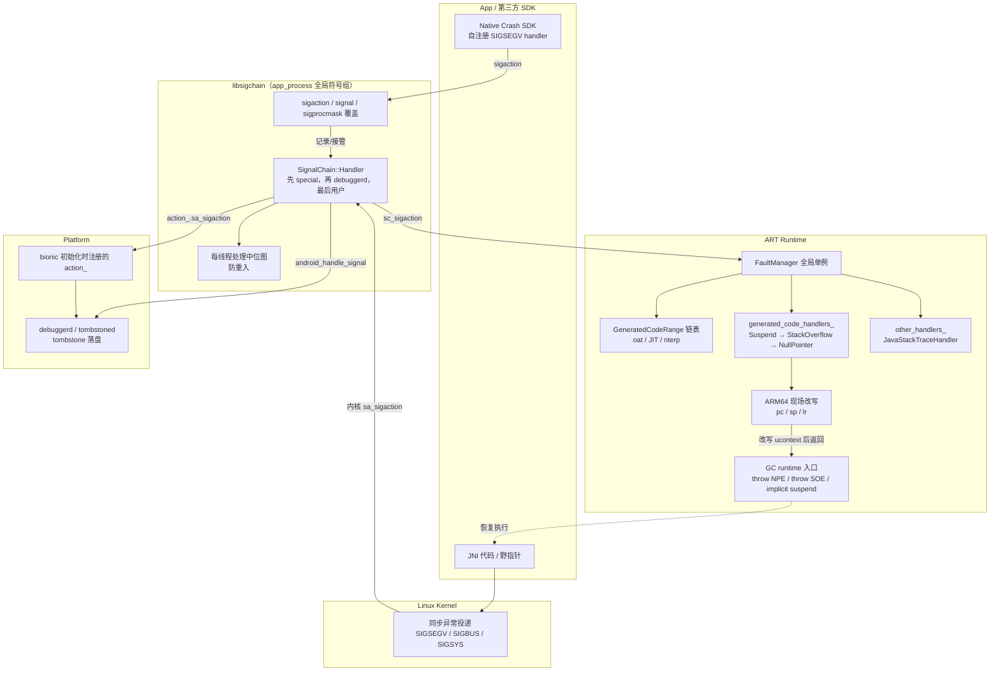
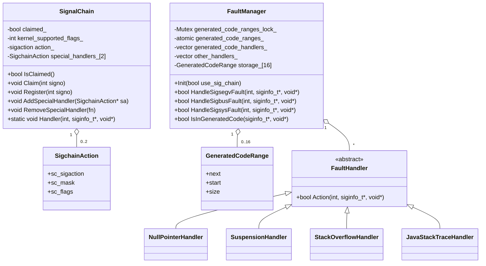
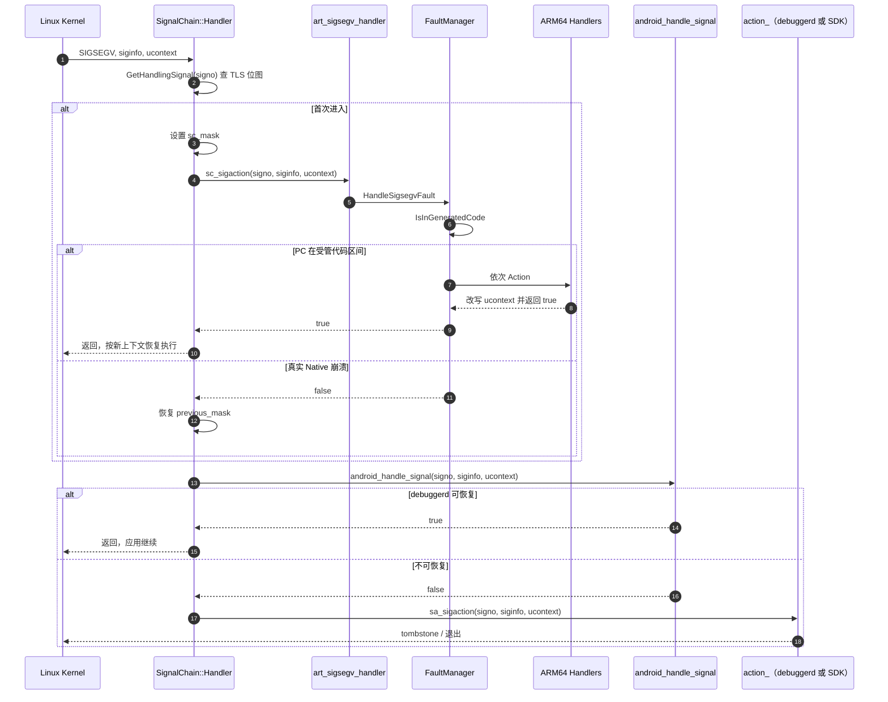
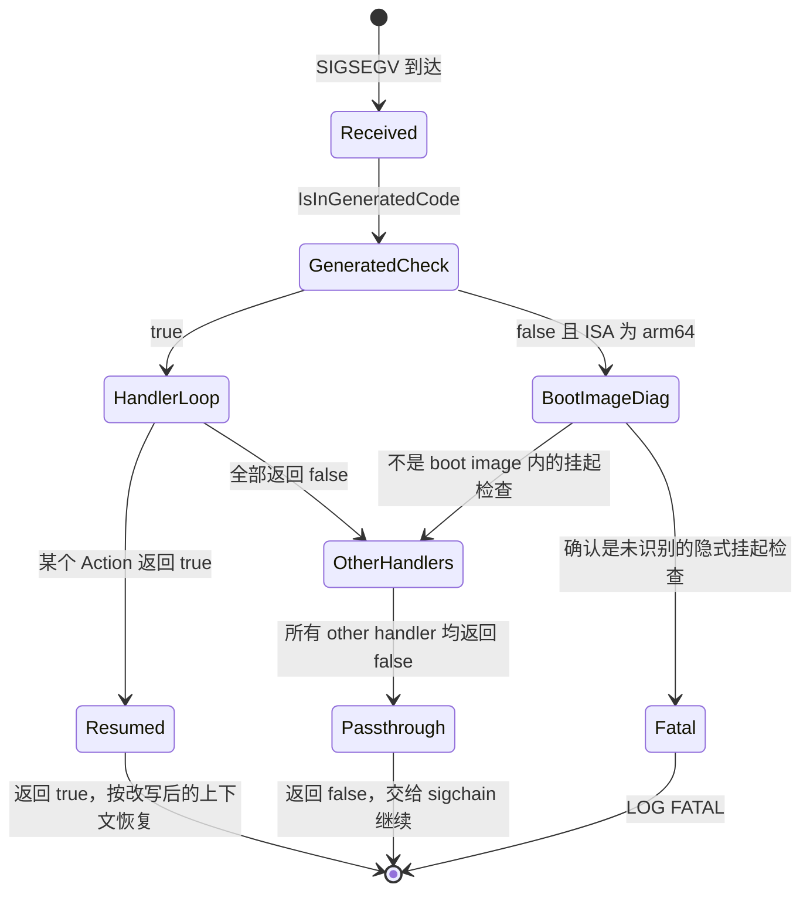

# 14 · 硬件异常拦截与 Native Crash 信号链

> [!IMPORTANT]
> **一句话核心结论**：ART 把「隐式空指针检查、栈溢出检查、挂起检查」实现为**故意触发的硬件异常**，于是进程里每一次 `SIGSEGV` 既可能是正常的 Java 语义，也可能是真正的 Native 崩溃。`libsigchain` 用 ELF 符号介入把全进程的 `sigaction` / `signal` / `sigprocmask` 收口成一条**有序信号链**（ART 专用 handler → debuggerd → 用户或第三方 SDK handler）；`FaultManager` 再用「线程处于 `Runnable` + 持有 mutator lock + 故障 PC 非 0 + PC 落在已注册生成代码区间」四道判据把受管故障与真实崩溃分开，并在 ARM64 上直接改写 `ucontext` 的 PC/SP/LR，把前一类变成 `NullPointerException`、`StackOverflowError` 或一次挂起检查，其余一律透传给 `debuggerd` 生成 tombstone。

| 项目 | 内容 |
| :--- | :--- |
| **机制定位** | 进程级信号链（sigchain）+ 受管代码故障分类器（FaultManager）+ ARM64 现场改写（fault_handler_arm64） |
| **源码模块（相对 `qssi/art/`）** | `sigchainlib/sigchain.cc`、`sigchainlib/sigchain.h`、`runtime/fault_handler.cc`、`runtime/fault_handler.h`、`runtime/arch/arm64/fault_handler_arm64.cc` |
| **核心类 / 入口** | `art::SignalChain`、`SignalChain::Handler`、`art::FaultManager`（全局单例 `fault_manager`）、`art::FaultHandler` 及其四个子类、`art::GeneratedCodeRange` |
| **关键启动参数** | `-Xno-sig-chain`（关闭 libsigchain 路径，`dex2oat` 等不执行受管代码的进程使用） |
| **关键日志开关** | `-verbose:signals`（打开 `FaultManager` 的 `VLOG(signals)` 分支） |
| **关键编译期开关** | `gUseUserfaultfd`（决定是否接管 `SIGBUS`/`SIGSYS`）、`kEnableJavaStackTraceHandler`（本基线为 `false`）、`ART_USE_RESTRICTED_MODE`（关闭隐式检查） |
| **源码基线** | `/home/voyah/workspace/8397/qssi/art`（Android 15/16 主线级 QSSI，commit `9a380e425f1270a51e0d7bf14363aa66b49509c2`，只读） |

## 1. What：机制是什么？

### 1.1 职责边界：三层各管一段

这条链路不是「一个 handler」，而是三个职责完全不同的层叠在一起。把它们混为一谈，是集成 Native Crash SDK 时最常见的理解错误。

**第一层：`libsigchain`——进程级信号入口与顺序仲裁。**
它本身不懂任何 Java 语义。它只做一件事：把「谁先看到信号」这件事从内核的**单槽 `sigaction`** 变成用户态的**有序链**。内核里每一个被接管的信号，其 `sa_sigaction` 永远指向 `SignalChain::Handler`；真正的分发顺序由 `chains[signo].special_handlers_` 与 `action_` 在用户态决定。它的覆盖范围是 `sigaction`、`signal`（以及 32 位下的 `bsd_signal`）、`sigprocmask` 三个 libc 入口。

**第二层：`FaultManager`——受管代码故障的分类器与分发器。**
它回答三个问题：当前线程是不是正在跑受管代码（`Runnable` + 共享持有 mutator lock + PC 在已注册生成代码区间内）？如果是，这三个 `generated_code_handlers_` 里有没有人认领？如果不是，或者没人认领，就返回 `false`，把决定权交回 sigchain，继续向 debuggerd / 用户 handler 传递。它**不生成 tombstone**，只负责「这一枪该不该由 ART 接」。

**第三层：架构相关 handler——现场改写与恢复执行。**
ARM64 上就是 `runtime/arch/arm64/fault_handler_arm64.cc` 里的三个 `Action()`。它们看到的是已经通过分类的、确实发生在受管代码里的故障。它们的工作不是「记录错误」，而是**把信号上下文改写成一次合法的运行时调用**：改 `pc`、改 `sp`、改 `lr`、必要时往栈上压一个返回地址，然后 `return true` 让内核按新上下文恢复执行。

它**不负责**：tombstone 的落盘与符号化（`debuggerd` / `tombstoned`，bionic 侧）、bionic 在进程初始化时注册的崩溃 handler（那是 sigchain `action_` 里的「上一层」）、Java 异常对象的构造与派发（`artThrowNullPointerExceptionFromSignal` 等运行时段，见 3.3）、ANR 判定与 `SIGQUIT` 转储（见第 12 篇）、以及 `userfaultfd` GC 的缺页处理算法本身（见第 5 篇，本篇只讲它如何接入信号链）。

### 1.2 核心术语表

| 术语 | 含义 | 源码锚点 |
| :--- | :--- | :--- |
| `SignalChain` | 单个信号的用户态链对象，含 `claimed_`、`action_`、`special_handlers_[2]` | [sigchain.cc](file:///home/voyah/workspace/8397/qssi/art/sigchainlib/sigchain.cc#L268-L416) |
| `chains[_NSIG]` | 全进程按信号号索引的 `SignalChain` 数组，静态分配 | [sigchain.cc](file:///home/voyah/workspace/8397/qssi/art/sigchainlib/sigchain.cc#L418-L420) |
| `special_handlers_` | ART / native bridge 的「插队」handler，只有 2 个槽位 | [sigchain.cc](file:///home/voyah/workspace/8397/qssi/art/sigchainlib/sigchain.cc#L415-L415) |
| `action_` | 被接管前（或接管后经覆盖 API 设置）的「用户 handler」，通常是 debuggerd | [sigchain.cc](file:///home/voyah/workspace/8397/qssi/art/sigchainlib/sigchain.cc#L343-L375) |
| 处理中位图 | 每线程 TLS 里按信号号置位的位图，用于检测异步信号重入 | [sigchain.cc](file:///home/voyah/workspace/8397/qssi/art/sigchainlib/sigchain.cc#L192-L251) |
| `FaultManager` | 全局静态对象，信号 handler 可直接访问 | [fault_handler.cc](file:///home/voyah/workspace/8397/qssi/art/runtime/fault_handler.cc#L43-L44) |
| `GeneratedCodeRange` | 一段「可能是受管代码」的地址区间，单链表节点，读者无锁遍历 | [fault_handler.h](file:///home/voyah/workspace/8397/qssi/art/runtime/fault_handler.h#L95-L99) |
| `kNumLocalGeneratedCodeRanges` | 进程内静态预置的范围节点数，值为 16，避免信号上下文走分配器 | [fault_handler.h](file:///home/voyah/workspace/8397/qssi/art/runtime/fault_handler.h#L126-L134) |
| 隐式空指针检查 | 编译器不插比较分支，直接解引用 `obj + offset`，靠 `SIGSEGV` 判定 `obj == null` | [runtime_globals.h](file:///home/voyah/workspace/8397/qssi/art/runtime/runtime_globals.h#L110-L119) |
| 隐式挂起检查 | 编译代码执行 `ldr x21, [x21]`；挂起请求时把 `suspend_trigger` 置空使其故障 | [thread.h](file:///home/voyah/workspace/8397/qssi/art/runtime/thread.h#L1621-L1641) |
| `SEGV_MTEAERR` | 异步 MTE 故障，投递点与真实故障点无关，PC/SP 不可信 | [fault_handler_arm64.cc](file:///home/voyah/workspace/8397/qssi/art/runtime/arch/arm64/fault_handler_arm64.cc#L41-L57) |
| `BUS_ADRERR` | `userfaultfd` 缺页产生的 `SIGBUS` 码，属正常 GC 行为 | [mark_compact.cc](file:///home/voyah/workspace/8397/qssi/art/runtime/gc/collector/mark_compact.cc#L4505-L4579) |
| `SIGCHAIN_ALLOW_NORETURN` | 标记「这个 special handler 可能不返回」，用于 native bridge | [sigchain.h](file:///home/voyah/workspace/8397/qssi/art/sigchainlib/sigchain.h#L26-L38) |

### 1.3 架构全景



图中的关键顺序是**内核只认 `SignalChain::Handler` 一个入口**，其余全是用户态顺序；这也是为什么「后注册的 SDK 覆盖先注册的 ART」在这套机制下不会发生。

## 2. Why：为什么需要它？

### 2.1 朴素方案会怎样死掉

**问题一：`sigaction` 是进程级单槽资源，天然是 last-writer-wins。**
一个进程里同时想处理 `SIGSEGV` 的有：ART（隐式检查）、debuggerd（崩溃报告）、GWP-ASan（可恢复的堆越界）、native bridge（翻译层）、以及任意第三方 crash SDK。如果各自直接调 `sigaction`，最后安装的那个赢，其余全部静默失效。对 ART 来说这不是「少了个功能」，而是**Java 语义直接崩塌**：任何一次 `obj.field` 的空引用都会变成进程级 `SIGSEGV`，`try/catch (NullPointerException)` 永久失效。

**问题二：`SIGSEGV` 在 ART 里是常态，不是异常。**
三类受管代码故障都会以 `SIGSEGV` 形式到达：

| 来源 | 触发方式 | 故障地址特征 | 期望结局 |
| :--- | :--- | :--- | :--- |
| 隐式空指针检查 | 解引用 `obj + offset`，`obj == null` | `offset < gPageSize` | 抛 Java `NullPointerException` |
| 隐式栈溢出检查 | 方法入口探测 `sp - gap` 是否落到栈底 guard 页 | `sp - kArm64StackOverflowReservedBytes` | 抛 `StackOverflowError` |
| 隐式挂起检查 | `ldr x21, [x21]`，`suspend_trigger` 被置空 | `0`（因为 x21 == 0） | 进入 `artImplicitSuspendFromCode` 做挂起/检查点 |

注意第三行：**挂起检查的故障地址也是 0**，与「空指针解引用」在地址上完全无法区分。如果分类器只看 `si_addr`，挂起检查会被误判成 NPE。这就是 ART 必须规定 handler 顺序的根本原因，`runtime.cc` 里写得非常直白：

> *These need to be in a specific order. The null point check handler must be after the suspend check and stack overflow check handlers.*

见 [runtime.cc](file:///home/voyah/workspace/8397/qssi/art/runtime/runtime.cc#L1971-L1974)。

**问题三：信号处理函数是异步信号上下文，几乎所有便利 API 都不能用。**
不能 `malloc` / `free`（分配器可能正被中断的线程持锁）、不能拿 ART 的 `Mutex`（可能死锁）、不能做 read barrier（可能触发 GC 相关代码）、不能保证栈还能用（栈溢出故障时原栈已耗尽）。因此范围查询必须是**无锁读**、范围节点必须**预分配**、handler 必须跑在**备用信号栈**上。

**问题四：信号不可靠地排队，且同步信号是线程定向的。**
标准信号不排队，同一线程在处理 `SIGSEGV` 时再来一个会被合并/阻塞。因此「正在处理哪个信号」的状态必须是**每线程**的，而不是全局 bool；同时必须提供重入路径，让「handler 自己崩溃」这件事仍然能变成一个可上报的崩溃，而不是静默死循环。

### 2.2 方案演进对比矩阵

| 方案 | 信号顺序 | 受管代码语义 | 真实崩溃可观测性 | 异步信号安全性 | 结论 |
| :--- | :--- | :--- | :--- | :--- | :--- |
| 各库直接 `sigaction` | 无序，last-writer-wins | 会被 SDK 覆盖而失效 | 取决于谁最后安装 | 各自负责 | 不可用 |
| ART 独占 `SIGSEGV`，其余一律丢弃 | 有序（只有一个） | 正常 | debuggerd 拿不到真实崩溃 | 可控 | 不可用 |
| 用全局 `bool in_handler` 防重入 | 有序 | 正常 | 多线程互相干扰，可能吞崩溃 | 差 | 有竞态 |
| `sigaltstack` + 每线程位图 + 无锁分类 | 有序 | 正常 | 真实崩溃完整透传 | 好 | **本实现** |
| `-Xno-sig-chain` 完全不走 sigchain | 无 | 需要关闭隐式检查 | 依赖调用方 | 不适用 | 仅编译器进程 |

### 2.3 一个典型的事故链

车机上集成某第三方 APM SDK 后，Java 层偶发「本该 catch 的 NPE 直接把进程打死」，tombstone 里 `signal 11 (SIGSEGV), code 1 (SEGV_MAPERR), fault addr 0x0000000000000000`，PC 落在 `boot.oat` 区间。根因通常不是 ART 坏了，而是 SDK 对信号的处置越过了链：

- 用 `signal()` / `sigaction()` 安装 handler 本身**无害**——sigchain 会把它记录为 `chains[SIGSEGV].action_`，ART 的 special handler 仍然先跑。
- 真正致命的是三种写法：handler 里直接 `_exit()` 或用 `siglongjmp()` 跳走；把 `SIGSEGV` 设回 `SIG_DFL`；绕过被覆盖的 `sigaction`，用 `syscall(SYS_rt_sigaction)` 直接把内核槽位换成自己的函数（最后这种会让 ART 完全收不到信号）。
- 用 `sigprocmask` 屏蔽 `SIGSEGV` 不会成功——sigchain 会把已接管信号从阻塞集合里剔除，详见 3.1.5。

第 4 节给出可落地的排查与集成规则。

## 3. How：源码级实现原理

### 3.1 libsigchain：符号介入与进程级信号链

#### 3.1.1 它凭什么能覆盖 libc 的 `sigaction`

`libsigchain` 不是通过 `LD_PRELOAD`，而是通过**链接期的符号优先级**：

1. 它被链接进 `app_process`（构建可见性只开放给 `//frameworks/base/cmds/app_process`），因此主要服务于 zygote 及其 fork 出的应用进程。
2. 它用 `-Wl,-z,global` 把自己的符号放进**全局符号组**（`DF_1_GLOBAL`）。`Android.bp` 的注释说明了目的：让应用在 classloader linker namespace 里加载的 native 库，在查找 `sigaction` 时**先命中 libsigchain，再命中 libc**。
3. `libsigchain.map.txt` 是 APEX stub 的符号表：它对外导出 0 个真实符号（只留一个占位符号满足 stub 生成），说明 libsigchain 没有任何「供调用的 API」，唯一的外部入口就是 libc 同名覆盖——这也解释了为什么 `AddSpecialSignalHandlerFn` 之类接口只供 ART 内部链接使用。

对应源码：[Android.bp](file:///home/voyah/workspace/8397/qssi/art/sigchainlib/Android.bp#L29-L41)、[libsigchain.map.txt](file:///home/voyah/workspace/8397/qssi/art/sigchainlib/libsigchain.map.txt#L16-L25)。

被覆盖的三个入口都先 `InitializeSignalChain()`，再用 `dlsym` 拿到**真正的** libc 版本存进 `linked_sigaction` / `linked_sigprocmask`（bionic 上还有 `sigaction64` / `sigprocmask64`），之后所有「放行到内核」的操作都走这两个函数指针，避免自我递归：

[sigchain.cc](file:///home/voyah/workspace/8397/qssi/art/sigchainlib/sigchain.cc#L125-L177)

#### 3.1.2 数据结构与内存布局

```text
chains[_NSIG]  —— 进程级、每信号一个 SignalChain，静态分配，无堆分配
┌────────────────────────────────────────────────────────────────────────┐
│ SignalChain（以 SIGSEGV 为例）                                          │
│   claimed_                : true                                       │
│   kernel_supported_flags_ : SA_SIGINFO | SA_ONSTACK | SA_RESTART | ...  │
│   action_                 : 被顶掉的“上一层” action（通常是 debuggerd）  │
│   special_handlers_[0]    : art_sigsegv_handler   ← ART 专用，最先跑     │
│   special_handlers_[1]    : native bridge handler（或空）               │
└────────────────────────────────────────────────────────────────────────┘
        │
        │ 内核中实际注册的 sa_sigaction 永远是 SignalChain::Handler
        ▼
   sigaction(SIGSEGV) → 内核只看到 SignalChain::Handler
```

每个 `SignalChain` 只有 **2 个 special handler 槽位**。`AddSpecialHandler()` 找不到空槽时直接 `fatal("too many special signal handlers")`：这是一个硬上限，不是可扩展容器。ART 占一个，native bridge 占一个，第三个调用者会让进程直接 abort。

[sigchain.cc](file:///home/voyah/workspace/8397/qssi/art/sigchainlib/sigchain.cc#L377-L386)

重入状态不在 `SignalChain` 里，而在**每线程 TLS**：

```text
每线程 pthread_setspecific 位图（64 位平台）
┌──────────────────────────────────────────────────────────────────┐
│ key[0] : uintptr_t bitmap                                        │
│          bit (signo - 1) = 1  →  本线程正在处理 signo             │
│                                                                  │
│ 32 位平台：key[0] / key[1] 两块，按 kNumSignalsPerKey=32 切分      │
│ kSignalSetLength = _NSIG - 1，kHandlingSignalKeyCount = 向上取整   │
└──────────────────────────────────────────────────────────────────┘
```

[sigchain.cc](file:///home/voyah/workspace/8397/qssi/art/sigchainlib/sigchain.cc#L192-L251)

`SetHandlingSignal()` 在读写前后各插一个 `std::atomic_signal_fence(std::memory_order_seq_cst)`，防止编译器把生成代码跨越信号边界重排；`ScopedHandlingSignal` 用 RAII 在 handler 返回时恢复原值。需要「可能不返回」的 handler（native bridge 可能 `siglongjmp`）会在调用前带上 `SIGCHAIN_ALLOW_NORETURN`，此时不置位，避免位图永久卡死。

#### 3.1.3 类关系



#### 3.1.4 `SignalChain::Handler` 的五段式分派

这是整条链路的「进程级」主干，顺序不可交换：

1. **special handlers 优先**。仅当本线程没有在处理同一信号时才进入。每个 special handler 调用前用 `SIG_SETMASK` 换上它自己注册时给的 `sc_mask`，返回 `false` 后恢复原 mask，保证 handler 之间互不污染信号屏蔽字。
2. **重入分支**。如果本线程已在处理该信号，跳过 special handlers，并在 ARM64 上打印位图实际值与期望值，用于诊断 TLS 位图被踩。
3. **`android_handle_signal`**。这是 libdl 提供的弱符号钩子，Android 14 起用于「可恢复 GWP-ASan」：debuggerd 可以先打印报告，如果它承诺能恢复并返回 `true`，sigchain 直接返回让应用继续跑。
4. **转发给用户 handler**。合并 `ucontext->uc_sigmask` 与 `action_.sa_mask`，若用户没要求 `SA_NODEFER` 则把当前信号也加进 mask；若用户没要求 `SA_EXPOSE_TAGBITS` 则对 `si_addr` 做 `untag_address()`。
5. **`SIG_DFL` / `SIG_IGN` 兜底**。`SIG_DFL` 表示「debuggerd 被禁用」：sigchain 打印调用栈、把 handler 改回 `SIG_DFL`、重新 `raise()`，让崩溃在没有任何 ART 上下文的情况下重放一次；`SIG_IGN` 直接返回（`SECCOMP` 场景例外，内核强制投递）。

源码：[sigchain.cc](file:///home/voyah/workspace/8397/qssi/art/sigchainlib/sigchain.cc#L430-L554)。分段锚点：[special 循环](file:///home/voyah/workspace/8397/qssi/art/sigchainlib/sigchain.cc#L431-L453)、[重入诊断](file:///home/voyah/workspace/8397/qssi/art/sigchainlib/sigchain.cc#L454-L472)、[GWP-ASan 钩子](file:///home/voyah/workspace/8397/qssi/art/sigchainlib/sigchain.cc#L474-L491)、[用户转发](file:///home/voyah/workspace/8397/qssi/art/sigchainlib/sigchain.cc#L493-L553)。



> **一个容易忽略的细节**：`Register()` 给内核注册的标志固定包含 `SA_ONSTACK`，也就是说走 sigchain 的 handler **总是跑在备用信号栈上**。这不是可选优化——没有它，隐式栈溢出检查的 handler 会在已经耗尽的栈上执行，必然二次故障。同时 `SA_EXPOSE_TAGBITS` 与 `SA_UNSUPPORTED` 用于探测内核是否支持把 MTE tag 暴露给用户态。

[sigchain.cc](file:///home/voyah/workspace/8397/qssi/art/sigchainlib/sigchain.cc#L285-L341)

#### 3.1.5 `sigprocmask` 为什么要被改写

`__sigprocmask()` 做两件事：在信号 handler 内部直接放行到 libc（因为 handler 自己调整 mask 是合法的）；在普通上下文里，**把已接管信号从阻塞集合中剔除**——用户无法通过屏蔽 `SIGSEGV` 来「防崩溃」。这一条对 SDK 集成很关键：屏蔽 ART 依赖的信号不会让进程更稳定，只会让隐式检查在某些线程上失效。

[sigchain.cc](file:///home/voyah/workspace/8397/qssi/art/sigchainlib/sigchain.cc#L649-L675)

同一个文件里还有 `EnsureFrontOfChain()`：当 zygote 里某个老 targetSdk（`<= L`）的库在 `JNI_OnLoad` 期间可能抢注 `SIGSEGV` 时，ART 会强制把 sigchain 重新放回内核槽位。调用点在 [java_vm_ext.cc](file:///home/voyah/workspace/8397/qssi/art/runtime/jni/java_vm_ext.cc#L1140-L1144)。`SkipAddSignalHandler(true)`（对应 `Runtime::SetSignalHookDebuggable`）则让后续 `sigaction` 直接返回成功但不生效，属于调试工具用的「冻结链」开关，生产代码不应触碰。

### 3.2 FaultManager：受管代码故障分类器

#### 3.2.1 初始化与注册顺序

`FaultManager` 是一个**静态全局对象**，注释明确说明原因：信号 handler 必须能直接访问它，不能依赖 `Runtime` 的构造顺序。

[fault_handler.cc](file:///home/voyah/workspace/8397/qssi/art/runtime/fault_handler.cc#L43-L44)、[fault_handler.h](file:///home/voyah/workspace/8397/qssi/art/runtime/fault_handler.h#L226-L227)

`Init(use_sig_chain)` 做四件事：

1. 若 `gUseUserfaultfd`，先取出 `MarkCompact` 收集器指针（`SIGBUS`/`SIGSYS` handler 要用）。
2. 构造 `sc_mask`：`sigfillset` 后只放行 `SIGABRT`、`SIGBUS`、`SIGFPE`、`SIGILL`、`SIGSEGV`。含义是「ART 的 fault handler 运行时，其他信号一律挡住，但五个致命信号保持可投递」，这样 handler 内部再次崩溃仍然能被报告。
3. 注册 special handler：`SIGSEGV` 无条件注册；`SIGBUS` / `SIGSYS` 只在 `gUseUserfaultfd` 时注册。
4. 注册 `MEMBARRIER_CMD_REGISTER_PRIVATE_EXPEDITED`，并初始化 16 个本地范围节点与空闲链。

[fault_handler.cc](file:///home/voyah/workspace/8397/qssi/art/runtime/fault_handler.cc#L134-L208)、[掩码构造](file:///home/voyah/workspace/8397/qssi/art/runtime/fault_handler.cc#L141-L147)、[本地节点池](file:///home/voyah/workspace/8397/qssi/art/runtime/fault_handler.cc#L171-L182)

handler 的注册顺序由 `runtime.cc` 固定，且代码里带注释说明不能随意调整：

```text
generated_code_handlers_（顺序敏感，AddHandler 的 generated_code 参数为 true）
  SuspensionHandler     ← 必须最先：挂起检查的 fault addr 也是 0
  StackOverflowHandler  ← 次之：按 sp - gap 精确匹配
  NullPointerHandler    ← 最后：剩下的、地址在页内的才可能是 NPE

other_handlers_（generated_code 参数为 false）
  JavaStackTraceHandler ← 可选，打印 Java 栈后始终返回 false（本基线未启用）
```

[runtime.cc](file:///home/voyah/workspace/8397/qssi/art/runtime/runtime.cc#L1968-L2000)

还有一个容易忽略的边界：`HandlesSignalsInCompiledCode()` 为假时（例如 `-Xno-sig-chain`，或 `ART_USE_RESTRICTED_MODE` 关掉了隐式检查），ART 完全不注册这些 handler。`dex2oat` 正是这么做的——它只编译不执行受管代码，不需要隐式检查，于是用 `-Xno-sig-chain` 换取静态链接可行性。

[runtime.h](file:///home/voyah/workspace/8397/qssi/art/runtime/runtime.h#L1160-L1164)、[dex2oat.cc](file:///home/voyah/workspace/8397/qssi/art/dex2oat/dex2oat.cc#L2721-L2726)

#### 3.2.2 生成代码范围：布局与注册来源

```text
generated_code_ranges_  (std::atomic<GeneratedCodeRange*>)
        │  acquire load
        ▼
┌─────────────────────┐      ┌─────────────────────┐      ┌─────────────────────┐
│ GeneratedCodeRange  │      │ GeneratedCodeRange  │      │ GeneratedCodeRange  │
│ next  ──────────────┼─────▶│ next  ──────────────┼─────▶│ next = nullptr      │
│ start = 0x7f..1000  │      │ start = 0x7f..9000  │      │ start = 0x7f..a000  │
│ size  = 0x20000     │      │ size  = 0x4000      │      │ size  = 0x1000      │
└─────────────────────┘      └─────────────────────┘      └─────────────────────┘
        ▲
        │ 前 16 个节点静态取自 generated_code_ranges_storage_[16]；
        │ 用尽后才 new，释放时优先回 free_generated_code_ranges_ 空闲链
        └─ 目的：信号上下文里不做堆分配、少走 cache miss
```

注册来源有三类，覆盖「受管代码可能出现的所有地址」：

| 来源 | 注册时机 | 锚点 |
| :--- | :--- | :--- |
| boot image / oat 文件可执行段 | 首次注册该 oat 的 dex 文件时，从 `GetExecutableOffset()` 到文件末尾 | [class_linker.cc](file:///home/voyah/workspace/8397/qssi/art/runtime/class_linker.cc#L4556-L4562) |
| JIT 代码缓存可执行页 | `JitCodeCache` 创建时 | [jit_code_cache.cc](file:///home/voyah/workspace/8397/qssi/art/runtime/jit/jit_code_cache.cc#L237-L241) |
| nterp 解释器代码 | `Runtime::Init()` 末尾，`NterpMethodHeader` 的代码段 | [runtime.cc](file:///home/voyah/workspace/8397/qssi/art/runtime/runtime.cc#L1995-L1999) |

#### 3.2.3 无锁读取与内存序

`IsInGeneratedCode()` 是整篇最「反直觉」的函数：它在信号上下文里遍历一个会被并发修改的链表，却**不拿锁**。判据是四连：

1. `Thread::Current()` 非空；
2. 线程状态必须是 `ThreadState::kRunnable`（只有正在跑受管代码的线程才可能处于此态）；
3. 共享持有 `Locks::mutator_lock_`；
4. `GetFaultPc()` 非 0 且 `fault_pc - range->start < range->size`（无符号减法，天然处理回绕）。

[fault_handler.cc](file:///home/voyah/workspace/8397/qssi/art/runtime/fault_handler.cc#L538-L584)

读侧协议：链表头用 `memory_order_acquire` 加载，`next` 用 `memory_order_relaxed` 加载。写侧协议：

- `AddGeneratedCodeRange()`：在 `generated_code_ranges_lock_` 下摘取/新建节点，`release` 存储新头，然后调用 `membarrier(kPrivateExpedited)`。后者解决的是「线程 A 加载类时注册了 oat 代码，线程 B 从未加载该类却通过引用执行到这段代码」的可见性问题——单靠 release/acquire 不够，因为 B 从未与 A 同步。
- `RemoveGeneratedCodeRange()`：先在锁内摘链（头节点用 release store 维持 release sequence，中间节点用 relaxed store，并保留被删节点的 `next` 让并发遍历仍能到达后续节点），再在锁外运行一次 **checkpoint**，确保没有 `Runnable` 线程还停在旧节点的遍历里，最后才归还/释放节点。

[fault_handler.cc](file:///home/voyah/workspace/8397/qssi/art/runtime/fault_handler.cc#L434-L461)、[移除与 checkpoint](file:///home/voyah/workspace/8397/qssi/art/runtime/fault_handler.cc#L463-L533)

这就是「信号 handler 里不能加锁」与「并发修改必须安全」之间的折中：**读者无锁、写者加锁、删除靠 checkpoint 兜底**。

#### 3.2.4 `HandleSigsegvFault` 主分派



三个 `Handle*Fault` 的差异：

| 入口 | 先试什么 | 失败后 | 备注 |
| :--- | :--- | :--- | :--- |
| `HandleSigsegvFault` | `generated_code_handlers_` 顺序列表 | ARM64 上做 boot image 隐式挂起检查诊断 → `other_handlers_` → `art_sigsegv_fault()` → false | 唯一会走「诊断 FATAL」的入口 |
| `HandleSigbusFault` | `mark_compact_->SigbusHandler(info)` | `art_sigbus_fault()` → false | 成功后还会 `MaybeSuspendFaster()` |
| `HandleSigsysFault` | `mark_compact_->SigsysHandler(info, context)` | `art_sigsys_fault()` → false | 处理 seccomp 拦截 `UFFDIO_MOVE` 的情况 |

[sigsegv 主流程](file:///home/voyah/workspace/8397/qssi/art/runtime/fault_handler.cc#L357-L391)、[sigbus](file:///home/voyah/workspace/8397/qssi/art/runtime/fault_handler.cc#L297-L314)、[sigsys](file:///home/voyah/workspace/8397/qssi/art/runtime/fault_handler.cc#L267-L284)

`other_handlers_` 目前唯一的实现是 `JavaStackTraceHandler`：它在真实崩溃发生前把 Java 栈打到 logcat（`Dumping java stack trace for crash in generated code`），然后**始终返回 `false`**，把信号继续让给 debuggerd。由于本基线 `kEnableJavaStackTraceHandler` 为 `false`，这条路默认不启用，启用它相当于给崩溃现场多加一份 Java 栈快照。

[JavaStackTraceHandler](file:///home/voyah/workspace/8397/qssi/art/runtime/fault_handler.cc#L656-L671)

`art_sigsegv_fault()` / `art_sigbus_fault()` / `art_sigsys_fault()` 是三个**无内联的默认可见空函数**，唯一作用是提供稳定的断点位置：调试器在这里停下时，`fault_manager`、`siginfo`、`ucontext` 都还在原始状态，可以直接观察 ART 为什么放弃了这个信号。

[fault_handler.cc](file:///home/voyah/workspace/8397/qssi/art/runtime/fault_handler.cc#L48-L59)

`CheckForUnrecognizedImplicitSuspendCheckInBootImage()` 是一段「自证式取证」：当 PC 不在任何已注册范围、但 PC 落在 boot image 内且指令恰好是 `0xf94002b5`（`ldr x21, [x21]`）时，说明 ART 漏认了一次合法的隐式挂起检查。它会打印线程状态、mutator lock 是否共享持有、以及当前所有注册范围，然后 `LOG(FATAL)`。这是针对一类极罕见竞态（TLS 位图/范围注册出问题）的定向诊断，不是通用崩溃路径。

[fault_handler.cc](file:///home/voyah/workspace/8397/qssi/art/runtime/fault_handler.cc#L316-L354)

### 3.3 ARM64 现场改写：三个 handler

三个 handler 共享同一个套路：**读 `siginfo` / `ucontext` 做判据 → 改写 `mcontext_t` → 返回 true**。真正的「抛出 Java 异常」发生在返回之后，由被改写的 PC 指向的运行时段入口完成。

#### 3.3.1 `NullPointerHandler`

判据分三层，逐层收紧：

1. **地址层**：`IsValidFaultAddress()` 复用 `CanDoImplicitNullCheckOn()`，即 `fault_address < gPageSize`。这排除了 MTE tag、堆内野指针、栈溢出（地址是 `sp - gap`，远大于零页）。
2. **方法层**：`sp[0]` 必须是合法的 `ArtMethod*`——非空、按指针大小对齐、其 declaring class 非空且按对象对齐、`class_class->GetClass() == class_class`（`Class.class` 自环）。所有读取都用 `kVerifyNone, kWithoutReadBarrier`，因为信号上下文不能触发 read barrier。
3. **返回地址层**：`return_pc = pc + 4`（ARM64 定长 4 字节），用 `OatQuickMethodHeader::ToDexPc(sp, return_pc, false)` 反查 dex pc；查不到说明不是编译器插的检查点。

三层全过之后，改写方式是：把 `return_pc` 压栈（`sp -= 8`）、把故障地址放进 `lr`（x30）、把 `pc` 指向 `art_quick_throw_null_pointer_exception_from_signal`。汇编入口先把 `lr` 搬到 `x0`，再调 `artThrowNullPointerExceptionFromSignal(addr, self)`，后者做**最后一次**校验：`IsValidImplicitCheck(addr, instr)` 会把故障地址与该 dex 指令的期望偏移对照，不匹配就 `LOG(FATAL) << "Invalid address for an implicit NullPointerException check"`。这道保险的意义是：宁可报一个明确的 ART 崩溃，也不要把野指针静默变成一个假 NPE。

[fault_handler_arm64.cc](file:///home/voyah/workspace/8397/qssi/art/runtime/arch/arm64/fault_handler_arm64.cc#L65-L94)、[IsValidMethod](file:///home/voyah/workspace/8397/qssi/art/runtime/fault_handler.cc#L586-L629)、[IsValidReturnPc](file:///home/voyah/workspace/8397/qssi/art/runtime/fault_handler.cc#L631-L654)、[二次校验](file:///home/voyah/workspace/8397/qssi/art/runtime/common_throws.cc#L483-L564)、[FATAL 分支](file:///home/voyah/workspace/8397/qssi/art/runtime/common_throws.cc#L566-L579)

#### 3.3.2 `SuspensionHandler`

判据只有一条：**PC 处的 32 位指令必须精确等于 `0xf94002b5`**。这个常量由基址 `0xf9400000`、`Rn=21`、`Rt=21` 拼出：

```text
checkinst = 0xf9400000 | (21 << 5) | (21 << 0)
          = 0xf9400000 | 0x000002A0 | 0x00000015
          = 0xf94002B5      // ldr x21, [x21, #0]
```

`x21` 是 `xSUSPEND`，它的值就是线程 TLS 中 `suspend_trigger` 的值。正常情况下这个值是一个指向自身的合法指针，`ldr` 只是无害地读回自己；当有人调用 `Thread::TriggerSuspend()` 把它置为 `nullptr`，同一条指令就会在地址 0 上故障。handler 认出指令后：`lr = pc + 4`（挂起检查后的下一条指令）、`pc = art_quick_implicit_suspend`、并调用 `Thread::Current()->RemoveSuspendTrigger()` 把指针恢复成合法值。此后由 `artImplicitSuspendFromCode()` 执行 `CheckSuspend(/*implicit=*/ true)`，必要时为当前 dex pc 反优化。

[fault_handler_arm64.cc](file:///home/voyah/workspace/8397/qssi/art/runtime/arch/arm64/fault_handler_arm64.cc#L96-L131)、[suspend 入口](file:///home/voyah/workspace/8397/qssi/art/runtime/entrypoints/quick/quick_thread_entrypoints.cc#L57-L66)、[refresh 宏](file:///home/voyah/workspace/8397/qssi/art/runtime/arch/arm64/asm_support_arm64.S#L251-L260)

`SuspendFaster()` 是这条路径的加速器：当异步信号（例如 `SIGQUIT` 相关流程）发现本线程有挂起请求、且确实在生成代码里时，直接把保存上下文中的 `x21` 清 0，使**下一条**挂起检查立刻故障，而不必等到第二次检查。它刻意只在 `IsInGeneratedCode()` 为真时动手，因为 `x21` 在非 ART 生成代码里没有这个约定。

[fault_handler_arm64.cc](file:///home/voyah/workspace/8397/qssi/art/runtime/arch/arm64/fault_handler_arm64.cc#L133-L147)、[调用点](file:///home/voyah/workspace/8397/qssi/art/runtime/fault_handler.cc#L286-L295)

#### 3.3.3 `StackOverflowHandler`

判据同样是一条精确等式：

```text
overflow_addr = sp - GetStackOverflowReservedBytes(InstructionSet::kArm64)
fault_addr == overflow_addr ?
```

`kArm64StackOverflowReservedBytes` 来自编译期宏，常规构建是 **8192 字节**，ASAN 构建是 **16384 字节**（`build/art.go`）。编译器和运行时共享这个常量：方法入口在**分配 frame 之前**先执行 `sub temp, sp, #gap; ldr wzr, [temp]`，把「SP 是否低于 `stack_end`」变成一次对 `sp - gap` 的探测。探测点仍在栈映射内时该读是无害的；一旦落到栈底 guard 页就精确故障在 `sp - gap`，而此刻 `mc->sp` 仍是入口 SP，所以等式成立。命中后只改 `pc` 指向 `art_quick_throw_stack_overflow`，**不改 `lr`**——注释特别强调，`lr` 必须保持进入故障代码时的原值，才能让入口正确构造 callee-save frame。

[fault_handler_arm64.cc](file:///home/voyah/workspace/8397/qssi/art/runtime/arch/arm64/fault_handler_arm64.cc#L149-L183)、[编译器探测序列](file:///home/voyah/workspace/8397/qssi/art/compiler/optimizing/code_generator_arm64.cc#L1516-L1529)、[常量定义](file:///home/voyah/workspace/8397/qssi/art/libartbase/arch/instruction_set.h#L256-L276)、[构建参数](file:///home/voyah/workspace/8397/qssi/art/build/art.go#L126-L136)

#### 3.3.4 现场改写前后对照

| handler | `pc` 改为 | `sp` | `lr`（x30） | 额外动作 |
| :--- | :--- | :--- | :--- | :--- |
| `NullPointerHandler` | `art_quick_throw_null_pointer_exception_from_signal` | `sp -= 8`，压入 `pc + 4` | 故障地址 | 先做 ArtMethod / ToDexPc 三层校验 |
| `SuspensionHandler` | `art_quick_implicit_suspend` | 不变 | `pc + 4` | `RemoveSuspendTrigger()` |
| `StackOverflowHandler` | `art_quick_throw_stack_overflow` | 不变 | **保持不变** | 地址必须精确等于 `sp - gap` |
| `SuspendFaster` | 不变 | 不变 | 不变 | 保存上下文 `x21 = 0` |

### 3.4 `userfaultfd` GC 分支：`SIGBUS` 与 `SIGSYS`

在 CMC（Concurrent Mark-Compact）配置下（`gUseUserfaultfd` 为真），ART 会主动把紧凑化页面的访问变成缺页，由 `userfaultfd` 线程补页。这条路径上的 `SIGBUS`（`BUS_ADRERR`）是**正常控制流**，不是内存错误：

- `HandleSigbusFault()` 先调 `mark_compact_->SigbusHandler(info)`。后者只认 `BUS_ADRERR`，按 `si_addr` 向下页对齐，判断是否属于移动空间或 linear-alloc 空间，若是则现场处理该页并返回 true。
- 成功返回后还会调 `MaybeSuspendFaster()`，让被缺页打断的线程尽快响应挂起。
- `HandleSigsysFault()` 处理的是 seccomp 把 `ioctl(UFFDIO_MOVE)` 拦成 `SIGSYS(SYS_SECCOMP)` 的情况：`MarkCompact::SigsysHandler` 识别后把返回寄存器改成 `-EINVAL`，让内核「假装这次 ioctl 不支持」，用户态自动退化为可用的拷贝路径，而不是整进程崩溃。

[fault_handler.cc](file:///home/voyah/workspace/8397/qssi/art/runtime/fault_handler.cc#L134-L162)、[MarkCompact::SigbusHandler](file:///home/voyah/workspace/8397/qssi/art/runtime/gc/collector/mark_compact.cc#L4505-L4579)、[MarkCompact::SigsysHandler](file:///home/voyah/workspace/8397/qssi/art/runtime/gc/collector/mark_compact.cc#L4467-L4503)、[编译期开关](file:///home/voyah/workspace/8397/qssi/art/runtime/read_barrier_config.h#L76-L91)

这也解释了为什么 `SIGBUS` / `SIGSYS` 只在 `gUseUserfaultfd` 时才被接管：不用 CMC 的配置下，这两个信号的默认处置才是正确的，抢过来反而会掩盖真实错误。

### 3.5 MTE：为什么异步 MTE 故障必须直接透传

ARM64 的 MTE 会带来两种 `SIGSEGV` code：

| code | 名称 | 投递时机 | PC / SP 是否可信 | ART 的处置 |
| :--- | :--- | :--- | :--- | :--- |
| 8 | `SEGV_MTEAERR` | 异步，实际故障后任意时点 | **不可信**，与故障无关 | `GetFaultPc()` 直接返回 0，分类必然失败，透传 |
| 9 | `SEGV_MTESERR` | 同步，故障指令处 | 可信 | PC 可能命中范围，但 `si_addr` 带 tag，`< gPageSize` 判据不成立，仍透传 |

`GetFaultPc()` 的第一段就是这道闸门：

```cpp
if (siginfo->si_signo == SIGSEGV && siginfo->si_code == SEGV_MTEAERR) {
  VLOG(signals) << "Async MTE fault";
  return 0u;
}
```

[fault_handler_arm64.cc](file:///home/voyah/workspace/8397/qssi/art/runtime/arch/arm64/fault_handler_arm64.cc#L41-L57)、[信号码命名](file:///home/voyah/workspace/8397/qssi/art/runtime/fault_handler.cc#L88-L114)

`SignalCodeName()` 里还有一个小细节：`SEGV_MTEAERR` / `SEGV_MTESERR` 用数字 8/9 硬编码，而不是用宏。这意味着即使在 bionic 头文件没有导出这两个常量的构建里，日志仍能打印正确名称。对 crash 平台的意义是：**看到 code 8 就不要试图用 PC 做归因**，异步 MTE 报告里的 PC 只是「碰巧被执行到的位置」。

## 4. 能利用这个机制做什么？

### 4.1 Native Crash 捕集 SDK 集成七条铁律

1. **用 `sigaction()`，不要用 `signal()`。** 走 sigaction 才能拿到 `siginfo` 与 `ucontext`；`signal()` 语义在各平台差异大，且 sigchain 的 `signal()` 覆盖会强制加上 `SA_RESTART|SA_ONSTACK`。
2. **不要试图抢到 ART 前面。** 受管代码里的 `SIGSEGV` 本来就不该进 crash 统计。sigchain 保证 ART 的 special handler 先跑，SDK 只看到 ART 放弃的真实崩溃——这正是你想要的统计口径。
3. **绝不要对 `SIGSEGV` 设置 `SIG_DFL`。** sigchain 会打印 `Setting SIGSEGV to SIG_DFL` 并 dump 调用栈（logcat tag 为 `libsigchain`），这通常意味着某段代码把 ART 的语义关掉了。
4. **handler 必须是 async-signal-safe。** 不 `malloc`、不 `dlopen`、不加 pthread 锁、不调 `stdio`、不做 JNI 调用。要写文件用 `open/write`，要日志用 `async_safe_format_log` 或 `__android_log_write`。
5. **自备 `sigaltstack` 并保留 `SA_ONSTACK`。** 栈溢出场景下原栈已不可用；丢掉 `SA_ONSTACK` 会让你的 handler 二次故障。
6. **主动处理 tag bits。** 若你的 handler 未设置 `SA_EXPOSE_TAGBITS`，sigchain 会在转发前把 `si_addr` 的 top-byte tag 抹掉；如果 crash 平台依赖带 tag 的地址做 MTE 归因，必须显式声明。
7. **不要屏蔽已接管信号。** `sigprocmask` 会把 `SIGSEGV` 等从阻塞集合里剔除；更不要假设 `pthread_sigmask` 等其他入口也被过滤——本篇源码只覆盖 `sigprocmask` / `sigprocmask64`。

### 4.2 打开 `signals` 日志看 ART 如何分类

`FaultManager` 的每一步都有 `VLOG(signals)`。该 tag 定义在 `LogVerbosity` 中，启动参数为 `-verbose:signals`：

[logging.h](file:///home/voyah/workspace/8397/qssi/art/libartbase/base/logging.h#L37-L62)、[cmdline_types.h](file:///home/voyah/workspace/8397/qssi/art/cmdline/cmdline_types.h#L717-L717)

```bash
# 仅调试/可重启 zygote 的设备。属性由 framework 侧读取后传给 runtime，
# 属 zygote 启动约定，不在本篇源码范围。
adb root
adb shell setprop dalvik.vm.extra-opts "-verbose:signals"
adb shell stop && adb shell start

# 只看 ART 的信号分类过程
adb logcat -v threadtime | grep -E "Handling SIG(SEGV|BUS|SYS) fault|in generated code|Generating null pointer|suspend check match|Stack overflow found"
```

典型输出（格式与 `PrintSignalInfo()` 完全一致，只是被 logcat 前缀包裹）：

```text
Handling SIGSEGV fault:
  si_signo: 11 (Segmentation fault)
  si_code: 1 (SEGV_MAPERR)
  si_addr: 0x0
in generated code, looking for handler
invoking Action on handler 0x...
checking suspend; inst: f94002b5 checkinst: f94002b5
suspend check match
removed suspend trigger invoking test suspend
```

字段含义：`si_signo` 是信号号；`si_code` 由 `SignalCodeName()` 翻译（`SEGV_MAPERR` / `SEGV_ACCERR` / `SEGV_MTEAERR` / `SEGV_MTESERR` / `BUS_ADRERR` / `SYS_SECCOMP`）；`si_addr` 是**数据故障地址**，不是 PC。看到 `si_addr: 0x0` 且 `inst: f94002b5`，说明这是一次挂起检查，不是崩溃。

### 4.3 定位「谁把 SIGSEGV 吞了」

`libsigchain` 的所有诊断都走 `LogError`，logcat tag 固定为 `libsigchain`，**不需要打开 verbose**：

```bash
adb logcat -s libsigchain
```

要重点关注的几条（字符串直接来自源码）：

| 日志 | 触发条件 | 含义 |
| :--- | :--- | :--- |
| `Setting SIGSEGV to SIG_DFL` | 有人对 `SIGSEGV` 调 `sigaction(SIG_DFL)` | 有代码在关闭 ART 的隐式检查，后面会附 `LogStack()` 调用栈 |
| `reverting to SIG_DFL handler for signal N` | chained handler 是 `SIG_DFL` | 源码注释：只有 debuggerd 被禁用时才会走到这里，随后的崩溃无法拿到原始 `ucontext` |
| `Already handling signal N, value=0x.. differs from expected=0x..` | ARM64 重入且 TLS 位图值异常 | 可能是 TLS 被踩或嵌套信号；这是 bug 294339122 / 304237198 的定向诊断 |
| `too many special signal handlers` | 第三个 `AddSpecialSignalHandlerFn` | 进程直接 abort，槽位只有 2 个 |
| `Unable to find next sigaction in signal chain` | `dlsym` 找不到真正的 libc 入口 | 链接/命名空间异常，进程 abort |

若要在「ART 放弃处理」的精确瞬间停下来，对这三个符号下断点即可：

```bash
# lldb 连上应用进程后
(lldb) breakpoint set -n art_sigsegv_fault
(lldb) breakpoint set -n art_sigbus_fault
(lldb) breakpoint set -n art_sigsys_fault
(lldb) po art::fault_manager
```

### 4.4 排查「Java 层 NPE 变成了整个进程崩溃」

按以下顺序验证，基本能在 5 分钟内定位到断链点：

1. **确认故障地址**：tombstone 中 `fault addr` 是否为 `0x0` 或小于一页。若是，且 PC 落在 `boot.oat` / JIT 区间，大概率本应是隐式检查。
2. **确认没有 SDK 抢注**：`adb logcat -s libsigchain | grep "SIG_DFL"`；再 `grep` 应用 native 库里的 `sigaction`、`signal(`、`sigprocmask` 调用。
3. **确认 ART handler 还在**：`-verbose:signals` 下应能看到 `in generated code, looking for handler`；若完全看不到，说明内核槽位已不是 `SignalChain::Handler`——有库绕过了被覆盖的 `sigaction`（例如直接 `syscall(SYS_rt_sigaction)`，或从全局符号组之外解析到真 libc）把链顶掉了。`EnsureFrontOfChain()` 只能在特定时机检查并复位，更晚的改写仍会断链。
4. **确认方法/返回地址校验没过**：日志里会出现 `null method`、`unaligned method`、`No method header`、`dexpc` 为 `kDexNoIndex`（VLOG 按 uint32 打印成 4294967295）等字样，说明 `IsValidMethod` / `IsValidReturnPc` 拒绝了这次 NPE。
5. **确认不是 STW 期间的假象**：`IsInGeneratedCode()` 要求线程 `Runnable` 且共享持有 mutator lock；处于 `kSuspended` 或 `kNative` 的线程即使 PC 在范围内也不会被认领。

### 4.5 车机座舱长稳场景的三个实际用法

**用法一：把「NPE 洪峰」从 crash 指标里摘干净。**
座舱应用在低内存/高负载下常出现大量可恢复 NPE。只要信号链完整，这些 NPE 会走 `artThrowNullPointerExceptionFromSignal` → Java 异常，不会进 tombstone。真正需要关注的是「本该是 NPE 却产生了 tombstone」的样本——它们代表信号链被破坏或 ART 的二次校验失败。

**用法二：区分 CMC 缺页与真实 `SIGBUS`。**
长时间运行后若 crash 平台报 `SIGBUS / BUS_ADRERR`，先看 `fault addr` 是否落在 ART 堆或 linear-alloc 区间、PC 是否在 `libart.so`。ART 已经吞掉了自身范围内的缺页；剩下的才是驱动/共享内存/对齐问题。不要把 GC 缺页当成硬件故障去查 DDR。

**用法三：用挂起检查诊断「卡住不动」。**
`SuspendFaster()` 的存在说明 ART 会把挂起请求「提前引爆」到最近一条挂起检查。若某个线程长时间不进入挂起检查（例如 JNI 里长循环），`SIGQUIT` 转储会显示它停在 native 帧；结合 `-verbose:signals` 里的 `Accelerating suspension`，可以判断是「没机会检查」还是「检查了但没停」。

### 4.6 产物解读避坑

| 现象 | 可能原因 | 不要下的结论 |
| :--- | :--- | :--- |
| tombstone 里 `signal 11, code 1, fault addr 0x0`，PC 在 `boot.oat` | 隐式 NPE / 挂起检查未被 ART 认领 | 不要直接判定「应用空指针崩溃」，先看 `libsigchain` 日志 |
| `signal 11, code 8 (SEGV_MTEAERR)` | 异步 MTE，PC/SP 与故障无关 | 不要用 PC 或调用栈归因 |
| `signal 7 (SIGBUS), code 2 (BUS_ADRERR)` | CMC 缺页或真实内存错误 | 先确认 `gUseUserfaultfd` 是否开启 |
| `signal 31 (SIGSYS), code 1 (SYS_SECCOMP)` | seccomp 拦截，ART 处理 `UFFDIO_MOVE` | 不一定是安全策略误伤 |
| `Invalid address for an implicit NullPointerException check` | 野指针恰好落在零页，二次校验拒绝 | 这是 ART 主动 FATAL，不是 NPE |
| `Failed to recognize implicit suspend check at 0x...` | 范围注册/TLS 异常导致漏认 | 不是普通应用崩溃，升级为 runtime 问题 |

### 4.7 常用命令模板

```bash
# 1. 触发一次可控崩溃，验证 tombstone 链路（会杀死进程）
adb shell am crash com.example.app
# 或（需 root / 有信号权限）
adb shell kill -11 $(adb shell pidof com.example.app)

# 2. 只看崩溃缓冲区
adb logcat -b crash -v threadtime

# 3. Dropbox 里的 native crash 记录
adb shell dumpsys dropbox --print data_app_native_crash | head -80

# 4. 直接让 debuggerd 打印某进程 backtrace（不杀进程，需 userdebug/eng）
adb shell debuggerd -b $(adb shell pidof com.example.app)

# 5. 观察 sigchain 诊断（无需 verbose）
adb logcat -s libsigchain

# 6. 静态检查 native 库是否引用信号 API（在构建产物上执行）
$NDK/toolchains/llvm/prebuilt/linux-x86_64/bin/llvm-nm -D --undefined-only libfoo.so \
  | grep -E "sigaction|sigprocmask|signal"
```

## 5. 核心源码对照索引表

| 源码文件 | 关键符号 | 行号区间 | 职责 |
| :--- | :--- | :--- | :--- |
| [sigchain.cc](file:///home/voyah/workspace/8397/qssi/art/sigchainlib/sigchain.cc#L54-L70) | 文件头设计说明 | L54-L70 | 信号链的 flag 语义与已知限制 |
| [sigchain.cc](file:///home/voyah/workspace/8397/qssi/art/sigchainlib/sigchain.cc#L125-L177) | `linked_sigaction` / `lookup_libc_symbol` / `InitializeSignalChain` | L125-L177 | 获取真正的 libc 入口，避免递归 |
| [sigchain.cc](file:///home/voyah/workspace/8397/qssi/art/sigchainlib/sigchain.cc#L192-L251) | `GetHandlingSignal` / `SetHandlingSignal` | L192-L251 | 每线程处理中位图，防重入 |
| [sigchain.cc](file:///home/voyah/workspace/8397/qssi/art/sigchainlib/sigchain.cc#L268-L416) | `SignalChain` | L268-L416 | 单信号链：claim、注册、special handler 槽位 |
| [sigchain.cc](file:///home/voyah/workspace/8397/qssi/art/sigchainlib/sigchain.cc#L418-L420) | `chains[_NSIG]` | L418-L420 | 全进程信号链表 |
| [sigchain.cc](file:///home/voyah/workspace/8397/qssi/art/sigchainlib/sigchain.cc#L430-L554) | `SignalChain::Handler` | L430-L554 | 五段式分派主流程 |
| [sigchain.cc](file:///home/voyah/workspace/8397/qssi/art/sigchainlib/sigchain.cc#L556-L639) | `__sigaction` / `sigaction` / `signal` | L556-L639 | libc 入口覆盖 |
| [sigchain.cc](file:///home/voyah/workspace/8397/qssi/art/sigchainlib/sigchain.cc#L649-L735) | `__sigprocmask` / `EnsureFrontOfChain` | L649-L735 | 屏蔽过滤与链位置修复 |
| [sigchain.h](file:///home/voyah/workspace/8397/qssi/art/sigchainlib/sigchain.h#L26-L38) | `SigchainAction` / `SIGCHAIN_ALLOW_NORETURN` | L26-L38 | special handler 契约 |
| [Android.bp](file:///home/voyah/workspace/8397/qssi/art/sigchainlib/Android.bp#L29-L41) | `-Wl,-z,global` | L29-L41 | 符号优先于 libc 的链接配置 |
| [fault_handler.h](file:///home/voyah/workspace/8397/qssi/art/runtime/fault_handler.h#L43-L137) | `FaultManager` | L43-L137 | 分类器接口与 16 节点本地池 |
| [fault_handler.h](file:///home/voyah/workspace/8397/qssi/art/runtime/fault_handler.h#L139-L224) | `FaultHandler` 及四个子类 | L139-L224 | handler 抽象与生成代码标记 |
| [fault_handler.cc](file:///home/voyah/workspace/8397/qssi/art/runtime/fault_handler.cc#L43-L59) | `fault_manager` / `art_sig*_fault` | L43-L59 | 全局单例与断点锚点 |
| [fault_handler.cc](file:///home/voyah/workspace/8397/qssi/art/runtime/fault_handler.cc#L134-L208) | `FaultManager::Init` | L134-L208 | 掩码、special handler、节点池初始化 |
| [fault_handler.cc](file:///home/voyah/workspace/8397/qssi/art/runtime/fault_handler.cc#L357-L391) | `HandleSigsegvFault` | L357-L391 | SIGSEGV 主分派 |
| [fault_handler.cc](file:///home/voyah/workspace/8397/qssi/art/runtime/fault_handler.cc#L297-L314) | `HandleSigbusFault` | L297-L314 | userfaultfd 缺页入口 |
| [fault_handler.cc](file:///home/voyah/workspace/8397/qssi/art/runtime/fault_handler.cc#L267-L284) | `HandleSigsysFault` | L267-L284 | seccomp / UFFDIO_MOVE 处理 |
| [fault_handler.cc](file:///home/voyah/workspace/8397/qssi/art/runtime/fault_handler.cc#L434-L461) | `AddGeneratedCodeRange` | L434-L461 | 范围发布与 membarrier |
| [fault_handler.cc](file:///home/voyah/workspace/8397/qssi/art/runtime/fault_handler.cc#L463-L533) | `RemoveGeneratedCodeRange` | L463-L533 | 摘链、checkpoint、节点回收 |
| [fault_handler.cc](file:///home/voyah/workspace/8397/qssi/art/runtime/fault_handler.cc#L538-L584) | `IsInGeneratedCode` | L538-L584 | 无锁遍历与四重判据 |
| [fault_handler.cc](file:///home/voyah/workspace/8397/qssi/art/runtime/fault_handler.cc#L586-L654) | `IsValidMethod` / `IsValidReturnPc` | L586-L654 | NPE 的二级校验 |
| [fault_handler_arm64.cc](file:///home/voyah/workspace/8397/qssi/art/runtime/arch/arm64/fault_handler_arm64.cc#L41-L63) | `GetFaultPc` / `GetFaultSp` | L41-L63 | MTE 闸门与上下文读取 |
| [fault_handler_arm64.cc](file:///home/voyah/workspace/8397/qssi/art/runtime/arch/arm64/fault_handler_arm64.cc#L65-L94) | `NullPointerHandler::Action` | L65-L94 | 现场改写为 NPE 入口 |
| [fault_handler_arm64.cc](file:///home/voyah/workspace/8397/qssi/art/runtime/arch/arm64/fault_handler_arm64.cc#L96-L131) | `SuspensionHandler::Action` | L96-L131 | 指令匹配与挂起恢复 |
| [fault_handler_arm64.cc](file:///home/voyah/workspace/8397/qssi/art/runtime/arch/arm64/fault_handler_arm64.cc#L133-L147) | `SuspendFaster` | L133-L147 | 提前引爆挂起检查 |
| [fault_handler_arm64.cc](file:///home/voyah/workspace/8397/qssi/art/runtime/arch/arm64/fault_handler_arm64.cc#L149-L183) | `StackOverflowHandler::Action` | L149-L183 | guard gap 精确匹配 |
| [runtime.cc](file:///home/voyah/workspace/8397/qssi/art/runtime/runtime.cc#L1968-L2000) | handler 注册顺序 | L1968-L2000 | 顺序约束的唯一权威来源 |
| [class_linker.cc](file:///home/voyah/workspace/8397/qssi/art/runtime/class_linker.cc#L4556-L4562) | oat 代码范围注册 | L4556-L4562 | boot image / oat exec 段 |
| [jit_code_cache.cc](file:///home/voyah/workspace/8397/qssi/art/runtime/jit/jit_code_cache.cc#L237-L241) | JIT 代码范围注册 | L237-L241 | JIT exec pages |
| [common_throws.cc](file:///home/voyah/workspace/8397/qssi/art/runtime/common_throws.cc#L483-L579) | `IsValidImplicitCheck` / `ThrowNullPointerExceptionFromDexPC` | L483-L579 | NPE 的最终 dex 级校验 |
| [quick_throw_entrypoints.cc](file:///home/voyah/workspace/8397/qssi/art/runtime/entrypoints/quick/quick_throw_entrypoints.cc#L82-L90) | `artThrowNullPointerExceptionFromSignal` | L82-L90 | 信号路径构造 NPE |
| [quick_thread_entrypoints.cc](file:///home/voyah/workspace/8397/qssi/art/runtime/entrypoints/quick/quick_thread_entrypoints.cc#L57-L66) | `artImplicitSuspendFromCode` | L57-L66 | 挂起检查运行时段 |
| [asm_support_arm64.S](file:///home/voyah/workspace/8397/qssi/art/runtime/arch/arm64/asm_support_arm64.S#L251-L260) | `REFRESH_SUSPEND_CHECK_REGISTER` | L251-L260 | x21 的加载约定 |